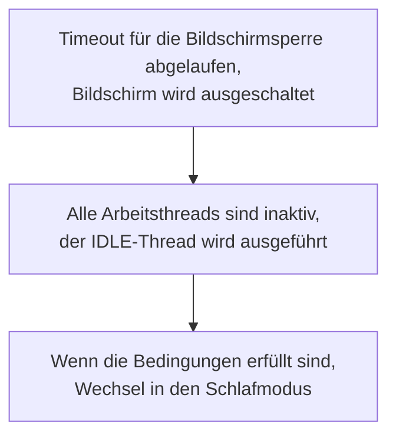
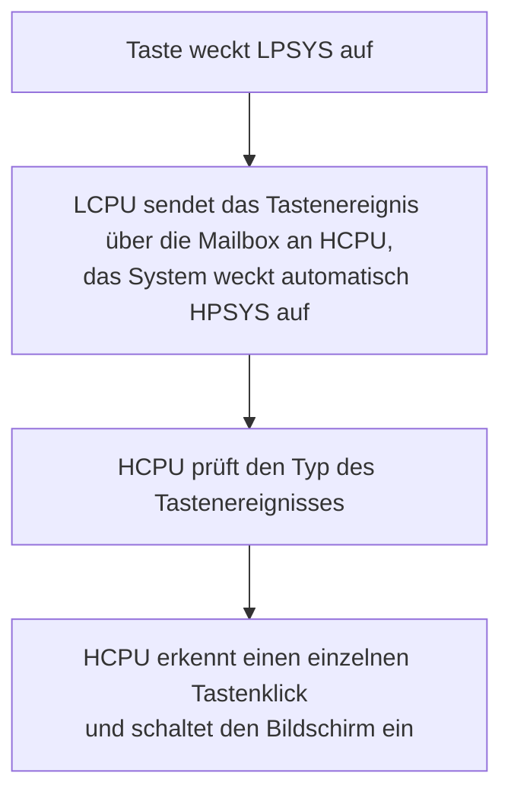

# Energiesparfunktionen konfigurieren und messen { #configure-and-measure-low-power }

Die SiFli-SDK-Leitfäden zum Energiesparen behandeln mehrere SF32-Architekturen. SF32LB52x, SF32LB55x und SF32LB56x besitzen zwei Kerne: Der HCPU in HPSYS arbeitet mit bis zu 240 MHz für rechenintensive Aufgaben, der LCPU in LPSYS mit bis zu 48 MHz für Bluetooth- und Sensoraufgaben. SF32LB57x und SF32LB58x ergänzen diese HCPU/LCPU-Architektur um einen ACPU; beim SF32LB58x arbeitet der stromsparende LCPU mit bis zu 96 MHz. Kernzahl, Taktgrenzen und Energiesparverhalten unterscheiden sich je nach Familie. Maßgeblich ist daher der SDK-Leitfaden für das Zielgerät.

## Das Energiemanagement-Framework konfigurieren { #configure-the-power-management-framework }

Führen Sie aus dem Projektverzeichnis aus:

```bash
sdk.py menuconfig
```

Die folgenden menuconfig-Einstellungen stammen aus dem SF32LB52x-Quellleitfaden. Namen und verfügbare Optionen der Energiesparmodi können je nach Familie und SDK-Version abweichen. Prüfen Sie sie daher vor der Übernahme anhand der Dokumentation der Zielfamilie.

<div align="center" markdown>

<em>Tabelle: Menuconfig-Beispiel für Energiesparen beim SF32LB52x</em>

| Menuconfig-Pfad | Symbol | Zweck |
|---|---|---|
| `Sifli middleware → Enable Low power support` | `BSP_USING_PM` | Aktiviert das SiFli-Energiemanagement-Modul. |
| `RTOS → RT-Thread Components → Device Drivers → Using Power Management device drivers → Select PM Mode → Enable Deep Mode` | `PM_DEEP_ENABLE` | Aktiviert die Unterstützung für Deep Sleep. |
| `Sifli middleware → Enable Low power support → Enable PM Debug` | `BSP_PM_DEBUG` | Gibt Energiemanagement-Übergänge aus; für endgültige Strommessungen deaktivieren. |
</div>

Die erzeugte `rtconfig.h` enthält normalerweise `RT_USING_PM`, `BSP_USING_PM` und das ausgewählte Modussymbol. Beginnen Sie mit `example/pm/classical` als funktionierende Referenz. Um die Funktion zu deaktivieren, machen Sie dieselbe Menuconfig-Auswahl rückgängig.

Die folgenden Abbildungen stammen aus dem SF32LB52x-Quellleitfaden und zeigen die beiden wichtigsten Menüpositionen. Für das konkrete Projekt ist das SDK-Menü der Zielfamilie maßgeblich.

{ loading="lazy" }
<div align="center"><em>Abbildung: Beispiel für SF32LB52x aus dem Quellleitfaden — `BSP_USING_PM` unter Sifli middleware → Enable Low power support aktivieren.</em></div>

{ loading="lazy" }
<div align="center"><em>Abbildung: Beispiel für SF32LB52x aus dem Quellleitfaden — `PM_DEEP_ENABLE` unter RTOS → RT-Thread Components → Device Drivers aktivieren.</em></div>

## Eine Weckquelle auswählen { #select-a-wake-source }

Verwenden Sie die `pinmux.c`/`drv_io.c` des Boards sowie die APIs aus dem passenden SDK-Beispiel.

<div align="center" markdown>

<em>Tabelle: Aufwachverhalten aus Deep Sleep, Standby und Hibernate nach Familie</em>

| Familie | Aufwachen aus Deep Sleep oder Standby | Aufwachen aus Hibernate |
|---|---|---|
| SF32LB52x | In Deep Sleep können alle Pins das System über `WSR_GPIO1` aufwecken; eine zusätzliche Auswahl des Aufwachpins ist nicht erforderlich. HCPU und LCPU können unabhängig voneinander schlafen. | Konfigurieren Sie den PMU-Aufwachpin und -pegel, bevor Sie `HAL_PMU_EnterHibernate()` aufrufen. |
| SF32LB55x | Verwenden Sie die AON-Aufwachpin-Zuordnung der 55x-Familie. | Im Hibernate-Modus können nur die LCPU-Aufwachpins `PIN0`–`PIN5` aufwecken. Verwenden Sie `HAL_PMU_EnablePinWakeup()` mit einer für 55x gültigen Pinnummer. Diese Pins sind im Hibernate-Modus schwebende Eingänge; sehen Sie bei Bedarf einen externen Pull-up- oder Pull-down-Widerstand vor. |
| SF32LB56x | Verwenden Sie die familienspezifische HPAON/LPAON-Aufwachpin-Zuordnung. | Die PMU unterstützt zwei Weckquellen, `PIN0` und `PIN1`, die einem HCPU- oder LCPU-Aufwachpin zugeordnet werden können. Siehe das PMU-Zuordnungsbeispiel unten. |
| SF32LB57x | Verwenden Sie die familienspezifische HPAON/LPAON-Aufwachpin-Zuordnung. | Die PMU unterstützt zwei Weckquellen, `PIN0` und `PIN1`; der Hibernate-Aufwachpin-Index reicht von 0 bis 13. Ordnen Sie jede Quelle dem vorgesehenen HCPU- oder LCPU-Aufwachpin zu. |
| SF32LB58x | Verwenden Sie die familienspezifische HPAON/LPAON-Aufwachpin-Zuordnung. | Die PMU unterstützt zwei Weckquellen, `PIN0` und `PIN1`, die einem HCPU- oder LCPU-Aufwachpin zugeordnet werden können. Siehe das PMU-Zuordnungsbeispiel unten. |
</div>

Für Hibernate bei SF32LB52x, SF32LB56x, SF32LB57x und SF32LB58x ordnet das folgende Beispiel einen GPIO der PMU-Weckquelle `PIN0` zu. Es gilt nicht für SF32LB55x; dort ist das separate, in der Tabelle beschriebene Verfahren zu verwenden. Beim SF32LB57x reicht der PMU-Aufwachpin-Index von 0 bis 13. Prüfen Sie die gewählte Pin-Zuordnung anhand des Benutzerhandbuchs und des Board-Designs.

```c
HAL_PMU_SelectWakeupPin(0,
    HAL_HPAON_QueryWakeupPin(hwp_gpio1, BSP_KEY1_PIN));
HAL_PMU_EnablePinWakeup(0, AON_PIN_MODE_HIGH);
rt_kprintf("CR:0x%x, WER:0x%x\n", hwp_pmuc->CR, hwp_pmuc->WER);
```

Das Aufwachen aus Hibernate ist ein Kaltstart mit gesetztem `PM_HIBERNATE_BOOT`; anders als bei Standby wird der unterbrochene Befehlsstrom nicht fortgesetzt. Muss ein I/O-Pin sowohl aus Standby als auch aus Hibernate wecken, konfigurieren Sie beide Pfade. Bei 55x sind die Aufwachpins in Hibernate schwebende Eingänge; sehen Sie bei Bedarf einen externen Pull-up- oder Pull-down-Widerstand vor.

## Die Schlafzustände verstehen { #understand-the-sleep-states }

<div align="center" markdown>

<em>Tabelle: Schlafmodi und typische Aufwachzeiten</em>

| SDK-Modus | CPU-/Peripheriezustand | SRAM und Weckquellen | Richtwertbereich der Aufwachzeit laut Leitfaden |
|---|---|---|---|
| `PM_SLEEP_MODE_IDLE` | CPU wartet in WFI/WFE; Takte und Peripherie laufen weiter. | SRAM bleibt zugänglich; jeder Interrupt kann aufwecken. | <1 µs |
| `PM_SLEEP_MODE_LIGHT` | Hochgeschwindigkeitstakte stoppen; das Subsystem wechselt auf 32 kHz. | LPTIM, RTC, LCPU-BLE-MAC, Mailbox oder ein Aufwachpin. | 30–100 µs |
| `PM_SLEEP_MODE_DEEP` | Wie Light Sleep, aber die Versorgung wechselt zu `RET_LDO`. | SRAM-Erhalt und Weckquellen hängen von der Familie ab; siehe die Familientabelle unten. | 100 µs–1 ms |
| `PM_SLEEP_MODE_STANDBY` | CPU und Peripherie werden zurückgesetzt oder abgeschaltet; der Pin-Zustand bleibt erhalten. | Erhaltene SRAM-Kapazität und Weckquellen hängen von der Familie ab; die Software erkennt den Start aus Standby anhand des AON-Zustands. | 1–2 ms |
| Hibernate | Alle Subsysteme werden abgeschaltet; der 32-kHz-Quarz bleibt aktiv. | RTC oder PMU-Aufwachpin; der RAM-Inhalt bleibt nicht erhalten. `HAL_PMU_EnterHibernate()`. | >2 ms |
| Shutdown | Alle Subsysteme werden abgeschaltet; RC10K bleibt aktiv. | RTC oder PMU-Aufwachpin; der RAM-Inhalt bleibt nicht erhalten und die IOs sind hochohmig. `HAL_PMU_EnterShutdown()`. | >2 ms |
</div>

<div align="center" markdown>

<em>Tabelle: Referenzwerte für SRAM-Erhalt und Aufwachzeit nach Familie</em>

| Familie | `PM_SLEEP_MODE_DEEP` | `PM_SLEEP_MODE_STANDBY` |
|---|---|---|
| SF32LB52x | HPSYS- und LPSYS-SRAM sind nicht zugänglich, bleiben aber erhalten; Aufwachen nach etwa 250 µs. | LPSYS-SRAM ist nicht zugänglich, bleibt aber vollständig erhalten; der HPSYS-SRAM ist nicht zugänglich, und nur 384 KB bleiben erhalten; Aufwachen nach etwa 1 ms. |
| SF32LB55x | HPSYS- und LPSYS-SRAM sind nicht zugänglich, bleiben aber erhalten; Aufwachen nach etwa 250 µs. | LPSYS-SRAM ist nicht zugänglich, bleibt aber vollständig erhalten; der HPSYS-SRAM ist nicht zugänglich, und nur 64 KB bleiben erhalten; Aufwachen nach etwa 1,5 ms. |
| SF32LB56x | HPSYS- und LPSYS-SRAM sind nicht zugänglich, bleiben aber erhalten; Aufwachen nach etwa 250 µs. | LPSYS-SRAM ist nicht zugänglich, bleibt aber vollständig erhalten; der HPSYS-SRAM ist nicht zugänglich, und nur 64 KB bleiben erhalten; Aufwachen nach etwa 1,5 ms. |
| SF32LB58x | HPSYS- und LPSYS-SRAM sind nicht zugänglich, bleiben aber erhalten; Aufwachen nach etwa 250 µs. | LPSYS-SRAM ist nicht zugänglich, bleibt aber vollständig erhalten; der HPSYS-SRAM ist nicht zugänglich, und nur 64 KB bleiben erhalten; Aufwachen nach etwa 1,5 ms. |

</div>

Der zitierte aktuelle SDK-Leitfaden zu niedrigem Stromverbrauch enthält keine vergleichbare Angabe zur SRAM-Erhaltung und Aufwachzeit des SF32LB57x. Übertragen Sie keine numerischen Erhaltungskapazitäten oder Zeitwerte anderer Familien auf das SF32LB57x; prüfen Sie sie anhand der SDK-Version und der Gerätedokumentation für das Zielsystem.

In dieser Tabelle entsprechen `PM_SLEEP_MODE_LIGHT`, `PM_SLEEP_MODE_DEEP` und `PM_SLEEP_MODE_STANDBY` den Modi Light Sleep, Deep Sleep und Standby.

Die familienbezogenen Werte sind Richtwerte aus den SDK-Leitfäden und keine garantierten Aufwachzeiten auf dem Board. Der SF32LB52x-Leitfaden beschreibt, dass HCPU bei vorhandenem PSRAM Daten aus dem abzuschaltenden RAM im PSRAM sichert und nach dem Aufwachen wiederherstellt; ohne PSRAM dient 64 KB Retention-RAM als Sicherungsziel. Dieser Sicherungsbereich ist nicht mit der in der Familientabelle genannten SRAM-Erhaltungskapazität gleichzusetzen (für den Standby-Modus von SF32LB52x sind beispielsweise 384 KB HPSYS-SRAM-Erhalt angegeben). Der tatsächliche Strom hängt außerdem von aktivierten Peripheriegeräten, IO-Pegeln, externem Speicher und dem Board ab.

## Takte im Wachzustand steuern { #control-clocks-while-awake }

Kann der Idle-Thread nicht in einen Schlafzustand wechseln, kann die automatische Taktreduzierung bei WFI den Stromverbrauch senken. Dies ist nur sicher, wenn EPIC, EZIP, LCDC, USB und SD im Leerlauf sind. Verwendet eine Anwendung nicht die SDK-interne Erfassung der LVGL- und Geräteaktivität, melden Sie den Beginn und das Ende der Peripherieaktivität mit `rt_pm_hw_device_start()` und `rt_pm_hw_device_stop()`. Konfigurieren Sie den Teiler mit `HAL_RCC_HCPU_SetDeepWFIDiv()`; Audioanwendungen begrenzen den reduzierten Takt normalerweise auf 48 MHz, während andere 4 MHz verwenden können. Setzen Sie `HPSYS_RCC_DBGR_FORCE_HP` entsprechend dem SDK-Leitfaden.

Verwenden Sie für aktive Arbeit `rt_pm_run_enter()`:

<div align="center" markdown>

<em>Tabelle: HCPU-Taktauswahl im Run-Modus</em>

| Modus | HCPU-Takt |
|---|---:|
| `PM_RUN_MODE_HIGH_SPEED` | 240 MHz |
| `PM_RUN_MODE_NORMAL_SPEED` | 144 MHz |
| `PM_RUN_MODE_MEDIUM_SPEED` | 48 MHz |
| `PM_RUN_MODE_LOW_SPEED` | 24 MHz |
</div>

`pm_scenario_start()`/`pm_scenario_stop()` setzen die SDK-Strategie für UI und Audio um: Sobald UI oder Audio aktiv ist, wird High Speed gewählt; ist keines der beiden Szenarien aktiv, wird Medium Speed gewählt. Messen Sie den Energieverbrauch, nicht nur den Momentanstrom, da ein niedrigerer Takt die Ausführungszeit verlängern kann.

## Reihenfolge der Subsysteme beim Übergang in den Schlafmodus { #understand-inter-subsystem-sleep-sequencing }

Nach dem Ausschalten des Bildschirms kann HPSYS in den Schlafmodus wechseln. Bei 55x/56x/58x folgt LPSYS normalerweise auf HPSYS; die 52x-Familie bildet die dokumentierte Ausnahme und erlaubt unabhängige Schlafzustände für HCPU und LCPU. Die verfügbaren Quellen belegen nicht, dass der ACPU des 57x derselben Reihenfolge folgt. Prüfen Sie dessen Subsystem-Richtlinie anhand der passenden SDK-Version. Nach dem Aufwachen startet `gui_resume` einen neuen Zyklus zur Entscheidung über das Abschalten des Bildschirms. Halten Sie einen Kern wach, solange ein gemeinsam genutztes Peripheriegerät oder eine IPC-Transaktion ihn noch benötigt.

Aktivieren Sie `BSP_PM_DEBUG` vorübergehend und suchen Sie in den Logs nach:

<div align="center" markdown>

<em>Tabelle: Log-Marker für Energiesparübergänge</em>

| Log | Bedeutung |
|---|---|
| `gui_suspend` / `gui_resume` | Übergang Bildschirm aus/an. |
| `[pm]S: mode,gtime` | Schlafmodus erreicht; `gtime` in 32 768-Hz-Takten. |
| `[pm]W: gtime` | Aus dem Schlaf aufgewacht. |
| `[pm]WSR:0x...` | Aufwachgrund; Bits anhand des Benutzerhandbuchs der Familie dekodieren. |
</div>

Tritt der erwartete Schlaf nicht ein, prüfen Sie `list_thread`, `pm_dump` und `list_timer`. Der IDLE-Thread muss ausgeführt werden; es darf keine aktive Anforderung durch `rt_pm_request(PM_SLEEP_MODE_IDLE)` bestehen. Der nächste OS-Timer darf erst nach Ablauf der Richtlinienschwelle auslösen (typischerweise 100 ms für HCPU und 10 ms für LCPU). Aufwachbedingungen müssen inaktiv und IPC-Queues geleert sein. Eine periodische Verzögerung unterhalb der Schwelle kann den Schlaf unbegrenzt verhindern.

Der Quellleitfaden zeigt außerdem die Abläufe „Bildschirm aus → IDLE → Schlaf, wenn Bedingungen erfüllt sind“ und „Taste weckt LPSYS, dann sendet LCPU das Ereignis über die Mailbox an HCPU, und das System weckt automatisch HPSYS auf“ als Diagramme. Sie helfen, die Log-Reihenfolge zu prüfen; Beschriftungen und Abläufe sind Beispiele für SF32LB52x und dürfen nicht als Grundlage dienen, um WSR-Bit-Zuordnungen anderer Familien abzuleiten.

{ loading="lazy" }
<div align="center"><em>Abbildung: SF32LB52x-Energiesparen-Debug-Schalter (`BSP_PM_DEBUG`).</em></div>

<div align="center"><em>Abbildung: SF32LB52x-Beispielablauf — vom ausgeschalteten Bildschirm bis zum Schlafmodus.</em></div>



<div align="center"><em>Abbildung: SF32LB52x-Beispielablauf — Aufwachen von LPSYS zu HPSYS.</em></div>



## Leckstrom auf Board-Ebene reduzieren { #reduce-board-level-leakage }

Messen Sie zuerst das Minimalsystem: Trennen Sie Display, Sensor, Ladeschaltung und andere entfernbare Lasten und fügen Sie sie dann nacheinander wieder hinzu. Übliche Leckstromquellen sind:

- ein externes Gerät, das weiterhin versorgt wird;
- ein Ausgang mit High-Pegel, der ein abgeschaltetes Gerät ansteuert;
- ein schwebender Eingang oder ein nicht passender Pull-up/Pull-down;
- PSRAM, NOR-/NAND-Flash, eMMC oder SDIO, das nicht in seinen Energiesparzustand versetzt wurde;
- eine 55x-USB-`PA01`-Konfiguration, die mit ihrem internen Pull-down in Konflikt steht.

Implementieren Sie board-spezifische Übergänge in `BSP_IO_Power_Down()` und `BSP_Power_Up()`, und verwenden Sie `BSP_TP_PowerDown/Up` sowie `BSP_LCD_PowerDown/Up`, wenn sich die Display- oder Touch-Versorgung unmittelbar beim Ausschalten/Einschalten des Bildschirms ändern soll. Wird XIP aus NOR-Flash ausgeführt, platzieren Sie die Flash-Schlaf-/Aufwach-Routine im Retention-RAM (`HAL_RAM_RET_CODE_SECT`).

## Ein reproduzierbares Ergebnis messen und protokollieren { #measure-and-record-a-reproducible-result }

Halten Sie für jede Messung Familie und SDK-Revision, Board-Revision, Versorgungsspannung, Messpunkt und Bandbreite des Strommessgeräts, Firmware-Konfiguration, Speicherbestückung, aktive Peripheriegeräte, Weckquelle, Schlafmodus und das Übergangslog fest. Geben Sie Zustand und Testbedingungen zusammen mit dem Strom an; vergleichen Sie keine isolierten Messwerte, die auf anderen Boards oder in anderen Modi ermittelt wurden.

Offizielle Familienquellen: [SF32LB52x](https://docs.sifli.com/projects/sdk/latest/sf32lb52x/app_note/low_power.html), [SF32LB55x](https://docs.sifli.com/projects/sdk/latest/sf32lb55x/app_note/low_power.html), [SF32LB56x](https://docs.sifli.com/projects/sdk/latest/sf32lb56x/app_note/low_power.html) und [SF32LB58x](https://docs.sifli.com/projects/sdk/latest/sf32lb58x/app_note/low_power.html). Die [PMU-API-Referenz des SDK](https://docs.sifli.com/projects/sdk/latest/en/sf32lb52x/api/hal/pmu.html) dokumentiert den Hibernate-Aufwachpin-Indexbereich des SF32LB57x.
