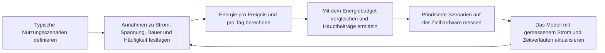

# Energiesparendes Design im Überblick { #low-power-overview }

## Zweck und Geltungsbereich { #overview }

Dieser Leitfaden zeigt, wie sich SF32-Produkte in der Praxis energiesparend auslegen lassen: Welche Betriebsmodi gibt es, welche Komponenten belasten den Akku und wie muss die Firmware aufgebaut sein, damit das System möglichst lange in einem sparsamen Zustand bleibt? Der Energiebedarf ist eine Systemeigenschaft. Entscheidungen zu Bluetooth, Grafik, Audio und KI werden deshalb gemeinsam betrachtet.

Die SiFli-SDK-Dokumentation beschreibt RT-Thread-basierte **PM-Middleware (Power Management)** für bestimmte Zielgeräte, darunter SF32LB52x. Verfügbare Modi und Weckverhalten können sich je nach Gerät und SDK-Konfiguration unterscheiden; maßgeblich ist die Dokumentation des jeweiligen Geräts. Bei Produktfamilien, deren SDK die Aufgaben des Bluetooth-Controllers einem separaten Prozessor zuweist (siehe [Bluetooth-Prozessorarchitektur](../bluetooth/processor.md)), kann der separate Prozessor Funkereignisse bearbeiten, ohne die Anwendungs-CPU jedes Mal aufzuwecken. Ob die Anwendungs-CPU schlafen kann, hängt von der Aufgabenverteilung, konfigurierten Weckquellen und der Inter-Prozessor-Kommunikation ab und muss am Zielgerät geprüft werden.

Diese Seite hilft, ein Ziel für die Akkulaufzeit in konkrete Firmware- und Hardwareentscheidungen zu übersetzen und durch Messungen zu belegen. Sie richtet sich an Entwickler, die vernetzten Standby, Displayverhalten, Audio, Sensorik, KI und Reaktionszeit gegeneinander abwägen müssen. Energiesparen ist mehr als ein einzelner API-Aufruf für den Schlafmodus.

## Zuerst das Energiebudget des Produkts definieren { #define-the-products-power-budget-first }

Definieren Sie vor der Implementierung des Energiemanagements, was das Produkt erreichen soll:

- Angestrebte Akkulaufzeit (Stunden, Tage oder Wochen) und Akkukapazität.
- Erwarteter Zeitanteil je Betriebszustand: Wie viel Zeit pro Tag verbringt das Gerät in aktiver Nutzung, im vernetzten Leerlauf oder vollständig im Schlafmodus?
- Welche Ereignisse müssen das System aufwecken, und wie schnell?
- Welche Subsysteme müssen dauerhaft aktiv bleiben, etwa eine Bluetooth-Verbindung, ein ständig eingeschaltetes Display (Always-on-Display) oder eine Sprachaktivierung? Welche können dagegen vollständig ereignisgesteuert arbeiten?
- Ladeverhalten und erwartete Ladezyklen, sofern sie für das Energiemanagement des Produkts relevant sind.

Diese Ziele sollten früh in die Architekturentscheidungen einfließen, etwa in die Wahl des Chips und des Displaytyps. Dazu gehört auch die Frage, ob sich Funktionen wie eine ständig aktive Sprachsteuerung oder ein Always-on-Display überhaupt im Energiebudget unterbringen lassen.

## Energiesparmodi und das PM-Framework { #power-modes-and-the-pm-framework }

Die folgenden Kategorien sind konzeptionelle Systemzustände und keine genaue Liste der SF32-Hardwaremodi oder SDK-Enumerationswerte. Prüfen Sie in der Dokumentation des gewählten Geräts und SDK die unterstützten Modi, Weckquellen und den Zustandserhalt:

<em>Tabelle: Energiesparmodi und das PM-Framework</em>

| Modus | Typischer Zustand | Wann verwendet |
|:-----|:---------------|:----------|
| **Aktiv** | CPU läuft; benötigte Peripherie ist eingeschaltet | Bedienung der Benutzeroberfläche, aktive Bluetooth-Übertragung, Audiostreaming, Sensorverarbeitung. |
| **Leerlauf** | CPU wartet auf ein Ereignis oder einen Interrupt; der Peripheriezustand hängt vom Gerät und von der Konfiguration ab | Zwischen UI-Bildaktualisierungen oder während das System auf die nächste geplante Aufgabe oder einen aktivierten Interrupt wartet. |
| **Schlaf-/Niedrigenergiemodus** | Eine CPU oder ein Subsystem wechselt in einen unterstützten Niedrigenergiemodus; Takte, Domänen und Peripherie können je nach Modus angehalten werden oder aktiv bleiben | Vernetzter Standby oder Warten auf ein konfiguriertes Bluetooth-Ereignis, einen Sensorinterrupt oder einen Timer. |
| **Deep Sleep / Standby** | Ein gerätespezifischer, tieferer Niedrigenergiemodus; abgeschaltete Domänen, Speichererhalt und Weckverhalten unterscheiden sich je nach Gerät | Längere Leerlaufphasen, sofern der gewählte Modus und die Weckanforderungen dies zulassen. |

Die Arbeitslast lässt das System zwischen Zuständen wechseln. Eine konfigurierte Weckquelle weckt die CPU oder das Subsystem; der Ablauf zum Aufwecken und Wiederherstellen der Takte ist bausteinspezifisch. Nach Abschluss der Arbeit sollten die zuständigen Treiber oder Aufgaben alle schlafverhindernden PM-Anforderungen freigeben, damit die konfigurierte Richtlinie einen zulässigen Niedrigenergiemodus auswählen kann. Die folgende Kurve dient nur der Illustration: Sie zeigt relative Übergänge, keine konkreten Stromwerte oder Zeitangaben eines bestimmten Geräts.

 <em>Diagramm: Beispielhafter Wechsel zwischen Energiesparmodi während einer kurzen Arbeitslast</em>

Die Auswahl eines Energiesparmodus und die Schlafsperre sind unterschiedliche Mechanismen. Die SiFli-[PM-Middleware-Referenz für SF32LB52x](https://docs.sifli.com/projects/sdk/latest/en/sf32lb52x/middleware/pm.html) und der [Leitfaden zum Energiesparen für SF32LB55x](https://docs.sifli.com/projects/sdk/latest/sf32lb55x/app_note/low_power.html) dokumentieren, dass `rt_pm_request(PM_SLEEP_MODE_IDLE)` den Eintritt in LIGHT, DEEP und STANDBY bis zum passenden Aufruf von `rt_pm_release(PM_SLEEP_MODE_IDLE)` sperrt; die Anforderung wählt keinen tieferen Modus aus.

Für die Umsetzung gilt der offizielle Leitfaden der jeweiligen Familie: [SF32LB52x](https://docs.sifli.com/projects/sdk/latest/en/sf32lb52x/app_note/low_power.html), [SF32LB55x](https://docs.sifli.com/projects/sdk/latest/sf32lb55x/app_note/low_power.html), [SF32LB56x](https://docs.sifli.com/projects/sdk/latest/sf32lb56x/app_note/low_power.html) oder [SF32LB58x](https://docs.sifli.com/projects/sdk/latest/sf32lb58x/app_note/low_power.html). Verfügbare Modi, Eintrittsbedingungen, Weckquellen und der Umfang der Zustandserhaltung hängen von Chipfamilie, Board und SDK-Konfiguration ab. Der [SF32LB52x-Leitfaden zum Energiesparen](https://docs.sifli.com/projects/sdk/latest/en/sf32lb52x/app_note/low_power.html) enthält ein Hibernate-Weckpin-Beispiel, das ausdrücklich für 58x/56x/52x/57x gruppiert ist. Die gemeinsame SDK-[HAL-PMU-API-Referenz](https://docs.sifli.com/projects/sdk/latest/en/sf32lb52x/api/hal/pmu.html) nennt für SF32LB57x den von `HAL_PMU_EnablePinWakeup()` verwendeten Indexbereich von 0 bis 13. Diese Quellen belegen nur diese Pin-Konfiguration; sie belegen nicht, dass die Verfügbarkeit der RT-Thread-Modi, die Schwellenwerte der PM-Richtlinie oder das Verhalten beim Zustandserhalt von 52x auch für 57x gelten. Prüfen Sie diese Punkte in der Dokumentation des konkreten SDK und Geräts. Eine konfigurierte Richtlinie kann grundsätzlich nur dann einen tieferen zulässigen Zustand auswählen, wenn Leerlaufintervall und weitere Eintrittsbedingungen dies erlauben. Eine nicht freigegebene Anforderung kann das System in einem flacheren Zustand als vorgesehen halten.

## Hauptverbraucher in einem SF32-Produkt { #what-drains-power-on-an-sf32-product }

Jedes Subsystem hat ein eigenes Verbrauchsprofil:

<em>Tabelle: Hauptverbraucher in einem SF32-Produkt</em>

| Subsystem | Wichtigster Einfluss auf den Energieverbrauch | Leitfaden |
|:----------|:--------------------|:------|
| **CPU** | Aktive Ausführungszeit, nicht nur Taktgeschwindigkeit | Dieser Leitfaden |
| **Bluetooth-Funk** | Advertising-Intervall, Verbindungsintervall, Slave-Latenz (Slave Latency), Sendeleistung | [Bluetooth-Übersicht](../bluetooth/overview.md#advertising-and-connection-parameters) |
| **Display** | Aktualisierungsfrequenz, Vollbild- oder Teilaktualisierung, Hintergrundbeleuchtung | [Display-Controller: Teilaktualisierung](../graphics/display-controller.md#partial-refresh-and-dirty-regions) |
| **Audio-Codec/DMA** | Aktive Sitzungszeit, Abtastrate und ob der Codec zwischen Sitzungen eingeschaltet bleibt | [Audioübersicht](../audio/overview.md#power-considerations-for-audio) |
| **KI-Inferenz** | Inferenzhäufigkeit und Fenstergröße, nicht allein die Modellgröße | [KI-Übersicht](../ai/overview.md#power-aware-inference-scheduling) |
| **Speichersystem** | Cache-/PSRAM-Aktivität, wie oft Code aus langsamem externem Speicher ausgeführt wird | [STAR-MC1](../architecture/star-mc1.md) |
| **Sensoren** | Polling-Häufigkeit vs. interruptgesteuerte Abtastung | Dieser Leitfaden |

Keine einzelne Maßnahme löst alle diese Probleme. Bei einem realen Produkt müssen Sie den Beitrag jedes Subsystems abstimmen und anschließend die Gesamtwirkung prüfen, denn alle Subsysteme beeinflussen gemeinsam, wie tief das System schlafen kann.

## Firmware für einen sparsamen Schlafbetrieb gestalten { #sleep-aware-firmware-design }

Die größten Einsparungen ergeben sich meist aus der Firmware-Architektur und nicht aus raffinierten Low-Level-Tricks:

- **Interrupts und Ereignisse statt Polling verwenden.** Eine Polling-Schleife hält die CPU auch dann aktiv, wenn keine Arbeit ansteht.
- **Arbeit bündeln.** Sammeln Sie Sensorwerte, Bluetooth-Ereignisse oder Audioblöcke, wenn es die Latenz zulässt, und verarbeiten Sie sie gemeinsam, statt das System für jedes Ereignis einzeln aufzuwecken.
- **Schlafverhindernde PM-Anforderungen zeitnah freigeben.** Hält ein Treiber oder eine Aufgabe eine PM-Anforderung aufrecht, die den Eintritt in einen tieferen Niedrigenergiemodus verhindert, sollte die zugehörige Anforderung freigegeben werden, sobald diese Sperre nicht mehr benötigt wird. Andernfalls kann das System in einem flacheren Zustand als vorgesehen bleiben.
- **UI- und Audiopfade ereignisgesteuert statt timerbasiert auslegen**, sofern das Framework dies ermöglicht.
- **Timer überprüfen.** Ein periodischer Timer plant künftige Arbeit und kann das System aufwecken oder das für die PM-Richtlinie verfügbare Leerlaufintervall verkürzen. Mehrere scheinbar harmlose Timer können daher die Zeit in tieferen Niedrigenergiemodi verringern.

## Mit einem validierten Energiesparbeispiel beginnen { #start-from-a-verified-power-example }

Wählen Sie ein SDK-Beispiel aus, das die größte Unsicherheit beim Energiebedarf Ihres Produkts adressiert, bevor Sie dessen Akkulaufzeit abschätzen. [Energiesparbeispiele des SiFli-SDK](low-power-sdk-examples.md) ordnet die offiziellen PM-, GPIO-, Prozessor-, Bluetooth-, Display-, GUI-, Bildschirmaktualisierungs- und Raise-to-Wake-Beispiele den jeweiligen Szenarien zu. Außerdem wird erläutert, welche Annahmen zu Versorgung, Entwicklungsboard, Konfiguration, Weckquelle, externer Beschaltung und Arbeitslast Sie überprüfen müssen, bevor Sie ein Beispiel als Nachweis für Ihr Produkt heranziehen.

## Bluetooth-Stromverbrauch optimieren { #bluetooth-power-tuning }

Verbindungs- und Advertising-Parameter bieten die wichtigsten Stellschrauben für den Bluetooth-Energiebedarf (siehe die vollständige Tabelle in der [Bluetooth-Übersicht](../bluetooth/overview.md#advertising-and-connection-parameters)):

- Erhöhen Sie bei überwiegend inaktiven Verbindungen das Verbindungsintervall und die Slave-Latenz (Slave Latency).
- Senken Sie die Sendeleistung auf den niedrigsten Wert, der die erforderliche Reichweite noch gewährleistet.
- Konfigurieren Sie Advertising weniger aggressiv, sobald ein Produkt eher mit Wiederverbindungen als mit erstmaliger Erkennung rechnet.
- Wenn das gewählte SDK Bluetooth-Controllerereignisse auf einem separaten Prozessor verarbeitet, kann die Anwendungs-CPU zwischen Verbindungsereignissen schlafen, sofern keine Anwendungstask, Weckquelle oder Inter-Prozessor-Nachricht sie benötigt. Weckt der Anwendungscode sie bei jedem Bluetooth-Callback, verringert das diesen Vorteil. Prüfen Sie die Kern- und Aufgabenverteilung des Zielgeräts.

Wie sich der tatsächliche Energieverbrauch szenarioweise mit Classic Bluetooth allein, mit BLE allein und mit beiden gemeinsam im Dual-Mode-Betrieb messen lässt, beschreibt [Bluetooth-Leistungsaufnahme messen und analysieren](../bluetooth/bluetooth-low-power-profiling.md).

## Energiebedarf von Display und Hintergrundbeleuchtung { #display-and-backlight-power }

Bei Wearables und Handgeräten sind Display und Hintergrundbeleuchtung häufig der größte einzelne Stromverbrauchsposten:

- Aktualisieren Sie nur geänderte Bildbereiche statt den gesamten Bildschirm neu zu zeichnen, sofern Display und Benutzeroberfläche es unterstützen (siehe [Display-Controller: Teilaktualisierung](../graphics/display-controller.md#partial-refresh-and-dirty-regions)).
- Senken Sie bei Inaktivität die Displayhelligkeit oder schalten Sie – sofern vorhanden – die Hintergrundbeleuchtung aus. Beenden Sie Animationen, sobald das Display gedimmt oder verdeckt ist.
- Vergleichen Sie für ein Always-on-Display Panels wie EPD, JDI/Memory-in-Pixel, AMOLED und TFT anhand des gemessenen Energiebedarfs in diesem Modus und der erforderlichen Nutzererfahrung. Wählen Sie Panel und Betriebsstrategie passend zum Budget, statt den normalen aktiven Anzeigemodus einfach dauerhaft laufen zu lassen.
- Führen Sie das Always-on-Display als eigenen Posten im Energiebudget, denn es verändert grundlegend, was „Leerlauf“ für das Produkt bedeutet.

## Energiebedarf von KI und Sensoren reduzieren { #ai-and-sensor-power-tuning }

On-Device-Inferenz und Sensorabtastung sollten gezielt geplant werden, statt kontinuierlich zu laufen:

- Führen Sie Inferenz nur dann aus, wenn neue und relevante Daten vorliegen, statt unabhängig von den Eingangsdaten in festen Zeitabständen.
- Verlagern Sie leichte, dauerhaft benötigte Sensorverarbeitung – sofern Gerät und SDK es unterstützen – auf den Niedrigenergieprozessor. So muss der Hauptprozessor nicht für jeden Messwert aufwachen.
- Messen Sie die **Energie pro Inferenz oder Abtastung** statt nur der Latenz. Eine schnellere Verarbeitung spart nur dann Energie, wenn das System dadurch früher in den Schlafmodus zurückkehren kann.

Siehe die [KI-Übersicht](../ai/overview.md#power-aware-inference-scheduling) für den Kompromiss zwischen Genauigkeit, Latenz und Stromverbrauch im Detail.

## Speicher und Takt { #memory-and-clock-considerations }

Der Speicher, aus dem Code ausgeführt wird, beeinflusst sowohl die Leistung als auch den Energiebedarf. Bei SF32-Geräten, die entsprechende Cache-Funktionen implementieren und aktivieren, können Instruktions- und Datencaches Wartezeiten bei Flash- oder PSRAM-Zugriffen verringern. Eine kürzere aktive Ausführungszeit lässt dem System mehr Zeit zum Schlafen. Weitere Hinweise zu Caches und zum Speichersystem enthält der Artikel [STAR-MC1](../architecture/star-mc1.md#memory-system-optimization).

Über die CPU selbst hinaus:

- Externer PSRAM und Flash haben eigene Leistungsprofile im aktiven Zustand und im Standby. Prüfen Sie im Datenblatt den Energiebedarf beim Zugriff und die Anforderungen an den Datenerhalt, insbesondere wenn große Puffer im Schlafmodus gültig bleiben müssen.
- Die Wahl der Taktquelle – Quarz oder interner Oszillator – sowie die aktiv bleibenden PLL- und Taktdomänen beeinflussen sowohl die Wecklatenz als auch die Leistungsaufnahme im Schlafmodus.
- Eine niedrigere CPU-Frequenz kann in weniger anspruchsvollen Phasen Energie sparen. Stellen Sie jedoch sicher, dass die aktive Zeit nicht so stark zunimmt, dass der Vorteil verloren geht. Messen Sie den tatsächlichen Energiebedarf und nicht nur den momentanen Strom.

## Hardware und RF-Auslegung { #hardware-and-rf-power-considerations }

Die Firmware kann nur innerhalb der durch die Hardware gesetzten Grenzen optimieren:

- Entscheidend ist der Wirkungsgrad von PMIC und LDO bei den tatsächlichen Lastströmen des Produkts, nicht ein Spitzenwert bei einem irrelevanten Lastpunkt.
- RF-Layout und Antennenabstimmung bestimmen mit, welche Sendeleistung für eine zuverlässige Funkreichweite erforderlich ist. Bei schlechtem RF-Design muss die Firmware möglicherweise die Sendeleistung erhöhen, was die Akkulaufzeit verkürzt. Siehe [Bluetooth-Prozessorarchitektur: RF und Takt](../bluetooth/processor.md#rf-and-clock-considerations).
- Die Quarzgenauigkeit beeinflusst die RF-Zeitreserven und wie großzügig die Firmware Überwachungs-Timeouts und Weckreserven bemessen muss.
- Sehen Sie Test- und Kalibrierzugänge für die Produktion bereits im Design vor. Die Optimierung von Stromverbrauch und RF-Eigenschaften endet oft nicht mit der ersten Hardware-Revision.

## Fallbeispiel: Display per Armbewegung aktivieren { #case-study-raise-to-wake }

Das Einschalten des Displays beim Anheben des Handgelenks (Raise-to-Wake) ist ein typisches Wearable-Szenario; die Umsetzung hängt jedoch von Sensor, Board und SDK ab. Das [Raise-to-Wake-Beispiel von SiFli für SF32LB52x](https://docs.sifli.com/projects/sdk/latest/en/sf32lb52x/example/pm/raise_wrist/README.html) ist für das Board `sf32lb52-lchspi-ulp` vorgesehen und verwendet einen LSM6DSL (Beschleunigungssensor/Gyroskop). Es erfasst alle 200 ms Beschleunigungsdaten, um das Heben und Senken des Handgelenks zu erkennen. Nach 10 Sekunden ohne Aktivität wechselt das Gerät in den Schlafmodus und wacht bei erkanntem Anheben auf, um das Display einzuschalten. Dies ist eine boardspezifische Umsetzung und kein Beleg dafür, dass andere Ziele Sensorinterrupts oder dasselbe PM-Verhalten verwenden. Unterstützt der Zielsensor Bewegungs- oder Schwellenwertinterrupts, kann die Firmware diese als konfigurierte Weckquelle nutzen und so kontinuierliches Polling durch die Anwendungs-CPU vermeiden. Andernfalls müssen Sensorabtastung und CPU-Weckvorgänge im Energiebudget berücksichtigt werden. Prüfen Sie Sensor, Board, Weckquellen und PM-Konfiguration für das konkrete Ziel.

## Vorlage für das Energiebudget { #power-budget-worksheet }

Beziffern Sie das Energieziel des Produkts, bevor Sie die Firmware optimieren. Dafür genügt meist eine einfache Übersicht:

<em>Tabelle: Vorlage für das Energiebudget</em>

| Betriebszustand | Leitfrage | Zu berücksichtigender Verbrauch |
|:------|:-----------------|:------------|
| Versand/Lagerung | Wie lange liegt das Produkt vor der ersten Nutzung? | Deep-Sleep-Strom, RTC-Datenerhalt, Leckströme externer Bauteile. |
| Vernetzter Leerlauf | Wie viele Stunden pro Tag ist das Produkt gekoppelt, aber ungenutzt? | BLE-Intervall, Slave-Latenz, Sensorinterrupts, Stromaufnahme bei ausgeschaltetem Display. |
| Kurzer Blick aufs Display | Wie oft und wie lange wird das Display aktiviert? | Hintergrundbeleuchtung, Teilaktualisierung, kurze CPU/UI-Lastspitze, Touchcontroller. |
| Audiositzung | Wie lange wird wiedergegeben, aufgenommen oder telefoniert? | Codec, DMA, Bluetooth-Audio, Speicherbandbreite. |
| KI-Ausführung | Wie oft wird eine Inferenz ausgeführt? | Sensorerfassung, Vorverarbeitung, Beschleuniger-/CPU-Zeit, Nachverarbeitung. |
| OTA/Wartung | Wie oft sind Aktualisierungen zu erwarten? | Kurzes Verbindungsintervall, Löschen/Beschreiben des Flash-Speichers, Speicher für Rollbacks. |

Schätzen Sie für eine Gruppe sich gegenseitig ausschließender Betriebszustände `average current = state current x duty cycle` und addieren Sie die Zustandsbeiträge. Gleichzeitige Lasten gehören in die Gesamtsumme des jeweiligen Szenarios, damit sich überlappende Zustände nicht doppelt zählen. So werden Entwurfsprobleme früh sichtbar: Ein Ziel von 20 µA im Schlafmodus nützt wenig, wenn das Display häufig mit hoher Helligkeit leuchtet oder eine Inferenzschleife in festen Abständen aktiv ist.

## Energieprofil erstellen: modellieren, messen, aktualisieren { #power-profiling-model-measure-update }

Ein Energieprofil macht aus dem Budget einen wiederholbaren Entwicklungsprozess. Definieren Sie typische Nutzungsszenarien, erfassen Sie Spannung und Strom an der jeweiligen Versorgungsgrenze und berücksichtigen Sie Dauer und Häufigkeit jeder Last. Berechnen Sie die Energie über die Zeit und rechnen Sie Messwerte einzelner Versorgungsschienen unter Berücksichtigung der Wandlungsverluste auf den Akku um; addieren Sie Ströme von Schienen mit unterschiedlichen Spannungen nicht direkt. Daraus lassen sich die durchschnittliche Stromaufnahme auf der Akkuseite, der tägliche Ladungsbedarf und die Akkulaufzeit abschätzen. Außerdem zeigt das Profil, welche Szenarien zuerst gemessen und optimiert werden sollten.

<em>Diagramm: Regelkreis zur Erstellung eines Energieprofils</em>

Ein Energieprofil liefert eine Schätzung, keine Messung. Der [Online Power Profiler for Bluetooth LE](https://devzone.nordicsemi.com/power/w/opp/2/online-power-profiler-for-bluetooth-le) von Nordic folgt demselben Prinzip: Das Werkzeug verwendet aus Messungen abgeleitete Modelle, liefert aber weiterhin Erwartungswerte und keine Messung eines konkreten Produkts. Der tatsächliche Strom hängt unter anderem vom Silizium, dem Board-Layout, der Akkuspannung, der Temperatur, den RF-Bedingungen, dem Firmware-Timing und dem Anwendungsszenario ab.

Erfassen Sie für jedes Szenario die Annahmen, die die Energie wesentlich beeinflussen:

- Welche Subsysteme sind eingeschaltet, und in welchen Energiesparmodus wechselt die MCU tatsächlich?
- Wie hoch ist der Strom am Akkueingang oder an den einzelnen geregelten Versorgungsschienen?
- Wie lange dauert der Vorgang, und wie oft tritt er an einem typischen Tag auf?
- Welche Stromspitzen sind zu erwarten, und welche weisen auf unbeabsichtigte Aktivität oder einen ausgebliebenen Wechsel in den Schlafmodus hin?

Nutzen Sie die Schätzung, um die größten Verbraucher zu ermitteln, und überprüfen Sie diese Szenarien auf der Hardware, bevor Sie eine Aussage zur Akkulaufzeit treffen. Der Artikel [Stromverbrauchsanalyse einer Smartwatch](smartwatch-power-profiling.md) führt die Methode anhand eines Tagesnutzungsmodells vor. [Energieverbrauch messen und validieren](measurement-and-validation.md) beschreibt den reproduzierbaren Messablauf.

## PM-Anforderungen und Weckquellen prüfen { #pm-ownership-and-wake-source-review }

Ein zuverlässiges Energiespardesign braucht eine klar zugeordnete Zuständigkeit für jede Weckquelle und jede Anforderung, die den Schlaf verhindert. Prüfen Sie im Design-Review:

<em>Tabelle: PM-Anforderungen und Weckquellen prüfen</em>

| Prüfpunkt | Prüffrage | Mögliches Problem |
|:-----|:----------------|:-------------|
| Verantwortlicher für PM-Anforderungen/Sperren | Welcher Treiber oder welche Aufgabe kann einen tieferen Zustand verhindern? | Eine nicht freigegebene Anforderung kann das System in einem flacheren Zustand halten. |
| Freigabebedingung | Welches Ereignis oder welcher Fehlerpfad stellt sicher, dass die zugehörige Anforderung freigegeben wird? | Eine aktive Anforderung kann tieferen Schlaf verhindern und den Verbrauch erhöhen. |
| Weckquelle | Welcher vom Zielgerät unterstützte und konfigurierte Interrupt, Timer, BLE-Vorgang oder Sensor kann die CPU wecken? | Unerwartete periodische Weckvorgänge können den größten Anteil am Ruhestrom ausmachen. |
| Taktabhängigkeit | Welche Taktdomäne muss aktiv bleiben? | Ein Peripheriegerät verhindert unbemerkt den Wechsel in einen tieferen Schlafmodus. |
| Speichererhalt | Welche Speicherinhalte oder Zustände müssen den Schlaf überdauern? | Zu viele erhaltene Inhalte erhöhen den Strom; zu wenige beeinträchtigen das Weckverhalten. |

Erfassen Sie beim Debuggen die konfigurierte PM-Richtlinie, aktive Anforderungen, die tiefere Modi verhindern, und den zuletzt vom SDK oder seinen Logs gemeldeten Niedrigenergiemodus. Erreicht das System einen flacheren Zustand als erwartet, sind diese Angaben oft aussagekräftiger als ein einzelner Strommesswert.

## Leistungsaufnahme in der Praxis messen { #measuring-power-in-practice }

Nicht schätzen, sondern messen. Ein einfacher Messaufbau zur Stromvalidierung umfasst:

- Eine Strommesssonde oder ein in Reihe geschaltetes Leistungsmessgerät zwischen Akku beziehungsweise Netzteil und Entwicklungsboard.
- Testszenarien, die der tatsächlichen Produktnutzung entsprechen: vernetzter Leerlauf, Bedienung der Benutzeroberfläche, Audiowiedergabe, KI-Inferenz und kombinierte Worst-Case-Last.
- Eine Protokollierung oder Markierung der Firmware-Zustände (aktiv, Leerlauf, Schlafmodus) parallel zum Stromverlauf, damit sich Stromspitzen bestimmten Codepfaden zuordnen lassen.

Die SiFli-SDK-Dokumentation enthält Beispiele zur Leistungsaufnahme für ausgewählte Geräte und Boards, etwa für AMOLED- und JDI-Displays, GPIO, BLE/Classic Bluetooth und CoreMark-ähnliche CPU-Last. Prüfen Sie in der Dokumentation des Ziel-SDKs und Boards, ob die Beispiele verfügbar sind und wie sie eingerichtet werden. Geeignete Beispiele können als Messvorlage und zur Plausibilitätsprüfung dienen, garantieren aber nicht die Leistungsaufnahme des Produkts.

## Matrix zur Validierung des Energieverbrauchs { #power-validation-matrix }

Verwenden Sie reproduzierbare Testszenarien, damit sich Messwerte verschiedener Firmware-Versionen vergleichen lassen. Messen Sie mindestens:

<em>Tabelle: Matrix zur Validierung des Energieverbrauchs</em>

| Testszenario | Zu aktivierende Funktionen | Erfolgskriterium |
|:-----------|:---------------|:---------------|
| Start bis Leerlauf | Normaler Systemstart, keine Kopplung, Display ausgeschaltet | Außer den benötigten Timern läuft keine regelmäßige Hintergrundarbeit. |
| Vernetzter Leerlauf | BLE-Verbindung mit Bonding und den für die Produktion vorgesehenen Verbindungsparametern | Prüfen Sie, ob die laut Gerätearchitektur vorgesehene CPU bzw. der vorgesehene Kern zwischen Verbindungsereignissen den Zielmodus erreicht; kontrollieren Sie Bluetooth-Aufgabenverteilung und Weckverhalten. |
| Kurzer Blick aufs Display | Display aktivieren, typischen Bildschirm aktualisieren, Dimm-Timeout abwarten | Hintergrundbeleuchtung und Animation enden nach dem Timeout. |
| Audio aktiv | Wiedergabe- oder Aufnahmepfad aktiv | Kein Pufferunterlauf; der Codec wird nach der Sitzung abgeschaltet. |
| KI aktiv | Echte Sensordaten und Inferenz ausführen | Der Energiebedarf pro Inferenz entspricht dem Budget. |
| Worst Case | Bluetooth, Display und – sofern vorgesehen – Audio/KI gleichzeitig aktiv | Keine Verbindungsabbrüche oder Funktionsstörungen; Temperatur- und Leistungsgrenzwerte werden eingehalten. |

Dokumentieren Sie Firmware-Version, Board-Revision, Akku- oder Versorgungsspannung, Temperatur, Antennen- und Gehäusekonfiguration sowie das Testskript. Ohne diese Angaben lassen sich Messwerte nur schwer vergleichen und leicht falsch interpretieren.

## Hohe Stromaufnahme systematisch untersuchen { #debugging-high-power-consumption }

<em>Tabelle: Ursachen einer zu hohen Stromaufnahme finden</em>

| Symptom | Wahrscheinliche Ursache |
|:--------|:----------------------|
| Gerät erreicht Deep Sleep nie | Ein Treiber oder eine Aufgabe gibt eine PM-Anforderung nicht frei. Prüfen Sie auf fehlende Freigaben. |
| Hohe Stromaufnahme trotz inaktiver Bluetooth-Verbindung | Slave-Latenz ist nicht eingestellt oder die Anwendung wacht bei jedem Verbindungsereignis auf. |
| Stromspitzen treten gleichzeitig mit Displayaktivität auf | Es wird der gesamte Bildschirm statt nur geänderter Bereiche aktualisiert, oder die Hintergrundbeleuchtung bleibt auf voller Helligkeit. |
| Stromaufnahme steigt nach einem Firmware-Update | Ein neuer Timer, eine Polling-Schleife oder ein dauerhaft aktives Peripheriegerät wurde ohne Prüfung des Energiebedarfs eingeführt. |
| Gute Messwerte auf dem Labortisch, aber hoher Verbrauch im Produkt | Eine Fehlanpassung von RF-Layout oder Antenne erzwingt eine höhere Sendeleistung; alternativ wirken sich Wärme oder Gehäuse auf das Ergebnis aus. |
| Audio- oder KI-Funktionen belasten den Akku übermäßig | Der Codec oder Inferenzpfad bleibt zwischen den Sitzungen aktiv. Siehe [Audioübersicht](../audio/overview.md#power-considerations-for-audio) und [KI-Übersicht](../ai/overview.md#power-aware-inference-scheduling). |

## Häufige Fehler { #common-mistakes }

- Energieoptimierung als späten Feinschliff statt von Anfang an als Entwurfsanforderung behandeln.
- Sensoren, Bluetooth-Status oder Timer regelmäßig abfragen, statt Interrupts und Ereignisse zu nutzen.
- Eine PM-Anforderung nach Abschluss der zugehörigen Arbeit aktiv lassen.
- Bei kleinen UI-Änderungen den gesamten Bildschirm neu zeichnen.
- Mangelhaftes RF-Layout nicht beheben und stattdessen die Firmware-Sendeleistung erhöhen.
- Nur den Momentanstrom messen, statt den Energiebedarf in einem realistischen Nutzungsszenario zu erfassen.
- Messungen auf dem Labortisch durchführen, aber das fertige Produkt im endgültigen Gehäuse mit realer Antenne und Akku nicht prüfen.

## Checkliste für die Inbetriebnahme { #bring-up-checklist }

- [ ] Legen Sie das Ziel für die Akkulaufzeit, die Zeitanteile je Betriebszustand und die erforderlichen Weckquellen fest.
- [ ] Ermitteln Sie, welche Subsysteme dauerhaft aktiv bleiben müssen und welche ereignisgesteuert arbeiten können.
- [ ] Stellen Sie sicher, dass jeder Treiber und jede Aufgabe die PM-Anforderung nach der Nutzung zeitnah freigibt.
- [ ] Stimmen Sie die Bluetooth-Advertising- und Verbindungsparameter auf das tatsächliche Nutzungsprofil des Produkts ab.
- [ ] Prüfen Sie, ob das Display – sofern unterstützt – teilweise aktualisiert wird und die Hintergrundbeleuchtung dem Produktverhalten entspricht.
- [ ] Überprüfen Sie alle periodischen Timer und entfernen oder bündeln Sie unnötige Timer.
- [ ] Richten Sie die Strommessung ein und validieren Sie aktive Zustände, Leerlauf und Schlafmodus einzeln.
- [ ] Testen Sie die kombinierte Worst-Case-Last (Bluetooth, Display sowie gegebenenfalls Audio und KI) und prüfen Sie, ob das Energiebudget eingehalten wird.
- [ ] Prüfen Sie den Energiebedarf nach jeder wesentlichen Firmware-Änderung erneut, nicht erst am Projektende.

## Wichtige Erkenntnisse { #key-takeaways }

- Der Energiebedarf ist eine Systemeigenschaft: Bluetooth, Display, Audio, KI und Speicher beeinflussen, wie tief und wie oft das Gerät schlafen kann.
- Die konfigurierte PM-Richtlinie wählt unter den zulässigen Niedrigenergiemodi. Eine nicht freigegebene Anforderung, die tiefere Modi verhindert, kann das System in einem flacheren Zustand als vorgesehen halten.
- Ereignis- und interruptgesteuerte Abläufe sind beim Energiesparen fast immer besser als regelmäßiges Polling.
- Bei vernetzten Wearables sind Bluetooth-Verbindungsparameter und Displayaktualisierung meist zwei der wirksamsten Stellschrauben.
- Messen Sie den Energiebedarf mit realistischen kombinierten Lasten auf echter Hardware im endgültigen Gehäuse. Messungen auf dem Labortisch und Messungen einzelner Subsysteme bilden den Verbrauch im fertigen Produkt oft nicht ausreichend ab.

Wie sich der Akkustand aus der Spannung abschätzen lässt, beschreibt [Schätzung des Akkuladezustands](battery-capacity-calculation.md).
