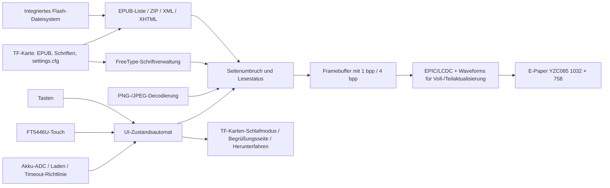

# EPUB-Reader mit E-Paper-Display auf SF32 { #sf32-e-paper-epub-reader }

## Was ist EPD Reader? { #what-is-epd-reader }

[OpenSiFli EPD Reader](https://github.com/OpenSiFli/EPD_Reader) passt [atomic14/diy-esp32-epub-reader](https://github.com/atomic14/diy-esp32-epub-reader) an die SiFli-Hardware `SF32-OED-EPD` an. Als Rechenkern dient SF32LB52x. EPUB-Dateien werden aus dem integrierten Dateisystem oder von einer TF-Karte gelesen, per ZIP/XML/XHTML geparst, mit FreeType-Schriften und Bilddecodern aufbereitet und anschließend mit Voll- und Teilaktualisierungs-Waveforms auf dem E-Paper-Panel dargestellt.

Die aktuelle Anwendung umfasst Ansichten für Bibliothek, Inhaltsverzeichnis, Lesen, Leseeinstellungen, Funktionseinstellungen, Begrüßungsbildschirm und ausgeschaltetes Display, niedrigen Akkustand, Laden und Herunterfahren. Sie unterstützt Tasten und Touch, chinesische und englische Texte, dynamische TTF-/OTF-Schriften, Schriftgröße und -stärke, Zeilenabstand, Ränder sowie das Speichern der Leseeinstellungen auf der TF-Karte. Um Ressourcen zu sparen, sind für die mitgelieferte chinesische Schrift standardmäßig keine separaten Fett- und Kursivschnitte aktiviert. Prüfen Sie daher mit der Zielschrift, wie die Einstellungen zur Schriftstärke tatsächlich dargestellt werden. Das Projekt ist eine vollständige Referenz für ein E-Paper-Lesegerät mit niedriger Aktualisierungsrate, aber kein Nachweis allgemeiner EPUB-Konformität und kein serienreifer E-Reader.

## Warum die SF32-Implementierung? { #why-the-sf32-implementation }

Dieser Anwendungsweg vereint Speicher des SF32LB52, EPIC/LCDC-Displaybeschleunigung, Touch, Tasten, Akkuüberwachung und Energiesparverwaltung in einer Anwendung. Für ein Produktteam ist der Nutzen mehr als die Darstellung einer einzelnen Seite: Auf unterstützter Hardware lassen sich gemeinsam Speicherbedarf des Layouts, Geisterbilder bei Voll- und Teilaktualisierung, Anpassung der Waveforms, Energieverwaltung der TF-Karte, Schriftzugriff, Bedienablauf und Schlafverhalten bewerten.

Der SiFli-Boardleitfaden verweist auf ein Beispielangebot, bestätigt jedoch nicht, dass das angebotene Board, Panel und Touchsystem der V1.1-Softwarebasis des Projekts entsprechen. Auch nennt er weder eine exakte Referenzbaugruppe noch eine separate Panel-Bezugsquelle. Angaben zur EPUB-Abdeckungsrate, zum Betriebstemperaturbereich des Panels, zur Lebensdauer im Produkteinsatz und zu den Strömen der einzelnen Betriebsarten fehlen ebenfalls. Deshalb gelten Hardware-Revision, Panel-/Touch-Kombination und Software-Commit hier als verbindliche technische Basis. Andere E-Paper-Module sind kein direkter Ersatz.

**Abgleich der Ausgangsbasis:** Der [SiFli-Leitfaden für SF32LB52-OED-6'-EPD](https://github.com/OpenSiFli/SiFli-Wiki/blob/main/source/zh_CN/board/sf32lb52x/SF32LB52-OED-6%27-EPD.md) beschreibt ein 6-Zoll-Panel OPM060DA mit 758 × 1024 Pixeln. Das Blockdiagramm zeigt außerdem die Boardpfade: eine 8-Bit-EPD-Schnittstelle im 8080-Modus, I²C-Touch, TF-Karte über SPI1, analoges Mikrofon/Audio-PA, USB-UART sowie Akku- und Ladeversorgung. Die festgelegte EPD-Reader-Konfiguration für V1.1 verwendet dagegen ein YZC085 V1.05 mit 1032 × 758 Pixeln; das Platinenfoto im Wiki ist mit V1.2 gekennzeichnet. Daraus lässt sich weder ableiten, dass OPM060DA und YZC085 austauschbar sind, noch dass V1.1 mit dem Wiki-Panel geliefert wird. Prüfen Sie die Aufdrucke auf der tatsächlichen Platine und dem Panel und verwenden Sie das passende Projektziel sowie die zugehörigen Waveform- und VCOM-Einstellungen.

**Anforderung an die Stromversorgung:** Der SiFli-Boardleitfaden verlangt, dass der Akku während des Betriebs angeschlossen bleibt; USB-C-VBUS dient zum Laden und kann das Board nicht allein betreiben. Der Leitfaden nennt 1000–1500 mAh und empfiehlt einen einzelligen Li-Po-Akku mit 1500 mAh und MX1.25-Anschluss. Das abgebildete Board ist als V1.2 gekennzeichnet, während die Projektbasis auf V1.1 zielt. Prüfen Sie daher vor der Akkuauswahl den Stromanschluss, die Polarität und die Ladegrenzen der konkreten Boardrevision.

## Ergebnis, Umfang und Eintrittskriterien { #outcome-scope-and-entry-criteria }

**Ergebnis:** Auf dem festgelegten Board `SF32-OED-EPD_V1.1` mit dem Panel YZC085 V1.05 und der konfigurierten Auflösung 1032 × 758 den Build- und Flashvorgang reproduzieren. Bibliothek, Inhaltsverzeichnis, Lesefluss, Tasten-/Touch-Eingabe, Speicherung der Einstellungen, Voll-/Teilaktualisierung, niedrigen Akkustand, Schlafmodus und Herunterfahren prüfen und anschließend die für eine Produktentscheidung erforderlichen Nachweise aufbewahren.

**Nicht abgedeckt:** Diese Seite weist keine vollständige EPUB-/CSS-/Schriftkompatibilität, keine DRM-Unterstützung, keine Waveform-Kompatibilität mit beliebigen Panels, keine kommerzielle Lesequalität, keine drahtlose Inhaltsverteilung, keine Zertifizierung und keine Serienzuverlässigkeit nach. Der fixierte Quellstand enthält Bluetooth-/PAN-Konfigurationsoptionen und eine Statusanzeige; die Upstream-README beschreibt jedoch keinen Inhaltsübertragungsweg über diese Verbindung. Die reproduzierbare Basis beschränkt sich auf lokale Dateien. Netzwerkübertragung ist nicht verifiziert und bleibt außerhalb des Umfangs.

**Eintrittskriterien:** Das Team kann SiFli-SDK-Anwendungen bauen und flashen und Boardrevision, Panelmodell, Ausrichtung des Flexkabels, Akkupolarität sowie Dateisystem der TF-Karte bestimmen. Sind Herkunft oder Hardwaredokumentation von Board und Panel unklar, tätigen Sie keine Kaufzusage, bis SiFli oder der Hardwareanbieter diese Angaben bestätigt hat.

<div align="center"><em>Tabelle: Projektbasis und Nachweise</em></div>

<div align="center" markdown>

| Bereich | Anforderung an die Basis | Vor dem Fortfahren aufzubewahrende Nachweise |
|:-----|:---------------------|:------------------------------------|
| Versionsstand | Board, Panel, Touchcontroller, Anwendungs-Commit und SDK-Submodul-Commit festlegen | Fotos, Kennzeichnungen, Konfiguration, Commits, Image-Hashes und Kabelausrichtung |
| Lesefunktion | Integrierte Beispiele, Bücher auf der TF-Karte, Inhaltsverzeichnisse, Bilder, chinesische/englische Texte und Einstellungen getrennt testen | Inhaltsmanifest, Seitenergebnisse, Protokolle und Fehlerklassifizierung |
| Displayanforderungen | Waveform, VCOM, Auflösung, Bus und Temperatur müssen zum Panel passen | Voll-/Teilaktualisierung, Geisterbilder, Aktualisierungszeit, Temperatur und Strommessungen |
| Produktvalidierung | Lizenzen, Inhaltsrechte, Stromversorgung, Zuverlässigkeit, Funk und Vorschriften separat prüfen | Risikoregister, Verantwortliche und Entscheidung zum Fortfahren oder Stoppen |

</div>

## Hardware- und Software-Spezifikationen { #hardware-and-software-specifications }

### Hardware-Spezifikation { #hardware-specification }

<div align="center"><em>Tabelle: Hardware-Spezifikation</em></div>

<div align="center" markdown>

| Komponente | Erforderliche Spezifikation | Funktion | Status | Bezugsquelle | Hinweise zu Kompatibilität und Ersatz |
|:----------|:-----------------------|:-----|:-------|:----------------|:-------------------------------------|
| Board SF32-OED-EPD V1.1 | SF32LB52x; Softwareziel `sf32-oed-epd_v11`; die Speicheraufteilung des Projekts sieht einen 16-MiB-QSPI-NOR-Bereich und einen 8-MiB-PSRAM-Bereich vor | Verarbeitung, Speicher, Display, Eingabe, Akku- und Energiemanagement | Erforderlich | Der [SiFli-Boardleitfaden](https://github.com/OpenSiFli/SiFli-Wiki/blob/main/source/zh_CN/board/sf32lb52x/SF32LB52-OED-6%27-EPD.md) verweist auf ein Beispielangebot; bestätigen Sie Boardrevision, mitgeliefertes Panel und Touchhardware beim Anbieter. Verwenden Sie die [festgelegte Boardkonfiguration für V1.1](https://github.com/OpenSiFli/EPD_Reader/tree/7d72223c513d0a77eb251a3acb0f18cadb8d4d89/epdiy-epub/sf32-oed-epd_v11), um das Softwareziel zu identifizieren | V1.2 und V1.2-SPI haben eigene Ziele und sind nicht allein aufgrund ähnlich aussehender Anschlüsse austauschbar |
| E-Paper-Modul YZC085 V1.05 | 1032 × 758; 8-Bit-EPD/DBI-Schnittstelle; Standardkonfiguration für V1.1. Die fixierte Projektkonfiguration und der zitierte Boardleitfaden belegen weder die physische Diagonale noch die DPI des Panels; anhand der Panelkennzeichnung und Herstellerunterlagen prüfen. | Darstellung der EPUB-Seiten und Benutzeroberfläche | Erforderlich | Keine Bezugsquelle veröffentlicht; physisches Modell anhand der [festgelegten Kconfig-Option](https://github.com/OpenSiFli/EPD_Reader/blob/7d72223c513d0a77eb251a3acb0f18cadb8d4d89/epdiy-epub/project/Kconfig.proj) abgleichen | R7D005 (1448 × 1072) und OPM037A3 (240 × 416, SPI) sind eigene Konfigurationen und kein Ersatz ohne Umkonfiguration; Waveform, VCOM, Timing und Auflösung für jedes Panel validieren |
| Touchschnittstelle FT5446U | `TSC_USING_FT5446U_V01` als Standard für V1.1 | Touchauswahl, Umblättern und nach oben wischbare Einblendung | Erforderlich, wenn Touch genutzt wird | Zusammen mit der passenden Baugruppe für Board und Panel V1.1 beziehen; keine separate Bezugsquelle veröffentlicht | V1.2 verwendet standardmäßig GT967, die 3,7-Zoll-SPI-Konfiguration FT6336U; die Treiber sind nicht austauschbar |
| TF-Karte | Vom SPI-Speichertreiber des Boards und FAT-Dateisystem erkannt | EPUB-Massenspeicher, externe Schriften und Speicherung von `/settings.cfg` | Für den vollständigen Funktionsumfang erforderlich; nur für integrierte Beispiele optional | Standard-TF-Karte; das Projekt nennt weder Marke noch Kapazität | Die Firmware bevorzugt die TF-Karte. Kapazität, Format und Dateien dokumentieren sowie Entfernen und Wiederherstellung nach Beschädigung testen |
| USB-Datenkabel und Build-Host | Datenfähiges Kabel; Host kann SiFli-SDK-Werkzeuge ausführen | USB-UART-Download, Debugging/Protokolle und Akkuladung; keine alleinige Boardversorgung | Erforderlich | Standard-Datenkabel; Werkzeuge aus dem [festgelegten SDK-Commit](https://github.com/OpenSiFli/SiFli-SDK/commit/8a1eb8a34be02c1df8529c9e8f0e69172bf9ef36) | USB-C-VBUS betreibt das Board nicht ohne angeschlossenen Akku; mit einem reinen Ladekabel lässt sich keine Firmware übertragen |
| Akku-/Stromversorgungsbaugruppe | Der SiFli-Boardleitfaden nennt 1000–1500 mAh und empfiehlt einen einzelligen Li-Po-Akku mit 1500 mAh und MX1.25-Anschluss; Eingang und Polarität der konkreten V1.1-Revision prüfen | Erforderliche Betriebsversorgung des Boards; Validierung bei niedrigem Akkustand, beim Laden, im Schlafmodus und im mobilen Einsatz | Zum Betrieb des Boards erforderlich | Eine genaue Akku-Teilenummer ist nicht veröffentlicht; siehe [SiFli-Boardleitfaden](https://github.com/OpenSiFli/SiFli-Wiki/blob/main/source/zh_CN/board/sf32lb52x/SF32LB52-OED-6%27-EPD.md) und Anschluss, Polarität sowie Grenzwerte beim Anbieter bestätigen | SiFli nennt maximal 1 A Ladestrom für den linearen Lader und standardmäßig 1000 mA Konstantstrom; vor dem Produktdesign für die V1.1-Baugruppe verifizieren |

</div>

### Software-Spezifikation { #software-specification }

<div align="center"><em>Tabelle: Software-Spezifikation</em></div>

<div align="center" markdown>

| Paket oder Dienst | Erforderliche Version/Revision | Funktion | Status | Bezugsquelle | Hinweise zu Kompatibilität und Updates |
|:-------------------|:-----------------------------|:-----|:-------|:----------------|:-------------------------------|
| OpenSiFli EPD Reader | Artikel-Review-Commit [`7d72223`](https://github.com/OpenSiFli/EPD_Reader/commit/7d72223c513d0a77eb251a3acb0f18cadb8d4d89); Submodule rekursiv beziehen | Hauptprojekt, Anwendung, Boarddefinitionen, Waveforms und SDK-Festlegung | Erforderlich | [OpenSiFli/EPD_Reader](https://github.com/OpenSiFli/EPD_Reader) | `git clone --recursive` verwenden oder Submodule initialisieren; der veränderliche Branch `main` dient nur zur Recherche |
| Anwendung `epdiy-epub` | Durch `7d72223` festgelegt | EPUB-Suche und -Parsing, Seitenzustandsautomat, Schriften, Rendering, Eingabe und Energierichtlinie | Erforderlich | [Festgelegtes Anwendungsverzeichnis](https://github.com/OpenSiFli/EPD_Reader/tree/7d72223c513d0a77eb251a3acb0f18cadb8d4d89/epdiy-epub) | Vom atomic14-Projekt abgeleitet; die Hauptanwendung steht unter MIT-Lizenz, für Drittanbieterbibliotheken gelten deren eigene Lizenzen |
| SiFli-SDK-Submodul | [`8a1eb8a`](https://github.com/OpenSiFli/SiFli-SDK/commit/8a1eb8a34be02c1df8529c9e8f0e69172bf9ef36) | RT-Thread, BSP, Dateisysteme, Bluetooth, Netzwerk, Energiemanagement, Build und Flashen | Erforderlich | [Repository-Submodul](https://github.com/OpenSiFli/EPD_Reader/tree/7d72223c513d0a77eb251a3acb0f18cadb8d4d89/SiFli-SDK) | Dies ist die vom Projekt festgelegte SDK-Revision für reproduzierbare Builds; jedes Update erfordert Regressionstests für Display, Speicher, Eingabe und Stromversorgung |
| EPUB-/Rendering-Abhängigkeiten | In der Anwendung festgelegt: EPDIY, tinyxml2, miniz 2.2.0, PNGdec, TJpgDec, FreeType und gebündelte Schrift | Archiv-, XML-/XHTML-, PNG-/JPEG-, Schrift- und EPD-Rendering | Erforderlich | Festgelegte Verzeichnisse [`lib/`](https://github.com/OpenSiFli/EPD_Reader/tree/7d72223c513d0a77eb251a3acb0f18cadb8d4d89/epdiy-epub/lib) und [`font/`](https://github.com/OpenSiFli/EPD_Reader/tree/7d72223c513d0a77eb251a3acb0f18cadb8d4d89/epdiy-epub/font) | Jede Lizenz und Font-NOTICE prüfen; die MIT-Lizenz des Hauptprojekts gilt nicht automatisch für Drittanbietercode und Schriften |
| SCons, Compiler und UART-Programmierwerkzeuge | Umgebung passend zum festgelegten SDK-Commit | menuconfig, Build, Dateisystem-/Waveform-Images und Programmierung | Erforderlich | Im [festgelegten SiFli-SDK](https://github.com/OpenSiFli/SiFli-SDK/commit/8a1eb8a34be02c1df8529c9e8f0e69172bf9ef36) enthalten | Umgebung, Befehle, erzeugte Images und Programmierprotokolle aufbewahren |
| EPUB- und Schriftdateien | Vom Team freigegebenes EPUB ohne DRM; optional `.ttf`/`.otf`, bis zu 64 externe Schriften | Lesemedien und Schriftauswahl | EPUB erforderlich; externe Schriften optional | Eigene oder lizenzierte Inhalte; das Repository enthält Testbeispiele unter [`disk/`](https://github.com/OpenSiFli/EPD_Reader/tree/7d72223c513d0a77eb251a3acb0f18cadb8d4d89/epdiy-epub/disk) | Das Team ist für Inhalts- und Schriftrechte verantwortlich; EPUB-Strukturen, Sprachen und Bilder der Zielprodukte testen |

</div>

## Unterstützte Referenzkonfiguration auswählen { #choose-a-supported-baseline }

Verwenden Sie für die erste Reproduktion `SF32-OED-EPD V1.1 + YZC085 V1.05 + FT5446U`. Die Projektdokumentation beschreibt dafür einen eigenen Build-/Flashpfad `sf32-oed-epd_v11`; Kconfig legt diese Kombination als Standard für V1.1 fest. Fixieren Sie den Top-Level-Commit `7d72223` und das SDK-Submodul `8a1eb8a`. Ändern Sie beim ersten Durchlauf nicht gleichzeitig Board, Panel, Touchcontroller und Waveform.

```bash
git clone --recursive https://github.com/OpenSiFli/EPD_Reader.git
cd EPD_Reader/epdiy-epub/project
scons --board=sf32-oed-epd_v11 --board_search_path=.. -j8
```

Das Windows-Flashskript heißt `build_sf32-oed-epd_v11_hcpu\uart_download.bat`. Führen Sie es aus und geben Sie bei Aufforderung den COM-Port an. Die Optionen lassen sich wie folgt anzeigen:

```bash
scons --board=sf32-oed-epd_v11 --board_search_path=.. --menuconfig
```

## Projektphasen und Entscheidungspunkte { #delivery-map }

<div align="center"><em>Tabelle: Projektphasen und Entscheidungspunkte</em></div>

<div align="center" markdown>

| Phase | Entscheidungsfrage | Mindestnachweise |
|:------|:-------------------|:-----------------|
| Hardware und Quellstand fixieren | Entspricht die physische Baugruppe der Upstream-Basis V1.1? | Fotos der Kennzeichnungen und des Panels, Anschlussausrichtung, Commits, Submodule und Konfiguration |
| Lesebasis herstellen | Kann das festgelegte Image den lokalen EPUB-Ablauf vollständig ausführen? | Build-/Programmierprotokolle, Beispielmanifest, Seiten und Eingabeprotokoll |
| Inhalte und Wiederherstellung validieren | Funktionieren echte Bücher, Schriften, TF-Karte und Einstellungen reproduzierbar? | Kompatibilitätsmatrix, Wiederherstellung bei fehlendem/beschädigtem Speicher oder fehlender Schrift sowie Persistenztests |
| Displayqualität und Stromverbrauch bewerten | Eignen sich Waveform, Geisterbilder, Aktualisierung und Akkuverhalten, um die Produktrichtung zu tragen? | Temperatur, Voll-/Teilaktualisierung, VCOM, Aktualisierungszeit und Strommessungen |
| Anpassen und bewerten | Ist eine begrenzte Änderung sicher möglich, und soll die Produktentwicklung fortgesetzt werden? | Änderung, Regressionstests, Risikoregister und Entscheidung zum Fortfahren oder Stoppen |

</div>

## Systemarchitektur und Abhängigkeiten { #system-architecture-and-dependencies }

<div align="center"><em>Abbildung: EPUB-Inhalte, Rendering, Eingabe und E-Paper-Datenpfade</em></div>



Die wichtigsten Fehlerbereiche sind Archiv-/XHTML-Parsing der Inhalte, Schriftdateien und Speicher, Erkennung und Stromversorgung der TF-Karte, Touch-/Tastenzuordnung, Panelmodell/Waveform/VCOM, Geisterbilder bei Voll-/Teilaktualisierung, Akku-ADC/Ladezustand sowie Herunterfahren und Aufwecken. Halten Sie künftige drahtlose Funktionen aus der Basis für lokale Dateien, Display und Stromversorgung heraus, bis ihre Unterstützung im Projekt und ihr Übertragungsweg dokumentiert sind.

## Phase 1 — Physische Basis und Quellbasis festlegen { #stage-1-pin-the-physical-and-source-baseline }

**Ziel:** nachweisen, dass Board, Panel, Touchcontroller und Quellcode dieselbe unterstützte Kombination beschreiben.

1. Kennzeichnungen des Boards V1.1, SF32-Gerät, Panelmodell, Touchcontroller, Flexkabelausrichtung und Stromquelle erfassen.
2. Top-Level-Commit und SDK-Submodul fixieren und den vollständigen Submodulstatus sichern.
3. In einer sauberen Umgebung bauen und flashen; Hashes aller erzeugten Images und Flashskripte sichern.

**Aufzubewahrende Nachweise:** Fotos der Baugruppe, Bauteilkennungen, Git-Status, Konfiguration, Build-/Flashprotokolle, Image-Hashes und Startprotokoll.

**Abnahmekriterium für Kontrollpunkt 1:** Die Baugruppe entspricht der Standardkombination `sf32-oed-epd_v11`; aus den fixierten Eingaben lässt sich reproduzierbar dasselbe Image erzeugen und starten.

## Phase 2 — Den unveränderten Leseablauf validieren { #stage-2-validate-the-untouched-reading-flow }

**Ziel:** den zentralen Bedienablauf vor jeder Änderung nachweisen.

1. EPUB-Dateien getrennt im integrierten Speicher und auf der TF-Karte suchen; die Firmware bevorzugt die TF-Karte.
2. Den Ablauf „Home“ (Startseite) → „Library“ (Bibliothek) → „Contents“ (Inhaltsverzeichnis) → „Reading“ (Lesen) durchspielen. Dabei vier Bibliothekseinträge pro Seite, sechs Inhaltsverzeichniseinträge pro Seite und die Tasten-/Touch-Bedienung „auswählen, dann bestätigen“ prüfen.
3. Vor- und Zurückblättern, die durch Wischen nach oben geöffnete Einblendung, Sprünge `-5/-1/+1/+5`, Rückkehr zu „Contents“/„Library“ und Aufruf von „reading-settings“ prüfen.
4. Chinesische und englische Texte, PNG/JPEG sowie Kapitelnavigation testen und nicht unterstützte oder fehlerhafte Inhaltsstrukturen dokumentieren.

**Aufzubewahrende Nachweise:** Quelle und Hashes der Test-EPUBs, Seitenfotos, Interaktionsablauf, Protokolle, Speicherreserve und klassifizierte Fehler.

**Abnahmekriterium für Kontrollpunkt 2:** Der Hauptablauf lässt sich mit der vorgesehenen Auswahl an Test-EPUBs wiederholen. Jeder Fehler ist einer Kategorie zugeordnet: Inhalt, Schrift, Speicher, Arbeitsspeicher, Eingabe oder Display. Er wird nicht pauschal als „sporadisch“ abgetan.

## Phase 3 — Einstellungen, Speicherverhalten und Wiederherstellung validieren { #stage-3-qualify-settings-storage-and-recovery }

**Ziel:** sicherstellen, dass echte Inhalte und Einstellungen den Nutzer nach Speicherereignissen nicht in einem nicht wiederherstellbaren Zustand zurücklassen.

1. Legen Sie `.ttf`-/`.otf`-Dateien im TF-Verzeichnis `/fonts` ab und prüfen Sie Suche, Auswahl von bis zu 64 externen Schriften sowie Rückfallverhalten bei nicht verfügbarer Schrift.
2. Testen Sie Schriftgrößen von 24–48 px, Schriftstärke, Zeilenabstände von 1,0×–2,0×, Ränder von 5–20 px und Speicherung über Neustarts hinweg in `/settings.cfg`.
3. Führen Sie an sicheren Stellen ohne laufenden Schreibvorgang Tests ohne Karte, mit Entfernen/Wiedereinsetzen, beschädigten Einstellungen und fehlenden Schriften durch. Entfernen Sie die Karte nicht im laufenden Betrieb so, dass das Dateisystem absichtlich beschädigt wird.
4. Die aktuelle Grenze prüfen: „Continue Reading“ (Weiterlesen) behält während des laufenden Betriebs den zuletzt geöffneten Buchindex und das Kapitel. Beschreiben Sie die Funktion nicht als vollständige Synchronisierung des Lesefortschritts über Neustarts hinweg.

**Aufzubewahrende Nachweise:** Kartenspezifikation und -format, Asset-Manifest, Einstellungsdatei, Neustartergebnisse, Fehlerprotokolle und Wiederherstellungsmaßnahmen.

**Abnahmekriterium für Kontrollpunkt 3:** Zielinhalte und Einstellungen lassen sich wiederholt laden. Bei fehlender Karte, ungültiger Konfiguration oder fehlender Schrift greifen verständliche Rückfallmechanismen, die eine Rückkehr zu Home (Startseite) ermöglichen.

## Phase 4 — E-Paper-Anzeigequalität und Stromverbrauch bewerten { #stage-4-qualify-e-paper-quality-and-power }

**Ziel:** beurteilen, ob Paneltreiber und Energiesparrichtlinie zum vorgesehenen Leseerlebnis passen.

1. Vollaktualisierungsintervalle von 5, 10, 20 und „every time“ (bei jeder Aktualisierung; `0`) prüfen und Geisterbilder, Blinken, Aktualisierungszeit sowie Seitenkonsistenz dokumentieren.
2. Waveform, VCOM und Timing des Zielpanels über den erwarteten Temperaturbereich validieren. Keine Werte aus einer anderen Panelkonfiguration übernehmen.
3. Vom Nutzer wählbare Timeouts von 5/10/30 Minuten, 1 Stunde und „never“ (nie) prüfen. Zusätzlich die unabhängige Standardeinstellung testen, die nach fünf Stunden ohne Interaktion in der Hauptschleife die Abschaltseite öffnet.
4. Akku-Prozentanzeige und Ladesymbol in der Statusleiste prüfen, einschließlich des Ausblendens des Ladesymbols bei 98 %. Strom bei Seitenumbruch, Teil- und Vollaktualisierung, Leerlauf, Aufwecken/Schlafen der TF-Karte, niedrigem Akkustand, Laden und Herunterfahren messen.

**Aufzubewahrende Nachweise:** Panel-/Waveform-Version, Temperatur, Seitenbilder, Aktualisierungsstatistiken, Stromverläufe, Akkuzustände sowie Ergebnisse zu Aufwecken und Herunterfahren.

**Abnahmekriterium für Kontrollpunkt 4:** Grenzwerte für Displayqualität, Aktualisierungslatenz, Temperatur, Stromverbrauch und Wiederherstellung sind festgelegt und eingehalten. Für jede Abweichung gibt es eine ausdrückliche Entscheidung.

## Phase 5 — Eine kontrollierte Anpassung vornehmen und die Reife überprüfen { #stage-5-make-a-controlled-adaptation-and-review-readiness }

**Ziel:** nachweisen, dass das Team eine einzelne Grenze anpassen kann, ohne die Basis zu beeinträchtigen.

Geeignete Änderungen sind beispielsweise das Hinzufügen einer lizenzierten Schrift, die Anpassung einer Seite, eine klar begrenzte Korrektur der EPUB-Kompatibilität oder ein separater Treiber für ein neues Panel. Bei einem neuen Panel müssen Kconfig, Auflösung/DPI, Touch, Bus, Waveform, Temperaturbereiche, LUT, Timing und VCOM abgedeckt werden. Das ursprüngliche Boardziel muss für Regressionstests erhalten bleiben.

Bei der Produktbewertung müssen mindestens folgende Fragen beantwortet werden:

- Welche Kompatibilitätsquote und welcher maximale Speicherbedarf gelten für die vorgesehenen EPUB-/XHTML-/CSS-/Bild-/Sprachinhalte?
- Wer verantwortet Beschaffung und Spezifikation von Panel, Waveform, VCOM, Temperaturbereich und Lebensdauer?
- Welche Verteilung erlauben die Lizenzen der Inhalte, Schriften, Hauptanwendung und sämtlicher Drittanbieterbibliotheken?
- Wie wird das Gerät nach Beschädigung der TF-Karte oder Einstellungen, niedrigem Akkustand, fehlerhaftem Herunterfahren, beschädigter Firmware oder abgebrochenem Update wiederhergestellt?
- Falls Bluetooth/PAN zum Funktionsumfang gehört: Wie sind Zweck, Kopplung, Sicherheit, Datenschutz und Funkkonformität festgelegt?
- Wie prüft der Produktionstest Displayfehler/Geisterbilder, Touch, Tasten, Speicher, Akku-ADC, Laden und Ruhestrom?

**Aufzubewahrende Nachweise:** Änderungsreview, Diff, Regressionsmatrix, Risikoregister, Verantwortliche und Produktentscheidung.

**Abnahmekriterium für Kontrollpunkt 5:** Die kontrollierte Änderung besteht alle relevanten Regressionstests. Für verbleibende Risiken zu Inhalten, Display, Stromversorgung, Sicherheit, Lizenzen, Beschaffung und Vorschriften sind Verantwortliche und Maßnahmen festgelegt; die Entscheidung zum Fortfahren, Zurückstellen oder Stoppen ist dokumentiert.

## Übergabe an das Produktdesign { #handoff-to-product-design }

Das Übergabepaket sollte Revisionen von Board, Panel und Touch, fixierte Code- und SDK-Stände, Speicher und Partitionen, Dateisysteme, Schrift- und Inhaltsdateien, Waveform/VCOM/Timing, Richtlinie für Voll-/Teilaktualisierung, Eingabezuordnung, Akkukurve, Strommessungen, Fehlerwiederherstellung, Lizenzmanifest und Produktionsprüfplan enthalten. Nutzen Sie den [Integrationspfad für SF32LB52x](../sf32-products/chips/SF32LB52x.md#integration-path), um Chip, Modul, Board, Hardware-Design-Leitfaden und Checkliste auszuwählen. Entwickeln Sie die eigene Hardware anschließend ausgehend von der validierten Funktionsgrenze neu.

## Maßgebliche Quellen { #authoritative-sources }

- [OpenSiFli/EPD_Reader](https://github.com/OpenSiFli/EPD_Reader)
- [Projekt-Review-Commit `7d72223`](https://github.com/OpenSiFli/EPD_Reader/commit/7d72223c513d0a77eb251a3acb0f18cadb8d4d89)
- [Offizielle chinesische EPD-Reader-README](https://github.com/OpenSiFli/EPD_Reader/blob/7d72223c513d0a77eb251a3acb0f18cadb8d4d89/epdiy-epub/README.md)
- [Festgelegter SiFli-SDK-Submodul-Commit `8a1eb8a`](https://github.com/OpenSiFli/SiFli-SDK/commit/8a1eb8a34be02c1df8529c9e8f0e69172bf9ef36)
- [EPD-Reader-Board-/Panel-Kconfig](https://github.com/OpenSiFli/EPD_Reader/blob/7d72223c513d0a77eb251a3acb0f18cadb8d4d89/epdiy-epub/project/Kconfig.proj)
- [Boardkonfiguration EPD Reader V1.1](https://github.com/OpenSiFli/EPD_Reader/tree/7d72223c513d0a77eb251a3acb0f18cadb8d4d89/epdiy-epub/sf32-oed-epd_v11)
- [MIT-Lizenz der EPD-Reader-Hauptanwendung](https://github.com/OpenSiFli/EPD_Reader/blob/7d72223c513d0a77eb251a3acb0f18cadb8d4d89/epdiy-epub/LICENSE)
- [atomic14/diy-esp32-epub-reader](https://github.com/atomic14/diy-esp32-epub-reader)
- [SiFli-Anleitung zum Bauen und Flashen für SF32LB52x](https://docs.sifli.com/projects/sdk/latest/sf32lb52x/quickstart/build.html)
- [Chinesischer SiFli-Hardwareleitfaden für SF32LB52-OED-6'-EPD](https://github.com/OpenSiFli/SiFli-Wiki/blob/main/source/zh_CN/board/sf32lb52x/SF32LB52-OED-6%27-EPD.md)
