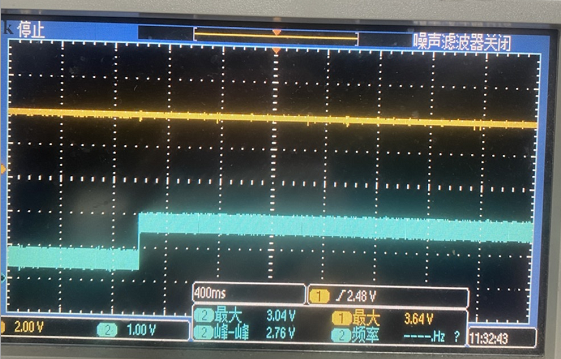
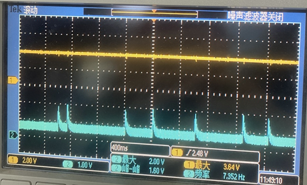

# Sample with GPADC { #sample-with-gpadc }

This note consolidates the ADC guides for SF32LB52x, SF32LB55x, SF32LB56x, SF32LB57x, and SF32LB58x. The software workflow is shared, but the input limits, pad assignments, and calibration points are family-specific. Select the target family in the tables before configuring hardware or firmware.

GPADC is SiFli's general-purpose ADC for measurements such as sensors and battery voltage. It is separate from the audio ADC available on SF32LB52x, SF32LB56x, SF32LB57x, and SF32LB58x, and from the sigma-delta ADC available on SF32LB55x and SF32LB58x. This note covers GPADC only; use the target family's audio or sigma-delta documentation for those converters.

## ADC Scope and Channel Model { #adc-scope-and-channel-model }

The SF32LB52x, SF32LB55x, SF32LB56x, and SF32LB58x SDK app-note model uses eight ADC channels, `GPADC_CH0` through `GPADC_CH7`, for analog sources such as sensor outputs and battery-voltage measurements. The SDK ADC channel map for SF32LB57x lists twelve channels: `PA28`–`PA38` map to `GPADC_CH0`–`GPADC_CH10`, and the battery channel is `GPADC_CH11` (`BAT` in the SDK map). The SF32LB57x hardware design guide labels the corresponding package signal `VBAT` or `VBATS`, depending on the power variant. A usable voltage result depends on the selected channel, its input network, and the target's software calibration.

The SF32LB52x has a dedicated battery-sense path on `GPADC_CH7` (`BAT`): the SDK example says this channel is internally connected to VBAT through a divider and applies a battery-voltage factor when converting the result. By contrast, `GPADC_CH7` maps to the external pads `PB32` on SF32LB56x and `PB39` on SF32LB58x. The SF32LB57x battery channel is `GPADC_CH11`; use the part-specific `VBAT` or `VBATS` signal and its battery-domain limits. Do not infer that a channel with a battery-related board connection is a dedicated on-chip battery channel.

## ADC Characteristics and Input Network { #adc-characteristics-and-input-network }

<div align="center"><em>Table: Normal GPADC characteristics by SF32 family</em></div>

<div align="center" markdown>

| Family | GPADC channels | Resolution | Typical accuracy | Maximum normal GPADC input |
|:-------|:---------------|:-----------|:-----------------|:---------------------------|
| SF32LB55x | 8 | 10 bit | 3–4 mV | 1.1 V (X1); 3.3 V (X3) |
| SF32LB52x | 8 | 12 bit | 1–2 mV | 3.3 V |
| SF32LB56x / 58x | 8 | 12 bit | 1–2 mV | 3.3 V |
| SF32LB57x | 12 | 12 bit | 1–2 mV | 3.3 V |

</div>

The maximum input voltages listed above apply to normal GPADC inputs; dedicated battery-sense channels have their own routing and limits. The SF32LB55x example uses a 1 MΩ / 220 kΩ divider with 157 ms RC settling. The consolidated SF32LB56x guide lists 470 kΩ / 1000 kΩ with 200 ms settling for SF32LB52x, SF32LB56x, and SF32LB58x; it does not make this recommendation for SF32LB57x. For 57x, follow the battery-sense path and limits documented for the exact part rather than extrapolating these resistor values or settling time. These recommendations apply to external divider networks. In particular, do not add an external divider to the SF32LB52x dedicated `GPADC_CH7` battery path unless the target board design calls for one: that path already uses an internal divider. Divider tolerance affects the final measurement accuracy, so calibrate an external divider separately on the production line when the design requires it.

<div align="center"><em>Table: Battery-voltage sensing routes by SF32 family</em></div>

<div align="center" markdown>

| Family | Battery-sense route | Design note |
|:-------|:--------------------|:------------|
| SF32LB55x | External divider to a selected GPADC input; the reference circuit uses `PB10` / `GPADC_CH1`. | Keep the divider output within the selected X1/X3 input limit. |
| SF32LB52x | Dedicated `GPADC_CH7` / `BAT`; the SDK example describes an internal divider from VBAT. | Use the SDK's `vbat_factor` when converting the dedicated-channel result to battery voltage. |
| SF32LB56x / 58x | An external divider feeds a board-selected GPADC pad; the SDK reference maps `GPADC_CH7` to `PB32` / `PB39`, respectively. | Confirm the actual battery-divider connection in the target board schematic; these are normal GPADC pads, not dedicated on-chip battery channels. |
| SF32LB57x | Dedicated `GPADC_CH11`; the SDK map calls it `BAT`, while the hardware guide uses `VBAT` or `VBATS` according to the power variant. | Use the exact part's battery-channel measurement limit. For 3.3 V-supply variants, the guide specifies a 0–4.5 V GPADC measurement range for `VBATS`; do not substitute the 4.7 V pin rating. |

</div>

For the SF32LB55x external battery path, the OpenSiFli ADC FAQ shows a 1 MΩ / 220 kΩ divider using 1% resistors. The high resistance reduces the divider's continuous leakage current; the 1% tolerance limits divider-ratio error and supports measurement accuracy. The divider output is the ADC test point; it is not the battery voltage itself. Use the target schematic and electrical limits when adapting this reference.

{ loading="lazy" }
<div align="center"><em>Figure: VBAT resistor-divider and ADC test-point reference from the SF32LB56x SDK guide.</em></div>

{ loading="lazy" }
<div align="center"><em>Figure: SF32LB55x divider-output reference values from the OpenSiFli ADC FAQ.</em></div>

<div align="center"><em>Table: Reference output voltage of the SF32LB55x 1 MΩ / 220 kΩ divider</em></div>

<div align="center" markdown>

| Battery input | `PB10_BAT_DET_ADC` output |
|:--------------|:-------------------------------|
| 3.0 V | 0.540983607 V |
| 3.3 V | 0.595081967 V |
| 3.6 V | 0.649180328 V |
| 4.0 V | 0.721311475 V |
| 4.2 V | 0.757377049 V |
| 5.0 V | 0.901639344 V |

</div>

In the SF32LB55x reference schematic, VBAT passes through R125 (1 MΩ) to `PB10_BAT_DET_ADC`. R126 (220 kΩ) and C118 (0.1 µF) connect this node to ground in parallel. Treat these values as a reference and verify them against the target schematic and electrical limits.

{ loading="lazy" }
<div align="center"><em>Figure: SF32LB55x external battery-voltage sampling path.</em></div>

## Analog Supply and Reference { #analog-supply-and-reference }

The analog-supply and reference-pin arrangement is family-specific. Use the target schematic rather than assuming that every GPADC has the same VREF pinout:

<div align="center"><em>Table: GPADC supply and reference connections by SF32 family</em></div>

<div align="center" markdown>

| Family | Supply and reference connections |
|:-------|:----------------------------------|
| SF32LB52x / 56x | Supply `AVDD33_ANA` from a stable 3.3 V rail. The reference schematic shows `GPADC_VREF` decoupled to ground; it is not a supply input. |
| SF32LB55x | The reference schematic shows `AVDD33_ANA` and `AVSS33_ANA`; follow the target schematic for their connection and decoupling. |
| SF32LB57x | Supply `AVDD33_ANA` from 3.3 V. `GPADC_VREF` is a reference pin: add the specified capacitor to ground only and do not drive it externally. |
| SF32LB58x | The reference schematic shows `AVDD33_ANA` / `AVSS33_ANA`, `GPADC_VREFP` with its specified capacitor, and `GPADC_VREFN` connected to ground. Do not treat either reference pin as a supply input. |

</div>

The 58x `GPADC_VREFP` / `GPADC_VREFN` pair is not interchangeable with the single `GPADC_VREF` naming used for other families. The SDK schematic also shows family-specific filtering components; use the exact reference circuit and component values for the target part. Never apply a supply directly to a GPADC reference pin. `AVDD33_ANA` is the analog supply; `AVSS33_ANA` is analog ground where provided.

{ loading="lazy" }
<div align="center"><em>Figure: Family-specific GPADC analog-supply and reference wiring shown in the SF32LB56x SDK guide.</em></div>

## Configure the ADC Pad { #configure-the-adc-pad }

Set the selected input pad to its analog function before sampling. The guide's generic API examples are:

```c
HAL_PIN_Set_Analog(PAD_PB08, 0);
HAL_PIN_Set_Analog(PAD_PB13, 0);
```

Those calls illustrate the analog-pin API, not a target-family pad selection. Select the physical input from this channel map:

<div align="center"><em>Table: GPADC pad-to-channel mapping by SF32 family</em></div>

<div align="center" markdown>

| Family | `GPADC_CH0` | `GPADC_CH1` | `GPADC_CH2` | `GPADC_CH3` | `GPADC_CH4` | `GPADC_CH5` | `GPADC_CH6` | `GPADC_CH7` |
|:-------|:------------|:------------|:------------|:------------|:------------|:------------|:------------|:------------|
| SF32LB55x | `PB08` | `PB10` | `PB12` | `PB13` | `PB16` | `PB17` | `PB18` | `PB19` |
| SF32LB52x | `PA28` | `PA29` | `PA30` | `PA31` | `PA32` | `PA33` | `PA34` | `BAT` |
| SF32LB56x | `PB22` | `PB23` | `PB24` | `PB25` | `PB26` | `PB27` | `PB28` | `PB32` |
| SF32LB58x | `PB32` | `PB33` | `PB34` | `PB35` | `PB36` | `PB37` | `PB38` | `PB39` |
| SF32LB57x | `PA28` | `PA29` | `PA30` | `PA31` | `PA32` | `PA33` | `PA34` | `PA35` |

</div>

SiFli's sources differ on the SF32LB52x pad mapping: the [dedicated SF32LB52x ADC application note](https://docs.sifli.com/projects/sdk/latest/sf32lb52x/app_note/adc.html) lists the external-pad map for revision A0 as `PB08`, `PB10`, `PB12`, `PB13`, `PB16`, `PB17`, `PB18`, and `PB19` for `GPADC_CH0`–`GPADC_CH7`; the [consolidated ADC table in the SF32LB56x guide](https://docs.sifli.com/projects/sdk/latest/sf32lb56x/app_note/adc.html) instead lists `PA28`–`PA34` for `GPADC_CH0`–`GPADC_CH6` and `BAT` for `GPADC_CH7`. The SF32LB52x row above reflects the consolidated table, not a universal 52x pin assignment. Before routing or configuring GPADC on a 52x device, verify the exact chip and revision against the matching SDK pinmux and board schematic; do not combine these maps.

SF32LB57x has four additional ADC channels: `PA36` is `GPADC_CH8`, `PA37` is `GPADC_CH9`, `PA38` is `GPADC_CH10`, and the battery-sense signal is `GPADC_CH11` (`BAT` in the SDK map; `VBAT` or `VBATS` in the hardware guide, according to the power variant). This channel belongs to the battery-voltage domain and has a different measurement range from normal GPADC pins. For 3.3 V-supply variants, follow the guide's 0–4.5 V `VBATS` GPADC range rather than the 4.7 V pin rating. The 12-channel map and battery input are therefore not interchangeable with the eight-channel maps above.

The SF32LB55x-only route can also assign the PIN directly to a GPADC channel, for example `HAL_PIN_Set(PAD_PB08, GPADC_CH0, PIN_NOPULL, 0)`. Do not copy that specific assignment into a different family.

{ loading="lazy" }
<div align="center"><em>Figure: SF32LB55x pin configuration showing analog input mode for the battery ADC path.</em></div>

## Read an ADC Channel { #read-an-adc-channel }

SiFli-SDK registers the ADC as a battery-voltage device; the guide uses `bat1` as its default device name. With the RT-Thread device interface, find the device, open it read-only, enable the intended channel, and read its raw value:

```c
uint32_t channel = 1;
uint32_t value;
rt_device_t dev = rt_device_find("bat1");

if (dev) {
    rt_device_open(dev, RT_DEVICE_FLAG_RDONLY);
    rt_device_control(dev, RT_ADC_CMD_ENABLE, (void *)channel);
    rt_device_read(dev, channel, &value, 1);
}
```

At the HAL level, read the conversion result with `HAL_ADC_GetValue(&hadc, slot)`. Pass the initialized ADC handle and the slot number configured for the conversion; ensure that the slot maps to the intended channel and PAD.

## ADC Calibration and Voltage Conversion { #adc-calibration-and-voltage-conversion }

The guide models conversion as a linear relationship:

<div align="center"><em>V<sub>real</sub> = (Value<sub>adc</sub> − Offset) × Ratio</em></div>

`Offset` is the raw value at 0 V; `Ratio` is the voltage increment per raw count. Factory calibration compensates for manufacturing variation, but the guide also describes a two-point calibration method for the assembled input path:

1. Apply two accurate, stable voltages and read the corresponding ADC values.
2. Use the target family's two calibration voltages rather than 0 V or the maximum input voltage.
3. Use `sifli_adc_calibration` to calculate and retain the ratio and offset.
4. Convert later raw values with the retained calibration values, and include the divider ratio when reporting source-side voltage.

The source implementation sets `ADC_RATIO_ACCURATE` to 1000, with initial `adc_vol_offset` and `adc_vol_ratio` values of 200 and 3930 respectively. This legacy helper illustrates the linear calculation; it is not a substitute for the calibration flow exposed by the target SDK release. Use the target HAL or device-driver calibration API where available.

### SF32LB55x Calibration Ranges { #sf32lb55x-calibration-ranges }

The OpenSiFli ADC FAQ documents the SF32LB55x calibration flow in more detail. During `sifli_adc_init`, the factory-area Flash configuration identified by `FACTORY_CFG_ID_ADC` supplies the stored calibration readings. `sifli_adc_calibration` derives the linear `offset` and `ratio` from those readings; subsequent samples use the selected range's `sifli_adc_get_mv` calculation.

Two calibration ranges are documented:

{ loading="lazy" }
<div align="center"><em>Figure: SF32LB55x calibration initialization, range selection, and offset/ratio calculation.</em></div>

- **X1 range:** 0.3 V and 0.8 V. The stored calibration values have bit 15 set, so the implementation selects the small-range path. Accuracy is reduced near 0 V and above 1 V. This path disables `GPADC_ADC_CFG_REG1_ANAU_GPADC_ATTN3X`, so the internal divider is off and the ADC test point must not exceed 1.1 V.
- **X3 range:** 1.0 V and 2.5 V. This is the earlier calibration method. It enables `GPADC_ADC_CFG_REG1_ANAU_GPADC_ATTN3X`, which enables the internal divider with 3× attenuation; the input must not exceed 3.3 V.

{ loading="lazy" }
<div align="center"><em>Figure: SF32LB55x internal-divider enable/disable control for the selected calibration range.</em></div>

Never choose a calibration range from the table alone: use the factory configuration and target SDK implementation. The X1 and X3 behaviors are specific to the SF32LB55x material cited here, not a rule to apply to another family.

<div align="center"><em>Table: Two-point calibration inputs listed by the consolidated ADC application note</em></div>

<div align="center" markdown>

| Family | Calibration inputs |
|:-------|:-------------------|
| SF32LB55x | 0.3 V and 0.8 V |
| SF32LB52x / 56x / 58x | 1.0 V and 2.5 V |
| SF32LB57x | 1.0 V and 2.5 V |

</div>

There is a source-version difference for SF32LB52x: the consolidated ADC application note lists 1.0 V and 2.5 V for two-point calibration, while the current HAL API reference identifies the default SF32LB52X calibration range as X1, with 0.3 V and 0.8 V points. Do not treat these pairs as interchangeable defaults. Check the exact SDK release, factory data, and runtime calibration range for the target part before selecting calibration inputs or the allowed input voltage.

```c
static uint32_t adc_vol_offset = 200;
static uint32_t adc_vol_ratio = 3930;
#define ADC_RATIO_ACCURATE 1000

int sifli_adc_get_mv(uint32_t value)
{
    return (value - adc_vol_offset) * adc_vol_ratio / ADC_RATIO_ACCURATE;
}

int sifli_adc_calibration(uint32_t value1, uint32_t value2,
                          uint32_t vol1, uint32_t vol2,
                          uint32_t *offset, uint32_t *ratio)
{
    uint32_t gap1, gap2;

    if (offset == NULL || ratio == NULL) return 0;

    gap1 = (value1 > value2) ? (value1 - value2) : (value2 - value1);
    gap2 = (vol1 > vol2) ? (vol1 - vol2) : (vol2 - vol1);

    if (gap1 == 0) return 0;

    *ratio = gap2 * ADC_RATIO_ACCURATE / gap1;
    adc_vol_ratio = *ratio;
    *offset = value1 - (vol1 * ADC_RATIO_ACCURATE / adc_vol_ratio);
    adc_vol_offset = *offset;

    return adc_vol_offset;
}
```

### Validate Calibration After Startup and Wake { #validate-calibration-after-startup-and-wake }

For SF32LB55x battery-voltage debugging, the OpenSiFli ADC FAQ warns that readings in the first approximately 300 ms after startup or wake can be inaccurate because of RC charging and discharging; the observed waveform settles after about 350 ms. Add an appropriate sampling delay or discard the initial unstable samples. When measuring the divider node with a multimeter or oscilloscope, account for the measurement instrument's input impedance; the FAQ reports it can introduce an approximately 30 mV drop.

{ loading="lazy" }
<div align="center"><em>Figure: SF32LB55x startup waveform showing the approximately 350 ms settling behavior.</em></div>

### Check the SF32LB55x ADC pin after standby and wake { #check-sf32lb55x-pin-configuration-after-standby }

For the SF32LB55x battery-sense input on `PB10`, verify the pin configuration both before entering standby and after wake. Before initialization, `PB10` has an internal pull-up by default. In `pinmux.c`, configure it as `PIN_NOPULL` and `PIN_ANALOG_INPUT`; otherwise, the pull-up can remain enabled and cause occasional high readings.

{ loading="lazy" }
<div align="center"><em>Figure: Example SF32LB55x battery-sampling node waveform while the device is in standby.</em></div>

{ loading="lazy" }
<div align="center"><em>Figure: Example SF32LB55x battery-sampling node waveform after the device wakes from standby.</em></div>

## Bring-Up Check { #bring-up-check }

Before adding multi-channel or cyclic acquisition, verify one channel with a stable, independently measured input:

1. Confirm its target-family pad mapping and analog configuration.
2. Confirm that the divider output stays within the target-family ADC limit.
3. Compare the raw and calibrated results with the applied voltage.
4. Retain the divider and calibration conditions with the board test record.

When connecting the SF32LB56x log UART to an external PC, make sure the serial adapter's reference level matches the chip I/O voltage. The OpenSiFli ADC FAQ warns that a 5 V adapter reference on a 3.3 V I/O connection can make ADC readings much lower than expected; for example, a 4 V battery may be reported as 3.3 V.

## Official Source { #official-source }

- [SF32LB52x ADC Usage and Configuration Guide](https://docs.sifli.com/projects/sdk/latest/sf32lb52x/app_note/adc.html)
- [SF32LB55x ADC Usage and Configuration Guide](https://docs.sifli.com/projects/sdk/latest/sf32lb55x/app_note/adc.html)
- [SF32LB56x ADC Usage and Configuration Guide](https://docs.sifli.com/projects/sdk/latest/sf32lb56x/app_note/adc.html)
- [SF32LB57x ADC Usage and Configuration Guide](https://docs.sifli.com/projects/sdk/latest/sf32lb57x/app_note/adc.html)
- [SF32LB58x ADC Usage and Configuration Guide](https://docs.sifli.com/projects/sdk/latest/sf32lb58x/app_note/adc.html)
- [SF32LB52x ADC HAL API Reference](https://docs.sifli.com/projects/sdk/latest/en/sf32lb52x/api/hal/adc.html) — default calibration-range definitions.
- SF32LB57x Hardware Design Guide — Storage & Manufacturing — GPADC channel and pad assignment.
- SF32LB57x Hardware Design Guide — Minimum System & Power — analog supply/reference connections and variant-specific battery-sense limits.
- [OpenSiFli ADC FAQ](https://github.com/OpenSiFli/SiFli-Wiki/blob/main/source/en/faq/mcu/adc.md) — SF32LB55x factory calibration ranges, startup/standby/wake validation, and SF32LB56x log-UART level guidance.
