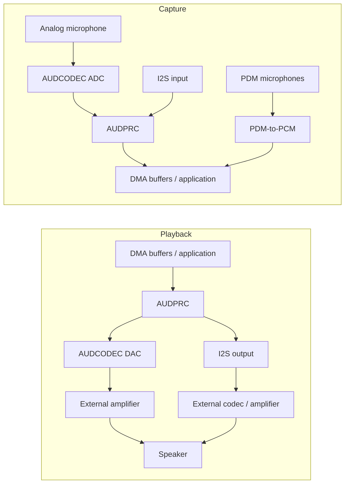

# Audio Overview { #audio-overview }

## Overview { #overview }

This guide covers the **local audio subsystem** on SF32 devices — the codec, DMA, and middleware path used for microphone input, speaker/line output, and on-device playback or recording. It focuses on practical decisions: interface selection, buffering strategy, the Audio Server middleware, codec choice, and power.

Bluetooth audio (A2DP, LE Audio) is a related but separate topic covered in the [Bluetooth Overview](../bluetooth/overview.md#bluetooth-audio-and-le-audio) — that page covers the wireless streaming side, while this one covers what happens once samples are on-chip: capture, mixing, decoding, and driving the physical audio path.

Use this guide to make product-level decisions about microphones, codecs, buffering, and power—not just to get a demo playing once. It is written for engineers who must make the audio path reliable alongside Bluetooth, display, storage, and battery constraints.

## Define the Product's Audio Requirements { #define-the-products-audio-requirements }

Before choosing interfaces or buffer sizes, pin down what the product needs:

- Playback only, recording only, or both simultaneously (full duplex)?
- How many microphones, and analog (AMIC) or digital (DMIC)?
- Local playback formats — raw PCM, MP3, Opus, or another codec?
- Is Bluetooth audio (Classic or LE Audio) also required, in parallel with local audio?
- Voice-trigger or always-listening behavior, and its power budget?
- Speaker/line-out drive requirements, or is output routed to an external amplifier/codec?
- Latency tolerance — voice calls and real-time monitoring are far stricter than notification chimes.

These answers determine the interface (I2S vs. PDM vs. ADC/DAC), the codec configuration, and how much of the pipeline needs to stay awake.

## The SF32 Audio Signal Path { #the-sf32-audio-signal-path }

Capture and playback follow different routes. The following diagram shows common paths; availability and simultaneous routing depend on the exact device, package, board and SDK configuration.

<div align="center"><em>Figure: Typical SF32 Local-Audio Signal Path</em></div>



**AUDCODEC** performs analog-to-digital and digital-to-analog conversion. **AUDPRC** handles digital processing such as mixing, gain and sample-rate conversion on supported routes. PDM microphones instead use the PDM block to produce PCM; they do not pass through the analog ADC. I2S provides a digital path to external devices. One PDM interface can connect up to two compatible microphones using left/right channel selection; two interfaces can support up to four microphones, subject to pin availability and driver support.

**Audio Server** is software that manages streams and sessions, not a physical converter inserted between the microphone and speaker. Applications normally use its APIs and the corresponding drivers; direct driver/HAL tests are useful during bring-up. Select the actual capture and playback routes first, then verify their clocks, sample formats, DMA requests and output-drive requirements. Do not assume the on-chip DAC can drive the selected speaker without an external amplifier.

These routes are documented in the [AUDPRC/AUDCODEC driver guide](https://docs.sifli.com/projects/sdk/latest/en/sf32lb52x/drivers/audprc_audcodec.html) and [PDM HAL guide](https://docs.sifli.com/projects/sdk/latest/en/sf32lb52x/hal/pdm.html).

## Microphones and Digital Interfaces { #choosing-interfaces-amic-dmic-and-i2s }

AMIC and DMIC describe microphone types; PDM and I2S describe digital interfaces. A digital microphone may use either PDM or I2S. Do not count a microphone, a channel and an interface as the same resource.

<div align="center"><em>Table: Microphones and Digital Interfaces</em></div>

<div align="center" markdown>

| Microphone / Bus | Typical Use | Notes |
|:----------|:------------|:------|
| **AMIC (analog mic input)** | General-purpose microphone capture | Uses an audio ADC, with microphone bias, gain, input range and board-noise control to be verified. |
| **DMIC (digital microphone)** | Voice capture, multi-mic arrays | Select the actual PDM or I2S bus. Digital signaling does not remove supply-noise, clock or layout requirements. |
| **I2S** | Streaming PCM to/from external codecs or amplifiers | Common when using an external audio codec/amp rather than the on-chip AUDCODEC path. |
| **PDM** | Digital microphone input | Native interface for many DMIC parts; paired with on-chip PDM-to-PCM conversion. |

</div>

Mixed analog/digital arrays require supported concurrent routes and synchronized sample timing. Beamforming also requires suitable microphone placement, calibration and an algorithm; merely connecting several microphones does not provide it.

## Start from a Verified Audio Example { #start-from-a-verified-audio-example }

Choose and validate the closest SiFli-SDK baseline before designing application behavior around it. [Audio SDK Examples](audio-sdk-examples.md) maps the official PDM, analog capture, record/playback, local music, SD-card, FLAC, Opus, and mixing examples to the engineering task they prove. It also identifies the board, pin-mux, storage, and configuration boundaries to re-check before adapting a sample to a product.

## Pick the Right SF32 Device { #pick-the-right-sf32-device }

Audio capability varies across the family — check the datasheet for the exact part, but as a starting point:

<div align="center"><em>Table: Pick the Right SF32 Device</em></div>

<div align="center" markdown>

| Device Family | Integrated Audio ADC/DAC | PDM Interfaces (Maximum Microphones) | I2S Interfaces | Application Direction |
|:---|:---|:---|:---|:---|
| **SF32LB52x** | 1 ADC + 1 DAC | 1 (2) | 1 | Cost-optimized Bluetooth audio accessories, voice-enabled compact HMIs. |
| **SF32LB55x** | None; use an external audio codec for analog audio. | SF32LB551/555: 1 (2); SF32LB557: 2 (4) | SF32LB551/555: 1; SF32LB557: 2 | BLE wearables and sensor-rich products where audio is secondary. |
| **SF32LB56x** | 1 ADC + 1 DAC | 2 (4) | 1 | Richer HMI/display products that also need multi-mic voice capture. |
| **SF32LB57x** | 2 ADC + 1 DAC | 2 (4) | 2 | Multi-microphone voice capture and local playback. |
| **SF32LB58x** | 2 ADC + 2 DAC | 2 (4) | 3 | Flagship products combining audio, graphics, AI, and complex connectivity. |

</div>

Confirm the exact model, package pinout, pin-mux and simultaneous routes before choosing a device. One PDM interface can serve two compatible microphones; ADC channels, microphone channels and digital-interface instances are different resources. I2S capabilities depend on the instance: on SF32LB58x, I2S1 supports receive (RX) only, while I2S2 and I2S3 support both receive and transmit (RX/TX). I2S2 receive also requires enabling its TX side as the clock source. See the [SiFli I2S HAL guide](https://docs.sifli.com/projects/sdk/latest/en/sf32lb52x/hal/i2s.html) for instance-specific details, and the [SF32 Family Overview](../../sf32-products/family/SF32_family.md) for broader selection factors.

Source references: [DS5201](https://downloads.sifli.com/user%20manual/DS5201-SF32LB52x-Datasheet%20V2p5.pdf), [DS5501, Table 0-1](https://downloads.sifli.com/user%20manual/DS5501-SF32LB55x-Datasheet%20V1p7p2.pdf), [DS5601](https://downloads.sifli.com/user%20manual/DS5601-SF32LB56x-Datasheet%20V1p9p2.pdf), [DS5801](https://downloads.sifli.com/user%20manual/DS5801-SF32LB58x-Datasheet%20V1p8p3.pdf), [SF32LB57x AUDCODEC registers (ADC_CH0/1, DAC_CH0)](https://github.com/OpenSiFli/SiFli-SDK/blob/v2.5.1/drivers/cmsis/sf32lb57x/audcodec.h), [SF32LB57x PDM/I2S instances](https://github.com/OpenSiFli/SiFli-SDK/blob/v2.5.1/drivers/cmsis/sf32lb57x/register.h), [SiFli SDK v2.5.1 release notes (57x four-microphone PDM configuration)](https://github.com/OpenSiFli/SiFli-SDK/releases/tag/v2.5.1), [SiFli SDK PDM example (57x board, PDM1, stereo channels)](https://docs.sifli.com/projects/sdk/latest/en/sf32lb52x/example/rt_device/pdm/README.html).

## Audio Session Templates { #audio-session-templates }

Most products fall into a few repeatable session shapes. Choose the closest one and validate it explicitly:

<div align="center"><em>Table: Audio Session Templates</em></div>

<div align="center" markdown>

| Session | Typical Pipeline | Main Risk |
|:--------|:-----------------|:----------|
| Notification sound | Flash/PSRAM asset -> decoder if needed -> Audio Server -> DAC/amp | Pop/click during start and stop. |
| Voice recording | AMIC -> ADC/AUDPRC, or PDM mic -> PDM-to-PCM, or I2S input -> DMA buffers -> app/storage/Bluetooth | Buffer overrun and clock drift. |
| Bluetooth speaker | Bluetooth audio -> decode/mix -> Audio Server -> DAC/amp | Coexistence with RF and memory bandwidth. |
| Voice call | Mic capture + playback at the same time | Full-duplex latency, echo-path handling, buffer ownership. |
| Wake/listen feature | Low-rate capture -> feature extraction -> AI trigger | Idle power and false wakeups. |

</div>

Define start, steady-state, underrun/overrun recovery, and teardown behavior for each session. Audio bugs often hide in transitions rather than in the steady playback loop.

## Buffer and Latency Budget { #buffer-and-latency-budget }

The buffer's audio duration depends on **sample frames**, where one frame contains one sample from each channel:

```text
interleaved frames = buffer bytes / (channels * stored bytes per sample)
planar frames per channel = channel buffer bytes / stored bytes per sample
buffer duration (s) = frames / sample rate (Hz)
```

At 48 kHz, 480 frames represent 10 ms. In interleaved stereo, that is 960 scalar samples; 480 scalar samples represent only 5 ms. Use the stored bytes per sample, including padding, when converting a byte-sized buffer to frames. For planar data, count frames in each channel buffer rather than adding both channel lengths.

This is the buffer's duration, not automatically the end-to-end latency. Ping-pong buffering lets DMA use one region while software handles another; its latency depends on filled data waiting in the queues and the half/full-transfer callback policy, not just the existence of two buffers. Budget and measure capture, processing, transport, playback and scheduling delays together.

## Playback and Recording Basics { #playback-and-recording-basics }

Whether driving a speaker or capturing a microphone, the same fundamentals apply:

- **Buffer sizing** — small blocks can reduce block-related latency but increase interrupt/DMA overhead; large blocks provide more scheduling margin and use more memory. Latency increases when more audio waits before processing or playback, not merely because more buffer capacity is allocated.
- **DMA-driven transfer** — use hardware-paced DMA for peripheral sample transfer. Software may still copy or process blocks in memory; avoid CPU polling or per-sample loops that must service the peripheral in real time.
- **Sample-rate and format planning** — decide sample rate (e.g., 16 kHz for voice, 44.1/48 kHz for music) and bit depth up front; converting formats at runtime costs CPU and memory.
- **Double buffering** — let DMA transfer one region while software fills or processes the other. Finish before that region is needed again; two buffers alone do not prevent underruns or overruns.

For cacheable buffers shared with DMA, establish ownership and follow the SDK's cache-line alignment and maintenance rules. Clean CPU-written playback data before DMA reads it. Prepare capture destinations before DMA writes, then invalidate the completed region before the CPU reads it, as required by the target's cache policy. Do not modify or reuse a DMA-owned region until its completion callback permits it; keep unrelated data out of the affected cache lines.

## Codec and Compression Choices { #codec-and-compression-choices }

Distinguish a **hardware audio codec** (ADC/DAC conversion) from a **compression codec** (such as MP3 or Opus). Raw PCM needs no compression decoder. Lossy compressed audio generally reduces stored size and read bandwidth for an equivalent signal, but decoder CPU time, working buffers and energy must still be measured; compression does not guarantee a smaller runtime memory footprint.

<div align="center"><em>Table: Codec and Compression Choices</em></div>

<div align="center" markdown>

| Format | Typical Use | Notes |
|:-------|:-------------|:------|
| **Raw PCM** | Short sounds, low-latency monitoring, voice pipelines | No compression decode step; size depends on duration, sample rate, channel count and stored sample width. |
| **MP3** | Local music playback | Broad compatibility; decode cost is well understood and commonly used in SD-card music-player examples. |
| **Opus** | Voice and general-purpose compressed audio | A useful compressed format for voice and general audio. Opus support alone does not establish A2DP, HFP or LE Audio interoperability; verify the chosen Bluetooth profile's codec and SDK support separately. |

</div>

The SDK offers local music, SD-card MP3, Opus, recording and dual ADC/DAC examples. The dual-channel example requires a device and board exposing those channels; it does not imply two ADCs/DACs on every SF32. Start from the supported baseline and measure decode cost on the actual target.

## Local Audio vs. Bluetooth Audio { #local-audio-vs-bluetooth-audio }

Keep the two paths conceptually separate, even though they may run concurrently:

- **Local audio** (this guide) — AUDCODEC/AUDPRC, microphones, speaker/line-out, on-device playback and recording.
- **Bluetooth audio** ([Bluetooth Overview](../bluetooth/overview.md#bluetooth-audio-and-le-audio)) — A2DP/AVRCP/HFP for Classic Bluetooth, or LE Audio unicast/broadcast where the device, stack and SDK support the required roles. A BLE-capable radio alone does not guarantee LE Audio.

Many real products bridge the two — for example, capturing on a local microphone and streaming over Bluetooth, or receiving Bluetooth audio and mixing it with a local notification chime through the Audio Server. Plan buffer ownership and mixing behavior explicitly when both paths are active at once.

## Board-Level Audio Checklist { #board-level-audio-checklist }

Firmware cannot fully hide poor analog design. Review these items during schematic and PCB work:

<div align="center"><em>Table: Board-Level Audio Checklist</em></div>

<div align="center" markdown>

| Area | Guidance |
|:-----|:---------|
| Microphone bias and routing | Keep analog mic traces short, quiet, and away from clocks/RF/high-current switching. |
| Grounding | Avoid noisy return paths through the microphone or speaker reference. |
| Power rails | Filter codec and microphone supplies according to the reference design and microphone datasheet. |
| Speaker/amp path | Check load, gain, thermal behavior, pop suppression, and shutdown pin behavior. |
| I2S/PDM clocks | Confirm timing margin, trace length, and clock quality at the selected sample rates. |
| Test access | Leave a practical way to inject/capture audio during bring-up and production test. |

</div>

For products with both RF and analog audio, validate noise with Bluetooth active, display refreshing, charger connected, and the final enclosure assembled.

## Power Considerations for Audio { #power-considerations-for-audio }

Measure microphone supplies, converters, digital processing, memory access and amplifier power separately, then measure the complete session. Their relative contribution depends on the hardware, workload and listening/playback duty cycle.

- Stop unused audio paths between sessions in the sequence required by the component and driver. Check amplifier mute/shutdown, clocks, supplies and GPIO states to avoid pops, back-powering and interface leakage.
- For always-listening voice triggers, keep the required capture path active and choose the lowest-power supported processing strategy; do not shut down the path the trigger depends on. Keep the trigger model lightweight. See [AI Overview](../ai/overview.md#audio-and-voice).
- Batch processing within the latency and buffer deadlines. DMA handles sample transfer, but completed blocks still need timely processing; fewer CPU wakeups must not cause overruns or underruns.
- Coordinate audio timing with Bluetooth and display activity. See [Low-Power Overview](../low-power/overview.md) and [Bluetooth Overview: Coexistence](../bluetooth/overview.md#coexistence-with-other-workloads).

## Audio Validation Matrix { #audio-validation-matrix }

Run the same audio tests after codec, Bluetooth, display, power, or clock changes:

<div align="center"><em>Table: Audio Validation Matrix</em></div>

<div align="center" markdown>

| Test | What to Check |
|:-----|:--------------|
| Silence capture/playback | Noise floor, hum, pop/click, DC offset. |
| Sine sweep or tone | Sample-rate correctness, distortion, clipping. |
| Long playback | Underrun, memory leak, thermal/power stability. |
| Record while displaying UI | DMA and memory-bandwidth coexistence. |
| Bluetooth audio plus local sound | Mixing, priority, and latency. |
| Sleep/wake around audio | Codec teardown/restart, pop suppression, and PM votes (requests that constrain the eligible power states). |

</div>

Keep a known-good reference WAV/PCM file and a known-good captured sample from the evaluation board. They make regressions much easier to identify than subjective listening alone.

## Debugging Audio Issues { #debugging-audio-issues }

<div align="center"><em>Table: Debugging Audio Issues</em></div>

<div align="center" markdown>

| Symptom | Likely Area to Check |
|:--------|:----------------------|
| Clicks, pops, or glitches | Buffer underrun, insufficient buffer count/size, DMA misconfiguration. |
| Persistent noise or hum | Analog front-end/board layout, AMIC grounding, power-rail noise. |
| Latency too high for the use case | Buffer sizes too large, unnecessary format conversion, scheduling delay before DMA starts. |
| Audio stutters when Bluetooth/display active | Coexistence and memory-bandwidth contention — see [Coexistence](../bluetooth/overview.md#coexistence-with-other-workloads). |
| Decoded audio sounds wrong (pitch/speed) | Sample-rate mismatch between source, decoder, and AUDCODEC configuration. |
| High power during idle playback state | Codec/DMA left active between sessions, unnecessary polling instead of event-driven session teardown. |

</div>

## Common Mistakes { #common-mistakes }

- Servicing every peripheral sample through CPU polling instead of hardware-paced DMA.
- Using an undersized or poorly managed buffer strategy that misses DMA deadlines; use double buffering when supported and appropriate.
- Choosing microphone types and counts without checking PDM/I2S instances, exposed pins and simultaneous routes.
- Treating Bluetooth audio and local audio as fully independent when they'll run concurrently in the real product.
- Ignoring cache-coherency and ownership rules for buffers shared between DMA and the CPU.
- Leaving unused audio paths active between sessions, or disabling capture that an always-listening feature still requires.
- Committing to a compressed format before confirming decode cost fits the power and CPU budget.

## Bring-Up Checklist { #bring-up-checklist }

- [ ] Confirm microphone types and channel counts, PDM/I2S instances, exposed pins and supported concurrent routes against the exact device and board.
- [ ] Set sample rate, stored sample width, channel layout and buffer sizes for capture and playback.
- [ ] Bring up the selected ADC/AUDPRC, PDM or I2S capture route and DAC or I2S playback route; test each direction before full duplex.
- [ ] Integrate supported sessions with Audio Server and the relevant drivers after the basic hardware paths work; retain direct HAL tests for diagnosis.
- [ ] Choose the audio format (PCM/MP3/Opus) and measure decoder cost where applicable, including CPU, memory and energy budgets.
- [ ] Validate DMA buffer ownership, alignment and cache clean/invalidate operations.
- [ ] Test concurrent local and Bluetooth audio if the product uses both.
- [ ] Measure active and idle power; verify shutdown and restart sequencing, interface pin states and any capture path that must remain active for listening.

## Key Takeaways { #key-takeaways }

- Select the physical route explicitly: analog audio uses AUDCODEC, PDM capture uses the PDM block, and external digital audio uses I2S. Use Audio Server and drivers to manage supported sessions, rather than treating every route as the same codec pipeline.
- Choose microphone types and PDM/I2S routes from the exact device's capabilities and the product's microphone layout, not assumptions carried over from another chip.
- Use DMA-paced transfers with enough buffer depth. Double buffering is a common baseline where supported, but correctness still depends on meeting callback and buffer-reuse deadlines.
- Local audio and Bluetooth audio are separate subsystems that often need to run together — plan mixing and buffer ownership explicitly.
- Treat audio power the same way as Bluetooth and AI power: minimize active time, avoid unnecessary CPU wakeups, and measure real sessions, not just steady-state playback.
