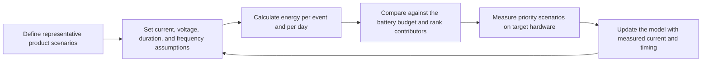

# Low-Power Design Overview { #low-power-overview }

## Purpose and Scope { #overview }

This guide covers practical low-power design on SF32 devices: power modes, what actually drains a battery, and how to structure firmware so the system spends as much time as possible in a low-power state. Power is a system-level concern: decisions about Bluetooth, graphics, audio, and AI all affect consumption, so this guide brings those effects together.

SiFli SDK documentation describes RT-Thread-based **PM (Power Management)** middleware for specific targets, including SF32LB52x. Available modes and wake behavior can differ by device and SDK configuration; verify the documentation for the target. On families where the selected SDK assigns Bluetooth controller work to a separate processor (see [Bluetooth Processor Architecture](../bluetooth/processor.md)), radio events may be handled without waking the application CPU each time. Whether it can remain asleep depends on task placement, configured wake sources, and inter-processor traffic; verify this on the target device.

Use this page when a battery-life target must become firmware and hardware decisions with measured evidence. It is for engineers balancing connected standby, display behavior, audio, sensing, AI, and user responsiveness—not for treating sleep as a single API call.

## Define the Product's Power Budget First { #define-the-products-power-budget-first }

Before writing any power-management code, define what "good" looks like for the product:

- Target battery life (hours, days, or weeks) and battery capacity.
- Expected duty cycle — how much of the day is the device actively used vs. idle-but-connected vs. fully asleep?
- Which events must wake the system, and how quickly?
- Which subsystems must stay alive continuously (e.g., a connected Bluetooth link, an always-on display, a voice trigger) versus which can be fully event-driven?
- Charging behavior and expected charge cycles, if relevant to the product's power policy.

These targets should drive architecture decisions early — including chip selection, display type, and whether features like always-listening voice or always-on display are affordable within the power budget at all.

## Power Modes and the PM Framework { #power-modes-and-the-pm-framework }

The following are conceptual system states, not an exact list of SF32 hardware modes or SDK enum values. Check the selected device and SDK documentation for supported modes, wake sources, and retention behavior:

<em>Table: Power Modes and the PM Framework</em>

| Mode | Typical State | When Used |
|:-----|:---------------|:----------|
| **Active** | CPU running, peripherals as needed | UI interaction, active Bluetooth transfer, audio streaming, sensor processing. |
| **Idle** | CPU waits for an event or interrupt; peripheral state depends on the device and configuration | Between UI frames, while waiting for the next scheduled task or an enabled interrupt. |
| **Sleep / Low-power** | A CPU or subsystem enters a supported low-power state; clocks, domains, and peripherals may stop or remain active according to that state | Connected standby or waiting for a configured Bluetooth event, sensor interrupt, or timer. |
| **Deep sleep / Standby** | A device-specific deeper state with reduced active domains; retention and wake behavior vary | Longer idle periods when the selected mode and wake requirements permit it. |

Real work moves the system between states. A configured wake source brings a CPU or subsystem out of its low-power state; the wake-up and clock-restoration sequence is device-specific. After the work is done, the responsible drivers or tasks should release any sleep-inhibiting PM requests so the configured policy can select an eligible low-power state. The trace below is illustrative: it shows relative transitions, not device-specific current values or timing.

 <em>Diagram: Illustrative Power-Mode Transitions During a Short Workload</em>

Power-mode selection and sleep inhibition are distinct. SiFli's [SF32LB52x PM middleware reference](https://docs.sifli.com/projects/sdk/latest/en/sf32lb52x/middleware/pm.html) and [SF32LB55x low-power guide](https://docs.sifli.com/projects/sdk/latest/sf32lb55x/app_note/low_power.html) document that `rt_pm_request(PM_SLEEP_MODE_IDLE)` blocks entry into LIGHT, DEEP, and STANDBY until the matching `rt_pm_release(PM_SLEEP_MODE_IDLE)` is called; the request does not select a deeper mode.

For implementation, use the official low-power guide for the target family: [SF32LB52x](https://docs.sifli.com/projects/sdk/latest/en/sf32lb52x/app_note/low_power.html), [SF32LB55x](https://docs.sifli.com/projects/sdk/latest/sf32lb55x/app_note/low_power.html), [SF32LB56x](https://docs.sifli.com/projects/sdk/latest/sf32lb56x/app_note/low_power.html), or [SF32LB58x](https://docs.sifli.com/projects/sdk/latest/sf32lb58x/app_note/low_power.html). Mode availability, entry conditions, wake sources, and retention behavior depend on the chip family, board, and SDK configuration. The [SF32LB52x low-power guide](https://docs.sifli.com/projects/sdk/latest/en/sf32lb52x/app_note/low_power.html) includes a Hibernate wake-pin example explicitly grouped for 58x/56x/52x/57x; the common SDK [HAL PMU API reference](https://docs.sifli.com/projects/sdk/latest/en/sf32lb52x/api/hal/pmu.html) lists the `HAL_PMU_EnablePinWakeup()` index range for SF32LB57x as 0 through 13. These sources establish this wake-pin configuration only; they do not establish that 52x RT-Thread mode availability, policy thresholds, or retention behavior apply to 57x. Confirm those points in the target SDK and device documentation. In general, a configured policy may select a deeper eligible state only when the idle interval and other entry conditions permit it. An unreleased request can keep the system in a shallower state than intended.

## What Drains Power on an SF32 Product { #what-drains-power-on-an-sf32-product }

Every subsystem has a different power signature:

<em>Table: What Drains Power on an SF32 Product</em>

| Subsystem | Main Power Driver | Guide |
|:----------|:--------------------|:------|
| **CPU** | Active execution time, not just clock speed | This guide |
| **Bluetooth radio** | Advertising interval, connection interval, slave latency, TX power | [Bluetooth Overview](../bluetooth/overview.md#advertising-and-connection-parameters) |
| **Display** | Refresh frequency, full-screen vs. partial updates, backlight | [Display Controller: Partial Refresh](../graphics/display-controller.md#partial-refresh-and-dirty-regions) |
| **Audio codec/DMA** | Active session time, sample rate, whether it's left powered between sessions | [Audio Overview](../audio/overview.md#power-considerations-for-audio) |
| **AI inference** | Inference frequency and window size, not model size alone | [AI Overview](../ai/overview.md#power-aware-inference-scheduling) |
| **Memory system** | Cache/PSRAM activity, how often code executes from slow external memory | [STAR-MC1](../architecture/star-mc1.md) |
| **Sensors** | Polling frequency vs. interrupt-driven sampling | This guide |

No single fix addresses all of these — power optimization on a real product is a matter of tuning each subsystem's contribution and then verifying the combined effect, since subsystems compete for the same "how deep can we sleep" decision.

## Sleep-Aware Firmware Design { #sleep-aware-firmware-design }

The biggest power wins usually come from firmware structure, not clever low-level tricks:

- **Prefer interrupts and events over polling.** A polling loop keeps the CPU active even when there's nothing to do.
- **Batch work.** Where latency allows, accumulate sensor samples, Bluetooth events, or audio blocks and process them together instead of waking for each one individually.
- **Release sleep-inhibiting PM requests promptly.** A driver or task that holds a PM request blocking entry into a deeper low-power state should release the matching request as soon as the block is no longer needed. An unreleased request can keep the system shallower than intended.
- **Design the UI and audio paths to be event-driven**, not timer-polled, wherever the framework allows it.
- **Audit timers.** A periodic timer schedules future work and may wake the system or limit the idle interval available to the PM policy. Several seemingly harmless timers can therefore reduce time in deeper low-power states.

## Start from a Verified Power Example { #start-from-a-verified-power-example }

Choose an SDK example that establishes the most uncertain power boundary before estimating product battery life. [Low-Power SDK Examples](low-power-sdk-examples.md) maps the official PM, GPIO, processor, Bluetooth, display, GUI, screen-refresh, and raise-to-wake projects to the scenario they prove. It also explains which supply connection, board, configuration, wake source, external circuit, and workload assumptions must be revalidated before using an example as product evidence.

## Bluetooth Power Tuning { #bluetooth-power-tuning }

Connection and advertising parameters are the primary levers for Bluetooth power (see the full table in the [Bluetooth Overview](../bluetooth/overview.md#advertising-and-connection-parameters)):

- Increase connection interval and slave latency for links that are mostly idle.
- Reduce TX power to the lowest level that still meets the range requirement.
- Advertise less aggressively once a product expects reconnection rather than first-time discovery.
- Where the selected SDK handles Bluetooth controller events on a separate processor, the application CPU may sleep between connection events if no application task, wake source, or inter-processor message needs it. Waking it for every Bluetooth callback can reduce that benefit; verify the core/task split for the target device.

For a practical, scenario-by-scenario method to measure actual power consumption with Classic Bluetooth alone, BLE alone, and both operating together in dual mode, see [Bluetooth Low-Power Profiling](../bluetooth/bluetooth-low-power-profiling.md).

## Display and Backlight Power { #display-and-backlight-power }

Displays and backlights are often the single largest power draw on a wearable or handheld product:

- Use partial refresh and dirty-region updates instead of full-screen redraws where the panel and UI allow it (see [Display Controller: Partial Refresh](../graphics/display-controller.md#partial-refresh-and-dirty-regions)).
- On inactivity, reduce display brightness or turn off the backlight where applicable; stop animations when the screen is dimmed or covered.
- For always-on-display products, compare panels such as EPD, JDI/memory-in-pixel, AMOLED, and TFT using measured always-on energy and the required user experience. Choose a panel and operating policy suited to the budget rather than simply keeping a normal active display mode running continuously.
- Treat "always-on display" as a distinct power budget line item, since it fundamentally changes what "idle" means for the product.

## AI and Sensor Power Tuning { #ai-and-sensor-power-tuning }

On-device inference and sensor sampling should be scheduled deliberately, not run continuously:

- Run inference only when new, useful data is available — not on a fixed timer regardless of input activity.
- Move lightweight always-on sensing to the low-power processor where the device and SDK support it, rather than waking the main application CPU for every sample.
- Measure **energy per inference or per sample**, not just latency — a faster operation only helps power if it lets the system return to sleep sooner.

See the [AI Overview](../ai/overview.md#power-aware-inference-scheduling) for the accuracy/latency/power tradeoff in more depth.

## Memory and Clock Considerations { #memory-and-clock-considerations }

Where code executes from matters for both performance and power. On SF32 devices that implement and enable the relevant cache features, instruction and data caches can reduce time spent stalled on Flash or PSRAM accesses; shorter active time can leave more time for sleep. See [STAR-MC1](../architecture/star-mc1.md#memory-system-optimization) for cache and memory-system considerations.

Beyond the CPU itself:

- External PSRAM and Flash have their own active/standby power characteristics — check the datasheet for retention and access power, especially if large buffers must remain valid during sleep.
- Clock source selection (crystal vs. internal oscillator, and which PLL/clock domains stay active) affects both wake latency and sleep-state power draw.
- Reducing CPU frequency during less demanding phases can help, but confirm it doesn't just extend active time enough to erase the benefit — measure the actual energy, not just instantaneous current.

## Hardware and RF Power Considerations { #hardware-and-rf-power-considerations }

Firmware policy can only work within what the hardware allows:

- PMIC/LDO efficiency at the actual load currents the product will draw matters more than headline efficiency numbers at unrelated load points.
- RF layout and antenna tuning affect the TX power actually required for reliable range — poor RF design forces firmware to compensate with higher TX power, which costs battery life. See [Bluetooth Processor Architecture: RF and Clock Considerations](../bluetooth/processor.md#rf-and-clock-considerations).
- Crystal accuracy affects both RF timing margins and how conservatively firmware must set supervision timeouts and wake margins.
- Leave production test/calibration access in the design — power and RF tuning often continue past the first hardware revision.

## Case Study: Raise-to-Wake { #case-study-raise-to-wake }

A common wearable use case is waking the display when the user raises their wrist, but the implementation depends on the sensor, board, and SDK. SiFli's [SF32LB52x raise-wrist example](https://docs.sifli.com/projects/sdk/latest/en/sf32lb52x/example/pm/raise_wrist/README.html) targets the `sf32lb52-lchspi-ulp` board and uses an LSM6DSL accelerometer/gyroscope, sampling acceleration every 200 ms to recognize wrist-raise and wrist-lower gestures. It enters sleep after 10 seconds of inactivity and wakes to light the display when a raise gesture is detected. This is one board-specific implementation, not evidence that other targets use a sensor interrupt or the same PM behavior. If the target sensor supports motion or threshold interrupts, firmware may use one as a configured wake source to avoid continuous application-CPU polling; otherwise, include sensor sampling and CPU wakeups in the power budget. Verify the sensor, board, wake sources, and PM configuration for the actual target.

## Power Budget Worksheet { #power-budget-worksheet }

Convert the product goal into numbers before tuning firmware. A simple worksheet is usually enough:

<em>Table: Power Budget Worksheet</em>

| State | Example Question | Budget Item |
|:------|:-----------------|:------------|
| Shipping / storage | How long can the product sit before first use? | Deep-sleep current, RTC retention, leakage through external parts. |
| Connected idle | How many hours per day is it paired but unused? | BLE interval, slave latency, sensor interrupts, display-off current. |
| Active glance | How often does the display wake and for how long? | Backlight, partial refresh, CPU/UI burst, touch controller. |
| Audio session | How long is playback, recording, or calling active? | Codec, DMA, Bluetooth audio, memory bandwidth. |
| AI burst | How often does inference run? | Sensor capture, pre-processing, accelerator/CPU time, post-processing. |
| OTA / maintenance | How often are updates expected? | Short connection interval, Flash erase/write, rollback storage. |

For mutually exclusive operating states, estimate `average current = state current x duty cycle`, then sum the state contributions. If loads operate concurrently, include them in the scenario total rather than double-counting overlapping states. This exposes design problems early: a 20 μA sleep target will not rescue a product that spends too much time with a bright backlight or fixed-interval inference loop active.

## Power Profiling: Model, Measure, Update { #power-profiling-model-measure-update }

Power profiling turns the budget into a repeatable engineering loop. Define representative product scenarios, record voltage and current at the relevant supply boundary, and account for each load's duration and frequency. Calculate energy over time and reconcile rail-level measurements with battery-side consumption, including conversion losses; do not add currents from rails at different voltages directly. The result estimates average battery-side current, daily charge consumption, and battery life, and ranks the scenarios that deserve measurement and optimization first.

<em>Diagram: Power-Profiling Loop</em>

Treat a profile as an estimate, not a meter. Nordic's [Online Power Profiler for Bluetooth LE](https://devzone.nordicsemi.com/power/w/opp/2/online-power-profiler-for-bluetooth-le) follows the same principle: it is based on models derived from measurements, but its outputs remain expected values rather than a measurement of a specific product. Current can vary with silicon, board design, battery voltage, temperature, RF conditions, firmware timing, and the use case.

For every scenario, capture the assumptions that materially affect energy:

- Which subsystems are on, and which power mode does the MCU actually enter?
- What is the current at the battery input or at each regulated rail?
- How long does the work last, and how often does it occur in a typical day?
- Which current spikes are expected, and which indicate unintended work or missed sleep?

Use the estimate to identify the largest budget items, then validate those scenes on hardware before making a battery-life claim. The [Smartwatch Power Profiling](smartwatch-power-profiling.md) article works through this method with a daily-use model, while [Power Measurement and Validation](measurement-and-validation.md) defines the repeatable capture workflow.

## PM Ownership and Wake-Source Review { #pm-ownership-and-wake-source-review }

A reliable low-power design needs a clear owner for every wake source and every PM vote. Track these items in the design review:

<em>Table: PM Ownership and Wake-Source Review</em>

| Item | Review Question | Failure Mode |
|:-----|:----------------|:-------------|
| PM request/blocker owner | Which driver or task can inhibit entry into a deeper state? | An unreleased request can keep the system in a shallower state. |
| Release condition | What event or error path ensures the matching request is released? | A request left active can prevent deeper sleep and increase consumption. |
| Wake source | Which device-supported, configured interrupt, timer, BLE event, or sensor can wake the CPU? | Unexpected periodic wakeups dominate idle current. |
| Clock dependency | Which clock domain must remain alive? | A peripheral silently prevents deeper sleep. |
| Retention need | Which memory/state must survive sleep? | Over-retention wastes current; under-retention breaks wake behavior. |

During debugging, record the configured PM policy, any active requests that inhibit deeper modes, and the last low-power mode reported by the target SDK or its logs. If the system reaches a shallower state than expected, this evidence is often more useful than the current reading alone.

## Measuring Power in Practice { #measuring-power-in-practice }

Don't guess — measure. A basic power validation setup includes:

- A current probe or inline power analyzer between the battery/supply and the board.
- Test scenarios that match real product usage: connected-idle, active UI interaction, audio playback, AI inference bursts, and worst-case combined load.
- Logging or marking firmware states (active/idle/sleep) alongside the power trace so current spikes can be attributed to specific code paths.

SiFli SDK documentation provides power-characterization examples for selected devices and boards, covering scenarios such as AMOLED and JDI displays, GPIO, BLE/Classic Bluetooth, and CoreMark-style CPU load. Check the target SDK and board documentation for availability and setup; use applicable examples as measurement templates and as a reasonableness check, not as product-specific power guarantees.

## Power Validation Matrix { #power-validation-matrix }

Use repeatable test scenes so improvements can be compared across firmware revisions. At minimum, measure:

<em>Table: Power Validation Matrix</em>

| Test Scene | What to Enable | Pass Criterion |
|:-----------|:---------------|:---------------|
| Boot to idle | Normal boot, no pairing, display off | No periodic work except required timers. |
| Connected idle | Bonded BLE link, production connection parameters | Verify that the CPU/core intended to sleep reaches its target low-power state between link events; confirm the target's Bluetooth task placement and wake behavior. |
| UI glance | Display wake, one typical screen update, dim timeout | Backlight and animation stop after timeout. |
| Audio active | Playback or recording path active | No underrun; codec powers down after session. |
| AI active | Real sensor input and inference burst | Energy per inference matches budget. |
| Worst case | Bluetooth + display + audio/AI as applicable | No disconnects, glitches, or thermal/power limit issues. |

Record firmware version, board revision, battery/supply voltage, temperature, antenna/enclosure configuration, and test script. Without that metadata, power numbers become difficult to compare and easy to misread.

## Debugging High Power Consumption { #debugging-high-power-consumption }

<em>Table: Debugging High Power Consumption</em>

| Symptom | Likely Area to Check |
|:--------|:----------------------|
| Device never reaches deep sleep | A driver or task holding a PM vote open; check for missing "release" calls. |
| High power despite an "idle" Bluetooth connection | Slave latency not configured, application waking on every connection event. |
| Power spikes correlate with display activity | Full-screen redraws instead of partial refresh, backlight left at full brightness. |
| Power drifts higher after a firmware update | New timer, polling loop, or always-on peripheral introduced without a power review. |
| Good bench power, worse in-product power | RF/antenna detuning forcing higher TX power, or thermal/enclosure effects not present on the bench. |
| Audio or AI features disproportionately drain battery | Codec/inference path left active between sessions — see [Audio Overview](../audio/overview.md#power-considerations-for-audio) and [AI Overview](../ai/overview.md#power-aware-inference-scheduling). |

## Common Mistakes { #common-mistakes }

- Treating power optimization as a final polish step instead of a design constraint from day one.
- Polling sensors, Bluetooth state, or timers instead of using interrupts and events.
- Leaving a PM vote active after the work that required it has finished.
- Full-screen display redraws for small UI changes.
- Ignoring RF layout quality and compensating with higher TX power in firmware.
- Measuring only instantaneous current instead of energy over a realistic usage scenario.
- Validating power only on the bench, never in the final enclosure with the real antenna and battery.

## Bring-Up Checklist { #bring-up-checklist }

- [ ] Define target battery life, duty cycle, and required wake sources.
- [ ] Identify which subsystems must stay active continuously vs. can be fully event-driven.
- [ ] Confirm every driver/task releases its PM vote promptly after use.
- [ ] Tune Bluetooth advertising/connection parameters for the product's actual usage pattern.
- [ ] Confirm the display path uses partial refresh where supported, and backlight policy matches product behavior.
- [ ] Audit all periodic timers and remove or consolidate unnecessary ones.
- [ ] Set up current measurement and validate active, idle, and sleep states individually.
- [ ] Test combined worst-case load (Bluetooth + display + audio + AI, as applicable) and confirm it still meets the power budget.
- [ ] Re-validate power after every significant firmware change, not just at the end of the project.

## Key Takeaways { #key-takeaways }

- Power is a system property: Bluetooth, display, audio, AI, and memory decisions all feed into how deeply — and how often — the device can sleep.
- The configured PM policy chooses among eligible low-power states; an unreleased request that inhibits deeper sleep can keep the system shallower than intended.
- Event-driven, interrupt-based design beats polling almost everywhere power matters.
- Bluetooth connection parameters and display refresh strategy are usually the two biggest levers on a connected wearable product.
- Measure real energy under realistic combined workloads, on real hardware in the final enclosure. Bench measurements and isolated-subsystem measurements can under-represent real product power.

To estimate the remaining battery percentage from voltage, see [Battery State-of-Charge Estimation](battery-capacity-calculation.md).
