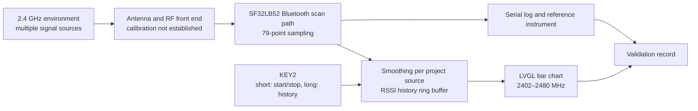

# Radiation Monitor Portable Signal-Strength Detector { #radiation-monitor-portable-signal-strength-detector }

## What Is Radiation Monitor? { #what-is-radiation-monitor }

[SiFliSparks/RadiationMonitor](https://github.com/SiFliSparks/RadiationMonitor) is a portable Bluetooth-band signal-strength viewer built on SF32LB52 and SiFli-SDK. Its firmware steps through 79 frequency points from 2402 to 2480 MHz and renders the received-strength values as an LVGL bar chart. KEY2 starts or stops scanning and browses stored history.

The project is useful for studying its Bluetooth-band scan path, real-time data processing, frequency visualization, and one-button interaction. It is not a calibrated spectrum analyzer and does not identify the source of the received signal. Nearby 2.4 GHz transmissions and measurement conditions can affect the chart. Without calibration and a controlled comparison, its values are not suitable for regulatory, certification, or precision RF measurements.

<em>Radiation Monitor 79-Point Bar-Chart Interface</em>

## Why the SF32 Implementation? { #why-the-sf32-implementation }

SF32LB52 combines dual-mode Bluetooth 5.3, a dual-core MCU, and display capabilities; the project uses SiFli-SDK and LVGL to keep frequency sampling, smoothing, history buffering, and screen updates on the device. That makes this reference a useful early experiment for an RF visualization panel, field interference indicator, or production diagnostic UI.

The repository does not specify a calibration procedure, uncertainty budget, or traceable measurement conditions. Results therefore need to be revalidated against the exact silicon, SDK and firmware revision, board, antenna, enclosure, board noise, and timing. Moving the method to another SF32LB52 board or product PCB requires renewed validation; a successful compile does not establish measurement equivalence.

## Outcome, Scope, and Entry Criteria { #outcome-scope-and-entry-criteria }

**Outcome:** reproduce the 79-point chart on version-locked SF32LB52 hardware, verify repeatable start/stop, establish the actual smoothing algorithm and depth against the pinned source, test the documented 10-record history and recovery, then collect enough evidence to decide whether calibration or custom hardware deserves investment.

This page does not interpret RSSI bar height as duty cycle, throughput, transmitter power, protocol identity, or regulatory spectrum power. It also does not claim that the repository provides a complete production design, calibration method, or explicit software license.

Before starting, have:

- an SF32LB52 display board. The project README names SF32LB52x and a `build_sf32lb52-lchspi-ulp_hcpu` output directory; SiFli’s supported-board list names `sf32lb52-lchspi-ulp` for Huangshan Pi. Record the actual board revision and verify the project’s build configuration;
- SiFli-SDK, SCons, a download path, and serial-log capture;
- a controllable 2.4 GHz source or at least two repeatable scenes, such as a selected BLE advertiser turned off and on;
- a calibrated spectrum analyzer or power instrument plus fixed antenna/distance/shielding conditions if numerical accuracy is in scope;
- a test record for screen state, serial output, board orientation, distance, power, and environment.

<em>Table: Radiation Monitor Project Contract</em>

| Area | Pinned source baseline | Evidence required before adaptation |
|:-----|:------------------------|:------------------------------------|
| Frequency scan | 79 points from 2402 to 2480 MHz | Firmware commit, SDK/board revision, and complete scan log |
| Processing | The upstream README's module description says to average the previous ten scans; its overview says 30 scans. It does not say whether the average is over linear power or dBm | Pinned source revision, averaging scale/depth, raw/smoothed results, and stable-source comparison |
| History | Ten-record circular history | Stop, page, wrap, and restart record |
| UI | LVGL bar chart with a nominal -110 to -20 dBm Y-axis | Screen capture and label-to-array mapping check |
| Measurement boundary | No traceable calibration or uncertainty is supplied | Reference-instrument, fixture, and error record, or an explicit relative-trend-only label |

## Hardware and Software Specifications { #hardware-and-software-specifications }

### Hardware Specification { #hardware-specification }

<em>Table: Radiation Monitor Hardware Specification</em>

| Component | Required specification | Role | Status | Where to get it | Compatibility and substitution notes |
|:----------|:-----------------------|:-----|:-------|:----------------|:-------------------------------------|
| SF32LB52-LCHSPI-ULP / Huangshan Pi | Start with SiFli's SCons board target `sf32lb52-lchspi-ulp`; record the exact board revision, antenna, and display assembly | Runs the Bluetooth scan, chart, controls, and history UI | Required; exact assembly must be confirmed | [Related μForge DevKit-ULP reference](../sf32-products/devkits/SF32LB52-DevKit-ULP.md); [SiFli supported-board list](https://docs.sifli.com/projects/sdk/latest/en/sf32lb52x/supported_boards/index.html); [LCKFB board page](https://lckfb.com/project/detail/lckfb-hspi-sf32lb52-ulp?param=baseInfo); [project source](https://github.com/SiFliSparks/RadiationMonitor) | The README output directory `build_sf32lb52-lchspi-ulp_hcpu` does not identify the exact PCB, antenna, or display revision |
| Host, USB data cable, and controlled power source | Host with the selected SiFli-SDK tools, data-capable cable, serial logging, and monitored supply | Build, download, observe, and repeat measurements | Required | [SiFli-SDK quick start](https://docs.sifli.com/projects/sdk/latest/sf32lb52x/quickstart/index.html) | Record port, voltage, host/tool versions, and recovery method |

### Software Specification { #software-specification }

<em>Table: Radiation Monitor Software Specification</em>

| Package or service | Required version or revision | Role | Status | Where to get it | Compatibility and update notes |
|:-------------------|:-----------------------------|:-----|:-------|:----------------|:-------------------------------|
| SiFliSparks/RadiationMonitor | Pinned commit [`670cf20`](https://github.com/SiFliSparks/RadiationMonitor/commit/670cf20b931e82b7ff1cd14fa6727e460c4f677a) | RF scan logic, 79-point chart, smoothing, and history | Required | [Repository](https://github.com/SiFliSparks/RadiationMonitor) | The README's smoothing descriptions conflict; verify the exact implementation at this commit before setting a measurement baseline |
| OpenSiFli/SiFli-SDK | Exact commit is not pinned by the project article; select and record one compatible revision | RTOS, Bluetooth scan path, display drivers, and build/download environment | Required | [Repository](https://github.com/OpenSiFli/SiFli-SDK) | A successful compile does not establish calibrated RF measurements or equivalence on another board |
| SCons and SDK host tools | Versions from the selected SiFli-SDK environment | Build and download the SF32LB52 target | Required | [SiFli-SDK quick start](https://docs.sifli.com/projects/sdk/latest/sf32lb52x/quickstart/index.html) | Record the exact build target, host OS, tool versions, and generated image |

## Choose a Supported Baseline { #choose-a-supported-baseline }

Use the pinned project commit [`670cf20`](https://github.com/SiFliSparks/RadiationMonitor/commit/670cf20b931e82b7ff1cd14fa6727e460c4f677a), not the moving `main` branch. The project README names `build_sf32lb52-lchspi-ulp_hcpu` as its output directory; SiFli’s supported-board list names `sf32lb52-lchspi-ulp` for Huangshan Pi / LCHSPI-ULP. This establishes the SDK board name, not the exact project command or tested board assembly. The README does not specify a board revision or a complete SCons command, so confirm the project build configuration during first reproduction rather than assuming every SF32LB52x board is supported.

<em>Table: Radiation Monitor Baseline Selection</em>

| Element | Baseline choice | Do not assume |
|:--------|:----------------|:--------------|
| Board | Start from the SiFli SCons board argument `sf32lb52-lchspi-ulp`; record the actual PCB and verify the project configuration | The README output directory `build_sf32lb52-lchspi-ulp_hcpu` proves every SF32LB52x antenna and display path is equivalent |
| SDK | Record the SiFli-SDK commit that builds successfully | Do not assume the newest SDK preserves the project's Bluetooth-scan behavior |
| Smoothing | Resolve the README's 30-scan versus previous-10-scan discrepancy against the pinned source; verify whether it averages linear power or dBm, and establish the depth | The module description says ten scans; the overview says 30, and neither specifies the averaging scale |
| Timing | The README reports a 30 ms data-update interval; measure the full 79-point sweep time | 30 ms is a guaranteed full 79-point update period |
| Licensing | Confirm the repository and incorporated-code licenses before reuse or distribution | Publicly visible source automatically grants product distribution rights |

!!! warning "The upstream documentation disagrees on smoothing depth"
    The README feature overview says a 30-scan average, while its module description says the previous ten scans and points to `src/BT/bt_repeat.c` as the scan module. It does not say whether the values are averaged as linear power or dBm, and its two counts do not establish which behavior the pinned code implements. Inspect that exact source revision and verify the averaging scale, buffer depth, and on-device behavior before treating either count as the measurement baseline. The README also reports a 30 ms data-update interval, which does not necessarily equal the time required to scan all 79 points.

## Delivery Map { #delivery-map }

<em>Table: Radiation Monitor Delivery Map</em>

| Stage | Decision it supports | Required output |
|:------|:---------------------|:----------------|
| 1. Untouched baseline | Can the target board scan and display all 79 points reliably? | Version, board, log, screen, and controlled-source record |
| 2. Data and recovery | Are smoothing, stop, history, and reset behavior trustworthy? | Deterministic functional and recovery tests |
| 3. Source reproduction | Can a second engineer rebuild the same image? | Clean build, image, download, and repeat result |
| 4. Measurement adaptation | Can one display or calibration change be added without hiding reference behavior? | Change, comparison data, error, and regression record |
| 5. Product review | Should it remain a trend indicator or become an instrument-development program? | Accuracy target, licensing, hardware, and risk decision |

## System Architecture and Dependencies { #system-architecture-and-dependencies }

<em>Figure: Radiation Monitor Data Path</em>

The principal failure domains are RF input/antenna, scan behavior and calibration, data processing, history buffer, button state machine, LVGL mapping, and power. One tall bar means only that the implementation observed a relatively strong receive value; without a controlled comparison, it does not identify a transmitter, modulation, or compliance state.

## Stage 1 — Establish the Untouched Scan Baseline { #stage-1-establish-the-untouched-scan-baseline }

**Goal:** prove that the selected hardware and source produce a repeatable 79-point display.

1. Lock the repository and SiFli-SDK commits, board revision, antenna, and display connection; build and download cleanly.
2. With a stable RF scene, start the device and record its initial chart, serial output, and KEY2 state.
3. Short-press KEY2 to start scanning. Confirm coverage and the X-axis references at 2402, 2441, and 2480 MHz.
4. Use a controlled BLE advertiser or another repeatable source and record source-off, source-on, distance, and board-orientation changes.
5. Reset and repeat, checking that the 79-point array and chart are not shifted or retaining stale data.

**Evidence to retain:** source/SDK/board revisions, build/download logs, environment description, source settings, distance/orientation, serial log, screen captures, and reset result.

**Gate 1 exit criterion:** two independent boots scan and display 79 points; controlled-scene changes are directionally repeatable; display indices and frequency labels have been checked.

## Stage 2 — Validate Processing, History, and Recovery { #stage-2-validate-processing-history-and-recovery }

**Goal:** prove that the UI represents an explainable data path rather than an accidental animation.

<em>Table: Radiation Monitor Functional Validation</em>

| Test | Method | Pass evidence |
|:-----|:-------|:--------------|
| Smoothing algorithm and depth | Record raw values and `rssi_res` for one frequency; compare with the pinned source and resolve the README discrepancy | Averaging scale and depth match the exact source revision and are confirmed on-device |
| Start/stop | Short-press KEY2 during scanning, then resume | Stop retains history; resume continues without a hang |
| History | While stopped, long-press KEY2 more than once | Up to ten records browse backward and wrap correctly |
| Empty history | Stop or long-press before valid history accumulates | No out-of-bounds access or crash; UI remains in a recognizable no-data state |
| Reset | Reset while scanning, stopped, and browsing history | Device returns to a known initial state without unexplained stale values |
| Interference change | Change source, distance, or shielding | Response is repeatable, with latency and peak-hold behavior recorded |

**Gate 2 exit criterion:** smoothing, history depth, button state, and reset behavior match the source; abnormal states are observable rather than silent.

## Stage 3 — Build a Reproducible Source Baseline { #stage-3-build-a-reproducible-source-baseline }

**Goal:** reproduce the Stage 2 image from a clean environment.

1. Record the project commit, SDK commit, host OS, SCons/compiler versions, and actual board argument.
2. Remove build output, reconfigure, and rebuild; save images, memory/partition output, and complete logs.
3. Flash with the generated download script and record the port, baud rate, and result.
4. Repeat on a second computer or clean directory and rerun the core Stage 2 checks.

**Gate 3 exit criterion:** the project produces a behaviorally equivalent image without untracked board files, generated files, or stale products.

## Stage 4 — Make One Controlled Measurement or UI Adaptation { #stage-4-make-one-controlled-measurement-or-ui-adaptation }

**Goal:** test one product direction without losing the original baseline.

Candidate changes include raw-value logging, explicit 1 MHz labels, peak hold, a different history selector, a calibration offset, or host export of relative trends. Change only one class at a time and retain the original image.

If adding calibration, define the reference source, frequency, input level, antenna/cable, distance, orientation, temperature, and uncertainty. One global offset is rarely enough to compensate frequency response, board variation, and enclosure effects.

**Gate 4 exit criterion:** the change passes the original 79-point, start/stop, history, reset, and controlled-source regressions; every accuracy statement names its reference instrument and conditions.

## Stage 5 — Product-Readiness Review { #stage-5-product-readiness-review }

The team must answer:

- Does the product need only relative interference trends, or traceable absolute power and uncertainty?
- Is the project's Bluetooth scan implementation documented as supported on the target silicon and SDK, and what concurrency limits apply?
- How much do antenna, enclosure, display noise, DC/DC operation, battery level, and temperature move the result?
- Can the product maintain required Bluetooth communication while scanning, or must the functions be mutually exclusive?
- Does the measured latency of a 79-point scan with source-verified smoothing meet the UI requirement?
- How will distribution and commercial rights be resolved when RadiationMonitor and incorporated code have no explicit top-level license?

**Gate 5 exit criterion:** the measurement goal, calibration plan, radio-concurrency strategy, licensing, hardware, and software ownership have named owners and a proceed/defer/stop decision.

## Handoff to Product Design { #handoff-to-product-design }

Carry forward the target SF32 device, board/antenna, the Bluetooth scan implementation and any mode/API constraints confirmed from the pinned source, frequency/data definition, raw and smoothed records, UI refresh budget, calibration fixture, power-noise tests, recovery path, and production-test boundary. Continue with [SF32LB52x](../sf32-products/chips/SF32LB52x.md), [SF32LB52-DevKit-ULP](../sf32-products/devkits/SF32LB52-DevKit-ULP.md), the [SF32LB52x Hardware Design Guide](../hardware/chip-guides/SF32LB52x_hardware_design_guide.md), and [SiFli-SDK RF Performance Tests](../develop/platforms/sifli-sdk/application-notes/rf-performance-tests.md).

## Authoritative Sources { #authoritative-sources }

- [SiFliSparks/RadiationMonitor](https://github.com/SiFliSparks/RadiationMonitor)
- [Upstream README on `main`](https://github.com/SiFliSparks/RadiationMonitor/blob/main/README.md)
- [Locked reference commit `670cf20`](https://github.com/SiFliSparks/RadiationMonitor/commit/670cf20b931e82b7ff1cd14fa6727e460c4f677a)
- [SiFli Sparks project catalogue](https://sparks.sifli.com/#projects)
- [OpenSiFli/SiFli-SDK](https://github.com/OpenSiFli/SiFli-SDK)
- [SiFli-SDK supported boards](https://docs.sifli.com/projects/sdk/latest/en/sf32lb52x/supported_boards/index.html)
- [SiFli-SDK RF test guide](https://docs.sifli.com/projects/sdk/latest/en/sf32lb52x/app_note/rf_test_guide.html)
- [SF32LB52x hardware overview](https://wiki.sifli.com/en/hardware/SF32LB52/SF32LB52-Overview-B3.html)
- [SF32LB52x SiFli-SDK quick start](https://docs.sifli.com/projects/sdk/latest/sf32lb52x/quickstart/index.html)
