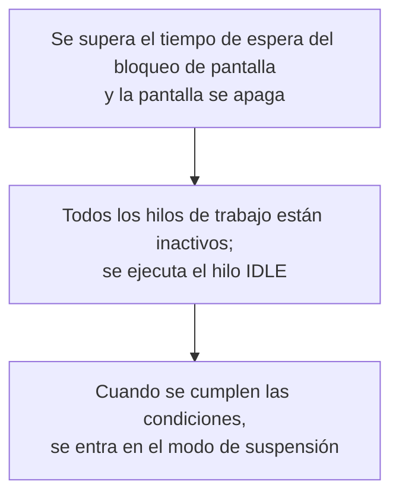
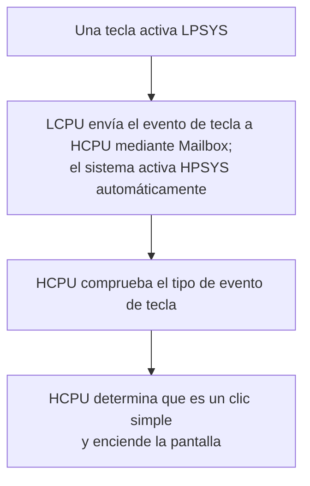

# Configurar modos de bajo consumo y medir corriente { #configure-and-measure-low-power }

Las guías de bajo consumo de SiFli-SDK abarcan varias arquitecturas SF32. SF32LB52x, SF32LB55x y SF32LB56x usan dos núcleos: HCPU, en HPSYS, funciona hasta 240 MHz para tareas de alto rendimiento, y LCPU, en LPSYS, hasta 48 MHz para Bluetooth y sensores. SF32LB57x y SF32LB58x añaden un ACPU a la arquitectura HCPU/LCPU; en SF32LB58x, la LCPU de bajo consumo funciona hasta 96 MHz. El número de núcleos, los límites de frecuencia y el comportamiento de bajo consumo varían según la familia, así que consulte la guía del SDK correspondiente al dispositivo de destino.

## Configurar el marco de gestión de energía { #configure-the-power-management-framework }

Desde el directorio del proyecto, ejecute:

```bash
sdk.py menuconfig
```

La siguiente configuración de menuconfig procede de la guía del SF32LB52x. Los nombres de los modos y las opciones disponibles pueden variar según la familia y la versión del SDK; antes de aplicarla, compruébelos en la documentación de la familia de destino.

<div align="center" markdown>

<em>Tabla: ejemplo de configuración de bajo consumo en menuconfig para SF32LB52x</em>

| Ruta de menuconfig | Símbolo | Propósito |
|---|---|---|
| `Sifli middleware → Enable Low power support` | `BSP_USING_PM` | Activa el módulo de gestión de energía de SiFli. |
| `RTOS → RT-Thread Components → Device Drivers → Using Power Management device drivers → Select PM Mode → Enable Deep Mode` | `PM_DEEP_ENABLE` | Activa la compatibilidad con el modo de suspensión profunda (Deep Sleep). |
| `Sifli middleware → Enable Low power support → Enable PM Debug` | `BSP_PM_DEBUG` | Muestra las transiciones de gestión de energía; desactívelo para las mediciones finales de corriente. |
</div>

El `rtconfig.h` generado suele incluir `RT_USING_PM`, `BSP_USING_PM` y el símbolo del modo seleccionado. Para partir de una referencia funcional, use `example/pm/classical`. Para desactivar esta función, revierta las mismas opciones de menuconfig.

Las figuras siguientes proceden de la guía de SiFli para SF32LB52x y muestran las dos ubicaciones clave en menuconfig. Para el proyecto real, tome como referencia el menú del SDK de la familia correspondiente.

{ loading="lazy" }
<div align="center"><em>Figura: Ejemplo del SF32LB52x incluido en la guía de SiFli: activar `BSP_USING_PM` en Sifli middleware → Enable Low power support.</em></div>

{ loading="lazy" }
<div align="center"><em>Figura: Ejemplo del SF32LB52x incluido en la guía de SiFli: activar `PM_DEEP_ENABLE` en RTOS → RT-Thread Components → Device Drivers.</em></div>

## Seleccionar una fuente de activación { #select-a-wake-source }

Use `pinmux.c`/`drv_io.c` de la placa y las API del ejemplo correspondiente del SDK.

<div align="center" markdown>

<em>Tabla: activación desde Deep Sleep, Standby y Hibernate, por familia</em>

| Familia | Activación desde Deep Sleep/Standby | Activación desde Hibernate |
|---|---|---|
| SF32LB52x | En Deep Sleep, cualquier pin puede activar el sistema mediante `WSR_GPIO1`; no hace falta seleccionar un pin de activación adicional. HCPU y LCPU pueden suspenderse de forma independiente. | Configure el pin y el nivel de activación de la PMU antes de llamar a `HAL_PMU_EnterHibernate()`. |
| SF32LB55x | Use el mapa de pines AON específico de 55x. | En Hibernate, solo los pines de activación `PIN0`–`PIN5` de la LCPU pueden despertar el sistema. Use `HAL_PMU_EnablePinWakeup()` con un número de pin válido para 55x. Estos pines quedan como entradas flotantes en Hibernate; añada una resistencia externa de pull-up o pull-down si el diseño de la placa lo requiere. |
| SF32LB56x | Use el mapa de pines HPAON/LPAON específico de la familia. | La PMU admite dos fuentes de activación, `PIN0` y `PIN1`, que pueden asignarse a un pin de activación de HCPU o LCPU. Consulte el ejemplo de asignación de la PMU siguiente. |
| SF32LB57x | Use el mapa de pines HPAON/LPAON específico de la familia. | La PMU admite dos fuentes de activación, `PIN0` y `PIN1`; el índice del pin de activación de Hibernate en 57x va de 0 a 13. Asigne cada fuente al pin de activación HCPU/LCPU correspondiente. |
| SF32LB58x | Use el mapa de pines HPAON/LPAON específico de la familia. | La PMU admite dos fuentes de activación, `PIN0` y `PIN1`, que pueden asignarse a un pin de activación de HCPU o LCPU. Consulte el ejemplo de asignación de la PMU siguiente. |
</div>

Para Hibernate en SF32LB52x, SF32LB56x, SF32LB57x y SF32LB58x, el ejemplo siguiente asigna una GPIO a la fuente de activación `PIN0` de la PMU. No se aplica a SF32LB55x, que usa el procedimiento independiente indicado en la tabla. En SF32LB57x, el índice del pin de activación de la PMU va de 0 a 13. Confirme la asignación elegida con el manual del dispositivo de destino y el diseño de la placa.

```c
HAL_PMU_SelectWakeupPin(0,
    HAL_HPAON_QueryWakeupPin(hwp_gpio1, BSP_KEY1_PIN));
HAL_PMU_EnablePinWakeup(0, AON_PIN_MODE_HIGH);
rt_kprintf("CR:0x%x, WER:0x%x\n", hwp_pmuc->CR, hwp_pmuc->WER);
```

La salida de Hibernate provoca un arranque en frío y establece `PM_HIBERNATE_BOOT`; no se reanuda la ejecución desde la instrucción interrumpida, a diferencia de la salida de Standby. Si un IO debe activar el sistema tanto desde Standby como desde Hibernate, configure ambas rutas. En 55x, los pines de activación desde Hibernate son entradas flotantes; añada una resistencia de pull-up o pull-down externa cuando la placa lo requiera.

## Entender los estados de suspensión { #understand-the-sleep-states }

<div align="center" markdown>

<em>Tabla: modos de suspensión y rangos de tiempo de activación de referencia</em>

| Modo del SDK | Estado de CPU/periféricos | SRAM y fuentes de activación | Rango de tiempo de activación según la guía |
|---|---|---|---|
| `PM_SLEEP_MODE_IDLE` | La CPU espera en WFI/WFE; los relojes y periféricos siguen funcionando. | La SRAM permanece accesible; cualquier interrupción puede activar el sistema. | <1 µs |
| `PM_SLEEP_MODE_LIGHT` | Se detienen los relojes de alta velocidad y el subsistema cambia a 32 kHz. | LPTIM, RTC, MAC BLE de LCPU, Mailbox o un pin de activación. | 30–100 µs |
| `PM_SLEEP_MODE_DEEP` | Similar a Light Sleep, pero la alimentación cambia a `RET_LDO`. | La retención de SRAM y las fuentes de activación dependen de la familia; consulte la tabla siguiente. | 100 µs–1 ms |
| `PM_SLEEP_MODE_STANDBY` | La CPU y sus periféricos se reinician o apagan; se conserva el estado de los pines. | La capacidad de SRAM retenida y las fuentes de activación dependen de la familia; el software identifica el arranque desde Standby mediante el estado AON. | 1–2 ms |
| Hibernate | Se apagan todos los subsistemas; el cristal de 32 kHz permanece activo. | RTC o pin de activación de la PMU; la RAM no se conserva. `HAL_PMU_EnterHibernate()`. | >2 ms |
| Shutdown | Se apagan todos los subsistemas; RC10K permanece activo. | RTC o pin de activación de la PMU; la RAM no se conserva y los IO quedan en alta impedancia. `HAL_PMU_EnterShutdown()`. | >2 ms |
</div>

<div align="center" markdown>

<em>Tabla: referencias de retención de SRAM y tiempo de activación por familia</em>

| Familia | `PM_SLEEP_MODE_DEEP` | `PM_SLEEP_MODE_STANDBY` |
|---|---|---|
| SF32LB52x | La SRAM de HPSYS y LPSYS no es accesible, pero se conserva por completo; activación en aproximadamente 250 µs. | La SRAM de LPSYS no es accesible, pero se conserva por completo; solo se conservan 384 KB de la SRAM de HPSYS, que sigue siendo inaccesible; activación en aproximadamente 1 ms. |
| SF32LB55x | La SRAM de HPSYS y LPSYS no es accesible, pero se conserva por completo; activación en aproximadamente 250 µs. | La SRAM de LPSYS no es accesible, pero se conserva por completo; solo se conservan 64 KB de la SRAM de HPSYS, que sigue siendo inaccesible; activación en aproximadamente 1,5 ms. |
| SF32LB56x | La SRAM de HPSYS y LPSYS no es accesible, pero se conserva por completo; activación en aproximadamente 250 µs. | La SRAM de LPSYS no es accesible, pero se conserva por completo; solo se conservan 64 KB de la SRAM de HPSYS, que sigue siendo inaccesible; activación en aproximadamente 1,5 ms. |
| SF32LB58x | La SRAM de HPSYS y LPSYS no es accesible, pero se conserva por completo; activación en aproximadamente 250 µs. | La SRAM de LPSYS no es accesible, pero se conserva por completo; solo se conservan 64 KB de la SRAM de HPSYS, que sigue siendo inaccesible; activación en aproximadamente 1,5 ms. |

</div>

La guía actual de bajo consumo citada no incluye una fila comparable de retención de SRAM y tiempo de activación para SF32LB57x. No extrapole al SF32LB57x las capacidades de retención ni los tiempos de otra familia; verifíquelos en la versión del SDK y la documentación del dispositivo de destino.

En la tabla anterior, `PM_SLEEP_MODE_LIGHT` corresponde a Light Sleep, `PM_SLEEP_MODE_DEEP` a Deep Sleep y `PM_SLEEP_MODE_STANDBY` a Standby, respectivamente.

Los valores por familia son referencias de las guías del SDK, no tiempos garantizados en la placa. La guía de SF32LB52x indica que, si hay PSRAM, HCPU guarda en ella los datos de la RAM que se apagará y los restaura al despertar; si no hay PSRAM, utiliza 64 KB de Retention RAM como destino de copia. Este espacio de copia es distinto de la capacidad de SRAM retenida indicada para cada familia (por ejemplo, el modo Standby de SF32LB52x especifica 384 KB de SRAM HPSYS retenida). No dé por hecho que esta política de copia ni esta capacidad se aplican a otras familias, salvo que su guía del SDK lo confirme. La corriente real también depende de los periféricos habilitados, los niveles de IO, la memoria externa y la placa.

## Controlar los relojes durante la actividad { #control-clocks-while-awake }

Si el hilo inactivo no puede entrar en un estado de suspensión, la reducción automática de frecuencia WFI puede disminuir la corriente. Solo es segura cuando EPIC, EZIP, LCDC, USB y SD están inactivos. Si la aplicación no utiliza el mecanismo del SDK para registrar la actividad de LVGL y los periféricos, indique el inicio y el fin de esa actividad mediante `rt_pm_hw_device_start()` y `rt_pm_hw_device_stop()`. Configure el divisor con `HAL_RCC_HCPU_SetDeepWFIDiv()`: las cargas de audio suelen limitar el reloj reducido a 48 MHz, mientras que otras tareas pueden usar 4 MHz. Ajuste `HPSYS_RCC_DBGR_FORCE_HP` según lo indique la guía del SDK.

Para ejecutar tareas, use `rt_pm_run_enter()`:

<div align="center" markdown>

<em>Tabla: selecciones de reloj HCPU para los modos Run</em>

| Modo | Reloj HCPU |
|---|---:|
| `PM_RUN_MODE_HIGH_SPEED` | 240 MHz |
| `PM_RUN_MODE_NORMAL_SPEED` | 144 MHz |
| `PM_RUN_MODE_MEDIUM_SPEED` | 48 MHz |
| `PM_RUN_MODE_LOW_SPEED` | 24 MHz |
</div>

`pm_scenario_start()`/`pm_scenario_stop()` aplican la política del SDK para UI y Audio: si hay una de las dos actividades, se selecciona la velocidad alta; si ninguna está activa, se selecciona la velocidad media. Mida la energía, no solo la corriente instantánea, porque una frecuencia menor puede prolongar la ejecución.

## Revisar la secuencia de suspensión entre subsistemas { #understand-inter-subsystem-sleep-sequencing }

Cuando se apaga la pantalla, HPSYS puede entrar en suspensión. En 55x/56x/58x, LPSYS suele hacerlo después de HPSYS. La familia 52x es la excepción documentada y permite que HCPU y LCPU duerman de forma independiente. Las fuentes disponibles no confirman que ACPU siga la misma secuencia en 57x; compruebe la política de sus subsistemas en la versión correspondiente del SDK. Tras la activación, `gui_resume` inicia un nuevo ciclo de decisión para apagar la pantalla. Mantenga despierto un núcleo mientras lo necesite un periférico compartido o una transacción IPC.

Active `BSP_PM_DEBUG` temporalmente y busque estos marcadores en los registros:

<div align="center" markdown>

<em>Tabla: marcadores de registro de transiciones de bajo consumo</em>

| Registro | Significado |
|---|---|
| `gui_suspend` / `gui_resume` | Transición de pantalla apagada/encendida. |
| `[pm]S: mode,gtime` | Entrada en suspensión; `gtime` se expresa en ciclos de reloj de 32 768 Hz. |
| `[pm]W: gtime` | Salida de suspensión. |
| `[pm]WSR:0x...` | Motivo de activación; consulte el manual de usuario de la familia para interpretar los bits. |
</div>

Si no se alcanza el estado de suspensión esperado, compruebe `list_thread`, `pm_dump` y `list_timer`. El hilo inactivo debe ejecutarse, ningún código debe mantener `rt_pm_request(PM_SLEEP_MODE_IDLE)`, el temporizador de SO más cercano debe quedar más allá del umbral de la política (normalmente 100 ms para HCPU y 10 ms para LCPU), no debe haber condiciones de activación activas y las colas IPC deben estar vacías. Una demora periódica inferior al umbral puede impedir la suspensión de forma indefinida.

La guía de SiFli también muestra los flujos «pantalla apagada → IDLE → suspensión cuando se cumplen las condiciones» y «una tecla activa LPSYS; después, LCPU envía el evento a HCPU por Mailbox y el sistema activa HPSYS automáticamente». Son útiles para comprobar el orden de los registros; las descripciones y el flujo son ejemplos de SF32LB52x, y no deben usarse para deducir la asignación de bits WSR de otra familia.

{ loading="lazy" }
<div align="center"><em>Figura: Opción de depuración de bajo consumo de SF32LB52x (`BSP_PM_DEBUG`).</em></div>

<div align="center"><em>Figura: Flujo de ejemplo del SF32LB52x: de pantalla apagada a suspensión.</em></div>



<div align="center"><em>Figura: Flujo de ejemplo del SF32LB52x: activación de LPSYS a HPSYS.</em></div>



## Reducir las fugas a nivel de placa { #reduce-board-level-leakage }

Mida primero el sistema mínimo: desconecte la pantalla, los sensores, el cargador y las demás cargas extraíbles; después, vuelva a conectarlas una por una. Algunas fuentes habituales de fuga son:

- un dispositivo externo que permanece alimentado;
- una salida que se mantiene en nivel alto hacia un dispositivo apagado;
- una entrada flotante o resistencias pull-up/pull-down incompatibles;
- PSRAM, NOR/NAND Flash, eMMC o SDIO que no se han puesto en su estado de bajo consumo;
- una configuración `PA01` de USB en 55x que entra en conflicto con su pull-down interno.

Implemente las transiciones específicas de la placa en `BSP_IO_Power_Down()` y `BSP_Power_Up()`. Si la alimentación de la pantalla o de la interfaz táctil debe cambiar inmediatamente al apagar/encender la pantalla, use `BSP_TP_PowerDown/Up` y `BSP_LCD_PowerDown/Up`. Si se ejecuta XIP desde NOR Flash, coloque la rutina de suspensión/activación de la memoria en RAM retenida (`HAL_RAM_RET_CODE_SECT`).

## Registrar resultados reproducibles { #measure-and-record-a-reproducible-result }

Para cada medición, registre la familia y la revisión del SDK, la revisión de la placa, la tensión de alimentación, la ubicación y el ancho de banda del medidor, la configuración del firmware, la memoria instalada, los periféricos activos, la fuente de activación, el modo de suspensión y el registro de transiciones. Indique siempre el estado y las condiciones de prueba junto con la corriente; no compare sin más un valor obtenido con otra placa o modo.

Fuentes oficiales por familia: [SF32LB52x](https://docs.sifli.com/projects/sdk/latest/sf32lb52x/app_note/low_power.html), [SF32LB55x](https://docs.sifli.com/projects/sdk/latest/sf32lb55x/app_note/low_power.html), [SF32LB56x](https://docs.sifli.com/projects/sdk/latest/sf32lb56x/app_note/low_power.html) y [SF32LB58x](https://docs.sifli.com/projects/sdk/latest/sf32lb58x/app_note/low_power.html). La [referencia de la API PMU del SDK](https://docs.sifli.com/projects/sdk/latest/en/sf32lb52x/api/hal/pmu.html) documenta el rango del índice del pin de activación de Hibernate en SF32LB57x.
