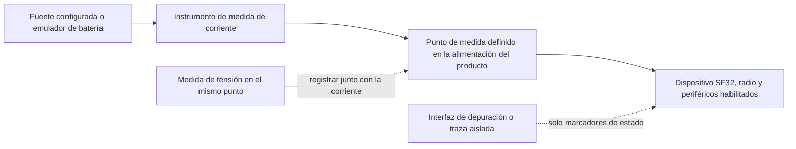
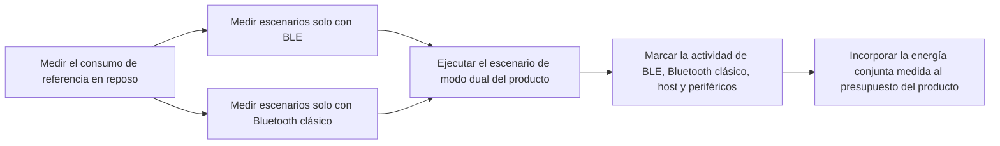

# Medición y análisis del consumo energético de Bluetooth { #bluetooth-low-power-profiling }

Este artículo explica cómo medir el **consumo real del dispositivo durante el funcionamiento Bluetooth**: Bluetooth Low Energy (BLE), Bluetooth clásico (BR/EDR) y el uso combinado de ambos en un producto de modo dual. Para cada escenario, defina el límite de medición eléctrica, registre la corriente y la tensión y recopile suficientes datos del firmware para explicar los tramos importantes de la traza.

Use las secciones sobre Bluetooth clásico y modo dual solo con dispositivos y configuraciones de firmware compatibles con BR/EDR. En un producto exclusivamente BLE se recomienda aplicar igualmente el mismo método, pero el plan de pruebas se limita a BLE.

El [Online Power Profiler for Bluetooth LE](https://devzone.nordicsemi.com/power/w/opp/2/online-power-profiler-for-bluetooth-le) de Nordic es una referencia conceptual útil para BLE. Nordic lo describe como un modelo basado en mediciones que estima valores esperados; no mide un dispositivo concreto. Las cifras de precisión publicadas solo corresponden a plataformas de referencia de Nordic y no deben extrapolarse a SF32. La herramienta tampoco modela Bluetooth clásico ni productos de modo dual. Use modelos para decidir qué medir y mida el dispositivo objetivo para determinar el consumo real del producto.

## Defina qué va a medir { #define-what-you-are-measuring }

«Consumo de Bluetooth» puede referirse a cosas muy distintas. Medir solo la radio puede ayudar a optimizar un parámetro de conexión, pero no refleja el consumo del producto completo, que también incluye el controlador, la CPU de aplicación, los sensores, la pantalla, la memoria y la fuente de alimentación.

<div align="center"><em>Tabla: Puntos de medida del consumo de Bluetooth</em></div>

<div align="center" markdown>

| Punto de medida | Qué incluye | Cuándo usarlo | Limitación |
|:---------|:-----------------|:---------------|:-----------|
| Subsistema Bluetooth o raíl seleccionado | Radio/controlador y el circuito de alimentación seleccionado | Aislar un aumento del consumo de la radio o del controlador | No representa el consumo de batería del dispositivo completo |
| Entrada de alimentación de la MCU | MCU, controlador y periféricos integrados alimentados desde ese raíl | Comparar estados del firmware en una placa controlada | No incluye componentes externos conectados a otros raíles ni las pérdidas del regulador |
| Batería o entrada principal del producto | Reguladores, MCU, memoria externa, sensores, pantalla y otras cargas | Estimar la autonomía y validar el producto | Exige controlar todas las conexiones y fuentes de alimentación del equipo |

</div>

Para estimar la autonomía del producto, mida en la batería o en la entrada principal siempre que sea posible. Registre la tensión junto con la corriente para poder calcular la potencia y la energía; una cifra de corriente aislada no indica las condiciones de alimentación.

## Prepare una prueba reproducible { #set-up-a-repeatable-test }

El instrumento y el dispositivo deben compartir un punto de medida claramente documentado. El Power Profiler Kit II (PPK II) de Nordic es un instrumento de alimentación y medida útil como referencia, siempre que sus rangos de tensión y corriente sean adecuados para la configuración. También puede usarse una unidad fuente-medida equivalente o un analizador de corriente. La calidad del procedimiento importa más que la marca del instrumento.

En el [modo Source Meter](https://docs.nordicsemi.com/r/bundle/ug_ppk2/page/ug/ppk/measure_current_source_meter.html) del PPK II, el instrumento alimenta el dispositivo; en el [modo Ampere Meter](https://docs.nordicsemi.com/r/bundle/ug_ppk2/page/ug/ppk/measure_current_ampere_meter.html), una fuente externa lo alimenta a través del instrumento. Elija el modo que corresponda al circuito de alimentación previsto. La tensión configurada no es una forma de onda registrada en el dispositivo: mida también la tensión en el punto seleccionado, especialmente si las caídas de tensión o los cambios de la batería afectan a la energía.

Compruebe los límites de funcionamiento del PPK II antes de conectar el DUT. En Source Meter, la salida se ajusta entre 0,8 y 5,0 V y la corriente máxima del DUT es de 600 mA. Ampere Meter requiere una fuente externa de 0,8–5,0 V y admite hasta 1 A de medida continua. Si el DUT puede superar los 400 mA en Source Meter, Nordic recomienda alimentar también el PPK II con una fuente USB adicional de al menos 1 A. Son límites del instrumento, no valores de funcionamiento recomendados para el dispositivo. Consulte la especificación de [corriente máxima del DUT](https://docs.nordicsemi.com/r/bundle/ug_ppk2/page/ug/ppk/ppk_max_dut_current.html) y las [recomendaciones de alimentación](https://docs.nordicsemi.com/r/bundle/ug_ppk2/page/ug/ppk/ppk_power_supply.html) de Nordic.

<div align="center"><em>Figura: Montaje para medir el consumo de Bluetooth en el dispositivo</em></div>



Antes de cada ejecución:

1. Desconecte la alimentación USB, el depurador y cualquier otra fuente que pueda puentear el instrumento o añadir carga. Mantenga únicamente las interfaces necesarias para el escenario.
2. Aplique la tensión documentada en el punto de medida elegido. Registre cada raíl alimentado, puente, módulo y dispositivo externo.
3. Use la compilación de firmware del producto y su configuración de PM prevista. Deshabilite el registro de diagnóstico de alto volumen para las mediciones finales, salvo que forme parte de la configuración de producción.
4. Para cada comparación, mantenga constantes el teléfono, los accesorios, la aplicación de prueba, la distancia, la orientación de la antena y el entorno de RF.
5. Capture una ventana suficientemente larga para incluir muchos eventos Bluetooth repetidos, no un único pulso aislado.

## Analice las fases de consumo de un evento de anuncio BLE { #read-a-ble-advertising-event-as-a-set-of-power-components }

Un evento típico de anuncio BLE no consiste en un único pulso de radio. Comienza con una breve fase de encendido y preparación, seguida de la puesta en marcha y estabilización del oscilador de cristal de alta frecuencia. Cuando la alimentación y los relojes están listos, el dispositivo permanece en Standby hasta la hora programada para iniciar la radio. En el ejemplo escaneable o conectable que se muestra aquí, inicia la radio, transmite por uno de los canales primarios de anuncio y abre una ventana de recepción en ese mismo canal. Después de las dos primeras ventanas de recepción, vuelve a Standby antes de transmitir por el canal siguiente; tras la última ventana, realiza el posprocesamiento. Un evento no conectable y no escaneable no escucha solicitudes. Las etapas reales dependen del tipo de anuncio configurado y del mapa de canales utilizado.

La secuencia completa representada es: Preprocesamiento → Arranque del cristal → Standby → Inicio de radio → Transmisión (TX) → Cambio TX/RX → Recepción (RX) → Standby → Transmisión (TX) → Cambio TX/RX → Recepción (RX) → Standby → Transmisión (TX) → Cambio TX/RX → Recepción (RX) → Posprocesamiento. La radio se inicia una sola vez; las transmisiones por los canales 38 y 39 comienzan después del periodo de Standby posterior a la ventana RX del canal anterior. La secuencia toma como referencia las etapas del [ejemplo ilustrativo de Nordic sobre un evento típico de anuncio BLE](https://devzone.nordicsemi.com/power/w/opp/2/online-power-profiler-for-bluetooth-le). Son fases genéricas de un evento BLE, no estados de radio propios de Nordic, y este redibujo no añade otros estados. Los niveles de corriente y las proporciones temporales son ilustrativos, no mediciones de SF32. Mídalos en el dispositivo objetivo.

<div align="center"><em>Figura: Etapas de un evento de anuncio BLE</em></div>


La ilustración representa un evento de anuncio heredado, escaneable o conectable, que usa los tres canales primarios, 37, 38 y 39; no muestra la interacción posterior a una solicitud recibida. Las etiquetas de canal son ilustrativas: la especificación Bluetooth Core permite usar los índices de canal primario habilitados en cualquier orden, mientras que el mapa configurado determina cuáles se utilizan. Un evento suele enviar una PDU de anuncio en cada índice utilizado, y como máximo una por índice. Las tres transmisiones son copias de los datos de anuncio en distintos canales, no reintentos sujetos a confirmación. En los eventos escaneables o conectables, la capa de enlace escucha solicitudes permitidas en el mismo canal primario; los eventos no escaneables y no conectables no escuchan solicitudes. Consulte la [especificación de la capa de enlace de Bluetooth Core 6.2](https://www.bluetooth.com/wp-content/uploads/Files/Specification/HTML/Core-62/out/en/low-energy-controller/link-layer-specification.html) y la [introducción de Bluetooth SIG](https://www.bluetooth.com/bluetooth-le-primer/). Los anuncios extendidos, otro mapa de canales o la recepción de una solicitud pueden producir una traza distinta; verifique el comportamiento configurado en el dispositivo objetivo.

<div align="center"><em>Tabla: Etapas de consumo en un evento de anuncio BLE</em></div>

<div align="center" markdown>

| Etapa | Principales actividades y fuentes de consumo | Qué medir y verificar |
|:------|:----------------------------|:---------------|
| Preprocesamiento | Breve fase de encendido, que puede implicar una corriente relativamente alta, además de la preparación de la CPU y del controlador, la gestión de la carga útil, DMA, el acceso a memoria y la configuración de periféricos | `I_pre` y `t_pre`; identifique las tareas necesarias para despertar y encender el sistema, y elimine o agrupe las que puedan evitarse |
| Arranque del cristal de alta frecuencia | Inicio y estabilización del reloj de alta frecuencia | `I_xtal` y `t_xtal`; compruebe que la política de reloj y la secuencia de activación no duren más de lo necesario |
| Standby | Estado de bajo consumo elegido cuando la alimentación y los relojes ya están listos, junto con la lógica de retención, la temporización de baja frecuencia y las fuentes de activación habilitadas | Mida `I_standby`, la espera inicial en Standby antes del arranque de radio y los periodos de Standby entre canales posteriores a RX; no equipare esta corriente interna con la corriente de reposo entre eventos completos |
| Inicio de radio | Preparación de la radio y del controlador, y ruta de alimentación de RF necesaria antes de la primera transmisión | `I_start` y `t_start`; detecte preparativos innecesarios o tareas de inicio repetidas |
| TX de radio | Ruta de transmisión, trabajo del controlador y envío de paquetes de anuncio por los canales 37, 38 y 39 | Mida `I_tx` y `t_tx` de cada paquete; la potencia TX, la longitud del paquete y los canales habilitados determinan la energía de los paquetes y del evento |
| Cambio de radio | Conmutación de transmisión a recepción y transición de estado del controlador | `I_switch` y `t_switch`; contabilice cada transición, no la trate como tiempo sin coste |
| RX de radio, si se habilita | Ruta de recepción y trabajo del controlador mientras espera una solicitud de escaneo o conexión | `I_rx` y `t_rx`; inclúyalo solo si el tipo de anuncio y su configuración abren ventanas de recepción |
| Posprocesamiento | Callbacks del protocolo, trabajo de CPU, acceso a memoria y periféricos, y respuesta de la aplicación antes de volver al estado de bajo consumo | `I_post` y `t_post`; compruebe que los relojes, las restricciones de PM y los componentes externos se desactiven a tiempo |

</div>

En un dispositivo SF32, use estos nombres de etapa para orientar los marcadores de la traza; no los interprete como estados de radio propios de Nordic ni como valores de corriente o duración predeterminados. Solo habrá recepción si el tipo y la configuración de anuncio abren ventanas de escucha; confírmelo en la traza del dispositivo objetivo.

La energía de un evento completo es la integral temporal de la potencia instantánea, es decir, del producto de la tensión por la corriente:

```text
E_event = sum(V_stage x I_stage x t_stage)
```

Con una tensión de alimentación constante, el consumo medio de una configuración periódica de anuncio puede aproximarse así:

```text
Q_event = sum(I_stage x t_stage)
I_average = (Q_event + I_idle x (T_cycle - t_event)) / T_cycle
```

`Q_event` incluye la carga de todas las etapas del evento completo, también sus periodos internos de Standby; `t_event` es la duración total del evento. `I_idle` es la corriente medida entre eventos completos, no la `I_standby` interna del evento. `T_cycle` es el intervalo medido entre el inicio de un evento y el siguiente, incluidos el retardo de anuncio y los efectos de la planificación. Si los intervalos varían, integre una traza larga y representativa en lugar de tomar el intervalo configurado como un periodo exacto.

A tensión constante, duplicar la corriente medida o la duración de una etapa duplica su energía. Las ráfagas breves de TX, RX e inicio pueden dominar la energía del evento; con intervalos largos, el reposo entre eventos puede dominar la corriente media. Marque las etapas mediante GPIO o eventos de firmware de baja sobrecarga y mida en la entrada de alimentación del producto completo antes de elegir qué optimizar.

Bluetooth clásico tiene una temporización de protocolo diferente, pero se aplica la misma disciplina de medición. La especificación Bluetooth Core define Inquiry Scan y Page Scan como procedimientos de escaneo distintos, y Sniff como un modo ACL con conexión que reduce las ranuras de escucha del lado Peripheral a las oportunidades Sniff programadas; el tráfico del dispositivo remoto puede prolongar la actividad más allá del intervalo de anclaje (anchor interval). Son comportamientos de temporización, no estimaciones de corriente. Mida en el dispositivo objetivo la política de escaneo configurada, los parámetros Sniff y la actividad real del dispositivo remoto y de la aplicación. Consulte la [BR/EDR Baseband Specification](https://www.bluetooth.com/wp-content/uploads/Files/Specification/HTML/Core-62/out/en/br-edr-controller/baseband-specification.html) y [HCI Scan Enable](https://www.bluetooth.com/wp-content/uploads/Files/Specification/HTML/Core-62/out/en/host-controller-interface/host-controller-interface-functional-specification.html).

## Prepare un plan de medición para cada modo { #build-a-mode-specific-measurement-plan }

No trate «Bluetooth activado» como un único estado de funcionamiento. BLE y Bluetooth clásico emplean distintos procedimientos de conexión y bajo consumo. En un producto de modo dual, ambos modos pueden compartir el tiempo de radio, los recursos del controlador, los relojes, la memoria y el trabajo de la aplicación. Empiece con los escenarios reproducibles más sencillos y mida después el funcionamiento combinado que se usará en el producto.

<div align="center"><em>Tabla: Escenarios Bluetooth que deben medirse</em></div>

<div align="center" markdown>

| Capacidad de radio | Escenario | Qué definir antes de medir | Resultado a conservar |
|:-----------------|:---------|:--------------------------------|:-----------------|
| BLE | Anuncios, conexión inactiva, transferencia de datos y reconexión | Rol, intervalo, potencia TX, carga útil, dispositivo remoto y condiciones de inicio y fin | Corriente media, energía por evento y energía por acción completada |
| Bluetooth clásico (BR/EDR) | Escaneo | Si están habilitados Inquiry Scan, Page Scan o ambos; política de visibilidad y conexión | Corriente media y energía durante un periodo de escaneo representativo |
| Bluetooth clásico (BR/EDR) | Modo Sniff con conexión activa | Parámetros Sniff, dispositivo remoto, estado del enlace y actividad de la aplicación en segundo plano | Corriente media y energía a lo largo de varios intervalos Sniff |
| Bluetooth clásico (BR/EDR) | Perfil con tráfico activo | Perfil y rol, por ejemplo, datos SPP/PAN o audio A2DP/HFP; duración de la transferencia o de la sesión de audio | Energía por transferencia o sesión completada y potencia media sostenida |
| Modo dual | BLE y Bluetooth clásico en uso conjunto | Enlaces activos, parámetros, carga de trabajo en primer plano y comportamiento durante transiciones y reconexiones | Potencia media combinada y energía del escenario completo del producto |

</div>

La [prueba de consumo BLE/BT](https://docs.sifli.com/projects/sdk/latest/en/sf32lb52x/example/pm/bt/README.html) de SiFli es una referencia útil: cubre los anuncios y los modos de conexión BLE, además de los modos Scan y Sniff de Bluetooth clásico. El resultado obtenido en una placa no es una especificación del producto. Use la placa compatible, el pin de activación, la consola y la configuración de PM documentados para repetir la prueba; después reproduzca en el hardware objetivo el rol, el dispositivo remoto, el tráfico y la política de energía del producto.

## Mida BLE como modo de radio independiente { #profile-ble-as-a-standalone-radio-mode }

Empiece midiendo solo BLE. Así establecerá una referencia sin que el tráfico de perfiles de Bluetooth clásico ni la planificación entre modos dificulten la interpretación de la traza.

<div align="center"><em>Tabla: Escenarios BLE independientes</em></div>

<div align="center" markdown>

| Escenario | Configuración | Qué calcular | Causa típica de un resultado engañoso |
|:---------|:------|:------------------|:-------------------------------------|
| Anuncio | Dispositivo no conectado que emite anuncios con un tipo y una configuración de canales documentados | Corriente media y energía por intervalo de anuncio | El comportamiento de escaneo del teléfono, el tráfico de depuración o una política que no reduce gradualmente la frecuencia de anuncio |
| Conectado en reposo | Dispositivo conectado, sin transferencia de la aplicación; registre si se usan emparejamiento, vinculación persistente y cifrado | Corriente media a lo largo de varios intervalos de conexión | La CPU de aplicación se activa en cada evento de conexión, o siguen activos temporizadores y notificaciones |
| Interacción del usuario | Un comando GATT representativo, una transferencia de datos del sensor o una acción iniciada desde la interfaz | Energía por acción completada y consumo adicional frente al estado inactivo | Medir solo la radio y omitir el trabajo del host, la pantalla o el sensor |
| Transferencia en ráfaga u OTA | Carga útil definida y condición de finalización especificada | Energía por byte o por transferencia completada, y duración total | Tomar la tasa máxima como representativa de toda la transferencia |
| Desconexión y reconexión | El dispositivo remoto BLE sale del alcance, vuelve y se reconecta | Energía y tiempo necesarios para recuperar la conexión | Reintentos ilimitados o una política de anuncio agresiva que no se reduce con el tiempo |

</div>

Registre el rol BLE, el dispositivo remoto, los parámetros de conexión o de anuncio, la potencia TX, la carga útil, el desencadenante y la condición de fin, así como la frecuencia de uso real. Sin estos datos, no se pueden comparar trazas de distintas versiones del firmware.

## Mida Bluetooth clásico como modo de radio independiente { #profile-classic-bluetooth-as-a-standalone-radio-mode }

En un producto de modo dual, mida Bluetooth clásico por separado antes de añadir BLE. Así podrá caracterizar los modos Scan y Sniff y el trabajo propio de cada perfil sin que se mezclen con los eventos BLE.

<div align="center"><em>Tabla: Escenarios independientes de Bluetooth clásico</em></div>

<div align="center" markdown>

| Escenario | Configuración | Qué calcular | Causa típica de un resultado engañoso |
|:---------|:------|:------------------|:-------------------------------------|
| Escaneo | Está activa la política del producto: Inquiry Scan, Page Scan o ambas | Corriente media y energía durante un periodo de escaneo representativo | Mantener una política de escaneo más agresiva que la prevista para el producto |
| Modo Sniff con conexión activa | Un enlace de Bluetooth clásico entra en la configuración Sniff prevista | Corriente media a lo largo de varios intervalos Sniff | Medir un enlace que sigue activo por tráfico del dispositivo remoto o por trabajo de la aplicación |
| Perfil con tráfico activo | Una transferencia SPP/PAN, una transmisión A2DP, una llamada HFP u otra actividad prevista para el producto | Energía por transferencia o sesión completada y potencia media sostenida | Medir solo la radio y omitir el códec, el amplificador, la pantalla, la memoria o el trabajo del host que requiere el perfil |
| Desconexión y reconexión | El dispositivo remoto de Bluetooth clásico sale del alcance, vuelve y se reconecta | Energía y tiempo necesarios para recuperar la conexión | Reintentos ilimitados o una política de búsqueda que permanece activa indefinidamente |

</div>

Registre el rol de Bluetooth clásico, el dispositivo remoto, la política Scan o Sniff, la potencia TX, el perfil, la carga útil o duración de la sesión, el desencadenante y la condición de fin, y la frecuencia de uso real. En los perfiles de audio, el límite de medición debe incluir la ruta de audio que utiliza realmente el producto.

## Mida el modo dual como un escenario independiente { #measure-dual-mode-behavior-as-its-own-scenario }

No estime el consumo del modo dual sumando sin más una medición BLE y otra de Bluetooth clásico. Ambos modos pueden compartir el tiempo de radio, el procesamiento del controlador, los relojes, la memoria y las activaciones de la aplicación. Por eso, el resultado conjunto puede diferir notablemente de la suma de los promedios medidos por separado.

<div align="center"><em>Figura: Secuencia de medición de Bluetooth en modo dual</em></div>



Una vez que haya caracterizado BLE y Bluetooth clásico por separado, mida el producto en modo dual. Por ejemplo, si mantiene un enlace BLE mientras transmite audio mediante Bluetooth clásico, mida lo siguiente con el mismo hardware y el mismo dispositivo remoto:

1. La política de conexión BLE en reposo, por sí sola.
2. La transmisión de audio o datos por Bluetooth clásico, por separado.
3. El estado estable combinado real, incluyendo el tráfico BLE previsto.
4. Las transiciones hacia y desde el estado combinado, más el comportamiento de recuperación de errores y reconexión.

Los marcadores de la traza deben identificar los eventos BLE, el trabajo del perfil Bluetooth clásico, los callbacks de la aplicación, el procesamiento de audio o datos y los cambios de estado de PM. Así se distingue la planificación de radio del trabajo del sistema que esta provoca y se detectan interacciones inesperadas, como un callback BLE que impide que la CPU de aplicación vuelva al estado de bajo consumo durante una sesión de Bluetooth clásico.

## Relacione la traza con el comportamiento del firmware { #correlate-the-trace-with-firmware-behavior }

Para conocer el consumo real del dispositivo, hay que relacionar cada variación de la traza con la actividad correspondiente. Marque o registre el inicio y el final de las tareas del producto para poder determinar por qué cambia la corriente:

- Antes y después de una transferencia iniciada por la aplicación o una ráfaga de notificación.
- Al habilitar o deshabilitar la pantalla, los sensores, la memoria Flash, la ruta de audio u otro componente externo.
- Cuando el firmware solicita un estado de PM y cuando el dispositivo realmente entra en él.
- Cuando comienza una secuencia de reconexión, reintento o recuperación de errores.

Use un marcador GPIO para la traza, un marcador de evento de bajo impacto o un script de prueba reproducible. Los registros por puerto serie ayudan durante la puesta en marcha, pero también pueden alterar el consumo. En las mediciones finales, controle el registro como una variable de prueba; no presuponga que observar el sistema carece de efecto.

<div align="center"><em>Tabla: Cómo interpretar una traza de consumo de Bluetooth</em></div>

<div align="center" markdown>

| Observación de traza | Significado probable | Verificar en firmware o hardware |
|:------------------|:---------------|:-------------------------------|
| Pulsos breves y regulares sobre un consumo de referencia bajo | Eventos programados de anuncio o conexión BLE, o actividad Scan/Sniff de Bluetooth clásico | Modo, intervalo, política Scan/Sniff, rol de radio y estado real de bajo consumo entre eventos |
| Una ráfaga más grande inmediatamente después de cada evento de radio | Callback del host, procesamiento de protocolo o trabajo de aplicación | Qué callback se ejecuta, si los datos son útiles y si el trabajo se puede agrupar |
| Actividad continua o muy frecuente durante una sesión de Bluetooth clásico | Tráfico activo de un perfil, a menudo con procesamiento adicional del host, audio o datos | Perfil, ruta de códec o datos, tráfico del dispositivo remoto, relojes de audio, componentes externos y duración de la sesión medida |
| Ráfagas BLE y Bluetooth clásico intercaladas | Planificación del modo dual o trabajo asociado del host | Qué enlace provoca cada tramo, qué trabajo comparten y si alguno de los modos retrasa la entrada en bajo consumo o aumenta los reintentos |
| La corriente sigue alta después del evento esperado | Una restricción de PM, un periférico o una interfaz externa sigue activo | Restricciones de PM, temporizadores, relojes, estado de los pines, alimentación de pantalla o sensores y rutas de error |
| Ráfagas largas esporádicas | Reintentos, escaneo, reconexiones, tráfico del dispositivo remoto o actividad del usuario | Condiciones de RF, comportamiento del dispositivo remoto, política de espera progresiva y reintentos, y script de prueba |
| Cambia el consumo de referencia al conectar un módulo o cable | Ha cambiado el punto de medida eléctrico | Rutas de alimentación inversa, adaptadores UART, resistencias externas de polarización, raíles del módulo y distribución de alimentación |

</div>

## Calcule la energía real y el consumo diario { #calculate-actual-energy-and-daily-consumption }

Para una traza variable, calcule la energía integrando la corriente y la tensión a lo largo del tiempo:

```text
E_scenario = integral(V(t) x I(t) dt)
P_average = E_scenario / T_scenario
```

Si la tensión permanece constante en el punto de medida, también puede comparar la corriente media. Aun así, conserve el registro de tensión, especialmente si alterna entre un raíl regulado y la entrada de batería.

Para un escenario de producto repetido:

```text
E_day = sum(E_scenario x events_per_day) + E_mode_idle + E_other_states
```

Divida el día en periodos que no se solapen. `E_mode_idle` y `E_other_states` deben cubrir solo el tiempo que no esté ya incluido en las energías completas de los escenarios. Cuando BLE y Bluetooth clásico funcionen a la vez, use un escenario combinado medido, no la suma de los modos aislados. Si el modelo ya incluye el consumo base de las 24 horas, añada solo la energía adicional de cada acción por encima de esa base, no su energía completa. Con voltios, amperios y segundos, el resultado está en julios; divídalo entre 3600 para convertirlo a Wh.

La energía del escenario debe incluir todo el trabajo que el dispositivo necesita para completarlo. Por ejemplo, una notificación del teléfono puede requerir un evento de conexión, procesamiento del host, acceso a un sensor o a la memoria Flash, una actualización de pantalla y la vuelta al estado de bajo consumo. Medir solo el pulso de RF subestima el consumo del dispositivo; medir el producto completo sin marcadores en la traza impide identificar qué lo provoca.

## Ajuste el modelo con las mediciones del dispositivo { #reconcile-the-model-with-the-device }

Use el modelo inicial para priorizar los posibles factores de consumo y actualícelo con mediciones reales. Las diferencias entre la estimación y la traza ayudan a localizar un evento omitido, una duración incorrecta, una activación inesperada o una carga externa que no se había contabilizado.

<div align="center"><em>Figura: Ciclo de verificación del consumo medido de Bluetooth</em></div>


<div align="center"><em>Tabla: Preguntas para conciliar el modelo con las mediciones</em></div>

<div align="center" markdown>

| Discrepancia entre modelo y medición | Preguntas a responder |
|:--------------------------------|:-------------------|
| La corriente media supera la estimación | ¿El dispositivo entra en el estado de PM solicitado? ¿Los temporizadores, los registros o los relojes de los periféricos lo mantienen activo? |
| La energía del evento supera la estimación | ¿El host, la pantalla, el sensor, la memoria o la lógica de reintento han añadido trabajo? ¿Las condiciones de RF provocan reintentos o exigen más potencia de transmisión? |
| El reposo de BLE o Bluetooth clásico es el principal factor de consumo | ¿Los parámetros de conexión BLE, la política Scan/Sniff, la frecuencia de notificaciones y las activaciones de la aplicación son adecuados para ese estado del producto? |
| El resultado en modo dual difiere de la suma de las pruebas por separado | ¿Qué intervalos de radio, tareas del controlador, relojes compartidos, callbacks de la aplicación, rutas de audio o datos y restricciones de PM se solapan o impiden el bajo consumo? |
| La reconexión domina el consumo | ¿El producto limita los reintentos y aplica una espera progresiva (backoff) y una política de búsqueda realistas? |
| La placa y el producto final no coinciden | ¿En qué difieren los raíles externos, las pérdidas de los reguladores, los módulos, la antena o la carcasa, y las resistencias de polarización de las interfaces? |

</div>

## Parta de una referencia reproducible de SiFli { #start-from-a-repeatable-sifli-baseline }

Use los ejemplos de SiFli-SDK para obtener un estado Bluetooth reproducible antes de medir el firmware del producto. La placa admitida, el recorrido de alimentación, la configuración de puentes, los ajustes del SDK y el procedimiento de prueba sirven como referencia; no constituyen especificaciones del producto.

<div align="center"><em>Tabla: Recursos de SiFli-SDK para iniciar la medición del consumo Bluetooth</em></div>

<div align="center" markdown>

| Qué medir | Ejemplo oficial de referencia | Qué validar después en el producto |
|:-------------------|:------------------------|:----------------------------|
| Anuncios y conexión BLE | [Prueba de consumo de anuncios y conexión BLE](https://docs.sifli.com/projects/sdk/latest/en/sf32lb52x/example/pm/ble/README.html) | Política de anuncio del producto, parámetros de conexión, callbacks, comportamiento del dispositivo remoto y antena |
| Scan y Sniff de Bluetooth clásico | [Prueba de consumo BLE/BT](https://docs.sifli.com/projects/sdk/latest/en/sf32lb52x/example/pm/bt/README.html) | Política Scan del producto, ajustes Sniff, comportamiento del dispositivo remoto y estado real del enlace inactivo |
| Tráfico de perfiles Bluetooth clásico | [Ejemplos Bluetooth del SDK](bluetooth-sdk-examples.md) | Transferencia SPP/PAN o sesión A2DP/HFP real, incluido el trabajo necesario del host, el audio, la memoria y los componentes externos |
| Funcionamiento del producto en modo dual | [Prueba de consumo BLE/BT](https://docs.sifli.com/projects/sdk/latest/en/sf32lb52x/example/pm/bt/README.html) y el ejemplo de perfil más cercano al producto | Comportamiento exacto de BLE y Bluetooth clásico, concurrente o alternado, incluidas las transiciones, el procesamiento compartido y la política de PM del producto |
| Servicio GATT conectado | [Periférico BLE (BLE Peripheral)](https://docs.sifli.com/projects/sdk/latest/sf32lb58x/example/ble/peripheral/README.html) | Características reales, cadencia de notificación, seguridad e interacción con el teléfono |
| Transferencia de datos BLE | [Rendimiento BLE (BLE Throughput)](https://docs.sifli.com/projects/sdk/latest/sf32lb58x/example/ble/throughput/README.html) | Energía por carga útil completada y tiempo de finalización de extremo a extremo |
| Otros flujos de trabajo de Bluetooth | [Ejemplos de SDK de Bluetooth](bluetooth-sdk-examples.md) | El rol/perfil de Bluetooth clásico, BLE, o LE Audio más cercano antes de la integración de producto |

</div>

## Lista de comprobación antes de liberar el producto { #release-review-checklist }

- [ ] El punto de medida y la tensión de alimentación están documentados.
- [ ] Se registraron la corriente y la tensión para cada escenario relevante para la liberación.
- [ ] Se controlaron o incluyeron explícitamente las fuentes USB, del depurador, de los adaptadores UART y de los módulos externos.
- [ ] Las trazas están correlacionadas con los eventos de firmware, las solicitudes de estado de PM y los estados a los que entra realmente el dispositivo.
- [ ] Se han medido los anuncios y el reposo con conexión BLE, y los modos Scan/Sniff de Bluetooth clásico, según corresponda.
- [ ] Cada perfil de datos o audio Bluetooth clásico de producción tiene una carga de trabajo definida y medida.
- [ ] Los escenarios de modo dual se han medido con ambos modos en funcionamiento, en lugar de estimarse sumando sus resultados por separado.
- [ ] Se ha medido el comportamiento representativo de transferencia, desconexión y reconexión donde corresponda.
- [ ] La energía de cada escenario se ha convertido a consumo diario con una frecuencia de uso realista y se ha contrastado con el presupuesto de energía de la batería.
- [ ] El principal factor de consumo tiene un responsable y una decisión documentada: optimizarlo o aceptarlo.

## Recursos relacionados { #related-resources }

- [Resumen de Bluetooth](overview.md) para BLE, Bluetooth clásico, perfiles, seguridad y coexistencia del sistema.
- [Ejemplos de SDK de Bluetooth](bluetooth-sdk-examples.md) para seleccionar proyectos de Bluetooth clásico, BLE y LE Audio.
- [Resumen del diseño de bajo consumo](../low-power/overview.md) para el diseño de PM y el presupuesto de energía completo del producto.
- [Medición y validación del consumo energético](../low-power/measurement-and-validation.md) para el flujo de trabajo de validación de componente a producto.
- [Análisis del consumo energético de un reloj inteligente](../low-power/smartwatch-power-profiling.md) para consultar un modelo energético de uso diario.
