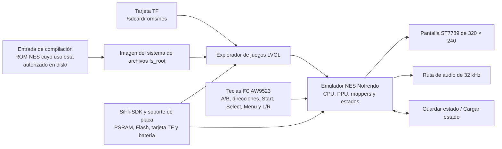

# Consola portátil Pocket Pi SF32 { #pocket-pi-sf32-handheld-game-console }

!!! note "Commit de referencia fijado"
    Salvo que se indique lo contrario, las referencias al comportamiento del código en este artículo corresponden al commit de PocketPi [`7d9fac2`](https://github.com/SiFliSparks/PocketPi/commit/7d9fac2cb577d6c9b66a99521aebf3c9de0ae163). La rama upstream `main` puede cambiar; para reproducir estos detalles, use el commit fijado.

## ¿Qué es Pocket Pi? { #what-is-pocket-pi }

[SiFliSparks/PocketPi](https://github.com/SiFliSparks/PocketPi) es una referencia de consola portátil y emulador para SF32LB52. La revisión fijada integra el emulador NES Nofrendo, un explorador de juegos LVGL, una ruta de pantalla ST7789 8080 de 320 × 240, audio, guardado y carga de estados, un sistema de archivos integrado y un directorio de ROM en tarjeta TF. La compilación pública usa como base Huangshan Pi / `sf32lb52-lchspi-ulp`.

Resulta útil para probar cómo conviven los gráficos locales, la entrada, el audio, el almacenamiento externo, la asignación de PSRAM y la carga del emulador en un sistema SF32LB52. El repositorio no incluye ROM comerciales; cada usuario debe aportar archivos `.nes`/`.NES` cuyo uso tenga autorizado. El código fuente público tampoco constituye un diseño de consola portátil listo para producción ni sustituye las revisiones de seguridad de la batería, audio, EMC, aspectos térmicos, licencias o distribución de contenido.


<div align="center"><em>Pocket Pi ejecutando un juego NES en SF32LB52</em></div>

## ¿Por qué la implementación en SF32? { #why-the-sf32-implementation }

La emulación NES reúne varios retos habituales del desarrollo embebido en una carga de trabajo fácil de entender: la emulación de CPU, los gráficos PPU, el muestreo de audio, la entrada de baja latencia, la lectura de archivos, el búfer de cuadros y los estados guardados deben funcionar en conjunto. Un sistema basado en SF32LB52 aporta los recursos de pantalla, audio, almacenamiento externo y PSRAM necesarios para esta carga; Huangshan Pi también ofrece una plataforma de evaluación alimentada por batería.

Esto no significa que todos los títulos NES sean totalmente compatibles. La compatibilidad con los mappers de las ROM, la tasa de cuadros, el audio, el guardado, el pico de memoria y la latencia de entrada pueden variar según el juego. Cada ROM o mapper que se añada requiere su propia decisión de compatibilidad y derechos de autor.

## Resultado, alcance y criterios de entrada { #outcome-scope-and-entry-criteria }

**Resultado:** generar una imagen reproducible a partir del commit de PocketPi fijado en la especificación de software, iniciar al menos una ROM de prueba cuyo uso esté autorizado, validar pantalla, entrada, audio, pausa, guardado, carga, salida y recuperación, y completar una adaptación acotada.

Esta página no garantiza la compatibilidad con todos los mappers NES, la temporización PAL/NTSC, la ruta de audio de los juegos, el formato de guardado ni ROM de terceros. Tampoco concede derechos para copiar o distribuir contenido de juegos. La revisión fijada del repositorio no contiene un archivo de licencia en el directorio raíz. Antes de incorporar código a un producto o distribuir binarios, alguien responsable debe determinar las licencias de PocketPi, Nofrendo y cada componente de terceros integrado.

Antes de empezar, tenga preparado:

- [SF32LB52-DevKit-ULP / Huangshan Pi](../sf32-products/devkits/SF32LB52-DevKit-ULP.md), o hardware compatible con la definición de placa `sf32lb52-lchspi-ulp` del repositorio;
- la pantalla de 320 × 240, el expansor de entrada I²C AW9523, las teclas, el audio y la ruta opcional de tarjeta TF que espera el código fijado; el nombre de la placa no garantiza que todos los periféricos estén montados;
- SiFli-SDK, SCons y herramientas de descarga por UART y de registro;
- una ROM de prueba `.nes` propia, de dominio público o con licencia adecuada;
- la ROM en `disk/` del repositorio para el sistema de archivos integrado o en el directorio de ROM de la tarjeta TF configurado por el firmware. La revisión fijada busca ROM durante la ejecución en `/sdcard/roms/nes`; compruebe en esa revisión que la ruta coincida con el punto de montaje de la tarjeta;
- medios para observar la fluidez de imagen, el audio, la entrada, la memoria y la corriente.

<div align="center"><em>Tabla: base fijada y evidencias necesarias antes de adaptar Pocket Pi</em></div>

<div align="center" markdown>

| Área | Base del código fijado | Evidencia necesaria antes de adaptar |
|:-----|:-----------------------|:-------------------------------------|
| Placa | `sf32lb52-lchspi-ulp` | Revisiones de placa, expansor, pantalla, audio, almacenamiento y alimentación |
| Contenido | En la revisión fijada, el explorador solo detecta archivos `.nes` y `.NES`; un `.jpg` con el mismo nombre puede aportar la portada | Procedencia/licencia de la ROM, hash, mapper y procedencia de la imagen |
| Almacenamiento | Convierte `disk/` en `fs_root`; también busca `/sdcard/roms/nes` durante la ejecución | Imagen del sistema de archivos, formato de la tarjeta TF, directorio y registro de recuperación ante errores |
| Entrada | En la revisión fijada, el código lee A/B, direcciones, Start, Select, Menu, L/R y teclas relacionadas mediante un expansor I²C AW9523 | Esquemático/definición de pines, matriz completa de teclas y resultados con varias teclas simultáneas |
| Emulador | Núcleo NES Nofrendo, pantalla, ruta de audio de 32 kHz y guardado/carga de estados | Compatibilidad de juegos y evidencias de cuadros, audio, estados, memoria y reinicio |

</div>

## Especificaciones de hardware y software { #hardware-and-software-specifications }

### Especificación de hardware { #hardware-specification }

<div align="center"><em>Tabla: Especificación de hardware de Pocket Pi</em></div>

<div align="center" markdown>

| Componente | Especificación necesaria | Función | Estado | Dónde obtenerlo | Compatibilidad y notas sobre sustituciones |
|:-----------|:-------------------------|:--------|:-------|:----------------|:-------------------------------------------|
| Base Huangshan Pi / SF32LB52-DevKit-ULP | Destino `sf32lb52-lchspi-ulp`; el código del proyecto en la revisión fijada requiere una ruta de pantalla ST7789 de 320 × 240, expansor de entrada I²C AW9523, audio e interfaz para tarjeta TF | Ejecuta el emulador y sus funciones de pantalla, entrada, audio y almacenamiento | Obligatorio | [Referencia de la placa en μForge](../sf32-products/devkits/SF32LB52-DevKit-ULP.md); [página de LCKFB](https://lckfb.com/project/detail/lckfb-hspi-sf32lb52-ulp?param=baseInfo); [código del proyecto](https://github.com/SiFliSparks/PocketPi) | Confirme el montaje y los periféricos concretos; el nombre del destino no demuestra que otra placa sea equivalente |
| Tarjeta TF | Tarjeta y sistema de archivos legibles por el firmware; la ruta de ejecución de la revisión fijada es `/sdcard/roms/nes` | Almacenamiento externo opcional de ROM | Opcional | [Código de PocketPi](https://github.com/SiFliSparks/PocketPi) | Verifique la ruta de montaje, el formato, la conexión en caliente y la recuperación en la revisión fijada |
| Host de compilación y cable USB de datos | Host capaz de ejecutar la cadena de herramientas seleccionada de SiFli-SDK; cable de datos para la ruta documentada de carga/depuración de la placa | Compilar, cargar y recopilar registros serie | Obligatorio | [Inicio rápido de SiFli-SDK](https://docs.sifli.com/projects/sdk/latest/sf32lb52x/quickstart/index.html) | Registre el sistema operativo/arquitectura, cable o adaptador, puerto y método de recuperación; un cable solo de carga no sirve |

</div>

!!! warning "Huangshan Pi no es una combinación de periféricos confirmada como sustitución directa"
    La [guía de Huangshan Pi de SiFli](https://wiki.sifli.com/en/board/sf32lb52x/SF32LB52-%E9%BB%84%E5%B1%B1%E6%B4%BE.html) documenta una pantalla AMOLED de 1,85 pulgadas y 390 × 450 con interfaz Quad-SPI, además de los botones de función y encendido de la placa. En cambio, el código de PocketPi de la revisión fijada espera una ruta de pantalla ST7789 320 × 240 con interfaz 8080 y entradas AW9523 por I²C. La guía oficial de la placa no confirma que el conjunto documentado incluya esos periféricos compatibles. Compruebe la pantalla, el adaptador y el hardware de entrada reales, o adapte las rutas de software correspondientes y repita las pruebas de regresión de pantalla/entrada antes de considerar que esta placa funciona sin adaptación.

### Especificación de software { #software-specification }

<div align="center"><em>Tabla: Especificación de software de Pocket Pi</em></div>

<div align="center" markdown>

| Paquete o servicio | Versión o revisión necesaria | Función | Estado | Dónde obtenerlo | Compatibilidad y notas de actualización |
|:-------------------|:----------------------------|:--------|:-------|:----------------|:----------------------------------------|
| SiFliSparks/PocketPi | Commit revisado [`7d9fac2`](https://github.com/SiFliSparks/PocketPi/commit/7d9fac2cb577d6c9b66a99521aebf3c9de0ae163) | Aplicación, integración de Nofrendo, imagen del sistema de archivos y destino de placa | Obligatorio | [Repositorio](https://github.com/SiFliSparks/PocketPi) | Mantenga por separado las licencias y los hashes de las ROM y del código fuente |
| OpenSiFli/SiFli-SDK | El artículo no fija un commit; seleccione y registre una revisión compatible | RTOS, soporte de placa, controladores, compilación SCons y herramientas de carga | Obligatorio | [Repositorio](https://github.com/OpenSiFli/SiFli-SDK) | No presuponga que `main` es compatible; registre juntos los commits de la aplicación y el SDK |
| Entorno SCons y herramientas de descarga UART | Versiones compatibles con la revisión elegida de SiFli-SDK | Compila y carga `sf32lb52-lchspi-ulp` | Obligatorio | [Inicio rápido de SiFli-SDK](https://docs.sifli.com/projects/sdk/latest/sf32lb52x/quickstart/index.html) | Registre el sistema operativo, la configuración del SDK, el registro de compilación y el script de descarga generado |
| ROM de prueba | Archivo `.nes`/`.NES` elegido por el usuario y cuyo uso esté autorizado; registre el mapper y el SHA-256 | Valida la detección, decodificación, emulación y audio | Contenido de prueba obligatorio | PocketPi no publica ROM para descargar; aporte un archivo con derechos claros y consulte el [código del proyecto](https://github.com/SiFliSparks/PocketPi) | La compatibilidad se debe probar por juego y mapper; registre los derechos y el hash aparte del código del proyecto |
| Carátula | `.jpg` opcional con el mismo nombre base que la ROM; registre origen, derechos y SHA-256 | Prueba la decodificación de la carátula y la imagen alternativa del explorador | Opcional | La aporta el usuario; PocketPi no publica carátulas. Consulte el [código del proyecto](https://github.com/SiFliSparks/PocketPi) | Incluya en `disk/` solo imágenes que se puedan redistribuir; registre su procedencia y hash |

</div>

## Elegir una configuración de referencia admitida { #choose-a-supported-baseline }
Use la revisión de PocketPi fijada en la especificación de software, en lugar de compilar el commit al que apunte `main` en ese momento:

```bash
git clone https://github.com/SiFliSparks/PocketPi.git
cd PocketPi
git checkout 7d9fac2cb577d6c9b66a99521aebf3c9de0ae163
cd project
scons --board=sf32lb52-lchspi-ulp -j8
```

El script de compilación convierte `../disk` en una imagen del sistema de archivos y la incorpora al firmware como `fs_root`. En Windows, el archivo generado `build_sf32lb52-lchspi-ulp_hcpu\uart_download.bat` proporciona la ruta de descarga. En otros hosts se debe usar la herramienta de descarga correspondiente de SiFli-SDK y registrar los parámetros equivalentes.

<div align="center"><em>Tabla: selección de la base de Pocket Pi</em></div>

<div align="center" markdown>

| Elemento | Opción de referencia | Limitación importante |
|:---------|:---------------------|:----------------------|
| ROM | Empiece con un archivo `.nes` o `.NES` pequeño, con mapper conocido y cuyo uso esté autorizado | En la revisión fijada, el explorador solo acepta `.nes` y `.NES`; que aparezca en la lista no demuestra que el emulador sea compatible |
| Imagen | `.jpg` opcional en el mismo directorio y con el mismo nombre base | Si falla la decodificación, debe mostrarse la imagen predeterminada en lugar de bloquear la lista |
| Pantalla | En la revisión fijada, la interfaz es de 320 × 240 y el código selecciona una rotación de 270° | Otro LCD u orientación requiere una regresión completa de pantalla y entrada |
| Entrada | Siga la asignación AW9523 de `input.c` e `input.h` en la revisión fijada | La sección del README que describe GPIO directos, nueve teclas y combinaciones con Select está obsoleta |
| Estado guardado | Use las acciones Save State / Load State del menú de pausa | Aún hay que demostrar la integridad ante pérdida de alimentación, el formato de ranura y la compatibilidad entre versiones |

</div>

!!! warning "La descripción de entrada del README no coincide con el código fijado"
    El README describe `key_pin_def[]`, un escaneo GPIO a 200 Hz y combinaciones con Select. El código de la revisión fijada lee las teclas mediante un expansor I²C AW9523 en la dirección `0x5B`; Menu abre una pantalla de pausa con Save State, Load State y Exit Game, mientras que L/R ajustan el desplazamiento del audio. La reproducción y el diseño de hardware deben seguir el código fijado y el esquemático, no la antigua tabla GPIO.

## Etapas del proyecto { #delivery-map }

<div align="center"><em>Tabla: etapas del proyecto Pocket Pi</em></div>

<div align="center" markdown>

| Etapa | Decisión que permite tomar | Resultado requerido |
|:------|:---------------------------|:-------------------|
| 1. Base sin modificaciones | ¿El hardware de destino puede mostrar y ejecutar una ROM cuyo uso esté autorizado? | Registro de versión, compilación, ROM, arranque, pantalla y audio |
| 2. Interacción y recuperación | ¿Son fiables la entrada, la pausa, el guardado, la carga, la salida y el reinicio? | Registro funcional y de recuperación ante fallos a nivel de juego |
| 3. Reproducción del código | ¿Puede un segundo ingeniero volver a generar el mismo sistema de archivos y la misma imagen? | Compilación fijada por versión, hashes de artefactos y resultado repetido |
| 4. Adaptación controlada | ¿Se puede cambiar una ROM, la interfaz o el hardware sin romper la base? | Evidencias del cambio, licencia del contenido, rendimiento y regresión |
| 5. Revisión de producto | ¿La referencia es una base suficiente para diseñar una consola propia y definir su estrategia de contenido? | Decisión sobre compatibilidad, licencias, alimentación y riesgos |

</div>

## Arquitectura del sistema y dependencias { #system-architecture-and-dependencies }

<div align="center"><em>Figura: ruta de ejecución de Pocket Pi</em></div>



Los principales dominios de fallo son el sistema de archivos/ROM, el mapper/emulador, la PSRAM/memoria, la pantalla/temporización de cuadros, la entrada AW9523, el audio, el estado guardado y la alimentación/reinicio. Ante una pantalla negra, conviene distinguir primero entre «no se detectó la ROM», «falló la decodificación de la imagen», «mapper no compatible», «falló la asignación del búfer de cuadros» y «falló la ruta LCD», en lugar de atribuirlo genéricamente a un fallo del emulador.

## Etapa 1 — Establecer la base de juego sin modificaciones { #stage-1-establish-the-untouched-game-baseline }

**Objetivo:** demostrar con una ROM de prueba cuyo uso esté autorizado la ruta completa, desde los archivos de compilación hasta la ejecución del juego.

1. Fije los commits de PocketPi y SiFli-SDK, así como las revisiones de la placa y los periféricos.
2. Coloque en `disk/` una ROM `.nes` cuyo uso esté autorizado; si añade una imagen, use un archivo `.jpg` con el mismo nombre base. Guarde el hash, la procedencia y el mapper de la ROM.
3. Compile desde cero y compruebe que se genera `fs_root` y se incluye en los artefactos de descarga.
4. Grabe el firmware y realice un arranque en frío. Confirme que el juego aparece en la lista, que se muestra la portada o la imagen predeterminada y que el juego se inicia.
5. Registre el tiempo de inicio, la estabilidad de vídeo, la respuesta de las teclas, el audio y los registros serie; después reinicie y repita.

**Evidencias que deben conservarse:** commits del repositorio y del SDK, placa y periféricos, hash/licencia de la ROM, registro de compilación, imagen del sistema de archivos, registro de descarga, registro serie y fotos de la lista de juegos y de la ejecución.

**Criterio de salida del punto de control 1:** dos arranques en frío muestran y ejecutan la misma ROM, con comportamiento repetible de pantalla, direcciones/A/B/Start/Select básicos y audio.

## Etapa 2 — Validar la entrada, los estados y la recuperación ante fallos { #stage-2-validate-input-state-and-fault-recovery }

**Objetivo:** convertir «el juego arranca» en una base de consola portátil que se pueda revisar.

<div align="center"><em>Tabla: validación básica de Pocket Pi</em></div>

<div align="center" markdown>

| Prueba | Método | Evidencia de aprobación |
|:-------|:-------|:------------------------|
| Todas las teclas | Pruebe A, B, direcciones, Start, Select, Menu, L y R por separado y en las combinaciones necesarias | No hay teclas bloqueadas, intercambiadas ni repeticiones inexplicables; la asignación coincide con el código fijado |
| Pantalla de pausa | Pulse Menu durante el juego y pruebe volver, Save State, Load State y Exit Game | El foco, la pausa/reanudación y la salida son repetibles |
| Guardado/carga | Guarde en una escena reconocible, cambie el estado y cárguelo | Se recupera el estado esperado; el archivo y la ranura de guardado se pueden rastrear |
| Sistemas de archivos | Pruebe `disk/` vacío, extensión no válida, ROM dañada, JPG ausente/dañado y tarjeta TF no disponible | La interfaz no se bloquea; el registro serie permite diagnosticar; la imagen predeterminada y el sistema raíz siguen utilizables |
| Reinicio y alimentación | Reinicie o corte la alimentación durante el juego, en pausa, antes/después de guardar y en la lista | El sistema de archivos permanece intacto; el dispositivo vuelve a una lista recuperable o a un estado de fallo explícito |
| Prueba prolongada | Ejecute un juego representativo durante un intervalo prolongado | No hay crecimiento continuo del uso de memoria, degradación de audio/vídeo, pérdida de entrada ni aumento anómalo de temperatura |

</div>

**Criterio de salida del punto de control 2:** se registran la entrada, la pantalla, el audio, la pausa, el guardado, la carga, la salida y el reinicio para la ROM elegida, y cada fallo se asocia a un dominio definido.

## Etapa 3 — Crear una base reproducible de código y contenido { #stage-3-build-a-reproducible-source-and-content-baseline }

**Objetivo:** permitir que otro ingeniero vuelva a generar el mismo firmware y la misma imagen de contenido.

1. Registre las revisiones de PocketPi, SiFli-SDK y cualquier núcleo de terceros.
2. Cree un manifiesto de `disk/` con nombres de archivo, hashes, procedencia y licencias de cada ROM y portada. No suba al repositorio ROM que no pueda redistribuir.
3. Compile desde un directorio de salida vacío y conserve `fs_root`, el firmware, los informes de memoria y particiones, el script de descarga y los hashes.
4. Repita la compilación en otro ordenador o en un directorio limpio y vuelva a ejecutar las pruebas básicas de la Etapa 2.

**Criterio de salida del punto de control 3:** los manifiestos del código y del contenido permiten reconstruir una imagen con los mismos hashes o diferencias explicadas, sin archivos locales no documentados.

## Etapa 4 — Adaptar una variable a la vez { #stage-4-adapt-one-variable-at-a-time }

**Objetivo:** medir los límites entre el emulador, el contenido y el hardware.

<div align="center"><em>Tabla: orden de adaptación controlada de Pocket Pi</em></div>

<div align="center" markdown>

| Tipo de cambio | Primer cambio recomendado | Regresión necesaria |
|:---------------|:-------------------------|:-------------------|
| Contenido | Añadir una ROM cuyo uso esté autorizado y una portada opcional | Detección, mapper, arranque, cuadros/audio, entrada, guardado y licencias |
| Interfaz de la lista | Fuente, portada, orden o mensaje para lista vacía | Memoria, desplazamiento, imagen predeterminada, nombres largos y JPG dañado |
| Entrada | Cambiar una asignación AW9523 o la disposición física | Todas las teclas, pulsaciones simultáneas, menú, fallo I²C y arranque |
| Pantalla | Orientación, LCD o estrategia de búfer de cuadros | Geometría de 320 × 240, temporización de cuadros, tearing, memoria y recuperación al salir |
| Audio | Volumen, desplazamiento o hardware de salida | Ruta de 32 kHz, distorsión, subflujo del búfer de audio (underrun), concurrencia con pantalla/almacenamiento y silencio |
| Almacenamiento | Directorio de tarjeta TF o política de archivos de estado | Límites de conexión en caliente, corrupción, corte de alimentación, almacenamiento lleno y ruta de reserva |

</div>

**Criterio de salida del punto de control 4:** se revisaron el cambio y los derechos del contenido, se puede recuperar la imagen original y se superan todas las pruebas de la Etapa 2 con la ROM seleccionada.

## Etapa 5 — Revisión de preparación para producto { #stage-5-product-readiness-review }

Antes de diseñar hardware de consola portátil propio o distribuir contenido, responda:

- ¿Qué mappers requiere el conjunto de juegos previsto y se han validado la tasa de cuadros, el audio, la memoria y el guardado de cada ROM?
- ¿Están claros los derechos y las licencias de PocketPi, Nofrendo, SiFli-SDK, fuentes, portadas, sonidos y ROM?
- ¿Tienen el AW9523, el LCD, el audio, la tarjeta TF, la batería y el circuito de carga esquemáticos, BOM y pruebas de producción completos?
- ¿Cuáles son la corriente durante el juego, la lista, la pausa, el reposo y el apagado, la autonomía, la temperatura y el comportamiento con batería baja?
- ¿Cómo se protegen y migran los estados guardados tras cortes de alimentación, actualizaciones, falta de espacio o corrupción?
- ¿Cómo se recupera el dispositivo ante un sistema de archivos dañado, una actualización fallida, una pantalla negra o una ROM que impide arrancar?

**Criterio de salida del punto de control 5:** la matriz de compatibilidad, las licencias de software/contenido, la responsabilidad del hardware, la alimentación y los riesgos de recuperación tienen responsables asignados y una decisión de continuar, aplazar o detener.

## Traspaso a la fase de diseño del producto { #handoff-to-product-design }

Traslade la selección del chip o módulo SF32, los picos de uso de PSRAM y Flash, la ruta de pantalla/búfer de cuadros, la matriz de entrada AW9523, el amplificador y el altavoz, la tarjeta TF y el sistema de archivos integrado, el formato de los estados guardados, la batería y su circuito de carga, el puerto de descarga para recuperación, la matriz de compatibilidad ROM/mapper y el manifiesto completo de licencias. Continúe con [SF32LB52x](../sf32-products/chips/SF32LB52x.md), [SF32LB52-DevKit-ULP](../sf32-products/devkits/SF32LB52-DevKit-ULP.md), [Compilar, grabar y supervisar con SiFli-SDK](../develop/platforms/sifli-sdk/build-flash-monitor.md) y [Diseño para producción](../hardware/design-for-production.md).

## Fuentes de referencia { #authoritative-sources }
- [SiFliSparks/PocketPi](https://github.com/SiFliSparks/PocketPi)
- [Commit de referencia fijado `7d9fac2`](https://github.com/SiFliSparks/PocketPi/commit/7d9fac2cb577d6c9b66a99521aebf3c9de0ae163)
- [Placa Huangshan Pi SF32LB52-ULP de LCKFB](https://lckfb.com/project/detail/lckfb-hspi-sf32lb52-ulp?param=baseInfo)
- [OpenSiFli/SiFli-SDK](https://github.com/OpenSiFli/SiFli-SDK)
- [Wiki de SiFli: guía de la placa Huangshan Pi](https://wiki.sifli.com/en/board/sf32lb52x/SF32LB52-%E9%BB%84%E5%B1%B1%E6%B4%BE.html)
- [Guía de inicio de SiFli-SDK](https://docs.sifli.com/projects/sdk/latest/en/sf32lb52x/quickstart/get-started.html)
- [pebri86/esplay-retro-emulation](https://github.com/pebri86/esplay-retro-emulation)
- [Documentación de LVGL](https://docs.lvgl.io/latest/en/html/index.html)
