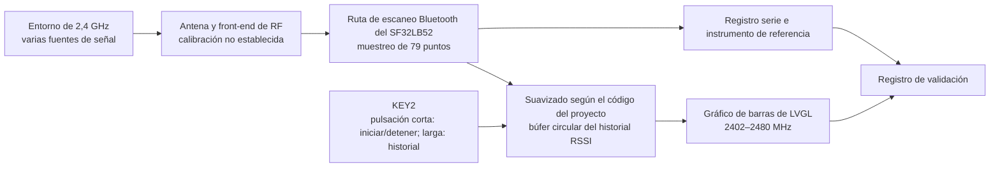

# Radiation Monitor: detector portátil de intensidad de señal { #radiation-monitor-portable-signal-strength-detector }

## ¿Qué es Radiation Monitor? { #what-is-radiation-monitor }

[SiFliSparks/RadiationMonitor](https://github.com/SiFliSparks/RadiationMonitor) es un visor portátil de intensidad de señal en la banda Bluetooth, basado en SF32LB52 y SiFli-SDK. El firmware recorre 79 puntos de frecuencia entre 2402 y 2480 MHz y representa los valores recibidos en un gráfico de barras LVGL. KEY2 inicia o detiene el barrido y permite consultar el historial guardado.

El proyecto permite estudiar el barrido de la banda Bluetooth, el procesamiento de datos en tiempo real, la visualización de frecuencias y la interacción con un solo botón. No es un analizador de espectro calibrado ni identifica el origen de la señal recibida. Las transmisiones cercanas en 2,4 GHz y las condiciones de medida pueden influir en el gráfico. Sin calibración ni una comparación en condiciones controladas, sus valores no son adecuados para mediciones reglamentarias, de certificación o de RF de precisión.

<em>Interfaz de gráfico de barras de 79 puntos de Radiation Monitor</em>

## ¿Por qué la implementación con SF32? { #why-the-sf32-implementation }

SF32LB52 integra Bluetooth 5.3 de modo dual, una MCU de doble núcleo y capacidades de pantalla. El proyecto usa SiFli-SDK y LVGL para procesar localmente el muestreo de frecuencias, el suavizado, el historial y las actualizaciones de pantalla. Es un punto de partida útil para experimentar con un panel de visualización de RF, un indicador de interferencias en campo o una interfaz de diagnóstico de producto.

El repositorio no especifica un procedimiento de calibración, un presupuesto de incertidumbre ni condiciones de medida trazables. Por ello, vuelva a validar los resultados para las revisiones concretas del silicio, el SDK y el firmware, así como para la placa, la antena, la carcasa, el ruido de la placa y la temporización. Trasladar el método a otra placa SF32LB52 o a una PCB de producto exige una nueva validación; una compilación correcta no demuestra que las mediciones sean equivalentes.

## Resultado, alcance y criterios de entrada { #outcome-scope-and-entry-criteria }

**Resultado:** reproducir el gráfico de 79 puntos en hardware SF32LB52 con versiones fijadas, comprobar que el inicio y la detención sean repetibles, confirmar el algoritmo y la profundidad reales del suavizado frente al código fijado, probar el historial documentado de 10 registros y la recuperación, y reunir evidencia suficiente para decidir si merece la pena invertir en calibración o hardware propio.

Esta página no interpreta la altura de una barra RSSI como ciclo de trabajo, caudal, potencia de transmisión, identidad del protocolo ni potencia espectral reglamentaria. Tampoco afirma que el repositorio proporcione un diseño de producción completo, un método de calibración o una licencia de software explícita.

Antes de empezar, tenga preparado:

- una placa de pantalla SF32LB52. El README del proyecto identifica SF32LB52x y el directorio de salida `build_sf32lb52-lchspi-ulp_hcpu`; la lista de placas compatibles de SiFli identifica Huangshan Pi como `sf32lb52-lchspi-ulp`. Registre la revisión real de la placa y verifique la configuración de compilación del proyecto;
- SiFli-SDK, SCons, una ruta de descarga y la captura del registro serie;
- una fuente de 2,4 GHz controlable o, como mínimo, dos escenarios repetibles, por ejemplo un anunciante BLE seleccionado apagado y encendido;
- si se necesita precisión numérica, un analizador de espectro calibrado o un instrumento de potencia, además de condiciones fijas para la antena, la distancia y el apantallamiento;
- un registro del estado de pantalla, la salida serie, la orientación de la placa, la distancia, la alimentación y el entorno.

<em>Tabla: condiciones del proyecto Radiation Monitor</em>

| Área | Base del código en la revisión fijada | Evidencia necesaria antes de adaptar |
|:-----|:-----------------------|:-------------------------------------|
| Barrido de frecuencias | 79 puntos entre 2402 y 2480 MHz | Commit del firmware, revisión del SDK/placa y registro completo del barrido |
| Procesamiento | La descripción del módulo en el README indica promediar las diez exploraciones anteriores; el resumen habla de 30. El README no especifica si se promedian valores de potencia lineal o dBm | Revisión del código fijado, escala y profundidad del promedio, resultados sin/con suavizado y comparación con una fuente estable |
| Historial | Historial circular de diez registros | Registro de detención, navegación, vuelta al inicio y reinicio |
| Interfaz | Gráfico de barras LVGL con eje Y nominal de -110 a -20 dBm | Captura de pantalla y verificación de la correspondencia entre etiquetas e índices del arreglo |
| Alcance de la medición | No se proporciona calibración trazable ni incertidumbre | Registro del instrumento de referencia, el montaje y el error, o indicación explícita de que solo muestra tendencias relativas |

## Especificaciones de hardware y software { #hardware-and-software-specifications }

### Especificación de hardware { #hardware-specification }

<em>Tabla: Especificación de hardware de Radiation Monitor</em>

| Componente | Especificación necesaria | Función | Estado | Dónde obtenerlo | Compatibilidad y notas sobre sustituciones |
|:-----------|:-------------------------|:--------|:-------|:----------------|:-------------------------------------------|
| SF32LB52-LCHSPI-ULP / Huangshan Pi | Use como referencia inicial el nombre de placa para SCons de SiFli `sf32lb52-lchspi-ulp`; registre la revisión exacta de la placa, la antena y la pantalla | Ejecuta el barrido Bluetooth, el gráfico, los controles y la interfaz del historial | Obligatorio; confirme el montaje exacto | [Referencia relacionada de μForge DevKit-ULP](../sf32-products/devkits/SF32LB52-DevKit-ULP.md); [lista de placas compatibles de SiFli](https://docs.sifli.com/projects/sdk/latest/en/sf32lb52x/supported_boards/index.html); [página LCKFB](https://lckfb.com/project/detail/lckfb-hspi-sf32lb52-ulp?param=baseInfo); [código del proyecto](https://github.com/SiFliSparks/RadiationMonitor) | El directorio de salida `build_sf32lb52-lchspi-ulp_hcpu` del README no identifica la PCB, la antena ni la revisión exactas de la pantalla |
| Host, cable USB de datos y alimentación controlada | Host con las herramientas SiFli-SDK seleccionadas, cable con datos, registro serie y fuente supervisada | Compilar, descargar, observar y repetir mediciones | Obligatorio | [Inicio rápido de SiFli-SDK](https://docs.sifli.com/projects/sdk/latest/sf32lb52x/quickstart/index.html) | Registre puerto, tensión, versiones de host/herramientas y método de recuperación |

### Especificación de software { #software-specification }

<em>Tabla: Especificación de software de Radiation Monitor</em>

| Paquete o servicio | Versión o revisión necesaria | Función | Estado | Dónde obtenerlo | Compatibilidad y notas de actualización |
|:-------------------|:----------------------------|:--------|:-------|:----------------|:----------------------------------------|
| SiFliSparks/RadiationMonitor | Commit fijado [`670cf20`](https://github.com/SiFliSparks/RadiationMonitor/commit/670cf20b931e82b7ff1cd14fa6727e460c4f677a) | Lógica de escaneo RF, gráfico de 79 puntos, suavizado e historial | Obligatorio | [Repositorio](https://github.com/SiFliSparks/RadiationMonitor) | Las descripciones del suavizado en el README se contradicen; compruebe la implementación de este commit antes de fijar la referencia de medición |
| OpenSiFli/SiFli-SDK | El artículo no fija un commit; seleccione y registre una revisión compatible | RTOS, ruta de escaneo Bluetooth, controladores de pantalla y entorno de compilación/carga | Obligatorio | [Repositorio](https://github.com/OpenSiFli/SiFli-SDK) | Compilar correctamente no demuestra que la medición RF esté calibrada ni que otra placa ofrezca resultados equivalentes |
| SCons y herramientas del SDK para el host | Versiones del entorno SiFli-SDK seleccionado | Compila y descarga el destino SF32LB52 | Obligatorio | [Inicio rápido de SiFli-SDK](https://docs.sifli.com/projects/sdk/latest/sf32lb52x/quickstart/index.html) | Registre el destino exacto, sistema operativo, versiones de herramientas e imagen generada |

## Elegir una configuración de referencia admitida { #choose-a-supported-baseline }
Use el commit fijado del proyecto [`670cf20`](https://github.com/SiFliSparks/RadiationMonitor/commit/670cf20b931e82b7ff1cd14fa6727e460c4f677a), no la rama `main`, que puede cambiar. El README del proyecto nombra `build_sf32lb52-lchspi-ulp_hcpu` como directorio de salida; la lista de placas compatibles de SiFli identifica Huangshan Pi / LCHSPI-ULP con el destino SCons `sf32lb52-lchspi-ulp`. Esto confirma el nombre del destino del SDK, no el comando exacto del proyecto ni el montaje de placa probado. El README no especifica una revisión de placa ni un comando SCons completo; confirme la configuración de compilación durante la primera reproducción y no presuponga que se admiten todas las placas SF32LB52x.

<em>Tabla: selección de la base de Radiation Monitor</em>

| Elemento | Opción de referencia | No suponga |
|:---------|:---------------------|:------------------|
| Placa | Parta del argumento SCons de SiFli `sf32lb52-lchspi-ulp`; registre la PCB real y verifique la configuración del proyecto | Que el directorio de salida `build_sf32lb52-lchspi-ulp_hcpu` demuestre que todas las antenas y rutas de pantalla SF32LB52x son equivalentes |
| SDK | Registre el commit de SiFli-SDK con el que la compilación funciona | No suponga que el SDK más reciente conserve el comportamiento de escaneo Bluetooth del proyecto |
| Suavizado | Resuelva con el código fijado la discrepancia del README entre 30 barridos y el promedio de las diez exploraciones anteriores; verifique si se promedian valores de potencia lineal o dBm y establezca la profundidad | La descripción del módulo indica diez exploraciones; el resumen, 30, y ninguno especifica la escala del promedio |
| Temporización | El README indica un intervalo de actualización de datos de 30 ms; mida el tiempo del barrido completo de 79 puntos | Que 30 ms sea el periodo garantizado para actualizar los 79 puntos completos |
| Licencia | Confirme las licencias del repositorio y del código incorporado antes de reutilizarlo o distribuirlo | Que la disponibilidad pública del código conceda automáticamente derechos de distribución comercial |

!!! warning "La documentación upstream no coincide en el número de muestras de suavizado"
    El resumen de funciones del README habla de un promedio de 30 barridos, mientras que la descripción del módulo indica que se promedian las diez exploraciones anteriores y señala `src/BT/bt_repeat.c` como módulo de escaneo. El README no especifica si el promedio se calcula sobre potencia lineal o valores en dBm, ni demuestra qué comportamiento implementa el código fijado. Inspeccione en ese commit la escala del promedio, la profundidad del búfer y el comportamiento del dispositivo antes de usar cualquiera de las dos cifras como referencia de medición. El README también indica un intervalo de actualización de 30 ms; no necesariamente equivale al tiempo necesario para recorrer los 79 puntos.

## Etapas del proyecto { #delivery-map }

<em>Tabla: etapas del proyecto Radiation Monitor</em>

| Etapa | Decisión que permite tomar | Resultado requerido |
|:------|:---------------------------|:-------------------|
| 1. Base sin modificar | ¿Puede la placa de destino barrer y mostrar de forma fiable los 79 puntos? | Registro de versión, placa, registros, pantalla y fuente controlada |
| 2. Datos y recuperación | ¿Son fiables el suavizado, la detención, el historial y el reinicio? | Pruebas funcionales y de recuperación deterministas |
| 3. Reproducción del código | ¿Puede otro ingeniero reconstruir la misma imagen? | Compilación limpia, imagen, descarga y resultado repetido |
| 4. Adaptación de la medición | ¿Se puede cambiar una visualización o calibración sin ocultar el comportamiento de referencia? | Registro del cambio, datos comparativos, error y regresión |
| 5. Revisión de producto | ¿Debe seguir como indicador de tendencias o convertirse en un programa de desarrollo de instrumentos? | Objetivo de precisión, licencias, hardware y decisión de riesgos |

## Arquitectura del sistema y dependencias { #system-architecture-and-dependencies }

<em>Figura: ruta de datos de Radiation Monitor</em>

Los principales dominios de fallo son la entrada RF/antena, el comportamiento del barrido y la calibración, el procesamiento de datos, el búfer del historial, la máquina de estados del botón, la asignación de LVGL y la alimentación. Una barra alta solo indica que la implementación observó un valor recibido relativamente fuerte; sin una comparación controlada, no identifica el transmisor, la modulación ni el estado de conformidad.

## Etapa 1 — Establecer la base de barrido sin modificar { #stage-1-establish-the-untouched-scan-baseline }

**Objetivo:** demostrar que el hardware y el código elegidos producen una visualización repetible de los 79 puntos.

1. Fije los commits del repositorio y SiFli-SDK, la revisión de la placa, la antena y la conexión de pantalla; compile desde cero y grabe el firmware.
2. Con un entorno RF estable, inicie el dispositivo y registre el gráfico inicial, la salida serie y el estado de KEY2.
3. Pulse KEY2 brevemente para iniciar el barrido. Compruebe la cobertura y las referencias del eje X en 2402, 2441 y 2480 MHz.
4. Use un anunciante BLE controlado u otra fuente repetible y registre las condiciones con la fuente apagada y encendida, la distancia y la orientación de la placa.
5. Reinicie y repita la prueba; compruebe que el arreglo de 79 puntos y el gráfico no estén desplazados ni conserven datos obsoletos.

**Evidencia que se debe conservar:** revisiones de código/SDK/placa, registros de compilación/descarga, descripción del entorno, configuración de la fuente, distancia/orientación, registro serie, capturas de pantalla y resultado del reinicio.

**Criterio de salida del punto de control 1:** dos arranques independientes barren y muestran 79 puntos; los cambios en el escenario controlado producen variaciones repetibles en la misma dirección; se han comprobado los índices de pantalla y las etiquetas de frecuencia.

## Etapa 2 — Validar el procesamiento, el historial y la recuperación { #stage-2-validate-processing-history-and-recovery }

**Objetivo:** demostrar que la interfaz representa una ruta de datos explicable, no una animación accidental.

<em>Tabla: validación funcional de Radiation Monitor</em>

| Prueba | Método | Evidencia de aprobación |
|:-------|:-------|:------------------------|
| Algoritmo y profundidad del suavizado | Registre los valores sin procesar y `rssi_res` para una frecuencia; compárelos con el commit fijado y resuelva la discrepancia del README | La escala y la profundidad del promedio coinciden con esa revisión exacta del código y se confirman en el dispositivo |
| Inicio/detención | Pulse KEY2 brevemente durante el barrido y después reanude | La detención conserva el historial; al reanudar no se bloquea |
| Historial | Con el barrido detenido, mantenga KEY2 pulsado más de una vez | Se pueden recorrer correctamente hasta diez registros hacia atrás y volver al inicio |
| Historial vacío | Detenga o mantenga pulsado antes de acumular un historial válido | No hay acceso fuera de límites ni fallos; la interfaz muestra un estado reconocible sin datos |
| Reinicio | Reinicie mientras se barre, está detenido o se consulta el historial | El dispositivo vuelve a un estado inicial conocido sin valores antiguos inexplicables |
| Cambio de interferencia | Cambie la fuente, la distancia o el apantallamiento | La respuesta es repetible; se registran la latencia y el comportamiento de retención de picos |

**Criterio de salida del punto de control 2:** el suavizado, la profundidad del historial, el estado del botón y el comportamiento tras el reinicio coinciden con el código; los estados anómalos se pueden observar y no pasan inadvertidos.

## Etapa 3 — Crear una base de código reproducible { #stage-3-build-a-reproducible-source-baseline }

**Objetivo:** reconstruir desde un entorno limpio la imagen validada en la Etapa 2.

1. Registre el commit del proyecto y del SDK, el sistema operativo anfitrión, las versiones de SCons y del compilador, y el argumento real de placa.
2. Elimine los archivos de compilación, vuelva a configurar y compile; conserve las imágenes, la salida de memoria/particiones y los registros completos.
3. Grabe el firmware con el script de descarga generado y registre el puerto, la velocidad en baudios y el resultado.
4. Repita la compilación en otro ordenador o directorio limpio y vuelva a ejecutar las comprobaciones principales de la Etapa 2.

**Criterio de salida del punto de control 3:** el proyecto genera una imagen equivalente en comportamiento sin depender de archivos de placa no versionados, archivos generados ni resultados de compilación obsoletos.

## Etapa 4 — Aplicar un cambio controlado de medición o interfaz { #stage-4-make-one-controlled-measurement-or-ui-adaptation }

**Objetivo:** probar una dirección de producto sin perder la base original.

Entre los cambios posibles están registrar valores sin procesar, añadir etiquetas explícitas por cada 1 MHz, retener picos, cambiar el selector del historial, añadir un desplazamiento de calibración o exportar tendencias relativas al anfitrión. Cambie una sola categoría cada vez y conserve la imagen original.

Si añade calibración, defina la fuente de referencia, frecuencia, nivel de entrada, antena/cable, distancia, orientación, temperatura e incertidumbre. Un desplazamiento global rara vez basta para compensar la respuesta en frecuencia, las variaciones entre placas y los efectos de la carcasa.

**Criterio de salida del punto de control 4:** el cambio supera las regresiones originales de 79 puntos, inicio/detención, historial, reinicio y fuente controlada; toda afirmación de precisión identifica el instrumento de referencia y las condiciones.

## Etapa 5 — Revisión de preparación para producto { #stage-5-product-readiness-review }

El equipo debe responder:

- ¿El producto necesita solo tendencias relativas de interferencia o valores absolutos de potencia trazables con su incertidumbre?
- ¿Está documentada como compatible con el silicio y el SDK de destino la implementación de escaneo Bluetooth del proyecto, y qué límites de concurrencia se aplican?
- ¿Cuánto varía el resultado por la antena, la carcasa, el ruido de pantalla, el funcionamiento del DC/DC, el nivel de batería y la temperatura?
- ¿El producto puede mantener la comunicación Bluetooth necesaria mientras barre o las funciones deben ser mutuamente excluyentes?
- ¿La latencia medida del barrido de 79 puntos con el suavizado verificado en el código satisface los requisitos de la interfaz?
- ¿Cómo se resolverán los derechos de distribución y comerciales si RadiationMonitor y el código incorporado no tienen una licencia explícita de nivel superior?

**Criterio de salida del punto de control 5:** hay responsables asignados para el objetivo de medición, el plan de calibración, la estrategia de concurrencia de radio, las licencias, el hardware y el software, y se registra una decisión de continuar, aplazar o detener.

## Traspaso a la fase de diseño del producto { #handoff-to-product-design }

Traslade el dispositivo SF32 objetivo, la placa/antena, la implementación de escaneo Bluetooth y las restricciones de modo/API confirmadas en el commit fijado, la definición de frecuencia/datos, los registros sin procesar y suavizados, el presupuesto de actualización de la interfaz, el montaje de calibración, las pruebas de ruido de alimentación, la ruta de recuperación y el alcance de las pruebas de producción. Continúe con [SF32LB52x](../sf32-products/chips/SF32LB52x.md), [SF32LB52-DevKit-ULP](../sf32-products/devkits/SF32LB52-DevKit-ULP.md), la [guía de diseño de hardware SF32LB52x](../hardware/chip-guides/SF32LB52x_hardware_design_guide.md) y las [pruebas de rendimiento RF de SiFli-SDK](../develop/platforms/sifli-sdk/application-notes/rf-performance-tests.md).

## Fuentes de referencia { #authoritative-sources }
- [SiFliSparks/RadiationMonitor](https://github.com/SiFliSparks/RadiationMonitor)
- [README upstream de `main`](https://github.com/SiFliSparks/RadiationMonitor/blob/main/README.md)
- [Commit de referencia fijado `670cf20`](https://github.com/SiFliSparks/RadiationMonitor/commit/670cf20b931e82b7ff1cd14fa6727e460c4f677a)
- [Catálogo de proyectos de SiFli Sparks](https://sparks.sifli.com/#projects)
- [OpenSiFli/SiFli-SDK](https://github.com/OpenSiFli/SiFli-SDK)
- [Lista de placas compatibles con SiFli-SDK](https://docs.sifli.com/projects/sdk/latest/en/sf32lb52x/supported_boards/index.html)
- [Guía de pruebas RF de SiFli-SDK](https://docs.sifli.com/projects/sdk/latest/en/sf32lb52x/app_note/rf_test_guide.html)
- [Descripción de hardware SF32LB52x](https://wiki.sifli.com/en/hardware/SF32LB52/SF32LB52-Overview-B3.html)
- [Inicio rápido de SiFli-SDK para SF32LB52x](https://docs.sifli.com/projects/sdk/latest/sf32lb52x/quickstart/index.html)
