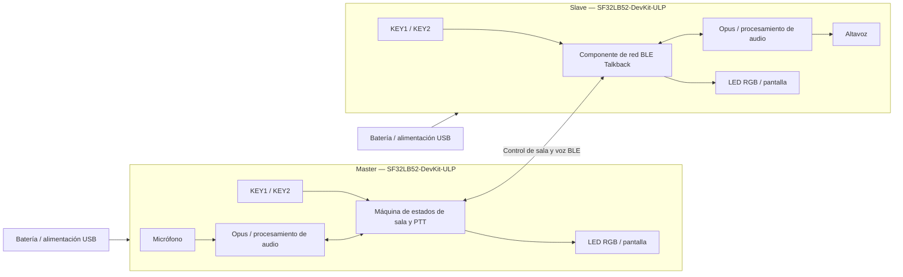

# Intercomunicador BLE SF32 Talkback { #sf32-ble-talkback-intercom }

## ¿Qué es Talkback? { #what-is-talkback }

[OpenSiFli Talkback](https://github.com/OpenSiFli/sifli-sdk-demo/tree/main/talkback) es un ejemplo de comunicación BLE en modo push-to-talk (PTT) multidispositivo para `SF32LB52-DevKit-ULP`, también conocido como Huangshan Pi. Un dispositivo puede actuar como Master para crear una sala o como Slave para buscar una sala y unirse a ella. Una vez dentro, el usuario mantiene pulsada la tecla de hablar para transmitir y la suelta para detenerse. La configuración de referencia oficial admite hasta ocho dispositivos y permite que hablen hasta tres a la vez.

El proyecto utiliza Opus para codificar la voz y combina el LED RGB, las teclas y la pantalla en una interfaz local sencilla. También implementa la reconexión del Slave con una sola tecla, la indicación del voltaje/nivel de batería, el reposo tras 60 segundos sin actividad y el apagado y encendido mediante pulsación larga. Por ello, es una referencia más útil para un intercomunicador portátil que un ejemplo aislado de audio punto a punto.

## ¿Por qué la implementación con SF32? { #why-the-sf32-implementation }

Esta ruta reúne BLE, audio, pantalla, teclas, supervisión de batería y comportamiento de bajo consumo del SF32LB52 en una configuración de referencia funcional. El equipo puede evaluar el rendimiento de red y audio en hardware de desarrollo compatible antes de invertir en un diseño personalizado de RF, audio y alimentación.

«Hasta ocho dispositivos y tres hablantes simultáneos» es un límite de la implementación original, no una capacidad de producto validada para todas las distancias, interferencias, pérdidas de paquetes y patrones de concurrencia. El material del proyecto original tampoco especifica la autenticación de salas, la política de cifrado del enlace, una garantía de privacidad de voz, el estado normativo de la radio ni todo el alcance de licencias del componente binario `talk_back`. Cada uno de estos aspectos requiere una revisión de producto independiente.

**Nota sobre la fuente de la placa:** La página china de SiFli Wiki para la placa ULP está marcada como pendiente de publicación; solo indica su uso en sensores de bajo consumo y dispositivos vestibles, opciones de sensores de 3 o 6 ejes y puntos de prueba reservados para medir bajo consumo. No es una especificación completa de la placa. Verifique los periféricos con la revisión física y el esquemático; el comportamiento de Talkback descrito abajo procede del código fuente fijado de la aplicación.

## Resultado, alcance y criterios de entrada { #outcome-scope-and-entry-criteria }

**Resultado:** utilizar al menos dos placas con revisiones controladas para reproducir la creación de salas, la incorporación, la voz PTT, la salida y reconexión, el reposo/activación y el comportamiento del estado de batería; después, conservar suficientes evidencias para decidir si se justifica diseñar hardware propio.

**Fuera del alcance:** esta página no demuestra cobertura de largo alcance, calidad de voz con un enlace degradado, cifrado de extremo a extremo, certificación, consumo de producción, consistencia de antena, cumplimiento normativo ni compatibilidad con cualquier dispositivo BLE.

**Criterios de entrada:** el equipo puede instalar el entorno de compilación de SiFli-SDK, grabar firmware por UART, inspeccionar los registros y conectar de forma segura un altavoz y una batería. Para una referencia completa de voz se necesitan al menos dos placas de la misma revisión.

<div align="center"><em>Tabla: Condiciones del proyecto</em></div>

<div align="center" markdown>

| Área | Requisito de referencia | Evidencias que se conservan antes de continuar |
|:-----|:------------------------|:----------------------------------------------|
| Límite de reproducción | Mantener intactos al principio el destino del proyecto original, las dependencias y la interacción predeterminada | Revisión de la placa, commit de la aplicación, revisión del SDK, registro de resolución de dependencias y hash del firmware |
| Límite funcional | Demostrar creación/unión, PTT, salida, reconexión del Slave, reposo/activación e indicación de batería | Registro de operaciones, registros UART, estados del LED y resultados de recuperación ante fallos |
| Límite del producto | Acústica, RF, seguridad, privacidad, licencias, alimentación y normativa requieren validaciones independientes | Riesgos, responsables, plan de resolución y decisión de continuar/detenerse |

</div>

## Especificaciones de hardware y software { #hardware-and-software-specifications }

### Especificación de hardware { #hardware-specification }

<div align="center"><em>Tabla: Especificación de hardware</em></div>

<div align="center" markdown>

| Componente | Especificación requerida | Función | Estado | Dónde obtenerlo | Notas de compatibilidad y sustitución |
|:-----------|:-------------------------|:--------|:-------|:----------------|:-------------------------------------|
| SF32LB52-DevKit-ULP / LCKFB-HSPI-SF32LB52-ULP | Destino `sf32lb52-lchspi-ulp`; mínimo 2 placas y máximo 8 | Ejecuta Talkback y proporciona BLE, micrófono, pantalla, teclas, LED RGB, alimentación y rutas de audio | Obligatorio | [Referencia de placa de μForge](../sf32-products/devkits/SF32LB52-DevKit-ULP.md); [página de la placa LCKFB](https://lckfb.com/project/detail/lckfb-hspi-sf32lb52-ulp?param=baseInfo); [tienda de muestras y placas de desarrollo de SiFli](https://sifli.taobao.com/) | Registre todas las revisiones de hardware; una placa SF32LB52 no validada no es un sustituto equivalente |
| Altavoz | Un altavoz externo de 3 W/4 Ω o 2 W/8 Ω por placa, conectado mediante el conector GH-1.25 mm | Reproduce la voz recibida | Obligatorio | Suele incluirse con la placa de desarrollo; antes de comprarlo, compruebe el contenido del paquete en la [referencia de placa](../sf32-products/devkits/SF32LB52-DevKit-ULP.md) | No conecte una carga fuera de los límites del amplificador Class-D y el conector integrados |
| Cables USB de datos y host | Un cable USB-C apto para datos por placa; host capaz de ejecutar las herramientas de SiFli-SDK | Alimentación, grabación por UART y captura de registros | Obligatorio | Cable USB-C de datos estándar; las herramientas se obtienen de [SiFli-SDK](https://github.com/OpenSiFli/SiFli-SDK) | Los cables solo de carga no permiten grabar firmware; registre los puertos asignados y el entorno host |
| Batería de litio de una celda | Debe coincidir con el conector, la polaridad y la ruta de carga de la placa | Uso portátil, reposo/activación y validación del nivel de batería | Necesaria para validar el producto; opcional para pruebas funcionales de laboratorio | El repositorio Talkback no publica un canal de compra específico; confirme la interfaz en la [referencia de placa](../sf32-products/devkits/SF32LB52-DevKit-ULP.md) antes de adquirirla | Antes de conectarla, verifique polaridad, rango de voltaje, capacidad y protección; el aspecto del conector no demuestra compatibilidad |
| Micrófono, teclas, LED RGB y pantalla integrados | Componentes originales de la placa de desarrollo | Capturan voz y muestran el rol, emparejamiento, transmisión, recepción y reposo | Integrados | Incluidos con la placa; no se adquieren por separado | Sustituir el hardware de audio o HMI es una adaptación que requiere pruebas de regresión de ganancia, temporización, códigos de tecla y mapa de estados |

</div>

### Especificación de software { #software-specification }

<div align="center"><em>Tabla: Especificación de software</em></div>

<div align="center" markdown>

| Paquete o servicio | Versión o revisión requerida | Función | Estado | Dónde obtenerlo | Notas de compatibilidad y actualización |
|:-------------------|:-----------------------------|:--------|:-------|:----------------|:--------------------------------------|
| OpenSiFli `sifli-sdk-demo/talkback` | Commit revisado para el artículo [`6fa55ac`](https://github.com/OpenSiFli/sifli-sdk-demo/commit/6fa55ac65b51fca5eac6660a7e481a30e07388ee) | Aplicación, configuración de placa y punto de entrada de compilación | Obligatorio | [Directorio del código fuente de Talkback](https://github.com/OpenSiFli/sifli-sdk-demo/tree/main/talkback) | La rama `main` del proyecto original cambia; fije un commit antes de recopilar evidencias. La ruta actual es `talkback/project`; la ruta `example/ble/talkback/project` del README está obsoleta |
| SiFli-SDK | `conanfile.py` declara compatibilidad con `^2.4`; el proyecto original no fija un commit exacto del SDK | Base de RT-Thread, BLE, audio, alimentación, compilación y grabación del firmware | Obligatorio | [OpenSiFli/SiFli-SDK](https://github.com/OpenSiFli/SiFli-SDK) | Elija y registre un commit concreto que satisfaga `^2.4`; `main`, al ser móvil, no es una revisión de referencia |
| `talk_back/1.2@sifli` | `1.2` | Componente de red/audio BLE Talkback | Obligatorio | Resuelto mediante el [manifiesto Conan del proyecto](https://github.com/OpenSiFli/sifli-sdk-demo/blob/6fa55ac65b51fca5eac6660a7e481a30e07388ee/talkback/project/conanfile.py) | El proyecto original no publica en esa página el código fuente independiente, el hash del paquete, el servidor de paquetes ni toda la información de licencias; archive el paquete y el registro de resolución, y cierre este riesgo antes de usarlo en un producto |
| Opus y configuración WebRTC AECM/AGC | Determinada conjuntamente por la aplicación, el SDK y la dependencia Conan fijados | Codificación de voz, tratamiento de eco y control de ganancia | Obligatorio | [Configuración del proyecto](https://github.com/OpenSiFli/sifli-sdk-demo/blob/6fa55ac65b51fca5eac6660a7e481a30e07388ee/talkback/project/proj.conf) y dependencias fijadas del SDK | No registre solo las macros de funciones; conserve las versiones resueltas de las bibliotecas y la información de licencias |
| SCons, compilador y herramientas de grabación UART | Versiones compatibles con el SiFli-SDK seleccionado | Configuran, compilan y programan las imágenes | Obligatorio | Incluidos en el entorno del [SiFli-SDK seleccionado](https://github.com/OpenSiFli/SiFli-SDK) | Registre el sistema operativo host, la versión de la cadena de herramientas, el comando de compilación y el hash del script generado |

</div>

## Elegir una configuración de referencia admitida { #choose-a-supported-baseline }
Empiece con dos placas `SF32LB52-DevKit-ULP` de la misma revisión. Fije el repositorio de demostración en `6fa55ac`, seleccione y registre un commit concreto de SiFli-SDK que satisfaga `^2.4` y conserve el resultado de resolución de Conan para `talk_back/1.2@sifli`. Durante la primera reproducción, no cambie los parámetros de audio, la lógica de roles ni los tiempos de bajo consumo.

Desde la raíz del repositorio, acceda a la ruta que existe realmente:

```bash
cd talkback/project
scons --board=sf32lb52-lchspi-ulp -j8
```

En Windows, el nombre del script generado para grabar el firmware es `build_sf32lb52-lchspi-ulp_hcpu\uart_download.bat`. Ejecútelo e introduzca el puerto COM correspondiente cuando se le solicite. Use la misma imagen de referencia en todos los dispositivos y registre la identidad de cada placa y el hash de la imagen.

### Controles e indicaciones de estado predeterminados { #default-controls-and-state-indication }

<div align="center"><em>Tabla: Comportamiento predeterminado de teclas y LED</em></div>

<div align="center" markdown>

| Estado | KEY1 | KEY2 | LED |
|:-------|:-----|:-----|:----|
| En espera | Un Slave que se haya unido correctamente antes pulsa brevemente para reconectar; en caso contrario, una pulsación breve reinicia el temporizador de reposo | Pulsación breve: cambia entre Master y Slave; pulsación larga: inicia el emparejamiento | Master azul fijo; Slave rojo fijo |
| Emparejamiento | — | El Master crea una sala; el Slave busca | Master azul intermitente; Slave rojo intermitente |
| Esperando el inicio | — | El Master mantiene KEY2 pulsada para confirmar el inicio | Master azul intermitente; Slave rojo intermitente |
| En una sala | Pulsación breve tras soltar KEY2 para salir | Mantener pulsada para hablar; soltar para parar | Verde fijo al hablar; naranja fijo al recibir |
| Reposo | Cualquier tecla activa el dispositivo | Cualquier tecla activa el dispositivo | Apagado |

</div>

## Etapas del proyecto { #delivery-map }

<div align="center"><em>Tabla: Etapas y decisiones del proyecto</em></div>

<div align="center" markdown>

| Etapa | Decisión que permite tomar | Evidencia mínima |
|:------|:---------------------------|:-----------------|
| Establecer la configuración intacta de referencia | ¿Se compilan, graban y arrancan de forma fiable los componentes fijados? | Manifiesto de versiones, registro de compilación limpia, hash de imagen y registro de arranque |
| Validar voz con dos dispositivos | ¿Funcionan la creación de sala, la unión y PTT predeterminados? | Roles, LED, acciones de teclas y registro de audio bidireccional para dos dispositivos |
| Validar red y recuperación | ¿Son aceptables los límites de salida, tiempo de espera, reconexión y concurrencia? | Matriz de inyección de fallos, tiempo de recuperación, registros y estados de fallo |
| Evaluar audio y alimentación | ¿Se ajustan la acústica y el comportamiento de batería al formato previsto? | Medidas de calidad de audio, latencia, alcance, corriente, reposo y activación |
| Revisar la preparación del producto | ¿Hay evidencias suficientes para financiar hardware propio? | Registro de riesgos, responsables y decisión de continuar, aplazar o detenerse |

</div>

## Arquitectura del sistema y dependencias { #system-architecture-and-dependencies }

<div align="center"><em>Figura: Roles de los dispositivos Talkback y rutas de audio y control</em></div>



Los principales ámbitos de fallo son el escaneo BLE y la creación de sala, la sincronización del estado de la sala, la planificación de hablantes simultáneos, la ruta acústica/Opus, los eventos de teclas, la batería baja y el reposo, la recuperación mediante la tecla de encendido y los datos no publicados del componente y sus licencias. Diagnostique primero el rol y el estado; después separe los fallos de radio, audio y alimentación local.

## Etapa 1 — Establecer la configuración intacta de referencia del código fuente { #stage-1-establish-the-untouched-source-baseline }

**Objetivo:** demostrar que el código, el SDK y las dependencias resueltas fijados generan una imagen repetible.

1. Fije la aplicación y un commit concreto del SDK; conserve el resultado de resolución de dependencias.
2. Compile `sf32lb52-lchspi-ulp` en un directorio limpio y grabe la imagen en dos placas.
3. Compruebe que cada dispositivo arranca como Slave con el LED rojo fijo y después pruebe las teclas, la pantalla, la batería y la ruta del altavoz.

**Evidencias que se deben conservar:** manifiesto completo de versiones, registros de compilación/grabación, hashes de firmware, revisiones de ambas placas y registros de arranque.

**Criterio de salida del punto de control 1:** las mismas entradas generan de forma reproducible y graban en ambos dispositivos la misma imagen de referencia; el estado al arrancar coincide con el comportamiento del proyecto original.

## Etapa 2 — Validar la configuración de sala y PTT bidireccional { #stage-2-validate-room-setup-and-bidirectional-ptt }

**Objetivo:** demostrar que un usuario puede crear y utilizar la sala mínima sin intervención de un depurador.

1. En espera, pulse brevemente KEY2 en un dispositivo para convertirlo en Master con LED azul fijo; deje el otro como Slave con LED rojo.
2. Mantenga KEY2 pulsada en ambos dispositivos: el Master crea una sala y el Slave la busca. El emparejamiento expira tras 30 segundos.
3. En el estado de espera, mantenga KEY2 pulsada en el Master para iniciar. En el estado de conversación, mantenga KEY2 pulsada para hablar y suéltela para detener la transmisión.
4. Compruebe el verde fijo durante la transmisión y el naranja fijo durante la recepción, y verifique que se entiende la voz en ambas direcciones.

**Evidencias que se deben conservar:** roles, cronología de operaciones, estado del LED, registros UART, muestras de audio bidireccional y resultados de reintentos.

**Criterio de salida del punto de control 2:** dos o más dispositivos completan repetidamente sesiones PTT bidireccionales; los indicadores coinciden con la dirección real del audio; y el tiempo de espera de 30 segundos vuelve a un estado explicable.

## Etapa 3 — Validar salida, reconexión y límites de capacidad { #stage-3-validate-leave-reconnect-and-capacity-boundaries }

**Objetivo:** confirmar que las rutas de recuperación del proyecto original y los límites de capacidad no dejan al usuario sin poder operar el dispositivo.

1. Para salir durante una conversación, suelte KEY2 antes de pulsar brevemente KEY1; un dispositivo no puede salir mientras transmite.
2. Un Slave que se haya unido correctamente anteriormente puede reconectar con una pulsación breve de KEY1 en espera. El Master no dispone de una ruta equivalente de reconexión.
3. Inyecte situaciones fuera de alcance, tiempo de espera de emparejamiento, pérdida del Master y reinicio de alimentación.
4. Si importa el funcionamiento con varios participantes, escale hasta el número previsto y cubra los límites indicados de ocho dispositivos y tres hablantes simultáneos.

**Evidencias que se deben conservar:** estado inicial, desencadenante, acción de recuperación, tiempo de recuperación, registros y participantes finales de la sala para cada fallo.

**Criterio de salida del punto de control 3:** cada fallo objetivo tiene una ruta de recuperación explícita, repetible y comprensible para el usuario; y la capacidad/concurrencia necesaria se ha medido en el entorno de RF objetivo, no se ha copiado de la declaración de límites.

## Etapa 4 — Evaluar el audio, el rendimiento RF y el consumo energético { #stage-4-qualify-acoustics-rf-and-low-power }

**Objetivo:** decidir si el comportamiento de la placa de desarrollo es adecuado para la carcasa, el alcance y el tiempo de funcionamiento previstos.

1. Registre la inteligibilidad, el recorte, el eco y los cortes al inicio/final de PTT en condiciones silenciosas, con doble habla en proximidad, ruido de fondo y varios ajustes de volumen del altavoz.
2. Registre la conexión, las desconexiones y la recuperación a la distancia prevista, a través de obstáculos y con interferencia de 2,4 GHz.
3. Verifique el reposo tras 60 segundos sin actividad, el restablecimiento del rol a Slave, la activación con cualquier tecla, el apagado/encendido mediante pulsación larga y la indicación LED por debajo del 20 % de batería.
4. Mida la corriente en espera, transmisión, recepción, reposo y activación; no equipare las mediciones de la placa de desarrollo con la autonomía del producto final.

**Evidencias que se deben conservar:** entorno, orientación de la placa/antena, archivos de audio, distancia e interferencia, trazas de corriente, condiciones de la batería y resultados de recuperación.

**Criterio de salida del punto de control 4:** el equipo de producto ha definido y alcanzado los umbrales acústicos, de RF, alimentación y activación del entorno objetivo, y hay responsables y decisiones para cada resultado insuficiente.

## Etapa 5 — Revisión de preparación del producto { #stage-5-product-readiness-review }

Antes de diseñar hardware propio, responda al menos a estas preguntas:

- ¿Cómo identifica una sala a los dispositivos de confianza y qué autenticación, cifrado y protección contra repetición se aplican a la voz y los datos de control?
- ¿Quién se responsabiliza de las licencias, de poner el código fuente a disposición y de responder ante vulnerabilidades de `talk_back/1.2@sifli`, Opus, los componentes WebRTC y los archivos de código fuente del repositorio?
- ¿Qué cobertura, latencia, pérdida de paquetes y recuperación se han medido con la antena y carcasa objetivo, la obstrucción del cuerpo y la concurrencia prevista?
- ¿Cómo cumplirán el micrófono, el amplificador, la cavidad del altavoz y los límites de volumen los requisitos acústicos y de seguridad?
- ¿Cómo se recupera el dispositivo de una batería baja, una pérdida anómala de alimentación, un firmware dañado o una actualización de campo fallida?
- ¿Qué actividades de conformidad de Bluetooth, EMC, radio y batería son aplicables?

**Criterio de salida del punto de control 5:** el registro de riesgos contiene evidencias, responsables, mitigaciones y una decisión explícita de continuar, aplazar o detenerse. Los aspectos de seguridad, licencias y normativa no pueden quedar como trabajo futuro sin responsable.

## Traspaso a la fase de diseño del producto { #handoff-to-product-design }

El paquete de traspaso debe incluir el código, SDK y dependencias fijados; los roles y la máquina de estados; la matriz de capacidad y recuperación; las mediciones de audio, RF y alimentación; las hipótesis acústicas y de antena; los límites de batería/carga; el modelo de seguridad/privacidad; la información de licencias; los requisitos de pruebas de producción y el plan de recuperación. Utilice la [ruta de integración de SF32LB52x](../sf32-products/chips/SF32LB52x.md#integration-path) para seleccionar el chip, el módulo, la placa, la guía de diseño de hardware y la lista de comprobación. Traslade el comportamiento validado al esquemático y al diseño de la PCB personalizada y vuelva a comprobarlo, en lugar de suponer que los resultados de la placa de desarrollo se transfieren sin cambios.

## Fuentes de referencia { #authoritative-sources }
- [Directorio OpenSiFli Talkback](https://github.com/OpenSiFli/sifli-sdk-demo/tree/main/talkback)
- [Commit `6fa55ac` revisado para la aplicación](https://github.com/OpenSiFli/sifli-sdk-demo/commit/6fa55ac65b51fca5eac6660a7e481a30e07388ee)
- [README oficial de Talkback](https://github.com/OpenSiFli/sifli-sdk-demo/blob/6fa55ac65b51fca5eac6660a7e481a30e07388ee/talkback/README.md)
- [Manifiesto Conan de Talkback](https://github.com/OpenSiFli/sifli-sdk-demo/blob/6fa55ac65b51fca5eac6660a7e481a30e07388ee/talkback/project/conanfile.py)
- [Configuración del proyecto Talkback](https://github.com/OpenSiFli/sifli-sdk-demo/blob/6fa55ac65b51fca5eac6660a7e481a30e07388ee/talkback/project/proj.conf)
- [OpenSiFli/SiFli-SDK](https://github.com/OpenSiFli/SiFli-SDK)
- [Fuente oficial de la Wiki de SF32LB52-DevKit-ULP](https://github.com/OpenSiFli/SiFli-Wiki/blob/main/source/en/board/sf32lb52x/SF32LB52-DevKit-ULP.md)
- [Fuente china de SiFli Wiki para SF32LB52-DevKit-ULP](https://github.com/OpenSiFli/SiFli-Wiki/blob/main/source/zh_CN/board/sf32lb52x/SF32LB52-DevKit-ULP.md)
