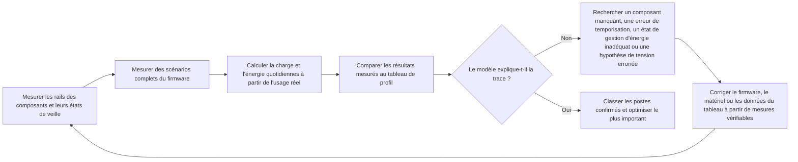

# Mesurer et valider la consommation énergétique { #power-measurement-and-validation }

Une estimation d'autonomie n'est crédible que si ses hypothèses sont confirmées par les mesures du matériel réel. Consultez cette page avec la [Vue d'ensemble de la conception basse consommation](overview.md) et l'exemple d'[analyse de la consommation d'une montre connectée](smartwatch-power-profiling.md). La méthode consiste à mesurer chaque composant, à valider des scénarios complets exécutés par le firmware, à comparer le modèle à une journée d'utilisation représentative, puis à optimiser le poste de consommation le plus important parmi ceux qui ont été mesurés.

## Mesurer l'énergie, pas seulement le courant { #measure-energy-not-current-alone }

Le courant ne suffit pas à caractériser la consommation. Enregistrez la tension aux bornes de l'appareil testé (DUT, `V_DUT`) en même temps que le courant. Vous pourrez ainsi calculer la puissance instantanée et l'énergie, en plus de la charge électrique :

```text
power_W(t) = voltage_V(t) x current_A(t)
energy_Wh = integral(power_W(t) dt) / 3600
energy_mWh = energy_Wh x 1000
charge_mAh = integral(current_mA(t) dt) / 3600
```

Dans ces formules, `t` est exprimé en secondes. La division par `3600` convertit les secondes en heures ; utilisez un courant en A pour calculer la puissance et en mA pour calculer la charge.

L'intégrale d'énergie est exprimée en Wh ; multipliez sa valeur par 1000 avant de l'ajouter à un profil exprimé en mWh. La charge (mAh) et l'énergie (mWh) sont des grandeurs distinctes et ne sont pas interchangeables.

Si la tension d'alimentation reste stable, relevez la valeur mesurée de `V_DUT` pendant l'acquisition et utilisez-la avec la trace de courant. Si elle varie, échantillonnez-la sur la même base de temps que le courant ou recueillez suffisamment de mesures synchronisées pour calculer une puissance moyenne fiable. Une comparaison limitée aux mAh peut masquer un écart réel d'énergie si la tension d'alimentation, le point de fonctionnement du régulateur ou l'état de la batterie diffère d'une acquisition à l'autre.

## Définir les conditions de référence { #set-up-the-measurement-baseline }

Utilisez le [Power Profiler Kit II (PPK2)](https://docs.nordicsemi.com/r/bundle/ug_ppk2/page/ug/ppk/ppk_user_guide_intro.html) de Nordic comme instrument de référence pour mesurer le courant. En mode Source Meter, il alimente l'appareil testé ; en mode Ampere Meter, le PPK2 est inséré en série entre l'appareil testé et une alimentation externe pour mesurer le courant. Dans le premier mode, la tension de sortie configurée constitue une condition d'essai maîtrisée. Dans le second, mesurez et consignez la tension de l'alimentation externe aux bornes de l'appareil. Dans les deux cas, relevez la tension réellement appliquée, et non la seule valeur nominale de la batterie ou de l'alimentation de laboratoire.

Le PPK2 fournit la forme d'onde du courant, la charge cumulée et des données exportables. Son port logique comprend les entrées D0–D7 ainsi que des connexions VCC et GND pour le DUT. Reliez VCC et GND à l'alimentation logique et à la masse commune du DUT, puis raccordez les GPIO de marquage à D0–D7. Maintenez VCC dans la plage de 1,65–5,5 V indiquée par Nordic et vérifiez la compatibilité des niveaux logiques. Les entrées numériques sont échantillonnées à 100 kHz, avec une bande passante typique de 50 kHz ; les phases très brèves peuvent donc ne pas être résolues de manière fiable. Consultez la documentation Nordic sur les [connecteurs](https://docs.nordicsemi.com/r/bundle/ug_ppk2/page/ug/ppk/ppk_user_guide_connectors.html), les [spécifications d'alimentation](https://docs.nordicsemi.com/r/bundle/ug_ppk2/page/ug/ppk/ppk_power_supply_specs.html) et la [résolution des entrées numériques](https://docs.nordicsemi.com/r/bundle/ug_ppk2/page/ug/ppk/digital_input_resolution.html). Utilisez des marqueurs GPIO pour délimiter les opérations importantes : réveil, mise à jour de l'affichage, transmission radio, échantillonnage des capteurs ou retour en veille. Le [guide officiel du PPK2](https://docs.nordicsemi.com/r/bundle/ug_ppk2/) décrit les modes pris en charge et les conditions de raccordement.

Pendant l'utilisation du PPK2, laissez sa connexion USB de données et d'alimentation branchée, conformément aux exigences de Nordic. Cette connexion est distincte de l'alimentation USB supplémentaire recommandée pour les charges importantes en mode Source Meter, décrite au paragraphe suivant.

Avant de connecter le DUT, vérifiez que le mode PPK2 choisi accepte sa tension et son courant de crête. Nordic spécifie une plage de tension du DUT de 0,8–5,0 V, un courant continu maximal du DUT de 1 A en mode Ampere Meter et un maximum de 600 mA en mode Source Meter. Si le DUT consomme plus de 400 mA en mode Source Meter, Nordic recommande une alimentation USB supplémentaire d'au moins 1 A pour alimenter le PPK2. Consultez la [spécification du courant maximal admissible du DUT](https://docs.nordicsemi.com/r/bundle/ug_ppk2/page/ug/ppk/ppk_max_dut_current.html) et les [consignes d'alimentation](https://docs.nordicsemi.com/r/bundle/ug_ppk2/page/ug/ppk/ppk_power_supply.html). Il s'agit de limites de l'instrument, et non de conditions de fonctionnement recommandées pour le produit. Pour les essais hors de la plage prise en charge, utilisez un équipement de mesure correctement dimensionné.

<div align="center"><em>Tableau : Informations à consigner pour chaque acquisition</em></div>

<div align="center" markdown>

| Enregistrement | Pourquoi il est nécessaire |
|:-------|:-----------------|
| Identifiant de l'essai, révision de la carte, composants montés et révision du firmware | Permet de reproduire et de comparer les résultats. |
| `V_DUT` : consigne, valeurs mesurées au début et à la fin, variations pendant l'acquisition | Permet de calculer correctement la puissance et l'énergie. |
| Trace du courant, courant moyen, courant de crête, puissance moyenne, charge (mAh), énergie (mWh) et durée de l'acquisition | Distingue les pointes brèves de courant de la consommation soutenue et consigne la puissance et l'énergie de l'acquisition. |
| Température, état de la batterie ou réglage de l'alimentation de laboratoire, environnement radio | Évite d'attribuer à une amélioration du firmware un écart dû aux conditions d'essai. |
| Périphériques actifs, configuration d'horloge, état de gestion d'énergie, sources de réveil | Explique pourquoi l'appareil a atteint ou non l'état de basse consommation prévu. |
| Marqueurs du firmware et conditions de déclenchement | Associe l'énergie à une opération précise plutôt qu'à une portion de trace difficile à interpréter. |

</div>

## Caractériser chaque composant avant les tests système complets { #characterize-each-component-before-full-system-tests }

Avant d'interpréter la trace de la carte complète, mesurez chaque composant sur un rail isolable ou à l'aide d'un montage d'essai dédié. Il ne s'agit pas de produire une nouvelle valeur de catalogue, mais d'identifier les modes, les charges et les réglages du firmware qui déterminent réellement sa consommation dans le produit.

<div align="center"><em>Tableau : Plan de caractérisation au niveau composant</em></div>

<div align="center" markdown>

| Composant | Mesurer au minimum | Enregistrer dans le modèle |
|:----------|:-------------------|:--------------------|
| MCU | Traitement actif, état inactif (Idle), chaque mode de veille prévu, durée du réveil et des transitions d'horloge | Courant et durée de chaque état du firmware ; réveils intempestifs et facteurs empêchant la gestion d'énergie. |
| PSRAM externe | Veille ou rétention, lectures, écritures, transferts en rafale et, le cas échéant, rafraîchissement | Courant du rail pour chaque profil d'accès et durée correspondante. |
| Mémoire Flash externe | Deep Power-Down ou veille, lectures, écritures, effacements et latence de réveil | Énergie par accès ou opération, ainsi que courant au repos. |
| Chaque capteur externe | Chaque mode utilisé, débit de sortie, stratégie FIFO ou interruption et rapport cyclique | Énergie par échantillon ou intervalle, y compris le traitement effectué par le MCU lorsque la mesure porte sur un scénario. |
| Moteur haptique et circuit de commande | Démarrage, amplitude, motif, durée et freinage ou roue libre | Énergie par motif haptique, et pas seulement courant de pointe du moteur. |
| Codec audio et amplificateur de puissance | Arrêt, veille, lecture ou enregistrement, niveau de sortie et impédance réelle du haut-parleur ou de la charge | Énergie par session audio et courant de fuite de toute la chaîne audio à l'arrêt. |
| Afficheur, tactile, radio, PMIC et autres charges | États actifs, inactifs et de rétention pertinents | Hypothèses de courant distinctes ou entrées `Other` explicites, avec leur périmètre indiqué. |

</div>

Pour évaluer la consommation énergétique du produit entier, mesurez au point d'entrée d'alimentation du produit, côté batterie. Les mesures par rail restent indispensables pour isoler les causes, mais convertissez-les côté batterie à l'aide du rendement et du courant de repos mesurés pour chaque régulateur avant de les intégrer au modèle d'autonomie. La somme des courants des rails ne correspond pas directement au courant d'entrée de la batterie.

## Vérifier les états basse consommation configurés par le pilote { #verify-driver-controlled-power-states }

Un composant n'atteint l'état de basse consommation spécifié que si son pilote applique les réglages et la séquence prescrits dans sa documentation. Même un pilote fonctionnel peut entraîner une surconsommation s'il maintient un signal d'activation, envoie une mauvaise commande de veille, laisse une horloge ou un bus actif, ou commande dans le mauvais ordre les signaux d'alimentation, de réinitialisation et d'interface. Pour chaque état visé, reproduisez dans le firmware les conditions de la fiche technique, puis vérifiez que le courant, la tension, la charge et l'énergie mesurés respectent la spécification applicable ou le point de fonctionnement validé du produit.

<div align="center"><em>Tableau : Vérifications des états basse consommation configurés par le pilote</em></div>

<div align="center" markdown>

| Point de contrôle | Exigence pour le pilote | Résultat à vérifier par la mesure |
|:-------------|:-------------------|:---------------------|
| Registres de mode et commandes basse consommation | Appliquer les réglages documentés de veille, d'arrêt, de rétention, de débit de données et d'interruption ; vérifier l'état si le composant le permet. | Le courant et l'énergie correspondent au mode choisi, et la configuration appliquée figure dans le compte rendu d'essai. |
| Responsabilité des verrous et contraintes de gestion d'énergie | Préciser si chaque verrou ou contrainte de gestion d'énergie relève du pilote du composant ou d'un service de niveau supérieur. N'activer ces verrous ou contraintes que tant que la ressource protégée est nécessaire et les libérer, sur tous les chemins de réussite, d'erreur ou de retour anticipé, dès que le composant peut rester inactif sans risque. | Les traces confirment que ces verrous et contraintes couvrent la durée nécessaire : ils ne sont ni désactivés trop tôt ni conservés après la fin du traitement ou une erreur au point d'empêcher la veille. |
| Séquence d'alimentation, d'activation, de réinitialisation et d'horloge | Respecter l'ordre et les temporisations requis à la mise sous tension, pendant le fonctionnement et à l'arrêt. | Les marqueurs GPIO et la trace confirment l'absence de période active ou de pic de courant imprévu. |
| SPI, I2C, UART et autres bus de commande | Interrompre les échanges inutiles et placer les signaux de sélection, d'horloge, de données et d'interruption dans l'état inactif prescrit. | Le composant reste dans l'état de basse consommation prévu entre les transactions. |
| Résistances de rappel GPIO et haute impédance | Configurer explicitement chaque broche de commande : sortie haute ou basse, entrée avec rappel adapté vers le haut ou vers le bas, ou haute impédance uniquement si le circuit externe fixe le niveau. | Mesurer le courant lorsque l'autre appareil est alimenté puis lorsqu'il n'est pas alimenté, et tenir compte des états de réinitialisation et par défaut. |
| Interfaces entre domaines d'alimentation | Ne pas alimenter un composant hors tension par une broche de commande ou de données, sauf si le matériel prévoit explicitement ce fonctionnement. | Vérifier l'absence de réalimentation parasite et de fuite lorsque l'un des côtés de l'interface est hors tension. |
| Gestion des erreurs et reprise | Rétablir le bon état après un délai d'attente, un transfert échoué, un réveil ou une réinitialisation du firmware. | Les acquisitions prolongées ne révèlent pas de courant excessif persistant ou croissant dû à une séquence de nettoyage incomplète. |

</div>

Des niveaux logiques valides ne garantissent pas l'absence de courant de fuite. Les résistances de rappel internes, des configurations de rappel contradictoires, les états par défaut après réinitialisation, les chemins ESD et les résistances de rappel des bus peuvent créer une fuite ou une réalimentation parasite, même si les deux composants semblent présenter des niveaux logiques corrects. Mesurez le courant de l'interface lorsque les deux côtés sont alimentés, lorsqu'un seul l'est, ainsi que pendant les transitions entre ces états. Si l'état observé ne correspond pas à l'attendu, déterminez d'abord s'il provient d'une erreur de réglage ou de séquence du pilote ou d'un chemin de fuite sur la carte, avant de modifier le tableau de profil énergétique.

## Valider les scénarios du firmware { #validate-firmware-scenarios }

Une fois le comportement de chaque composant caractérisé, mesurez les scénarios complets du firmware correspondant à l'expérience de l'utilisateur. Un scénario combine les composants actifs, les états de gestion d'énergie, les réveils et les temporisations qui surviennent ensemble. Pour une montre connectée, reprenez les scénarios de l'[analyse de la consommation d'une montre connectée](smartwatch-power-profiling.md) : attente écran éteint, notifications, alertes d'appel entrant, activation de l'écran au lever du poignet, mesures automatiques de la fréquence cardiaque, mesures manuelles de SpO2, suivi d'activité physique, alarmes, suivi du sommeil et synchronisation avec l'application. Si le produit intègre le NFC, les appels Bluetooth ou l'affichage permanent (AOD), ajoutez chacun comme scénario distinct.

<div align="center"><em>Tableau : Informations à relever pour valider chaque scénario</em></div>

<div align="center" markdown>

| Pour chaque scénario | Vérifier | Reporter dans le profil |
|:------------------|:-------|:---------------------------|
| Marqueurs de début et de fin | La trace couvre tout le cycle, du réveil au retour en veille. | Limites et durée du scénario. |
| Activité des composants et des rails | Seuls les composants prévus sont actifs. | Hypothèses concernant les composants et répartition de `Other`. |
| État de gestion d'énergie après l'opération | Le système atteint l'état de veille prévu. | Courant d'inactivité ou de veille et durée restante estimée. |
| Courant, `V_DUT`, charge (mAh) et énergie (mWh) par occurrence | L'acquisition représente la consommation côté batterie. | Charge (mAh) et énergie (mWh) par événement. |
| Comportement du produit | Les mesures préservent la latence requise, la fiabilité RF, la qualité audio et l'expérience utilisateur. | Un point de fonctionnement utilisable, et non un réglage basse consommation incompatible avec le produit. |

</div>

Utilisez des marqueurs GPIO pilotés par le firmware pour découper la trace en phases. Une mesure de l'activation de l'écran au lever du poignet peut ainsi distinguer la reconnaissance du geste, le réveil du MCU, l'allumage de l'écran, le rendu, la durée d'affichage, la baisse de luminosité ou l'extinction, puis le retour en veille. Une valeur moyenne unique est alors décomposée en opérations concrètes que les équipes firmware et matériel peuvent optimiser.

## Confronter le profil d'usage quotidien aux mesures { #reconcile-the-daily-use-profile }

La validation finale ne consiste pas à juxtaposer des mesures isolées réalisées dans les meilleures conditions. Exécutez ou reconstituez une journée représentative à partir de l'énergie mesurée pour chaque scénario et de sa fréquence réelle. Comparez au tableau de profil la charge électrique et l'énergie mesurées :

```text
daily_charge_mAh = sum(occurrences_per_day x charge_per_occurrence_mAh)
daily_energy_mWh = sum(occurrences_per_day x energy_per_occurrence_mWh)
```

<div align="center"><em>Diagramme : Boucle de rapprochement du modèle avec les mesures</em></div>



Si les mesures ne concordent pas avec le modèle, ne modifiez pas le tableau dans le seul but de faire coïncider les résultats. Recherchez une cause vérifiable : charge oubliée, rapport cyclique erroné, pertes du régulateur mal estimées, réveil intempestif, composant resté actif ou périmètre de mesure différent de celui du modèle. Ne mettez le tableau à jour qu'après correction du matériel ou du firmware et nouvelle mesure à l'appui. Avant la mise en production, définissez un critère de concordance explicite, adapté au produit. La tolérance dépend de l'autonomie annoncée, de la plage de fonctionnement et de l'incertitude résiduelle.

<div align="center"><em>Tableau : Interpréter les écarts entre le profil et les mesures</em></div>

<div align="center" markdown>

| Écart observé | Cause possible | Vérification suivante |
|:---------|:-------------|:-----------|
| La consommation mesurée d'un composant dépasse la prévision | Mode incorrect, fuite sur le rail, pertes du régulateur ou charge introduite par le montage d'essai | Isoler le rail ; vérifier les broches de mode, la tension et la configuration de la carte. |
| L'énergie du scénario dépasse la somme des composants | Réveils supplémentaires, écran ou radio actifs trop longtemps, traitement logiciel ou charges simultanées | Ajouter des marqueurs du firmware et examiner l'état des composants pendant tout le scénario. |
| Le profil journalier dépasse la somme des scénarios | Fréquence d'utilisation ou durée d'inactivité connectée mal estimée, fonction désactivée à tort ou tâche d'arrière-plan oubliée | Vérifier le nombre d'événements, les temporisations, le calendrier radio et la durée de veille restante. |
| Le modèle et les mesures ne concordent que dans une configuration | Écart de tension, de température, d'environnement RF, d'état de batterie ou de version du firmware | Répéter les mêmes scénarios sur toute la plage de fonctionnement prévue. |

</div>

## Optimiser les principaux postes de consommation confirmés par mesure { #optimize-the-largest-verified-contributors }

Appuyez-vous sur le profil validé pour cibler les optimisations les plus efficaces. Distinguez deux questions : quel composant consomme le plus d'énergie, et quel scénario pèse le plus dans la consommation du produit ? Les réponses peuvent différer. L'écran peut être le composant le plus énergivore, tandis que la fréquence d'activation au lever du poignet peut faire de ce scénario le principal poste de consommation.

1. **Optimisez d'abord le firmware si le comportement est en cause.** Supprimez les réveils intempestifs, réduisez les interrogations périodiques, regroupez les traitements, raccourcissez la durée d'affichage, évitez les rafraîchissements inutiles, levez rapidement les contraintes qui empêchent la gestion d'énergie et réduisez le rapport cyclique des capteurs ou de la radio sans compromettre les exigences du produit.
2. **Faites évoluer le matériel si la limite vient réellement d'un composant.** Envisagez des capteurs, mémoires, régulateurs, codecs, amplificateurs, afficheurs ou actionneurs haptiques moins énergivores. Comparez leur énergie mesurée dans le mode d'utilisation prévu, et non une valeur mise en avant dans la fiche technique pour un état sans rapport.
3. **Mesurez de nouveau le composant et le scénario modifiés.** Un remplacement peut déplacer le principal poste de consommation, changer les délais de réveil ou imposer un autre point de fonctionnement au régulateur.
4. **Mettez à jour le profil et répétez la comparaison sur une journée entière.** La modification n'est validée que si la trace du scénario et le bilan énergétique du produit s'améliorent tous deux.

## Dossier de validation avant mise en production { #release-evidence }

Avant d'annoncer une autonomie, archivez les mesures des composants et des scénarios, le profil d'utilisation quotidien, les relevés de tension, les marqueurs du firmware et les hypothèses versionnées qui relient ces éléments. Reprenez les étapes concernées dès qu'une modification touche l'ordonnancement du firmware, la gestion de l'affichage, les paramètres radio, la cadence des capteurs, les composants de l'alimentation ou les hypothèses d'utilisation du produit.

!!! note "Contenu généré automatiquement"
    Cette page a été compilée ou rédigée sans document source préexistant. Vérifiez les affirmations techniques dans la documentation officielle de SiFli avant de vous y fier.
