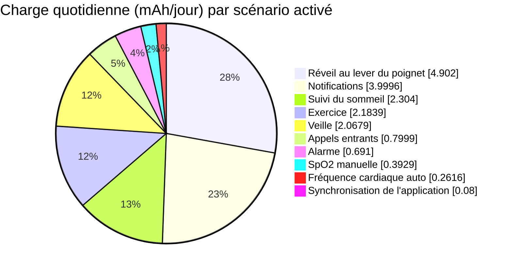
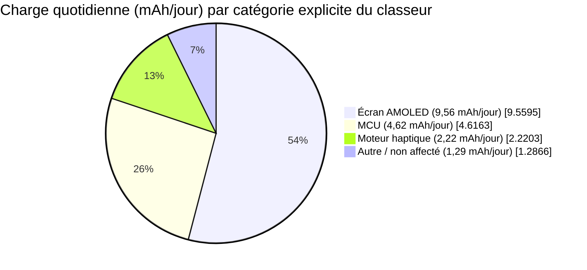
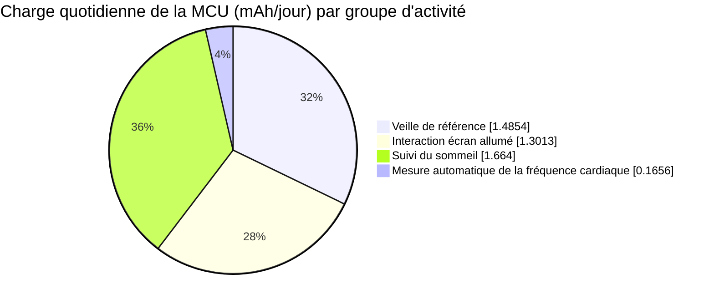

# Profilage de la consommation d'une montre connectée { #power-profiling-a-smartwatch }

Le profilage de la consommation transforme l'usage quotidien attendu en une estimation d'autonomie et, surtout, en une liste hiérarchisée des charges à optimiser. Cet article s'appuie sur le [classeur anglais de données de profil de consommation d'une montre connectée](assets/smartwatch-power-profile-data.xlsx) fourni comme exemple détaillé. Il montre comment convertir le comportement de l'utilisateur en mAh par jour, repérer les charges qui dominent le budget et transformer le modèle du tableur en plan de mesure.

!!! warning "Un modèle, pas une spécification d'appareil"
    Les courants et hypothèses d'usage de cet exemple appartiennent au modèle fourni. Ce ne sont pas des données de caractérisation d'un composant SF32, d'un écran, d'une batterie ou d'une conception de montre particuliers. Remplacez-les par des mesures de votre matériel avant d'utiliser le résultat dans une affirmation d'autonomie de produit.
    Le classeur ne contient aucun relevé de mesure ; il n'identifie donc aucune entrée comme une mesure matérielle. Le résultat de 13,15 jours est une estimation du modèle, et non une autonomie observée.

Utilisez cette page avec la [vue d'ensemble de la basse consommation](overview.md) pour l'architecture et les conseils de firmware, et avec [Mesure et validation de la consommation](measurement-and-validation.md) pour le flux de mesure qui valide le modèle.

## Vue d'ensemble du système de montre connectée { #smartwatch-system-overview }

Commencez par définir la frontière du modèle. Ce classeur représente une montre connectée alimentée par batterie, avec une MCU, un écran AMOLED, un moteur haptique et une catégorie de charge non affectée `Autre`. Il n'indique ni la taille de la dalle, ni la résolution, ni le réglage de luminosité, ni l'architecture radio, ni les capteurs individuels. Considérez les courants d'écran ci-dessous comme des entrées du classeur, et non comme des points de fonctionnement mesurés ni des spécifications d'une dalle particulière. Considérez `Autre` comme une frontière de modélisation, et non comme un composant physique unique.

<div align="center"><em>Tableau : Système de montre connectée et entrées du modèle</em></div>

<div align="center" markdown>

| Élément | Valeur dans le classeur | Pourquoi il compte |
|:-----|----------------------:|:---------------|
| Courant normal de l'écran AMOLED | 15 mA | Utilisé pour les notifications, les alertes d'appel entrant et les événements de réveil au lever du poignet. |
| Courant AOD de l'AMOLED | 2 mA | Défini dans le modèle, mais son scénario AOD est désactivé dans cette configuration de référence. |
| Capacité nominale de la batterie | 250 mAh | La capacité de départ avant la marge du modèle. |
| Marge de dégradation de la batterie | 7 % | Réduit la capacité disponible à 232,5 mAh. |
| Tension nominale de la batterie | 3,87 V | Utilisée par la valeur auxiliaire de normalisation de tension du classeur. |

</div>

## Consommation par scénario { #power-consumption-by-scenario }

Un scénario est un événement complet d'utilisateur ou de système, et non un élément isolé. Une notification de message peut réveiller la MCU, allumer l'écran AMOLED, piloter le moteur haptique et maintenir actives des charges d'arrière-plan. Dans la matrice source, chaque ligne `Écran` désigne l'écran AMOLED. La matrice regroupe les lignes de composants de chaque scénario et conserve les valeurs quotidiennes calculées à des fins de traçabilité. Les nombres d'occurrences et les durées derrière ces valeurs figurent plus loin dans cet article, dans le profil d'usage quotidien.

<div align="center"><em>Tableau : Modèle complet de consommation au niveau des composants</em></div>

<div align="center" markdown>

| Scénario | Composant | Tension | Courant | Facteur de tension* | Charge quotidienne | Part de la charge quotidienne |
|:---------|:----------|--------:|--------:|----------------:|-------------:|----------------------:|
| Veille de référence | MCU | 3,3 V | 0,102 mA | 85,27 % | 1,4854 mAh | 8,40 % |
| Veille de référence | Écran | 3,3 V | 0 mA | 85,27 % | 0 mAh | 0,00 % |
| Veille de référence | Moteur haptique | 3,3 V | 0 mA | 85,27 % | 0 mAh | 0,00 % |
| Veille de référence | Autre | 3,87 V | 0,04 mA | 100,00 % | 0,5825 mAh | 3,29 % |
| Notification de message | MCU | 3,3 V | 2,507 mA | 85,27 % | 0,3482 mAh | 1,97 % |
| Notification de message | Écran | 3,3 V | 15 mA | 85,27 % | 2,0833 mAh | 11,78 % |
| Notification de message | Moteur haptique | 3,3 V | 11,25 mA | 85,27 % | 1,5625 mAh | 8,84 % |
| Notification de message | Autre | 3,87 V | 0,04 mA | 100,00 % | 0,0056 mAh | 0,03 % |
| Alerte d'appel entrant | MCU | 3,3 V | 2,507 mA | 85,27 % | 0,0696 mAh | 0,39 % |
| Alerte d'appel entrant | Écran | 3,3 V | 15 mA | 85,27 % | 0,4167 mAh | 2,36 % |
| Alerte d'appel entrant | Moteur haptique | 3,3 V | 11,25 mA | 85,27 % | 0,3125 mAh | 1,77 % |
| Alerte d'appel entrant | Autre | 3,87 V | 0,04 mA | 100,00 % | 0,0011 mAh | 0,01 % |
| Réveil au lever du poignet | MCU | 3,3 V | 2,607 mA | 85,27 % | 0,7242 mAh | 4,10 % |
| Réveil au lever du poignet | Écran | 3,3 V | 15 mA | 85,27 % | 4,1667 mAh | 23,56 % |
| Réveil au lever du poignet | Moteur haptique | 3,3 V | 0 mA | 85,27 % | 0 mAh | 0,00 % |
| Réveil au lever du poignet | Autre | 3,87 V | 0,04 mA | 100,00 % | 0,0111 mAh | 0,06 % |
| Mesure automatique de la fréquence cardiaque | MCU | 3,3 V | 0,207 mA | 85,27 % | 0,1656 mAh | 0,94 % |
| Mesure automatique de la fréquence cardiaque | Écran | 3,3 V | 0 mA | 85,27 % | 0 mAh | 0,00 % |
| Mesure automatique de la fréquence cardiaque | Moteur haptique | 3,3 V | 0,08 mA | 85,27 % | 0,0640 mAh | 0,36 % |
| Mesure automatique de la fréquence cardiaque | Autre | 3,87 V | 0,04 mA | 100,00 % | 0,0320 mAh | 0,18 % |
| Mesure manuelle de la SpO2 | MCU | 3,3 V | 2,6 mA | 85,27 % | 0,0578 mAh | 0,33 % |
| Mesure manuelle de la SpO2 | Écran | 3,3 V | 15 mA | 85,27 % | 0,3333 mAh | 1,89 % |
| Mesure manuelle de la SpO2 | Moteur haptique | 3,3 V | 0 mA | 85,27 % | 0 mAh | 0,00 % |
| Mesure manuelle de la SpO2 | Autre | 3,87 V | 0,08 mA | 100,00 % | 0,0018 mAh | 0,01 % |
| Enregistrement d'exercice | MCU | 3,3 V | 0,207 mA | 85,27 % | 0,0296 mAh | 0,17 % |
| Enregistrement d'exercice | Écran | 3,3 V | 15 mA | 85,27 % | 2,1429 mAh | 12,12 % |
| Enregistrement d'exercice | Moteur haptique | 3,3 V | 0 mA | 85,27 % | 0 mAh | 0,00 % |
| Enregistrement d'exercice | Autre | 3,87 V | 0,08 mA | 100,00 % | 0,0114 mAh | 0,06 % |
| Vibration de l'alarme | MCU | 3,3 V | 2,6 mA | 85,27 % | 0,0650 mAh | 0,37 % |
| Vibration de l'alarme | Écran | 3,3 V | 15 mA | 85,27 % | 0,3750 mAh | 2,12 % |
| Vibration de l'alarme | Moteur haptique | 3,3 V | 10 mA | 85,27 % | 0,2500 mAh | 1,41 % |
| Vibration de l'alarme | Autre | 3,87 V | 0,04 mA | 100,00 % | 0,0010 mAh | 0,01 % |
| Suivi du sommeil | MCU | 3,3 V | 0,208 mA | 85,27 % | 1,6640 mAh | 9,41 % |
| Suivi du sommeil | Écran | 3,3 V | 0 mA | 85,27 % | 0 mAh | 0,00 % |
| Suivi du sommeil | Moteur haptique | 3,3 V | 0 mA | 85,27 % | 0 mAh | 0,00 % |
| Suivi du sommeil | Autre | 3,87 V | 0,08 mA | 100,00 % | 0,6400 mAh | 3,62 % |
| Synchronisation des données de l'application | MCU | 3,3 V | 2,5 mA | 85,27 % | 0,0069 mAh | 0,04 % |
| Synchronisation des données de l'application | Écran | 3,3 V | 15 mA | 85,27 % | 0,0417 mAh | 0,24 % |
| Synchronisation des données de l'application | Moteur haptique | 3,3 V | 11,25 mA | 85,27 % | 0,0313 mAh | 0,18 % |
| Synchronisation des données de l'application | Autre | 3,87 V | 0,04 mA | 100,00 % | 0,0001 mAh | 0,0006 % |
| Transaction par carte NFC | MCU | 3,3 V | 2,5 mA | 85,27 % | 0 mAh | 0,00 % |
| Transaction par carte NFC | Écran | 3,3 V | 15 mA | 85,27 % | 0 mAh | 0,00 % |
| Transaction par carte NFC | Moteur haptique | 3,3 V | 11,25 mA | 85,27 % | 0 mAh | 0,00 % |
| Transaction par carte NFC | Autre | 3,87 V | 0,04 mA | 100,00 % | 0 mAh | 0,00 % |
| Appel Bluetooth | MCU | 3,3 V | 10 mA | 85,27 % | 0 mAh | 0,00 % |
| Appel Bluetooth | Écran | 3,3 V | 15 mA | 85,27 % | 0 mAh | 0,00 % |
| Appel Bluetooth | Moteur haptique | 3,3 V | 11,25 mA | 85,27 % | 0 mAh | 0,00 % |
| Appel Bluetooth | Autre | 3,87 V | 0,04 mA | 100,00 % | 0 mAh | 0,00 % |
| AOD, mise à jour de la MCU une fois par minute | MCU | 3,3 V | 2,5 mA | 85,27 % | 0 mAh | 0,00 % |
| AOD, mise à jour de la MCU une fois par minute | Écran | 3,3 V | 0 mA | 85,27 % | 0 mAh | 0,00 % |
| AOD, mise à jour de la MCU une fois par minute | Moteur haptique | 3,3 V | 0 mA | 85,27 % | 0 mAh | 0,00 % |
| AOD, mise à jour de la MCU une fois par minute | Autre | 3,87 V | 0,08 mA | 100,00 % | 0 mAh | 0,00 % |
| AOD, écran allumé | MCU | 3,3 V | 0 mA | 85,27 % | 0 mAh | 0,00 % |
| AOD, écran allumé | Écran | 3,3 V | 2 mA | 85,27 % | 0 mAh | 0,00 % |
| AOD, écran allumé | Moteur haptique | 3,3 V | 0 mA | 85,27 % | 0 mAh | 0,00 % |
| AOD, écran allumé | Autre | 3,87 V | 0,08 mA | 100,00 % | 0 mAh | 0,00 % |

</div>

\*Le classeur nomme cette colonne « Rendement de conversion de puissance (%) », mais sa formule n'est qu'un rapport de tensions, et non un rendement de régulateur mesuré. La sous-section « Vérifier l'hypothèse de conversion du classeur » ci-dessous explique les conséquences pour les estimations d'autonomie. Les valeurs de charge quotidienne et de pourcentage de ce tableau sont arrondies à partir du classeur ; utilisez le fichier téléchargeable pour les formules et valeurs exactes. Servez-vous des tableaux classés ci-dessous pour fixer les priorités, puis revenez à cette matrice lorsque vous devez inspecter l'hypothèse de courant ou de tension derrière une contribution.

<div align="center"><em>Schéma : Boucle de profilage de la consommation d'une montre connectée</em></div>


### Convertir un scénario en charge quotidienne { #convert-a-scenario-into-daily-charge }

Pour une charge dont le courant est déjà exprimé au niveau de la batterie, la charge quotidienne est simple :

```text
daily_charge_mAh = current_mA x active_time_seconds_per_day / 3600
```

Pour une charge alimentée par un régulateur, calculez le courant côté batterie avant d'appliquer le terme de temps :

```text
battery_current_mA = (load_voltage_V x load_current_mA) /
                     (battery_voltage_V x regulator_efficiency)
```

Utilisez le rendement mesuré du régulateur au courant de charge visé. Le rendement maximal affiché en titre d'un régulateur est rarement utile pour une montre qui passe une grande partie de la journée en faible charge.

### Vérifier l'hypothèse de conversion du classeur { #check-the-workbooks-conversion-assumption }

La colonne « Rendement de conversion de puissance (%) » du classeur est calculée comme `tension de la charge / tension de la batterie`. Sa formule de charge suivante divise par cette valeur auxiliaire (« helper »), puis par la tension de la batterie, de sorte que les termes de tension s'annulent. La charge quotidienne qui en résulte est simplement le courant de charge multiplié par le temps : elle traite le courant de batterie comme égal au courant de charge, au lieu de modéliser une conversion de puissance idéale. Cela ressemble à un régulateur linéaire dont le courant de repos est omis ; ce n'est pas un modèle général pour un régulateur à découpage.

Par exemple, une charge de 1 mA sous 3,3 V alimentée depuis une batterie de 3,87 V consommerait environ 0,853 mA à travers un convertisseur idéal, alors que le classeur compte 1 mA. Le résultat d'un convertisseur réel dépend de son rendement et de son courant de repos. Par conséquent, l'hypothèse de conversion du classeur ne suffit pas à établir si son estimation d'autonomie est optimiste ou prudente. Le classement est utile pour une première revue des hypothèses déclarées de courant et de temps, mais ce n'est pas un budget de batterie définitif. Pour un budget de production, remplacez la valeur auxiliaire par le rendement mesuré de chaque rail et de chaque plage de charge, incluez le courant de repos sans le compter deux fois s'il figure déjà dans cette mesure, et tenez compte des pertes de la protection de batterie et du chemin de charge.

## Calculer la consommation quotidienne à partir de l'usage du produit { #calculate-daily-consumption-from-product-usage }

Un même scénario peut être négligeable ou dominant selon l'usage du produit. Le classeur active une journée représentative : veille de référence, notifications, alertes d'appel entrant, réveil au lever du poignet, mesures de fréquence cardiaque et de SpO2, enregistrement d'exercice, alarmes, suivi du sommeil et synchronisation de l'application. Il met à zéro le NFC, les appels Bluetooth et les deux scénarios AOD ; ces fonctions ne sont donc pas incluses dans le résultat de 13,15 jours.

<div align="center"><em>Tableau : Profil d'usage quotidien du produit et contributions</em></div>

<div align="center" markdown>

| Scénario | Occurrences par jour | Durée par occurrence | Durée totale par jour | Part de la charge quotidienne | Statut dans le modèle |
|:---------|--------------------:|------------------------:|-----------------------:|----------------------:|:----------------|
| Veille de référence | 1 | Secondes restantes de la journée (`=G7`) | 52 425,7 s | 11,69 % | Activé |
| Notification de message | 100 | 5 s | 500 s | 22,62 % | Activé |
| Alerte d'appel entrant | 10 | 10 s | 100 s | 4,52 % | Activé |
| Réveil au lever du poignet | 200 | 5 s | 1 000 s | 27,72 % | Activé |
| Mesure automatique de la fréquence cardiaque | 48 | 60 s | 2 880 s | 1,48 % | Activé |
| Mesure manuelle de la SpO2 | 2 | 40 s | 80 s | 2,22 % | Activé |
| Enregistrement d'exercice | 1 | `3600 / 7` s | 514,3 s | 12,35 % | Activé ; une heure par semaine, moyennée par jour |
| Vibration de l'alarme | 3 | 30 s | 90 s | 3,91 % | Activé |
| Suivi du sommeil | 1 | `8 x 3600` s | 28 800 s | 13,03 % | Activé |
| Synchronisation des données de l'application | 20 | 0,5 s | 10 s | 0,45 % | Activé |
| Transaction par carte NFC | 0 | 5 s | 0 s | 0,00 % | Désactivé |
| Appel Bluetooth | 0 | `2 x 60` s | 0 s | 0,00 % | Désactivé |
| AOD, mise à jour de la MCU une fois par minute | 0 | 0,05 s | 0 s | 0,00 % | Désactivé |
| AOD, écran allumé | 0 | `(24 - 8) x 3600` s | 0 s | 0,00 % | Désactivé |

</div>

Les cellules de scénario vides de la matrice source sont intentionnelles : chaque scénario nommé est suivi de ses lignes de charge pour l'écran, le moteur haptique et `Autre`. Ces lignes héritent des occurrences et de la durée quotidiennes de la ligne de scénario située au-dessus, si bien que la source ne nomme chaque scénario qu'une fois.

<div align="center"><em>Tableau : Résultat calculé de l'usage quotidien</em></div>

<div align="center" markdown>

| Résultat | Calcul | Valeur |
|:-------|:------------|------:|
| Capacité utilisable de la batterie | `250 mAh x (1 - 7%)` | 232,5 mAh |
| Consommation quotidienne modélisée | Somme de toutes les charges de scénarios activés | 17,68 mAh/jour |
| Courant moyen de la batterie | `17,68 mAh/jour / 24 h` | 0,74 mA |
| Autonomie estimée de la batterie | `232,5 mAh / 17,68 mAh/jour` | 13,15 jours |

</div>

Le classement des scénarios du modèle est plus exploitable que son chiffre final d'autonomie. Les plus gros contributeurs sont les premiers endroits où tester une hypothèse d'optimisation.

<div align="center"><em>Tableau : Contributions des scénarios activés dans le modèle de montre connectée</em></div>

<div align="center" markdown>

| Scénario | Charge quotidienne | Part de la charge quotidienne | Comportement quotidien supposé |
|:---------|------------:|----------------------:|:-----------------------|
| Réveil au lever du poignet | 4,90 mAh | 27,72 % | 200 événements, 5 s chacun. |
| Notification de message | 4,00 mAh | 22,62 % | 100 notifications, 5 s chacune. |
| Suivi du sommeil | 2,30 mAh | 13,03 % | 8 h. |
| Enregistrement d'exercice | 2,18 mAh | 12,35 % | 1 h par semaine, moyennée par jour. |
| Veille de référence | 2,07 mAh | 11,69 % | Temps restant après les activités activées. |
| Alerte d'appel entrant | 0,80 mAh | 4,52 % | 10 alertes, 10 s chacune. |
| Vibration de l'alarme | 0,69 mAh | 3,91 % | 3 alarmes, 30 s chacune. |
| Mesure manuelle de la SpO2 | 0,39 mAh | 2,22 % | 2 mesures, 40 s chacune. |
| Mesure automatique de la fréquence cardiaque | 0,26 mAh | 1,48 % | 48 mesures, 60 s chacune. |
| Synchronisation des données de l'application | 0,08 mAh | 0,45 % | 20 transferts, 0,5 s chacun. |

</div>

<div align="center"><em>Graphique : Contributions des scénarios activés dans le modèle de montre connectée</em></div>



Les deux premières interactions écran allumé représentent environ la moitié de la charge quotidienne modélisée. C'est un résultat testable, et pas simplement l'affirmation générique que les écrans consomment de l'énergie. Avant d'investir dans des charges plus petites, confirmez le vrai nombre de réveils au lever du poignet, la durée d'écran allumé, la luminosité, le comportement de rafraîchissement et la politique de notification.

<div align="center"><em>Tableau : Charge quotidienne par catégorie de composants</em></div>

<div align="center" markdown>

| Catégorie de composants | Charge quotidienne | Part de la charge quotidienne | Question de profilage |
|:-------------------|------------:|----------------------:|:-------------------|
| Écran AMOLED | 9,56 mAh | 54,06 % | La luminosité, la durée d'allumage et les rafraîchissements correspondent-ils au comportement réel de l'utilisateur ? |
| MCU | 4,62 mAh | 26,11 % | Le firmware revient-il à l'état de veille prévu entre les rafales de travail ? |
| Moteur haptique | 2,22 mAh | 12,56 % | L'intensité, le motif et la durée des vibrations sont-ils nécessaires pour chaque événement ? |
| Autre / non affecté | 1,29 mAh | 7,28 % | Les hypothèses sur les capteurs, le PMIC, la radio et les fuites sont-elles mesurées individuellement ? |

</div>

<div align="center"><em>Graphique : Répartition connue de la charge quotidienne dans le modèle de montre connectée</em></div>



Le graphique laisse volontairement la dernière part en `Autre / non affecté`. Le classeur ne fournit pas de valeurs indépendantes côté batterie pour le Bluetooth, l'accéléromètre ou le gyroscope. Son scénario d'appel Bluetooth désactivé ne prouve pas que le Bluetooth ne coûte rien : le scénario de synchronisation de l'application peut aussi emprunter un chemin radio, mais le classeur n'isole pas cette énergie. De même, la contribution des capteurs peut être incluse dans `Autre`, mais elle ne peut pas être séparée en valeurs d'accéléromètre et de gyroscope à partir des données fournies.

Pour en faire un graphique à cinq catégories — MCU, écran, moteur haptique, Bluetooth et une catégorie combinée accéléromètre/gyroscope —, ajoutez des lignes distinctes pour les états inactif et de transfert du Bluetooth, pour les modes et rapports cycliques de l'accéléromètre, et pour les modes et rapports cycliques du gyroscope. Mesurez chaque ligne à l'entrée de la batterie, ou appliquez le rendement mesuré du régulateur avant de l'ajouter au total en mAh côté batterie. Remplacez ensuite la part `Autre / non affecté` plutôt que d'ajouter une seconde part de capteur ou de Bluetooth qui se chevaucherait.

### Séparer la consommation de base de la MCU, le travail de la MCU lié aux scénarios et les charges des capteurs { #separate-standby-mcu-active-mcu-and-sensors }

Le classeur fournit une catégorie explicite `MCU`, mais il n'isole pas le rendu graphique comme un chemin de code distinct. L'analyse la plus défendable sépare l'entrée MCU de la veille de référence des entrées MCU affectées aux scénarios d'usage ; la consommation des capteurs n'est pas identifiée comme une catégorie distincte.

<div align="center"><em>Tableau : Ventilation de la catégorie MCU du classeur</em></div>

<div align="center" markdown>

| Groupe d'activité de la MCU | Charge quotidienne | Part de la charge quotidienne totale | Part de la charge de la MCU | Interprétation |
|:-------------------|------------:|----------------------------:|--------------------:|:---------------|
| Veille de référence | 1,49 mAh | 8,40 % | 32,18 % | 0,102 mA pendant les 14,56 h restantes du modèle. C'est une hypothèse de catégorie MCU au niveau système, et non une fuite vérifiée de la puce nue. |
| Interaction écran allumé | 1,30 mAh | 7,36 % | 28,19 % | Scénarios de message, d'appel entrant, de réveil au lever du poignet, de SpO2, d'exercice, d'alarme et de synchronisation de l'application. Elle inclut la gestion des événements autant que tout travail graphique. |
| Suivi du sommeil | 1,66 mAh | 9,41 % | 36,04 % | 0,208 mA sur 8 h ; la plus grosse entrée MCU individuelle du modèle. |
| Mesure automatique de la fréquence cardiaque | 0,17 mAh | 0,94 % | 3,59 % | Détection planifiée et travail de la MCU associé. |
| **Total MCU** | **4,62 mAh** | **26,11 %** | **100 %** | Toutes les entrées MCU explicites du classeur. |

</div>

<div align="center"><em>Graphique : Ventilation de la charge quotidienne de la catégorie MCU du classeur</em></div>



Deux comparaisons évitent une conclusion trompeuse :

- **Entrée MCU de la veille de référence et entrées des scénarios écran allumé :** la veille de référence contribue pour 1,49 mAh/jour, un peu plus que les 1,30 mAh/jour affectés à la MCU dans l'ensemble des scénarios écran allumé. Dans ce modèle, réduire le courant de base supposé compte au moins autant que réduire le travail de la MCU associé à ces scénarios. Le classeur n'isole pas les rafales graphiques comme une mesure distincte.
- **Entrée MCU de la veille de référence et toutes les autres entrées MCU explicites :** les autres entrées MCU totalisent 3,13 mAh/jour, soit 2,11 fois l'entrée de veille de référence. Le suivi du sommeil est la plus grosse entrée individuelle hors référence, à 1,66 mAh/jour ; il s'agit d'une affectation de la MCU au niveau du scénario, et non d'une mesure du seul courant du CPU actif.

Le classeur ne fournit aucune catégorie dédiée aux capteurs. Sa catégorie `Autre` est le seul endroit susceptible d'inclure la consommation des capteurs, mais elle peut aussi inclure le PMIC, la radio, les fuites ou d'autres charges d'arrière-plan. Elle totalise 1,29 mAh/jour (7,28 %). Même si tout `Autre` était attribué aux capteurs, la catégorie MCU explicite resterait plus grande : 4,62 mAh/jour contre 1,29 mAh/jour, soit 3,59 fois plus. Cela compare des catégories du classeur, et non une mesure directe du silicium de la MCU par rapport aux capteurs. La part réelle des seuls capteurs ne peut être déterminée qu'après que le modèle a séparé les rails des capteurs de l'entrée générique `Autre`.

<div align="center"><em>Tableau : Ce qu'il faut mesurer ensuite pour séparer les charges restantes</em></div>

<div align="center" markdown>

| Question | Frontière actuelle du classeur | Mesure nécessaire |
|:---------|:--------------------------|:-------------------|
| Quelle est la fuite de la MCU ? | Le courant de base `MCU` inclut plus que la fuite de la puce nue. | Mesurez l'alimentation de la MCU dans l'état de veille prévu, puis mesurez séparément les fuites au niveau de la carte. |
| Quelle énergie représente le rendu graphique ? | Le temps de la MCU écran allumé comprend aussi le réveil, la gestion des événements et le travail du pilote d'écran. | Marquez l'intervalle de rendu dans le firmware et intégrez le courant sur cet intervalle. |
| Quelle part revient aux capteurs ? | Les capteurs ne forment pas une catégorie distincte ; ils peuvent être dans `Autre`. | Mesurez chaque rail de capteur ou ajoutez une ligne au classeur par mode de capteur et par rapport cyclique. |
| Que reste-t-il dans `Autre` ? | Le PMIC, la radio, les fuites et les capteurs sont mélangés. | Désactivez ou isolez un rail ou un sous-système à la fois, puis rapprochez le total côté batterie. |

</div>

## Transformer le classement en travail de conception { #turn-the-ranking-into-design-work }

Travaillez du plus gros contributeur modélisé vers le plus petit, puis validez l'ordre par des mesures. Dans ce modèle, un enchaînement raisonnable est le suivant :

1. **Politique d'écran :** mesurez la trace complète d'un réveil au lever du poignet. Réduisez les faux déclenchements de gestes, la durée d'écran allumé, la luminosité, les redessins plein écran et les animations inutiles avant de courir après les microampères de la MCU.
2. **Politique de notification :** regroupez les notifications non urgentes lorsque l'expérience produit le permet. Vérifiez si chaque événement a besoin à la fois de l'écran et d'un retour haptique.
3. **Veille connectée :** confirmez que la MCU atteint le mode de veille prévu après chaque événement. Auditez les minuteurs périodiques, les boucles d'interrogation, les rappels Bluetooth et les demandes de gestion d'énergie (PM).
4. **Motifs haptiques :** réglez l'amplitude et la durée à l'aide de tests perceptifs. Un motif plus court ou plus doux peut réduire l'énergie sans rendre les alertes moins utilisables.
5. **Surveillance prolongée :** profilez le suivi du sommeil et l'enregistrement d'exercice comme des scénarios complets, y compris le rapport cyclique des capteurs, le traitement, le trafic mémoire et le comportement radio.

N'optimisez pas un chiffre de tableur isolé. Un changement apparemment efficace peut augmenter la fréquence des réveils, réduire la satisfaction de l'utilisateur ou allonger le temps actif au point d'effacer l'économie d'énergie attendue.

## Valider le modèle sur le matériel { #validate-the-model-on-hardware }

Le modèle devient utile lorsqu'il est étalonné en continu par des mesures. Pour chaque contributeur principal, consignez la tension de la batterie ou de l'alimentation, la température, la révision de la carte, la révision du firmware, les radios activées, le mode d'écran et la plage de mesure.

<div align="center"><em>Tableau : Plan minimal de validation pour ce profil de montre connectée</em></div>

<div align="center" markdown>

| Scène profilée | Ce qu'il faut mesurer | Ce qu'il faut réinjecter dans le modèle |
|:---------------|:----------------|:---------------------------------|
| Veille écran éteint | Courant moyen et réveils inattendus sur une longue capture | Courant de fond de la MCU, des capteurs, du PMIC et autres charges d'arrière-plan. |
| Réveil au lever du poignet | Détection du geste, latence de réveil, courant de l'écran et durée d'écran allumé | Nombre réel d'événements, durée d'affichage et coût de l'interface. |
| Notification | Activité de la MCU, de l'écran, de l'haptique et du Bluetooth pendant une alerte | Énergie par notification et nombre quotidien correct. |
| Suivi du sommeil | Une trace complète de nuit ou une fenêtre représentative répétable | Rapport cyclique des capteurs et coût du traitement périodique. |
| Enregistrement d'exercice | Activité des capteurs, de l'écran, du stockage et de la radio sur la session prévue | Énergie par session et fréquence hebdomadaire réaliste. |
| AOD, NFC et appels Bluetooth | Mesures séparées avant de les activer dans la prévision | Leurs propres scénarios, et non un petit ajustement de la veille. |

</div>

## Garder le profil honnête { #keep-the-profile-honest }

- Considérez les scénarios désactivés comme non budgétés, et non comme gratuits. Le classeur affecte actuellement une charge nulle aux scénarios NFC, appels Bluetooth et AOD.
- Conservez des scénarios distincts pour les fonctions visibles par l'utilisateur et pour le travail d'arrière-plan. Les arbitrages produit deviennent ainsi visibles lors des revues.
- Mesurez si possible à l'entrée de la batterie. Les mesures au niveau des rails restent précieuses, mais il faut leur ajouter les pertes du régulateur et le courant de repos avant d'en faire des chiffres d'autonomie.
- Changez une hypothèse à la fois, puis comparez les mAh par jour plutôt que seulement le courant instantané.
- Relancez le profil chaque fois qu'une politique d'écran, un réglage Bluetooth, une cadence de capteur, une politique de gestion d'énergie ou une fonction majeure du firmware change.

## Points clés à retenir { #key-takeaways }

- L'autonomie est la capacité effective de la batterie divisée par la consommation quotidienne ; ce modèle projette 13,15 jours à partir de 232,5 mAh de capacité utilisable et d'une charge quotidienne modélisée de 17,68 mAh.
- Dans la configuration de référence fournie, le comportement de l'écran domine le budget. Le réveil au lever du poignet et les notifications de message représentent à eux seuls environ la moitié de la charge quotidienne.
- Le classement des scénarios indique où mesurer et optimiser en premier ; il est plus utile qu'un seul chiffre de courant moyen.
- Utilisez le rendement réel du convertisseur et le courant de repos avant de traiter une prévision de classeur comme une affirmation d'autonomie de production.
- Répétez la boucle : modéliser un comportement réaliste, mesurer les scènes dominantes, mettre à jour les hypothèses, puis optimiser.
