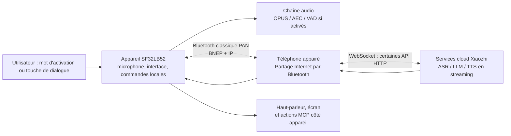

# Assistant vocal Xiaozhi sur SF32 { #sf32-xiaozhi-voice-assistant }

## Qu'est-ce que Xiaozhi ? { #what-is-xiaozhi }

[Xiaozhi](https://github.com/78/xiaozhi-esp32) est un chatbot vocal open source fondé sur MCP, largement connu depuis son implémentation ESP32 en 2025. Il associe un appareil d'interaction vocale à des services cloud de grands modèles et à des extensions MCP côté appareil ou côté cloud. C'est donc un point de départ concret pour du matériel d'IA conversationnelle, et pas seulement une application de chat textuel.

## Pourquoi l'implémentation SF32 ? { #why-the-sf32-implementation }

[78/xiaozhi-sf32](https://github.com/78/xiaozhi-sf32) est l'implémentation SF32, mais elle utilise volontairement un autre schéma de connectivité. Alors que le projet ESP32 d'origine prend en charge le Wi-Fi et d'autres connexions réseau directes, la version SF32 accède à Internet via le [Bluetooth PAN classique](../learn/bluetooth/pan.md), fourni par un téléphone appairé. Le téléphone prend ainsi en charge la connexion à Internet, ce qui peut réduire sensiblement la consommation électrique liée au réseau côté appareil dans une conception dépendante du téléphone. L'économie réelle dépend toutefois du téléphone, des conditions radio, du rapport cyclique des dialogues et de la politique d'alimentation. Cette approche convient particulièrement aux appareils personnels portables sur batterie, comme les pendentifs, badges, assistants compacts et petits appareils connectés portés sur soi.

Cette référence produit est particulièrement utile, car elle réunit des aspects souvent traités séparément : matériel d'affichage et audio, réseau fourni par le téléphone, service vocal cloud, parcours d'activation utilisateur, commandes de l'appareil et capacité de mise à jour sur le terrain.

## Résultat, portée et critères d'entrée { #outcome-scope-and-entry-criteria }

Cette page décrit un parcours d'ingénierie complet pour faire évoluer cette référence vers un produit. Elle **n'affirme pas** que Xiaozhi est un LLM hors ligne exécuté sur l'appareil, que toutes les fonctions amont sont qualifiées pour la production, ni qu'une carte de développement prise en charge équivaut à un produit fini certifié. L'appareil utilise Bluetooth PAN pour accéder à Internet par l'intermédiaire d'un téléphone appairé et s'appuie sur les services cloud Xiaozhi pour le dialogue. Avant tout engagement produit, vérifiez les conditions du service, la propriété du compte, la confidentialité, la sécurité, les coûts, la disponibilité et l'adéquation régionale.

**Résultat :** obtenir un assistant vocal avec affichage reproductible, configurable via un téléphone, capable de mener un dialogue appuyé par le cloud, de contrôler une fonction sûre de l'appareil, de récupérer après la perte de la connexion PAN et de produire les preuves nécessaires à une décision de matériel personnalisé.

**Public visé :** ingénieurs firmware, matériel et produit déjà capables de compiler et flasher une base SF32, et prêts à travailler avec C/C++, les schémas de carte, la configuration Bluetooth et l'intégration de services cloud.

<div align="center"><em>Tableau : contrat du projet</em></div>

<div align="center" markdown>

| Domaine | Référence projet | Preuves à réunir avant l'étape suivante |
|:-----|:-----------------|:-------------------------------|
| Matériel | Une cible Xiaozhi SF32LB52 documentée, son parcours audio/affichage, la connexion USB de flashage et son alimentation | Démarrage à froid, touches, écran, microphone, haut-parleur et indication de charge/batterie le cas échéant |
| Connectivité | Un téléphone pouvant s'appairer sous `sifli-pan` et partager l'accès Internet via Bluetooth PAN | L'interface de la carte confirme PAN ; perte et reconnexion sont reproductibles |
| Service | Un compte Xiaozhi, l'activation de l'appareil et un agent configuré depuis la console Xiaozhi | Une requête de dialogue atteint le service et la réponse revient à la carte |
| Firmware | Commit amont, révision du sous-module SDK, cible de carte et méthode de compilation/flashage consignés | Compilation propre reproductible, flashage, journal série et image firmware |
| Adaptation produit | Une modification volontairement limitée, par exemple l'identité visuelle de l'interface, le nom de l'appareil, la courbe batterie ou une sortie sûre pilotée par MCP | Le parcours vocal d'origine fonctionne toujours après la modification |

</div>

## Spécifications matérielles et logicielles { #hardware-and-software-specifications }

Le manifeste ci-dessous définit une référence concrète de compilation depuis les sources : **SF32LB52-DevKit-Nano-R16N16 V1.0.0**, avec l'écran externe et le circuit audio documentés par SiFli. Il ne constitue pas une nomenclature universelle pour toutes les cartes Xiaozhi prises en charge. Si vous choisissez DevKit-ULP, DevKit-LCD ou Xiaotangyuan, remplacez l'ensemble de ce manifeste matériel par l'assemblage documenté de cette carte et conservez les références exactes des fournisseurs et la révision de la carte.

### Spécification matérielle { #hardware-specification }

<div align="center"><em>Tableau : spécification matérielle de référence Xiaozhi Nano</em></div>

<div align="center" markdown>

| Composant | Spécification requise | Rôle | Statut | Approvisionnement | Compatibilité et remplacement |
|:----------|:-----------------------|:-----|:-------|:----------------|:-------------------------------------|
| SF32LB52-DevKit-Nano-R16N16 V1.0.0 | SF32LB52JUD6, 16 Mo de PSRAM OPI et 16 Mo de flash NOR SPI | Calcul SF32, Bluetooth PAN, flashage/débogage USB, interface et audio | Obligatoire | [Page produit SiFli](https://www.sifli.com/zh-hans/SF32LB52_DevKit_Nano) ; [boutique officielle SiFli](https://sifli.taobao.com/) | Ne pas remplacer par la variante Nano N4 sans revérifier la cible firmware et le budget mémoire. Noter la révision de la PCB et le lien de commande fournisseur. |
| AMOLED 1,85 pouce 390 × 450 avec adaptateur FPC 16 vers 22 broches | Assemblage d'affichage QSPI et brochage FPC utilisés dans le câblage officiel Xiaozhi Nano | Interface utilisateur | Obligatoire | [Page matérielle officielle de Xiaozhi Nano](https://docs.sifli.com/projects/xiaozhi/get-started/SF32LB52-DevKit-Nano/) | La page officielle ne donne pas de lien d'achat. Fixer le contrôleur de dalle, l'orientation FPC, la référence fournisseur et le lien d'approvisionnement avant de considérer la base reproductible. |
| Module microphone MEMS analogique | Sortie analogique compatible avec `MIC_BIAS`, `MIC_ADC` et GND | Capture vocale | Obligatoire | [Lien du composant publié dans le guide officiel](https://item.taobao.com/item.htm?id=595237371680) | Tout remplacement exige de valider polarisation, niveau de sortie, bruit et acoustique. |
| Module amplificateur PAM8302 | Entrée différentielle depuis `DACP`/`DACN` ; arrêt commandé par `PA30` | Pilotage du haut-parleur | Obligatoire | [Lien du composant publié dans le guide officiel](https://item.taobao.com/item.htm?id=535743493142) | Traiter tout autre amplificateur comme une adaptation matérielle ; vérifier à nouveau polarité d'activation, gain, courant au repos et bruit. |
| Haut-parleur en enceinte | 8 Ω, 2–3 W | Restitution vocale | Obligatoire | [Lien du composant publié dans le guide officiel](https://item.taobao.com/item.htm?id=895176389650) | Revalider le rendu acoustique, la température de l'amplificateur et le courant pour toute autre enceinte ou impédance. |
| Fils de prototypage et plaque d'essai 400 points | Jeu de fils et plaque correspondant au prototype Nano documenté | Interconnexion du prototype | Obligatoire pour le prototype documenté | [Fils de prototypage](https://item.taobao.com/item.htm?id=39961676503) ; [plaque d'essai 400 points](https://item.taobao.com/item.htm?id=39828824454) | Ne remplacer par une PCB revue qu'après validation du câblage de référence et transfert exact du brochage. |
| Câble USB Type-C de données et ordinateur de développement | Câble Type-C de données ; ordinateur sous Windows, Linux ou macOS | Alimentation, flashage, compilation et journaux série | Obligatoire | [Prérequis SiFli-SDK](https://docs.sifli.com/projects/sdk/latest/en/sf32lb52x/quickstart/get-started.html) | Un câble de charge seul ne permet ni de flasher ni de capturer les journaux. Noter le système d'exploitation et l'architecture de l'ordinateur. |
| Téléphone Android ou iOS avec partage Internet Bluetooth | Doit s'appairer sous `sifli-pan` et fournir l'accès Internet via Bluetooth PAN classique | Relais réseau | Obligatoire | [Procédure officielle d'accès Xiaozhi via PAN](https://docs.sifli.com/projects/xiaozhi/get-started/) | Noter le modèle du téléphone et la version de son système d'exploitation. Valider perte, nouvel appairage et partage pour chaque combinaison téléphone/système prise en charge. |

</div>

Les URL de composants tiers ci-dessus pointent vers des places de marché citées par le guide officiel SiFli Nano ; elles ne garantissent pas des références fabricant pérennes. Conservez captures d'écran ou justificatifs d'achat des pièces évaluées, puis remplacez chaque dépendance à une place de marché par une référence fournisseur qualifiée et sa fiche technique avant la conception du produit.

### Spécification logicielle { #software-specification }

<div align="center"><em>Tableau : spécification logicielle de référence Xiaozhi</em></div>

<div align="center" markdown>

| Paquet ou service | Version ou révision requise | Rôle | Statut | Approvisionnement | Compatibilité et mises à jour |
|:-------------------|:-----------------------------|:-----|:-------|:----------------|:-------------------------------|
| Firmware SF32 Xiaozhi précompilé | v1.4.0 | Image de référence intacte pour la base et la récupération | Obligatoire pour les étapes 1–2 | [Version v1.4.0](https://github.com/78/xiaozhi-sf32/releases/tag/v1.4.0) | Sélectionner `sf32lb52-nano_52j.zip` pour la référence Nano R16N16. Ne pas mélanger les archives de cartes différentes. |
| Sources `78/xiaozhi-sf32` | Commit [`1d3ef641ace47fae68227e9173647fd5db01f6f5`](https://github.com/78/xiaozhi-sf32/commit/1d3ef641ace47fae68227e9173647fd5db01f6f5) | Sources de l'application et configuration de la carte | Obligatoire pour les étapes 3–4 | [Dépôt](https://github.com/78/xiaozhi-sf32) | Il s'agit de l'instantané source examiné pour cet article. Consigner tout commit ultérieur comme nouvelle référence et reprendre tous les contrôles. |
| Sous-module SiFli-SDK | Commit [`0d2de1480f735e05017c41436e655a1688063881`](https://github.com/OpenSiFli/SiFli-SDK/tree/0d2de1480f735e05017c41436e655a1688063881) | Pilotes SF32, RTOS, middleware, scripts de chaîne d'outils et environnement SCons | Obligatoire pour les étapes 3–4 | [OpenSiFli/SiFli-SDK](https://github.com/OpenSiFli/SiFli-SDK) via le sous-module `sdk` du dépôt | Utiliser la révision du sous-module enregistrée par le commit de l'application retenu ; ne pas mettre à jour le SDK séparément dans une référence conservée. |
| Interface graphique sftool | v1.2.1 ; conserver le SHA-256 de l'artefact choisi pour l'OS depuis la page de version | Flashage de l'image précompilée et récupération locale | Obligatoire pour le parcours graphique documenté avec v1.4.0 | [Version v1.2.1 et artefacts par plateforme](https://github.com/OpenSiFli/sftool-gui/releases/tag/v1.2.1) | Noter l'OS hôte, le nom de l'artefact et son empreinte. Qualifier toute version ultérieure avant remplacement. |
| Outils de l'hôte de compilation | Scripts d'installation/export fournis par le SiFli-SDK figé ; environnement SCons créé par ces scripts | Configuration et compilation des sources | Obligatoire pour les étapes 3–4 | [Guide officiel de compilation Xiaozhi depuis les sources](https://docs.sifli.com/projects/xiaozhi/source-build/) | Noter l'OS et l'architecture de l'hôte, le résultat des scripts et l'environnement exporté. Un outil installé globalement ne doit pas remplacer silencieusement celui du SDK figé. |
| Console et service cloud Xiaozhi | Service hébergé sur `xiaozhi.me` ; noter date de validation, propriétaire du compte, configuration de l'agent et point d'accès | Activation, ASR/LLM/TTS en streaming et MCP cloud | Obligatoire pour le dialogue | [Console Xiaozhi](https://xiaozhi.me) | L'utilisateur ne peut pas figer une version du service hébergé. Traiter son comportement, ses conditions, sa disponibilité et son accès régional comme des dépendances contrôlées de l'extérieur. |

</div>

## Choisir une configuration de référence prise en charge { #choose-a-supported-baseline }

La documentation de démarrage rapide SiFli pour Xiaozhi répertorie quatre cibles avec firmware précompilé : SF32LB52-DevKit-ULP (Huangshan), SF32LB52-DevKit-LCD, SF32LB52-DevKit-Nano et la carte d'extension Xiaotangyuan. La documentation de compilation depuis les sources répertorie actuellement DevKit-ULP, DevKit-LCD et DevKit-Nano. Si la personnalisation des sources est une exigence du projet, choisissez une carte figurant dans cette dernière liste ; la présence d'une image précompilée ne garantit pas l'existence d'une cible de compilation documentée.

<div align="center"><em>Tableau : choix de la carte</em></div>

<div align="center" markdown>

| Carte | À choisir si | Point de vigilance avant mise en produit |
|:------|:------------|:----------------------|
| [SF32LB52-DevKit-ULP](https://docs.sifli.com/projects/xiaozhi/get-started/SF32LB52-DevKit-ULP/) | Vous souhaitez suivre l'exemple ULP documenté de compilation depuis les sources et évaluer une configuration adaptée à une alimentation par batterie. | Recalibrez la courbe de batterie pour tout modèle différent de la batterie de référence documentée. |
| [SF32LB52-DevKit-LCD](https://docs.sifli.com/projects/xiaozhi/get-started/SF32LB52-DevKit-LCD/) | Vous avez besoin d'une référence concrète d'intégration de l'écran et du haut-parleur. | Les indications sur l'AMOLED 390 × 450, l'orientation FPC, la connexion `SPK` et les touches `KEY1` et `KEY2` sont propres à cette carte. |
| [SF32LB52-DevKit-Nano](https://docs.sifli.com/projects/xiaozhi/get-started/SF32LB52-DevKit-Nano/) | Vous recherchez une base SF32LB52 documentée et plus compacte. | Vérifiez précisément l'écran, l'audio, l'alimentation et les entrées utilisateur avant de reprendre le câblage d'une autre carte. |
| [Carte d'extension Xiaotangyuan](https://docs.sifli.com/projects/xiaozhi/get-started/SF32LB52-XTY-AI-THT/) | Vous suivez le parcours de démarrage rapide correspondant avec firmware précompilé. | Vérifiez l'état actuel de la compilation depuis les sources et de la personnalisation avant d'en faire la base du produit. |

</div>

## Étapes du projet { #delivery-map }

Considérez les étapes comme des points de décision, et non comme une liste de fonctionnalités. Chacune produit un élément vérifiable qui permet d'examiner et de reproduire la décision suivante.

<div align="center"><em>Tableau : étapes du projet</em></div>

<div align="center" markdown>

| Étape | Décision étayée | Résultat attendu |
|:------|:---------------------|:----------------|
| 1. Base de référence | La carte, le téléphone, le compte et le service documentés fonctionnent-ils ensemble sans modification ? | Session de dialogue consignée et validée. |
| 2. Validation de la reprise | Cette base résiste-t-elle aux défaillances prévisibles en usage réel ? | Procès-verbal concluant des essais de défaillance et de reprise. |
| 3. Base source | L'équipe peut-elle reproduire le firmware sans dépendre d'une image fournie ? | Artefact de compilation aux versions verrouillées et journaux associés. |
| 4. Adaptation maîtrisée | Peut-on apporter une modification produit sans dégrader le comportement de référence ? | Modification revue et preuves des tests de non-régression. |
| 5. Décision produit | Les risques liés au matériel, au service, à la sécurité et à la reprise sont-ils assez bien compris pour poursuivre l'investissement ? | Dossier de maturité produit approuvé et transfert vers la conception matérielle. |

</div>

## Architecture système et dépendances { #system-architecture-and-dependencies }

<div align="center"><em>Figure : flux produit de Xiaozhi sur SF32</em></div>



Le guide d'architecture officiel décrit le Bluetooth PAN sur Bluetooth classique comme chemin réseau, avec une pile IP légère sur l'appareil. WebSocket est le principal canal applicatif temps réel ; HTTP sert à certaines interactions avec les API. La présentation de SiFli cite parmi les fonctions implémentées le réveil par mot-clé (KWS), le dialogue continu, l'AEC/VAD, les expressions dynamiques, les polices vectorielles et le MCP local. D'autres documents officiels décrivent aussi l'interface à l'écran, la gestion de la batterie et de l'alimentation, les extensions MCP côté cloud et la mise à jour OTA via PAN ; vérifiez la prise en charge concrète avec la carte et le firmware choisis.

Ce flux comporte quatre domaines de défaillance à diagnostiquer séparément : matériel et audio locaux, appairage Bluetooth et PAN, accès à Internet et au service cloud, configuration de l'application et du service. Un appairage BLE réussi ne prouve ni que la carte accède à Internet ni que le service vocal est activé.

## Étape 1 — Établir la référence intacte { #stage-1-establish-the-untouched-reference-baseline }

1. Effectuez le montage matériel propre à la carte selon la procédure officielle. Pour le DevKit-LCD, cela comprend l'ensemble AMOLED/FPC spécifié, un haut-parleur connecté à `SPK`, `KEY1` pour le réveil et le dialogue, ainsi qu'un appui long sur `KEY2` pour éteindre l'appareil.
2. Flashez le firmware précompilé pris en charge en suivant la procédure officielle Xiaozhi. Le guide de démarrage rapide recommande l'outil graphique de flashage ; à la date de publication du guide, il précise que le flashage depuis le terminal n'est pas pris en charge pour les firmwares à partir de la version 1.4.0.
3. Sur le téléphone, activez le **partage Internet Bluetooth avant l'appairage**. Appairez-le avec `sifli-pan`, puis vérifiez dans l'interface de la carte et l'état de partage du téléphone que PAN est bien actif, et qu'il ne s'agit pas d'un simple appairage Bluetooth. Pour iOS, le guide officiel indique qu'un redémarrage du téléphone peut être nécessaire si `sifli-pan` n'apparaît pas.
4. Suivez la procédure d'activation officielle dans la console Xiaozhi sur [xiaozhi.me](https://xiaozhi.me) : créez et configurez un agent, puis ajoutez le code d'appareil affiché par la carte.
5. Lancez un dialogue à l'aide de la touche prévue ou du mécanisme d'activation configuré. Consignez dans le dossier projet la version du firmware, la carte, le modèle et le système du téléphone, ainsi que les identifiants du compte et de l'agent.

**Critère de sortie du point de contrôle 1 :** après un démarrage à froid, l'appareil établit PAN, indique qu'il est activé, accepte une requête de dialogue, restitue une réponse et affiche l'état attendu de l'interface.

## Étape 2 — Prouver la récupération et le comportement critique du produit { #stage-2-prove-recovery-and-product-critical-behavior }

Effectuez ces essais avant toute modification des sources. Ils transforment la démonstration en une base fiable :

<div align="center"><em>Tableau : preuves de validation de la base</em></div>

<div align="center" markdown>

| Essai | Méthode | Critère de réussite |
|:-----|:-------|:--------------|
| PAN absent | Appairez le téléphone sans activer le partage Internet Bluetooth. | L'interface ou le journal signale clairement l'absence de PAN ; l'activation du partage et une nouvelle connexion rétablissent le service. |
| Perte de PAN | Désactivez le partage, coupez Bluetooth ou éloignez-vous pendant une période d'inactivité ou un dialogue. | L'appareil détecte le problème, revient à un état récupérable et se reconnecte par le mécanisme documenté de réveil/reconnexion. |
| Veille et réveil | Laissez l'appareil inactif jusqu'à sa mise en veille, puis utilisez la commande de réveil prévue. | Le réveil, la reconnexion et le dialogue suivant sont reproductibles sans nouveau flashage. |
| Audio et interface | Enchaînez plusieurs dialogues à un volume représentatif. | La capture est intelligible, la restitution est nette, l'interface reste réactive et aucun redémarrage ne survient. |
| Indication de batterie | Chargez et déchargez la batterie à des niveaux représentatifs. | L'état affiché est plausible ; une batterie autre que la référence est identifiée comme nécessitant une calibration de courbe. |
| Limite du service | Testez volontairement un compte ou agent auquel manque la configuration attendue. | La défaillance se distingue des problèmes de PAN et de matériel. |

</div>

Le guide officiel avertit que la courbe `battery_table.c` fournie pour une carte peut être inexacte avec une autre batterie. Pour la batterie du produit, obtenez les données de charge et de décharge du fournisseur ou mesurez-les. Mettez à jour `charging_curve_table` et `discharge_curve_table`, recompilez, puis répétez les essais de batterie.

**Critère de sortie du point de contrôle 2 :** chaque essai a un résultat consigné, les défaillances sont attribuables à leur domaine respectif et chaque procédure de reprise documentée fonctionne sans nouveau flashage ni correction manuelle de l'état.

## Étape 3 — Établir une base de code reproductible { #stage-3-build-a-reproducible-source-baseline }

Le dépôt intègre SiFli-SDK sous forme de sous-module. Clonez-le récursivement et consignez le commit Xiaozhi ainsi que celui du sous-module SDK :

```bash
git clone --recursive https://github.com/78/xiaozhi-sf32.git
cd xiaozhi-sf32
git checkout 1d3ef641ace47fae68227e9173647fd5db01f6f5
git submodule update --init --recursive
cd sdk
# Windows: .\install.ps1, then .\export.ps1
# macOS/Linux: ./install.sh, then . ./export.sh
```

Pour l'exemple officiel de compilation par script du DevKit-ULP, lancez la compilation depuis `app/project` en utilisant le chemin documenté vers les cartes externes :

```bash
scons --board=sf32lb52-lchspi-ulp --board_search_path="../boards" -j8
```

Consultez la page de compilation officielle propre à la carte pour connaître la cible exacte et le script de flashage ; ne réutilisez ni le nom de cible ULP ni le chemin de l'artefact généré pour une autre carte. Un dossier de compilation reproductible doit contenir le système d'exploitation hôte, le résultat de l'installation des outils, l'environnement exporté, l'argument de carte, les révisions amont et du SDK, le journal de compilation, l'image flashée et le journal série.

**Critère de sortie du point de contrôle 3 :** un clone propre sur une seconde machine — ou après suppression du répertoire de compilation — produit une image qui passe tous les contrôles de l'étape 2.

## Étape 4 — Adapter délibérément { #stage-4-adapt-deliberately }

Ne modifiez qu'un élément à la fois et conservez l'image de référence validée. La documentation officielle de personnalisation traite du nom Bluetooth, des images statiques et animées, des polices, du DFU via PAN et de MCP.

<div align="center"><em>Tableau : ordre recommandé des adaptations</em></div>

<div align="center" markdown>

| Type de modification | Commencer par | Non-régression requise |
|:-------------|:-----------|:--------------------|
| Identité du produit | Nom Bluetooth, image statique, police ou animation. | Flashage, activation, PAN, interface et dialogue. |
| Batterie et matériel produit | Courbe de batterie, paramètres d'écran, chaîne audio, comportement des touches. | Alimentation, réveil, audio/interface et dialogues répétés. |
| Commande locale de l'appareil | Outil MCP à périmètre réduit, paramètres bornés et callback sûr. | Autorisation de la commande, entrée invalide, déconnexion en cours d'action, état de repli physique et journal vérifiable. |
| Extension cloud | Service MCP externe. | Authentification du point d'accès, stockage des secrets, disponibilité et reprise après redémarrage, privilèges minimaux et consentement visible par l'utilisateur. |
| Mise à jour sur le terrain | DFU_PAN et serveur OTA. | Détection de version, intégrité CRC/partition, interruption de mise à jour, retour arrière/reprise et provenance de l'image. |

</div>

Pour MCP côté appareil, le guide officiel utilise `McpServer::AddCommonTools()` dans `app/src/mcp/mcp_server.cc`. Considérez toute action demandée par le LLM comme une requête non fiable : vérifiez les plages de valeurs et l'état dans le callback, placez les sorties dans un état sûr par défaut et n'exposez aucune commande irréversible, dangereuse ou sensible pour la sécurité sans autorisation propre au produit.

Pour l'OTA via PAN, la documentation officielle distingue trois catégories d'images déployables séparément : le code, les ressources graphiques et les polices. L'adresse et la taille des images doivent être déterminées à partir de la table de partitions. Avant d'activer l'OTA en production, définissez une politique de version, contrôlez l'accès au serveur, vérifiez l'intégrité, testez une interruption et prévoyez une procédure de reprise locale ou filaire.

**Critère de sortie du point de contrôle 4 :** la modification choisie, sa procédure de retour arrière ou de reprise et les résultats de non-régression applicables sont consignés. Le parcours de dialogue initial et les limites de sécurité de chaque action sur l'appareil restent validés.

## Étape 5 — Revue de préparation produit { #stage-5-product-readiness-review }

Ne passez pas à une conception matérielle personnalisée avant que l'équipe puisse répondre aux questions suivantes :

- Quelles versions de téléphone et de système d'exploitation prennent en charge exactement le parcours d'appairage PAN, et quelle solution de repli prévoir sinon ?
- Quels points de terminaison cloud, compte, agent, point de terminaison MCP et identifiants sont utilisés, et qui en est responsable et en assure la rotation ?
- Quelles données audio, d'appareil et d'utilisateur quittent l'appareil ? Comment le consentement est-il obtenu ? Quelles exigences s'appliquent à la conservation des données et aux régions ?
- Quels courants sont mesurés pendant un dialogue, au repos connecté, en veille, en charge et au réveil avec la batterie et le boîtier prévus ?
- Comment l'appareil récupère-t-il après une mise à jour échouée, la perte du téléphone, une panne cloud, une ressource corrompue ou une mauvaise configuration ?
- Quels éléments du code amont, du service, du comportement du modèle et de l'infrastructure OTA sont maîtrisés par votre équipe produit, et lesquels dépendent de fournisseurs externes ?

**Critère de sortie du point de contrôle 5 :** les réponses, les responsables désignés et les risques résiduels sont consignés et acceptés par l'équipe produit. Chaque point restant comporte une mesure d'atténuation, un report explicite ou une décision d'arrêt.

## Passage à la conception du produit { #handoff-to-product-design }

Intégrez le composant SF32 choisi, l'architecture d'alimentation, la conception de l'écran et de l'audio, la stratégie RF, le plan de stockage et de partitions, les essais de production et les hypothèses de reprise à la [conception pour la production](../hardware/design-for-production.md). Suivez le [parcours d'intégration SF32LB52](../sf32-products/chips/SF32LB52x.md#integration-path) pour choisir le composant, le module, la carte, le guide et la liste de contrôle adaptés.

**Définition de l'achèvement du projet :** cette référence a rempli son rôle lorsqu'un nouveau membre de l'équipe peut reproduire la base choisie, relier chaque défaillance observée à son responsable ou à sa procédure de reprise, reconstruire l'image personnalisée et examiner les éléments nécessaires à la décision de concevoir un matériel spécifique. Elle devient alors une référence de développement produit, et non une démonstration non évaluée à transposer en production.

## Sources de référence { #authoritative-sources }

- [Dépôt 78/xiaozhi-esp32](https://github.com/78/xiaozhi-esp32)
- [Dépôt 78/xiaozhi-sf32](https://github.com/78/xiaozhi-sf32)
- [Wiki SiFli : présentation d'AI Xiaozhi (en chinois)](https://github.com/OpenSiFli/SiFli-Wiki/blob/main/source/zh_CN/application/xiaozhi.md)
- [Démarrage rapide officiel SiFli pour Xiaozhi](https://docs.sifli.com/projects/xiaozhi/get-started/)
- [Compilation officielle de Xiaozhi depuis les sources](https://docs.sifli.com/projects/xiaozhi/source-build/)
- [Architecture officielle SiFli de Xiaozhi](https://docs.sifli.com/projects/xiaozhi/architecture/)
- [Personnalisation officielle de Xiaozhi par SiFli](https://docs.sifli.com/projects/xiaozhi/custom/)
- [Guide officiel SiFli DFU_PAN de Xiaozhi](https://docs.sifli.com/projects/xiaozhi/custom/dfu_pan.html)
- [Guide officiel SiFli MCP de Xiaozhi](https://docs.sifli.com/projects/xiaozhi/custom/mcp.html)
