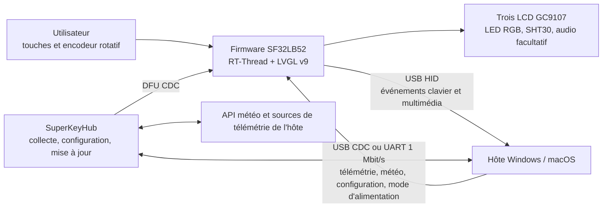

# Clavier macro multifonction SuperKey { #superkey-multifunction-macro-keyboard }

## Qu'est-ce que SuperKey ? { #what-is-superkey }

[SiFliSparks/SuperKey](https://github.com/SiFliSparks/SuperKey) est une implémentation de référence d'un clavier macro multifonction à écrans, basée sur le SF32LB52. Son firmware open source fonctionne sous RT-Thread et LVGL v9 ; il pilote trois écrans LCD GC9107 de 128 × 128, trois LED RGB, quatre touches physiques, un encodeur rotatif et un capteur de température/humidité SHT30, et se connecte à un ordinateur comme périphérique USB composite HID/CDC.

SuperKey est plus qu'un pavé de raccourcis. Cette référence opérationnelle combine les fonctions suivantes :

- sortie USB HID pour clavier et commandes multimédias ;
- données de performances, météo, configuration et état d'alimentation de l'ordinateur via USB CDC ou UART à 1 Mbit/s ;
- pages réparties sur trois écrans pour la supervision des performances, la météo, l'horloge, les utilitaires, la musique et les mappages personnalisés ;
- application compagnon [SuperKeyHub](https://github.com/SiFliSparks/SuperKeyHub) qui collecte les données de l'hôte, configure les fonctions et déclenche les mises à jour du firmware ;
- matériel reproductible grâce au design ouvert [sf32-keyboard](https://oshwhub.com/sifli/sf32-keyboard).


<div align="center"><em>Interface SuperKey sur trois écrans</em></div>

## Pourquoi l'implémentation SF32 ? { #why-the-sf32-implementation }

SuperKey requiert des graphismes, plusieurs écrans, un périphérique USB composite, des touches et un encodeur, des capteurs, des effets RGB, un système de fichiers et éventuellement l'audio. Le SF32LB52 exécute ces tâches temps réel sur le MCU ; l'appareil peut ainsi démarrer son interface et fournir les fonctions HID de base même si l'application compagnon n'est pas lancée. L'application hôte traite la télémétrie de l'ordinateur et les données Internet, qui relèvent plutôt du système d'exploitation de bureau.

Cette répartition convient aux contrôleurs de bureau, claviers de productivité, panneaux d'état et IHM compactes, mais crée des dépendances explicites. Les affichages de données avancés nécessitent l'application compagnon, des pilotes et des API externes ; les versions du firmware et de l'hôte doivent rester compatibles ; les pertes USB, la veille de l'hôte et les configurations endommagées nécessitent des tests de récupération distincts.

## Résultat, portée et critères d'entrée { #outcome-scope-and-entry-criteria }

**Résultat attendu :** reproduire une configuration SuperKey avec des versions figées, valider HID, CDC, l'interface sur trois écrans, les entrées, les capteurs et la reprise après veille, puis ne modifier qu'une catégorie de comportement à la fois en conservant des preuves de compilation, de communication et de non-régression pour la revue produit.

Cette page ne démontre pas que le circuit imprimé ouvert est prêt pour la production, ni que toutes les sources de télémétrie PC, tous les services météo, ponts série, hôtes USB ou systèmes d'exploitation sont compatibles. Les cours boursiers, les données météo et les données de performance peuvent dépendre de la version de SuperKeyHub, d'API tierces, des autorisations système et du matériel hôte.

Avant de commencer, préparez :

- matériel SuperKey assemblé selon le design ouvert, avec trois écrans LCD GC9107, des touches, un encodeur et une connexion USB de données ;
- un ordinateur sous Windows 10/11 pour le parcours principal documenté. Le dépôt SuperKeyHub annonce la prise en charge de Windows et macOS ; validez toutefois le flashage de la carte, la communication CDC et la récupération sur l'OS choisi ;
- une version de SuperKeyHub compatible avec le firmware ;
- un environnement SiFli-SDK, le sous-module SDK récupéré récursivement et une connexion de flashage/récupération opérationnelle ;
- si la météo est dans le périmètre, une clé API QWeather valide, l'API Host et la configuration de ville ;
- un rapport de test couvrant l'énumération USB, les journaux série, le comportement des touches, l'état des écrans et la récupération après veille.

<div align="center"><em>Tableau : contrat du projet SuperKey</em></div>

<div align="center" markdown>

| Domaine | Base de référence connue | Éléments requis avant adaptation |
|:-----|:---------------|:------------------------------------|
| Matériel | Matériel ouvert `sf32-keyboard` et cible `sf32lb52-superkey` | Révision de la PCB/de l'assemblage, LCD et entrées, alimentation et connexion USB consignés |
| Firmware | Dépôt SuperKey, sous-module SiFli-SDK, RT-Thread, LVGL v9 et CherryUSB | Commit du firmware et du SDK, journal de compilation, image et journal de flashage |
| Application compagnon | SuperKeyHub avec protocole firmware compatible | Version de l'application, système d'exploitation, port, configuration API et journal de connexion |
| Fonctions principales | HID, CDC, trois écrans, encodeur, touches, capteur et modes d'alimentation | Compte rendu du démarrage à froid, de l'actualisation des données, des entrées, de la déconnexion et de la récupération après veille |
| Adaptation | Une modification d'interface, de touche, de LED ou de champ de données à la fois | Modification relue, image de retour arrière et résultats complets des tests de non-régression |

</div>

## Spécifications matérielles et logicielles { #hardware-and-software-specifications }

### Spécification matérielle { #hardware-specification }

<div align="center"><em>Tableau : spécification matérielle de SuperKey</em></div>

<div align="center" markdown>

| Composant | Spécification requise | Rôle | Statut | Où l'obtenir | Compatibilité et remarques sur les substitutions |
|:-----------|:----------------------|:-----|:-------|:-------------|:--------------------------------------------------|
| Assemblage matériel ouvert SuperKey | Configuration SF32LB52 avec trois écrans GC9107 de 128 × 128, trois LED RGB, quatre touches, un encodeur rotatif, un SHT30 et USB, selon le projet | Contrôle du clavier macro, affichage, entrée, capteurs et USB HID/CDC | Obligatoire | [Conception ouverte `sf32-keyboard`](https://oshwhub.com/sifli/sf32-keyboard) ; [dépôt SuperKey](https://github.com/SiFliSparks/SuperKey) | Les fichiers de conception ne constituent pas une spécification de carte assemblée disponible à l'achat ; consigner les révisions de la PCB et de l'assemblage |
| Ordinateur hôte et connexion USB de données | Windows 10/11 est le parcours principal documenté ; connexion USB de données | Exécuter SuperKeyHub, fournir l'hôte HID/CDC et permettre le flashage/la récupération | Obligatoire | [Documentation SuperKey](https://sparks.sifli.com/projects/superkey/) | Le dépôt SuperKeyHub annonce la prise en charge de Windows/macOS ; valider CDC, DFU, flashage et récupération sur l'OS choisi |
| Compte et configuration API QWeather | API Key, API Host et configuration de la ville | Fonction météo optionnelle | Optionnel | [QWeather](https://www.qweather.com/) | Ne pas verser les identifiants dans le dépôt ; vérifier les conditions et la disponibilité du service |

</div>

### Spécification logicielle { #software-specification }

<div align="center"><em>Tableau : spécification logicielle de SuperKey</em></div>

<div align="center" markdown>

| Paquet ou service | Version ou révision requise | Rôle | Statut | Où l'obtenir | Compatibilité et remarques de mise à jour |
|:------------------|:---------------------------|:-----|:-------|:-------------|:-----------------------------------------|
| Firmware SuperKey | Version v1.4.2 ; consigner le commit exact utilisé | Firmware SF32, UI LVGL, USB, capteur et mises à jour | Obligatoire | [Version v1.4.2](https://github.com/SiFliSparks/SuperKey/releases/tag/v1.4.2) | Figer le commit du firmware ; ne pas déduire la compatibilité hôte des seuls numéros de version |
| SuperKeyHub | Version ou commit validé avec le firmware v1.4.2 | Télémétrie hôte, configuration et interface de mise à jour | Obligatoire pour les fonctions hôte | [Dépôt](https://github.com/SiFliSparks/SuperKeyHub) | Les informations amont citées n'établissent pas de couple firmware/application fixe ; tester télémétrie, configuration et DFU, puis consigner le couple utilisé |
| Sous-module SiFli-SDK, RT-Thread, LVGL et CherryUSB | Révisions enregistrées par le checkout du firmware choisi | Compilation du firmware et pile USB | Obligatoire pour compiler les sources | [Dépôt SuperKey](https://github.com/SiFliSparks/SuperKey) | Cloner récursivement et conserver les révisions des sous-modules ; ne pas mettre les dépendances à jour séparément |

</div>

## Choisir une configuration de référence prise en charge { #choose-a-supported-baseline }

La liste des releases amont inclut le firmware [v1.4.2](https://github.com/SiFliSparks/SuperKey/releases/tag/v1.4.2), qui constitue un point de départ figé. Les sources citées ne précisent pas de version SuperKeyHub compatible. Choisissez et figez une release ou un commit de Hub, testez avec v1.4.2 la télémétrie, la configuration et DFU, puis consignez le couple testé au lieu de déduire la compatibilité des numéros de version.

<div align="center"><em>Tableau : choix de la base SuperKey</em></div>

<div align="center" markdown>

| Élément de référence | Point de départ recommandé | Limite importante |
|:-----------------|:------------------|:--------------------|
| Firmware | SuperKey v1.4.2 ou commit validé par l'équipe | Les versions du protocole firmware et hôte doivent correspondre |
| Application compagnon | Release ou commit SuperKeyHub validé avec le firmware v1.4.2 | Les sources citées ne précisent pas de couple fixe ; valider les données CDC, la configuration et DFU sur l'OS choisi |
| Cible de compilation | `sf32lb52-superkey`, avec les fichiers de carte sous `app/boards` | Il ne s'agit pas d'une cible générique pour carte de développement SF32LB52 |
| Communication | Valider d'abord l'USB composite HID + CDC ; valider séparément l'UART à 1 Mbit/s si utilisé | Le fait que le périphérique USB soit énuméré ne prouve pas que les interfaces HID et CDC fonctionnent toutes deux |
| Mise à jour | DFU CDC déclenchée par l'application compagnon, avec conservation d'une voie filaire de flashage/récupération | Ce n'est pas une solution de mise à jour terrain tant que l'interruption, les incompatibilités et la récupération n'ont pas été validées |

</div>

La CI amont utilise la cible suivante. Installez et exportez l'environnement SiFli-SDK avant d'exécuter ces commandes localement :

```bash
git clone --recursive https://github.com/SiFliSparks/SuperKey.git
cd SuperKey/SiFli-SDK
./install.sh
. ./export.sh
cd ../app/project
scons --board=sf32lb52-superkey --board_search_path="../boards" -j8
```

Sous Windows, utilisez les scripts PowerShell d'installation et d'environnement SiFli-SDK correspondants. Le niveau de parallélisme peut varier, mais le nom de la carte, le chemin de recherche des fichiers de carte et les révisions des sous-modules doivent figurer dans le rapport de compilation.

## Étapes du projet { #delivery-map }

<div align="center"><em>Tableau : étapes du projet SuperKey</em></div>

<div align="center" markdown>

| Étape | Décision éclairée | Résultat requis |
|:------|:---------------------|:----------------|
| 1. Référence intacte | Le matériel ouvert, le firmware et l'application compagnon fonctionnent-ils ensemble comme consigné ? | Session de référence fonctionnelle, verrouillée par versions |
| 2. Communication et récupération | Les pannes USB, série, veille, déconnexion et configuration sont-elles diagnostiquables et récupérables ? | Rapport d'injection de pannes et de récupération |
| 3. Reproduction des sources | L'équipe peut-elle reconstruire la même image depuis un checkout propre ? | Environnement, image, flashage et résultat reproductible |
| 4. Adaptation contrôlée | Peut-on modifier un comportement produit sans rompre la référence ? | Modification limitée, voie de retour arrière et preuves de non-régression |
| 5. Revue produit | La référence est-elle assez solide pour une PCB personnalisée, un boîtier ou une présérie ? | Risques attribués et décision de poursuivre, différer ou arrêter |

</div>

## Architecture système et dépendances { #system-architecture-and-dependencies }

<div align="center"><em>Figure : chemins des données et commandes du produit SuperKey</em></div>



Répartissez les pannes en cinq domaines : matériel/écran du périphérique, entrées HID, canal de données CDC/UART, application compagnon/autorisations système et services de données externes. Un panneau météo vide n'indique pas nécessairement un défaut du firmware ; la clé API, l'API Host, la configuration de la ville ou l'envoi des données peuvent être en cause.

## Étape 1 — Établir la référence intacte { #stage-1-establish-the-untouched-reference-baseline }

**Objectif :** vérifier l'ensemble du parcours de référence avant de modifier le code.

1. Suivez les instructions d'assemblage amont pour vérifier l'orientation des câbles LCD, les interrupteurs, l'encodeur, le boîtier et le connecteur USB ; consignez les révisions de la PCB et du firmware.
2. Installez la version correspondante de SuperKeyHub. Vérifiez l'énumération du périphérique, puis testez séparément HID et CDC.
3. Configurez les identifiants météo, le port et la liaison série à 1 Mbit/s. Consignez le comportement sans l'application compagnon, puis connectez-la et activez l'envoi de données.
4. Vérifiez la navigation sur les trois écrans, le mappage des touches, les commandes multimédias, l'encodeur, les données SHT30, les effets LED et un cycle complet d'actualisation de la télémétrie.
5. Effectuez un démarrage à froid et répétez les tests. Enregistrez des photos de l'interface, les journaux de l'application et du périphérique ainsi que le résultat de la requête de version.

**Éléments à conserver :** révision matérielle, tag/commit du firmware, commit du SDK, version de l'application compagnon, système d'exploitation, configuration du port et de l'API, énumération USB, journaux, affichages et relevé des entrées.

**Critère de sortie du point de contrôle 1 :** deux démarrages à froid valident les entrées HID, l'actualisation des données CDC et l'interaction avec les trois écrans ; chaque domaine de panne peut être identifié par les journaux ou un état observable.

## Étape 2 — Valider les limites de défaillance et de récupération { #stage-2-validate-fault-and-recovery-boundaries }

**Objectif :** vérifier que les interruptions courantes en environnement de bureau ne réduisent pas l'appareil à un démonstrateur qu'il faut flasher à nouveau pour récupérer.

<div align="center"><em>Tableau : tests de panne et de récupération SuperKey</em></div>

<div align="center" markdown>

| Test | Méthode | Critère de réussite |
|:-----|:-------|:--------------|
| Application compagnon absente | Fermer SuperKeyHub et redémarrer l'appareil | L'interface locale et HID restent fonctionnels ; les valeurs dépendant du compagnon apparaissent clairement comme obsolètes ou indisponibles |
| Perte de CDC | Débrancher/rebrancher l'USB ou changer de port pendant l'envoi de données | L'appareil ne se bloque pas ; la requête de version et l'envoi de données reprennent après reconnexion |
| Mise en veille de l'hôte | Activer `power_mode sleep/normal`, puis effectuer un cycle veille/réveil de l'hôte | LCD, LED, rétroéclairage et capteurs s'arrêtent/redémarrent comme prévu ; les données sont ensuite actualisées |
| Incompatibilité de version | Tester dans un environnement contrôlé une paire firmware/application compagnon incompatible | Le couple refuse de fonctionner ou signale une erreur diagnostiquable au lieu d'appliquer une mise à jour incompatible |
| Défaillance de l'API | Utiliser une configuration météo invalide ou déconnecter le réseau | La panne météo n'affecte ni HID, ni CDC, ni l'interface locale, ni la récupération |
| DFU interrompu | Interrompre une mise à jour sur une unité de test récupérable | La voie filaire de flashage conservée restaure l'image connue |

</div>

**Critère de sortie du point de contrôle 2 :** chaque panne applicable dispose d'un résultat reproductible de détection et de récupération, sans réparation manuelle d'état non documentée.

## Étape 3 — Établir une base de code reproductible { #stage-3-build-a-reproducible-source-baseline }

**Objectif :** permettre à un second ingénieur de compiler, flasher l'image et répéter l'étape 2 depuis un checkout propre.

1. Clonez récursivement et consignez les commits de SuperKey et de SiFli-SDK.
2. Compilez proprement avec `sf32lb52-superkey` et le chemin de recherche `../boards`.
3. Conservez le journal de compilation, les sorties mémoire/partition, le script de flashage, les images générées et le journal série.
4. Recompilez sur un second ordinateur ou après suppression du répertoire de compilation, flashez le même matériel et répétez les tests de non-régression principaux.

**Critère de sortie du point de contrôle 3 :** aucun fichier non suivi, artefact obsolète ou remplacement manuel de binaire n'est nécessaire pour produire une image qui réussit l'étape 2.

## Étape 4 — Adapter une variable produit à la fois { #stage-4-adapt-one-product-variable-at-a-time }

**Objectif :** valider le périmètre des modifications tout en préservant la référence fonctionnelle.

<div align="center"><em>Tableau : ordre des adaptations contrôlées de SuperKey</em></div>

<div align="center" markdown>

| Type de modification | Première modification conseillée | Tests de non-régression requis |
|:-------------|:------------------|:--------------------|
| Identité et interface | Icône, police, mise en page ou un réglage de rotation | Rafraîchissement des trois écrans, rotation, polices, démarrage à froid et utilisation mémoire |
| Parcours des touches | Un mappage HID ou une combinaison | Appui/relâchement, touches multiples, déconnexion imprévue et configuration persistée |
| Champ de données | Une valeur de télémétrie ou de capteur | Compatibilité du protocole, vérification des plages, délai d'actualisation et comportement avec une ancienne version du compagnon |
| Effet LED | Une couleur ou animation | Limites de luminosité, veille, retour des touches et fonctionnement prolongé |
| Mise à jour | Politique de version ou interface de mise à jour | Provenance de l'image, validation de version, interruption, retour arrière et récupération filaire |

</div>

**Critère de sortie du point de contrôle 4 :** la modification est relue, l'image d'origine peut être restaurée et les tests HID, CDC, écran, entrées, veille et récupération réussissent.

## Étape 5 — Revue de préparation produit { #stage-5-product-readiness-review }

Avant de concevoir du matériel spécifique ou de lancer une présérie, l'équipe doit répondre aux questions suivantes :

- Le produit dépendra-t-il encore de SuperKeyHub, de privilèges administrateur et d'un service météo tiers ? Qui est responsable de ces dépendances ?
- Comment les versions du firmware, du compagnon et du protocole sont-elles gérées, et comment les combinaisons invalides sont-elles bloquées ?
- Quelles combinaisons de PC cibles, hubs USB, câbles, politiques de veille et logiciels de sécurité ont été testées ?
- Quelle est la mémoire utilisée, la température et le courant lorsque les trois écrans, les données USB, les LED, les capteurs et l'audio facultatif fonctionnent simultanément ?
- Comment restaurer la configuration, les mappages de touches et l'état de mise à jour après une coupure d'alimentation ou un stockage endommagé ?
- La PCB ouverte, le boîtier, les polices, icônes, musiques et API tierces sont-ils sous licence pour la distribution prévue ?

**Critère de sortie du point de contrôle 5 :** chaque risque résiduel a un responsable, des preuves et une décision de traitement ; l'équipe a décidé de poursuivre, différer ou arrêter.

## Passage à la conception du produit { #handoff-to-product-design }

Transférez à la conception le choix du SF32 et de la mémoire, les descripteurs USB HID/CDC, les connexions des trois écrans et du rétroéclairage, les interfaces d'entrée et de capteur, la politique d'alimentation et de veille, les partitions du système de fichiers et des mises à jour, le protocole compagnon, les points de test en production et le chemin de récupération validé. Consultez [SF32LB52x](../sf32-products/chips/SF32LB52x.md), le [guide de conception matérielle SF32LB52x](../hardware/chip-guides/SF32LB52x_hardware_design_guide.md), [SiFli-SDK : compiler, flasher et surveiller la sortie série](../develop/platforms/sifli-sdk/build-flash-monitor.md) et [Conception pour la production](../hardware/design-for-production.md).

## Sources de référence { #authoritative-sources }

- [Dépôt du firmware SiFliSparks/SuperKey](https://github.com/SiFliSparks/SuperKey)
- [Version SuperKey v1.4.2](https://github.com/SiFliSparks/SuperKey/releases/tag/v1.4.2)
- [Dépôt de l'application compagnon SiFliSparks/SuperKeyHub](https://github.com/SiFliSparks/SuperKeyHub)
- [Documentation du projet SuperKey](https://sparks.sifli.com/projects/superkey/)
- [Matériel ouvert sf32-keyboard](https://oshwhub.com/sifli/sf32-keyboard)
- [OpenSiFli/SiFli-SDK](https://github.com/OpenSiFli/SiFli-SDK)
