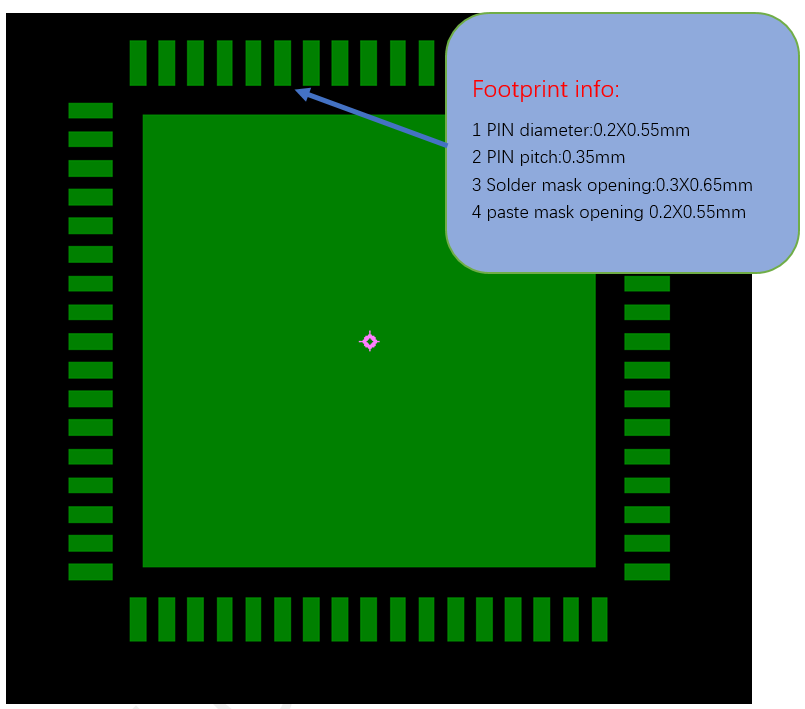

# SF32LB52x Hardware Design Guide — PCB Layout Guidelines { #sf32lb52x-hardware-design-guide-pcb-layout-guidelines }

!!! note "Part of the SF32LB52x Hardware Design Guide"
    This page covers Section 6, PCB Layout Guidelines. Return to [Schematic Design Guidelines](SF32LB52x_schematic_design.md) (the first of its three pages), continue to the [PCB Layout Checklist](SF32LB52x_pcb_layout_checklist.md), or skip ahead to [Design Review Checklist and References](SF32LB52x_review_and_reference.md).

## 6. PCB Layout Guidelines { #6-pcb-layout-guidelines }

Use this chapter as the layout-review companion to Section 5. The schematic should already define the variant, power tree, clock parts, RF reserve, display/storage pins, and test access before final placement begins.

**Design Goal**

Translate the schematic into a manufacturable 4-layer PTH board while protecting the sensitive RF, crystal, audio, power, USB, and SDIO paths from impedance, noise, and return-current problems.

**PCB Review Flow**

1. Confirm package footprint and paste/land pattern.
2. Confirm stack-up, trace/space, drill, and impedance rules with the PCB vendor.
3. Place chip, crystals, RF path, DC/DC, charger, display/storage connectors, and audio components.
4. Review fanout and sensitive routing before filling less critical GPIO routes.
5. Capture evidence screenshots for RF, crystals, USB, SDIO, audio, DC/DC, charger, and power rails.

### 6.1. PCB Footprint Design { #61-pcb-footprint-design }

The SF32LB52x QFN68L package is 7 mm x 7 mm x 0.85 mm, with 68 pins and 0.35 mm pitch.

The package drawing specifies a nominal total height of 0.85 mm, with a 0.8–0.9 mm range, and a nominal 0.02 mm stand-off (maximum 0.05 mm). Use the detailed drawing, not the rounded package summary alone, when checking assembly and enclosure clearances.

{ width="100%" loading="lazy" }

<em>Figure 6.1-1: QFN68L Package Dimensions</em>

{ width="100%" loading="lazy" }

<em>Figure 6.1-2: QFN68L Package Shape</em>

{ width="100%" loading="lazy" }

<em>Figure 6.1-3: QFN68L PCB Land Pattern Reference</em>

Figure 6.1-3 specifies 0.2 mm x 0.55 mm peripheral pads, 0.35 mm pitch, 0.3 mm x 0.65 mm solder-mask openings, and 0.2 mm x 0.55 mm paste-mask openings. These are the reference footprint dimensions; review assembly-process requirements before releasing the footprint.

The package outline gives a nominal exposed-pad size of 5.49 mm x 5.49 mm. The fanout example connects the central pad to GND; do not treat it as an unused mechanical feature.

### 6.2. PCB Stack-Up { #62-pcb-stack-up }

The reference design supports single- or double-sided placement. Components can be placed on one side, or capacitors and similar passives can be placed on the back side under the chip. A 4-layer through-hole via (PTH) stack-up is recommended.

{ width="100%" loading="lazy" }

<em>Figure 6.2-1: Reference Stack-Up Structure</em>

Figure 6.2-1 is a 0.8 mm ±10% reference stack-up, including plating and solder mask. Its calculated total is 0.79553 mm. Confirm the actual finished thickness and dielectric construction with the PCB manufacturer rather than treating this example as a universal stack-up.

<em>Table 6.2-1: Reference Stack-Up Values</em>

| Layer | Material | Thickness (mil) | Thickness (mm) | Dk | Df |
|:---|:---|---:|---:|---:|---:|
| Top solder mask | Solder mask | 1 | 0.0254 | 3.5 | 0.8 |
| L1 | Copper + plating | 1.81 | 0.045974 | — | — |
| L1–L2 dielectric | 1080 (66%) x3 prepreg | 8.5 | 0.2159 | 3.8 | 0.019 |
| L2 | Copper + plating | 1.4 | 0.03556 | — | — |
| L2–L3 dielectric | Core | 5.9 | 0.14986 | 4 | 0.017 |
| L3 | Copper + plating | 1.4 | 0.03556 | — | — |
| L3–L4 dielectric | 1080 (66%) x3 prepreg | 8.5 | 0.2159 | 3.8 | 0.019 |
| L4 | Copper + plating | 1.81 | 0.045974 | — | — |
| Bottom solder mask | Solder mask | 1 | 0.0254 | 3.5 | 0.8 |

The prepreg rows assume 70% copper area. Dk and Df are reproduced from the reference image, including its solder-mask Df of 0.8; they are not verified universal material properties. Confirm the manufacturer's actual material data for impedance and loss calculations.

### 6.3. General PCB Design Rules { #63-general-pcb-design-rules }

Follow the general PTH-board PCB design rules from the reference design.

{ width="100%" loading="lazy" }

<em>Figure 6.3-1: General PCB Design Rules</em>

Figure 6.3-1 uses a 0.1 mm minimum/recommended trace width and a 2.54 mm maximum in the illustrated rule set. It also distinguishes 0.1 mm trace/via/pad clearances from copper-clearance rules of 0.127 mm (0.15 mm between copper regions), and specifies 0.25 mm board-edge clearance. These are reference CAD rules; verify manufacturing limits and controlled-impedance routing separately.

The additional reference rules in Figure 6.3-1 specify 0.1 mm drill-to-drill and body-to-body spacing. Some same-net entries are zero; those entries do not waive clearance between different nets or the board-edge and copper rules.

### 6.4. PCB Trace Fanout { #64-pcb-trace-fanout }

Fan out all QFN package signals through the top layer.

{ width="100%" loading="lazy" }

<em>Figure 6.4-1: Top-Layer Fanout Reference</em>

### 6.5. Clock Interface Routing { #65-clock-interface-routing }

Apply these clock-routing rules across both design groups:

- Place crystals inside the shield can, more than 1 mm from the PCB edge, and as far as practical from heat-generating components (PA, charger, PMU circuits) — ideally more than 5 mm — to avoid affecting crystal frequency drift
- Keep a clearance greater than 0.25 mm around the crystal, free of other metal or components
- Route 48 MHz crystal traces on the top layer, 3–10 mm long, 0.1 mm wide, with full ground shielding, away from VBAT/VCC, DC/DC, and high-speed signal lines; keep the top layer and adjacent layer under the crystal area clear of other routing
- Route 32.768 kHz crystal traces on the top layer, ≤10 mm long, 0.1 mm wide, with ≥0.15 mm spacing between the parallel 32K_XI/32K_XO traces, and full ground shielding. Keep the top and adjacent layers beneath this crystal circuit clear of unrelated routing.

{ width="100%" loading="lazy" }

<em>Figure 6.5-1: Crystal Placement</em>

{ width="100%" loading="lazy" }

<em>Figure 6.5-2: 48 MHz Crystal Schematic</em>

{ width="100%" loading="lazy" }

<em>Figure 6.5-3: 48 MHz Crystal Routing Model</em>

{ width="100%" loading="lazy" }

<em>Figure 6.5-4: 48 MHz Crystal Routing Reference</em>

{ width="100%" loading="lazy" }

<em>Figure 6.5-5: 32.768 kHz Crystal Schematic</em>

{ width="100%" loading="lazy" }

<em>Figure 6.5-6: 32.768 kHz Crystal Routing Model</em>

{ width="100%" loading="lazy" }

<em>Figure 6.5-7: 32.768 kHz Crystal Routing Reference</em>

Figures 6.5-3 and 6.5-6 show at least 0.15 mm between the parallel XI/XO traces for both crystals. Figure 6.5-2 uses a 48 MHz crystal with 8.8 pF load capacitance and marks the external load capacitors NF (not fitted); Figure 6.5-5 uses a 32.768 kHz, 7 pF crystal on PA22/PA23, which are also multiplexed with PDM_CLK/PDM_DATA.

!!! important "Crystal ground treatment"
    The battery-variant application note conflicts with itself on crystal-area copper: its clock section says to remove L2 ground directly beneath the crystal, while its PCB-routing section prohibits plane voids or copper cutouts on the top and adjacent layers and depicts continuous L2 ground. The separate PCB layout guide repeats the no-void instruction. Do not infer a universal L2 rule or resolve this by layer count; confirm the stack-up-specific treatment with SiFli before release. The specified crystal keep-out and component clearances remain separate checks.

### 6.6. RF Interface Routing { #66-rf-interface-routing }

Apply these RF-routing rules across both design groups:

- Place the RF matching circuit close to the chip side, not the antenna side
- Place the AVDD_BRF filter capacitor close to the chip pin, with its ground pin vias connected directly to the main ground
- Route RF traces on the top layer where possible, avoiding performance-degrading vias. The source recommends a width above 10 mil; confirm that the actual stack-up achieves 50 Ω. Provide ground shielding and avoid acute or right-angle bends.
- Control RF trace impedance to 50 Ω, with dense shielding ground vias along both sides

{ width="100%" loading="lazy" }

<em>Figure 6.6-1: π-Network and Power Circuit Schematic</em>

{ width="100%" loading="lazy" }

<em>Figure 6.6-2: π-Network and Power Circuit PCB Layout</em>

{ width="100%" loading="lazy" }

<em>Figure 6.6-3: RF Signal Circuit Schematic</em>

{ width="100%" loading="lazy" }

<em>Figure 6.6-4: RF Signal PCB Routing</em>

The RF examples use a series 15 pF/50 V capacitor (C0333), leave C0318/C0319 NF, and show 0.47 uF filtering on AVDD_BRF. These are example-population values, not a universal antenna-matching prescription.

### 6.7. Audio Interface Routing { #67-audio-interface-routing }

Apply these audio-routing rules across both design groups:

- Place the AVDD33_AUD, MIC_BIAS, and AUD_VREF filter capacitors close to their respective pins. Connect their ground terminals securely to the main ground.
- Keep components for the ADCP analog input close to the chip pin, with short traces, full ground shielding, and away from other strong interference sources
- Keep components for the DACP/DACN analog output close to the chip pin, routed as a differential pair, with short traces, parasitic capacitance below 10 pF, and full ground shielding

{ width="100%" loading="lazy" }

<em>Figure 6.7-1: Audio Power Filtering Schematic</em>

{ width="100%" loading="lazy" }

<em>Figure 6.7-2: Audio Power Filtering PCB Reference Routing</em>

{ width="100%" loading="lazy" }

<em>Figure 6.7-3: Analog Audio Input Schematic</em>

{ width="100%" loading="lazy" }

<em>Figure 6.7-4: Analog Audio Input PCB Design</em>

{ width="100%" loading="lazy" }

<em>Figure 6.7-5: Analog Audio Output Schematic</em>

{ width="100%" loading="lazy" }

<em>Figure 6.7-6: Analog Audio Output PCB Design</em>

Figure 6.7-1 shows reference filter capacitors of 1 uF/6.3 V for MIC_BIAS, 2.2 uF/10 V for AVDD33_AUD, and 1 uF/6.3 V for AUD_VREF. These values explain the illustrated circuit; confirm the required values for the actual design. Keep DACP/DACN away from strong interference sources as well as maintaining differential routing.

The source schematic guidance also limits the DAC output trace length to less than 2 cm.

### 6.8. USB Interface Routing { #68-usb-interface-routing }

Route USB DP (PA35) / DN (PA36) through the ESD device pins first, then to the chip, and ensure the ESD device ground connects solidly to the main ground. Route the pair with 90 Ω differential impedance control and full ground shielding.

{ width="100%" loading="lazy" }

<em>Figure 6.8-1: USB Signal Schematic</em>

{ width="100%" loading="lazy" }

<em>Figure 6.8-2: USB Signal PCB Design</em>

{ width="100%" loading="lazy" }

<em>Figure 6.8-3: USB Signal Component Placement Reference</em>

{ width="100%" loading="lazy" }

<em>Figure 6.8-4: USB Signal Routing Model</em>

Figure 6.8-3 contrasts routing through protection-device pads with unprotected branches: do not create a branch that reaches the chip without passing the protection connection.

### 6.9. SDIO Interface Routing { #69-sdio-interface-routing }

Route SDIO signals together as a group, with total trace length ≤50 mm and within-group length matching ≤6 mm. Provide full ground shielding for the clock signal, and shield the DATA and CMD signals as well.

{ width="100%" loading="lazy" }

<em>Figure 6.9-1: SDIO Interface Circuit Schematic</em>

{ width="100%" loading="lazy" }

<em>Figure 6.9-2: SDIO PCB Routing Model</em>

Figure 6.9-2 also shows at least 0.15 mm between the CMD trace and the adjacent ground shielding.

The SDIO schematic labels PA11 as MPI2_VDD_EN/SD_VDD_EN. The higher-priority OpenSiFli application guides and schematic guide specify PA21 for boot-storage power switching, so use PA21 as the source-supported design basis; the linked checklist workbook's PA11 entry for battery-variant external Flash does not establish whether this is a separate control. Do not substitute PA11 without clarification. Confirm the exact net and variant with SiFli; see [Storage and Manufacturing](SF32LB52x_schematic_storage_mfg.md#5613-boot-storage-power-control).

### 6.10. DC/DC Circuit Routing { #610-dcdc-circuit-routing }

Place the power inductor and filter capacitors close to the chip pins. Keep the BUCK_LX trace short and wide, and keep the BUCK_FB feedback trace wider than 0.25 mm. Connect all DC/DC output filter capacitor ground pins to the main ground plane with multiple vias. Do not pour top-layer copper in the power inductor area, and keep the adjacent layer as a complete reference ground.

{ width="100%" loading="lazy" }

<em>Figure 6.10-1: DC/DC Key Component Schematic</em>

{ width="100%" loading="lazy" }

<em>Figure 6.10-2: DC/DC Key Component PCB Layout</em>

Figure 6.10-1 uses a 4.7 uH inductor and a 4.7 uF/10 V output capacitor. Its labels PMU_BUCK_VSW and PMU_BUCK_VOUT correspond to the switching and output/feedback nodes described as BUCK_LX and BUCK_FB in the source pin table. Keep unrelated routing out of the inductor region.

### 6.11. Power Supply Routing { #611-power-supply-routing }

=== "SF32LB520/3/5/7 (Battery-Powered)"

    VCC is the input pin for the chip's internal PMU module — place its capacitor close to the pin, with trace width no less than 0.4 mm. Place filter capacitors for VDD_VOUT1, VDD_VOUT2, VDD_RET, VDD_RTC, VDD18_VOUT, VDD33_VOUT1, VDD33_VOUT2, AVDD33_AUD, and AVDD_BRF close to their respective pins, with trace widths sized for the required input current.

    { width="100%" loading="lazy" }

    
<em>Figure 6.11-1: VCC Power Routing (Schematic)</em>

    { width="100%" loading="lazy" }

    
<em>Figure 6.11-2: VCC Power Routing (PCB)</em>

    **Charging Circuit Routing**

    VBUS and VBAT are the input/output pins of the chip's internal charging module — place their filter capacitors close to the pins. Because the charging loop carries relatively high current, use trace widths of at least 16 mil (about 0.41 mm) and avoid routing sensitive signals in parallel with them. Use star routing so the charging path does not share routing with sensitive circuit modules. The application note rounds this minimum to 0.4 mm.

    { width="100%" loading="lazy" }

    
<em>Figure 6.11-3: VBUS & VBAT Power Routing (Schematic)</em>

    { width="100%" loading="lazy" }

    
<em>Figure 6.11-4: VBUS & VBAT Power Routing (PCB)</em>

    !!! note "Reference charging schematic"
        Figure 6.11-3 shows 10 uF/10 V on VBUS and 4.7 uF/10 V on VBAT. Its printed VBUS range is 4.3–5.5 V; Electrical Specification-A3 lists 4.5–5.5 V, and the battery-variant application note specifies 4.6–5.5 V for the integrated charger, including a ≥4.6 V pin requirement at maximum charging current. Treat the schematic as a placement reference, not an alternative validated lower limit; see the source-discrepancy note in Section 5.2.

=== "52B/D/E/G/J (Regular-Powered)"

    PVDD is the input pin for the chip's internal PMU module — place its capacitor close to the pin, with trace width no less than 0.4 mm. Place filter capacitors for AVDD33, VDDIOA, VDD_SIP, AVDD33_AUD, and AVDD_BRF close to their respective pins, with trace widths sized for the required input current, kept as short and wide as practical to reduce power-supply ripple and improve system stability.

    { width="100%" loading="lazy" }

    
<em>Figure 6.11-5: PVDD Power Routing</em>

    !!! info "Not Applicable"
        This variant has no charging management circuitry, so no charging-circuit routing is required.

### 6.12. Other Interface Routing { #612-other-interface-routing }

Ground-shield GPADC input traces and keep them away from other potentially interfering circuits, including battery-level and temperature-detection circuitry.

### 6.13. EMI & ESD { #613-emi-esd }

Apply these EMI and ESD rules across both design groups:

- Keep long interference-generating clock and power traces outside the shield can off the top layer; route them on inner layers.
- Place ESD protection devices close to the connector pins, routing signals through the ESD device before anything else
- Ensure ESD device ground pins connect to the main ground through vias, with short and wide ground pad traces to reduce impedance and improve ESD performance

### 6.14. Other Considerations { #614-other-considerations }

Place USB charging-line test points on the connector side, before the TVS protection point, and place the battery-side TVS at the board entry before the line branches to the MCU and other loads. Route the line through the TVS connection point before reaching the chip; the TVS itself is connected as a shunt to ground, not in series. Keep its ground connection short.

{ width="100%" loading="lazy" }

<em>Figure 6.14-1: Power TVS Placement Reference</em>

{ width="100%" loading="lazy" }

<em>Figure 6.14-2: TVS Routing Reference</em>

