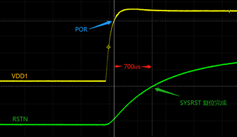
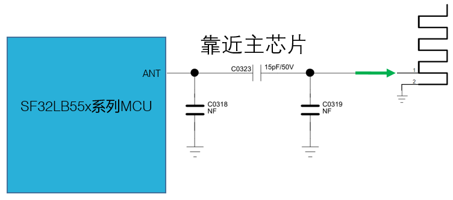
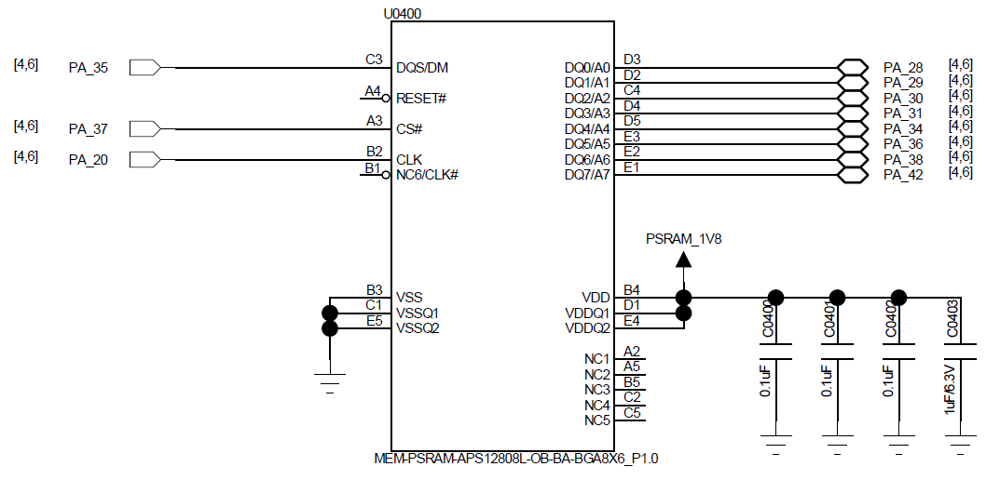
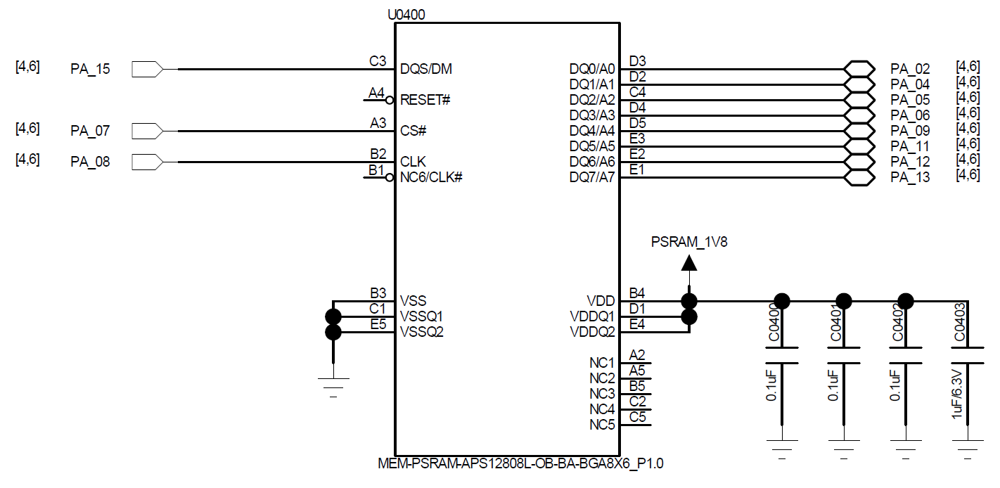
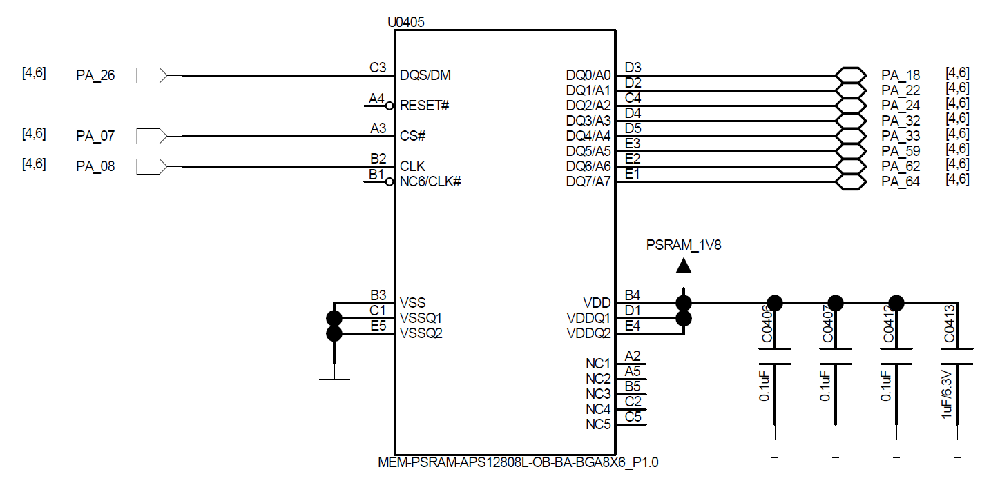
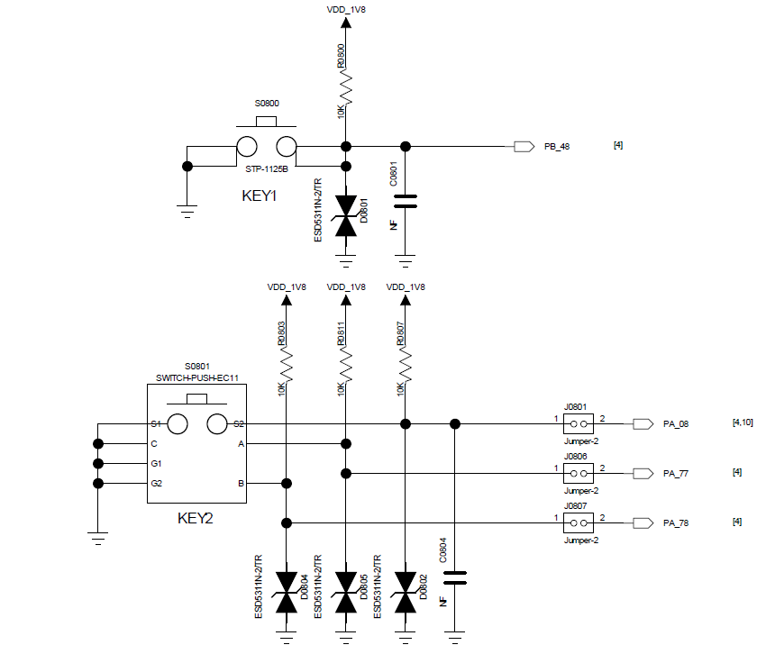
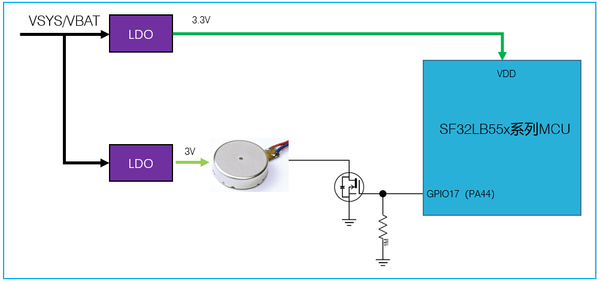
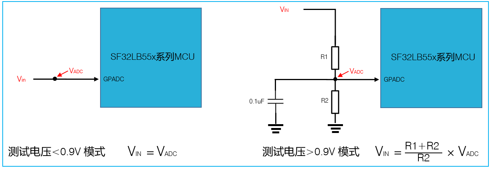
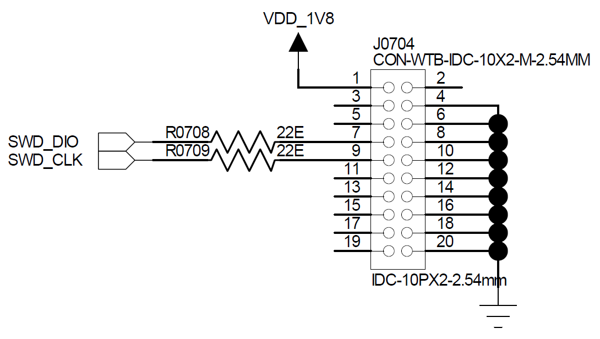

# SF32LB55x Hardware Design Guide — Schematic Design Guidelines { #sf32lb55x-hardware-design-guide-schematic-design-guidelines }

## 5. Schematic Design Guidelines { #5-schematic-design-guidelines }

<em>Table 5-1: Schematic Section Map</em>

| Group | Topics |
|:---|:---|
| Power System | PMU rails, other rails, capacitors, POR/BOR/reset, BUCK inductor. |
| Boot Mode | Mode-pin voltage domain, pull resistor, download/recovery and production access. |
| Clock Generation | 48 MHz crystal, 32.768 kHz crystal, and matching-capacitor review. |
| RF | RF matching, 50-ohm antenna path, AVDD_BRF filtering, and RF keep-out. |
| Storage Interfaces | OPI PSRAM, QSPI NOR/NAND/PSRAM, and SDIO eMMC/Micro SD. |
| Display and Touch | MIPI DSI, SPI/QSPI, MCU8080, JDI, touch interrupt, reset, backlight, and panel power. |
| Wake, GPADC, and Manufacturing | Wake sources and buttons, motor PWM, GPADC dividers, sensors, Bluetooth audio, DBG-UART, SWD, production flashing and crystal calibration. |

### 5.1. Power System { #51-power-system }

SF32LB551 in QFN68L has no VDD2, BUCK2_VSW, BUCK2_VOUT, LDOVCC2_VOUT, or AVDD_DSI pins. Apply the supply and capacitor tables only to pins present on the selected package. BGA packages provide two BUCK outputs; BUCK2 supports BUCK or LDO operation, with BUCK mode recommended. QFN68L provides one BUCK output.

<em>Table 5.1-1: PMU Power Supply Pins</em>

| PMU Power Supply Pins | Minimum Voltage (V) | Typical Voltage (V) | Maximum Voltage (V) | Maximum Current (mA) | Detailed Description |
| :--- | :--- | :--- | :--- | :--- | :--- |
| VDD1 | 1.71 | 1.8 | 3.6 | 50 | VDD1 Power Supply input |
| VDD2 | 1.71 | 1.8 | 3.6 | 50 | VDD2 Power Supply input |
| BUCK1_VSW BUCK1_VOUT | - | 1.25 | - | 50 | BUCK1 VSW output, connected to the inductor; internal Power Supply input 1, connected to the other end of the inductor and an external capacitor |
| BUCK2_VSW BUCK2_VOUT LDOVCC2_VOUT | - | 0.9 | - | 50 | BUCK2 VSW output, connected to the inductor; internal Power Supply input 2, connected to the other end of the inductor and an external capacitor |
| LDO_VOUT1 | - | 1.1 | - | 50 | LDO output 1, connect an external capacitor |
| LDO_VOUT2 | - | 0.9 | - | 20 | LDO output 2, connect an external capacitor |
| VDD_RET | - | 0.9 | - | 1 | RET LDO output, connect an external capacitor |
| VDD_RTC | - | 1.1 | - | 1 | RTC LDO output, connect an external capacitor |

<em>Table 5.1-2: Other Power Supply Pins</em>

| Other Power Supply Pins | Minimum Voltage (V) | Typical Voltage (V) | Maximum Voltage (V) | Maximum Current (mA) | Detailed Description |
| :--- | :--- | :--- | :--- | :--- | :--- |
| AVDD_BRF | 1.71 | 1.8 | 3.63 | 30 | RF Power Supply input |
| AVDD_DSI | 1.71 | 1.8 | 2.75 | 20 | MIPI DSI Power Supply input; power must be supplied |
| VDD_SIP | 1.71 | 1.8 | 1.98 | 30 | Power Supply input for the co-packaged memory chip |
| AVDD33 | 3.15 | 3.3 | 3.63 | 50 | Power Supply input |
| VDDIOA | 1.71 | 1.8 | 3.63 | - | PA I/O Power Supply input |
| VDDIOB | 1.71 | 1.8 | 3.63 | - | PB I/O Power Supply input |

<em>Table 5.1-3: Required Power Capacitors</em>

| Power Supply Pins | Capacitor | Detailed Description |
| :--- | :--- | :--- |
| VDD1 VDD2 | 0.1 µF + 10 µF | Short VDD1 and VDD2 together. Place at least two capacitors, 10 µF and 0.1 µF, close to the pins |
| BUCK1_VSW BUCK1_VOUT | 0.1 µF + 4.7 µF | Place at least two capacitors, 4.7 µF and 0.1 µF, close to the pins |
| BUCK2_VSW BUCK2_VOUT | 0.1 µF + 4.7 µF | Place at least two capacitors, 4.7 µF and 0.1 µF, close to the pins |
| LDOVCC2_VOUT | 0.1 µF + 4.7 µF | When BUCK2 is configured in BUCK mode, leave this pin floating; when BUCK2 is configured in LDO mode, leave BUCK2_VSW floating, short LDOVCC2_VOUT and BUCK2_VOUT together, and place at least two capacitors, 4.7 µF and 0.1 µF, close to the pins |
| LDO_VOUT1 | 4.7 µF | Place at least one 4.7 µF capacitor close to the pin |
| LDO_VOUT2 | 4.7 µF | Place at least one 4.7 µF capacitor close to the pin |
| VDD_RET | 0.47 µF | Place at least one 0.47 µF capacitor close to the pin |
| VDD_RTC | 1 µF | Place at least one 1 µF capacitor close to the pin |
| VDD_SIP | 1 µF | Place at least one 1 µF capacitor close to the pin |
| SDMADC_VREF | 4.7 µF | Place at least one 4.7 µF capacitor close to the pin |
| AVDD_DSI | 0.1 µF + 10 µF | Place at least two capacitors, 10 µF and 0.1 µF, close to the pins |
| AVDD33 | 4.7 µF | Place at least one 4.7 µF capacitor close to the pin |
| AVDD_BRF | 1 µF | Place at least one 1 µF capacitor close to the pin |
| VDDIOA VDDIOB | 2 × 0.1 µF + 2 × 1 µF | Place at least two capacitors, 1 µF and 0.1 µF, close to each pin |

Place the required capacitors close to the corresponding pins, keep BUCK current loops compact, and verify the BUCK/LDO operating mode before layout. The reset circuit and POR/BOR timing should be checked on actual hardware.

The source documents disagree: Table 3-3 of [SiFli's Chinese hardware application guide](https://github.com/OpenSiFli/SiFli-Wiki/blob/main/source/zh_CN/hardware/SF32LB55x-HW-Application.md) and item 9 of the [V1.0 schematic checklist](https://downloads.sifli.com/hardware/files/documentation/SF32LB55x%20Schematic%26PCB%20checklist_V1.0_20260121.xlsx) specify 1 µF for VDD_RTC, while [C0313 in the guide's reference schematic](https://github.com/OpenSiFli/SiFli-Wiki/blob/main/source/zh_CN/hardware/assets/55x/SF32LB55x-LDOIO-SCH.png) is labeled 0.1 µF. They do not explain when each value applies. Confirm the required value with SiFli for the exact device before design release; do not resolve the discrepancy by assumption.

Power VDD1 and VDD2 simultaneously; SF32LB551 has no VDD2. Pull RSTN up to the VDD1 input-voltage domain and connect 0.1 µF to ground. The reference drawing labels the pull-up rail 1.8 V/3.3 V and uses a 10 kΩ resistor; use the level corresponding to the selected design's VDD1 domain. Figure 5.1-1 shows a 1.50 V POR level, configurable BOR from 2.5 V to 1.5 V, and a 0.7 V RSTN marker. The measured trace in Figure 5.1-3 illustrates about 700 µs from the supply rise to reset release in that example; it is not a guaranteed reset delay for every design.

{ width="100%" loading="lazy" }

<em>Figure 5.1-1: Power-On and Power-Off Timing</em>

{ width="100%" loading="lazy" }

<em>Figure 5.1-2: Reset Circuit</em>

{ width="100%" loading="lazy" }

<em>Figure 5.1-3: Measured Power-Up and Reset Trace</em>

{ width="100%" loading="lazy" }

<em>Figure 5.1-4: BGA DC-DC Reference Circuit</em>

{ width="100%" loading="lazy" }

<em>Figure 5.1-5: QFN DC-DC Reference Circuit</em>

Select a 4.7 µH BUCK inductor with DCR ≤ 0.4 ohm and saturation current Isat ≥ 450 mA, as specified in SiFli's hardware application note.

### 5.2. Boot Mode { #52-boot-mode }

<em>Table 5.2-1: Boot Mode Configuration</em>

| Mode Configuration | Detailed Description |
| :--- | :--- |
| High | After the chip powers on and starts up, it enters download mode |
| Low | After the chip powers on and starts up, it jumps to the user program area to start |

High mode enters download mode after power-on; low mode boots the user program. Ensure production fixtures can force the required boot state and that boot-related pins are not blocked by product enclosure or test access limitations.

The Mode pin shares the VDDIOA voltage domain. Use an external 10 kΩ resistor to hold it at the required supply or ground level; do not leave it floating or allow unintended toggling. Production boards must expose a Mode test point for firmware download and crystal calibration; a jumper is not required. On test boards, reserve a jumper so a stalled application can be recovered by booting into download mode.

### 5.3. Clock Generation { #53-clock-generation }

<em>Table 5.3-1: Crystal Requirements</em>

| Crystal | Crystal Specification Requirements | Detailed Description |
| :--- | :--- | :--- |
| 48MHz | 7pF≦CL≦12pF (recommended value 8.8pF) △F/F0≦±10ppm ESR≦30 ohms (recommended value 22ohms) | Crystal oscillator power consumption is related to CL and ESR. The smaller the CL and ESR, the lower the power consumption. For optimal power performance, it is recommended to use components with relatively smaller CL and ESR values within the required range. Reserve parallel matching capacitors next to the crystal. When CL<12pF, no capacitors need to be mounted |
| 32.768KHz | CL≦12.5pF (recommended value 7pF) △F/F0≦±20ppm ESR≦80k ohms (recommended value 38Kohms) | Crystal power consumption is related to CL and ESR. The smaller the CL and ESR, the lower the power consumption. For optimal power consumption performance, it is recommended to use components with relatively small CL and ESR values within the required range. Reserve parallel matching capacitors next to the crystal. When CL<12.5pF, no capacitor needs to be soldered |

Place both crystals close to the chip, keep traces short and symmetric, reserve matching capacitor footprints, and protect crystal nets from RF, BUCK, display, and motor noise.

### 5.4. RF { #54-rf }

The SF32LB55x RF front end uses on-chip wideband matching-filter technology. Keep the RF PCB trace at 50 ohms characteristic impedance, reserve a π-type matching network for spurious filtering and antenna matching, and determine final component values by testing the actual antenna and PCB layout. If the selected antenna is already matched, no additional RF components are normally required beyond the reserved network.

Keep RF routing on a continuous reference ground, place the matching circuit close to the chip side, keep AVDD_BRF filtering close to the pin, and keep DC-DC, VBAT, crystal, high-speed clock, SPI, SDIO, I2S, and UART traces away from the RF area.

The RF reference circuit places C0323 (15 pF/50 V) in series with ANT and leaves the two shunt positions C0318 and C0319 unpopulated (NF). These are example values, not universal antenna-matching values.

{ width="100%" loading="lazy" }

<em>Figure 5.4-1: RF Matching Reference Circuit</em>

### 5.5. Storage Interfaces { #55-storage-interfaces }

SF32LB55x supports OPI PSRAM, QSPI NOR/NAND Flash and PSRAM, and SDIO eMMC or Micro SD options. Package selection affects which pins and interfaces are available, so storage selection should be completed before pin locking and PCB stack-up review.

BGA145 has one external OPI-PSRAM channel; BGA169 has two. Tables 5.5-1 to 5.5-3 describe the BGA145 configuration and the two BGA169 memory devices, not three channels on one package. The QSPI tables correspond to QSPI2, QSPI3, and QSPI4. The SDIO tables cover SDIO1 in 4-bit/8-bit modes and SDIO2 in 4-bit mode.

Prefer QSPI2 for external QSPI PSRAM. If HCPU GPIO controls an external OPI/QSPI PSRAM supply, use a PU-type HCPU pin with High enabling and Low disabling power. If switching VDD_SIP for internal Flash, use PA58 with the same High-on/Low-off polarity. Ask SiFli's FAE to assess Flash space for LCPU accelerometer and heart-rate algorithms before deciding whether to add QSPI4 NOR Flash.

The source tables use inconsistent direction labels. In the [BGA145 reference schematic](https://github.com/OpenSiFli/SiFli-Wiki/blob/main/source/zh_CN/hardware/assets/55x/SF32LB55x-BGA145-PSRAM-SCH.png) and the [BGA169 device 1](https://github.com/OpenSiFli/SiFli-Wiki/blob/main/source/zh_CN/hardware/assets/55x/SF32LB55x-BGA169-PSRAM-1-SCH.png) and [device 2 reference schematics](https://github.com/OpenSiFli/SiFli-Wiki/blob/main/source/zh_CN/hardware/assets/55x/SF32LB55x-BGA169-PSRAM-2-SCH.png), MCU pins PA37/PA20 and PA07/PA08, respectively, drive the external PSRAM's CS# and CLK pins. The tables below therefore describe CS# and CLK from the MCU side: MCU output, PSRAM input. The schematics do not establish a fixed direction for DQS/DM; verify its function and direction in the selected PSRAM datasheet.

Each illustrated PSRAM uses a 1.8 V supply, three 0.1 µF capacitors and one 1 µF/6.3 V capacitor. RESET# and NC/CLK# connections shown unconnected belong to the depicted memory part; check the selected part's datasheet rather than generalizing them.

{ width="100%" loading="lazy" }

<em>Figure 5.5-1: BGA145 OPI PSRAM Reference Circuit</em>

<em>Table 5.5-1: OPI PSRAM: BGA145</em>

| PSRAM Signal | MCU Pin | Detailed Description |
| :--- | :--- | :--- |
| CS# | PA37 | MCU output; PSRAM input |
| CLK | PA20 | MCU output; PSRAM input |
| DQS | PA35 | DQS/DM; verify function and direction in the selected PSRAM datasheet |
| DQ0 | PA28 | Data In/Out 0 |
| DQ1 | PA29 | Data In/Out 1 |
| DQ2 | PA30 | Data In/Out 2 |
| DQ3 | PA31 | Data In/Out 3 |
| DQ4 | PA34 | Data In/Out 4 |
| DQ5 | PA36 | Data In/Out 5 |
| DQ6 | PA38 | Data In/Out 6 |
| DQ7 | PA42 | Data In/Out 7 |

{ width="100%" loading="lazy" }

<em>Figure 5.5-2: BGA169 OPI PSRAM Device 1 Reference Circuit</em>

<em>Table 5.5-2: OPI PSRAM: BGA169, memory device 1</em>

| PSRAM Signal | MCU Pin | Detailed Description |
| :--- | :--- | :--- |
| CS# | PA07 | MCU output; PSRAM input |
| CLK | PA08 | MCU output; PSRAM input |
| DQS | PA15 | DQS/DM; verify function and direction in the selected PSRAM datasheet |
| DQ0 | PA02 | Data In/Out 0 |
| DQ1 | PA04 | Data In/Out 1 |
| DQ2 | PA05 | Data In/Out 2 |
| DQ3 | PA06 | Data In/Out 3 |
| DQ4 | PA09 | Data In/Out 4 |
| DQ5 | PA11 | Data In/Out 5 |
| DQ6 | PA12 | Data In/Out 6 |
| DQ7 | PA13 | Data In/Out 7 |

{ width="100%" loading="lazy" }

<em>Figure 5.5-3: BGA169 OPI PSRAM Device 2 Reference Circuit</em>

<em>Table 5.5-3: OPI PSRAM: BGA169, memory device 2</em>

| PSRAM Signal | MCU Pin | Detailed Description |
| :--- | :--- | :--- |
| CS# | PA07 | MCU output; PSRAM input |
| CLK | PA08 | MCU output; PSRAM input |
| DQS | PA26 | DQS/DM; verify function and direction in the selected PSRAM datasheet |
| DQ0 | PA18 | Data In/Out 0 |
| DQ1 | PA22 | Data In/Out 1 |
| DQ2 | PA24 | Data In/Out 2 |
| DQ3 | PA32 | Data In/Out 3 |
| DQ4 | PA33 | Data In/Out 4 |
| DQ5 | PA59 | Data In/Out 5 |
| DQ6 | PA62 | Data In/Out 6 |
| DQ7 | PA64 | Data In/Out 7 |

<em>Table 5.5-4: QSPI2: NOR/NAND Flash or PSRAM</em>

| Interface Signal | QFN68 | BGA145/169 | Detailed Description |
| :--- | :--- | :--- | :--- |
| CS# | GPIO9 | PA61 | Chip select, active low |
| SO | GPIO7 | PA65 | Data Input (Data Input Output 1) |
| WP# | GPIO6 | PA66 | Write Protect Output (Data Input Output 2) |
| SI | GPIO8 | PA63 | Data Output (Data Input Output 0) |
| SCLK | GPIO10 | PA60 | Serial Clock Output |
| Hold# | GPIO5 | PA68 | Data Output (Data Input Output 3) |

<em>Table 5.5-5: QSPI3: NOR/NAND Flash or PSRAM</em>

| Interface Signal | QFN68 | BGA145/169 | Detailed Description |
| :--- | :--- | :--- | :--- |
| CS# | GPIO16 | PA45 | Chip select, active low |
| SO | GPIO14 | PA49 | Data Input (Data Input Output 1) |
| WP# | GPIO13 | PA51 | Write Protect Output (Data Input Output 2) |
| SI | GPIO15 | PA47 | Data Output (Data Input Output 0) |
| SCLK | GPIO17 | PA44 | Serial Clock Output |
| Hold# | GPIO12 | PA55 | Data Output (Data Input Output 3) |

<em>Table 5.5-6: QSPI4: NOR/NAND Flash or PSRAM</em>

| Interface Signal | QFN68 | BGA145/169 | Detailed Description |
| :--- | :--- | :--- | :--- |
| CS# | - | PB33 | Chip select, active low |
| SO | - | PB36 | Data Input (Data Input Output 1) |
| WP# | - | PB37 | Write Protect Output (Data Input Output 2) |
| SI | - | PB35 | Data Output (Data Input Output 0) |
| SCLK | - | PB32 | Serial Clock Output |
| Hold# | - | PB07 | Data Output (Data Input Output 3) |

<em>Table 5.5-7: SDIO1: 4-bit eMMC/Micro SD</em>

| Interface Signal | QFN68 | BGA145/169 | Detailed Description |
| :--- | :--- | :--- | :--- |
| CLK | GPIO10 | PA34 | Clock input |
| CMD | GPIO9 | PA36 | Command input |
| DATA0 | GPIO8 | PA28 | Data 0 |
| DATA1 | GPIO7 | PA29 | Data 1 |
| DATA2 | GPIO6 | PA30 | Data 2 |
| DATA3 | GPIO5 | PA31 | Data 3 |

<em>Table 5.5-8: SDIO1: 8-bit eMMC</em>

| Interface Signal | QFN68 | BGA145/169 | Detailed Description |
| :--- | :--- | :--- | :--- |
| CLK | GPIO10 | PA34 | Clock input |
| CMD | GPIO9 | PA36 | Command input |
| DATA0 | GPIO8 | PA28 | Data 0 |
| DATA1 | GPIO7 | PA29 | Data 1 |
| DATA2 | GPIO6 | PA30 | Data 2 |
| DATA3 | GPIO5 | PA31 | Data 3 |
| DATA4 | GPIO15 | PA47 | Data 4 |
| DATA5 | GPIO14 | PA49 | Data 5 |
| DATA6 | GPIO13 | PA51 | Data 6 |
| DATA7 | GPIO12 | PA55 | Data 7 |

<em>Table 5.5-9: SDIO2: 4-bit eMMC/Micro SD</em>

| Interface Signal | QFN68 | BGA145/169 | Detailed Description |
| :--- | :--- | :--- | :--- |
| CLK | GPIO17 | PA44 | Clock input |
| CMD | GPIO16 | PA45 | Command input |
| DATA0 | GPIO15 | PA47 | Data 0 |
| DATA1 | GPIO14 | PA49 | Data 1 |
| DATA2 | GPIO13 | PA51 | Data 2 |
| DATA3 | GPIO12 | PA55 | Data 3 |

### 5.6. Display and Touch Interfaces { #56-display-and-touch-interfaces }

Display choices include MIPI DSI, SPI/QSPI, MCU8080, and JDI. Choose the panel before pin assignment and PCB routing so the interface width, clocking, power control, touch interrupt, and backlight strategy are reviewed together.

Both parallel and serial JDI are supported through the PA-side LCDC1 or PB-side LCDC2 multiplexed signal groups. The tables below list only the PA/LCDC1 assignments; SiFli recommends the PB/LCDC2 interface. The source guide does not provide a pin-by-pin LCDC2 table, so confirm the actual assignment against the chip pin-mux documentation rather than inferring it from the LCDC1 tables.

<em>Table 5.6-1: MIPI DSI Display Interface</em>

| MIPI DSI Signal | BGA145/169 Pin | Description |
| :--- | :--- | :--- |
| CLKP | DSI_CLKP | MIPI Clock signal + |
| CLKN | DSI_CLKN | MIPI Clock signal - |
| D0P | DSI_D0P | MIPI data lane 0+ |
| D0N | DSI_D0N | MIPI data lane 0- |
| D1P | DSI_D1P | MIPI data lane 1+ |
| D1N | DSI_D1N | MIPI data lane 1- |
| - | AVDD18_DSI | MIPI Power Supply input |
| - | DSI_REXT | Connect an external 10K resistor to ground |
| - | AVSS_DSI | Ground |
| TE | PA77 | Tearing effect to MCU frame signal |
| RESET | PB17 | Reset signal for the Display panel |

Display pin-selection notes:

- TE may use another GPIO in the PA group.
- If the panel supports TE over DSI, a separate TE pin is not required.
- RESET may use another GPIO in the PB group.

<em>Table 5.6-2: SPI/QSPI Display Interface</em>

| SPI Signal | QFN68 GPIO | BGA145/169 Pin | Detailed Description |
| :--- | :--- | :--- | :--- |
| CSX | GPIO22 | PB33 | Enable signal |
| WRX_SCL | GPIO23 | PB32 | Clock signal |
| DCX | GPIO20 | PB36 | Data/command signal in 4-wire SPI mode; data 1 in Quad-SPI mode |
| SDI_RDX | GPIO21 | PB35 | Data input signal in 3/4-wire SPI mode; data 0 in Quad-SPI mode |
| SDO | GPIO21 | PB35 | Data output signal in 3/4-wire SPI mode; short it together with SDI_RDX |
| D[0] | GPIO19 | PB37 | Data 2 in Quad-SPI mode |
| D[1] | GPIO18 | PB07 | Data 3 in Quad-SPI mode |
| RESET | GPIO2 | PB17 | Reset signal for the display panel |
| TE | GPIO3 | PB77 | Tearing effect to MCU frame signal |

Display pin-selection notes:

- TE may use PA77 or another PA-group GPIO configured to emulate the signal.
- RESET may use any GPIO. For an always-on display (AOD), SiFli recommends a GPIO in the PB group.

<em>Table 5.6-3: MCU8080 Display Interface</em>

| MCU8080 Signal | QFN68 GPIO | BGA145/169 Pin | Detailed Description |
| :--- | :--- | :--- | :--- |
| CSX | GPIO22 | - | Chip select |
| WRX | GPIO23 | - | Write strobe for sending data to the display |
| DCX | GPIO20 | - | Display data / command selection |
| RDX | GPIO21 | - | Read strobe for display read transactions |
| D[0] | GPIO19 | - | Data 0 |
| D[1] | GPIO18 | - | Data 1 |
| D[2] | GPIO17 | - | Data 2 |
| D[3] | GPIO16 | - | Data 3 |
| D[4] | GPIO15 | - | Data 4 |
| D[5] | GPIO14 | - | Data 5 |
| D[6] | GPIO13 | - | Data 6 |
| D[7] | GPIO12 | - | Data 7 |
| RESET | GPIO2 | - | Reset |
| TE | GPIO3 | - | Tearing effect to MCU frame signal |

Display pin-selection notes:

- TE may use PA77 or another PA-group GPIO configured to emulate the signal.
- RESET may use any GPIO. For an always-on display (AOD), SiFli recommends a GPIO in the PB group.

The [SiFli hardware application guide](https://github.com/OpenSiFli/SiFli-Wiki/blob/main/source/en/hardware/SF32LB55x-HW-Application.md) labels RDX as a read strobe but ends its description with “to write data.” That phrase conflicts with the RDX label and the paired WRX write-strobe signal, so it is treated here as a source wording error. Readback support and timing depend on the selected display controller; verify them against that controller's datasheet.

<em>Table 5.6-4: JDI Parallel Display Interface</em>

| JDI Signal | MCU Pin (LCDC1) | Detailed Description |
| :--- | :--- | :--- |
| JDI_VCK | PA20 | Shift clock for the vertical driver |
| JDI_VST | PA31 | Start signal for the vertical driver |
| JDI_XRST | PA34 | Reset signal for the horizontal and vertical driver |
| JDI_HCK | PA36 | Shift clock for the horizontal driver |
| JDI_HST | PA38 | Start signal for the horizontal driver |
| JDI_ENB | PA42 | Write enable signal for the pixel memory |
| JDI_R1 | PA49 | Red image data (odd pixels) |
| JDI_R2 | PA51 | Red image data (even pixels) |
| JDI_G1 | PA55 | Green image data (odd pixels) |
| JDI_G2 | PA77 | Green image data (even pixels) |
| JDI_B1 | PA78 | Blue image data (odd pixels) |
| JDI_B2 | PA79 | Blue image data (even pixels) |
| JDI_XFRP | PA45 | Liquid crystal driving signal (“On” pixel) |
| JDI_VCOM/FRP | PA47 | Common electrode driving signal/ Liquid crystal driving signal (“Off” pixel) |

<em>Table 5.6-5: JDI Serial Display Interface</em>

| JDI Signal | MCU Pin (LCDC1) | Detailed Description |
| :--- | :--- | :--- |
| JDI_SCS | PA31 | Chip Select Signal |
| JDI_SCLK | PA20 | Serial Clock Signal |
| JDI_SO | PA34 | Serial Data Output Signal |
| JDI_DISP | PA36 | Display ON/OFF Switching Signal |
| JDI_EXTCOMIN | PA38 | COM Inversion Polarity Input |

<em>Table 5.6-6: Touch and Backlight Interfaces</em>

| Touchscreen and Backlight Signals | QFN68 GPIO | BGA145 Pin | BGA169 Pin | Detailed Description |
| :--- | :--- | :--- | :--- | :--- |
| Interrupt | GPIO1 | PA79 | PA79 | Touch status interrupt signal (wake-up capable) |
| I2C1_SCL | GPIO25 | PA10 | PA10 | Touchscreen I2C Clock signal |
| I2C1_SDA | GPIO24 | PA14 | PA14 | Touchscreen I2C data signal |
| BL_PWM | GPIO0 | - | - | Backlight PWM control signal |
| Reset | GPIO16 | PA00 | PA00 | Touch reset signal |
| Power Enable | GPIO26 | PA06 | PA03 | Touchscreen Power Supply enable signal |

For BL_PWM, use a GPIO with the GPTIM1_CHx function and configure an appropriate pull-up or pull-down state to prevent the backlight from turning on unexpectedly during cold start.

### 5.7. Wake, GPADC, and Manufacturing Interfaces { #57-wake-gpadc-and-manufacturing-interfaces }

Wake, analog, debug, and production access must be planned with the enclosure and fixture in mind. Wake pins need defined idle levels and ESD protection, GPADC dividers must balance settling time and leakage, and debug/download access must remain reachable in EVT and production.

SF32LB55x provides four HCPU wake sources (WKUP_A0–WKUP_A3) and six LCPU wake sources (WKUP_B0–WKUP_B5). Each wakes its associated CPU; only the six LCPU sources wake the system from Hibernate. None of these ten inputs may float: add external pull-up or pull-down resistors to suit the function and avoid sleep leakage.

In the reference circuit, KEY1 connects to PB48 with a 10 kΩ pull-up to VDD_1V8, ESD protection, and a capacitor. The KEY2 network shows 10 kΩ pull-ups, ESD protection, and jumper-selectable connections to PA08, PA77, and PA78; C0004 is marked NF. These are circuit examples, not a list of wake-capable pins: PA08 is not listed in Table 5.7-1. Choose the actual wake-capable input from that table and keep every input at a defined idle level.

{ width="100%" loading="lazy" }

<em>Figure 5.7-1: Wake Button Reference Circuit</em>

Use a GPIO with GPTIM1_CHx for motor PWM. Select the appropriate PU/PD pin behavior so a cold start cannot unintentionally activate the motor. The reference circuit uses GPIO17 (PA44), a low-side transistor and a 1 MΩ gate pull-down, with a 3 V motor supply and a separate 3.3 V MCU supply.

{ width="100%" loading="lazy" }

<em>Figure 5.7-2: Motor Driver Reference Circuit</em>

<em>Table 5.7-1: Wake-Up Interrupt Sources</em>

| Interrupt Source | QFN68 | BGA145/169 | Detailed Description |
| :--- | :--- | :--- | :--- |
| WKUP_A0 | GPIO3 | PA77 | HCPU interrupt signal 0 |
| WKUP_A1 | GPIO2 | PA78 | HCPU interrupt signal 1 |
| WKUP_A2 | GPIO1 | PA79 | HCPU interrupt signal 2 |
| WKUP_A3 | GPIO0 | PA80 | HCPU interrupt signal 3 |
| WKUP_B0 | GPIO43 | PB43 | LCPU interrupt signal 0 |
| WKUP_B1 | GPIO44 | PB44 | LCPU interrupt signal 1 |
| WKUP_B2 | GPIO45 | PB45 | LCPU interrupt signal 2 |
| WKUP_B3 | GPIO46 | PB46 | LCPU interrupt signal 3 |
| WKUP_B4 | GPIO47 | PB47 | LCPU interrupt signal 4 |
| WKUP_B5 | GPIO48 | PB48 | LCPU interrupt signal 5 |

SiFli's hardware application guide describes a five-channel, 10-bit GPADC with an input range of 0–0.9 V. For a conservative board design, connect VIN directly only when it is below 0.9 V; divide higher voltages so VADC stays below 0.9 V. For battery sensing, the source suggests R1:R2 near 5:1 and MΩ-range resistors: lower divider current comes at the cost of longer settling. The illustrated divider adds 0.1 µF from VADC to ground. Use `VADC = VIN × R2 / (R1 + R2)` and check the maximum battery voltage and resistor tolerances; Table 5.7-2's current values are for VIN = 4.2 V, not every battery condition.

Source discrepancy: the higher-priority [OpenSiFli hardware application guide](https://github.com/OpenSiFli/SiFli-Wiki/blob/main/source/zh_CN/hardware/SF32LB55x-HW-Application.md) describes a five-channel, 10-bit GPADC with a 0–0.9 V input range. Item 2 of the [V1.0 schematic checklist](https://downloads.sifli.com/hardware/files/documentation/SF32LB55x%20Schematic%26PCB%20checklist_V1.0_20260121.xlsx) sets a 1.0 V maximum but does not specify the channel count. In contrast, the [SF32LB55x datasheet V1.7.2, section 3.2.1](https://downloads.sifli.com/user%20manual/DS5501-SF32LB55x-%E8%8A%AF%E7%89%87%E6%8A%80%E6%9C%AF%E8%A7%84%E6%A0%BC%E4%B9%A6%20V1p7p2.pdf) specifies eight single-ended inputs or four differential pairs, with a 0–1.1 V single-ended range and a −0.7 to 0.7 V differential range; its pin table lists GPADC_CH0–CH7. The current [SDK ADC guide](https://docs.sifli.com/projects/sdk/latest/sf32lb55x/app_note/adc.html) also maps eight channels (0–7) and lists 1.1 V as the maximum sampled voltage. SiFli has not explained the conflicting channel counts and voltage limits. This guide therefore retains the higher-priority hardware application's five-channel and 0–0.9 V design basis pending written clarification. Keep VADC below 0.9 V; do not treat 1.0 V or 1.1 V as an approved design limit, and confirm channel availability for the selected device and package.

{ width="100%" loading="lazy" }

<em>Figure 5.7-3: GPADC Input and Divider Reference</em>

<em>Table 5.7-2: GPADC Divider Examples</em>

| Resistor Combination | R1 (kΩ) ±1% | R2 (kΩ) ±1% | Voltage Settling Time (ms) | Iq (µA) (VIN = 4.2 V) |
| :--- | :--- | :--- | :--- | :--- |
| 1 | 1000 | 220 | 138 | 3.44 |
| 2 | 2000 | 430 | 250 | 1.73 |
| 3 | 3000 | 680 | 302 | 1.14 |
| 4 | 4300 | 910 | - | 0.81 |
| 5 | 5100 | 1100 | 420 | 0.68 |

Route heart-rate and accelerometer I2C/SPI, control and wake-interrupt interfaces through LCPU. Select low-Iq DC-DC converters, LDOs or load switches so sensor supplies can be switched as needed.

External Bluetooth audio communicates through HCPU UART1. Match voltage levels or add a level translator; when cutting module power, shut down the translator supply simultaneously to avoid leakage. If the audio module stays powered while SF32LB55x enters Standby and its supply enable is active-low, use an LCPU GPIO with default PD behavior.

<em>Table 5.7-3: Debug and Flashing Interface</em>

| UART Signal | QFN68 | BGA145/169 | Detailed Description |
| :--- | :--- | :--- | :--- |
| TXD1 | GPIO13 | PA19 | UART1 RXD signal |
| RXD1 | GPIO14 | PA17 | UART1 TXD signal |
| TXD2 | - | PA07 | UART2 RXD signal |
| RXD2 | - | PA05 | UART2 TXD signal |
| TXD3 | GPIO46 | PB46 | UART3 RXD signal, system default log port |
| RXD3 | GPIO45 | PB45 | UART3 TXD signal, system default log port |
| TXD4 | - | PB14 | UART4 RXD signal |
| RXD4 | - | PB12 | UART4 TXD signal |
| TXD5 | - | PB11 | UART5 RXD signal |
| RXD5 | - | PB06 | UART5 TXD signal |
| SWCLK | GPIO41 | PB31 | SWD Clock signal |
| SWDIO | GPIO42 | PB34 | SWD data signal |

Do not leave UART RXD floating; enable its internal pull-up during firmware initialization. UART3 is the default log port. SiFli provides an offline programmer for production flashing and crystal calibration. Reserve at least VBAT, GND, VDDIOA, VDDIOB, RSTN, Mode, SWDIO, SWCLK, RXD1, TXD1, RXD3 and TXD3 test points. The production fixture subset is VBAT, GND, boot_mode, VDDIOB, RXD3 and TXD3. VBAT and boot_mode are source fixture labels; map them to the actual board supply and Mode connection before wiring.

The source drawing connects VDD_1V8 to connector pin 1 (VTref), SWDIO to pin 7, and SWCLK to pin 9 through 22 Ω series resistors. Standard [J-Link SWD](https://kb.segger.com/20-pin_J-Link_Connector) also uses pin 1 for [VTref](https://kb.segger.com/VTref), the target-voltage reference input, not a probe power output. Verify the header orientation and 1.8 V compatibility before connecting a standard cable.

{ width="100%" loading="lazy" }

<em>Figure 5.7-4: Source SWD Connector: Verify Adapter Wiring</em>

