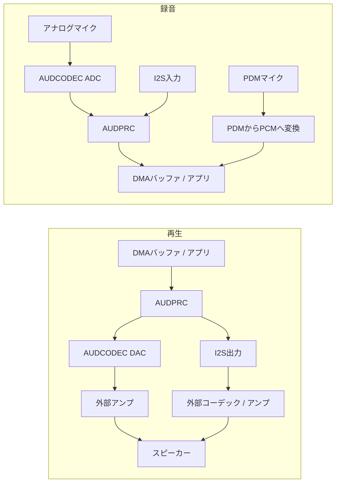

# オーディオ概要 { #audio-overview }

## 概要 { #overview }

このガイドでは、SF32デバイスの**ローカルオーディオサブシステム**を扱います。マイク入力、スピーカー/ライン出力、デバイス上での再生・録音に使うコーデック、DMA、ミドルウェアの経路を取り上げ、インターフェース、バッファリング、Audio Server、コーデック、消費電力に関する実践的な設計判断を説明します。

Bluetoothオーディオ（A2DP、LE Audio）は関連するものの別のトピックであり、[Bluetooth概要](../bluetooth/overview.md#bluetooth-audio-and-le-audio)で扱っています。そちらでは無線ストリーミングを、このページでは音声サンプルがチップに取り込まれた後のキャプチャ、ミキシング、デコード、物理オーディオパスの駆動を説明します。

このページは、デモを一度再生できればよいという場合ではなく、製品に適したマイク、コーデック、バッファリング、消費電力の設計を決める際に参照してください。Bluetooth、ディスプレイ、ストレージ、バッテリーの制約がある中で、オーディオ経路を安定して動作させる必要のあるエンジニアを対象としています。

## 製品のオーディオ要件を定義する { #define-the-products-audio-requirements }

インターフェースやバッファーサイズを選ぶ前に、製品が必要とすることを明確にしてください。

- 再生のみ、録音のみ、それとも両方を同時に行う全二重か。
- マイクは何個必要か。アナログ（AMIC）とデジタル（DMIC）のどちらを使うか。
- ローカル再生のフォーマット — 生のPCM、MP3、Opus、あるいは他のコーデックか。
- Bluetoothオーディオ（クラシックまたはLE Audio）もローカルオーディオと並行して必要か。
- 音声トリガーや常時リスニング機能が必要か。また、その消費電力の予算はどの程度か。
- スピーカー/ライン出力のドライブ要件、あるいは出力は外部アンプ/コーデックにルーティングされるか。
- レイテンシの許容度 — 音声通話やリアルタイムモニタリングは、通知音よりもはるかに厳しい要件です。

これらの要件をもとに、インターフェース（I2S、PDM、ADC/DAC）、コーデックの設定、パイプライン内で稼働状態を保つ必要がある部分を決めます。

## SF32オーディオ信号パス { #the-sf32-audio-signal-path }

録音と再生では信号経路が異なります。以下は代表的な経路です。利用できる機能と同時使用できる経路は、型番、パッケージ、基板、SDK設定によって異なります。

<div align="center"><em>図: SF32の代表的なローカルオーディオ信号経路</em></div>



**AUDCODEC**はA/D・D/A変換を行います。**AUDPRC**は対応する経路でミキシング、ゲイン調整、サンプルレート変換などのデジタル処理を行います。PDMマイクの信号はPDMブロックでPCMに変換され、アナログADCを通りません。I2Sは外部デバイスとのデジタル接続に使います。1つのPDMインターフェースには、左右チャネルを選択して対応マイクを最大2個接続できます。2系統なら最大4個ですが、利用可能なピンとドライバーの対応を確認してください。

**Audio Server**はストリームとセッションを管理するソフトウェアであり、マイクとスピーカーの間に入る物理的な変換器ではありません。通常、アプリケーションはそのAPIと対応ドライバーを使います。立ち上げ時にはドライバーやHALを直接試すことも有効です。まず録音・再生の実際の経路を選び、クロック、サンプル形式、DMA要求、出力の駆動能力を確認してください。内蔵DACが外部アンプなしで選定したスピーカーを駆動できるとは限りません。

経路の詳細は[AUDPRC/AUDCODECドライバーガイド](https://docs.sifli.com/projects/sdk/latest/en/sf32lb52x/drivers/audprc_audcodec.html)と[PDM HALガイド](https://docs.sifli.com/projects/sdk/latest/en/sf32lb52x/hal/pdm.html)に記載されています。

## マイクとデジタル音声インターフェース { #choosing-interfaces-amic-dmic-and-i2s }

AMICとDMICはマイクの種類、PDMとI2Sはデジタルインターフェースです。デジタルマイクにはPDM方式とI2S方式があります。マイク数、チャネル数、インターフェース数を同じものとして数えないでください。

<div align="center"><em>表: マイクとデジタル音声インターフェース</em></div>

<div align="center" markdown>

| マイク / バス | 一般的な用途 | 備考 |
|:----------|:------------|:------|
| **AMIC（アナログマイク入力）** | 汎用マイクキャプチャ | 音声用ADCを使用。マイクのバイアス、ゲイン、入力範囲、基板ノイズを確認する。 |
| **DMIC（デジタルマイク）** | 音声キャプチャ、マルチマイクアレイ | PDMかI2Sかを確認する。デジタル伝送でも電源ノイズ、クロック、配線への配慮は必要。 |
| **I2S** | 外部コーデックやアンプとのPCM送受信 | オンチップのAUDCODECではなく、外部のオーディオコーデックやアンプを使用する場合によく使われる。 |
| **PDM** | デジタルマイク入力 | 多くのDMICでネイティブに使われるインターフェースで、チップ内のPDM-PCM変換と組み合わせて使う。 |

</div>

アナログとデジタルの混在アレイでは、経路の同時使用とサンプルタイミングの同期を確認してください。ビームフォーミングには適切なマイク配置、校正、アルゴリズムも必要です。マイクを複数接続するだけでは実現できません。

## 検証済みのオーディオ例から始める { #start-from-a-verified-audio-example }

アプリケーションの動作を設計する前に、目的に最も近いSiFli-SDKのサンプルを選び、動作を確認してください。[オーディオSDKサンプル](audio-sdk-examples.md)では、PDM、アナログ入力、録音/再生、端末内の音楽再生、SDカード、FLAC、Opus、ミキシングの公式サンプルを、それぞれの検証目的ごとに整理しています。また、製品へ適用する前に再確認すべき開発ボード、ピン多重化、ストレージ、設定上の前提や制約も示しています。

## 適切なSF32デバイスを選ぶ { #pick-the-right-sf32-device }

オーディオ機能は製品ファミリーによって異なります。具体的な型番の仕様はデータシートで確認してください。以下は初期選定の目安です。

<div align="center"><em>表: 適切なSF32デバイスを選ぶ</em></div>

<div align="center" markdown>

| デバイスファミリー | 内蔵オーディオADC/DAC | PDMインターフェース数（最大マイク数） | I2Sインターフェース数 | 用途の目安 |
|:---|:---|:---|:---|:---|
| **SF32LB52x** | 1 ADC + 1 DAC | 1 (2) | 1 | コスト最適化されたBluetoothオーディオアクセサリ、音声対応のコンパクトHMI。 |
| **SF32LB55x** | なし。アナログ音声には外部オーディオコーデックを使用。 | SF32LB551/555: 1 (2); SF32LB557: 2 (4) | SF32LB551/555: 1; SF32LB557: 2 | オーディオが主機能ではないBLEウェアラブルや、センサーを多く搭載する製品。 |
| **SF32LB56x** | 1 ADC + 1 DAC | 2 (4) | 1 | 表示機能が充実し、複数マイクによる音声入力も必要なHMI/ディスプレイ製品。 |
| **SF32LB57x** | 2 ADC + 1 DAC | 2 (4) | 2 | 複数マイクによる音声入力とローカル再生。 |
| **SF32LB58x** | 2 ADC + 2 DAC | 2 (4) | 3 | オーディオ、グラフィックス、AI、複雑な接続性を組み合わせたフラッグシップ製品。 |

</div>

選定前に、型番、パッケージの端子、ピン機能割り当て、同時動作可能な経路を確認してください。PDM 1系統で互換性のあるマイク2個を接続できます。ADCチャネル数、マイクチャネル数、デジタルインターフェース数は別の資源です。I2Sの機能はインスタンスごとに異なります。SF32LB58xでは、I2S1は受信（RX）のみ、I2S2とI2S3は送受信（RX/TX）に対応します。I2S2で受信する場合は、クロック源としてTX側も有効にする必要があります。インスタンスごとの詳細は[SiFli I2S HALガイド](https://docs.sifli.com/projects/sdk/latest/en/sf32lb52x/hal/i2s.html)を、その他の選定条件は[SF32ファミリー概要](../../sf32-products/family/SF32_family.md)を参照してください。

参照元: [DS5201](https://downloads.sifli.com/user%20manual/DS5201-SF32LB52x-Datasheet%20V2p5.pdf), [DS5501, Table 0-1](https://downloads.sifli.com/user%20manual/DS5501-SF32LB55x-Datasheet%20V1p7p2.pdf), [DS5601](https://downloads.sifli.com/user%20manual/DS5601-SF32LB56x-Datasheet%20V1p9p2.pdf), [DS5801](https://downloads.sifli.com/user%20manual/DS5801-SF32LB58x-Datasheet%20V1p8p3.pdf), [SF32LB57x AUDCODEC registers (ADC_CH0/1, DAC_CH0)](https://github.com/OpenSiFli/SiFli-SDK/blob/v2.5.1/drivers/cmsis/sf32lb57x/audcodec.h), [SF32LB57x PDM/I2S instances](https://github.com/OpenSiFli/SiFli-SDK/blob/v2.5.1/drivers/cmsis/sf32lb57x/register.h), [SiFli SDK v2.5.1 release notes (57x 4マイクPDM設定)](https://github.com/OpenSiFli/SiFli-SDK/releases/tag/v2.5.1), [SiFli SDK PDM example (57x board, PDM1, stereo channels)](https://docs.sifli.com/projects/sdk/latest/en/sf32lb52x/example/rt_device/pdm/README.html).

## オーディオセッションのテンプレート { #audio-session-templates }

多くの製品のオーディオ処理は、いくつかの代表的なセッションパターンに分類できます。最も近いものを選び、実際の構成で検証してください。

<div align="center"><em>表: オーディオセッションのテンプレート</em></div>

<div align="center" markdown>

| セッション | 一般的なパイプライン | 主なリスク |
|:--------|:-----------------|:----------|
| 通知音 | Flash/PSRAMアセット -> 必要であればデコーダー -> Audio Server -> DAC/アンプ | 開始・停止時のポップ/クリック音。 |
| 音声録音 | AMIC -> ADC/AUDPRC、またはPDMマイク -> PDM-PCM変換、またはI2S入力 -> DMAバッファー -> アプリ/ストレージ/Bluetooth | バッファーオーバーランとクロックドリフト。 |
| Bluetoothスピーカー | Bluetoothオーディオ -> デコード/ミキシング -> Audio Server -> DAC/アンプ | RF動作との共存とメモリー帯域幅の競合。 |
| 音声通話 | マイクキャプチャと再生を同時に | 全二重レイテンシ、エコーパスの処理、バッファーの所有権。 |
| 音声トリガー/常時リスニング | 低いサンプルレートでの音声キャプチャ -> 特徴抽出 -> AIによる起動判定 | 待機中の消費電力と誤起動。 |

</div>

各セッションについて、開始、定常状態、アンダーラン/オーバーランからの復帰、終了処理の挙動を定義してください。オーディオのバグは、定常的な再生ループよりも、遷移状態に潜んでいることがよくあります。

## バッファーとレイテンシの予算 { #buffer-and-latency-budget }

バッファーが保持する音声の時間は、**サンプルフレーム**で計算します。1フレームには各チャネルのサンプルが1つずつ含まれます。

```text
interleaved frames = buffer bytes / (channels * stored bytes per sample)
planar frames per channel = channel buffer bytes / stored bytes per sample
buffer duration (s) = frames / sample rate (Hz)
```

48 kHzでは480フレームが10 msに相当します。インターリーブ形式のステレオなら960個のサンプルです。サンプルが合計480個なら5 msにしかなりません。バイト数からフレーム数へ換算するときは、パディングを含む実際の格納バイト数を使ってください。チャネル別のバッファーでは、両チャネルの長さを足さず、各チャネルのフレーム数を数えます。

この値はバッファー内の音声の長さであり、そのまま端から端までのレイテンシになるわけではありません。ピンポンバッファーでは、DMAが一方を使用している間にソフトウェアが他方を処理します。レイテンシは、キューに滞留するデータ量と半転送・全転送完了コールバックの使い方で決まり、バッファーが2つあることだけでは決まりません。録音、処理、転送、再生、タスクスケジューリングを合わせて遅延を配分し、実測してください。

## 再生と録音の基本 { #playback-and-recording-basics }

スピーカーを駆動する場合も、マイクから音声を取り込む場合も、同じ基本原則が適用されます。

- **バッファーサイズ** — 小さなブロックはブロック処理に伴うレイテンシを短縮できますが、割り込み/DMAのオーバーヘッドが増えます。大きなブロックはスケジューリングの余裕を増やす一方、メモリーを多く使います。レイテンシが増えるのは、処理や再生の前に待機する音声データが増えるためであり、バッファー容量を追加で確保するだけでは増えません。
- **DMA転送** — ペリフェラルとのサンプル転送はハードウェアのタイミングに従うDMAで行います。ソフトウェアがメモリー内のブロックをコピー・処理することは問題ありません。CPUのポーリングやサンプル単位のループでペリフェラルをリアルタイムに処理する設計を避けてください。
- **サンプルレートとフォーマットの計画** — サンプルレート（例: 音声には16 kHz、音楽には44.1/48 kHz）とビット深度は事前に決めてください。実行時にフォーマットを変換すると、CPUとメモリーのコストがかかります。
- **ダブルバッファリング**：DMAが一方の領域を転送している間に、ソフトウェアがもう一方を準備または処理します。その領域が再び必要になる前に処理を終えてください。バッファーが2つあるだけではアンダーランやオーバーランを防げません。

DMAと共有するキャッシュ可能なバッファーでは、管理主体を明確にし、SDKのキャッシュライン境界と保守手順に従ってください。DMAが再生データを読む前に、CPUが書いたデータをキャッシュから書き戻します。録音ではDMA書き込み前に転送先を準備し、転送完了後、CPUが読む前に対象領域のキャッシュを無効化します。具体的な操作は対象のキャッシュ方針に従います。完了コールバックで受け渡しが許可されるまで、DMA使用中の領域を変更・再利用しないでください。対象キャッシュラインに無関係なデータを混在させないことも重要です。

## コーデックと圧縮の選択 { #codec-and-compression-choices }

**ハードウェア音声コーデック**（ADC/DAC変換）と**圧縮コーデック**（MP3やOpusなど）を区別してください。非圧縮PCMには圧縮デコーダーが不要です。同等の音声なら非可逆圧縮で保存容量や読み出し帯域を減らせますが、デコードのCPU負荷、作業バッファー、消費エネルギーは実測が必要です。ファイルが小さくても、実行時のメモリー使用量が減るとは限りません。

<div align="center"><em>表: コーデックと圧縮の選択</em></div>

<div align="center" markdown>

| フォーマット | 一般的な用途 | 備考 |
|:-------|:-------------|:------|
| **非圧縮PCM** | 短い通知音、低レイテンシのモニタリング、音声処理 | 圧縮デコードは不要。容量は長さ、サンプルレート、チャネル数、格納するサンプル幅で決まる。 |
| **MP3** | 端末内の音楽再生 | 広い互換性。デコードコストはよく理解されており、SDカードを使った音楽プレーヤーの例で一般的に使用される。 |
| **Opus** | 音声および汎用の圧縮オーディオ | 音声や汎用オーディオに使える圧縮形式。Opus対応だけではA2DP、HFP、LE Audioとの相互運用性は保証されない。選ぶBluetoothプロファイルのコーデックとSDK対応を別途確認する。 |

</div>

SDKには端末内の音楽再生、SDカードMP3、Opus、録音、2系統のADC/DACの例があります。2チャネルの例には、そのチャネルを使えるデバイスと基板が必要です。すべてのSF32にADC/DACが2つあるという意味ではありません。対応する構成から始め、実機でデコード負荷を測定してください。

## ローカルオーディオとBluetoothオーディオ { #local-audio-vs-bluetooth-audio }

両者が同時に動作することがあるとしても、概念的には2つのパスを分けて考えてください。

- **ローカルオーディオ**（このガイド）— AUDCODEC/AUDPRC、マイク、スピーカー/ライン出力、オンデバイスの再生と録音。
- **Bluetoothオーディオ**（[Bluetooth概要](../bluetooth/overview.md#bluetooth-audio-and-le-audio)）— Classic BluetoothのA2DP/AVRCP/HFP、またはデバイス、スタック、SDKが必要なロールに対応する場合のLE Audioユニキャスト/ブロードキャスト。BLE無線に対応するだけではLE Audioを利用できるとは限りません。

実際の製品では、2つの経路を連携させることがよくあります。例えば、ローカルマイクで音声を取り込みBluetoothで送信する、またはBluetoothオーディオを受信し、Audio Serverでローカルの通知音とミキシングする構成です。両方の経路を同時に使う場合は、バッファーの管理主体とミキシングの動作を明確にしてください。

## 基板レベルのオーディオチェックリスト { #board-level-audio-checklist }

アナログ回路の設計不良をファームウェアだけで補うことはできません。回路図とPCBを設計する際は、次の項目を確認してください。

<div align="center"><em>表: 基板レベルのオーディオチェックリスト</em></div>

<div align="center" markdown>

| 領域 | ガイダンス |
|:-----|:---------|
| マイクのバイアスと配線 | アナログマイクの配線を短くし、ノイズの結合を抑えてください。クロック、RF、大電流のスイッチング回路から離します。 |
| 接地 | マイクやスピーカーの基準を経由するノイズの多いリターンパスを避けてください。 |
| 電源レール | リファレンスデザインとマイクのデータシートに従って、コーデックとマイクの電源をフィルタリングしてください。 |
| スピーカー/アンプパス | 負荷、ゲイン、熱挙動、ポップ抑制、シャットダウンピンの挙動を確認してください。 |
| I2S/PDMクロック | 選択したサンプルレートにおけるタイミングマージン、トレース長、クロック品質を確認してください。 |
| テストアクセス | 立ち上げ時と量産テスト時にオーディオを注入/キャプチャできる実用的な方法を残してください。 |

</div>

RFとアナログオーディオの両方を持つ製品では、Bluetoothがアクティブな状態、ディスプレイがリフレッシュしている状態、充電器が接続されている状態、そして最終的な筐体を組み立てた状態でノイズを検証してください。

## オーディオの消費電力に関する考慮事項 { #power-considerations-for-audio }

マイク電源、変換器、デジタル処理、メモリーアクセス、アンプの消費電力を個別に測定した後、セッション全体を測定してください。各部分の割合は、ハードウェア、処理内容、リスニングと再生のデューティ比で変わります。

- セッション間では、不要な音声経路を部品とドライバーが要求する順序で停止します。アンプのミュートと停止制御、クロック、電源、GPIOの状態を確認し、ポップノイズ、逆給電、インターフェースの漏れ電流を防いでください。
- 常時リスニング型の音声トリガーでは、必要な入力経路を維持し、対応する低消費電力の処理方式を選びます。トリガーが依存する経路を停止してはいけません。検出モデルも軽量にしてください。[AI概要](../ai/overview.md#audio-and-voice)を参照してください。
- ブロック処理は、レイテンシの許容値とバッファーの処理期限を守って行います。DMAがサンプル転送を担っても、転送済みのブロックは期限内に処理する必要があります。CPUのウェイクアップ回数を減らすことでオーバーランやアンダーランを起こさないでください。
- 音声処理のタイミングをBluetoothと表示処理に合わせて調整します。[低消費電力設計の概要](../low-power/overview.md)と[Bluetooth概要：共存](../bluetooth/overview.md#coexistence-with-other-workloads)を参照してください。

## オーディオ検証マトリクス { #audio-validation-matrix }

コーデック、Bluetooth、ディスプレイ、電源、またはクロックの変更後は、同じオーディオテストを実行してください。

<div align="center"><em>表: オーディオ検証マトリクス</em></div>

<div align="center" markdown>

| テスト | 確認すべきこと |
|:-----|:--------------|
| 無音のキャプチャ/再生 | ノイズフロア、ハム音、ポップ/クリック音、DCオフセット。 |
| サイン波スイープまたはトーン | サンプルレートの正確性、歪み、クリッピング。 |
| 長時間の再生 | アンダーラン、メモリーリーク、熱/電力の安定性。 |
| UI表示中の録音 | DMAとメモリー帯域幅の共存。 |
| Bluetoothオーディオとローカルサウンドの併用 | ミキシング、優先度、レイテンシ。 |
| オーディオの再生・録音に伴うスリープ/ウェイク | コーデックの停止/再起動、ポップノイズの抑制、利用可能な電源状態を制約するPM vote。 |

</div>

正常動作を確認したWAV/PCM参照ファイルと、評価ボードで取得した正常な録音サンプルを保管してください。聴感だけに頼るよりも、変更後の不具合を見つけやすくなります。

## オーディオの問題のデバッグ { #debugging-audio-issues }

<div align="center"><em>表: オーディオの問題のデバッグ</em></div>

<div align="center" markdown>

| 症状 | 確認すべき可能性の高い領域 |
|:--------|:----------------------|
| クリック音、ポップ音、音切れ | バッファーアンダーラン、バッファー数/サイズの不足、DMAの誤設定。 |
| 持続的なノイズやハム音 | アナログフロントエンド/基板レイアウト、AMICの接地、電源レールのノイズ。 |
| ユースケースに対してレイテンシが高すぎる | バッファーサイズが大きすぎる、不要なフォーマット変換、DMA開始前のスケジューリング遅延。 |
| Bluetoothやディスプレイの動作中に音声が途切れる | 共存とメモリー帯域幅の競合。[共存](../bluetooth/overview.md#coexistence-with-other-workloads)を参照。 |
| デコードされたオーディオがおかしい（ピッチ/速度） | ソース、デコーダー、AUDCODEC構成の間のサンプルレートの不一致。 |
| アイドル再生状態での高消費電力 | セッション間もコーデック/DMAがアクティブなまま、イベント駆動のセッション終了ではなく不要なポーリング。 |

</div>

## よくある間違い { #common-mistakes }

- ハードウェア同期のDMAを使わず、ペリフェラルの各サンプルをCPUのポーリングで処理する。
- バッファーが小さすぎる、または管理が不適切でDMAの処理期限を守れない。対応していて要件にも合う場合は、ダブルバッファーを使います。
- PDM/I2Sの数、使用できる端子、同時動作可能な経路を確認せず、マイクの種類と数だけで設計する。
- 実際の製品では同時に動作するにもかかわらず、Bluetoothオーディオとローカルオーディオを完全に独立したものとして扱ってしまう。
- DMAとCPUで共有するバッファーのキャッシュ整合性と所有権の規則を無視する。
- セッション間で不要な音声経路を動かし続ける、または常時リスニングに必要な入力経路を止めてしまう。
- デコードコストが電力とCPUの予算に収まることを確認する前に、圧縮フォーマットを確定してしまう。

## 立ち上げチェックリスト { #bring-up-checklist }

- [ ] 対象デバイスとボードについて、マイクの種類とチャネル数、PDM/I2Sの数、使用できる端子、同時動作可能な経路を確認する。
- [ ] 録音と再生のサンプルレート、保存時のサンプル幅、チャネル配置、バッファーサイズを決める。
- [ ] 選択したADC/AUDPRC、PDMまたはI2Sの入力経路と、DACまたはI2Sの出力経路を動作させる。全二重動作の前に各方向を個別に試験する。
- [ ] 基本的なハードウェア経路が動作してから、Audio Serverと対応するドライバーでセッションを統合する。診断用のHAL直接呼び出しテストも残す。
- [ ] 音声フォーマット（PCM/MP3/Opus）を選び、デコードが必要ならCPU負荷、メモリー使用量、消費エネルギーを実測する。
- [ ] DMAバッファーの所有権、アラインメント、キャッシュのクリーンと無効化を検証する。
- [ ] ローカル音声とBluetooth音声を併用する製品では、同時動作を試験する。
- [ ] 動作時と待機時の消費電力を測り、停止・再開の順序、インターフェース端子の状態、常時リスニングに必要な入力経路を確認する。

## 要点のまとめ { #key-takeaways }

- 物理的な経路を明確に選びます。アナログ音声はAUDCODEC、PDM録音はPDMブロック、外部とのデジタル接続はI2Sを使います。すべてを同じコーデック経路と見なさず、対応するセッションをAudio Serverとドライバーで管理してください。
- 他のチップの前提を流用せず、対象デバイスの能力と製品のマイク配置に基づいて、マイクの種類とPDM/I2Sの経路を選んでください。
- DMAはハードウェアのタイミングに合わせて転送し、十分なバッファー容量を確保します。対応しており要件にも合う場合、ダブルバッファーは一般的な方法ですが、コールバックとバッファー再利用の期限を守る必要があります。
- ローカルオーディオとBluetoothオーディオは別個のサブシステムであり、多くの場合同時に動作させる必要があります — ミキシングとバッファーの所有権を明示的に計画してください。
- BluetoothやAIと同様に、音声処理も不要な稼働時間とCPUのウェイクアップを減らしてください。定常再生だけでなく、実際のセッション全体の消費電力を測定することが重要です。
