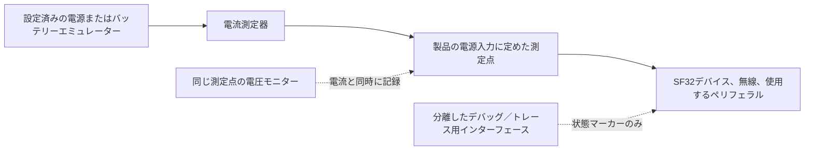
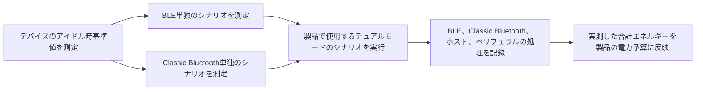

# Bluetoothの消費電力を測定・分析する { #bluetooth-low-power-profiling }

この記事では、Bluetooth Low Energy（BLE）、Classic Bluetooth（BR/EDR）、およびデュアルモード製品で両方を組み合わせて動作させる場合の、デバイスの実消費電力を測定する方法を説明します。各シナリオで測定対象の範囲を定め、電流と電圧を記録し、トレースの主要な区間を説明できるだけのファームウェア情報を取得します。

この記事のClassic Bluetoothおよびデュアルモードの部分は、BR/EDRをサポートするデバイスとファームウェア構成にのみ適用してください。BLE専用製品でも同じ方法を使い、測定シナリオはBLEのみを対象としてください。

Nordicの[Online Power Profiler for Bluetooth LE](https://devzone.nordicsemi.com/power/w/opp/2/online-power-profiler-for-bluetooth-le)は、BLEの消費電力を考える際の参考になります。Nordicによると、これは実測値を基に期待値を推定するモデルであり、特定のデバイスを直接測定するものではありません。公開されている精度情報はNordicのリファレンス機器に限られ、SF32には適用できません。また、Classic Bluetoothやデュアルモード製品も対象外です。モデルは測定項目を決める参考にとどめ、製品の消費電力は対象デバイスを実測して確認してください。

## 何を測定しているかを定義する { #define-what-you-are-measuring }

「Bluetoothの消費電力」が指す範囲はさまざまです。無線部だけを測定すれば接続パラメーターの最適化には役立ちますが、コントローラー、アプリケーションCPU、センサー、ディスプレイ、メモリー、電源を含む製品全体の消費電力は分かりません。

<div align="center"><em>表: Bluetooth消費電力の測定点と対象範囲</em></div>

<div align="center" markdown>

| 測定点 | 測定に含まれるもの | 適した用途 | 注意点 |
|:---------|:-----------------|:---------------|:-----------|
| Bluetoothサブシステムまたは特定の電源ライン | 無線部、コントローラー、および選択した給電経路 | 無線部やコントローラーの消費電力が増えた原因を切り分ける | 製品全体の電池消費量とは一致しない |
| MCUの電源入力 | 同じ電源ラインから給電されるMCU、コントローラー、内蔵ペリフェラル | 条件を管理したボードでファームウェアの動作状態を比較する | 別系統の外付け部品やレギュレーターの損失は含まれない |
| 電池入力または製品の主電源入力 | レギュレーター、MCU、外部メモリー、センサー、ディスプレイ、その他の負荷 | 電池寿命の予測と製品の合否判定 | 接続する機器と給電経路をすべて把握し、条件を管理する必要がある |

</div>

製品の電池寿命を評価する場合は、可能な限り電池入力または製品の主電源入力で測定してください。電流と同時に電圧も記録すれば、電源条件を無視した電流値だけでなく、電力やエネルギーとして結果を評価できます。

## 再現可能なテストを構築する { #set-up-a-repeatable-test }

計測器とデバイスの間で測定境界を明確に定め、記録してください。NordicのPower Profiler Kit II（PPK II）は、電圧と電流のレンジが測定条件に合えば、電源供給と電流測定を兼ねる測定器として利用できます。同等のソースメジャーユニットや電流アナライザーも使用できます。重要なのは機器のブランドではなく、測定手順の厳密さです。

PPK IIの[Source Meterモード](https://docs.nordicsemi.com/r/bundle/ug_ppk2/page/ug/ppk/measure_current_source_meter.html)では測定器がデバイスに給電し、[Ampere Meterモード](https://docs.nordicsemi.com/r/bundle/ug_ppk2/page/ug/ppk/measure_current_ampere_meter.html)では外部電源から測定器を経由して給電します。製品の給電経路に合うモードを選んでください。設定した電源電圧は、記録したデバイス電圧の波形ではありません。電圧降下や電池電圧の変化がエネルギーに影響する場合は特に、測定点の電圧も監視してください。

DUTを接続する前に、PPK IIの動作上限を確認してください。Source Meterモードの出力は0.8～5.0 Vに設定でき、DUT電流の上限は600 mAです。Ampere Meterモードでは0.8～5.0 Vの外部電源が必要で、連続測定電流の上限は1 Aです。Source MeterモードでDUTが400 mAを超える電流を消費する可能性がある場合、NordicはPPK II用に定格1 A以上のUSB電源を追加することを推奨しています。これらは計測器の上限であり、デバイスの推奨動作条件ではありません。Nordicの[最大DUT電流](https://docs.nordicsemi.com/r/bundle/ug_ppk2/page/ug/ppk/ppk_max_dut_current.html)と[電源に関する説明](https://docs.nordicsemi.com/r/bundle/ug_ppk2/page/ug/ppk/ppk_power_supply.html)を参照してください。

<div align="center"><em>図: デバイスレベルのBluetooth電力測定セットアップ</em></div>



各測定の前に、次の点を確認してください。

1. 計測器を迂回する経路や余分な負荷となる可能性のあるUSB電源、デバッガー、その他の電源を切り離してください。シナリオに必要なインターフェースだけを残します。
2. 選択した測定点に規定の供給電圧を印加してください。給電されているすべてのレール、ジャンパー、モジュール、外部デバイスを記録します。
3. 製品用ファームウェアと想定するPM構成を使用してください。最終測定では、出荷時の製品構成に含まれる場合を除き、大量の診断ログを無効にします。
4. 比較条件をそろえるため、スマートフォン、アクセサリー、テストアプリ、距離、アンテナの向き、RF環境を統一してください。
5. 測定時間を十分に確保し、繰り返されるBluetoothイベントを多数含めてください。捉えやすい単発のパルスだけでは不十分です。

## BLEアドバタイズイベントの消費電力を段階ごとに見る { #read-a-ble-advertising-event-as-a-set-of-power-components }

典型的なBLEアドバタイズイベントは、単一の無線パルスではありません。まず短時間の電源投入と準備を行い、高周波水晶発振器を起動して安定させます。電源とクロックの準備が整うと、予定された無線起動時刻までスタンバイ状態で待機します。ここで示すスキャン可能または接続可能なアドバタイズの例では、無線を起動し、プライマリアドバタイズチャネルの1つで送信した後、同じチャネルで受信ウィンドウを開きます。最初の2回の受信ウィンドウの後は、次のチャネルで送信する前にスタンバイへ戻ります。最後の受信ウィンドウの後には後処理を行います。非接続可能かつ非スキャン可能なイベントでは、要求を受信するウィンドウを開きません。実際の段階は、設定されたアドバタイズ種別とチャネルマップによって異なります。

図に示す全体の順序は、前処理 → 水晶発振器の立ち上がり → スタンバイ → 無線起動 → 無線送信 → 無線切り替え → 無線受信 → スタンバイ → 無線送信 → 無線切り替え → 無線受信 → スタンバイ → 無線送信 → 無線切り替え → 無線受信 → 後処理です。無線起動は最初に一度だけ行います。チャネル38と39での送信は、それぞれ直前の受信ウィンドウ後にスタンバイを経て始まります。この順序はNordicが示す[典型的なBLEアドバタイズイベント図](https://devzone.nordicsemi.com/power/w/opp/2/online-power-profiler-for-bluetooth-le)の段階に沿っています。これらは一般的なBLEイベントの段階であり、Nordic固有の無線状態ではありません。また、描き直しではほかの状態を追加していません。電流値と時間の比率は説明用で、SF32の実測値ではありません。実際の値は対象デバイスで測定してください。

<div align="center"><em>図: BLEアドバタイズイベントの段階</em></div>


この図は、プライマリチャネル37、38、39をすべて使う、スキャン可能または接続可能なレガシーアドバタイズイベントを示しています。要求を受信した場合の応答処理は描いていません。図中のチャネル番号は説明用です。Bluetooth Core仕様では、有効なプライマリアドバタイズチャネルのインデックスを任意の順序で使用でき、実際に使うインデックスは設定したチャネルマップで決まります。各使用チャネルでは最大1個のアドバタイズPDUが送信され、通常は各チャネルで1回ずつ送信されます。3回の送信は各チャネルへのパケットのコピー送信であり、確認応答を待った再送ではありません。スキャン可能または接続可能なイベントでは、規定された条件で要求を受信するためのウィンドウを設けますが、スキャン不可かつ接続不可のイベントでは要求受信用のウィンドウを開きません。[Bluetooth Core 6.2のリンクレイヤー仕様](https://www.bluetooth.com/wp-content/uploads/Files/Specification/HTML/Core-62/out/en/low-energy-controller/link-layer-specification.html)と[Bluetooth SIGの入門資料](https://www.bluetooth.com/bluetooth-le-primer/)を参照してください。拡張アドバタイズ、異なるチャネルマップ、または実際に要求を受信した場合は波形が変わることがあります。設定した動作は対象デバイスで確認してください。

<div align="center"><em>表: BLEアドバタイズイベントの電力トレースにおける段階</em></div>

<div align="center" markdown>

| 段階 | この段階で主に動作する要素 | 測定・検証すべきこと |
|:------|:----------------------------|:---------------|
| 前処理（Pre-processing） | 短時間の電源投入フェーズ（比較的大きな電流が流れる場合があります）と、CPU/コントローラーの準備、ペイロード処理、DMA、メモリーアクセス、ペリフェラルのセットアップ | `I_pre`と`t_pre`。必要なウェイクおよび電源投入作業を特定し、回避可能な作業を除去またはバッチ化する |
| 水晶発振器の立ち上がり（Crystal ramp-up） | 高周波クロックの起動と安定化 | `I_xtal`と`t_xtal`。クロックポリシーとウェイクシーケンスが必要以上に長くないことを確認する |
| スタンバイ（Standby） | 電源とクロックが準備できた後の選択された低消費電力状態、加えて保持ロジック、低周波タイミング、有効化されたウェイクアップ要因 | `I_standby`、無線起動前の初期待機時間、およびRX後のチャネル間待機時間を測定する。イベント内の待機電流と、イベント間のスリープ電流を同一視しない |
| 無線起動（Start radio） | 最初の送信前に行う無線/コントローラーの準備と必要なRF電源経路 | `I_start`と`t_start`。不要な準備や繰り返される起動作業を特定する |
| 無線送信（Radio TX） | 無線送信パス、コントローラーの作業、チャネル37、38、39でのアドバタイズパケット送信 | 各パケットの`I_tx`と`t_tx`を測定する。送信電力、パケット長、有効なチャネルがパケットおよびイベントのエネルギーを決める |
| 無線切り替え（Radio switch） | 無線の送信から受信への切り替えとコントローラーの状態遷移 | `I_switch`と`t_switch`。消費電力がゼロの時間とは見なさず、各遷移にかかる電流と時間を計上する |
| 無線受信（Radio RX、有効な場合） | スキャン要求または接続要求を待つ間の受信パスとコントローラーの作業 | `I_rx`と`t_rx`。アドバタイズの種類と構成が受信ウィンドウを開く場合にのみ含める |
| 後処理（Post-processing） | プロトコルコールバック、CPU作業、メモリー/ペリフェラルアクセス、低消費電力状態に戻る前のアプリケーション応答 | `I_post`と`t_post`。クロック、PM制約、外部コンポーネントが速やかに解放されることを確認する |

</div>

SF32では、これらの段階名を波形上で各段階を識別するための目印として使い、Nordic固有の動作状態や時間・電流の既定値として扱わないでください。対象のアドバタイズ構成に受信動作が含まれるかどうかは、設定したアドバタイズ方式によって異なるため、実機の波形で確認してください。

イベント全体のエネルギーは、トレースの下の面積を電圧で重み付けしたもの、つまり各段階の電圧・電流・時間の積の総和です。

```text
E_event = sum(V_stage x I_stage x t_stage)
```

一定の供給電圧では、周期的なアドバタイズ構成は次のように近似できます。

```text
Q_event = sum(I_stage x t_stage)
I_average = (Q_event + I_idle x (T_cycle - t_event)) / T_cycle
```

`Q_event`には、イベント内のスタンバイ期間を含む全段階の電荷量を算入します。`t_event`はイベント全体の継続時間です。`I_idle`はイベントと次のイベントの間で測定した電流であり、イベント内の`I_standby`とは区別してください。`T_cycle`は開始時刻から次の開始時刻までの実測間隔で、アドバタイズ遅延やスケジューリングの影響も含みます。間隔が変動する場合は、設定したアドバタイズ間隔を正確な周期とみなさず、十分に長い代表的な波形を積分してください。

電圧が一定なら、ある段階の実測電流または継続時間を2倍にすると、その段階のエネルギーも2倍になります。短いTX、RX、起動処理がイベントの主な消費要因になる一方、間隔が長い場合はイベント間のアイドル消費が平均電流を左右します。GPIOや処理負荷の小さいファームウェアイベントで各段階を識別し、製品全体の電源入力で測定してから最適化対象を決めてください。

Classic Bluetoothはプロトコルのタイミングが異なりますが、同じ測定の考え方が当てはまります。Bluetooth Core Specificationは、Inquiry ScanとPage Scanを別個のスキャン手順として定義し、Sniffを、Peripheral側の受信スロットを予定されたSniff機会に絞る、接続中のACLモードとして定義しています。相手機器のトラフィックによって、アンカー間隔を超えて無線動作が続く場合があります。これらはタイミング上の動作であり、電流値の見積もりではありません。対象デバイスで、設定したスキャンポリシー、Sniffパラメーター、実際の相手機器とアプリケーションの動作を測定してください（[Bluetooth Core Specification: BR/EDR Baseband](https://www.bluetooth.com/wp-content/uploads/Files/Specification/HTML/Core-62/out/en/br-edr-controller/baseband-specification.html)、[HCI Scan Enable](https://www.bluetooth.com/wp-content/uploads/Files/Specification/HTML/Core-62/out/en/host-controller-interface/host-controller-interface-functional-specification.html)）。

## モード固有の測定計画を構築する { #build-a-mode-specific-measurement-plan }

「Bluetoothが有効」というだけで、単一の動作状態とみなさないでください。BLEとClassic Bluetoothでは接続手順や低消費電力動作が異なります。一方、デュアルモード製品では、無線サブシステム、コントローラー資源、クロック、メモリーに加え、アプリケーション処理も両モードで共有することがあります。まず再現しやすい単純なシナリオから測定し、その後、製品で実際に使う組み合わせ動作を確認してください。

<div align="center"><em>表: Bluetoothシナリオのカバレッジ</em></div>

<div align="center" markdown>

| 無線機能 | シナリオ | 測定前に定義すべきこと | 保持すべき結果 |
|:-----------------|:---------|:--------------------------------|:-----------------|
| BLE | アドバタイズ、接続済みアイドル、アプリケーション転送、再接続 | ロール、間隔、送信電力、ペイロード、ピア、開始/終了条件 | 平均電流、イベントエネルギー、完了した動作あたりのエネルギー |
| Classic Bluetooth（BR/EDR） | スキャン状態 | Inquiry Scan、Page Scan、あるいは両方が有効かどうか。発見可能性/接続可能性ポリシー | 代表的なスキャンウィンドウにわたる平均電流とエネルギー |
| Classic Bluetooth（BR/EDR） | 接続済みSniffモード | Sniffパラメーター、ピア、リンク状態、バックグラウンドのアプリケーション活動 | 多数のSniff間隔にわたる平均電流とエネルギー |
| Classic Bluetooth（BR/EDR） | プロファイル動作中の負荷 | プロファイルとロール、例えばSPP/PANデータやA2DP/HFPオーディオ、ペイロードまたはオーディオセッションの継続時間 | 完了した転送またはセッションあたりのエネルギー、加えて持続的な平均電力 |
| デュアルモード | BLEとClassic Bluetoothを併用 | どのリンクを併用するか、そのパラメーター、フォアグラウンドワークロード、遷移/再接続の挙動 | 測定された組み合わせの平均電力と、完全な製品シナリオあたりのエネルギー |

</div>

SiFliの[BLE/BT消費電力テスト](https://docs.sifli.com/projects/sdk/latest/en/sf32lb52x/example/pm/bt/README.html)は、BLEのアドバタイズと接続に加え、Classic BluetoothのScanとSniffを確認できるため、基準測定に使えます。ただし、特定のボードで得た結果がそのまま製品仕様になるわけではありません。この例が対象とするボード、ウェイクピン、コンソール、PM設定を使って基準測定の再現性を確保し、その後、対象ハードウェアで製品のロール、相手機器、通信量、電源管理方針を再現してください。

## BLEを単独の無線モードとして測定する { #profile-ble-as-a-standalone-radio-mode }

まずBLE単独から測定してください。Classic Bluetoothのプロファイル通信やモード間のスケジューリングが測定波形に重ならず、BLEの基準値を把握できます。

<div align="center"><em>表: 単独BLEシナリオセット</em></div>

<div align="center" markdown>

| シナリオ | セットアップ | 測定・算出する項目 | 誤解を招く結果の典型的な原因 |
|:---------|:------|:------------------|:-------------------------------------|
| アドバタイズ | 未接続のデバイスが、記録した方式とチャネル設定でアドバタイズを送信する | アドバタイズ間隔あたりの平均電流とエネルギー | スマートフォンのスキャン挙動、デバッグトラフィック、頻度が下がらないアドバタイズ |
| 接続済みアイドル | 接続中でアプリケーションデータ転送はない。ペアリング、ボンディング、暗号化の有無を記録する | 複数の接続間隔にわたる平均電流 | 接続イベントのたびにアプリケーションCPUがウェイクアップする、またはタイマーや通知が動作したままになっている |
| ユーザーインタラクション | 1つの代表的なGATTコマンド、センサーアップロード、またはUIトリガーによるアクション | 完了した動作あたりのエネルギーと、アイドル時からの追加エネルギー | ホスト、ディスプレイ、センサーの作業を無視して無線だけを測定する |
| バースト転送またはOTA | 転送量と完了条件を決める | 1バイトあたり、または転送完了までのエネルギーと総所要時間 | 瞬間的な最大転送速度だけで、転送全体の効率を判断する |
| 切断と再接続 | BLEのピアが範囲外に出て、戻り、再接続する | 復旧までのエネルギーと時間 | 際限のない再試行や、無期限に続く積極的なアドバタイズポリシー |

</div>

BLEのロール、ピア、接続またはアドバタイズパラメーター、送信電力、ペイロード、開始トリガー、終了条件、実際の使用頻度を記録してください。これらの事実がないトレースは、別のファームウェアリビジョンと比較できません。

## Classic Bluetoothを単独の無線モードとして測定する { #profile-classic-bluetooth-as-a-standalone-radio-mode }

デュアルモード製品では、まずClassic Bluetoothを単独で測定し、その後でBLEを加えてください。こうすることで、BLEイベントが測定に混在せず、Scan/Sniff時の基準消費電力と各プロファイルに固有のシステム処理を把握できます。

<div align="center"><em>表: 単独Classic Bluetoothシナリオセット</em></div>

<div align="center" markdown>

| シナリオ | セットアップ | 測定・算出する項目 | 誤解を招く結果の典型的な原因 |
|:---------|:------|:------------------|:-------------------------------------|
| Scan | 製品版で使うInquiry Scan、Page Scan、またはその組み合わせを有効にする | 代表的なスキャン期間における平均電流とエネルギー | 製品版よりスキャン頻度の高い設定が残っている |
| 接続済みSniffモード | 接続されたClassic Bluetoothリンクが意図するSniff構成に入る | 多数のSniff間隔にわたる平均電流 | ピアのトラフィックやアプリケーション作業によって、意図せずアクティブなままになっているリンクを測定する |
| プロファイルの実使用負荷 | 条件を定めたSPP/PANデータ転送、A2DPストリーム、HFP通話、または製品版で使うその他のプロファイル | 転送またはセッション完了あたりのエネルギーと、継続動作時の平均電力 | プロファイルに必要なコーデック、アンプ、ディスプレイ、メモリー、ホストの処理を除外し、無線だけを測定する |
| 切断と再接続 | Classic Bluetoothの相手機器が通信範囲外に出た後、戻って再接続する | 復旧までのエネルギーと時間 | 再試行に上限がない、または機器探索がいつまでも続く |

</div>

Classic Bluetoothのロール、相手機器、Scan/Sniffの設定、送信電力、プロファイル、ペイロードまたはセッション時間、開始トリガー、終了条件、実際の使用頻度を記録してください。オーディオプロファイルでは、製品が実際に使用するオーディオ経路全体を測定対象に含めてください。

## デュアルモード動作は独立したシナリオとして測定する { #measure-dual-mode-behavior-as-its-own-scenario }

BLEの測定とClassic Bluetoothの測定を単純に足し合わせて製品のデュアルモード電力を計算しないでください。この2つのモードは、無線時間、コントローラーの処理、クロック、メモリー、アプリケーションのウェイクアップを共有し得ます。そのため、両者の組み合わせの結果は、2つの独立した平均値の算術的な和とは実質的に異なる場合があります。

<div align="center"><em>図: デュアルモードBluetooth電力測定の手順</em></div>



BLEとClassic Bluetoothそれぞれの基準値を把握してから、デュアルモード製品を測定してください。例えば、Classic BluetoothでオーディオをストリーミングしながらBLE接続を維持する製品では、同じハードウェアとピアの条件で次のすべてを測定します。

1. BLE接続済みアイドルのポリシー単独。
2. Classic Bluetoothのストリームまたはデータプロファイル単独。
3. 想定するBLEトラフィックを含む、両モードを組み合わせた実運用時の定常状態。
4. 組み合わされた状態への出入りの遷移、加えてエラー復旧と再接続の挙動。

BLEイベント、Classic Bluetoothのプロファイル処理、アプリケーションのコールバック、オーディオ・データ処理、PM状態の変化をマーカーで識別してください。無線のスケジューリングと、それによって発生するシステム処理を分けて追えます。例えば、Classic Bluetoothのセッション中にBLEのコールバックが発生し、アプリケーションCPUがスリープに戻れない、といった予期しない相互作用を見つけやすくなります。

## トレースをファームウェアの挙動と対応付ける { #correlate-the-trace-with-firmware-behavior }

実機の消費電力を把握するには、測定トレースとファームウェアの処理を対応付けることが重要です。製品の処理の開始・終了をマーカーやログで記録し、電流が変化した理由をトレースから判断できるようにしてください。

- アプリケーションが開始した転送や通知バーストの前後。
- ディスプレイ、センサー、Flash、オーディオパス、その他の外部コンポーネントが有効化または無効化されたとき。
- ファームウェアがPM状態を要求したときと、デバイスが実際にその状態に入ったとき。
- 再接続、再試行、エラー復旧パスが開始したとき。

GPIOトレースポイント、処理負荷の小さいイベントマーカー、または再現可能なテストスクリプトを使用してください。シリアルログは立ち上げ時には役立ちますが、消費電力を変化させることもあります。最終測定では、ログ出力を測定に影響しない観測手段と見なさず、条件を管理する試験変数として扱ってください。

<div align="center"><em>表: Bluetooth電力トレースの読み方</em></div>

<div align="center" markdown>

| トレースの観測 | 考えられる意味 | ファームウェアまたはハードウェアで検証すべきこと |
|:------------------|:---------------|:-------------------------------|
| 低いベースラインの上に、規則的な間隔で並ぶ短いパルス | スケジュールされたBLEアドバタイズ/接続イベント、またはClassic BluetoothのScan/Sniff活動 | モード、間隔またはScan/Sniffポリシー、無線のロール、イベント間の実際の低消費電力状態 |
| 各無線イベントの直後に生じるより大きなバースト | ホストのコールバック、プロトコル処理、またはアプリケーション作業 | どのコールバックが実行されるか、データが有用かどうか、作業をバッチ化できるかどうか |
| Classic Bluetoothセッション中の持続的または密に繰り返される活動 | アクティブなClassic Bluetoothプロファイルのトラフィック。しばしばホスト、オーディオ、またはデータ処理を伴う | プロファイル、コーデック/データパス、ピアのトラフィック、オーディオクロック、外部コンポーネント、定義されたセッション境界 |
| BLEとClassic Bluetoothのバーストが交錯している | デュアルモードのスケジュール、または関連するホストの作業 | どちらのリンクが各領域を引き起こしたか、作業が共有されているかどうか、いずれかのモードがスリープを遅らせたり再試行の活動を増やしたりしているか |
| 期待されるイベントの後も高い電流が持続する | PM制約、ペリフェラル、または外部インターフェースがアクティブなまま | PM状態の要求や制約、タイマー、クロック、ピンの状態、ディスプレイ/センサーの電源、エラーパス |
| 散発的な長いバースト | 再試行、スキャン、再接続、ピアのトラフィック、またはユーザーの活動 | RF条件、ピアの挙動、バックオフ/再試行ポリシー、テストスクリプト |
| モジュールまたはケーブルの接続後にベースラインが変化する | 電気的境界が変化した | バックパワーのパス、UARTアダプター、外部のプルアップ/ダウン、モジュールのレール、電源の配線 |

</div>

## 実際のエネルギーと日次消費量を計算する { #calculate-actual-energy-and-daily-consumption }

電流や電圧が変動する場合は、その積を時間について積分してエネルギーを求めます。

```text
E_scenario = integral(V(t) x I(t) dt)
P_average = E_scenario / T_scenario
```

測定点の電圧が一定なら、平均電流でも比較できます。それでも電圧の記録は残してください。特に、レギュレーター出力側と電池入力側の間で測定点を変える場合は重要です。

製品で繰り返し発生するシナリオから、1日の消費エネルギーを次のように求めます。

```text
E_day = sum(E_scenario x events_per_day) + E_mode_idle + E_other_states
```

1日を重複しない時間帯に分けてください。`E_mode_idle`と`E_other_states`には、各シナリオの総エネルギーに含まれていない時間だけを算入します。BLEとClassic Bluetoothが同時に動作する場合は、単独モードの測定値を足すのではなく、組み合わせたシナリオを実測します。24時間分のベースライン消費をすでに計上しているモデルでは、各操作の総エネルギーではなく、ベースラインを超える増分だけを加算します。電圧をV、電流をA、時間をsで計算すると結果はJです。Whへの換算は3600で割ります。

シナリオのエネルギーには、それを完了するために必要なデバイス全体の作業を含めなければなりません。例えば、スマートフォンの通知には、接続イベント、ホストの処理、センサーまたはFlashへのアクセス、ディスプレイの更新、スリープへの復帰が含まれるかもしれません。RFパルスだけを測定するとデバイスのエネルギーを過小評価することになり、トレースマーカーなしに製品全体を測定すると消費要因を特定できず、改善につなげにくくなります。

## モデルと実機の測定結果を照合する { #reconcile-the-model-with-the-device }

最初のモデルで主な消費要因に見当をつけ、実測値で更新してください。推定値と測定波形の差は、イベントの見落とし、時間設定の誤り、予期しない復帰動作、計上していない外部負荷を調べる手掛かりになります。

<div align="center"><em>図: Bluetooth消費電力の実測・検証ループ</em></div>


<div align="center"><em>表: 一致確認のための質問</em></div>

<div align="center" markdown>

| モデルと測定値の不一致 | 答えるべき質問 |
|:--------------------------------|:-------------------|
| 平均電流が期待より高い | デバイスは要求されたPM状態に入っているか。タイマー、ロギング、ペリフェラルのクロックがデバイスを起こしたままにしていないか。 |
| イベントエネルギーが期待より高い | ホスト、ディスプレイ、センサー、メモリー、または再試行パスが余分な作業を行っていないか。RF品質が再試行や高い送信電力を強いていないか。 |
| BLEまたはClassic Bluetoothのアイドル時消費が電池消費を大きく左右している | BLEの接続パラメーター、Classic BluetoothのScan/Sniffポリシー、通知の頻度、アプリケーションのウェイクアップは、製品の状態に対して適切か。 |
| デュアルモードの結果が単一モードテストの和と異なる | どの無線期間、コントローラーの作業、共有されるクロック、アプリケーションのコールバック、オーディオ/データパス、またはPM制約が重複したりスリープを妨げたりしているか。 |
| 再接続のエネルギーが支配的である | 再試行回数や待ち時間に上限を設け、使用条件に合った機器探索の方針を採用しているか。 |
| ボードと最終製品が一致しない | どの外部レール、レギュレーターの損失、モジュール、アンテナ/筐体の影響、インターフェースのプルアップ/ダウンが異なるか。 |

</div>

## 再現可能なSiFliの基準構成から始める { #start-from-a-repeatable-sifli-baseline }

製品ファームウェアを測定する前に、SiFli-SDKの例を使ってBluetoothの状態を再現可能にしてください。例のサポート対象ボード、供給パス、ジャンパー構成、SDK設定、テスト手順は基準構成の根拠であり、製品仕様ではありません。

<div align="center"><em>表: SiFli-SDK Bluetooth消費電力測定の出発点</em></div>

<div align="center" markdown>

| 測定対象 | 公式の出発点 | 製品で測定すべきこと |
|:-------------------|:------------------------|:----------------------------|
| BLEのアドバタイズおよび接続の電力 | [BLEブロードキャストおよび接続消費電力テスト](https://docs.sifli.com/projects/sdk/latest/en/sf32lb52x/example/pm/ble/README.html) | 製品のアドバタイズポリシー、接続パラメーター、コールバック、ピアの挙動、アンテナ |
| Classic BluetoothのScanおよびSniff | [BLE/BT消費電力テスト](https://docs.sifli.com/projects/sdk/latest/en/sf32lb52x/example/pm/bt/README.html) | 出荷時のスキャンポリシー、Sniff設定、ピアの挙動、実際のアイドルリンク状態 |
| Classic Bluetoothプロファイルのワークロード | [Bluetooth SDKの例](bluetooth-sdk-examples.md) | 必要なホスト、オーディオ、メモリー、外部コンポーネントの作業を含む、実際のSPP/PAN転送またはA2DP/HFPセッション |
| デュアルモード製品の挙動 | [BLE/BT消費電力テスト](https://docs.sifli.com/projects/sdk/latest/en/sf32lb52x/example/pm/bt/README.html)と最も近い製品プロファイルの例 | 遷移、共有された処理、製品のPMポリシーを含む、正確な同時または交互のBLEとClassic Bluetoothの挙動 |
| 接続済みGATTサービス | [BLEペリフェラル](https://docs.sifli.com/projects/sdk/latest/sf32lb58x/example/ble/peripheral/README.html) | 実際のキャラクタリスティック、通知の頻度、セキュリティ、スマートフォンとのインタラクション |
| BLEデータ転送 | [BLEスループット](https://docs.sifli.com/projects/sdk/latest/sf32lb58x/example/ble/throughput/README.html) | 完了したペイロードあたりのエネルギーとエンドツーエンドの完了時間 |
| その他のBluetoothワークフロー | [Bluetooth SDKの例](bluetooth-sdk-examples.md) | 製品統合の前の、最も近いClassic Bluetooth、BLE、またはLE Audioのロール/プロファイル |

</div>

## リリースレビューチェックリスト { #release-review-checklist }

- [ ] 測定境界と供給電圧が文書化されている。
- [ ] リリースに関連するすべてのシナリオについて、電流と電圧が記録されている。
- [ ] USB、デバッガー、UARTアダプター、外部モジュールの電源が管理されているか、明示的に含まれている。
- [ ] トレースがファームウェアのイベント、PM状態の要求、実際に入った状態と対応付けられている。
- [ ] 該当する場合、BLEのアドバタイズ/接続済みアイドルとClassic BluetoothのScan/Sniffの挙動が測定されている。
- [ ] 出荷される各Classic Bluetoothのデータまたはオーディオプロファイルに、定義され測定されたワークロードがある。
- [ ] デュアルモードのシナリオは、単一モードの結果を足し合わせて推定するのではなく、組み合わされた製品状態として測定されている。
- [ ] 該当する場合、代表的な転送、切断、再接続の挙動が測定されている。
- [ ] シナリオのエネルギーを現実的な1日の発生頻度に換算し、電池予算と照合している。
- [ ] 最大の寄与要因に担当者と、最適化または受け入れの判断がある。

## 関連リソース { #related-resources }

- BLE、Classic Bluetooth、プロファイル、セキュリティ、システムの共存については[Bluetooth概要](overview.md)。
- Classic Bluetooth、BLE、LE Audioのプロジェクト選定については[Bluetooth SDKの例](bluetooth-sdk-examples.md)。
- PM設計と製品全体の電力予算については[低消費電力設計の概要](../low-power/overview.md)。
- コンポーネントから製品への検証ワークフローについては[電力測定と検証](../low-power/measurement-and-validation.md)。
- 実例に基づく日次使用エネルギーモデルについては[スマートウォッチの消費電力分析](../low-power/smartwatch-power-profiling.md)。
