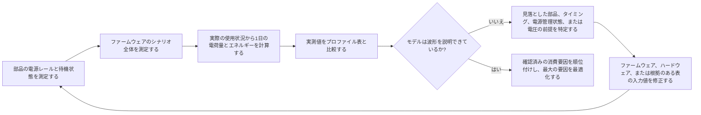

# 電力測定と検証 { #power-measurement-and-validation }

バッテリー駆動時間の推定は、その前提が実機測定と整合して初めて信頼できるものになります。このページは[低消費電力設計の概要](overview.md)および[スマートウォッチの消費電力分析](smartwatch-power-profiling.md)と併せて参照してください。個々の部品を測定し、ファームウェア全体のシナリオを検証し、1日の使用モデルと照合したうえで、実測で確認した最大のエネルギー消費要因から最適化します。

## 電流だけでなくエネルギーを測る { #measure-energy-not-current-alone }

電流は測定結果の一側面にすぎません。電流波形とともに被測定デバイス（DUT）の電圧（`V_DUT`）を記録し、電荷量だけでなく瞬時電力とエネルギーも算出できるようにします。

```text
power_W(t) = voltage_V(t) x current_A(t)
energy_Wh = integral(power_W(t) dt) / 3600
energy_mWh = energy_Wh x 1000
charge_mAh = integral(current_mA(t) dt) / 3600
```

ここで、`t`の単位は秒です。`3600`で割ることで秒を時間に換算します。電力の計算にはA単位の電流を、電荷量の計算にはmA単位の電流を使ってください。

エネルギー積分の単位はWhです。mWh単位のプロファイルに加算する前に、値を1000倍して換算してください。電荷量（mAh）とエネルギー（mWh）は異なる量であり、相互に置き換えられません。

電源電圧が安定している場合は、測定時の`V_DUT`を記録し、電流波形と合わせて使います。試験中に電圧が変化する場合は、電流と同じ時間軸でサンプリングするか、妥当な平均電力を算出できるよう同期した電圧データを十分な点数で記録してください。測定ごとに電源電圧、レギュレーターの動作点、バッテリー状態が異なると、mAhだけの比較では実際のエネルギー差が見えないことがあります。

## 測定条件をそろえる { #set-up-the-measurement-baseline }

基準となる電流測定器にはNordicの[Power Profiler Kit II (PPK2)](https://docs.nordicsemi.com/r/bundle/ug_ppk2/page/ug/ppk/ppk_user_guide_intro.html)を使用します。Source MeterモードではPPK2からDUTへ給電し、Ampere MeterモードではDUTと外部電源の間にPPK2を直列に接続して電流を測定します。Source Meterモードでは設定した出力電圧を試験条件として管理します。Ampere Meterモードでは、DUTに供給される外部電源電圧を測定して記録します。いずれのモードでも、公称設定だけでなくDUTに実際に印加される電圧を記録してください。

PPK2では電流波形、積算電荷量、エクスポート可能な測定データを取得できます。ロジックポートにはD0～D7のデジタル入力と、DUT用のVCC/GND接点があります。VCCとGNDをDUTのロジック電源と共通グラウンドに接続し、マーカー用GPIOをD0～D7に接続してください。ロジックポートのVCCはNordicが定める1.65～5.5 Vの範囲内とし、マーカー信号の電圧レベルが適合することも確認します。デジタル入力のサンプリング周波数は100 kHz、典型的な帯域幅は50 kHzのため、非常に短いフェーズは確実に分解できない場合があります。Nordicの資料にある[コネクター定義](https://docs.nordicsemi.com/r/bundle/ug_ppk2/page/ug/ppk/ppk_user_guide_connectors.html)、[電源仕様](https://docs.nordicsemi.com/r/bundle/ug_ppk2/page/ug/ppk/ppk_power_supply_specs.html)、[デジタル入力の分解能](https://docs.nordicsemi.com/r/bundle/ug_ppk2/page/ug/ppk/digital_input_resolution.html)を参照してください。ウェイクアップ、画面更新、無線通信、センサーサンプリング、スリープ状態に戻る処理などの重要な処理をGPIOマーカーで囲みます。対応モードと接続条件の詳細は、公式の[PPK2ユーザーガイド](https://docs.nordicsemi.com/r/bundle/ug_ppk2/)を参照してください。

Nordicの要件に従い、PPK2の使用中はデータ/電源用USB接続を常に接続しておいてください。Source Meterで大きな負荷を測定する場合の追加USB電源とは別の要件です。

DUTを接続する前に、選択したPPK2のモードがDUTの電圧とピーク電流に対応していることを確認してください。Nordicが規定するDUTの電圧範囲は0.8～5.0 Vです。最大DUT電流は、Ampere Meterモードでは連続1 A、Source Meterモードでは600 mAです。Source MeterモードでDUT電流が400 mAを超える場合、NordicはPPK2用に1 A以上を供給できる追加のUSB電源を推奨しています。詳しくは、Nordicの[最大DUT電流の仕様](https://docs.nordicsemi.com/r/bundle/ug_ppk2/page/ug/ppk/ppk_max_dut_current.html)と[電源に関する説明](https://docs.nordicsemi.com/r/bundle/ug_ppk2/page/ug/ppk/ppk_power_supply.html)を参照してください。これらは計測器の制限であり、製品の推奨動作条件ではありません。対応範囲を超える測定には、定格が適切な計測器を使用してください。

<div align="center"><em>表: 測定記録に必要な項目</em></div>

<div align="center" markdown>

| 記録項目 | 必要な理由 |
|:-------|:-----------------|
| 試験ID、基板リビジョン、実装部品、ファームウェアリビジョン | 測定の再現と結果の比較が可能になります。 |
| `V_DUT`：目標値、測定開始/終了時の値、測定中の変動 | 妥当な電力とエネルギーの算出に必要です。 |
| 電流波形、平均電流、ピーク電流、平均電力、電荷量（mAh）、エネルギー（mWh）、測定時間 | 短時間の電流ピークと継続的な消費を区別し、測定時の電力とエネルギーを記録できます。 |
| 温度、バッテリー状態またはベンチ電源の設定、無線環境 | 環境条件の変化をファームウェア改善と誤認するのを防ぎます。 |
| 有効な周辺機器、クロック方針、電源管理状態、ウェイクアップ要因 | 意図した低消費電力状態に遷移したかどうかを判断できます。 |
| ファームウェアマーカーとトリガー条件 | 曖昧な波形区間ではなく、特定の処理経路にエネルギー消費を割り当てられます。 |

</div>

## システム全体の試験前に部品ごとの特性を測る { #characterize-each-component-before-full-system-tests }

基板全体の波形に頼る前に、電源レールを分離するか専用治具を使って部品ごとに測定します。ここで求めるのはカタログ値ではなく、実際の製品でどの動作モード、負荷、ファームウェア設定が部品のエネルギー消費を支配しているかです。

<div align="center"><em>表: 部品ごとの特性評価計画</em></div>

<div align="center" markdown>

| 部品 | 最低限測定する項目 | モデルに記録する項目 |
|:----------|:-------------------|:--------------------|
| MCU | アクティブ処理、Idle、各スリープモード、ウェイクアップとクロック遷移の時間 | 各ファームウェア状態の電流と継続時間、予期しないウェイクアップ、電源管理を妨げる要因。 |
| 外付けPSRAM | スタンバイまたはデータ保持、読み出し、書き込み、バースト転送、該当する場合はリフレッシュ動作 | アクセスパターンごとの電源レール電流と、そのパターンの継続時間。 |
| 外付けフラッシュメモリー | Deep Power-Downまたはスタンバイ、読み出し、書き込み、消去、復帰時間 | アクセスまたは処理ごとのエネルギーと、アイドル時の電流。 |
| 外付けセンサー（各デバイス） | 使用する各モード、出力データレート、FIFOまたは割り込みの設定、デューティ比 | サンプルまたは時間間隔あたりのエネルギー。シナリオとして測定する場合はMCUの処理コストも含めます。 |
| 触覚モーターとドライバー | 起動、振幅、駆動パターン、継続時間、ブレーキまたは惰性動作 | モーターのピーク電流だけでなく、触覚パターンごとのエネルギー。 |
| オーディオコーデックとパワーアンプ | 電源オフ、スタンバイ、再生または録音、出力レベル、実際のスピーカーまたは負荷インピーダンス | 音声セッションごとのエネルギーと、オーディオ経路全体の電源オフ時リーク電流。 |
| ディスプレイ、タッチ、無線、PMIC、その他の負荷 | 関連するアクティブ、アイドル、リテンション状態 | 電流の前提を個別に記録するか、測定境界を明示した`Other`項目として記録します。 |

</div>

製品全体のエネルギーを評価する場合は、バッテリー入力で測定してください。原因切り分けには各レールの測定も不可欠ですが、バッテリー駆動時間の見積もりに加える前に、実測したレギュレーター効率と静止電流を使ってバッテリー側に換算します。各レール電流の合計を、そのままバッテリー入力電流として扱ってはいけません。

## ドライバーによる電源状態の制御を検証する { #verify-driver-controlled-power-states }

部品が仕様上の低消費電力状態に入るのは、ドライバーが資料に記載された設定とシーケンスを適用した場合に限られます。機能的には正しいドライバーでも、イネーブル信号をアサートしたままにする、誤ったスタンバイコマンドを使う、クロックやバスを動作させ続ける、電源・リセット・インターフェース信号の順序を誤ると、電力を浪費します。想定する各状態について、データシートの条件をファームウェアで再現し、実測した電流、電圧、電荷量、エネルギーが該当仕様または製品で検証済みの動作点に合うことを確認します。

<div align="center"><em>表: ドライバーによる電源状態制御の確認項目</em></div>

<div align="center" markdown>

| 制御項目 | ドライバーに求められること | 測定で確認する証跡 |
|:-------------|:-------------------|:---------------------|
| モードレジスターと低消費電力コマンド | 資料に記載されたスタンバイ、シャットダウン、リテンション、データレート、割り込み設定を適用し、部品が対応する場合は状態を読み戻して確認する。 | 電流とエネルギーが選択したモードに合致し、意図した設定が試験記録に残っている。 |
| PMロック／制約の管理責任 | 各PMロック／制約をデバイスドライバーと上位サービスのどちらが管理するかを明確にします。保護対象のリソースが必要な間だけ取得し、デバイスが安全にアイドル状態へ移行できたら、正常終了・エラー・早期リターンのすべての経路で解放します。 | ロックが必要な期間をカバーし、早すぎる解放や、処理の完了・失敗後も保持されてスリープを妨げる状態がないことを波形やログで確認します。 |
| 電源、イネーブル、リセット、クロックのシーケンス | 電源投入、動作、電源遮断時に、部品が要求する順序とタイミングを守る。 | GPIOマーカーと電力波形から、意図しないアクティブ期間や電流スパイクが残っていないことを確認できる。 |
| SPI、I2C、UARTなどの制御バス | 不要な通信を止め、チップセレクト、クロック、データ、割り込み信号を仕様で定められた非アクティブ状態にする。 | 通信の合間も部品が意図した低消費電力状態を維持する。 |
| GPIOのプル設定とハイインピーダンス | 各制御ピンを、出力High、出力Low、適切なプルアップ/プルダウン付き入力、または外部回路がレベルを定義する場合に限ったハイインピーダンスのいずれかに、意図して設定する。 | 接続先の電源オン/オフ両方で電流を確認し、リセット時およびデフォルト状態も含めて評価する。 |
| 電源ドメイン間の接続 | ハードウェアが明示的に許容する場合を除き、制御ピンやデータピンを通じて電源オフの部品を駆動しない。 | インターフェースの片側がオフのときに、逆給電やリークが発生しない。 |
| エラー時および復帰時の処理 | タイムアウト、転送失敗、ウェイクアップ、ファームウェアリセットの後に正しい状態へ復元する。 | 長時間測定で、後処理の不備により、余分な電流が持続したり徐々に増えたりしていない。 |

</div>

論理レベルが正しくても、リーク電流が小さいとは限りません。内部プル、競合するプル設定、リセット時の初期値、ESD経路、バスのプルアップにより、両方のデバイスが妥当な論理状態に見えても、リークや逆給電が発生することがあります。インターフェース両側が給電された状態、片側が無給電の状態、および両状態の切り替え中に、インターフェース関連の電流を測定してください。観測結果が期待と異なる場合は、電力プロファイル表を変更する前に、ドライバーの設定/シーケンスの誤りと基板レベルのリーク経路を切り分けます。

## ファームウェアのシナリオを検証する { #validate-firmware-scenarios }

部品ごとの動作を把握したら、ユーザーが実際に経験する一連のファームウェア動作を測定します。シナリオには、同時に動作する部品、電源管理状態、ウェイクアップ、タイミングを含めます。スマートウォッチでは、[スマートウォッチの消費電力分析](smartwatch-power-profiling.md)のモデルと同じ、画面消灯時の待機、通知、着信アラート、手首を上げる動作での画面点灯、心拍数の自動測定、SpO2の手動測定、運動記録、アラーム、睡眠モニタリング、アプリ同期から始めます。NFC、Bluetooth通話、AODを有効にする場合は、それぞれ別のシナリオとして追加します。

<div align="center"><em>表: シナリオ検証記録</em></div>

<div align="center" markdown>

| 各シナリオで記録する項目 | 確認内容 | プロファイルへ反映する値 |
|:------------------|:-------|:---------------------------|
| 開始/終了マーカー | 波形にウェイクアップからスリープまでの全経路が含まれている。 | シナリオの境界と継続時間。 |
| 部品と電源レールの動作 | 想定した部品だけが動作している。 | 部品ごとの前提と`Other`の割り当てを修正する。 |
| 処理完了後の電源管理状態 | システムが意図したスリープ状態に遷移している。 | アイドル/待機電流と残り時間の前提。 |
| 1回あたりの電流、`V_DUT`、電荷量（mAh）、エネルギー（mWh） | 測定値がバッテリー側の消費を示している。 | イベントあたりの電荷量（mAh）とエネルギー（mWh）。 |
| 製品の動作 | 必要なレイテンシ、RF信頼性、音質、ユーザー体験が測定条件でも維持されている。 | 実用できない低消費電力設定ではなく、妥当な動作点。 |

</div>

ファームウェアのGPIOマーカーを使って、1つの波形を複数段階に分けます。手首を上げたときに画面を点灯するシナリオの波形では、ジェスチャー認識、MCUのウェイクアップ、ディスプレイ有効化、描画、画面点灯の継続、減光または消灯、スリープ状態に戻る処理を読み取れます。これにより、平均電流値をファームウェア担当とハードウェア担当が個別に改善できる処理に分解できます。

## 1日の使用プロファイルと照合する { #reconcile-the-daily-use-profile }

最終確認では、個別の最良条件の測定値を並べるだけでは不十分です。シナリオごとの実測エネルギーと実際の発生頻度から、代表的な1日の動作を実行または再構成します。電荷量とエネルギーの両方で、実測値とプロファイル表を比較してください。

```text
daily_charge_mAh = sum(occurrences_per_day x charge_per_occurrence_mAh)
daily_energy_mWh = sum(occurrences_per_day x energy_per_occurrence_mWh)
```

<div align="center"><em>図: 電力プロファイルの収束ループ</em></div>



測定値とモデルが一致しなくても、表の数値を無理に変更して合わせてはいけません。負荷の見落とし、誤ったデューティ比、レギュレーター損失の前提、意図しないウェイクアップ、部品の有効状態の継続、モデルと異なる測定境界など、検証可能な原因を特定します。ハードウェアまたはファームウェアを修正して再測定した根拠がある場合にのみ、表を更新してください。リリース前に製品に適した一致判定基準を明確に定めます。許容誤差は、公表するバッテリー駆動時間、動作範囲、残る不確かさによって異なります。

<div align="center"><em>表: プロファイルとの不一致の見方</em></div>

<div align="center" markdown>

| 不一致 | 主な原因 | 次に確認する項目 |
|:---------|:-------------|:-----------|
| 部品の測定値が想定より大きい | 部品モードの誤り、電源レールのリーク、レギュレーター損失、測定治具の負荷 | 電源レールを分離し、モードピン、電圧、基板の実装状態を確認する。 |
| シナリオのエネルギーが部品の合計より大きい | 余分なウェイクアップ、ディスプレイ/無線の動作時間、サービス処理、負荷の重複 | ファームウェアマーカーを追加し、シナリオ全体の部品状態を比較する。 |
| 1日のプロファイルがシナリオの合計より大きい | 使用頻度、接続中アイドル時間、機能の無効化、バックグラウンド処理の前提が誤っている | イベント回数、タイマー、無線スケジュール、残りの待機時間の定義を監査する。 |
| 特定の条件でしかモデルと測定値が一致しない | 電圧、温度、RF環境、バッテリー状態、ファームウェアビルドが異なる | 想定する動作範囲全体で同じシナリオを再測定する。 |

</div>

## 実測で確認した最大の消費要因を最適化する { #optimize-the-largest-verified-contributors }

照合済みのプロファイルを使い、効果が最も大きい改善対象を決めます。最もエネルギーを消費する部品と、最もエネルギーを消費する製品シナリオは分けて考えてください。両者は異なる場合があります。たとえば最大の部品はディスプレイでも、手首を上げて画面を点灯する回数が多いために、そのシナリオ全体の消費量が支配的になることがあります。

1. **動作が主因なら、まずファームウェアを改善します。** 意図しないウェイクアップをなくし、ポーリングを減らし、処理をまとめ、画面点灯時間を短縮し、不要な再描画を避け、電源管理の制約を速やかに解除します。製品要件を損なわない範囲で、センサーや無線のデューティ比も下げます。
2. **部品自体の制約が実測で確認できた場合は、ハードウェアを改善します。** 低消費電力のセンサー、メモリー、レギュレーター、コーデック、アンプ、ディスプレイ、触覚デバイスを選ぶ際は、無関係な状態のデータシート電流ではなく、想定動作モードで実測したエネルギーを比較してください。
3. **変更した部品とシナリオを再測定します。** 部品の置き換えによってボトルネックが移動したり、ウェイクアップのタイミングが変わったり、レギュレーターの動作点を変更する必要が生じたりすることがあります。
4. **プロファイルを更新し、1日分の比較をやり直します。** シナリオ波形と製品全体の電力予算の両方が改善して初めて、変更完了と判断できます。

## リリース時に保管する検証記録 { #release-evidence }

バッテリー駆動時間を提示する前に、部品ごとの測定データ、シナリオ測定データ、1日の使用プロファイル、電圧記録、ファームウェアマーカー、それらを結び付けるバージョン管理された前提を保管してください。ファームウェアのスケジューリング、ディスプレイ方針、無線パラメーター、センサー周期、電源ツリーの部品、製品の使用前提を変更した場合は、影響する工程を再実施します。

!!! note "自動生成コンテンツ"
    このページは、既存の原資料に基づいて作成したものではありません。技術情報を利用する前に、SiFliの公式ドキュメントで内容を確認してください。
