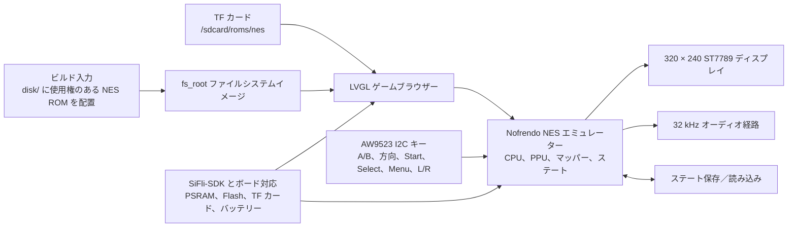

# Pocket Pi SF32ハンドヘルドゲーム機 { #pocket-pi-sf32-handheld-game-console }

!!! note "固定した参照コミット"
    特に明記しない限り、本記事のソースコードに関する説明はPocketPiのcommit [`7d9fac2`](https://github.com/SiFliSparks/PocketPi/commit/7d9fac2cb577d6c9b66a99521aebf3c9de0ae163) に基づきます。上流の`main`ブランチは更新されるため、記載内容を再現するときは固定したcommitをチェックアウトしてください。

## Pocket Piとは { #what-is-pocket-pi }

[SiFliSparks/PocketPi](https://github.com/SiFliSparks/PocketPi) は、SF32LB52向けの携帯型ゲーム機およびエミュレーターのリファレンスです。固定したリビジョンでは、Nofrendo NESエミュレーター、LVGLのゲームブラウザー、320 × 240 ST7789 8080ディスプレイ経路、オーディオ、ステートの保存／読み込み、組み込みファイルシステム、TFカードのROMディレクトリを統合しています。公開されているビルド基準はHuangshan Pi／`sf32lb52-lchspi-ulp`ターゲットです。

ローカル描画、入力、オーディオ、外部ストレージ、PSRAM割り当て、エミュレーター負荷がSF32LB52システム上でどのように共存するかを検証するのに適しています。リポジトリーには市販ゲームのROMは含まれていません。利用する権利のある`.nes`／`.NES`ファイルは、各自で用意する必要があります。また、公開ソースは量産可能な携帯ゲーム機の完全な設計ではありません。バッテリー安全性、オーディオ、EMC、熱、ライセンス、コンテンツ配布に関するレビューの代わりにはなりません。


<div align="center"><em>SF32LB52上でNESゲームを実行するPocket Pi</em></div>

## SF32実装を使う理由 { #why-the-sf32-implementation }

NESエミュレーションは、CPUエミュレーション、PPU描画、オーディオサンプリング、低レイテンシ入力、ファイル読み出し、フレームバッファー、ステートセーブを連携させる必要があり、複数の組み込み技術要素を分かりやすい1つの負荷にまとめています。SF32LB52ベースのシステムは、この負荷に必要なディスプレイ、オーディオ、外部ストレージ、PSRAMを備え、Huangshan Piはバッテリー駆動の評価環境も提供します。

その価値は、すべてのNESタイトルが完全に互換であると主張することではありません。ROMマッパーの対応状況、フレームレート、オーディオ、セーブ動作、ピークメモリー使用量、入力レイテンシはゲームごとに異なる場合があります。追加するROMやマッパーごとに、互換性と著作権について個別の判断が必要です。

## 目標、対象範囲、開始条件 { #outcome-scope-and-entry-criteria }

**目標：** ソフトウェア仕様に固定したPocketPiのcommitから再現可能なイメージをビルドし、利用権のあるテストROMを少なくとも1つ起動します。ディスプレイ、入力、オーディオ、一時停止、保存、読み込み、終了、復旧を検証した後、範囲を限定した変更を1件実施します。

このページでは、すべてのNESマッパー、PAL／NTSCタイミング、ゲームのオーディオ経路、セーブ形式、サードパーティーROMの動作を保証しません。ゲームコンテンツを複製または配布する権利も付与しません。固定したリビジョンにはトップレベルのライセンスファイルがありません。製品にコードを取り込んだりバイナリーを配布したりする前に、PocketPi、Nofrendo、および組み込まれるすべてのサードパーティーコンポーネントのライセンスを責任者が確認する必要があります。

開始前に、次のものを用意してください。

- [SF32LB52-DevKit-ULP／Huangshan Pi](../sf32-products/devkits/SF32LB52-DevKit-ULP.md)、またはリポジトリーの`sf32lb52-lchspi-ulp`ボード定義に合致するハードウェア。
- 固定したソースが想定する320 × 240ディスプレイ、AW9523 I²C入力エキスパンダー、キー、オーディオ、任意のTFカード経路。ボード名だけでは、すべての周辺機器が実装済みとは判断できません。
- SiFli-SDK、SCons、UART書き込み、ログ取得用のツール。
- 自作、パブリックドメイン、または適切なライセンスを得た`.nes`テストROM。
- ROMは、組み込みファイルシステム用ならリポジトリーの`disk/`に配置します。TFカードを使う場合はファームウェアで設定されたROMディレクトリに置いてください。固定したリビジョンの実行時検索パスは`/sdcard/roms/nes`です。カードのマウントパスが一致することを該当リビジョンのソースで確認してください。
- フレーム動作、オーディオ、入力、メモリー、電流を確認する手段。

<div align="center"><em>表: Pocket Piの固定した基準構成と変更前に必要な証跡</em></div>
<div align="center" markdown>

| 項目 | 固定したソースの基準構成 | 変更前に必要な証跡 |
|:-----|:------------------------|:------------------------------------|
| ボード | `sf32lb52-lchspi-ulp` | ボード、エキスパンダー、ディスプレイ、オーディオ、ストレージ、電源のリビジョン |
| コンテンツ | 固定したリビジョンでは`.nes`と`.NES`のみを検索。同名の`.jpg`をカバー画像として使用可能 | ROMの入手元／ライセンス、ファイルハッシュ、マッパー、画像の入手元 |
| ストレージ | `disk/`を`fs_root`にビルド。実行時に`/sdcard/roms/nes`も検索 | ファイルシステムイメージ、TFカード形式、ディレクトリ、エラー復旧の記録 |
| 入力 | 固定したリビジョンではAW9523 I2Cエキスパンダー経由でA/B、方向、Start、Select、Menu、L/Rおよび関連キーを読み取る | 回路図／ピン定義、全キー構成、複数キー同時押しの結果 |
| エミュレーター | Nofrendo NESコア、ディスプレイ、32 kHzオーディオ経路、ステート保存／読み込み | ゲーム互換性、フレーム／オーディオ、ステート、メモリー、リセットの証跡 |

</div>

## ハードウェアとソフトウェアの仕様 { #hardware-and-software-specifications }

### ハードウェア仕様 { #hardware-specification }

<div align="center"><em>表: Pocket Piハードウェア仕様</em></div>

<div align="center" markdown>

| 構成要素 | 必要な仕様 | 役割 | 状態 | 入手先 | 互換性・代替に関する注意 |
|:---------|:-----------|:-----|:-----|:-------|:-------------------------|
| Huangshan Pi / SF32LB52-DevKit-ULP基準構成 | ボードターゲット`sf32lb52-lchspi-ulp`。固定したリビジョンのプロジェクトソースは320 × 240 ST7789ディスプレイ経路、AW9523 I²C入力エキスパンダー、オーディオ、TFカードインターフェースを想定 | エミュレーターと表示、入力、オーディオ、ストレージ経路を実行 | 必須 | [μForgeボードリファレンス](../sf32-products/devkits/SF32LB52-DevKit-ULP.md); [LCKFBボードページ](https://lckfb.com/project/detail/lckfb-hspi-sf32lb52-ulp?param=baseInfo); [プロジェクトソース](https://github.com/SiFliSparks/PocketPi) | 正確な構成と実装済み周辺機器を確認してください。ターゲット名だけではボードの同等性を証明できません |
| TFカード | 選択したファームウェアで読み取れるカードとファイルシステム。固定したリビジョンの実行時パスは`/sdcard/roms/nes` | 任意の外部ROMストレージ | 任意 | [PocketPiソース](https://github.com/SiFliSparks/PocketPi) | 固定したリビジョンでマウントパス、カード形式、ホットプラグ動作、障害復旧を確認してください |
| ビルドホストとUSBデータケーブル | 選択したSiFli-SDKツールチェーンを実行できるホスト。ボードの文書化された書き込み／デバッグ経路に対応するデータケーブル | ビルド、書き込み、シリアルログの取得 | 必須 | [SiFli-SDKクイックスタート](https://docs.sifli.com/projects/sdk/latest/sf32lb52x/quickstart/index.html) | ホストOS／アーキテクチャ、ケーブル／アダプター、ポート、復旧方法を記録してください。充電専用ケーブルは使用できません |

</div>

!!! warning "Huangshan Piは周辺機器まで一致する即時利用可能な構成とは確認されていません"
    SiFliの[Huangshan Piガイド](https://wiki.sifli.com/en/board/sf32lb52x/SF32LB52-%E9%BB%84%E5%B1%B1%E6%B4%BE.html)には、1.85インチ、390 × 450、Quad-SPI接続のAMOLEDディスプレイと、ボードのファンクションキー／電源キーが記載されています。一方、固定したリビジョンのPocketPiソースは320 × 240 ST7789 8080ディスプレイ経路とAW9523 I²C入力を想定しています。公式ボードガイドからは、記載された構成にこれらの周辺機器が含まれるとは確認できません。このボードターゲットをプラグアンドプレイとして扱う前に、実際のディスプレイ、アダプター、入力ハードウェアを確認するか、対応するソフトウェア経路を移植してディスプレイ／入力の回帰試験を再実施してください。

### ソフトウェア仕様 { #software-specification }

<div align="center"><em>表: Pocket Piソフトウェア仕様</em></div>

<div align="center" markdown>

| パッケージまたはサービス | 必要なバージョンまたはリビジョン | 役割 | 状態 | 入手先 | 互換性・更新に関する注意 |
|:-------------------------|:---------------------------------|:-----|:-----|:-------|:-------------------------|
| SiFliSparks/PocketPi | レビュー済みcommit [`7d9fac2`](https://github.com/SiFliSparks/PocketPi/commit/7d9fac2cb577d6c9b66a99521aebf3c9de0ae163) | アプリケーション、Nofrendoの統合、ファイルシステムイメージ、ボードターゲット | 必須 | [リポジトリー](https://github.com/SiFliSparks/PocketPi) | ROM入力とリポジトリーのソースは別々にライセンスを確認し、ハッシュを記録してください |
| OpenSiFli/SiFli-SDK | プロジェクト記事では正確なcommitが固定されていません。互換性のあるリビジョンを選び、記録してください | RTOS、ボードサポート、ドライバー、SConsビルド、書き込みツール | 必須 | [リポジトリー](https://github.com/OpenSiFli/SiFli-SDK) | `main`が互換性を持つと仮定しないでください。アプリケーションとSDKのcommitを組み合わせて管理してください |
| SCons環境とUART書き込みツール | 選択したSiFli-SDKリビジョンに対応するバージョン | `sf32lb52-lchspi-ulp`のビルドと書き込み | 必須 | [SiFli-SDKクイックスタート](https://docs.sifli.com/projects/sdk/latest/sf32lb52x/quickstart/index.html) | ホストOS、SDKのセットアップ、ビルドログ、生成された書き込みスクリプトを記録してください |
| テストROM | 利用権限を確認した`.nes`/`.NES`ファイル。マッパーとSHA-256を記録 | ファイル検出、デコード、エミュレーション、オーディオを検証 | 必須のテストデータ | PocketPiはROMを配布していません。使用権のあるファイルを用意し、[プロジェクトソース](https://github.com/SiFliSparks/PocketPi)を参照してください | ゲームとマッパーごとに互換性を確認し、コンテンツの権利とハッシュはプロジェクトソースと分けて管理してください |
| カバー画像 | ROMと同じベース名の任意の`.jpg`。出所、利用権、SHA-256を記録 | ゲームブラウザーで画像デコードとフォールバックを検証 | 任意 | ユーザーが用意してください。PocketPiはカバー画像を配布していません。[プロジェクトソース](https://github.com/SiFliSparks/PocketPi)を参照してください | 再配布できる画像だけを`disk/`に置き、出所とハッシュを記録してください |

</div>

## サポート対象の基準構成を選ぶ { #choose-a-supported-baseline }
ソフトウェア仕様に記載したPocketPiのリビジョンを使い、現在の`main`が指すコミットをそのままビルドしないでください。

```bash
git clone https://github.com/SiFliSparks/PocketPi.git
cd PocketPi
git checkout 7d9fac2cb577d6c9b66a99521aebf3c9de0ae163
cd project
scons --board=sf32lb52-lchspi-ulp -j8
```

ビルドスクリプトは`../disk`をファイルシステムイメージに変換し、`fs_root`としてファームウェアに追加します。Windowsでは、生成された`build_sf32lb52-lchspi-ulp_hcpu\uart_download.bat`が書き込み手段を提供します。他のホストでは、対応するSiFli-SDK書き込みツールを使い、同等のパラメーターを記録してください。

<div align="center"><em>表: Pocket Piの基準構成選定</em></div>
<div align="center" markdown>

| 要素 | 基準構成の選択 | 重要な制約 |
|:--------|:----------------|:--------------------|
| ROM | マッパーが分かっていて、使用権を確認した小さな`.nes`または`.NES` ROMから始める | 固定したリビジョンでは、スキャナーが受け付ける拡張子は`.nes`と`.NES`のみです。リストに表示されても、エミュレーター互換性が確認できたことにはなりません。 |
| 画像 | 同じディレクトリ、同じベース名の`.jpg`を任意で指定 | デコードに失敗した場合は、ゲームリストを止めずに既定画像へフォールバックする必要があります。 |
| ディスプレイ | 固定したソースのUIは320 × 240で、270°回転を選択 | 別のLCDや向きでは、ディスプレイと入力の全体回帰試験が必要です。 |
| 入力 | 固定したソースの`input.c`と`input.h`にあるAW9523マッピングに従う | GPIO直結、9キー、Selectキーの組み合わせを説明するREADMEの記述は古くなっています。 |
| ステートセーブ | 一時停止メニューの「Save State」／「Load State」を使う | 電源断時の整合性、スロット形式、バージョン間互換性はまだ実証が必要です。 |

</div>

!!! warning "READMEの入力に関する説明は固定したソースと異なります"
    READMEには、`key_pin_def[]`、200 HzのGPIOスキャン、Selectキーの組み合わせが記載されています。固定したリビジョンのコードはアドレス`0x5B`のAW9523 I²Cエキスパンダー経由でキーを読み取ります。MenuキーではSave State、Load State、Exit Gameを含む一時停止画面を開き、L／Rキーではオーディオシフトを調整します。再現試験とハードウェア設計では、古いGPIO表ではなく、固定したソースと回路図に従ってください。

## プロジェクトの開発段階と判断ポイント { #delivery-map }

<div align="center"><em>表: Pocket Piの開発段階と判断ポイント</em></div>
<div align="center" markdown>

| 段階 | 判断する内容 | 必要な成果物 |
|:------|:---------------------|:----------------|
| 1. 未変更の基準構成 | 対象ハードウェアで利用権のあるROMを1つ認識し、実行できるか | バージョン、ビルド、ROM、起動、ディスプレイ、オーディオの記録 |
| 2. 操作と復旧 | 入力、一時停止、保存、読み込み、終了、リセットが安定しているか | ゲーム単位の機能・障害復旧記録 |
| 3. ソースの再現 | 別のエンジニアが同じファイルシステムとイメージを再ビルドできるか | バージョン固定ビルド、成果物ハッシュ、再現結果 |
| 4. 管理された変更 | ROM、UI、ハードウェアを1つ変更しても基準構成を壊さないか | 変更内容、コンテンツライセンス、性能、回帰試験の証跡 |
| 5. 製品レビュー | カスタム携帯ゲーム機とコンテンツ戦略の検討に十分なリファレンスか | 互換性、ライセンス、電源、リスクに関する判断 |

</div>

## システム構成と依存関係 { #system-architecture-and-dependencies }

<div align="center"><em>図: Pocket Piの実行時の経路</em></div>



主な障害領域は、ファイルシステム／ROM、マッパー／エミュレーター、PSRAM／メモリー、ディスプレイ／フレームタイミング、AW9523入力、オーディオ、ステートセーブ、電源／リセットです。画面が真っ黒な場合は、単に「エミュレーターの障害」とせず、「ROMが見つからない」「画像デコードに失敗」「マッパー非対応」「フレームバッファー割り当て失敗」「LCD経路の障害」に切り分けてください。

## 段階1 — 未変更のゲーム基準構成を確立する { #stage-1-establish-the-untouched-game-baseline }

**目標：** 利用権のあるテストROMを1つ使い、ビルド入力からゲーム実行までの経路全体を実証します。

1. PocketPiとSiFli-SDKのコミット、およびボードと周辺機器のリビジョンを固定します。
2. ライセンスを確認した`.nes` ROMを`disk/`に配置します。カバー画像を追加する場合は同じベース名の`.jpg`にします。ROMのハッシュ、入手元、マッパーを記録します。
3. クリーンビルドし、`fs_root`が生成され、書き込み成果物に含まれていることを確認します。
4. 書き込み後に完全に電源を入れ直します。ゲームがリストに表示され、カバー画像または既定画像が見え、ゲームを起動できることを確認します。
5. 起動時間、安定した映像、キー応答、オーディオ、シリアルログを記録し、リセット後にもう一度再現します。

**保存する証跡：** リポジトリー／SDKのコミット、ボードと周辺機器、ROMのハッシュ／ライセンス、ビルドログ、ファイルシステムイメージ、書き込みログ、シリアルログ、ゲームリスト／実行画面の写真。

**ゲート1の終了条件：** 2回の完全な電源投入で同じROMがリストに表示されて起動し、映像、基本的な方向／A／B／Start／Select入力、オーディオが再現可能に動作する。

## 段階2 — 入力、ステート、障害復旧を検証する { #stage-2-validate-input-state-and-fault-recovery }

**目標：** 「ゲームが起動する」状態から、レビュー可能な携帯ゲーム機の基準構成へ進めます。

<div align="center"><em>表: Pocket Piの主要な検証項目</em></div>
<div align="center" markdown>

| テスト | 方法 | 合格の証跡 |
|:-----|:-------|:--------------|
| 全キー | A、B、方向、Start、Select、Menu、L、Rを個別に、必要な組み合わせも含めて操作 | キーの固着、入れ替わり、原因不明の連続入力がなく、マッピングが固定したソースと一致する |
| 一時停止画面 | ゲーム中にMenuを押し、「戻る」「Save State」「Load State」「Exit Game」を操作 | 選択フォーカス、一時停止／再開、終了を繰り返し確認できる |
| 保存／読み込み | 状態が分かる場面を保存し、状態を変えてから読み込む | 期待した状態に戻り、保存ファイルとスロットを追跡できる |
| ファイルシステム | 空の`disk/`、非対応拡張子、破損ROM、欠落／破損JPG、利用できないTFカードを試す | UIがクラッシュしない。シリアル出力で診断できる。既定画像とルートファイルシステムが利用可能な状態を保つ |
| リセットと電源 | ゲーム中、一時停止中、保存前後、リスト画面でリセットまたは電源を切る | ファイルシステムが保たれ、復旧可能なリスト画面または明示的な障害状態に戻る |
| 長時間動作 | 代表的なゲームを一定時間以上実行する | メモリーの継続的な増加、音声／映像の崩れ、入力喪失、異常な温度上昇がない |

</div>

**ゲート2の終了条件：** 選択したROMについて、入力、ディスプレイ、オーディオ、一時停止、保存、読み込み、終了、リセットを記録し、各障害を定義済みの領域に対応付ける。

## 段階3 — ソースとコンテンツの再現可能な基準構成を整える { #stage-3-build-a-reproducible-source-and-content-baseline }

**目標：** 別のエンジニアが同じファームウェアとコンテンツイメージを再ビルドできる状態にします。

1. PocketPi、SiFli-SDK、サードパーティーコアの各リビジョンを記録します。
2. ROMとカバー画像ごとに、ファイル名、ハッシュ、入手元、ライセンスを記載した`disk/`マニフェストを作成します。再配布できないROMはコミットしないでください。
3. 空の出力ディレクトリからビルドし、`fs_root`、ファームウェア、メモリー／パーティション出力、書き込みスクリプト、ハッシュを保存します。
4. 2台目のPCまたはクリーンなディレクトリで再ビルドし、段階2の主要テストを繰り返します。

**ゲート3の終了条件：** ソースとコンテンツのマニフェストから、ハッシュが一致するか差分を説明できるイメージを再現し、未記録のローカルファイルに依存しない。

## 段階4 — 変更は一度に1つずつ行う { #stage-4-adapt-one-variable-at-a-time }

**目標：** エミュレーター、コンテンツ、ハードウェアの境界を測定します。

<div align="center"><em>表: Pocket Piの段階的な変更順</em></div>
<div align="center" markdown>

| 変更の分類 | 最初に試す変更 | 必要な回帰試験 |
|:-------------|:------------------|:--------------------|
| コンテンツ | 利用権を確認したROMを1つ追加し、必要ならカバー画像を追加 | 認識、マッパー、起動、フレーム／オーディオ、入力、保存、ライセンス |
| ゲームリストUI | フォント、カバー画像、並べ替え、空リスト時の案内 | メモリー、スクロール、既定画像、長いファイル名、破損JPG |
| 入力 | AW9523のマッピングまたは物理配置を1つ変更 | 全キー、同時入力、メニュー、I2C障害、ブート |
| ディスプレイ | 向き、LCD、フレームバッファー方式 | 320 × 240の形状、フレームタイミング、ティアリング、メモリー、終了後の復旧 |
| オーディオ | 音量、シフト、出力ハードウェア | 32 kHz経路、歪み、アンダーラン、ディスプレイ／ストレージとの同時動作、ミュート |
| ストレージ | TFカードのディレクトリまたはステートファイル方式 | ホットプラグ境界、破損、電源断、容量不足、フォールバック経路 |

</div>

**ゲート4の終了条件：** 変更内容とコンテンツの権利をレビューし、元のイメージに復旧でき、選択したROMで段階2のすべてのテストに合格する。

## 段階5 — 製品化準備のレビュー { #stage-5-product-readiness-review }

カスタム携帯ゲーム機の設計やコンテンツ配布に進む前に、以下を確認してください。

- 対象ゲームが必要とするマッパーは何か。各ROMのフレームレート、オーディオ、メモリー、保存動作を評価したか。
- PocketPi、Nofrendo、SiFli-SDK、フォント、カバー画像、サウンド、ROMのライセンスと配布権は明確か。
- AW9523、LCD、オーディオ、TFカード、バッテリー、充電回路の回路図、BOM、量産試験は揃っているか。
- ゲーム中、リスト表示中、一時停止中、スリープ中、電源オフ時の電流、バッテリー寿命、温度、低バッテリー時の挙動はどうか。
- 電源断、バージョン更新、メディア容量不足、破損後にステートセーブをどう保護し、移行するか。
- ファイルシステム破損、更新失敗、黒画面、起動不能なROMからどう復旧するか。

**ゲート5の終了条件：** 互換性表、コンテンツ／ソフトウェアライセンス、ハードウェア担当、電力、復旧リスクに責任者を割り当て、「進める／保留／中止」を決定する。

## 製品設計への引き継ぎ { #handoff-to-product-design }

SF32チップまたはモジュールの選定、PSRAMとFlashのピーク使用量、ディスプレイ／フレームバッファー経路、AW9523入力マトリクス、オーディオアンプとスピーカー、TFカードと組み込みファイルシステム、ステートセーブ形式、バッテリー／充電回路、復旧用書き込みポート、ROM／マッパー互換性表、ライセンスの完全な一覧を引き継いでください。続けて [SF32LB52x](../sf32-products/chips/SF32LB52x.md)、[SF32LB52-DevKit-ULP](../sf32-products/devkits/SF32LB52-DevKit-ULP.md)、[SiFli-SDKのビルド、書き込み、モニター](../develop/platforms/sifli-sdk/build-flash-monitor.md)、[量産設計](../hardware/design-for-production.md)を参照してください。

## 主な情報源 { #authoritative-sources }
- [SiFliSparks/PocketPi](https://github.com/SiFliSparks/PocketPi)
- [固定した参照コミット`7d9fac2`](https://github.com/SiFliSparks/PocketPi/commit/7d9fac2cb577d6c9b66a99521aebf3c9de0ae163)
- [LCKFB Huangshan Pi SF32LB52-ULPボード](https://lckfb.com/project/detail/lckfb-hspi-sf32lb52-ulp?param=baseInfo)
- [OpenSiFli/SiFli-SDK](https://github.com/OpenSiFli/SiFli-SDK)
- [SiFli Wiki: Huangshan Pi開発ボードガイド](https://wiki.sifli.com/en/board/sf32lb52x/SF32LB52-%E9%BB%84%E5%B1%B1%E6%B4%BE.html)
- [SiFli-SDK Getting Started Guide](https://docs.sifli.com/projects/sdk/latest/en/sf32lb52x/quickstart/get-started.html)
- [pebri86/esplay-retro-emulation](https://github.com/pebri86/esplay-retro-emulation)
- [LVGLドキュメント](https://docs.lvgl.io/latest/en/html/index.html)
