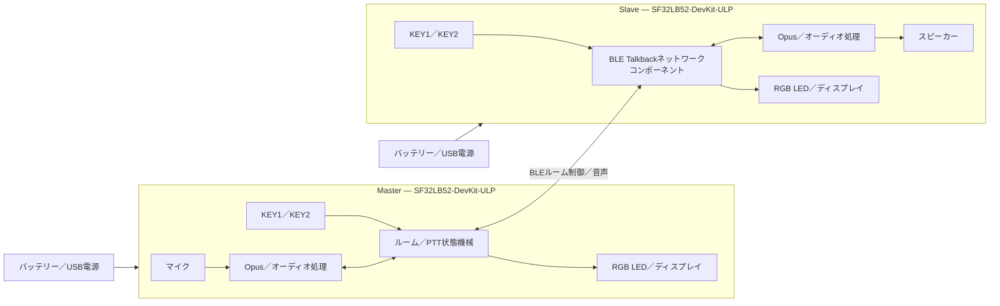

# SF32 BLE Talkbackインターコム { #sf32-ble-talkback-intercom }

## Talkbackとは { #what-is-talkback }

[OpenSiFli Talkback](https://github.com/OpenSiFli/sifli-sdk-demo/tree/main/talkback)は、`SF32LB52-DevKit-ULP`（Huangshan Piとも呼ばれます）向けの複数デバイス対応BLEプッシュ・トゥ・トーク（PTT）サンプルです。Masterモードではルームを作成し、Slaveモードではルームを検索して参加します。参加後、ユーザーが通話キーを押している間は送信し、離すと停止します。公式の基準実装では最大8台のデバイスに対応し、最大3台が同時に発話できます。

このプロジェクトは音声コーデックにOpusを使用し、RGB LED、キー、ディスプレイを組み合わせた簡易ローカルUIを備えています。また、ワンキーでのSlave再接続、バッテリー電圧／残量表示、60秒間入力がない場合のスリープ、長押しによる電源オフ／オン動作も実装しています。そのため、単純な1対1音声サンプルより、携帯型インターコムの参照例として有用です。

## SF32を採用する理由 { #why-the-sf32-implementation }

この開発手順では、SF32LB52のBLE、オーディオ、ディスプレイ、キー、バッテリー監視、低消費電力動作を、動作する1つの基準構成で評価できます。カスタムRF、オーディオ、電源設計に投資する前に、対応開発ボード上でネットワークと音響を評価できます。

「最大8台、同時発話3台」は上流実装の上限であり、通信距離、干渉、パケット損失、あらゆる同時発話パターンを含め、製品条件で検証済みであることを示すものではありません。上流資料には、ルーム認証、リンク暗号化方針、音声プライバシーの保証、バイナリーの`talk_back`コンポーネントに関する完全なライセンス範囲も記載されていません。いずれも製品レビューで個別に確認する必要があります。

**開発ボード資料について：** SiFli WikiのULP開発ボード中国語ページは「未公開」とされ、低消費電力センサー／ウェアラブル用途、3軸または6軸センサー、低消費電力測定用テストポイントのみを記載しています。完全なボード仕様ではありません。周辺機器は実際の基板リビジョンと回路図で確認してください。以下のTalkback動作は、固定した上流アプリケーションソースに基づいています。

## 目標、対象範囲、開始条件 { #outcome-scope-and-entry-criteria }

**目標：** リビジョンを管理した2台以上のボードで、ルーム作成、参加、PTT音声、退出／再接続、スリープ／ウェイク、バッテリー状態の動作を再現し、カスタムハードウェアへの移行が妥当か判断できる証跡を残します。

**対象外：** このページは、長距離通信、リンク劣化時の音声品質、エンドツーエンド暗号化、認証、量産時の電力、アンテナの一貫性、法規制への適合、任意のBLEデバイスとの互換性を証明するものではありません。

**開始条件：** SiFli-SDKのビルド環境を導入し、UART経由でファームウェアを書き込み、ログを確認し、安全にスピーカーとバッテリーを接続できること。音声動作の基準試験には、同一リビジョンのボードが最低2台必要です。

<div align="center"><em>表: プロジェクトの合意事項</em></div>

<div align="center" markdown>

| 項目 | 基準要件 | 次に進む前に保管する証跡 |
|:-----|:---------|:-------------------------|
| 再現性の境界 | 最初は上流ターゲット、依存関係、デフォルト操作を変更しない | ボードリビジョン、アプリケーションのコミット、SDKリビジョン、依存解決記録、ファームウェアのハッシュ |
| 機能の境界 | 作成／参加、PTT、退出、Slave再接続、スリープ／ウェイク、バッテリー表示を確認 | 操作記録、UARTログ、LED状態、故障復旧結果 |
| 製品の境界 | 音響、RF、セキュリティ、プライバシー、ライセンス、電力、法規制は個別に検証 | リスク、担当者、対応計画、続行／中止の判断 |

</div>

## ハードウェアとソフトウェアの仕様 { #hardware-and-software-specifications }

### ハードウェア仕様 { #hardware-specification }

<div align="center"><em>表: ハードウェア仕様</em></div>

<div align="center" markdown>

| コンポーネント | 必要な仕様 | 役割 | 必須／任意 | 入手先 | 互換性と代替に関する注意 |
|:--------------|:-----------|:-----|:----------|:-------|:-------------------------|
| SF32LB52-DevKit-ULP／LCKFB-HSPI-SF32LB52-ULP | `sf32lb52-lchspi-ulp`ターゲット。2台以上8台以下 | Talkbackを実行し、BLE、マイク、ディスプレイ、キー、RGB LED、電源、オーディオ経路を提供 | 必須 | [μForgeのボードリファレンス](../sf32-products/devkits/SF32LB52-DevKit-ULP.md)、[LCKFBボードページ](https://lckfb.com/project/detail/lckfb-hspi-sf32lb52-ulp?param=baseInfo)、[SiFliサンプル／キットストア](https://sifli.taobao.com/) | ハードウェアリビジョンをすべて記録してください。未検証のSF32LB52ボードを同等品として代用できません |
| スピーカー | GH-1.25 mmコネクター経由の外付け3 W／4 Ωまたは2 W／8 Ωスピーカーを各ボードに1台 | 受信音声を再生 | 必須 | ボードキットに同梱されることが多いため、購入前に[ボードリファレンス](../sf32-products/devkits/SF32LB52-DevKit-ULP.md)と同梱物を照合してください | オンボードClass-Dアンプとコネクターの制限外の負荷を接続しないでください |
| USBデータケーブルとホスト | 各ボードにデータ通信対応USB-Cケーブルを1本。SiFli-SDKツールを実行できるホスト | 電源、UART書き込み、ログ取得 | 必須 | 標準的なUSB-Cデータケーブル。[SiFli-SDK](https://github.com/OpenSiFli/SiFli-SDK)からツールを入手 | 充電専用ケーブルではファームウェアを書き込めません。ポート割り当てとホスト環境を記録してください |
| 単セルリチウムバッテリー | ボードのコネクター、極性、充電経路に適合すること | 携帯動作、スリープ／ウェイク、バッテリー残量の評価 | 製品評価には必須、ベンチ上の機能確認には任意 | Talkbackリポジトリーには専用販売先の記載がありません。購入前に[ボードリファレンス](../sf32-products/devkits/SF32LB52-DevKit-ULP.md)で接続仕様を確認してください | 接続前に極性、電圧範囲、容量、保護回路を確認してください。コネクターの外観だけでは適合性を判断できません |
| 内蔵マイク、キー、RGB LED、ディスプレイ | 開発ボードに搭載された純正部品 | 音声の入力と、役割、ペアリング、発話、受信、スリープ状態の表示 | 内蔵 | ボードに含まれ、個別には調達しません | オーディオやHMI部品の交換は変更に当たり、ゲイン、タイミング、キーコード、状態マップの回帰試験が必要です |

</div>

### ソフトウェア仕様 { #software-specification }

<div align="center"><em>表: ソフトウェア仕様</em></div>

<div align="center" markdown>

| パッケージ／サービス | 必要なバージョンまたはリビジョン | 役割 | 必須／任意 | 入手先 | 互換性と更新時の注意 |
|:--------------------|:----------------------------------|:-----|:----------|:-------|:---------------------|
| OpenSiFli `sifli-sdk-demo/talkback` | 記事レビュー時のコミット[`6fa55ac`](https://github.com/OpenSiFli/sifli-sdk-demo/commit/6fa55ac65b51fca5eac6660a7e481a30e07388ee) | アプリケーション、ボード設定、ビルド入口 | 必須 | [Talkbackソースディレクトリー](https://github.com/OpenSiFli/sifli-sdk-demo/tree/main/talkback) | 上流の`main`は更新されます。証跡取得前にコミットを固定してください。現在のパスは`talkback/project`です。READMEにある`example/ble/talkback/project`は古いパスです |
| SiFli-SDK | `conanfile.py`では`^2.4`との互換性が宣言されています。上流では厳密なSDKコミットは固定されていません | RT-Thread、BLE、オーディオ、電源、ビルド、書き込みの基盤 | 必須 | [OpenSiFli/SiFli-SDK](https://github.com/OpenSiFli/SiFli-SDK) | `^2.4`を満たす具体的なコミットを選び、記録してください。更新され続ける`main`は基準リビジョンではありません |
| `talk_back/1.2@sifli` | `1.2` | BLE Talkbackのネットワーク／オーディオコンポーネント | 必須 | プロジェクトの[Conanマニフェスト](https://github.com/OpenSiFli/sifli-sdk-demo/blob/6fa55ac65b51fca5eac6660a7e481a30e07388ee/talkback/project/conanfile.py)で解決 | 上流ページには単体ソース、パッケージハッシュ、パッケージサーバー、完全なライセンス情報がありません。製品で使う前にパッケージと解決記録を保管し、このリスクを解消してください |
| OpusおよびWebRTC AECM／AGC設定 | 固定したアプリケーション、SDK、Conan依存関係により決まります | 音声符号化、エコー処理、ゲイン制御 | 必須 | [プロジェクト設定](https://github.com/OpenSiFli/sifli-sdk-demo/blob/6fa55ac65b51fca5eac6660a7e481a30e07388ee/talkback/project/proj.conf)および固定したSDK依存関係 | 機能マクロだけを記録せず、解決したライブラリのバージョンとライセンス資料を保管してください |
| SCons、コンパイラー、UART書き込みツール | 選定したSiFli-SDKに適合するバージョン | 設定、ビルド、イメージ書き込み | 必須 | 選定した[SiFli-SDK](https://github.com/OpenSiFli/SiFli-SDK)環境に含まれます | ホストOS、ツールチェーンのバージョン、ビルドコマンド、生成スクリプトのハッシュを記録してください |

</div>

## サポート対象の基準構成を選ぶ { #choose-a-supported-baseline }
まず、同一リビジョンの`SF32LB52-DevKit-ULP`を2台用意します。デモリポジトリーを`6fa55ac`に固定し、`^2.4`を満たす具体的なSiFli-SDKコミットを選んで記録し、`talk_back/1.2@sifli`のConan解決結果も保管してください。最初の再現試験では、オーディオパラメーター、役割ロジック、低消費電力のタイミングを変更しないでください。

リポジトリーのルートから、実在するパスへ移動してビルドします。

```bash
cd talkback/project
scons --board=sf32lb52-lchspi-ulp -j8
```

Windowsでは、生成される書き込みスクリプトは`build_sf32lb52-lchspi-ulp_hcpu\uart_download.bat`です。実行し、プロンプトが表示されたら該当するCOMポートを入力します。全デバイスに同じ基準イメージを使用し、各ボードの識別情報とイメージハッシュを記録してください。

### デフォルトの操作と状態表示 { #default-controls-and-state-indication }

<div align="center"><em>表: デフォルトのキー操作とLED動作</em></div>

<div align="center" markdown>

| 状態 | KEY1 | KEY2 | LED |
|:-----|:-----|:-----|:----|
| 待機 | 過去に接続成功したSlaveは短押しで再接続。それ以外は短押しでスリープタイマーをリセット | 短押しでMaster／Slaveを切り替え、長押しでペアリング開始 | Masterは青点灯、Slaveは赤点灯 |
| ペアリング | — | Masterはルームを作成、Slaveはスキャン | Masterは青点滅、Slaveは赤点滅 |
| 開始待ち | — | Masterが長押しして開始を確定 | Masterは青点滅、Slaveは赤点滅 |
| ルーム参加中 | KEY2を離してから短押しすると退出 | 長押しで発話し、離すと停止 | 発話中は緑点灯、受信中はオレンジ点灯 |
| スリープ | どのキーでもウェイク | どのキーでもウェイク | 消灯 |

</div>

## プロジェクトの開発段階と判断ポイント { #delivery-map }

<div align="center"><em>表: プロジェクトの開発段階と判断ポイント</em></div>

<div align="center" markdown>

| 段階 | 判断する内容 | 最低限必要な証跡 |
|:-----|:-------------|:-----------------|
| 未変更の基準構成を確立 | バージョン固定した一式をビルド、書き込み、安定起動できるか | バージョンマニフェスト、クリーンビルドログ、イメージハッシュ、起動記録 |
| 2台での音声通話を検証 | デフォルトのルーム作成、参加、PTTが動作するか | 2台の役割、LED、キー操作、双方向音声の記録 |
| ネットワークと復旧を検証 | 退出、タイムアウト、再接続、同時発話の境界が許容できるか | 故障注入マトリクス、復旧時間、ログ、失敗状態 |
| 音声と電力を評価 | 音声品質とバッテリー動作が想定フォームファクターに合うか | 音質、レイテンシ、通信距離、電流、スリープ、ウェイクの測定 |
| 製品化準備をレビュー | カスタムハードウェアに投資できる証跡がそろっているか | リスク一覧、担当者、続行／保留／中止の判断 |

</div>

## システム構成と依存関係 { #system-architecture-and-dependencies }

<div align="center"><em>図: Talkbackのデバイス役割、オーディオ、制御経路</em></div>



主な故障領域は、BLEスキャン／ルーム作成、ルーム状態の同期、同時発話のスケジューリング、Opus／音響経路、キーイベント、低バッテリーとスリープ、電源キーによる復旧、未公開コンポーネントとライセンス情報です。まず役割と状態を診断し、その後に無線、オーディオ、ローカル電源の問題を切り分けます。

## 段階1 — 未変更のソース基準構成を確立する { #stage-1-establish-the-untouched-source-baseline }

**目標：** 固定したソース、SDK、解決済み依存関係から再現可能なイメージが生成されることを確認します。

1. アプリケーションと具体的なSDKコミットを固定し、依存関係の解決結果を保管します。
2. クリーンなディレクトリーで`sf32lb52-lchspi-ulp`をビルドし、2台のボードに書き込みます。
3. 各デバイスがSlaveとして起動し、赤色LEDが点灯することを確認した後、キー、ディスプレイ、バッテリー、スピーカーの経路を試験します。

**保管する証跡：** バージョンマニフェスト全体、ビルド／書き込みログ、ファームウェアハッシュ、両ボードのリビジョン、起動記録。

**ゲート1の終了条件：** 同じ入力から同一の基準イメージを再現可能に生成して両デバイスに書き込め、起動時の状態が上流の動作と一致すること。

## 段階2 — ルーム設定と双方向PTTを検証する { #stage-2-validate-room-setup-and-bidirectional-ptt }

**目標：** デバッガーを使わずに、ユーザーが最低限のルームを作成して利用できることを確認します。

1. 待機中に一方のデバイスでKEY2を短押しし、青色LED点灯のMasterにします。もう一方は赤色のSlaveのままにします。
2. 両方のデバイスでKEY2を長押しします。Masterはルームを作成し、Slaveはスキャンします。ペアリングは30秒でタイムアウトします。
3. 開始待ち状態でMasterのKEY2を長押しして開始します。通話状態ではKEY2を押している間発話し、離すと停止します。
4. 送信中の緑点灯、受信中のオレンジ点灯を確認し、双方向で音声を聞き取れることを確かめます。

**保管する証跡：** 役割、操作の時系列、LED状態、UARTログ、双方向の音声サンプル、再試行結果。

**ゲート2の終了条件：** 2台以上のデバイスで双方向PTTセッションを繰り返し完了でき、インジケーターが実際の音声方向と一致し、30秒タイムアウト後に説明可能な状態へ戻ること。

## 段階3 — 退出、再接続、収容台数の境界を検証する { #stage-3-validate-leave-reconnect-and-capacity-boundaries }

**目標：** 上流の復旧経路と容量上限を確認し、ユーザーが操作不能にならないことを確かめます。

1. 通話状態で退出するには、KEY2を離してからKEY1を短押しします。送信中のデバイスは退出できません。
2. 過去に接続成功したSlaveは、待機中にKEY1を短押しすると再接続します。Masterには同等の再接続経路はありません。
3. 通信範囲外への移動、ペアリングタイムアウト、Masterの停止、電源再起動を試します。
4. 複数ユーザー動作が必要な場合は想定人数まで台数を増やし、最大8台、同時発話3台という記載上の上限を検証します。

**保管する証跡：** 各故障について、初期状態、トリガー、復旧操作、復旧時間、ログ、最終的なルーム参加者。

**ゲート3の終了条件：** 対象とする各故障に、明確で反復可能かつユーザーが理解できる復旧経路があり、必要な台数／同時発話数を上限値の記載だけで判断せず、対象RF環境で実測していること。

## 段階4 — 音声、RF、消費電力を評価する { #stage-4-qualify-acoustics-rf-and-low-power }

**目標：** 開発ボードの動作が、想定する筐体、通信距離、動作時間を満たせるか判断します。

1. 静かな環境、近端の同時発話、背景雑音、複数のスピーカー音量設定で、明瞭度、クリッピング、エコー、PTT開始／終了時の音切れを記録します。
2. 想定距離、障害物越し、2.4 GHz干渉下で接続、切断、復旧を記録します。
3. 60秒間入力がない場合のスリープ、Slaveへの役割リセット、任意キーでのウェイク、長押しによる電源オフ／オン、バッテリー残量20%未満のLED表示を確認します。
4. 待機、送信、受信、スリープ、ウェイク時の電流を測定します。開発ボードの測定値を最終製品のバッテリー寿命と同一視しないでください。

**保管する証跡：** 試験環境、ボード／アンテナの向き、音声ファイル、距離と干渉、電流波形、バッテリー条件、復旧結果。

**ゲート4の終了条件：** 製品チームが対象環境に必要な音響、RF、電力、ウェイクのしきい値を定義して達成し、未達項目すべてに担当者と対応方針があること。

## 段階5 — 製品化準備のレビュー { #stage-5-product-readiness-review }

カスタムハードウェアに進む前に、少なくとも次の質問に答えてください。

- ルームは信頼できるデバイスをどのように識別し、音声と制御データにはどの認証、暗号化、リプレイ保護を適用しますか。
- `talk_back/1.2@sifli`、Opus、WebRTCコンポーネント、リポジトリー内ソースファイルのライセンス、ソース提供、脆弱性対応は誰が管理しますか。
- 対象アンテナ、筐体、人体による遮蔽、同時発話条件で、通信範囲、レイテンシ、パケット損失、復旧を測定しましたか。
- マイク、アンプ、スピーカーキャビティ、音量制限は、音響と安全の要件をどのように満たしますか。
- 低バッテリー、異常な電源断、ファームウェア破損、現場更新の失敗から、デバイスはどのように復旧しますか。
- 適用されるBluetooth、EMC、無線、バッテリーの適合性評価は何ですか。

**ゲート5の終了条件：** リスク一覧に証跡、担当者、緩和策、明示的な続行／保留／中止の判断が記載されていること。セキュリティ、ライセンス、法規制の問題を、担当者不在の「後回し」の作業として残してはいけません。

## 製品設計への引き継ぎ { #handoff-to-product-design }

固定したソース／SDK／依存関係、役割と状態機械、容量と復旧のマトリクス、オーディオ／RF／電力の測定値、アンテナと音響の前提、バッテリー／充電の境界、セキュリティ／プライバシーモデル、ライセンス資料、量産試験の要件、復旧計画を引き継いでください。[SF32LB52xの製品統合手順](../sf32-products/chips/SF32LB52x.md#integration-path)を使って、チップ、モジュール、ボード、ハードウェア設計ガイド、チェックリストを選定します。検証済みの動作をカスタム回路図とレイアウトへ反映し、開発ボードの結果がそのまま当てはまると仮定せずに再確認してください。

## 主な情報源 { #authoritative-sources }

- [OpenSiFli Talkbackディレクトリー](https://github.com/OpenSiFli/sifli-sdk-demo/tree/main/talkback)
- [アプリケーションレビュー時のコミット`6fa55ac`](https://github.com/OpenSiFli/sifli-sdk-demo/commit/6fa55ac65b51fca5eac6660a7e481a30e07388ee)
- [Talkback公式README](https://github.com/OpenSiFli/sifli-sdk-demo/blob/6fa55ac65b51fca5eac6660a7e481a30e07388ee/talkback/README.md)
- [Talkback Conanマニフェスト](https://github.com/OpenSiFli/sifli-sdk-demo/blob/6fa55ac65b51fca5eac6660a7e481a30e07388ee/talkback/project/conanfile.py)
- [Talkbackプロジェクト設定](https://github.com/OpenSiFli/sifli-sdk-demo/blob/6fa55ac65b51fca5eac6660a7e481a30e07388ee/talkback/project/proj.conf)
- [OpenSiFli/SiFli-SDK](https://github.com/OpenSiFli/SiFli-SDK)
- [SF32LB52-DevKit-ULP公式Wikiソース](https://github.com/OpenSiFli/SiFli-Wiki/blob/main/source/en/board/sf32lb52x/SF32LB52-DevKit-ULP.md)
- [SF32LB52-DevKit-ULP中国語Wikiソース](https://github.com/OpenSiFli/SiFli-Wiki/blob/main/source/zh_CN/board/sf32lb52x/SF32LB52-DevKit-ULP.md)
