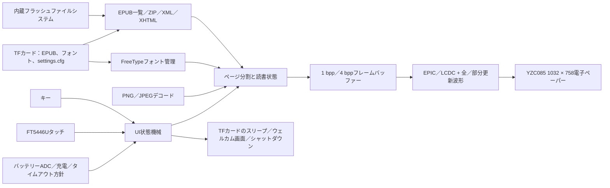

# SF32電子ペーパーEPUBリーダー { #sf32-e-paper-epub-reader }

## EPD Readerとは { #what-is-epd-reader }

[OpenSiFli EPD Reader](https://github.com/OpenSiFli/EPD_Reader)は、[atomic14/diy-esp32-epub-reader](https://github.com/atomic14/diy-esp32-epub-reader)をSiFliの`SF32-OED-EPD`ハードウェアに対応させたものです。処理コアにSF32LB52xを使用し、内蔵ファイルシステムまたはTFカードからEPUBファイルを読み込みます。ZIP／XML／XHTMLを解析してページをレイアウトし、FreeTypeフォントと画像デコーダーを利用して、全画面／部分更新用の波形で電子ペーパーパネルを駆動します。

現在のアプリケーションには、ライブラリー、目次、読書、読書設定、機能設定、ウェルカム画面／画面消灯、低バッテリー、充電、シャットダウンの各画面があります。キーとタッチ、中国語と英語のテキスト、動的なTTF／OTFフォント、フォントサイズ／太さ、行間、余白に対応し、読書設定をTFカードに保存できます。リソース節約のため、同梱の中国語フォントでは太字／斜体の個別書体をデフォルトで有効にしていません。太さの設定は、対象フォントで実際の表示を確認してください。画面更新の頻度が低い読書端末の参考実装一式ですが、一般的なEPUB仕様への準拠や、量産品の電子書籍リーダーであることを証明するものではありません。

## SF32を採用する理由 { #why-the-sf32-implementation }

この実装では、SF32LB52のストレージ、EPIC／LCDC表示アクセラレーション、タッチ、キー、バッテリー監視、低消費電力管理を1つのアプリケーションで評価できます。製品チームにとっての価値は、単にページを表示することではありません。対応ハードウェア上で、レイアウトに必要なメモリー、全／部分更新によるゴースト、波形の適合、TFカードの電源管理、フォントアクセス、操作フロー、スリープ動作をまとめて評価できます。

SiFliのボードガイドにはサンプル品の販売ページへのリンクがありますが、販売品がプロジェクトのV1.1ソフトウェア基準に対応するボード、パネル、タッチ構成であることまでは確認できません。基準となる一式やパネル単体の入手先も特定されていません。また、EPUB対応率、パネル動作温度範囲、量産寿命、モード別電流値も公開されていません。そのため、本ページではハードウェアリビジョン、パネル／タッチの組み合わせ、ソフトウェアコミットを必須の技術基準として扱います。他の電子ペーパーモジュールは、そのまま置き換えられるものではありません。

**ソースの基準構成の確認：** SiFliの[SF32LB52-OED-6'-EPDガイド](https://github.com/OpenSiFli/SiFli-Wiki/blob/main/source/zh_CN/board/sf32lb52x/SF32LB52-OED-6%27-EPD.md)では、6インチのOPM060DAパネル（758 × 1024）を説明しています。機能ブロック図には、基板側の接続として8-bit 8080 EPD、I²Cタッチ、SPI1 TFカード、アナログマイク／オーディオPA、USB-UART、バッテリー／充電電源経路も示されています。一方、固定されたEPD Reader V1.1の設定は、1032 × 758のYZC085 V1.05を選択し、Wikiの基板写真にはV1.2と記載されています。これらの資料から、OPM060DAとYZC085が互換であることや、V1.1にWiki記載のパネルが付属することは確認できません。実物の基板とパネルの表示を確認し、実際の組み合わせに合うプロジェクトターゲット、波形、VCOM設定を使用してください。

**電源要件：** SiFliのボードガイドでは、動作中はバッテリーを接続しておく必要があります。USB-CのVBUSは充電用であり、ボード単体の動作電源にはなりません。ガイドは1000～1500 mAhを指定し、MX1.25コネクター付きの単セル1500 mAh Li-Poバッテリーを推奨しています。写真のボードはV1.2表記ですが、プロジェクトはV1.1を対象としているため、電池選定前に実際のボードの電源コネクター、極性、充電上限を確認してください。

## 目標、対象範囲、開始条件 { #outcome-scope-and-entry-criteria }

**目標：** バージョンを固定した`SF32-OED-EPD_V1.1`ボードで、設定上の解像度が1032 × 758のYZC085 V1.05パネルを使い、ビルド／書き込み、ライブラリー／目次／読書、キー／タッチ入力、設定の永続化、全／部分更新、低バッテリー、スリープ、シャットダウンの動作を再現し、製品判断に必要な証跡を残します。

**対象外：** このページは、EPUB／CSS／フォントの完全互換性、DRM対応、任意のパネル波形との互換性、商用読書品質、無線コンテンツ配信、認証、量産信頼性を証明するものではありません。固定したソースにはBluetooth/PANの設定項目と状態表示がありますが、上流READMEにはその接続を使ったコンテンツ配信手順がありません。再現可能な基準はローカルファイルとし、ネットワーク経由の配信は未検証のため対象外とします。

**開始条件：** SiFli-SDKアプリケーションをビルド・書き込みでき、ボードリビジョン、パネル型番、フレキシブルケーブルの向き、バッテリー極性、TFカードのファイルシステムを特定できること。ボード／パネルの出所やハードウェア資料が不明確な場合は、SiFliまたはハードウェア提供元に確認するまで購入を確定しないでください。

<div align="center"><em>表: プロジェクトの合意事項</em></div>

<div align="center" markdown>

| 項目 | 基準要件 | 次に進む前に保管する証跡 |
|:-----|:---------|:-------------------------|
| バージョン境界 | ボード、パネル、タッチコントローラー、アプリケーションのコミット、SDKサブモジュールのコミットを固定 | 写真、刻印、設定、コミット、イメージハッシュ、ケーブルの向き |
| 読書の境界 | 内蔵サンプル、TFカードの書籍、目次、画像、中国語／英語、設定を個別に試験 | コンテンツ一覧、ページ結果、ログ、故障の分類 |
| 表示の境界 | 波形、VCOM、解像度、バス、温度がパネルに適合していること | 全／部分更新、ゴースト、更新時間、温度、電流の記録 |
| 製品の境界 | ライセンス、コンテンツ権利、電力、信頼性、無線、法規制は個別にレビュー | リスク一覧、担当者、続行／中止の判断 |

</div>

## ハードウェアとソフトウェアの仕様 { #hardware-and-software-specifications }

### ハードウェア仕様 { #hardware-specification }

<div align="center"><em>表: ハードウェア仕様</em></div>

<div align="center" markdown>

| コンポーネント | 必要な仕様 | 役割 | 必須／任意 | 入手先 | 互換性と代替に関する注意 |
|:--------------|:-----------|:-----|:----------|:-------|:-------------------------|
| SF32-OED-EPD V1.1ボード | SF32LB52x、ソフトウェアターゲット`sf32-oed-epd_v11`、プロジェクトのメモリーマップは16 MiB QSPI NORと8 MiB PSRAM領域を定義 | 処理、ストレージ、表示、入力、バッテリー、電源管理 | 必須 | SiFliの[ボードガイド](https://github.com/OpenSiFli/SiFli-Wiki/blob/main/source/zh_CN/board/sf32lb52x/SF32LB52-OED-6%27-EPD.md)にはサンプル品の販売ページへのリンクがあります。購入前にボードリビジョン、付属パネル、タッチ部品を販売元に確認してください。[固定したV1.1ボード設定](https://github.com/OpenSiFli/EPD_Reader/tree/7d72223c513d0a77eb251a3acb0f18cadb8d4d89/epdiy-epub/sf32-oed-epd_v11)でソフトウェアターゲットを特定できます | V1.2とV1.2-SPIには別ターゲットがあります。コネクターの外観だけを根拠に代替できません |
| YZC085 V1.05電子ペーパーモジュール | 1032 × 758、8-bit EPD／DBIインターフェース、V1.1のデフォルト。固定したプロジェクト設定と引用したボードガイドでは、パネルの物理サイズとDPIを確認できません。パネルの表示とメーカー資料で確認してください。 | EPUBページとUIの表示 | 必須 | 購入先は公開されていません。[固定したKconfig設定](https://github.com/OpenSiFli/EPD_Reader/blob/7d72223c513d0a77eb251a3acb0f18cadb8d4d89/epdiy-epub/project/Kconfig.proj)と実機型番を照合してください | R7D005（1448 × 1072）とOPM037A3（240 × 416、SPI）は別設定であり、設定なしで置き換えられるものではありません。波形、VCOM、タイミング、解像度はパネルごとに確認してください |
| FT5446Uタッチインターフェース | V1.1のデフォルトは`TSC_USING_FT5446U_V01` | タッチ選択、ページめくり、上スワイプのオーバーレイ | タッチを使う場合は必須 | 対応するV1.1ボード／パネルのアセンブリーとともに入手してください。単体の販売先は公開されていません | V1.2のデフォルトはGT967、3.7インチSPI設定ではFT6336Uを選択します。ドライバーは互換ではありません |
| TFカード | ボードのSPIストレージドライバーとFATファイルシステムで認識されるもの | EPUB、外部フォント、`/settings.cfg`の保存 | 機能一式には必須。内蔵サンプルのみなら任意 | 標準的なTFカード。プロジェクトではメーカーや容量を指定していません | ファームウェアはTFカードを優先します。容量、フォーマット、ファイルを記録し、取り外し／破損からの復旧を試験してください |
| USBデータケーブルとビルド用ホスト | データ通信対応ケーブル。SiFli-SDKツールを実行できるホスト | USB-UARTダウンロード、デバッグ／ログ取得、バッテリー充電。ボード単体への給電には使えません | 必須 | 標準データケーブル。[固定したSDKコミット](https://github.com/OpenSiFli/SiFli-SDK/commit/8a1eb8a34be02c1df8529c9e8f0e69172bf9ef36)のツールを使用 | バッテリーを接続しない状態ではUSB-C VBUSでボードを動作させられません。充電専用ケーブルではファームウェアを書き込めません |
| バッテリー／電源アセンブリー | SiFliのボードガイドは1000～1500 mAhを指定し、MX1.25コネクター付きの単セル1500 mAh Li-Poを推奨しています。V1.1ボードの入力と極性を要確認 | ボード動作用電源。低バッテリー、充電、スリープ、携帯使用の評価 | ボード動作に必須 | 電池の正確な型番は未公開です。[SiFliボードガイド](https://github.com/OpenSiFli/SiFli-Wiki/blob/main/source/zh_CN/board/sf32lb52x/SF32LB52-OED-6%27-EPD.md)を参照し、コネクター、極性、制限をボード提供元に確認してください | SiFliは線形充電電流の最大値を1 A、初期の定電流設定を1000 mAとしています。製品設計前にV1.1の構成に当てはまるか確認してください |

</div>

### ソフトウェア仕様 { #software-specification }

<div align="center"><em>表: ソフトウェア仕様</em></div>

<div align="center" markdown>

| パッケージ／サービス | 必要なバージョンまたはリビジョン | 役割 | 必須／任意 | 入手先 | 互換性と更新時の注意 |
|:--------------------|:----------------------------------|:-----|:----------|:-------|:---------------------|
| OpenSiFli EPD Reader | 記事レビュー時のコミット[`7d72223`](https://github.com/OpenSiFli/EPD_Reader/commit/7d72223c513d0a77eb251a3acb0f18cadb8d4d89)。サブモジュールは再帰的に取得する必要があります | トップレベルプロジェクト、アプリケーション、ボード定義、波形、SDK固定 | 必須 | [OpenSiFli/EPD_Reader](https://github.com/OpenSiFli/EPD_Reader) | `git clone --recursive`またはサブモジュールの初期化が必要です。更新される`main`は調査にのみ使用してください |
| `epdiy-epub`アプリケーション | `7d72223`で固定 | EPUBの検出／解析、ページ状態機械、フォント、描画、入力、電源方針 | 必須 | [固定したアプリケーションディレクトリー](https://github.com/OpenSiFli/EPD_Reader/tree/7d72223c513d0a77eb251a3acb0f18cadb8d4d89/epdiy-epub) | atomic14プロジェクトをベースにしています。メインアプリケーションはMITライセンスですが、サードパーティーライブラリーはそれぞれ独自のライセンスが適用されます |
| SiFli-SDKサブモジュール | [`8a1eb8a`](https://github.com/OpenSiFli/SiFli-SDK/commit/8a1eb8a34be02c1df8529c9e8f0e69172bf9ef36) | RT-Thread、BSP、ファイルシステム、Bluetooth、ネットワーク、電源管理、ビルド、書き込み | 必須 | [リポジトリーのサブモジュール](https://github.com/OpenSiFli/EPD_Reader/tree/7d72223c513d0a77eb251a3acb0f18cadb8d4d89/SiFli-SDK) | プロジェクトが固定している再現用のSDKコミットです。更新時は表示、ストレージ、入力、電源の回帰試験が必要です |
| EPUB／描画依存関係 | アプリケーションが固定するEPDIY、tinyxml2、miniz 2.2.0、PNGdec、TJpgDec、FreeType、同梱フォント | アーカイブ、XML／XHTML、PNG／JPEG、フォント、EPD描画 | 必須 | 固定された[`lib/`ディレクトリー](https://github.com/OpenSiFli/EPD_Reader/tree/7d72223c513d0a77eb251a3acb0f18cadb8d4d89/epdiy-epub/lib)と[`font/`ディレクトリー](https://github.com/OpenSiFli/EPD_Reader/tree/7d72223c513d0a77eb251a3acb0f18cadb8d4d89/epdiy-epub/font) | 各ライセンスとフォントのNOTICEを確認してください。メインプロジェクトのMITライセンスは、すべてのサードパーティーコードやフォントに自動適用されるものではありません |
| SCons、コンパイラー、UART書き込みツール | 固定SDKコミットに合う環境 | menuconfig、ビルド、ファイルシステム／波形イメージ、書き込み | 必須 | [固定したSiFli-SDK](https://github.com/OpenSiFli/SiFli-SDK/commit/8a1eb8a34be02c1df8529c9e8f0e69172bf9ef36)に含まれます | 環境、コマンド、生成イメージ、書き込みログを保管してください |
| EPUBとフォントアセット | チームが承認したDRMなしEPUB。任意の`.ttf`／`.otf`外部フォントは最大64個 | 読書コンテンツとフォント選択 | EPUBは必須、外部フォントは任意 | 権利を保有／取得したコンテンツ。リポジトリーの[`disk/`](https://github.com/OpenSiFli/EPD_Reader/tree/7d72223c513d0a77eb251a3acb0f18cadb8d4d89/epdiy-epub/disk)には試験用サンプルがあります | コンテンツとフォントの権利はチームが確認してください。製品で扱うEPUB構造、言語、画像を試験してください |

</div>

## サポート対象の基準構成を選ぶ { #choose-a-supported-baseline }
最初の再現では`SF32-OED-EPD V1.1 + YZC085 V1.05 + FT5446U`を使用してください。プロジェクトには`sf32-oed-epd_v11`のビルド／書き込み手順があり、Kconfigでもこの組み合わせがV1.1のデフォルト構成になっています。トップレベルのコミットを`7d72223`、SDKサブモジュールを`8a1eb8a`に固定し、初回はボード、パネル、タッチコントローラー、波形を同時に変更しないでください。

```bash
git clone --recursive https://github.com/OpenSiFli/EPD_Reader.git
cd EPD_Reader/epdiy-epub/project
scons --board=sf32-oed-epd_v11 --board_search_path=.. -j8
```

Windowsでの書き込みスクリプトは`build_sf32-oed-epd_v11_hcpu\uart_download.bat`です。実行し、プロンプトに従ってCOMポートを入力します。設定項目は次のコマンドで確認できます。

```bash
scons --board=sf32-oed-epd_v11 --board_search_path=.. --menuconfig
```

## プロジェクトの開発段階と判断ポイント { #delivery-map }

<div align="center"><em>表: プロジェクトの開発段階と判断ポイント</em></div>

<div align="center" markdown>

| 段階 | 判断する内容 | 最低限必要な証跡 |
|:-----|:-------------|:-----------------|
| ハードウェアとソースを固定 | 実機アセンブリーが上流のV1.1基準構成に適合するか | 刻印／パネルの写真、接続方向、コミット、サブモジュール、設定 |
| 読書の基準動作を確立 | 固定イメージでローカルEPUBの一連の操作を完了できるか | ビルド／書き込みログ、サンプル一覧、ページ、入力記録 |
| コンテンツと復旧を評価 | 実書籍、フォント、TFカード、設定を再現可能に扱えるか | 互換性マトリクス、ストレージ／フォント不在・破損からの復旧、保存結果 |
| 表示と電力を評価 | 波形、ゴースト、更新、バッテリー動作が製品方針を満たすか | 温度、全／部分更新、VCOM、更新時間、電流測定 |
| 変更とレビュー | 範囲を限定した変更を安全に加え、製品開発へ進むべきか | 変更、回帰試験、リスク一覧、続行／中止の判断 |

</div>

## システム構成と依存関係 { #system-architecture-and-dependencies }

<div align="center"><em>図: EPUBコンテンツ、描画、入力、電子ペーパーの経路</em></div>



主な故障領域は、コンテンツアーカイブ／XHTML解析、フォントファイルとメモリー、TFカードの検出／電源、タッチ／キー割り当て、パネル型番／波形／VCOM、全／部分更新のゴースト、バッテリーADC／充電状態、シャットダウン／ウェイクです。将来の無線機能は、プロジェクトでのサポートと配信経路が文書化されるまで、ローカルファイル、表示、電源の基準構成の外に置いてください。

## 段階1 — 物理構成とソースの基準構成を固定する { #stage-1-pin-the-physical-and-source-baseline }

**目標：** ボード、パネル、タッチコントローラー、ソースが、サポート対象の1つの組み合わせを示していることを確認します。

1. V1.1ボードの刻印、SF32デバイス、パネル型番、タッチコントローラー、フレキシブルケーブルの向き、電源を記録します。
2. トップレベルのコミットとSDKサブモジュールを固定し、サブモジュール状態全体を保存します。
3. クリーンな環境でビルド・書き込みし、生成されたすべてのイメージと書き込みスクリプトのハッシュを記録します。

**保管する証跡：** 実機写真、部品識別情報、Git状態、設定、ビルド／書き込みログ、イメージハッシュ、起動ログ。

**ゲート1の終了条件：** 実機アセンブリーが`sf32-oed-epd_v11`のデフォルト構成に一致し、固定した入力から同じイメージを再現可能に生成・起動できること。

## 段階2 — 未変更の読書フローを検証する { #stage-2-validate-the-untouched-reading-flow }

**目標：** 変更を加える前に、中心となるユーザー操作を確認します。

1. 内蔵ストレージとTFカードからEPUBを個別に検出します。ファームウェアはTFカードを優先します。
2. ホーム → ライブラリー → 目次 → 読書の操作を完了し、1ページあたりライブラリー項目4件、目次項目6件、およびキー／タッチの「選択してから確定」動作を確認します。
3. 左右へのページ送り、上スワイプのオーバーレイ、`-5/-1/+1/+5`ジャンプ、目次／ライブラリーへの復帰、読書設定への移動を検証します。
4. 中国語、英語、PNG／JPEG、章移動を確認し、非対応または不正なコンテンツ構造を記録します。

**保管する証跡：** 試験EPUBの入手元／ハッシュ、ページ写真、操作の時系列、ログ、メモリー余裕、分類済みの故障。

**ゲート2の終了条件：** 対象サンプルで中心的な操作を繰り返せ、すべての故障が「不安定」ではなく、コンテンツ、フォント、ストレージ、メモリー、入力、表示のいずれかに分類されていること。

## 段階3 — 設定、ストレージ、復旧を検証する { #stage-3-qualify-settings-storage-and-recovery }

**目標：** ストレージの状態変化後も、実コンテンツや設定によってユーザーが復旧不能にならないことを確認します。

1. TFカードの`/fonts`に`.ttf`／`.otf`ファイルを置き、外部フォント最大64個の検出、選択、フォント消失時のフォールバックを検証します。
2. フォントサイズ24～48 px、フォント太さ、行間1.0×～2.0×、余白5～20 px、および`/settings.cfg`を介した再起動後の設定保持を試験します。
3. 安全に書き込みを行わないタイミングで、カード不在、取り外し、再挿入、設定破損、フォント不在を試験します。意図的にファイルシステムを壊すようなホットリムーブは行わないでください。
4. 現行の境界を確認してください。「読書を続ける」機能が保持するのは、実行中に最後に開いた書籍インデックスと章です。再起動をまたぐ完全な読書進捗同期として説明しないでください。

**保管する証跡：** カード仕様／フォーマット、アセット一覧、設定ファイル、再起動結果、エラーログ、復旧操作。

**ゲート3の終了条件：** 対象コンテンツと設定を繰り返し読み込め、カード不在、不正設定、フォント不在時にも、ホーム画面へ戻れなくなることのない理解しやすいフォールバックがあること。

## 段階4 — 電子ペーパーの表示品質と電力を評価する { #stage-4-qualify-e-paper-quality-and-power }

**目標：** パネルドライバーと低消費電力方針が、想定する読書体験に適合するか判断します。

1. 全画面更新の間隔を5、10、20回ごと、および毎回（`0`）に設定し、ゴースト、画面の明滅、更新時間、ページの一貫性を記録します。
2. 想定温度範囲で対象パネルの波形、VCOM、タイミングを検証します。他のパネル設定の値を流用しないでください。
3. ユーザー設定のタイムアウト5／10／30分、1時間、無効に加え、メインループで操作がない場合に5時間後にシャットダウン画面へ移る独立したデフォルト動作も検証します。
4. ステータスバーのバッテリー残量と充電中アイコンを確認し、残量98%で充電アイコンが消えることも検証します。ページ分割、部分更新、全画面更新、アイドル、TFカードのウェイク／スリープ、低バッテリー、充電、シャットダウン時の電流を測定します。

**保管する証跡：** パネル／波形のバージョン、温度、ページ画像、更新統計、電流波形、バッテリー条件、ウェイク／シャットダウン結果。

**ゲート4の終了条件：** 表示品質、更新レイテンシ、温度、電力、復旧のしきい値が定義・達成され、未達項目すべてに明示的な対応方針があること。

## 段階5 — 管理された変更を加え、製品化準備をレビューする { #stage-5-make-a-controlled-adaptation-and-review-readiness }

**目標：** 基準構成を崩さず、変更範囲を1つに絞って変更できることを確認します。

適切な変更例は、ライセンスを確認したフォントを1つ追加する、ページを1つ調整する、範囲を限定したEPUB互換性修正を1つ実装する、新しいパネル用のドライバーを1つ追加することです。新しいパネルへの対応では、元のボードターゲットを回帰試験用に維持しながら、Kconfig、解像度／DPI、タッチ、バス、波形、温度範囲、LUT、タイミング、VCOMを確認してください。

製品レビューでは、少なくとも次の質問に答える必要があります。

- 対象EPUB／XHTML／CSS／画像／言語のコンテンツ群に対する互換率とメモリー上限はどの程度ですか。
- パネルの供給、波形、VCOM、温度範囲、寿命は誰が管理し、仕様化しますか。
- コンテンツ、フォント、メインアプリケーション、各サードパーティーライブラリーのライセンスは、配布をどのように許可しますか。
- TFカードや設定の破損、低バッテリー、異常終了、ファームウェア破損、更新中断からどのように復旧しますか。
- Bluetooth／PANを対象に含める場合、用途、ペアリング、セキュリティ、プライバシー、無線規制への適合をどう定義しますか。
- 量産試験で、ディスプレイ不良／ゴースト、タッチ、キー、ストレージ、バッテリーADC、充電、スリープ電流をどう確認しますか。

**保管する証跡：** 変更レビュー、差分、回帰試験マトリクス、リスク一覧、担当者、製品判断。

**ゲート5の終了条件：** 管理された変更が該当する回帰試験すべてに合格し、残るコンテンツ、表示、電力、セキュリティ、ライセンス、供給、法規制のリスクに担当者、緩和策、続行／保留／中止の判断があること。

## 製品設計への引き継ぎ { #handoff-to-product-design }

引き継ぎ資料には、ボード／パネル／タッチの各リビジョン、固定したコードとSDK、メモリー／パーティション、ファイルシステム、フォント／コンテンツアセット、波形／VCOM／タイミング、全／部分更新方針、入力マップ、バッテリー特性、電力測定、故障復旧、ライセンス一覧、量産試験計画を含めてください。[SF32LB52xの製品統合手順](../sf32-products/chips/SF32LB52x.md#integration-path)でチップ、モジュール、ボード、ハードウェア設計ガイド、チェックリストを選定し、検証済みの機能範囲に基づいてカスタムハードウェアを再設計します。

## 主な情報源 { #authoritative-sources }
- [OpenSiFli/EPD_Reader](https://github.com/OpenSiFli/EPD_Reader)
- [プロジェクトレビュー時のコミット`7d72223`](https://github.com/OpenSiFli/EPD_Reader/commit/7d72223c513d0a77eb251a3acb0f18cadb8d4d89)
- [EPD Reader公式中国語README](https://github.com/OpenSiFli/EPD_Reader/blob/7d72223c513d0a77eb251a3acb0f18cadb8d4d89/epdiy-epub/README.md)
- [固定SiFli-SDKサブモジュールのコミット`8a1eb8a`](https://github.com/OpenSiFli/SiFli-SDK/commit/8a1eb8a34be02c1df8529c9e8f0e69172bf9ef36)
- [EPD Readerのボード／パネルKconfig](https://github.com/OpenSiFli/EPD_Reader/blob/7d72223c513d0a77eb251a3acb0f18cadb8d4d89/epdiy-epub/project/Kconfig.proj)
- [EPD Reader V1.1ボード設定](https://github.com/OpenSiFli/EPD_Reader/tree/7d72223c513d0a77eb251a3acb0f18cadb8d4d89/epdiy-epub/sf32-oed-epd_v11)
- [EPD ReaderメインアプリケーションのMITライセンス](https://github.com/OpenSiFli/EPD_Reader/blob/7d72223c513d0a77eb251a3acb0f18cadb8d4d89/epdiy-epub/LICENSE)
- [atomic14/diy-esp32-epub-reader](https://github.com/atomic14/diy-esp32-epub-reader)
- [SiFli SF32LB52xのビルド／書き込みガイド](https://docs.sifli.com/projects/sdk/latest/sf32lb52x/quickstart/build.html)
- [SiFliのSF32LB52-OED-6'-EPD中国語ハードウェアガイド](https://github.com/OpenSiFli/SiFli-Wiki/blob/main/source/zh_CN/board/sf32lb52x/SF32LB52-OED-6%27-EPD.md)
