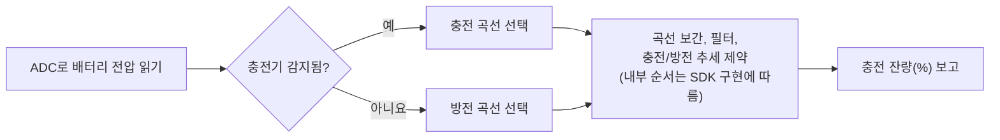

# 배터리 충전 잔량(SoC) 추정 { #battery-capacity-calculation }

SiFli-SDK 배터리 계산기는 측정한 전압으로 배터리 충전 잔량(state of charge, SoC)을 추정해 백분율로 반환합니다. 쿨롱 카운터가 아니라 전압 기반 잔량 추정기이므로, 결과의 정확도는 제공된 배터리 곡선과 충전기 상태 정보에 달려 있습니다.

이 미들웨어는 충전기 상태를 감지하고, 이에 맞는 충전 또는 방전 곡선을 선택해 보간으로 잔량을 추정합니다. 추정값을 안정화하기 위해 기본 점프 필터와 선택형 가중 평균 필터도 사용합니다. 공개된 가이드는 필터의 내부 순서를 완전히 규정하지 않으므로, 정확한 처리 순서를 가정하기 전에 프로젝트에서 사용하는 SDK 리비전의 구현을 확인하십시오.

## 계산기의 기능 { #what-the-calculator-does }

<div align="center"><em>표: 배터리 계산기 동작</em></div>
<div align="center" markdown>

| 기능 | 동작 |
| --- | --- |
| 충전 및 방전 곡선 | 현재 충전 또는 방전 상태에 맞는 전압-잔량 곡선을 선택합니다. |
| 선형 보간 | 선택한 곡선의 데이터 지점 사이에서 충전 잔량(%)을 계산합니다. |
| 기본 필터 | 설정된 임계값과 확인 횟수로 전압 점프를 필터링합니다. |
| 보조 필터 | 선택적으로 이전 전압과 현재 전압의 가중 평균을 계산합니다. |
| 충전기 상태 감지 | 보드의 충전기 감지 설정을 사용해 충전 곡선 또는 방전 곡선을 선택합니다. |

</div>

<div align="center"><em>그림: 배터리 충전 잔량 추정 경로</em></div>



이는 개념적인 요약이며 내부 호출 순서를 보장하지 않습니다. 공개된 가이드는 보간, 필터링, 충전/방전 추세 제약의 정확한 순서를 정의하지 않으므로, 제품에서 사용하는 SDK 리비전에서 그 순서를 확인하십시오. 다만 가이드는 보고되는 충전 잔량이 충전 중에는 감소하지 않고 방전 중에는 증가하지 않는다고 명시합니다.

## 먼저 보드 구성하기 { #configure-the-board-first }

미들웨어를 사용하기 전에 menuconfig에서 보드를 구성하십시오.

1. 배터리 전압 측정을 위해 ADC 지원을 활성화합니다.
2. 배터리 계산기 기능을 활성화합니다.
3. 충전 지원을 활성화합니다.
4. 보드에서 사용하는 충전기 IC를 선택합니다. 나열된 충전기 IC가 하나도 해당되지 않을 때만 단순 충전기 항목을 사용합니다.
5. 보드의 충전기 삽입 감지 핀을 구성합니다.
6. 하드웨어에 맞게 감지 핀의 극성을 선택합니다.

`BSP_CHARGER_INT_PIN_ACTIVE_HIGH`는 충전기 감지 극성을 정의합니다. 이 값이 정의되어 있으면 High 레벨이 충전기가 삽입된 상태를 의미하고, 정의되어 있지 않으면 Low 레벨이 삽입된 상태를 의미합니다. 극성이 잘못되면 잘못된 배터리 곡선이 선택되어 표시되는 충전 잔량이 멈춘 것처럼 보이거나 반대 방향으로 움직일 수 있습니다.

## 실제 셀의 배터리 곡선 사용 { #use-battery-curves-from-the-actual-cell }

보드 디렉터리의 기본 `battery_table.c`는 범용 배터리 모델이 아니라 참고용 예제입니다. 실제 셀의 전압-충전 잔량 곡선은 셀 제조사에서 받아 제품에 맞는 조회 테이블을 구성하십시오.

<div align="center"><em>표: 배터리 곡선 요구 사항</em></div>
<div align="center" markdown>

| 테이블 | 필수 정의 |
| --- | --- |
| `charging_curve_table` | 충전용 `const battery_lookup_point_t[]` 테이블. 전압 항목은 높은 값에서 낮은 값 순서여야 합니다. |
| `discharge_curve_table` | 방전용 `const battery_lookup_point_t[]` 테이블. 전압 항목은 높은 값에서 낮은 값 순서여야 합니다. |
| 테이블 내용 | 충전 잔량은 100%에서 0%까지에 대응하며 실제 배터리의 동작을 반영해야 합니다. |
| 테이블 위치 | 보드별 `battery_table.c`. |

</div>

충전 잔량이 같더라도 충전 중과 방전 중의 셀 전압은 다르므로 곡선을 따로 사용하십시오. 공칭 화학 조성이 같다는 이유만으로 임의의 4.2 V 리튬 셀 곡선을 실제 셀의 곡선 대신 사용하지 마십시오.

!!! warning "사용하는 SDK와 보드의 전압 스케일 확인"
    공개된 SiFli 가이드는 내용이 일관되지 않습니다. `voltage_mv`와 필터 임계값을 mV 단위로 표기하지만, 예제는 `3.8 V`에 `38000`을 전달하고 샘플 곡선은 `4.18 V`에 `41808`을 사용합니다. 이 값은 0.1 mV 스케일과 일치하지만 가이드가 그 스케일을 명시적으로 문서화하지는 않으므로, API 보장이 아닌 추정으로 취급하십시오. 계산기를 사용하기 전에 정확한 SDK 리비전과 보드 구성에서 ADC 변환 경로, 배터리 테이블, 임계값 비교를 확인하십시오.

    ADC 판독값, 선택한 곡선 테이블, 필터 임계값이 서로 호환되는 스케일을 사용하는지 확인하십시오. 가이드는 임계값 리터럴 `50`과 `30`을 나열하고 mV로 설명하는데, 전압 예제만 근거로 이 값들의 스케일을 조정하지 마십시오. 대상 SDK가 각 필드를 어떻게 해석하고 비교하는지 확인하고, 테이블이나 임계값은 다른 스케일로 둔 채 ADC 판독값만 변경하지 마십시오.

## 계산기 구성 { #configure-the-calculator }

`battery_calculator_config_t`는 두 개의 곡선 테이블과 필터링 설정을 제공합니다.

<div align="center"><em>표: 배터리 계산기 구성</em></div>
<div align="center" markdown>

| 필드 | 용도 | 공개된 예제 리터럴(문서상 단위 표기) |
| --- | --- | --- |
| `charging_table`, `charging_table_size` | 충전 곡선과 점의 개수 | 보드별 |
| `discharging_table`, `discharging_table_size` | 방전 곡선과 점의 개수 | 보드별 |
| `charge_filter_threshold` | 충전 전압 점프 임계값 | `50` (문서에는 mV로 표기. 대상 SDK의 스케일을 확인) |
| `discharge_filter_threshold` | 방전 전압 점프 임계값 | `30` (문서에는 mV로 표기. 대상 SDK의 스케일을 확인) |
| `filter_count` | 기본 필터에서 연속으로 임계값을 초과해야 하는 샘플 수 | `3` |
| `secondary_filter_enabled` | 가중 보조 필터 활성화 여부 | `true` |
| `secondary_filter_weight_pre` | 이전 전압의 가중치 | `90` |
| `secondary_filter_weight_cur` | 현재 전압의 가중치 | `10` |

</div>

보조 필터가 활성화되면 `secondary_filter_weight_pre + secondary_filter_weight_cur`는 `100`이어야 합니다. 임계값, 횟수, 가중치는 SDK 참고 값을 보정 결과로 취급하지 말고 실제 배터리, 부하 과도 상태, 제품 사용 경험에 맞게 조정하십시오.

## 초기화 및 계산 { #initialize-and-calculate }

충전 잔량을 요청하기 전에 계산기를 초기화하십시오. 공개된 SiFli 가이드는 초기화 함수를 `void`로 선언합니다. 프로젝트에서 사용하는 정확한 SDK 리비전의 헤더를 기준으로 컴파일하십시오.

```c
void battery_calculator_init(battery_calculator_t *calc,
                             const battery_calculator_config_t *config);
```

충전 잔량 API는 0~100 값을 반환합니다. 이는 mAh 단위의 배터리 용량이 아니라 충전 잔량(%)입니다. 통합하기 전에 정확한 SDK 헤더와 구현에서 추가 매개변수 제약이나 초기화 상태가 있는지 확인하십시오.

정확한 SDK 리비전에서 기대하는 스케일로 측정된 배터리 전압을 제공하십시오. 공개된 API는 매개변수 이름을 `voltage_mv`로 붙이지만, 위에서 설명한 대로 실제 스케일을 확인하십시오.

```c
uint8_t battery_calculator_get_percent(battery_calculator_t *calc,
                                       uint32_t voltage_mv);
```

<div align="center"><em>표: 권장 통합 순서</em></div>
<div align="center" markdown>

| 단계 | 작업 |
| --- | --- |
| 1 | 보드의 ADC, 충전기 유형, 충전기 감지 핀, 극성을 구성합니다. |
| 2 | `battery_table.c`에 검증된 충전 곡선과 방전 곡선을 정의합니다. |
| 3 | `battery_calculator_config_t`로 `battery_calculator_t`를 초기화합니다. |
| 4 | 구성된 ADC 경로로 배터리 전압을 읽습니다. |
| 5 | 테이블 및 임계값과 스케일이 일치하는지 확인한 후 전압을 `battery_calculator_get_percent()`에 전달합니다. |
| 6 | 필터링된 결과를 UI, 배터리 부족 정책, 제품 텔레메트리에 사용합니다. |

</div>

## 제품 하드웨어에서 동작 검증 { #verify-behavior-on-product-hardware }

표시되는 충전 잔량은 실험실에서 그럴듯한 값을 반환하는 데 그치지 않고 제품의 실제 상태를 반영해야 합니다. 충전, 방전, 케이블 삽입, 케이블 제거 중 충전기 감지 상태, 전압 판독값, 선택된 곡선, 표시되는 충전 잔량(%)을 함께 검증하십시오.

<div align="center"><em>표: 배터리 충전 잔량 문제 해결</em></div>
<div align="center" markdown>

| 증상 | 먼저 확인할 사항 |
| --- | --- |
| 충전 잔량이 너무 급격하게 변함 | 먼저 ADC 판독값, 곡선 테이블, 임계값이 같은 스케일을 사용하는지 확인합니다. 그런 다음 해당 임계값 또는 `filter_count`를 조정하고, 필요하면 보조 필터를 활성화하거나 강화합니다. |
| 충전 잔량이 부정확함 | 실제 배터리와 일치하는 곡선을 구하여 조회 지점을 다시 보정합니다. |
| 충전 잔량이 고정되어 있음 | 보고되는 충전기 상태와 `BSP_CHARGER_INT_PIN_ACTIVE_HIGH` 극성을 확인합니다. 공개된 가이드는 충전 중에는 잔량이 감소하지 않고 방전 중에는 증가하지 않는다고 설명합니다. |
| 충전 잔량의 추세가 잘못됨 | 충전기 감지 핀, 그 전기적 극성, 선택된 충전/방전 곡선을 확인합니다. |

</div>

공식 미들웨어 레퍼런스와 최신 구성 스크린샷은 [Battery Capacity Calculation in SiFli-SDK](https://docs.sifli.com/projects/sdk/latest/sf32lb58x/middleware/battery_calculator.html)를 참고하십시오. 시스템 수준의 배터리 수명 추정은 [스마트워치 전력 프로파일링](smartwatch-power-profiling.md)에서 이어서 확인하고, 측정을 통한 검증은 [전력 측정과 검증](measurement-and-validation.md)을 참고하십시오.

공개된 가이드는 출발점이 되는 참고 자료이며, 제품에서 사용하는 SDK 리비전을 대체하지 않습니다. 특히 추정기를 신뢰하기 전에 가이드의 전압 스케일 불일치를 해당 리비전의 ADC 경로, 배터리 테이블, 필터 비교, API 헤더와 대조하여 해결하십시오.
