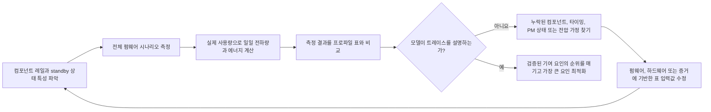

# 전력 측정과 검증

배터리 수명 추정치는 그 가정이 하드웨어 측정값과 수렴할 때에만 신뢰할 수 있습니다. 이 페이지는 [저전력 설계 개요](overview.md) 및 [스마트워치 전력 프로파일링](smartwatch-power-profiling.md) 예제와 함께 사용하십시오. 워크플로는 개별 컴포넌트에서 시작하여 전체 펌웨어 시나리오를 검증하고, 일일 사용 모델을 대조한 다음, 다음 최적화 작업을 검증된 가장 큰 에너지 비용에 집중시킵니다.

## 전류만이 아니라 에너지를 측정하기

전류는 결과의 일부일 뿐입니다. 캡처가 전하량뿐 아니라 순간 전력과 에너지도 나타낼 수 있도록, 테스트 대상 디바이스(DUT, `V_DUT`)의 전압을 전류 트레이스와 함께 기록하십시오.

```text
power_W(t) = voltage_V(t) x current_A(t)
energy_Wh = integral(power_W(t) dt) / 3600
energy_mWh = energy_Wh x 1000
charge_mAh = integral(current_mA(t) dt) / 3600
```

여기서 `t`의 단위는 초입니다. 계수 `3600`은 초를 시간으로 변환합니다. 전력 계산에는 A 단위의 전류를, 전하량 계산에는 mA 단위의 전류를 사용하십시오.

에너지 적분값의 단위는 Wh입니다. mWh로 기록된 프로파일과 결합하기 전에 1000을 곱하여 mWh로 변환하십시오. mAh와 mWh는 서로 다른 양이므로 별도로 유지하십시오. 둘은 호환되지 않습니다.

공급 전압이 안정적이면 캡처 중 측정한 `V_DUT`를 기록하고 전류 트레이스와 함께 사용하십시오. 테스트 중 전압이 변하면 전류와 같은 타임베이스로 전압을 샘플링하거나, 타당한 평균 전력을 계산할 수 있도록 동기화된 전압 지점을 충분히 기록하십시오. mAh만 비교하면 캡처마다 공급 전압, 레귤레이터 동작점, 배터리 상태가 다를 때 에너지의 실제 변화가 가려질 수 있습니다.

## 측정 기준 설정하기

기준 전류 측정 도구로 Nordic [Power Profiler Kit II(PPK2)](https://docs.nordicsemi.com/r/bundle/ug_ppk2/page/ug/ppk/ppk_user_guide_intro.html)를 사용하십시오. Source Meter 모드에서는 DUT에 전원을 공급할 수 있고, Ampere Meter 모드에서는 PPK2를 DUT와 외부 전원 사이에 직렬로 삽입하여 전류를 측정할 수 있습니다. Source Meter 모드에서는 설정한 출력 전압을 제어된 테스트 조건으로 사용하고, Ampere Meter 모드에서는 DUT에서 외부 공급 전압을 측정하여 기록하십시오. 어느 경우든 공칭 배터리 전압이나 벤치 전원 설정값이 아니라 DUT에 실제로 인가된 전압을 기록하십시오.

PPK2는 전류 파형, 누적 전하량, 내보낼 수 있는 캡처 데이터를 제공합니다. 로직 포트는 D0–D7과 DUT VCC 및 GND 연결을 제공합니다. VCC와 GND를 DUT의 로직 전원과 공통 그라운드에 연결한 다음, 마커 GPIO를 D0–D7에 연결하십시오. 로직 포트 VCC는 Nordic이 지정한 1.65~5.5 V 범위 안에 두고, 마커 레벨이 호환되는지 확인하십시오. 디지털 입력은 100 kHz로 샘플링되며 전형적인 대역폭은 50 kHz이므로, 매우 짧은 구간은 안정적으로 분해되지 않을 수 있습니다. Nordic의 [커넥터 정의](https://docs.nordicsemi.com/r/bundle/ug_ppk2/page/ug/ppk/ppk_user_guide_connectors.html), [전원 공급 사양](https://docs.nordicsemi.com/r/bundle/ug_ppk2/page/ug/ppk/ppk_power_supply_specs.html), [디지털 입력 분해능](https://docs.nordicsemi.com/r/bundle/ug_ppk2/page/ug/ppk/digital_input_resolution.html)을 참조하십시오. 웨이크업, 디스플레이 업데이트, 무선 전송, 센서 샘플링, 슬립 복귀와 같은 중요한 경로 주변에는 GPIO 마커를 사용하십시오. 공식 [PPK2 사용자 가이드](https://docs.nordicsemi.com/r/bundle/ug_ppk2/)에는 지원되는 동작 모드와 연결 요구 사항이 설명되어 있습니다.

Nordic이 요구하는 대로, PPK2를 사용하는 동안에는 USB 데이터/전원 연결을 계속 유지하십시오. 이는 아래에서 더 큰 Source Meter 부하에 권장하는 추가 USB 전원과는 별개입니다.

DUT를 연결하기 전에, 선택한 PPK2 모드가 DUT의 전압과 피크 전류를 지원하는지 확인하십시오. Nordic은 DUT 전압 범위를 0.8~5.0 V, Ampere Meter 모드의 연속 DUT 전류 한계를 1 A, Source Meter 모드의 최대 전류를 600 mA로 규정합니다. Source Meter 모드에서 DUT가 400 mA를 초과하여 소비하면, Nordic은 PPK2에 전원을 공급하기 위해 최소 1 A 정격의 추가 USB 전원을 사용할 것을 권장합니다. Nordic의 [최대 DUT 전류 사양](https://docs.nordicsemi.com/r/bundle/ug_ppk2/page/ug/ppk/ppk_max_dut_current.html)과 [전원 공급 지침](https://docs.nordicsemi.com/r/bundle/ug_ppk2/page/ug/ppk/ppk_power_supply.html)을 참조하십시오. 이는 계측기의 한계이며 제품의 권장 동작점이 아닙니다. 지원 범위를 벗어나는 테스트에는 적절한 정격의 계측 장비를 사용하십시오.

<div align="center"><em>표: 필수 캡처 기록</em></div>

<div align="center" markdown>

| 기록 항목 | 필요한 이유 |
|:-------|:-----------------|
| 테스트 ID, 보드 리비전, 실장된 부품, 펌웨어 리비전 | 결과를 반복 가능하고 비교 가능하게 만듭니다. |
| `V_DUT`: 목표값, 시작/종료 시 측정값, 캡처 중 변동 | 유효한 전력 및 에너지 계산을 가능하게 합니다. |
| 전류 트레이스, 평균 및 피크 전류, 평균 전력, 전하량(mAh), 에너지(mWh), 캡처 시간 | 짧은 전류 피크와 지속적인 소모를 구분하고, 캡처의 전력과 에너지를 기록합니다. |
| 온도, 배터리 상태 또는 벤치 전원 설정, 무선 환경 | 환경 변화를 펌웨어 개선으로 잘못 해석하는 일을 방지합니다. |
| 활성화된 주변 장치, 클럭 정책, PM 상태, 웨이크업 소스 | 디바이스가 의도한 저전력 상태에 진입했는지 여부와 그 이유를 설명합니다. |
| 펌웨어 마커와 트리거 조건 | 모호한 파형 영역이 아니라 특정 경로에 에너지를 귀속시킵니다. |

</div>

## 전체 시스템 테스트 전에 각 컴포넌트 특성 파악하기

전체 보드 트레이스에 의존하기 전에, 분리할 수 있는 레일이나 픽스처에서 각 컴포넌트를 측정하십시오. 목적은 카탈로그 수치를 만드는 것이 아니라, 실제 제품에서 컴포넌트의 에너지를 좌우하는 동작 모드, 부하, 펌웨어 설정이 무엇인지 알아내는 것입니다.

<div align="center"><em>표: 컴포넌트 수준 특성 파악 계획</em></div>

<div align="center" markdown>

| 컴포넌트 | 최소 측정 항목 | 모델에 기록할 내용 |
|:----------|:-------------------|:--------------------|
| MCU | Active 작업, Idle, 의도한 각 슬립 모드, 웨이크업 및 클럭 전환 구간 | 각 펌웨어 상태의 전류와 지속 시간. 예기치 않은 웨이크업과 PM 차단 요인. |
| 외부 PSRAM | Standby 또는 리텐션, 읽기, 쓰기, 버스트 트래픽, 해당하는 경우 리프레시 동작 | 접근 패턴별 레일 전류와 각 패턴에 머문 시간. |
| 외부 플래시 | Deep-power-down 또는 standby, 읽기, 쓰기, 소거 동작, 웨이크업 지연 시간 | 접근 또는 동작당 에너지와 유휴 상태 전류. |
| 각 외부 센서 | 활성화된 모든 모드, 출력 데이터 레이트, FIFO 또는 인터럽트 정책, 듀티 사이클 | 시나리오로 측정하는 경우 MCU 서비스 비용을 포함한 샘플당 또는 구간당 에너지. |
| 햅틱 모터와 드라이버 | 시동, 진폭, 패턴, 지속 시간, 제동 또는 코스트 동작 | 모터 피크 전류만이 아닌 햅틱 패턴당 에너지. |
| 오디오 코덱과 파워 앰프 | 전원 꺼짐, standby, 재생 또는 캡처, 출력 레벨, 실제 스피커 또는 부하 임피던스 | 오디오 세션당 에너지와 전체 오디오 경로의 꺼짐 상태 누설. |
| 디스플레이, 터치, 무선, PMIC 및 기타 부하 | 해당하는 active, idle, 리텐션 상태 | 별도의 전류 가정, 또는 경계를 명시한 `Other` 항목. |

</div>

제품 전체 에너지가 문제일 때는 항상 배터리 입력에서 측정하십시오. 레일 수준 측정은 분리를 위해 여전히 필수이지만, 배터리 수명 모델에 더하기 전에 측정한 레귤레이터 효율과 정지 전류를 적용하여 배터리 측 값으로 환산하십시오. 레일 전류의 합을 배터리 입력 결과로 취급하지 마십시오.

## 드라이버가 제어하는 전원 상태 검증하기

컴포넌트는 드라이버가 문서화된 설정과 시퀀스를 적용해야만 규정된 저전력 상태에 도달합니다. 기능적으로 올바른 드라이버라도 enable 신호를 어서트한 채로 두거나, 잘못된 standby 명령을 사용하거나, 클럭이나 버스를 계속 활성 상태로 유지하거나, 전원, 리셋, 인터페이스 신호를 잘못된 순서로 변경하면 전력을 낭비할 수 있습니다. 의도한 모든 상태에 대해 펌웨어에서 데이터시트 조건을 재현하고, 측정한 전류, 전압, 전하량, 에너지가 해당 사양 또는 제품에서 검증된 동작점과 일치하는지 확인하십시오.

<div align="center"><em>표: 드라이버가 제어하는 전원 상태 검토</em></div>

<div align="center" markdown>

| 제어 영역 | 드라이버 요구 사항 | 측정 증거 |
|:-------------|:-------------------|:---------------------|
| 모드 레지스터와 저전력 명령 | 문서화된 standby, 셧다운, 리텐션, 데이터 레이트, 인터럽트 설정을 적용합니다. 컴포넌트가 지원하는 경우 상태를 확인하십시오. | 전류와 에너지가 선택한 모드와 일치하며, 의도한 구성이 테스트 기록에 캡처되어 있습니다. |
| PM 락과 제약의 소유권 | 각 PM 락 또는 제약을 컴포넌트 드라이버가 소유하는지 상위 수준 서비스가 소유하는지 정의합니다. 보호 대상 리소스가 필요한 동안에만 획득하고, 컴포넌트가 안전하게 유휴 상태가 되면 모든 성공, 오류, 조기 반환 경로에서 해제하십시오. | 락이 필요한 구간을 덮고 있고, 일찍 해제되지 않으며, 작업이 완료되거나 실패한 뒤에도 계속 유지되어 슬립을 막지 않는다는 것을 트레이스로 확인합니다. |
| 전원, enable, 리셋, 클럭 시퀀스 | 전원 인가, 사용, 전원 차단 중에 컴포넌트가 요구하는 순서와 타이밍을 충족합니다. | GPIO 마커와 전력 트레이스에 의도하지 않은 활성 구간이나 전류 스파이크가 남아 있지 않습니다. |
| SPI, I2C, UART 및 기타 제어 버스 | 불필요한 트래픽을 중지합니다. 칩 셀렉트, 클럭, 데이터, 인터럽트 라인을 규정된 비활성 상태로 둡니다. | 트랜잭션 사이에 컴포넌트가 의도한 저전력 상태를 유지합니다. |
| GPIO 풀과 하이 임피던스 | 모든 제어 핀을 출력 High, 출력 Low, 올바른 풀업 또는 풀다운이 있는 입력, 또는 외부 회로가 레벨을 정의하는 경우에 한정한 하이 임피던스 중 하나로 의도적으로 구성하십시오. | 상대편에 전원이 인가된 경우와 인가되지 않은 경우, 그리고 리셋/기본 상태를 포함하여 전류를 확인합니다. |
| 전원 도메인 경계 | 하드웨어가 해당 경로를 명시적으로 지원하지 않는 한, 제어 또는 데이터 핀으로 전원이 꺼진 컴포넌트를 구동하지 마십시오. | 인터페이스의 어느 한쪽이 꺼져 있을 때 역전원 공급이나 누설이 나타나지 않습니다. |
| 오류 및 재개 경로 | 타임아웃, 전송 실패, 웨이크업, 펌웨어 리셋 이후 올바른 상태를 복원하십시오. | 장시간 캡처에서 불완전한 정리로 인한 지속적이거나 점진적으로 증가하는 초과 전류가 나타나지 않습니다. |

</div>

유효한 로직 레벨이 낮은 누설을 보장하지는 않습니다. 두 디바이스가 모두 합리적인 로직 상태인 것처럼 보여도, 내부 풀, 충돌하는 풀 정의, 리셋 기본값, ESD 경로, 버스 풀업이 누설 또는 역전원 경로를 만들 수 있습니다. 인터페이스 관련 전류는 인터페이스 양쪽에 전원이 인가된 상태, 한쪽에만 전원이 인가되지 않은 상태, 그리고 이 조건 사이의 전환 과정에서 측정하십시오. 관측된 상태가 기대에 미치지 못하면, 전력 프로파일 표를 변경하기 전에 먼저 드라이버 구성 또는 시퀀스 오류와 보드 수준 누설 경로를 구분하십시오.

## 펌웨어 시나리오 검증하기

컴포넌트 동작을 이해했다면, 사용자가 경험하는 전체 펌웨어 시나리오를 측정하십시오. 시나리오에는 함께 발생하는 컴포넌트, PM 상태, 웨이크업, 타이밍이 포함됩니다. 스마트워치의 경우 [스마트워치 전력 프로파일링](smartwatch-power-profiling.md) 모델에서 사용한 것과 같은 시나리오부터 시작하십시오. 디스플레이 꺼짐 standby, 알림, 수신 전화 알림, 손목 들어 올리기 웨이크업, 자동 심박수 측정, 수동 SpO2 측정, 운동 기록, 알람, 수면 모니터링, 앱 동기화입니다. 해당 기능이 활성화된 경우 NFC, Bluetooth 통화, AOD를 별도의 시나리오로 추가하십시오.

<div align="center"><em>표: 시나리오 검증 기록</em></div>

<div align="center" markdown>

| 시나리오별 | 검증 사항 | 프로파일에 반영할 내용 |
|:------------------|:-------|:---------------------------|
| 시작 및 종료 마커 | 트레이스에 웨이크업에서 슬립까지의 전체 경로가 포함되어 있습니다. | 시나리오 경계와 지속 시간. |
| 컴포넌트와 레일 활동 | 예상한 컴포넌트만 동작합니다. | 올바른 컴포넌트 가정과 `Other` 배분. |
| 작업 완료 후 PM 상태 | 시스템이 의도한 슬립 상태에 도달합니다. | 유휴 또는 standby 전류와 잔여 시간 가정. |
| 발생 1회당 전류, `V_DUT`, 전하량(mAh), 에너지(mWh) | 전압과 전류를 배터리 입력점에서 함께 측정했는지 확인합니다. | 이벤트당 전하량(mAh)과 에너지(mWh). |
| 제품 동작 | 측정이 요구되는 지연 시간, RF 신뢰성, 오디오 품질, 사용자 경험을 보존합니다. | 사용할 수 없는 저전력 설정이 아닌 유효한 동작점. |

</div>

펌웨어 GPIO 마커를 사용하여 하나의 파형을 구간으로 나누십시오. 예를 들어 손목 들어 올리기 웨이크업 트레이스에서는 제스처 인식, MCU 웨이크업, 디스플레이 활성화, 렌더링, 디스플레이 켜짐 유지, 어두워짐 또는 꺼짐, 슬립 복귀를 확인할 수 있습니다. 이렇게 하면 평균 전류라는 숫자 하나가 펌웨어 팀과 하드웨어 팀이 각자 맡을 수 있는 동작으로 바뀝니다.

## 일일 사용 프로파일 대조하기

최종 검증은 개별적으로 가장 좋은 캡처를 모으는 것으로 끝나지 않습니다. 측정한 시나리오 에너지와 실제 빈도를 사용해 대표적인 하루를 실행하거나 재구성하십시오. 측정 결과를 프로파일 표와 대조할 때는 전하량과 에너지를 모두 비교하십시오.

```text
daily_charge_mAh = sum(occurrences_per_day x charge_per_occurrence_mAh)
daily_energy_mWh = sum(occurrences_per_day x energy_per_occurrence_mWh)
```

<div align="center"><em>다이어그램: 전력 프로파일 수렴 루프</em></div>



측정값과 모델이 일치하지 않을 때, 일치시키려는 목적만으로 표를 수정하지 마십시오. 불일치를 검증 가능한 원인으로 추적하십시오. 누락된 부하, 잘못된 듀티 사이클, 레귤레이터 손실 가정, 의도하지 않은 웨이크업, 켜진 채 남아 있는 컴포넌트, 모델과 맞지 않는 측정 경계 등이 그 예입니다. 표는 수정된 하드웨어 또는 펌웨어의 측정에서 얻은 증거가 있을 때에만 업데이트하십시오. 릴리스 전에 제품별로 명시적인 일치 기준을 설정하십시오. 허용 오차는 배터리 관련 주장, 동작 범위, 남아 있는 불확실성에 따라 달라집니다.

<div align="center"><em>표: 프로파일 불일치 해석 방법</em></div>

<div align="center" markdown>

| 불일치 | 가능한 원인 | 다음 점검 |
|:---------|:-----------|:-----------|
| 컴포넌트 측정값이 예상보다 높음 | 잘못된 컴포넌트 모드, 레일 누설, 레귤레이터 손실 또는 테스트 픽스처 부하 | 레일을 분리하고, 모드 핀, 전압, 보드 실장 상태를 확인합니다. |
| 시나리오 에너지가 컴포넌트 합계보다 높음 | 추가 웨이크업, 디스플레이 또는 무선 유지 시간, 서비스 코드 또는 겹치는 부하 | 펌웨어 마커를 추가하고 전체 시나리오에 걸쳐 컴포넌트 상태를 비교합니다. |
| 일일 프로파일이 시나리오 합계보다 높음 | 사용 빈도, connected-idle 시간, 비활성화된 기능 또는 백그라운드 작업이 잘못됨 | 이벤트 횟수, 타이머, 무선 스케줄, 잔여 standby 시간의 정의를 점검합니다. |
| 모델과 측정이 한 가지 설정에서만 일치함 | 전압, 온도, RF 환경, 배터리 상태 또는 펌웨어 빌드가 다름 | 의도한 동작 범위 전체에서 같은 시나리오를 반복합니다. |

</div>

## 검증된 가장 큰 기여 요인 최적화하기

조정된 프로파일을 사용하여 어디에 노력을 들일 때 효과가 가장 큰지 결정하십시오. 두 가지 질문을 구분하십시오. 어떤 컴포넌트가 에너지를 가장 많이 소비하는가, 그리고 어떤 제품 시나리오가 에너지를 가장 많이 소비하는가입니다. 답이 다를 수 있습니다. 디스플레이가 가장 큰 컴포넌트일 수 있지만, 디스플레이를 지배적으로 만드는 시나리오는 손목 들어 올리기 웨이크업의 빈도일 수 있습니다.

1. **동작이 원인인 부분은 펌웨어를 먼저 개선합니다.** 의도하지 않은 웨이크업을 제거하고, 폴링을 줄이고, 작업을 일괄 처리하고, 디스플레이 켜짐 시간을 단축하고, 불필요한 화면 재렌더링을 피하고, PM 제약을 즉시 해제하고, 제품 요구 사항을 해치지 않는 범위에서 센서 또는 무선 듀티 사이클을 낮춥니다.
2. **컴포넌트 자체의 한계가 실제인 부분은 하드웨어를 개선합니다.** 관련 없는 상태의 대표 데이터시트 전류가 아니라, 의도한 동작 모드에서 측정한 에너지를 비교한 후에만 더 낮은 전력의 센서, 메모리, 레귤레이터, 코덱, 앰프, 디스플레이, 햅틱 솔루션을 선택합니다.
3. **변경된 컴포넌트와 시나리오를 다시 측정합니다.** 교체로 인해 병목이 이동하거나, 웨이크업 타이밍이 바뀌거나, 다른 레귤레이터 동작점이 필요해질 수 있습니다.
4. **프로파일을 업데이트하고 하루 전체 비교를 반복합니다.** 시나리오 트레이스와 제품 수준 예산이 모두 개선되어야 변경이 완료된 것입니다.

## 릴리스 증거

배터리 수명에 관한 주장을 하기 전에, 컴포넌트 캡처, 시나리오 캡처, 일일 사용 프로파일, 전압 기록, 펌웨어 마커, 그리고 이들을 연결하는 버전 관리된 가정을 보관하십시오. 펌웨어 스케줄링, 디스플레이 정책, 무선 파라미터, 센서 주기, 전원 트리 컴포넌트, 제품 사용 가정이 변경될 때마다 이 워크플로에서 영향을 받는 부분을 다시 실행하십시오.

!!! note "자동 생성 콘텐츠"
    이 페이지는 기존 원본 문서 없이 작성되었습니다. 기술적 주장은 사용하기 전에 SiFli 공식 문서로 확인하십시오.
