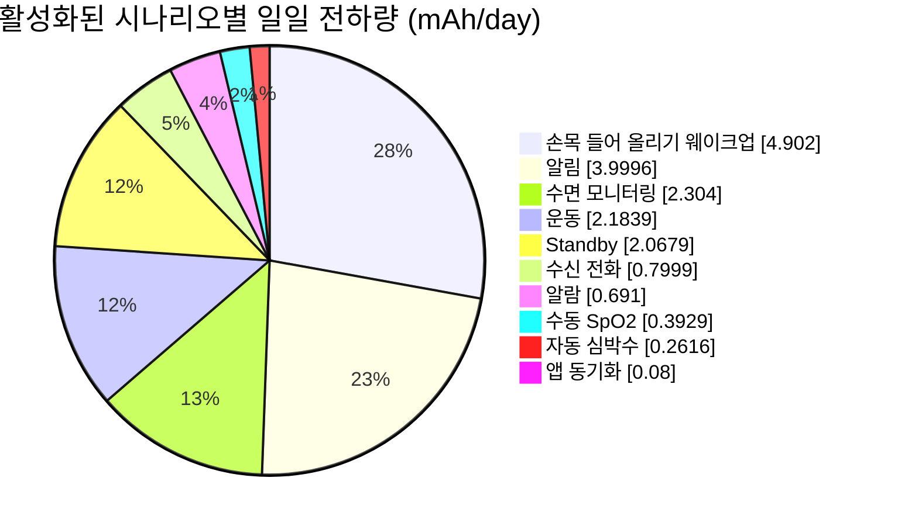
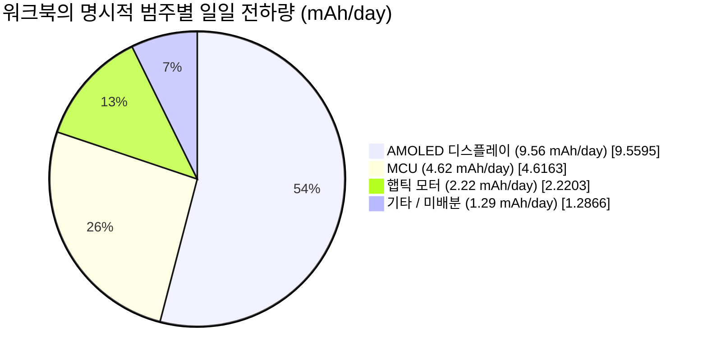
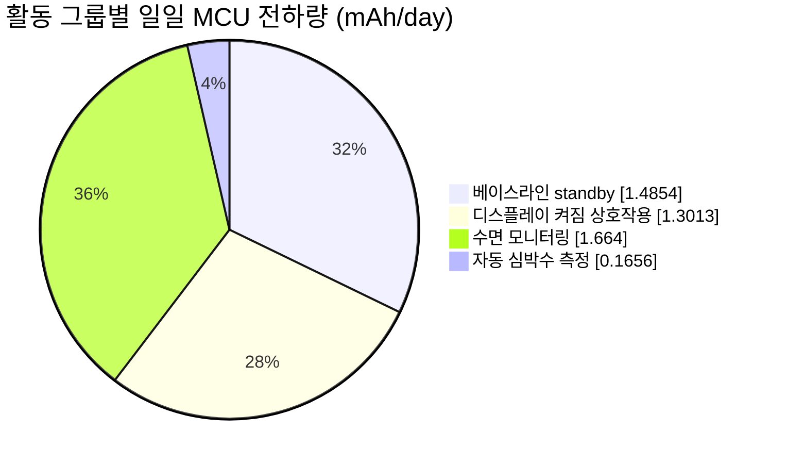

# 스마트워치 전력 프로파일링

전력 프로파일링은 예상되는 일일 사용 패턴을 배터리 수명 추정치로 바꾸고, 더 중요하게는 최적화할 가치가 있는 부하의 순위 목록으로 바꿉니다. 이 문서는 제공된 [영문 스마트워치 전력 프로파일 데이터 워크북](assets/smartwatch-power-profile-data.xlsx)을 실제 예제로 사용합니다. 사용자 행동을 하루당 mAh로 변환하는 방법, 예산을 지배하는 부하를 식별하는 방법, 스프레드시트 모델을 측정 계획으로 바꾸는 방법을 보여 줍니다.

!!! warning "모델이며 디바이스 사양이 아님"
    이 예제의 전류와 사용 가정은 제공된 모델에 속한 것입니다. 특정 SF32 디바이스, 디스플레이, 배터리 또는 워치 설계의 특성 데이터가 아닙니다. 제품의 배터리 수명 주장에 결과를 사용하기 전에 이를 사용자의 하드웨어에서 측정한 값으로 교체하십시오.
    워크북에는 측정 로그가 없으므로 어떤 입력도 하드웨어 측정값으로 식별되지 않습니다. 13.15일이라는 결과는 모델 추정치이며 관측된 동작 시간이 아닙니다.

아키텍처와 펌웨어 지침은 [저전력 설계 개요](overview.md)를, 모델을 검증하는 측정 워크플로는 [전력 측정과 검증](measurement-and-validation.md)을 이 페이지와 함께 사용하십시오.

## 스마트워치 시스템 개요

먼저 모델의 경계를 정의하십시오. 이 워크북은 MCU, AMOLED 디스플레이, 햅틱 모터, 배분되지 않은 `기타` 부하 버킷을 갖춘 배터리 구동 스마트워치를 나타냅니다. 패널 크기, 해상도, 밝기 설정, 무선 아키텍처, 개별 센서는 식별하지 않습니다. 아래의 디스플레이 전류 항목은 특정 패널의 측정된 동작점이나 사양이 아니라 워크북 입력값으로 취급하십시오. `기타`는 하나의 물리적 컴포넌트가 아니라 모델링 경계로 취급하십시오.

<div align="center"><em>표: 스마트워치 시스템과 모델 입력값</em></div>

<div align="center" markdown>

| 항목 | 워크북의 값 | 중요한 이유 |
|:-----|----------------------:|:---------------|
| 일반 AMOLED 디스플레이 전류 | 15 mA | 알림, 수신 전화 알림, 손목 들어 올리기 웨이크업 이벤트에 사용됩니다. |
| AMOLED AOD 전류 | 2 mA | 모델에 정의되어 있지만, 이 기준에서는 AOD 시나리오가 비활성화되어 있습니다. |
| 정격 배터리 용량 | 250 mAh | 모델의 허용치를 적용하기 전의 시작 용량입니다. |
| 배터리 열화 허용치 | 7% | 사용 가능한 용량을 232.5 mAh로 줄입니다. |
| 공칭 배터리 전압 | 3.87 V | 워크북의 전압 정규화 헬퍼에 사용됩니다. |

</div>

## 시나리오별 소비 전력

시나리오는 하나의 고립된 컴포넌트가 아니라 완전한 사용자 이벤트 또는 시스템 이벤트입니다. 메시지 알림은 MCU를 깨우고, AMOLED 디스플레이를 켜고, 햅틱 모터를 구동하며, 백그라운드 부하를 활성 상태로 유지할 수 있습니다. 원본 매트릭스에서 모든 `Display` 행은 AMOLED 디스플레이를 가리킵니다. 매트릭스는 각 시나리오의 컴포넌트 행을 함께 묶어 두고, 추적성을 위해 계산된 일일 값을 유지합니다. 이 값의 바탕이 되는 발생 횟수와 지속 시간은 이 문서 뒷부분의 일일 사용 프로파일에 나열되어 있습니다.

<div align="center"><em>표: 컴포넌트 수준 전체 전력 모델</em></div>

<div align="center" markdown>

| 시나리오 | 컴포넌트 | 전압 | 전류 | 전압 계수* | 일일 전하량 | 일일 전하량 비중 |
|:---------|:----------|--------:|--------:|----------------:|-------------:|----------------------:|
| 베이스라인 standby | MCU | 3.3 V | 0.102 mA | 85.27% | 1.4854 mAh | 8.40% |
| 베이스라인 standby | 디스플레이 | 3.3 V | 0 mA | 85.27% | 0 mAh | 0.00% |
| 베이스라인 standby | 햅틱 모터 | 3.3 V | 0 mA | 85.27% | 0 mAh | 0.00% |
| 베이스라인 standby | 기타 | 3.87 V | 0.04 mA | 100.00% | 0.5825 mAh | 3.29% |
| 메시지 알림 | MCU | 3.3 V | 2.507 mA | 85.27% | 0.3482 mAh | 1.97% |
| 메시지 알림 | 디스플레이 | 3.3 V | 15 mA | 85.27% | 2.0833 mAh | 11.78% |
| 메시지 알림 | 햅틱 모터 | 3.3 V | 11.25 mA | 85.27% | 1.5625 mAh | 8.84% |
| 메시지 알림 | 기타 | 3.87 V | 0.04 mA | 100.00% | 0.0056 mAh | 0.03% |
| 수신 전화 알림 | MCU | 3.3 V | 2.507 mA | 85.27% | 0.0696 mAh | 0.39% |
| 수신 전화 알림 | 디스플레이 | 3.3 V | 15 mA | 85.27% | 0.4167 mAh | 2.36% |
| 수신 전화 알림 | 햅틱 모터 | 3.3 V | 11.25 mA | 85.27% | 0.3125 mAh | 1.77% |
| 수신 전화 알림 | 기타 | 3.87 V | 0.04 mA | 100.00% | 0.0011 mAh | 0.01% |
| 손목 들어 올리기 웨이크업 | MCU | 3.3 V | 2.607 mA | 85.27% | 0.7242 mAh | 4.10% |
| 손목 들어 올리기 웨이크업 | 디스플레이 | 3.3 V | 15 mA | 85.27% | 4.1667 mAh | 23.56% |
| 손목 들어 올리기 웨이크업 | 햅틱 모터 | 3.3 V | 0 mA | 85.27% | 0 mAh | 0.00% |
| 손목 들어 올리기 웨이크업 | 기타 | 3.87 V | 0.04 mA | 100.00% | 0.0111 mAh | 0.06% |
| 자동 심박수 측정 | MCU | 3.3 V | 0.207 mA | 85.27% | 0.1656 mAh | 0.94% |
| 자동 심박수 측정 | 디스플레이 | 3.3 V | 0 mA | 85.27% | 0 mAh | 0.00% |
| 자동 심박수 측정 | 햅틱 모터 | 3.3 V | 0.08 mA | 85.27% | 0.0640 mAh | 0.36% |
| 자동 심박수 측정 | 기타 | 3.87 V | 0.04 mA | 100.00% | 0.0320 mAh | 0.18% |
| 수동 SpO2 측정 | MCU | 3.3 V | 2.6 mA | 85.27% | 0.0578 mAh | 0.33% |
| 수동 SpO2 측정 | 디스플레이 | 3.3 V | 15 mA | 85.27% | 0.3333 mAh | 1.89% |
| 수동 SpO2 측정 | 햅틱 모터 | 3.3 V | 0 mA | 85.27% | 0 mAh | 0.00% |
| 수동 SpO2 측정 | 기타 | 3.87 V | 0.08 mA | 100.00% | 0.0018 mAh | 0.01% |
| 운동 기록 | MCU | 3.3 V | 0.207 mA | 85.27% | 0.0296 mAh | 0.17% |
| 운동 기록 | 디스플레이 | 3.3 V | 15 mA | 85.27% | 2.1429 mAh | 12.12% |
| 운동 기록 | 햅틱 모터 | 3.3 V | 0 mA | 85.27% | 0 mAh | 0.00% |
| 운동 기록 | 기타 | 3.87 V | 0.08 mA | 100.00% | 0.0114 mAh | 0.06% |
| 알람 진동 | MCU | 3.3 V | 2.6 mA | 85.27% | 0.0650 mAh | 0.37% |
| 알람 진동 | 디스플레이 | 3.3 V | 15 mA | 85.27% | 0.3750 mAh | 2.12% |
| 알람 진동 | 햅틱 모터 | 3.3 V | 10 mA | 85.27% | 0.2500 mAh | 1.41% |
| 알람 진동 | 기타 | 3.87 V | 0.04 mA | 100.00% | 0.0010 mAh | 0.01% |
| 수면 모니터링 | MCU | 3.3 V | 0.208 mA | 85.27% | 1.6640 mAh | 9.41% |
| 수면 모니터링 | 디스플레이 | 3.3 V | 0 mA | 85.27% | 0 mAh | 0.00% |
| 수면 모니터링 | 햅틱 모터 | 3.3 V | 0 mA | 85.27% | 0 mAh | 0.00% |
| 수면 모니터링 | 기타 | 3.87 V | 0.08 mA | 100.00% | 0.6400 mAh | 3.62% |
| 앱 데이터 동기화 | MCU | 3.3 V | 2.5 mA | 85.27% | 0.0069 mAh | 0.04% |
| 앱 데이터 동기화 | 디스플레이 | 3.3 V | 15 mA | 85.27% | 0.0417 mAh | 0.24% |
| 앱 데이터 동기화 | 햅틱 모터 | 3.3 V | 11.25 mA | 85.27% | 0.0313 mAh | 0.18% |
| 앱 데이터 동기화 | 기타 | 3.87 V | 0.04 mA | 100.00% | 0.0001 mAh | 0.0006% |
| NFC 카드 거래 | MCU | 3.3 V | 2.5 mA | 85.27% | 0 mAh | 0.00% |
| NFC 카드 거래 | 디스플레이 | 3.3 V | 15 mA | 85.27% | 0 mAh | 0.00% |
| NFC 카드 거래 | 햅틱 모터 | 3.3 V | 11.25 mA | 85.27% | 0 mAh | 0.00% |
| NFC 카드 거래 | 기타 | 3.87 V | 0.04 mA | 100.00% | 0 mAh | 0.00% |
| Bluetooth 통화 | MCU | 3.3 V | 10 mA | 85.27% | 0 mAh | 0.00% |
| Bluetooth 통화 | 디스플레이 | 3.3 V | 15 mA | 85.27% | 0 mAh | 0.00% |
| Bluetooth 통화 | 햅틱 모터 | 3.3 V | 11.25 mA | 85.27% | 0 mAh | 0.00% |
| Bluetooth 통화 | 기타 | 3.87 V | 0.04 mA | 100.00% | 0 mAh | 0.00% |
| AOD, MCU 분당 1회 업데이트 | MCU | 3.3 V | 2.5 mA | 85.27% | 0 mAh | 0.00% |
| AOD, MCU 분당 1회 업데이트 | 디스플레이 | 3.3 V | 0 mA | 85.27% | 0 mAh | 0.00% |
| AOD, MCU 분당 1회 업데이트 | 햅틱 모터 | 3.3 V | 0 mA | 85.27% | 0 mAh | 0.00% |
| AOD, MCU 분당 1회 업데이트 | 기타 | 3.87 V | 0.08 mA | 100.00% | 0 mAh | 0.00% |
| AOD, 디스플레이 켜짐 | MCU | 3.3 V | 0 mA | 85.27% | 0 mAh | 0.00% |
| AOD, 디스플레이 켜짐 | 디스플레이 | 3.3 V | 2 mA | 85.27% | 0 mAh | 0.00% |
| AOD, 디스플레이 켜짐 | 햅틱 모터 | 3.3 V | 0 mA | 85.27% | 0 mAh | 0.00% |
| AOD, 디스플레이 켜짐 | 기타 | 3.87 V | 0.08 mA | 100.00% | 0 mAh | 0.00% |

</div>

\*워크북은 이 열을 "Power-Conversion Efficiency (%)"로 표기하지만, 실제 수식은 전압비일 뿐이며 측정된 레귤레이터 효율이 아닙니다. 이것이 배터리 수명 추정에 미치는 영향은 아래 "워크북의 변환 가정 확인하기" 절에서 설명합니다. 이 표의 일일 전하량과 백분율 값은 워크북에서 반올림한 것입니다. 정확한 수식과 값은 다운로드 가능한 파일을 사용하십시오. 아래의 순위 표로 우선순위를 정한 다음, 각 기여분의 바탕이 되는 전류 또는 전압 가정을 확인해야 할 때 이 매트릭스로 돌아오십시오.

<div align="center"><em>다이어그램: 스마트워치 전력 프로파일링 루프</em></div>


### 시나리오를 일일 전하량으로 변환하기

전류가 이미 배터리 기준으로 표현된 부하라면 일일 전하량은 간단합니다.

```text
daily_charge_mAh = current_mA x active_time_seconds_per_day / 3600
```

레귤레이터를 거쳐 공급되는 부하는 시간 항을 적용하기 전에 배터리 측 전류를 계산하십시오.

```text
battery_current_mA = (load_voltage_V x load_current_mA) /
                     (battery_voltage_V x regulator_efficiency)
```

의도한 부하 전류에서 측정한 레귤레이터 효율을 사용하십시오. 하루의 많은 시간을 경부하로 보내는 워치에는 레귤레이터의 최대 효율 수치가 거의 도움이 되지 않습니다.

### 워크북의 변환 가정 확인하기

워크북의 "Power-Conversion Efficiency (%)" 열은 `load voltage / battery voltage`로 계산됩니다. 이후의 전하량 수식은 이 헬퍼로 나눈 다음 배터리 전압으로 다시 나누므로, 전압 항이 상쇄됩니다. 결과적으로 일일 전하량은 부하 전류에 시간을 곱한 값일 뿐입니다. 이상적인 전력 변환을 모델링하는 것이 아니라 배터리 전류가 부하 전류와 같다고 취급합니다. 이는 정지 전류를 생략한 선형 레귤레이터와 비슷하며, 스위칭 레귤레이터에 대한 일반적인 모델이 아닙니다.

예를 들어 3.87 V 배터리에서 공급되는 3.3 V의 1 mA 부하는 이상적인 컨버터에서는 약 0.853 mA를 소비하지만, 워크북은 1 mA로 계산합니다. 실제 컨버터의 결과는 효율과 정지 전류에 따라 달라집니다. 따라서 워크북의 변환 가정만으로는 배터리 수명 추정치가 낙관적인지 보수적인지 알 수 없습니다. 순위는 선언된 전류와 시간 가정을 처음 검토하는 데는 유용하지만, 최종 배터리 예산은 아닙니다. 양산용 예산에서는 헬퍼를 각 레일과 부하 범위에서 측정한 효율로 교체하고, 정지 전류가 측정에 이미 포함되어 있다면 이중으로 계산하지 않도록 유의하면서 이를 포함하며, 배터리 보호 회로와 충전기 경로의 손실도 반영하십시오.

## 제품 사용 패턴으로 일일 소비량 계산하기

같은 시나리오라도 제품을 어떻게 사용하느냐에 따라 무시할 만한 수준일 수도, 지배적일 수도 있습니다. 워크북은 대표적인 하루를 활성화합니다. 베이스라인 standby, 알림, 수신 전화 알림, 손목 들어 올리기 웨이크업, 심박수 및 SpO2 측정, 운동 기록, 알람, 수면 모니터링, 앱 동기화입니다. NFC, Bluetooth 통화, 두 AOD 시나리오는 0으로 설정되어 있으므로 13.15일이라는 결과에 포함되지 않습니다.

<div align="center"><em>표: 제품 일일 사용 프로파일과 기여도</em></div>

<div align="center" markdown>

| 시나리오 | 일일 발생 횟수 | 발생 1회당 지속 시간 | 일일 총 지속 시간 | 일일 전하량 비중 | 모델링 상태 |
|:---------|--------------------:|------------------------:|-----------------------:|----------------------:|:----------------|
| 베이스라인 standby | 1 | 하루 중 남은 시간(초) (`=G7`) | 52,425.7 s | 11.69% | 활성화 |
| 메시지 알림 | 100 | 5 s | 500 s | 22.62% | 활성화 |
| 수신 전화 알림 | 10 | 10 s | 100 s | 4.52% | 활성화 |
| 손목 들어 올리기 웨이크업 | 200 | 5 s | 1,000 s | 27.72% | 활성화 |
| 자동 심박수 측정 | 48 | 60 s | 2,880 s | 1.48% | 활성화 |
| 수동 SpO2 측정 | 2 | 40 s | 80 s | 2.22% | 활성화 |
| 운동 기록 | 1 | `3600 / 7` s | 514.3 s | 12.35% | 활성화. 주당 1시간, 하루 평균으로 환산 |
| 알람 진동 | 3 | 30 s | 90 s | 3.91% | 활성화 |
| 수면 모니터링 | 1 | `8 x 3600` s | 28,800 s | 13.03% | 활성화 |
| 앱 데이터 동기화 | 20 | 0.5 s | 10 s | 0.45% | 활성화 |
| NFC 카드 거래 | 0 | 5 s | 0 s | 0.00% | 비활성화 |
| Bluetooth 통화 | 0 | `2 x 60` s | 0 s | 0.00% | 비활성화 |
| AOD, MCU 분당 1회 업데이트 | 0 | 0.05 s | 0 s | 0.00% | 비활성화 |
| AOD, 디스플레이 켜짐 | 0 | `(24 - 8) x 3600` s | 0 s | 0.00% | 비활성화 |

</div>

원본 매트릭스의 비어 있는 시나리오 셀은 의도된 것입니다. 이름이 있는 각 시나리오 뒤에 디스플레이, 햅틱 모터, `기타` 컴포넌트 부하 행이 이어집니다. 이 행들은 바로 위 시나리오 행의 일일 발생 횟수와 지속 시간을 상속하므로, 원본에는 각 시나리오의 이름이 한 번만 나옵니다.

<div align="center"><em>표: 계산된 일일 사용 결과</em></div>

<div align="center" markdown>

| 결과 | 계산 | 값 |
|:-------|:------------|------:|
| 사용 가능한 배터리 용량 | `250 mAh x (1 - 7%)` | 232.5 mAh |
| 모델링된 일일 소비량 | 활성화된 모든 시나리오 부하의 합 | 17.68 mAh/day |
| 평균 배터리 전류 | `17.68 mAh/day / 24 h` | 0.74 mA |
| 추정 배터리 수명 | `232.5 mAh / 17.68 mAh/day` | 13.15일 |

</div>

모델의 시나리오 순위는 최종 배터리 수명 수치보다 실행에 옮기기 쉽습니다. 가장 큰 기여 요인은 최적화 가설을 가장 먼저 테스트할 곳입니다.

<div align="center"><em>표: 스마트워치 모델에서 활성화된 시나리오의 기여도</em></div>

<div align="center" markdown>

| 시나리오 | 일일 전하량 | 일일 전하량 비중 | 가정한 일일 동작 |
|:---------|------------:|----------------------:|:-----------------------|
| 손목 들어 올리기 웨이크업 | 4.90 mAh | 27.72% | 200회 이벤트, 각 5 s. |
| 메시지 알림 | 4.00 mAh | 22.62% | 알림 100회, 각 5 s. |
| 수면 모니터링 | 2.30 mAh | 13.03% | 8 h. |
| 운동 기록 | 2.18 mAh | 12.35% | 주당 1 h, 하루 평균으로 환산. |
| 베이스라인 standby | 2.07 mAh | 11.69% | 활성화된 활동을 제외한 나머지 시간. |
| 수신 전화 알림 | 0.80 mAh | 4.52% | 알림 10회, 각 10 s. |
| 알람 진동 | 0.69 mAh | 3.91% | 알람 3회, 각 30 s. |
| 수동 SpO2 측정 | 0.39 mAh | 2.22% | 측정 2회, 각 40 s. |
| 자동 심박수 측정 | 0.26 mAh | 1.48% | 측정 48회, 각 60 s. |
| 앱 데이터 동기화 | 0.08 mAh | 0.45% | 전송 20회, 각 0.5 s. |

</div>

<div align="center"><em>차트: 스마트워치 모델에서 활성화된 시나리오의 기여도</em></div>



화면이 켜지는 상호작용 상위 두 가지가 모델링된 일일 전하량의 약 절반을 차지합니다. 이는 디스플레이가 전력을 소비한다는 일반적인 주장이 아니라 검증 가능한 결과입니다. 더 작은 부하에 노력을 들이기 전에, 실제 손목 들어 올리기 웨이크업 횟수, 디스플레이 켜짐 지속 시간, 밝기, 리프레시 동작, 알림 정책을 확인하십시오.

<div align="center"><em>표: 컴포넌트 범주별 일일 전하량</em></div>

<div align="center" markdown>

| 컴포넌트 범주 | 일일 전하량 | 일일 전하량 비중 | 프로파일링 질문 |
|:-------------------|------------:|----------------------:|:-------------------|
| AMOLED 디스플레이 | 9.56 mAh | 54.06% | 밝기, 켜짐 시간, 리프레시가 실제 사용자 행동과 맞는가? |
| MCU | 4.62 mAh | 26.11% | 펌웨어가 작업 버스트 사이에 의도한 슬립 상태로 돌아가는가? |
| 햅틱 모터 | 2.22 mAh | 12.56% | 각 이벤트에 진동 세기, 패턴, 지속 시간이 필요한가? |
| 기타 / 미배분 | 1.29 mAh | 7.28% | 센서, PMIC, 무선, 누설 가정을 개별적으로 측정했는가? |

</div>

<div align="center"><em>차트: 스마트워치 모델의 확인된 일일 전하량 분포</em></div>



파이 차트의 마지막 항목은 의도적으로 `기타 / 미배분`으로 남겨 둡니다. 워크북은 Bluetooth, 가속도계, 자이로스코프에 대한 독립적인 배터리 측 값을 제공하지 않습니다. Bluetooth 통화 시나리오가 비활성화되어 있다고 해서 Bluetooth 소비 전력이 0이라는 뜻은 아닙니다. 앱 동기화 시나리오도 무선 경로를 사용할 수 있지만, 워크북에서는 해당 에너지를 분리하지 않습니다. 센서 소비 전력이 `기타`에 포함되어 있을 수도 있지만, 제공된 데이터만으로는 가속도계와 자이로스코프의 값을 따로 구할 수 없습니다.

이를 MCU, 디스플레이, 햅틱 모터, Bluetooth, 가속도계와 자이로스코프를 합친 범주로 구성된 5개 항목의 차트로 만들려면 Bluetooth 유휴·전송 상태, 가속도계 모드와 듀티 사이클, 자이로스코프 모드와 듀티 사이클을 각각 행으로 추가하십시오. 각 항목은 배터리 입력에서 측정하거나, 배터리 측 mAh 합계에 반영하기 전에 측정한 레귤레이터 효율을 적용하십시오. 중복되는 센서나 Bluetooth 항목을 더하는 대신 `기타 / 미배분` 항목을 교체하십시오.

### 베이스라인 MCU 소비, 시나리오 관련 MCU 작업, 센서 부하 구분하기 { #separate-standby-mcu-active-mcu-and-sensors }

워크북은 명시적인 `MCU` 버킷을 제공하지만 그래픽 렌더링을 별도의 코드 경로로 분리하지는 않습니다. 가장 타당한 분석은 베이스라인 standby MCU 항목을 사용 시나리오에 할당된 MCU 항목과 구분하는 것이며, 센서 소비는 별도의 범주로 식별되지 않습니다.

<div align="center"><em>표: 워크북 MCU 버킷의 세부 내역</em></div>

<div align="center" markdown>

| MCU 활동 그룹 | 일일 전하량 | 전체 일일 전하량 비중 | MCU 전하량 비중 | 해석 |
|:-------------------|------------:|----------------------------:|--------------------:|:---------------|
| 베이스라인 standby | 1.49 mAh | 8.40% | 32.18% | 모델의 나머지 14.56 h 동안 0.102 mA. 이는 시스템 수준의 MCU 버킷 가정이며, 검증된 베어 다이 누설이 아닙니다. |
| 디스플레이 켜짐 상호작용 | 1.30 mAh | 7.36% | 28.19% | 메시지, 수신 전화, 손목 들어 올리기 웨이크업, SpO2, 운동, 알람, 앱 동기화 시나리오. 그래픽 작업뿐 아니라 이벤트 처리도 포함합니다. |
| 수면 모니터링 | 1.66 mAh | 9.41% | 36.04% | 8 h 동안 0.208 mA. 모델에서 가장 큰 개별 MCU 항목입니다. |
| 자동 심박수 측정 | 0.17 mAh | 0.94% | 3.59% | 예약된 센싱과 관련 MCU 작업. |
| **전체 MCU** | **4.62 mAh** | **26.11%** | **100%** | 워크북의 모든 명시적 MCU 항목. |

</div>

<div align="center"><em>차트: 워크북 MCU 버킷의 일일 전하량 세부 내역</em></div>



두 가지 비교로 오해를 피할 수 있습니다.

- **베이스라인 standby MCU 항목과 디스플레이 켜짐 시나리오 항목의 비교:** 베이스라인 standby는 하루 1.49 mAh를 차지하며, 모든 디스플레이 켜짐 상호작용 시나리오에서 MCU에 할당된 1.30 mAh/day보다 약간 큽니다. 이 모델에서는 가정한 베이스라인 전류를 줄이는 것이 해당 시나리오와 관련된 MCU 작업을 줄이는 것만큼, 혹은 그 이상으로 중요합니다. 워크북은 그래픽 버스트를 별도의 측정으로 분리하지 않습니다.
- **베이스라인 standby MCU 항목과 나머지 모든 명시적 MCU 항목의 비교:** 나머지 MCU 항목의 합은 3.13 mAh/day로, 베이스라인 standby 항목의 2.11배입니다. 수면 모니터링은 베이스라인을 제외한 개별 항목 중 가장 큰 1.66 mAh/day입니다. 이는 시나리오 수준의 MCU 할당이며, CPU 활성 전류만을 측정한 것이 아닙니다.

워크북에는 전용 센서 범주가 없습니다. 센서 소비를 포함할 수 있는 곳은 `기타` 버킷뿐이지만, 여기에는 PMIC, 무선, 누설 또는 기타 백그라운드 부하도 포함될 수 있습니다. 이 버킷의 합계는 1.29 mAh/day(7.28%)입니다. `기타` 전체를 센서에 귀속시키더라도 명시적 MCU 버킷이 여전히 더 큽니다. 4.62 mAh/day 대 1.29 mAh/day로, 3.59배 높습니다. 이는 MCU 실리콘과 센서를 직접 측정해 비교한 것이 아니라 워크북 범주를 비교한 것입니다. 센서만의 실제 비중은 모델이 센서 레일을 일반적인 `기타` 항목에서 분리한 후에야 알 수 있습니다.

<div align="center"><em>표: 나머지 부하를 분리하기 위해 다음에 측정할 항목</em></div>

<div align="center" markdown>

| 질문 | 현재 워크북의 경계 | 필요한 측정 |
|:---------|:--------------------------|:-------------------|
| MCU 누설은 얼마인가? | 베이스라인 `MCU` 전류에는 베어 다이 누설 이상의 요소가 포함됩니다. | 의도한 슬립 상태에서 MCU 전원을 측정한 다음, 보드 수준 누설을 별도로 측정합니다. |
| 그래픽 렌더링에 에너지가 얼마나 드는가? | 디스플레이 켜짐 MCU 시간에는 웨이크업, 이벤트 처리, 디스플레이 드라이버 작업도 포함됩니다. | 펌웨어에서 렌더링 구간을 표시하고 그 구간에 대해 전류를 적분합니다. |
| 센서에 귀속되는 비중은 얼마인가? | 센서는 별도의 범주가 아니며 `기타`에 포함되어 있을 수 있습니다. | 각 센서 레일을 측정하거나 센서 모드와 듀티 사이클마다 워크북 행을 하나씩 추가합니다. |
| `기타`에는 무엇이 남는가? | PMIC, 무선, 누설, 센서가 섞여 있습니다. | 한 번에 하나의 레일 또는 서브시스템을 비활성화하거나 분리한 다음, 배터리 측 합계를 대조합니다. |

</div>

## 순위를 설계 작업으로 바꾸기

모델링된 가장 큰 기여 요인부터 아래로 작업하고, 그 순서를 측정으로 검증하십시오. 이 모델에서 합리적인 순서는 다음과 같습니다.

1. **디스플레이 정책:** 손목 들어 올리기 웨이크업 트레이스 전체를 측정합니다. MCU 마이크로암페어를 쫓기 전에 잘못된 제스처 트리거, 화면 켜짐 시간, 밝기, 전체 화면 재렌더링, 불필요한 애니메이션을 줄입니다.
2. **알림 정책:** 제품 경험이 허용하는 범위에서 긴급하지 않은 알림을 통합합니다. 모든 이벤트에 디스플레이와 햅틱 피드백이 모두 필요한지 검토합니다.
3. **Connected standby:** 각 이벤트 이후 MCU가 의도한 슬립 모드에 도달하는지 확인합니다. 주기적 타이머, 폴링 루프, Bluetooth 콜백, PM vote를 점검합니다.
4. **햅틱 패턴:** 지각 테스트로 진폭과 지속 시간을 조정합니다. 더 짧거나 더 약한 패턴은 알림의 사용성을 떨어뜨리지 않으면서 에너지를 줄일 수 있습니다.
5. **장시간 센싱:** 수면 모니터링과 운동 기록을 센서 듀티 사이클, 처리, 메모리 트래픽, 무선 동작을 포함한 완전한 장면으로 프로파일링합니다.

고립된 스프레드시트 수치를 최적화하지 마십시오. 효율적으로 보이는 변경이 웨이크업 빈도를 높이거나, 사용자 만족도를 떨어뜨리거나, 활성 시간을 늘려 기대한 에너지 절감을 상쇄할 수 있습니다.

## 하드웨어에서 모델 검증하기

모델은 측정값과 지속적으로 보정될 때 유용해집니다. 상위 기여 요인마다 배터리 또는 공급 전압, 온도, 보드 리비전, 펌웨어 리비전, 활성화된 무선, 디스플레이 모드, 측정 범위를 기록하십시오.

<div align="center"><em>표: 이 스마트워치 프로파일의 최소 검증 계획</em></div>

<div align="center" markdown>

| 프로파일링한 장면 | 측정할 항목 | 모델에 반영할 내용 |
|:---------------|:----------------|:---------------------------------|
| 디스플레이 꺼짐 standby | 장시간 캡처에서 평균 전류와 예기치 않은 웨이크업 | 베이스라인 MCU, 센서, PMIC 및 기타 백그라운드 전류. |
| 손목 들어 올리기 웨이크업 | 제스처 감지, 웨이크업 지연 시간, 디스플레이 전류, 화면 켜짐 시간 | 실제 이벤트 횟수, 디스플레이 지속 시간, UI 비용. |
| 알림 | 알림 1회 동안의 MCU, 디스플레이, 햅틱, Bluetooth 활동 | 알림당 에너지와 올바른 일일 횟수. |
| 수면 모니터링 | 밤새 전체 트레이스 또는 반복 가능한 대표 구간 | 센서 듀티 사이클과 주기적 처리 비용. |
| 운동 기록 | 의도한 세션 동안의 센서, 디스플레이, 스토리지, 무선 활동 | 세션당 에너지와 현실적인 주간 빈도. |
| AOD, NFC, Bluetooth 통화 | 예측에 포함하기 전의 별도 측정 | standby에 대한 작은 조정이 아닌 각각의 시나리오. |

</div>

## 프로파일을 정직하게 유지하기

- 비활성화된 시나리오는 비용이 없는 것이 아니라 예산에 반영되지 않은 것으로 취급하십시오. 워크북은 현재 NFC, Bluetooth 통화, AOD 시나리오에 0 전하량을 할당합니다.
- 사용자에게 보이는 기능과 백그라운드 작업의 시나리오를 별도로 유지하십시오. 이렇게 하면 검토 중에 제품의 트레이드오프가 드러납니다.
- 가능하면 배터리 입력에서 측정하십시오. 레일 수준 측정도 여전히 가치가 있지만, 배터리 수명 수치가 되려면 레귤레이터 손실과 정지 전류를 더해야 합니다.
- 한 번에 하나의 가정만 변경한 다음, 순간 전류만이 아니라 하루당 mAh를 비교하십시오.
- 디스플레이 정책, Bluetooth 설정, 센서 주기, PM 정책 또는 주요 펌웨어 기능이 변경될 때마다 프로파일을 다시 실행하십시오.

## 핵심 요약

- 배터리 수명은 유효 배터리 용량을 일일 전하량 소비량으로 나눈 값입니다. 이 모델은 사용 가능한 용량 232.5 mAh와 활성화된 부하 17.68 mAh/day로 13.15일을 예측합니다.
- 제공된 기준에서는 디스플레이 동작이 예산을 지배합니다. 손목 들어 올리기 웨이크업과 메시지 알림만으로 일일 전하량의 약 절반을 차지합니다.
- 시나리오 순위는 어디를 먼저 측정하고 최적화할지 알려 줍니다. 단일 평균 전류 수치보다 더 유용합니다.
- 워크북의 예측을 양산용 배터리 수명 주장으로 취급하기 전에 실제 컨버터 효율과 정지 전류를 사용하십시오.
- 루프를 반복하십시오. 현실적인 동작을 모델링하고, 지배적인 장면을 측정하고, 가정을 업데이트한 다음 최적화하십시오.
