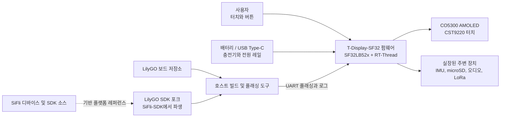

# LilyGO T-Display-SF32 { #lilygo-t-display-sf32 }

!!! warning "서드파티 프로젝트 — SiFli 프로젝트가 아닙니다"
    T-Display-SF32는 SiFli나 OpenSiFli가 아니라 Xinyuan-LilyGO/LilyGO가 게시하고 유지 관리합니다. 보드별 하드웨어, 펌웨어, 지원에 관한 결정은 LilyGO의 저장소를 참조하십시오. 기반이 되는 SF32 디바이스와 SiFli-SDK에 대해서는 여전히 SiFli의 자료가 기준이지만, SiFli가 이 LilyGO 보드를 검증했거나 지원한다는 뜻은 아닙니다.

## T-Display-SF32란 무엇인가? { #what-is-t-display-sf32 }

[Xinyuan-LilyGO/T-Display-SF32](https://github.com/Xinyuan-LilyGO/T-Display-SF32)는 SF32LB52x MCU와 CST9220 터치를 갖춘 2.16인치 CO5300 AMOLED를 중심으로 구성된 개발 플랫폼입니다. 이 저장소에는 16 MB 플래시, 8 MB PSRAM, BHI260AP IMU, SX1262 LoRa, microSD 인터페이스, 오디오, USB Type-C, 충전 지원, 보드 핀 할당, 예제 애플리케이션, 하드웨어 파일, 공장 출하 펌웨어 디렉터리, 보드 전용 소비 전력 보고서가 문서화되어 있습니다.

이러한 조합 덕분에 이 보드는 디스플레이 중심의 웨어러블, 휴대용 컨트롤러, 휴대용 센서 단말, 연결형 HMI를 평가하는 데 유용합니다. 완성된 제품이 아니라 플랫폼 레퍼런스입니다. 저장소가 많은 하드웨어 경로를 제공하지만, 제품 팀은 여전히 어떤 경로가 중요한지 선택하고, 알려진 기준 구성을 재현하고, 정확한 보드 리비전에서 측정하고, 전력, RF, 안전, 소프트웨어 유지 관리, 복구를 검증해야 합니다.

저장소의 기능 매트릭스는 단독형 T-SF32-Display와 선택적인 T-SF32-Keyboard 확장을 구분합니다. Wi-Fi(ESP32-C6), GPS(L76K), 매트릭스 키보드와 LED(TCA8418, AW21009, XL9555), BME280, 적외선 송신기, 진동 모터(AW86224)는 이 확장이 있어야 하므로 단독형 보드 기준 구성에 포함하지 마십시오.

## 왜 SF32 구현인가? { #why-the-sf32-implementation }

T-Display-SF32는 SF32LB52x의 그래픽, Bluetooth, 오디오, 저전력 기능을 외부 디스플레이, 터치, 모션, 스토리지, LoRa 디바이스와 한 보드에서 결합합니다. LilyGO는 보드 구성, 전용 디바이스 드라이버, 예제와 함께 SiFli-SDK 2.4.0을 기반으로 한 것으로 설명되는 별도의 [LilyGO SDK 포크](https://github.com/Xinyuan-LilyGO/SlFli-SDK-Lilygo)도 제공합니다. 따라서 수정되지 않은 범용 SDK 타깃에서 시작하는 것보다 초기 보드 브링업 시간을 줄일 수 있습니다.

대신 소유권의 문제가 따릅니다. 보드 지원, 드라이버 변경, 하드웨어 리비전, 번들 펌웨어, LilyGO의 SDK 포크와 업스트림 SiFli-SDK의 관계는 SiFli 밖에서 통제됩니다. 따라서 재현 가능한 프로젝트가 되려면 두 저장소를 모두 커밋 단위로 고정하고, 동작하는 공장 출하/복구 이미지를 보관하고, 더 새로운 업스트림 SDK로의 마이그레이션을 명시적인 엔지니어링 변경으로 테스트해야 합니다.

## 목표, 범위, 시작 조건 { #outcome-scope-and-entry-criteria }

**목표:** 버전이 고정된 T-Display-SF32 기준 구성을 확립하고, 디스플레이/터치, 선택한 주변 장치, 전력 동작, 복구 경로를 검증하고, 소스 빌드를 재현한 다음, 제품 검토에 적합한 회귀 증거와 함께 범위가 제한된 애플리케이션 변경 하나를 수행합니다.

이 페이지는 모든 보드 변형에 모든 주변 장치가 실장되어 있다는 점, 벤더 펌웨어가 양산 수준이라는 점, 전력 보고서가 다른 리비전이나 워크로드에도 적용된다는 점, LoRa 동작이 모든 지역에서 합법이라는 점을 증명하지 않습니다. 또한 SiFli의 지원을 LilyGO 전용 하드웨어나 드라이버로 이전하지도 않습니다.

시작하기 전에 다음을 준비하십시오.

- 회로도 또는 핀 맵을 포함한 정확한 T-Display-SF32 보드와 하드웨어 리비전;
- 전류 제한이 있는 벤치 전원 공급 장치 또는 전압과 상태를 모니터링할 수 있는 보호된 배터리;
- 검증된 USB 데이터 케이블, 문서화된 Type-C 플래싱 연결, 보관해 둔 복구 이미지;
- T-Display-SF32 저장소와 LilyGO의 SDK 포크 모두에 대해 고정된 커밋;
- 최초의 재현 가능한 빌드를 위해 LilyGO SDK 포크가 문서화한 Windows/PowerShell 환경. 다른 호스트 경로는 별도로 검증해야 하는 것으로 취급하십시오;
- microSD 카드, 헤드폰 또는 오디오 부하, 합법적인 대역의 LoRa 상대 장치처럼 범위에 포함된 인터페이스에 필요한 테스트 액세서리만;
- 펌웨어 버전, 빌드 로그, 시리얼 출력, 사진, 전류 측정, 장애/복구 결과의 기록.

<div align="center"><em>표: T-Display-SF32 프로젝트 기준</em></div>

<div align="center" markdown>

| 영역 | 시작 기준 구성 | 적용 전에 필요한 증거 |
|:-----|:------------------|:------------------------------------|
| 소유권 | LilyGO 보드, 저장소, SDK 포크 | 저장소 소유자, 커밋, 보드 리비전, 지원 경계 |
| 하드웨어 | SF32LB52x, 2.16인치 AMOLED/터치, 외부 메모리, 실장된 주변 장치 구성 | 회로도/핀 맵 검토, 어셈블리 기록, 실장된 디바이스 목록 |
| 펌웨어 | 번들 공장 출하 이미지 또는 수정하지 않은 저장소 예제 | 이미지 식별 정보, 플래시 기록 로그, 부트 로그, 기능 기록 |
| 전력 | LilyGO가 문서화한 USB/충전기/배터리 경로 | 전원 한계, 시작 결과, 종료 동작, 선택한 워크로드에서 측정한 전류 |
| 적용 | 한 번에 하나의 예제, UI, 센서, 스토리지, 오디오 또는 무선 변경 | 검토를 거친 변경, 롤백 이미지, 전체 회귀 테스트 결과 |

</div>

## 하드웨어 및 소프트웨어 사양 { #hardware-and-software-specifications }

### 하드웨어 사양 { #hardware-specification }

<div align="center"><em>표: T-Display-SF32 하드웨어 사양</em></div>

<div align="center" markdown>

| 구성 요소 | 필수 사양 | 역할 | 상태 | 구하는 곳 | 호환성 및 대체 참고 사항 |
|:----------|:-----------------------|:-----|:-------|:----------------|:-------------------------------------|
| T-Display-SF32 보드 | SF32LB52x; 문서화된 구성에는 2.16인치 CO5300 AMOLED, CST9220 터치, 16 MB 플래시, 8 MB PSRAM, BHI260AP IMU, SX1262 LoRa, microSD, 온보드 마이크와 3.5 mm 오디오 잭이 있는 스피커 앰프, 사용자 버튼 3개가 포함됨 | 통합된 연산, 디스플레이, 센싱, 무선, 스토리지, 오디오 레퍼런스 | 필수 | [LilyGO 저장소](https://github.com/Xinyuan-LilyGO/T-Display-SF32); [하드웨어 파일](https://github.com/Xinyuan-LilyGO/T-Display-SF32/tree/master/hardware) | 정확한 보드 리비전과 실장된 디바이스 목록을 기록하십시오. 모든 변형이 같은 구성으로 실장되어 있다고 가정하지 마십시오 |
| T-SF32-Keyboard 확장 | ESP32-C6 Wi-Fi, L76K GPS, TCA8418/AW21009/XL9555 키보드 서브시스템, BME280, 적외선 송신기, AW86224 진동 모터를 갖춘 선택적 확장 | 나열된 무선, 위치 측정, 키보드, 환경 센싱, IR, 햅틱 기능을 추가 | 선택; 해당 기능에만 필수 | [LilyGO 저장소](https://github.com/Xinyuan-LilyGO/T-Display-SF32); [하드웨어 파일](https://github.com/Xinyuan-LilyGO/T-Display-SF32/tree/master/hardware) | 이 부품들은 단독형 T-SF32-Display에는 없습니다. Wi-Fi와 GPS는 UART2를 공유하므로 확장의 통합 구성을 검증하십시오 |
| USB Type-C 데이터 연결과 제어된 전원 | 데이터 전송이 가능한 케이블; 전류 제한이 있는 전원 공급 장치 또는 전압을 모니터링하는 보호된 배터리 | 플래싱, 로그, 안전한 전원 검증 | 필수 | [LilyGO 저장소](https://github.com/Xinyuan-LilyGO/T-Display-SF32) | Type-C의 D+/D-는 CH343P USB-UART 브리지에 연결됩니다. 이 포트는 UART 플래싱/로그를 지원하며 SF32 네이티브 USB 디바이스/호스트 데이터는 지원하지 않습니다. 또한 보드별 3.5 V 초과 시작 조건을 따르십시오 |
| 인터페이스별 테스트 액세서리 | 테스트하는 경로에 필요한 microSD 카드, 오디오 부하/헤드폰, 합법적인 대역의 LoRa 상대 장치만 | 선택적인 보드 인터페이스를 점검 | 선택; 테스트별로 선택 | [예제](https://github.com/Xinyuan-LilyGO/T-Display-SF32/tree/master/examples) | 연결하기 전에 보드 파일과 대조하여 정확한 커넥터, 전압, 지역, 리비전을 확인하십시오 |

</div>

### 소프트웨어 사양 { #software-specification }

<div align="center"><em>표: T-Display-SF32 소프트웨어 사양</em></div>

<div align="center" markdown>

| 패키지 또는 서비스 | 필수 버전 또는 리비전 | 역할 | 상태 | 구하는 곳 | 호환성 및 업데이트 참고 사항 |
|:-------------------|:-----------------------------|:-----|:-------|:----------------|:-------------------------------|
| T-Display-SF32 펌웨어/소스 | 저장소 커밋을 고정하고 기록; 업스트림은 공통으로 쓸 수 있는 태그된 기준 구성을 밝히지 않음 | 보드 예제, 구성, 펌웨어 | 필수 | [저장소](https://github.com/Xinyuan-LilyGO/T-Display-SF32) | 공장 출하 이미지를 보존하고 보드 리비전과 커밋을 함께 기록하십시오 |
| LilyGO SiFli-SDK 포크 | SiFli-SDK 2.4.0 기반으로 문서화된 포크의 커밋을 고정 | 보드 지원, 드라이버, 빌드, 플래싱 환경 | 필수 | [LilyGO SDK 포크](https://github.com/Xinyuan-LilyGO/SlFli-SDK-Lilygo) | 2.4.0 기반이라는 설명은 포크의 정확한 리비전이 아닙니다. 업스트림 SDK로 임의로 교체하지 마십시오 |
| SCons와 호스트 플래싱 도구 | 선택한 포크가 제공하는 버전; 호스트 OS와 확인된 버전을 기록 | `t-display-sf32_hcpu` 타깃을 빌드하고 플래시에 기록 | 필수 | [LilyGO SDK 포크](https://github.com/Xinyuan-LilyGO/SlFli-SDK-Lilygo) | 문서화된 최초 빌드 경로는 Windows/PowerShell을 사용합니다. 다른 호스트는 별도로 검증하십시오 |
| 공장 출하 펌웨어 V1.2 | 일치하는 보드/저장소 리비전의 이미지 | 수정하지 않은 동작 및 복구 레퍼런스 | 선택, 단 수정하기 전에 보관 | [공장 출하 펌웨어 디렉터리](https://github.com/Xinyuan-LilyGO/T-Display-SF32/tree/master/firmware/T-SF32-Factory-V1.2) | 디렉터리 이름만으로는 이미지와 보드의 호환성이 확정되지 않습니다. 플래시에 기록하기 전에 확인하십시오 |

</div>

## 지원되는 기준 구성 선택 { #choose-a-supported-baseline }

업스트림 저장소는 현재 `master` 브랜치를 사용하며, 태그된 릴리스를 공통 소프트웨어 기준 구성으로 제시하지 않습니다. "최신"이라고 적지 말고 정확한 커밋을 기록하십시오. 저장소에는 `firmware/T-SF32-Factory-V1.2` 디렉터리가 있지만, 그 디렉터리 이름이 일치하는 보드 리비전, 저장소 커밋, 플래시 기록 절차의 기록을 대신하지는 않습니다.

<div align="center"><em>표: T-Display-SF32 기준 구성 선택</em></div>

<div align="center" markdown>

| 기준 구성 요소 | 권장 시작점 | 핵심 제한 사항 |
|:-----------------|:------------------|:--------------------|
| 보드 | 사진을 찍고 리비전을 식별한 T-Display-SF32 유닛 하나 | 핀 맵이나 실장된 주변 장치가 다른 리비전이나 키보드 관련 변형과 일치한다고 가정하지 마십시오 |
| 공장 출하 동작 | 유닛에 따라 번들 공장 출하 V1.2 디렉터리 또는 수정하지 않은 `menu_app` 빌드 | 플래시에 기록하기 전에 출처와 호환성을 확인하고 원래 이미지를 보관하십시오 |
| 소스 | 고정된 T-Display-SF32 커밋 | 저장소는 SiFli-SDK와 별개로 발전함 |
| SDK | 고정된 LilyGO SDK 포크 커밋, SiFli-SDK 2.4.0에서 파생된 것으로 문서화됨 | 다른 SDK 리비전으로 임의로 교체하지 마십시오. 보드 드라이버와 구성이 다를 수 있습니다 |
| 빌드 타깃 | `t-display-sf32_hcpu` | 범용 SF32LB52x 타깃이 아니라 LilyGO 보드 타깃임 |
| 전원 입력 | LilyGO가 명시한 3.5 V 초과 시작 조건을 따르고, 커스텀 펌웨어에서 전압 감지/배터리 부족 시 종료를 구현 | 이를 확인해야 하는 벤더 보드 요구 사항으로 취급하십시오. 칩 데이터시트, 배터리 한계, 측정된 브라운아웃 동작을 대체하지 않습니다 |

</div>

T-Display-SF32 README는 필요한 환경을 구성한 뒤의 Windows 빌드 및 플래싱 경로를 다음과 같이 문서화합니다.

```powershell
cd T-Display-SF32\examples\rt_os\rt_driver\project
scons --board=t-display-sf32_hcpu -j8
build_t-display-sf32_hcpu\uart_download.bat
```

실제 저장소와 SDK 커밋, 환경 익스포트 결과, 전체 빌드 로그, 생성된 이미지, 플래싱 로그, 부트 로그를 저장하십시오. 병렬 작업 수는 바꿔도 되지만, 타깃과 소스 리비전은 바꾸면 안 됩니다.

## 프로젝트 개발 단계와 의사결정 지점 { #delivery-map }

<div align="center"><em>표: T-Display-SF32 프로젝트 개발 단계와 의사결정 지점</em></div>

<div align="center" markdown>

| 단계 | 이 단계가 뒷받침하는 의사결정 | 필수 산출물 |
|:------|:---------------------|:----------------|
| 1. 벤더 기준 구성 | 수정하지 않은 보드/펌웨어 조합이 식별된 대로 동작하는가? | 버전이 고정되고 사진으로 기록된, 정상 동작이 확인된 세션 |
| 2. 주변 장치 및 복구 검증 | 선택한 인터페이스, 전원 상태, 장애를 관찰하고 복구할 수 있는가? | 장애 주입, 측정, 복구 기록 |
| 3. 소스 재현 | 팀이 클린 소스에서 같은 동작을 다시 빌드하고 플래시에 기록할 수 있는가? | 환경, 이미지, 플래시 기록 로그, 반복 수행 결과 |
| 4. 범위를 제한한 적용 | 기준 구성을 깨뜨리지 않고 제품 동작 하나를 바꿀 수 있는가? | 범위가 제한된 변경, 롤백 경로, 회귀 테스트 증거 |
| 5. 제품 검토 | 이 서드파티 플랫폼이 프로토타입 또는 커스텀 하드웨어 작업을 계속하기에 적합한가? | 책임자가 지정된 리스크와 진행/보류/중단 결정 |

</div>

## 시스템 아키텍처와 의존성 { #system-architecture-and-dependencies }

<div align="center"><em>그림: T-Display-SF32 제품 및 개발 경계</em></div>



장애를 별개의 영역으로 취급하십시오. 보드 전원/충전, 부팅과 플래싱, 디스플레이/터치, 선택한 각 주변 장치, LilyGO 보드 지원, 기반 SDK입니다. 예를 들어 디스플레이 예제의 실패는 전원, 보드 리비전, 패널/터치 구성, 애플리케이션, SDK/드라이버 불일치 중 어느 것에서든 비롯될 수 있으므로 "SDK가 실패했다"는 것은 충분한 진단이 아닙니다.

## 1단계 — 수정하지 않은 벤더 기준 구성 확립 { #stage-1-establish-the-untouched-vendor-baseline }

**목표:** 소스를 변경하기 전에 받은 보드와 벤더 기준 구성이 실제로 무엇을 하는지 증명합니다.

1. 보드 양면을 촬영하고 마킹, 실장된 주변 장치, 디스플레이/터치 부품, 메모리, 스위치, 커넥터, 저장소 커밋을 기록하십시오.
2. 전원 공급원과 극성을 확인하십시오. LilyGO는 시작에 3.5 V를 초과하는 전압이 필요하다고 경고합니다. 전압을 모니터링할 수 있는 전원을 사용하고, 심하게 방전된 셀을 시험에 사용하지 마십시오.
3. 보드와 일치하는 것으로 확인된 기준 구성만 플래시에 기록하거나, 출처를 알고 있다면 먼저 기존 펌웨어를 실행하십시오. 도구가 허용하면 원래 이미지를 보존하십시오.
4. 로컬 메뉴 또는 수정하지 않은 예제로 디스플레이/터치와 제품에 사용할 각 주변 장치를 점검하십시오. 사용할 수 없거나 실장되지 않은 기능은 실패로 취급하지 말고 그대로 기록하십시오.
5. 콜드 스타트를 두 번 수행하고 부트 로그, UI 사진, 터치/입력 결과, 명확히 정의한 유휴/동작 워크로드 하나의 전류 트레이스를 보관하십시오.

**보관할 증거:** 보드 리비전과 사진, 저장소/이미지 식별 정보, 전원 및 배터리 상세, 플래시 기록 및 부트 로그, 실장된 디바이스 목록, 기능 결과, 전류 테스트 조건.

**게이트 1 종료 기준:** 두 번의 콜드 스타트에서 식별된 디스플레이/터치 기준 구성이 재현되고, 범위에 포함된 실장 주변 장치마다 결과가 기록되어 있으며, 원래 이미지 또는 정상 동작이 확인된 이미지를 복원할 수 있습니다.

## 2단계 — 주변 장치, 전원, 복구 경계 검증 { #stage-2-validate-peripheral-power-and-recovery-boundaries }

**목표:** 안전하지 않은 배터리 사용이나 문서화되지 않은 재플래싱 없이 장애를 감지하고 복구할 수 있는지 판단합니다.

<div align="center"><em>표: T-Display-SF32 장애 및 복구 테스트</em></div>

<div align="center" markdown>

| 테스트 | 방법 | 통과 증거 |
|:-----|:-------|:--------------|
| 시작 마진 | 문서화된 한계를 넘지 않는 범위에서 전류 제한 벤치 전원을 의도한 동작 범위 주변으로 스윕 | 시작/종료 임계값과 동작이 측정되며, 반복 리셋이나 정의되지 않은 상태가 감춰지지 않음 |
| 배터리 부족 정책 | 제어된 전원으로 경고 및 종료 임계값을 점검 | 커스텀 펌웨어가 선택한 배터리의 안전 방전 한계 전에 경고하고 종료함 |
| 전원 꺼진 상태에서의 충전 | 공장 출하 펌웨어 종료 후 USB 전원을 연결하고 문서화된 버튼 웨이크 경로를 사용 | 충전 상태와 버튼 전용 웨이크 동작이 벤더 안내와 일치하며, USB 삽입만으로 부팅된다고 잘못 취급하지 않음 |
| 디스플레이/터치 중단 | UI 동작 중 리셋하거나 전원을 껐다 켜고 가장자리/모서리 터치 테스트를 반복 | 지속적인 손상이나 오입력 없이 디스플레이와 터치가 알려진 상태로 돌아옴 |
| 탈착식 스토리지 | 제어된 시점에서만 테스트 카드를 제거, 손상, 교체 | 누락/오류 상태를 진단할 수 있으며, 애플리케이션이 무관한 상태를 손상시키거나 멈추지 않음 |
| LoRa 경로 | 합법적인 대역의 상대 장치와 제어된 RF 환경을 사용 | 주파수/구성이 기록되고, 타임아웃과 재연결 동작이 확인되며, 측정 없이 통신 거리를 주장하지 않음 |
| 플래시 복구 | 복구할 수 있는 유닛에서만 테스트 플래싱을 중단한 뒤, 문서화된 Type-C/UART 경로를 사용 | 기록된 도구와 절차로 보관해 둔 정상 동작 이미지가 복원됨 |

</div>

**게이트 2 종료 기준:** 해당하는 각 테스트에 반복 가능한 결과와 복구 경로가 있고, 커스텀 펌웨어에는 배터리 부족 보호가 구현되어 있으며, 배터리를 손상시키거나 문서화된 복구 경로 없이 보드를 사용할 수 없게 만들 수 있는 미해결 장애가 없습니다.

## 3단계 — 재현 가능한 소스 기준 구성 빌드 { #stage-3-build-a-reproducible-source-baseline }

**목표:** 두 번째 엔지니어가 클린하고 버전이 고정된 소스에서 같은 기준 구성을 만들고 플래시에 기록할 수 있게 합니다.

1. 보드 저장소와 LilyGO SDK 포크의 고정된 커밋을 체크아웃하고 포크가 밝힌 업스트림 SDK 기반을 기록하십시오.
2. 문서화된 PowerShell 환경을 구성하고 클린 디렉터리에서 `t-display-sf32_hcpu`를 빌드하십시오.
3. 환경, 의존성, 구성, 메모리/파티션, 이미지, 플래싱, 시리얼 로그 증거를 보관하십시오.
4. 다른 머신에서 빌드하거나 모든 빌드 출력을 삭제한 뒤 다시 빌드하고 2단계 회귀 테스트 전체를 수행하십시오.

**게이트 3 종료 기준:** 2단계를 통과하는 펌웨어를 만드는 데 오래된 이미지, 추적되지 않는 보드 파일, 문서화되지 않은 SDK 대체가 필요하지 않습니다.

## 4단계 — 한 번에 하나의 제품 경로만 적용 { #stage-4-adapt-one-product-path-at-a-time }

**목표:** 동작하는 벤더 기준 구성과 복구 기준 구성을 보존하면서 유용한 변경 하나를 수행합니다.

<div align="center"><em>표: 범위를 제한한 T-Display-SF32 적용 순서</em></div>

<div align="center" markdown>

| 변경 유형 | 처음 시도하기 좋은 변경 | 필수 회귀 테스트 |
|:-------------|:------------------|:--------------------|
| UI | 페이지, 아이콘, 폰트 또는 터치 동작 하나 | 콜드 스타트, 전체 화면 새로고침, 터치 범위, 메모리 사용량, 복구 |
| 센서 | IMU 값 또는 이벤트 하나 | 디바이스 식별, 범위, 샘플 레이트, 오류 처리, 유휴 전류, 웨이크 동작 |
| 스토리지/오디오 | 파일 작업 또는 재생 경로 하나 | 미디어 누락, 잘못된 데이터, 볼륨/출력 한계, 전원 중단, 파일 시스템 복구 |
| LoRa | 허용된 대역에서 범위가 제한된 패킷 교환 하나 | 구성 기록, 타임아웃, 재시도, 전류, 공존, 규제 검토 |
| 전원 | 슬립/웨이크 또는 레일 제어 변경 하나 | 모든 웨이크 소스, 디스플레이/주변 장치 상태, 배터리 부족 시 종료, 충전, 반복 사이클 |
| SDK 마이그레이션 | LilyGO 포크 또는 업스트림 SDK 업데이트 후보 하나 | 보드 구성 diff, 클린 빌드, 모든 주변 장치 회귀 테스트, 전류 측정, 롤백 |

</div>

**게이트 4 종료 기준:** 변경 사항이 검토되었고, 원래 이미지를 계속 복원할 수 있으며, 해당하는 모든 디스플레이, 터치, 주변 장치, 전원, 플래시, 복구 테스트가 통과합니다.

## 5단계 — 제품 준비 상태 검토 { #stage-5-product-readiness-review }

현장 시험이나 커스텀 PCB를 확정하기 전에 다음 질문에 답하십시오.

- 보드 파일, LilyGO SDK 포크, 드라이버 수정, 보안 업데이트, 이후 SiFli-SDK 버전으로의 마이그레이션은 누가 책임지는가?
- 제품 기준 구성에는 어떤 보드 리비전과 실장된 주변 장치가 포함되며, 입고되는 유닛은 어떻게 식별하고 테스트하는가?
- 의도한 디스플레이 밝기, 무선 듀티 사이클, 스토리지, 센서 구성에서 측정한 동작, 유휴, 슬립, 시작, 종료 전류는 얼마인가?
- 배터리 보호, 충전, 열 동작, 케이스, 커넥터 접근성, 전원이 꺼진 상태에서의 복구는 어떻게 검증하는가?
- 어떤 LoRa 지역, 안테나, 주파수 계획, 송신 파라미터, 규제 의무가 적용되는가?
- 하드웨어 파일, 펌웨어, SDK 포크, 예제, 에셋, 서드파티 구성 요소의 라이선스가 의도한 배포 방식과 호환되는가?
- 팀이 서드파티 프로토타입 의존성을 감수하는가, 아니면 관리되는 포크와 지원 계획을 검증했는가?

**게이트 5 종료 기준:** 남은 리스크마다 담당자, 증거, 처리 방침이 있으며, 팀이 진행, 보류, 중단 중 하나를 명시적으로 결정했습니다.

## 제품 설계로의 인계 { #handoff-to-product-design }

정확한 SF32 부품과 메모리 디바이스, 디스플레이/터치 타이밍, 실장된 주변 장치와 버스, 전원 트리, 충전기와 배터리 정책, 안테나/RF 전략, 부팅/플래싱 연결, 파티션 계획, 양산 테스트 접근성, 소프트웨어 포크 소유권, 검증된 복구 경로를 가져가십시오. [SF32LB52x 통합 경로](../sf32-products/chips/SF32LB52x.md#integration-path), [SF32LB52x 하드웨어 설계 가이드](../hardware/chip-guides/SF32LB52x_hardware_design_guide.md), [SiFli-SDK 빌드, 플래시, 모니터](../develop/platforms/sifli-sdk/build-flash-monitor.md), [양산 설계](../hardware/design-for-production.md)로 이어서 진행하십시오.

## 주요 정보 출처 { #authoritative-sources }

- [Xinyuan-LilyGO/T-Display-SF32 저장소](https://github.com/Xinyuan-LilyGO/T-Display-SF32)
- [T-Display-SF32 중국어 README](https://github.com/Xinyuan-LilyGO/T-Display-SF32/blob/master/readme_cn.md)
- [T-Display-SF32 예제](https://github.com/Xinyuan-LilyGO/T-Display-SF32/tree/master/examples)
- [T-Display-SF32 하드웨어 파일](https://github.com/Xinyuan-LilyGO/T-Display-SF32/tree/master/hardware)
- [T-Display-SF32 전력 테스트 자료](https://github.com/Xinyuan-LilyGO/T-Display-SF32/tree/master/lowpowertest)
- [Xinyuan-LilyGO/SlFli-SDK-Lilygo 저장소](https://github.com/Xinyuan-LilyGO/SlFli-SDK-Lilygo)
- [OpenSiFli/SiFli-SDK](https://github.com/OpenSiFli/SiFli-SDK)
