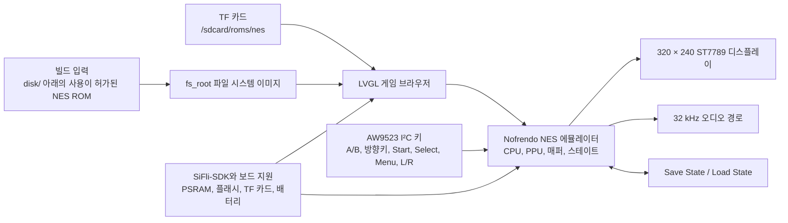

# Pocket Pi SF32 휴대용 게임기 { #pocket-pi-sf32-handheld-game-console }

!!! note "고정된 소스 스냅샷"
    별도로 명시하지 않는 한, 이 문서에서 코드와 관련된 동작은 PocketPi 커밋 [`7d9fac2`](https://github.com/SiFliSparks/PocketPi/commit/7d9fac2cb577d6c9b66a99521aebf3c9de0ae163) 기준입니다. 업스트림 `main` 브랜치는 바뀔 수 있으므로, 이러한 세부 사항을 재현할 때는 고정된 커밋을 체크아웃하십시오.

## Pocket Pi란 무엇인가? { #what-is-pocket-pi }

[SiFliSparks/PocketPi](https://github.com/SiFliSparks/PocketPi)는 SF32LB52용 휴대용 게임기 및 에뮬레이터 레퍼런스입니다. 고정된 리비전에서 이 프로젝트는 Nofrendo NES 에뮬레이터, LVGL 게임 브라우저, 320 × 240 ST7789 8080 디스플레이 경로, 오디오, 세이브/로드 스테이트, 내장 파일 시스템, TF 카드 ROM 디렉터리를 통합합니다. 공개된 빌드 기준 구성은 Huangshan Pi / `sf32lb52-lchspi-ulp` 타깃을 사용합니다.

SF32LB52 시스템에서 로컬 그래픽, 입력, 오디오, 외부 스토리지, PSRAM 할당, 에뮬레이터 부하가 어떻게 공존하는지 테스트하는 데 유용합니다. 저장소에는 상용 게임 ROM이 포함되어 있지 않으며, 사용자는 사용 권한이 있는 `.nes`/`.NES` 파일을 직접 준비해야 합니다. 또한 공개된 소스는 완전한 양산용 휴대용 게임기 설계가 아니며, 배터리 안전, 오디오, EMC, 열, 라이선스, 콘텐츠 배포에 대한 검토를 대체하지 않습니다.


<div align="center"><em>SF32LB52에서 NES 게임을 실행 중인 Pocket Pi</em></div>

## 왜 SF32 구현인가? { #why-the-sf32-implementation }

NES 에뮬레이션은 CPU 에뮬레이션, PPU 그래픽, 오디오 샘플링, 저지연 입력, 파일 읽기, 프레임 버퍼링, 세이브 스테이트가 함께 동작해야 하므로, 여러 임베디드 시스템의 경계를 직관적인 하나의 워크로드로 모아 놓습니다. SF32LB52 기반 시스템은 이 워크로드에 필요한 디스플레이, 오디오, 외부 스토리지, PSRAM 리소스를 함께 갖추고 있으며, Huangshan Pi는 배터리로 구동하는 평가 플랫폼도 제공합니다.

가치는 모든 NES 타이틀이 완전히 호환된다고 주장하는 데 있지 않습니다. ROM 매퍼 지원, 프레임 레이트, 오디오, 세이브 동작, 최대 메모리 사용량, 입력 지연 시간은 게임마다 다를 수 있습니다. ROM이나 매퍼를 추가할 때마다 호환성과 저작권에 대한 별도의 결정이 필요합니다.

## 목표, 범위, 시작 조건 { #outcome-scope-and-entry-criteria }

**목표:** 소프트웨어 사양에 고정된 PocketPi 커밋에서 반복 가능한 이미지를 빌드하고, 사용이 허가된 테스트 ROM을 하나 이상 부팅하고, 디스플레이, 입력, 오디오, 일시 정지, 저장, 로드, 종료, 복구를 검증한 다음, 범위가 제한된 적용 하나를 완료합니다.

이 페이지는 모든 NES 매퍼, PAL/NTSC 타이밍, 게임 오디오 경로, 세이브 형식, 서드파티 ROM을 보장하지 않습니다. 게임 콘텐츠를 복사하거나 배포할 권리도 부여하지 않습니다. 고정된 저장소 리비전에는 최상위 라이선스 파일이 없습니다. 코드를 제품에 복사하거나 바이너리를 배포하기 전에, 담당자가 PocketPi, Nofrendo, 포함된 모든 서드파티 구성 요소의 라이선스를 확정해야 합니다.

시작하기 전에 다음을 준비하십시오.

- [SF32LB52-DevKit-ULP / Huangshan Pi](../sf32-products/devkits/SF32LB52-DevKit-ULP.md) 또는 저장소의 `sf32lb52-lchspi-ulp` 보드 정의와 일치하는 하드웨어;
- 고정된 소스가 기대하는 320 × 240 디스플레이, AW9523 I²C 입력 익스팬더, 키, 오디오, 선택적인 TF 카드 경로. 보드 이름만으로는 모든 주변 장치가 실장되어 있음이 증명되지 않습니다;
- SiFli-SDK, SCons, UART 플래싱 및 로깅 도구;
- 직접 제작했거나, 퍼블릭 도메인이거나, 적법하게 라이선스를 받은 `.nes` 테스트 ROM;
- 내장 파일 시스템용으로는 저장소의 `disk/` 아래에, TF 카드용으로는 펌웨어에 구성된 TF 카드 ROM 디렉터리에 둔 ROM. 고정된 소스는 런타임에 `/sdcard/roms/nes`를 스캔하므로 해당 리비전을 기준으로 카드의 마운트 경로를 확인하십시오;
- 프레임 동작, 오디오, 입력, 메모리, 전류를 관찰할 수 있는 수단.

<div align="center"><em>표: Pocket Pi 고정 기준 구성과 적용 전 증거</em></div>

<div align="center" markdown>

| 영역 | 고정된 소스 기준 구성 | 적용 전에 필요한 증거 |
|:-----|:------------------------|:------------------------------------|
| 보드 | `sf32lb52-lchspi-ulp` | 보드, 익스팬더, 디스플레이, 오디오, 스토리지, 전원 리비전 |
| 콘텐츠 | 고정된 리비전에서는 `.nes`와 `.NES`만 스캔하며, 이름이 같은 `.jpg`가 커버 아트가 될 수 있음 | ROM 출처/라이선스, 파일 해시, 매퍼, 아트워크 출처 |
| 스토리지 | `disk/`를 `fs_root`로 빌드하며, 런타임에 `/sdcard/roms/nes`도 스캔 | 파일 시스템 이미지, TF 카드 포맷, 디렉터리, 오류 복구 기록 |
| 입력 | 고정된 리비전에서 소스는 A/B, 방향키, Start, Select, Menu, L/R 및 관련 키를 AW9523 I²C 익스팬더를 통해 읽음 | 회로도/핀 정의, 전체 키 매트릭스, 동시 키 입력 결과 |
| 에뮬레이터 | Nofrendo NES 코어, 디스플레이, 32 kHz 오디오 경로, 스테이트 저장/로드 | 게임 호환성, 프레임/오디오, 스테이트, 메모리, 리셋 증거 |

</div>

## 하드웨어 및 소프트웨어 사양 { #hardware-and-software-specifications }

### 하드웨어 사양 { #hardware-specification }

<div align="center"><em>표: Pocket Pi 하드웨어 사양</em></div>

<div align="center" markdown>

| 구성 요소 | 필수 사양 | 역할 | 상태 | 구하는 곳 | 호환성 및 대체 참고 사항 |
|:----------|:-----------------------|:-----|:-------|:----------------|:-------------------------------------|
| Huangshan Pi / SF32LB52-DevKit-ULP 기준 구성 | 보드 타깃 `sf32lb52-lchspi-ulp`; 고정된 리비전의 프로젝트 소스는 320 × 240 ST7789 디스플레이 경로, AW9523 I²C 입력 익스팬더, 오디오, TF 카드 인터페이스를 기대함 | 에뮬레이터와 그 디스플레이, 입력, 오디오, 스토리지 경로를 실행 | 필수 | [μForge 보드 레퍼런스](../sf32-products/devkits/SF32LB52-DevKit-ULP.md); [LCKFB 보드 페이지](https://lckfb.com/project/detail/lckfb-hspi-sf32lb52-ulp?param=baseInfo); [프로젝트 소스](https://github.com/SiFliSparks/PocketPi) | 정확한 어셈블리와 실장된 주변 장치를 확인하십시오. 타깃 이름만으로는 보드가 동등하다는 사실이 증명되지 않습니다 |
| TF 카드 | 선택한 펌웨어가 읽을 수 있는 카드와 파일 시스템; 고정된 리비전의 런타임 경로는 `/sdcard/roms/nes` | 선택적인 외부 ROM 스토리지 | 선택 | [PocketPi 소스](https://github.com/SiFliSparks/PocketPi) | 고정된 리비전에서 마운트 경로, 카드 포맷, 핫플러그 동작, 복구를 확인하십시오 |
| 빌드 호스트와 USB 데이터 케이블 | 선택한 SiFli-SDK 툴체인을 실행할 수 있는 호스트; 문서화된 보드 플래싱/디버그 경로를 위한 데이터 전송 가능 케이블 | 빌드, 플래시 기록, 시리얼 로그 수집 | 필수 | [SiFli-SDK 퀵 스타트](https://docs.sifli.com/projects/sdk/latest/sf32lb52x/quickstart/index.html) | 호스트 OS/아키텍처, 케이블/어댑터, 포트, 복구 방법을 기록하십시오. 충전 전용 케이블은 동작하지 않습니다 |

</div>

!!! warning "Huangshan Pi는 주변 장치가 그대로 호환된다고 확인되지 않았습니다"
    SiFli의 [Huangshan Pi 가이드](https://wiki.sifli.com/en/board/sf32lb52x/SF32LB52-%E9%BB%84%E5%B1%B1%E6%B4%BE.html)에는 Quad-SPI로 연결된 1.85인치 390 × 450 AMOLED 디스플레이가 문서화되어 있고, 보드의 기능 키와 전원 키가 나열되어 있습니다. 반면 고정된 리비전의 PocketPi 소스는 320 × 240 ST7789 8080 디스플레이 경로와 AW9523 I²C 입력을 기대합니다. 공식 보드 가이드는 문서화된 어셈블리에 그와 일치하는 주변 장치가 포함되어 있다고 밝히지 않습니다. 이 보드 타깃을 플러그 앤 플레이로 취급하기 전에 실제 디스플레이, 어댑터, 입력 하드웨어를 확인하거나, 해당 소프트웨어 경로를 포팅하고 디스플레이/입력 회귀 테스트를 다시 수행하십시오.

### 소프트웨어 사양 { #software-specification }

<div align="center"><em>표: Pocket Pi 소프트웨어 사양</em></div>

<div align="center" markdown>

| 패키지 또는 서비스 | 필수 버전 또는 리비전 | 역할 | 상태 | 구하는 곳 | 호환성 및 업데이트 참고 사항 |
|:-------------------|:-----------------------------|:-----|:-------|:----------------|:-------------------------------|
| SiFliSparks/PocketPi | 검토한 커밋 [`7d9fac2`](https://github.com/SiFliSparks/PocketPi/commit/7d9fac2cb577d6c9b66a99521aebf3c9de0ae163) | 애플리케이션, Nofrendo 통합, 파일 시스템 이미지, 보드 타깃 | 필수 | [저장소](https://github.com/SiFliSparks/PocketPi) | ROM 입력과 저장소 소스는 라이선스와 해시를 별도로 관리하십시오 |
| OpenSiFli/SiFli-SDK | 프로젝트 문서에서 정확한 커밋을 고정하지 않음; 호환되는 리비전을 선택하여 기록 | RTOS, 보드 지원, 드라이버, SCons 빌드, 플래싱 도구 | 필수 | [저장소](https://github.com/OpenSiFli/SiFli-SDK) | `main`이 호환된다고 가정하지 마십시오. 애플리케이션 커밋과 SDK 커밋을 함께 보관하십시오 |
| SCons 환경과 UART 플래싱 도구 | 선택한 SiFli-SDK 리비전과 일치하는 버전 | `sf32lb52-lchspi-ulp`를 빌드하고 플래시에 기록 | 필수 | [SiFli-SDK 퀵 스타트](https://docs.sifli.com/projects/sdk/latest/sf32lb52x/quickstart/index.html) | 호스트 OS, SDK 설정, 빌드 로그, 생성된 플래싱 스크립트를 기록하십시오 |
| 테스트 ROM | 사용자가 선택한, 합법적으로 사용할 수 있는 `.nes`/`.NES` 파일; 매퍼와 SHA-256을 기록 | 파일 탐색, 디코딩, 에뮬레이션, 오디오를 검증 | 필수 테스트 콘텐츠 | PocketPi는 ROM 다운로드를 게시하지 않습니다. 권리가 해결된 파일을 직접 준비하고 [프로젝트 소스](https://github.com/SiFliSparks/PocketPi)를 참조하십시오 | 게임과 매퍼 호환성을 테스트해야 합니다. 콘텐츠 권리와 해시는 프로젝트 소스와 별도로 추적하십시오 |
| 커버 아트 | ROM의 기본 파일 이름과 같은 선택적 `.jpg`; 출처, 권리, SHA-256을 기록 | 게임 브라우저의 커버 이미지 디코딩과 폴백 동작을 테스트 | 선택 | 사용자가 제공합니다. PocketPi는 커버 아트를 게시하지 않으므로 [프로젝트 소스](https://github.com/SiFliSparks/PocketPi)를 참조하십시오 | 재배포할 수 있는 아트만 `disk/`에 두고 출처와 해시를 기록하십시오 |

</div>

## 지원되는 기준 구성 선택 { #choose-a-supported-baseline }

현재 `main`의 최신 커밋을 빌드하지 말고, 소프트웨어 사양에 고정된 PocketPi 리비전을 사용하십시오.

```bash
git clone https://github.com/SiFliSparks/PocketPi.git
cd PocketPi
git checkout 7d9fac2cb577d6c9b66a99521aebf3c9de0ae163
cd project
scons --board=sf32lb52-lchspi-ulp -j8
```

빌드 스크립트는 `../disk`를 파일 시스템 이미지로 만들고 `fs_root`로 펌웨어에 추가합니다. Windows에서는 생성된 `build_sf32lb52-lchspi-ulp_hcpu\uart_download.bat`가 플래싱 경로를 제공합니다. 다른 호스트에서는 해당하는 SiFli-SDK 플래싱 도구를 사용하고 동등한 파라미터를 기록하십시오.

<div align="center"><em>표: Pocket Pi 기준 구성 선택</em></div>

<div align="center" markdown>

| 요소 | 기준 구성 선택 | 핵심 제한 사항 |
|:--------|:----------------|:--------------------|
| ROM | 사용이 허가되었고 매퍼를 아는 작은 `.nes` 또는 `.NES` ROM 하나로 시작 | 고정된 리비전에서 스캐너는 `.nes`와 `.NES`만 허용하며, 목록에 나타난다고 해서 에뮬레이터 호환성이 증명되는 것은 아님 |
| 아트워크 | 같은 디렉터리에 있고 기본 파일 이름이 같은 선택적 `.jpg` | 디코딩에 실패하면 게임 목록을 막기보다 기본 이미지로 대체하는 것이 좋음 |
| 디스플레이 | 고정된 리비전에서 UI는 320 × 240이며 소스는 270° 회전을 선택 | 다른 LCD나 방향을 사용하려면 디스플레이/입력 전체 회귀 테스트가 필요함 |
| 입력 | 고정된 리비전의 `input.c`와 `input.h`에 있는 AW9523 매핑을 따름 | 직접 GPIO, 키 9개, Select 키 조합을 설명하는 README 섹션은 오래된 내용임 |
| 세이브 스테이트 | 일시 정지 메뉴의 Save State / Load State 동작을 사용 | 전원 손실 시 무결성, 슬롯 형식, 버전 간 호환성은 여전히 증명이 필요함 |

</div>

!!! warning "README의 입력 설명이 고정된 소스와 다릅니다"
    README는 `key_pin_def[]`, 200 Hz GPIO 스캔, Select 키 조합을 설명합니다. 고정된 리비전에서 소스는 주소 `0x5B`의 AW9523 I²C 익스팬더를 통해 키를 읽습니다. Menu는 Save State, Load State, Exit Game이 있는 일시 정지 화면을 열고, L/R은 오디오 시프트를 조정합니다. 재현과 하드웨어 설계는 예전 GPIO 표가 아니라 고정된 소스와 회로도를 따라야 합니다.

## 프로젝트 개발 단계와 의사결정 지점 { #delivery-map }

<div align="center"><em>표: Pocket Pi 프로젝트 개발 단계와 의사결정 지점</em></div>

<div align="center" markdown>

| 단계 | 이 단계가 뒷받침하는 의사결정 | 필수 산출물 |
|:------|:---------------------|:----------------|
| 1. 수정하지 않은 기준 구성 | 타깃 하드웨어가 사용이 허가된 ROM 하나를 목록에 표시하고 실행할 수 있는가? | 버전, 빌드, ROM, 부팅, 디스플레이, 오디오 기록 |
| 2. 상호작용과 복구 | 입력, 일시 정지, 저장, 로드, 종료, 리셋이 안정적인가? | 게임 수준의 기능 및 장애 복구 기록 |
| 3. 소스 재현 | 두 번째 엔지니어가 같은 파일 시스템과 이미지를 다시 빌드할 수 있는가? | 버전이 고정된 빌드, 산출물 해시, 반복 수행 결과 |
| 4. 범위를 제한한 적용 | 기준 구성을 깨뜨리지 않고 ROM, UI 또는 하드웨어 변경 하나를 적용할 수 있는가? | 변경, 콘텐츠 라이선스, 성능, 회귀 테스트 증거 |
| 5. 제품 검토 | 이 레퍼런스가 커스텀 휴대용 게임기 하드웨어와 콘텐츠 전략을 뒷받침할 만큼 탄탄한가? | 호환성, 라이선스, 전력, 리스크에 대한 결정 |

</div>

## 시스템 아키텍처와 의존성 { #system-architecture-and-dependencies }

<div align="center"><em>그림: Pocket Pi 런타임 경로</em></div>



주요 장애 영역은 파일 시스템/ROM, 매퍼/에뮬레이터, PSRAM/메모리, 디스플레이/프레임 타이밍, AW9523 입력, 오디오, 세이브 스테이트, 전원/리셋입니다. 검은 화면은 에뮬레이터 장애라고 뭉뚱그려 보고하지 말고, 먼저 "ROM이 발견되지 않음", "아트워크 디코딩 실패", "지원되지 않는 매퍼", "프레임버퍼 할당 실패", "LCD 경로 실패" 중 어디에 해당하는지 구분하는 것이 좋습니다.

## 1단계 — 수정하지 않은 게임 기준 구성 확립 { #stage-1-establish-the-untouched-game-baseline }

**목표:** 사용이 허가된 테스트 ROM 하나로 빌드 입력에서 게임 실행까지의 전체 경로를 증명합니다.

1. PocketPi와 SiFli-SDK 커밋, 보드 및 주변 장치 리비전을 고정하십시오.
2. 사용이 허가된 `.nes` ROM을 `disk/` 아래에 두십시오. 아트워크를 제공하는 경우 기본 파일 이름이 같은 `.jpg`를 사용하십시오. ROM 해시, 출처, 매퍼를 저장하십시오.
3. 클린 빌드를 수행한 뒤 `fs_root`가 생성되어 플래싱 산출물에 포함되었는지 확인하십시오.
4. 펌웨어를 보드에 기록한 뒤 콜드 스타트하십시오. 목록에 게임이 나타나고 커버 아트 또는 기본 이미지가 보이며 게임이 실행되는지 확인하십시오.
5. 시작 시간, 안정적인 영상, 키 응답, 오디오, 시리얼 로그를 기록한 뒤 리셋하고 다시 수행하십시오.

**보관할 증거:** 저장소/SDK 커밋, 보드와 주변 장치, ROM 해시/라이선스, 빌드 로그, 파일 시스템 이미지, 플래싱 로그, 시리얼 로그, 게임 목록/실행 화면 사진.

**게이트 1 종료 기준:** 두 번의 콜드 스타트에서 같은 ROM이 목록에 표시되고 실행되며, 디스플레이, 기본 방향키/A/B/Start/Select, 오디오 동작이 반복됩니다.

## 2단계 — 입력, 스테이트, 장애 복구 검증 { #stage-2-validate-input-state-and-fault-recovery }

**목표:** "게임이 시작된다"는 수준을 검토할 수 있는 휴대용 게임기 기준 구성으로 끌어올립니다.

<div align="center"><em>표: Pocket Pi 핵심 검증</em></div>

<div align="center" markdown>

| 테스트 | 방법 | 통과 증거 |
|:-----|:-------|:--------------|
| 전체 키 세트 | A, B, 방향키, Start, Select, Menu, L, R을 각각 점검하고 필요한 조합도 점검 | 키가 고착되거나 뒤바뀌거나 이유 없이 반복되지 않으며, 매핑이 고정된 소스와 일치함 |
| 일시 정지 화면 | 게임 중 Menu를 눌러 돌아가기, Save State, Load State, Exit Game을 수행 | 포커스, 일시 정지/재개, 종료가 반복 가능함 |
| 저장/로드 | 식별하기 쉬운 장면에서 저장하고 상태를 바꾼 뒤 로드 | 예상한 상태가 복원되며, 세이브 파일과 슬롯을 추적할 수 있음 |
| 파일 시스템 | 빈 `disk/`, 잘못된 확장자, 손상된 ROM, 없거나 손상된 JPG, 사용할 수 없는 TF 카드를 테스트 | UI가 충돌하지 않고, 시리얼 출력으로 원인을 진단할 수 있으며, 기본 아트와 루트 파일 시스템을 계속 사용할 수 있음 |
| 리셋과 전원 | 게임 중, 일시 정지 중, 저장 전후, 목록 상태에서 리셋하거나 전원을 제거 | 파일 시스템이 온전하게 유지되고, 디바이스가 복구 가능한 목록 상태 또는 명시적인 장애 상태로 돌아감 |
| 내구성 | 대표적인 게임 하나를 장시간 실행 | 메모리가 계속 늘어나거나, 오디오/비디오가 붕괴하거나, 입력이 사라지거나, 온도가 비정상적으로 상승하지 않음 |

</div>

**게이트 2 종료 기준:** 선택한 ROM에 대해 입력, 디스플레이, 오디오, 일시 정지, 저장, 로드, 종료, 리셋이 기록되어 있으며, 각 실패가 정의된 영역에 대응됩니다.

## 3단계 — 재현 가능한 소스 및 콘텐츠 기준 구성 빌드 { #stage-3-build-a-reproducible-source-and-content-baseline }

**목표:** 다른 엔지니어가 같은 펌웨어와 콘텐츠 이미지를 다시 빌드할 수 있게 합니다.

1. PocketPi, SiFli-SDK, 모든 서드파티 코어 리비전을 기록하십시오.
2. 각 ROM과 커버의 파일 이름, 해시, 출처, 라이선스를 담은 `disk/` 매니페스트를 만드십시오. 재배포할 수 없는 ROM은 커밋하지 마십시오.
3. 빈 출력 디렉터리에서 빌드하고 `fs_root`, 펌웨어, 메모리/파티션 출력, 플래싱 스크립트, 해시를 저장하십시오.
4. 다른 컴퓨터에서 또는 클린 디렉터리에서 다시 빌드하고 2단계의 핵심 테스트를 반복하십시오.

**게이트 3 종료 기준:** 문서화되지 않은 로컬 파일 없이 소스와 콘텐츠 매니페스트로 해시가 일치하는 이미지를 재현하거나, 차이가 있으면 그 이유를 설명할 수 있습니다.

## 4단계 — 한 번에 하나의 변수만 적용 { #stage-4-adapt-one-variable-at-a-time }

**목표:** 에뮬레이터, 콘텐츠, 하드웨어의 경계를 측정합니다.

<div align="center"><em>표: 범위를 제한한 Pocket Pi 적용 순서</em></div>

<div align="center" markdown>

| 변경 유형 | 처음 시도하기 좋은 변경 | 필수 회귀 테스트 |
|:-------------|:------------------|:--------------------|
| 콘텐츠 | 사용이 허가된 ROM 하나와 선택적인 커버를 추가 | 탐색, 매퍼, 부팅, 프레임/오디오, 입력, 저장, 라이선스 |
| 게임 목록 UI | 폰트, 커버, 정렬 또는 빈 목록 안내 문구 | 메모리, 스크롤, 기본 아트, 긴 파일 이름, 손상된 JPG |
| 입력 | AW9523 매핑 하나 또는 물리적 레이아웃 변경 | 모든 키, 동시 입력, 메뉴, I²C 장애, 부팅 |
| 디스플레이 | 방향, LCD 또는 프레임버퍼 전략 | 320 × 240 기하 구조, 프레임 타이밍, 티어링, 메모리, 종료 후 복구 |
| 오디오 | 볼륨, 시프트 또는 출력 하드웨어 | 32 kHz 경로, 왜곡, 언더런, 디스플레이/스토리지 동시 동작, 음소거 |
| 스토리지 | TF 카드 디렉터리 또는 스테이트 파일 정책 | 핫플러그 경계, 손상, 전원 손실, 가득 찬 미디어, 폴백 경로 |

</div>

**게이트 4 종료 기준:** 변경 사항과 콘텐츠 권리가 검토되었고, 원래 이미지를 복구할 수 있으며, 선택한 ROM에 대한 2단계 테스트가 모두 통과합니다.

## 5단계 — 제품 준비 상태 검토 { #stage-5-product-readiness-review }

커스텀 휴대용 게임기 하드웨어나 콘텐츠 배포에 앞서 다음 질문에 답하십시오.

- 의도한 게임 세트에는 어떤 매퍼가 필요하며, 각 ROM의 프레임 레이트, 오디오, 메모리, 세이브 동작이 검증되었는가?
- PocketPi, Nofrendo, SiFli-SDK, 폰트, 커버, 사운드, ROM의 라이선스와 배포 권리가 명확한가?
- AW9523, LCD, 오디오, TF 카드, 배터리, 충전 하드웨어에 완전한 회로도, BOM, 양산 테스트가 갖춰져 있는가?
- 게임, 목록, 일시 정지, 슬립, 꺼짐 상태의 전류와 배터리 수명, 온도, 배터리 부족 시 동작은 어떠한가?
- 전원 손실, 버전 업데이트, 가득 찬 미디어, 손상이 발생한 뒤 세이브 스테이트를 어떻게 보호하고 마이그레이션하는가?
- 손상된 파일 시스템, 업데이트 실패, 검은 화면, 부팅되지 않는 ROM에서 디바이스는 어떻게 복구하는가?

**게이트 5 종료 기준:** 호환성 매트릭스, 콘텐츠/소프트웨어 라이선스, 하드웨어 소유권, 전력, 복구 리스크에 지정된 담당자가 있고 진행/보류/중단 결정이 내려져 있습니다.

## 제품 설계로의 인계 { #handoff-to-product-design }

SF32/모듈 선택, PSRAM과 플래시 최대 사용량, 디스플레이/프레임버퍼 경로, AW9523 입력 매트릭스, 오디오 앰프와 스피커, TF 카드와 내장 파일 시스템, 세이브 스테이트 형식, 배터리/충전, 복구용 플래싱 포트, ROM/매퍼 호환성 매트릭스, 전체 라이선스 매니페스트를 가져가십시오. [SF32LB52x](../sf32-products/chips/SF32LB52x.md), [SF32LB52-DevKit-ULP](../sf32-products/devkits/SF32LB52-DevKit-ULP.md), [SiFli-SDK 빌드, 플래시, 모니터](../develop/platforms/sifli-sdk/build-flash-monitor.md), [양산 설계](../hardware/design-for-production.md)로 이어서 진행하십시오.

## 주요 정보 출처 { #authoritative-sources }

- [SiFliSparks/PocketPi](https://github.com/SiFliSparks/PocketPi)
- [고정된 레퍼런스 커밋 `7d9fac2`](https://github.com/SiFliSparks/PocketPi/commit/7d9fac2cb577d6c9b66a99521aebf3c9de0ae163)
- [LCKFB Huangshan Pi SF32LB52-ULP 보드](https://lckfb.com/project/detail/lckfb-hspi-sf32lb52-ulp?param=baseInfo)
- [OpenSiFli/SiFli-SDK](https://github.com/OpenSiFli/SiFli-SDK)
- [SiFli Wiki: Huangshan Pi 개발 보드 가이드](https://wiki.sifli.com/en/board/sf32lb52x/SF32LB52-%E9%BB%84%E5%B1%B1%E6%B4%BE.html)
- [SiFli-SDK 시작 가이드](https://docs.sifli.com/projects/sdk/latest/en/sf32lb52x/quickstart/get-started.html)
- [pebri86/esplay-retro-emulation](https://github.com/pebri86/esplay-retro-emulation)
- [LVGL 문서](https://docs.lvgl.io/latest/en/html/index.html)
