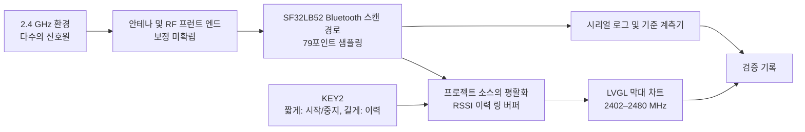

# Radiation Monitor 휴대용 신호 세기 감지기 { #radiation-monitor-portable-signal-strength-detector }

## Radiation Monitor란 무엇인가? { #what-is-radiation-monitor }

[SiFliSparks/RadiationMonitor](https://github.com/SiFliSparks/RadiationMonitor)는 SF32LB52와 SiFli-SDK 기반으로 만든 휴대용 Bluetooth 대역 신호 세기 뷰어입니다. 펌웨어는 2402~2480 MHz의 79개 주파수 포인트를 순차적으로 이동하며, 수신 세기 값을 LVGL 막대 차트로 표시합니다. KEY2로 스캔을 시작 또는 중지하고 저장된 이력을 탐색합니다.

이 프로젝트는 Bluetooth 대역 스캔 경로, 실시간 데이터 처리, 주파수 시각화, 버튼 하나로 조작하는 흐름을 살펴보는 데 유용합니다. 보정된 스펙트럼 분석기가 아니며 수신된 신호의 발생원을 식별하지도 않습니다. 주변의 2.4 GHz 송신과 측정 조건이 차트에 영향을 줄 수 있습니다. 보정과 제어된 비교가 없으면, 이 값은 규제, 인증, 정밀 RF 측정에 적합하지 않습니다.

<em>Radiation Monitor 79포인트 막대 차트 인터페이스</em>

## 왜 SF32 구현인가? { #why-the-sf32-implementation }

SF32LB52는 듀얼 모드 Bluetooth 5.3, 듀얼 코어 MCU, 디스플레이 기능을 결합하고 있습니다. 이 프로젝트는 SiFli-SDK와 LVGL을 사용하여 주파수 샘플링, 평활화, 이력 버퍼링, 화면 갱신을 모두 디바이스에서 처리합니다. 따라서 이 레퍼런스는 RF 시각화 패널, 현장 간섭 표시기, 양산 진단 UI를 위한 초기 실험으로 유용합니다.

저장소에는 보정 절차, 불확도 예산, 추적 가능한 측정 조건이 명시되어 있지 않습니다. 그러므로 결과는 정확한 실리콘, SDK 및 펌웨어 리비전, 보드, 안테나, 인클로저, 보드 노이즈, 타이밍을 기준으로 다시 검증해야 합니다. 이 방식을 다른 SF32LB52 보드나 제품 PCB로 옮기려면 검증을 새로 해야 하며, 컴파일에 성공했다고 해서 측정이 동등하다는 것이 입증되지는 않습니다.

## 목표, 범위, 시작 조건 { #outcome-scope-and-entry-criteria }

**목표:** 버전이 고정된 SF32LB52 하드웨어에서 79포인트 차트를 재현하고, 시작/중지가 반복 가능함을 확인하고, 고정된 소스를 기준으로 실제 평활화 알고리즘과 깊이를 확정하고, 문서화된 10개 레코드 이력과 복구를 테스트한 다음, 보정이나 커스텀 하드웨어에 투자할 가치가 있는지 판단하기에 충분한 증거를 수집합니다.

이 페이지는 RSSI 막대 높이를 듀티 사이클, 처리량, 송신기 출력, 프로토콜 식별, 규제 대상 스펙트럼 전력으로 해석하지 않습니다. 또한 저장소가 완전한 양산 설계, 보정 방법, 명시적인 소프트웨어 라이선스를 제공한다고 주장하지도 않습니다.

시작하기 전에 다음을 준비하십시오.

- SF32LB52 디스플레이 보드. 프로젝트 README에는 SF32LB52x와 `build_sf32lb52-lchspi-ulp_hcpu` 출력 디렉터리가 명시되어 있고, SiFli의 지원 보드 목록에는 Huangshan Pi용으로 `sf32lb52-lchspi-ulp`가 명시되어 있습니다. 실제 보드 리비전을 기록하고 프로젝트의 빌드 구성을 확인하십시오.
- SiFli-SDK, SCons, 플래싱 경로, 시리얼 로그 캡처.
- 제어할 수 있는 2.4 GHz 소스, 또는 선택한 BLE 어드버타이저를 껐다 켜는 것과 같이 반복 가능한 장면 두 개 이상.
- 수치 정확도가 범위에 포함되는 경우, 보정된 스펙트럼 분석기 또는 전력 계측기와 고정된 안테나/거리/차폐 조건.
- 화면 상태, 시리얼 출력, 보드 방향, 거리, 전원, 환경에 대한 테스트 기록.

<em>표: Radiation Monitor 프로젝트 기준 및 적용 전 검증 항목</em>

| 영역 | 고정된 소스 기준 구성 | 적용 전에 필요한 증거 |
|:-----|:------------------------|:------------------------------------|
| 주파수 스캔 | 2402~2480 MHz의 79포인트 | 펌웨어 커밋, SDK/보드 리비전, 전체 스캔 로그 |
| 처리 | 업스트림 README의 모듈 설명에는 이전 10회 스캔을 평균한다고 되어 있고, 개요에는 30회 스캔이라고 되어 있습니다. 평균이 선형 전력 기준인지 dBm 기준인지는 명시되어 있지 않습니다 | 고정된 소스 리비전, 평균 스케일/깊이, 원시/평활화 결과, 안정된 소스와의 비교 |
| 이력 | 10개 레코드 순환 이력 | 중지, 페이지 이동, 순환, 재시작 기록 |
| UI | 공칭 -110~-20 dBm Y축을 가진 LVGL 막대 차트 | 화면 캡처와 레이블-배열 매핑 확인 |
| 측정 경계 | 추적 가능한 보정이나 불확도가 제공되지 않음 | 기준 계측기, 고정구, 오차 기록, 또는 상대 추세 전용이라는 명시적 표기 |

## 하드웨어 및 소프트웨어 사양 { #hardware-and-software-specifications }

### 하드웨어 사양 { #hardware-specification }

<em>표: Radiation Monitor 하드웨어 사양</em>

| 구성 요소 | 필수 사양 | 역할 | 상태 | 구하는 곳 | 호환성 및 대체 참고 사항 |
|:----------|:-----------------------|:-----|:-------|:----------------|:-------------------------------------|
| SF32LB52-LCHSPI-ULP / Huangshan Pi | SiFli의 SCons 보드 타깃 `sf32lb52-lchspi-ulp`에서 시작하고, 정확한 보드 리비전, 안테나, 디스플레이 어셈블리를 기록 | Bluetooth 스캔, 차트, 조작, 이력 UI 실행 | 필수; 정확한 어셈블리를 확인해야 함 | [관련 μForge DevKit-ULP 레퍼런스](../sf32-products/devkits/SF32LB52-DevKit-ULP.md); [SiFli 지원 보드 목록](https://docs.sifli.com/projects/sdk/latest/en/sf32lb52x/supported_boards/index.html); [LCKFB 보드 페이지](https://lckfb.com/project/detail/lckfb-hspi-sf32lb52-ulp?param=baseInfo); [프로젝트 소스](https://github.com/SiFliSparks/RadiationMonitor) | README의 출력 디렉터리 `build_sf32lb52-lchspi-ulp_hcpu`만으로는 정확한 PCB, 안테나, 디스플레이 리비전을 알 수 없습니다 |
| 호스트, USB 데이터 케이블, 제어된 전원 | 선택한 SiFli-SDK 도구가 설치된 호스트, 데이터 전송이 가능한 케이블, 시리얼 로깅, 모니터링되는 전원 | 측정을 빌드, 플래싱, 관찰, 반복 | 필수 | [SiFli-SDK 퀵 스타트](https://docs.sifli.com/projects/sdk/latest/sf32lb52x/quickstart/index.html) | 포트, 전압, 호스트/도구 버전, 복구 방법을 기록하십시오 |

### 소프트웨어 사양 { #software-specification }

<em>표: Radiation Monitor 소프트웨어 사양</em>

| 패키지 또는 서비스 | 필수 버전 또는 리비전 | 역할 | 상태 | 구하는 곳 | 호환성 및 업데이트 참고 사항 |
|:-------------------|:-----------------------------|:-----|:-------|:----------------|:-------------------------------|
| SiFliSparks/RadiationMonitor | 고정된 커밋 [`670cf20`](https://github.com/SiFliSparks/RadiationMonitor/commit/670cf20b931e82b7ff1cd14fa6727e460c4f677a) | RF 스캔 로직, 79포인트 차트, 평활화, 이력 | 필수 | [저장소](https://github.com/SiFliSparks/RadiationMonitor) | README의 평활화 설명이 서로 상충합니다. 측정 기준 구성을 정하기 전에 이 커밋의 정확한 구현을 확인하십시오 |
| OpenSiFli/SiFli-SDK | 프로젝트 문서에 정확한 커밋이 고정되어 있지 않으므로, 호환되는 리비전 하나를 선택하여 기록 | RTOS, Bluetooth 스캔 경로, 디스플레이 드라이버, 빌드/플래싱 환경 | 필수 | [저장소](https://github.com/OpenSiFli/SiFli-SDK) | 컴파일에 성공했다고 해서 보정된 RF 측정이나 다른 보드에서의 동등성이 입증되지는 않습니다 |
| SCons 및 SDK 호스트 도구 | 선택한 SiFli-SDK 환경의 버전 | SF32LB52 타깃 빌드 및 플래싱 | 필수 | [SiFli-SDK 퀵 스타트](https://docs.sifli.com/projects/sdk/latest/sf32lb52x/quickstart/index.html) | 정확한 빌드 타깃, 호스트 OS, 도구 버전, 생성된 이미지를 기록하십시오 |

## 지원되는 기준 구성 선택 { #choose-a-supported-baseline }

움직이는 `main` 브랜치가 아니라 고정된 프로젝트 커밋 [`670cf20`](https://github.com/SiFliSparks/RadiationMonitor/commit/670cf20b931e82b7ff1cd14fa6727e460c4f677a)을 사용하십시오. 프로젝트 README에는 출력 디렉터리로 `build_sf32lb52-lchspi-ulp_hcpu`가 명시되어 있고, SiFli의 지원 보드 목록에는 Huangshan Pi / LCHSPI-ULP용으로 `sf32lb52-lchspi-ulp`가 명시되어 있습니다. 이것으로 확립되는 것은 SDK 보드 이름일 뿐, 정확한 프로젝트 명령이나 테스트된 보드 어셈블리가 아닙니다. README에는 보드 리비전이나 완전한 SCons 명령이 명시되어 있지 않으므로, 모든 SF32LB52x 보드가 지원된다고 가정하지 말고 첫 재현 단계에서 프로젝트 빌드 구성을 확인하십시오.

<em>표: Radiation Monitor 기준 구성 선택</em>

| 요소 | 기준 구성 선택 | 가정하면 안 되는 것 |
|:--------|:----------------|:--------------|
| 보드 | SiFli SCons 보드 인자 `sf32lb52-lchspi-ulp`에서 시작하고, 실제 PCB를 기록하며 프로젝트 구성을 확인 | README의 출력 디렉터리 `build_sf32lb52-lchspi-ulp_hcpu`가 모든 SF32LB52x의 안테나와 디스플레이 경로가 동등함을 증명한다는 가정 |
| SDK | 빌드에 성공한 SiFli-SDK 커밋을 기록 | 최신 SDK가 프로젝트의 Bluetooth 스캔 동작을 유지한다고 가정하면 안 됩니다 |
| 평활화 | README의 30회 스캔 대 이전 10회 스캔 불일치를 고정된 소스로 확인하고, 선형 전력 평균인지 dBm 평균인지 검증하고, 깊이를 확정 | 모듈 설명에는 10회 스캔, 개요에는 30회라고 되어 있으며, 어느 쪽도 평균 스케일을 명시하지 않습니다 |
| 타이밍 | README에는 30 ms 데이터 갱신 간격이 보고되어 있으므로, 79포인트 전체 스윕 시간을 측정 | 30 ms가 보장된 79포인트 전체 갱신 주기라는 가정 |
| 라이선스 | 재사용이나 배포 전에 저장소와 포함된 코드의 라이선스를 확인 | 공개된 소스라고 해서 제품 배포 권리가 자동으로 부여된다는 가정 |

!!! warning "업스트림 문서의 평활화 깊이 설명이 서로 다릅니다"
    README의 기능 개요에는 30회 스캔 평균이라고 되어 있는 반면, 모듈 설명에는 이전 10회 스캔이라고 되어 있고 스캔 모듈로 `src/BT/bt_repeat.c`를 지목합니다. 값을 선형 전력으로 평균하는지 dBm으로 평균하는지는 명시되어 있지 않으며, 두 횟수만으로는 고정된 코드가 어느 동작을 구현하는지 알 수 없습니다. 어느 쪽 횟수든 측정 기준 구성으로 삼기 전에 해당 소스 리비전을 직접 확인하여 평균 스케일, 버퍼 깊이, 디바이스 동작을 검증하십시오. 또한 README에는 30 ms 데이터 갱신 간격이 보고되어 있는데, 이것이 79포인트 전체를 스캔하는 데 걸리는 시간과 반드시 같지는 않습니다.

## 프로젝트 개발 단계와 의사결정 지점 { #delivery-map }

<em>표: Radiation Monitor 프로젝트 개발 단계와 의사결정 지점</em>

| 단계 | 이 단계가 뒷받침하는 의사결정 | 필수 산출물 |
|:------|:---------------------|:----------------|
| 1. 수정하지 않은 기준 구성 | 대상 보드가 79포인트 전체를 안정적으로 스캔하고 표시할 수 있는가? | 버전, 보드, 로그, 화면, 제어된 소스 기록 |
| 2. 데이터 및 복구 | 평활화, 중지, 이력, 리셋 동작을 신뢰할 수 있는가? | 결정적인 기능 및 복구 테스트 |
| 3. 소스 재현 | 두 번째 엔지니어가 동일한 이미지를 다시 빌드할 수 있는가? | 클린 빌드, 이미지, 플래싱, 반복 결과 |
| 4. 측정 적용 | 기준 동작을 가리지 않고 디스플레이 변경이나 보정 변경 하나를 추가할 수 있는가? | 변경, 비교 데이터, 오차, 회귀 기록 |
| 5. 제품 검토 | 추세 표시기로 남겨야 하는가, 아니면 계측기 개발 프로그램으로 전환해야 하는가? | 정확도 목표, 라이선스, 하드웨어, 리스크 결정 |

## 시스템 아키텍처와 의존성 { #system-architecture-and-dependencies }

<em>그림: Radiation Monitor 데이터 경로</em>

주요 장애 영역은 RF 입력/안테나, 스캔 동작과 보정, 데이터 처리, 이력 버퍼, 버튼 상태 머신, LVGL 매핑, 전원입니다. 막대 하나가 높다는 것은 구현이 상대적으로 강한 수신 값을 관측했다는 의미일 뿐이며, 제어된 비교가 없으면 송신기, 변조 방식, 규정 준수 상태를 식별하지 못합니다.

## 1단계 — 수정하지 않은 스캔 기준 구성 확립 { #stage-1-establish-the-untouched-scan-baseline }

**목표:** 선택한 하드웨어와 소스가 반복 가능한 79포인트 표시를 만들어 낸다는 것을 입증합니다.

1. 저장소와 SiFli-SDK 커밋, 보드 리비전, 안테나, 디스플레이 연결을 고정하고 클린 빌드와 플래싱을 수행하십시오.
2. RF 환경이 안정된 상태에서 디바이스를 시작하고 초기 차트, 시리얼 출력, KEY2 상태를 기록하십시오.
3. KEY2를 짧게 눌러 스캔을 시작하십시오. 커버리지와 2402, 2441, 2480 MHz의 X축 기준값을 확인하십시오.
4. 제어된 BLE 어드버타이저 또는 반복 가능한 다른 소스를 사용해 소스 꺼짐/켜짐, 거리, 보드 방향에 따른 변화를 기록하십시오.
5. 리셋한 뒤 반복하여 79포인트 배열과 차트가 어긋나거나 오래된 데이터가 남지 않는지 확인하십시오.

**보관할 증거:** 소스/SDK/보드 리비전, 빌드/플래싱 로그, 환경 설명, 소스 설정, 거리/방향, 시리얼 로그, 화면 캡처, 리셋 결과.

**게이트 1 종료 기준:** 독립적인 두 번의 부팅에서 79포인트를 스캔하고 표시합니다. 제어된 장면의 변화가 방향성 면에서 반복 가능합니다. 표시 인덱스와 주파수 레이블을 확인했습니다.

## 2단계 — 처리, 이력, 복구 검증 { #stage-2-validate-processing-history-and-recovery }

**목표:** UI가 우연한 애니메이션이 아니라 설명 가능한 데이터 경로를 나타낸다는 것을 입증합니다.

<em>표: Radiation Monitor 기능 검증</em>

| 테스트 | 방법 | 통과 증거 |
|:-----|:-------|:--------------|
| 평활화 알고리즘과 깊이 | 한 주파수의 원시 값과 `rssi_res`를 기록하고, 고정된 소스와 비교하여 README의 불일치를 해소합니다 | 평균 스케일과 깊이가 정확한 소스 리비전과 일치하며 디바이스에서 확인됨 |
| 시작/중지 | 스캔 중에 KEY2를 짧게 눌러 중지한 다음 재개합니다 | 중지해도 이력이 유지되고, 재개 시 멈춤 없이 계속됨 |
| 이력 | 중지한 상태에서 KEY2를 여러 번 길게 누릅니다 | 최대 10개 레코드를 거꾸로 탐색하며 올바르게 순환함 |
| 빈 이력 | 유효한 이력이 쌓이기 전에 중지하거나 길게 누릅니다 | 범위를 벗어난 접근이나 충돌이 없고, UI가 알아볼 수 있는 데이터 없음 상태로 유지됨 |
| 리셋 | 스캔 중, 중지 중, 이력 탐색 중에 리셋합니다 | 설명할 수 없는 오래된 값 없이 디바이스가 알려진 초기 상태로 돌아감 |
| 간섭 변화 | 소스, 거리 또는 차폐를 변경합니다 | 응답이 반복 가능하며, 지연 시간과 피크 홀드 동작이 기록됨 |

**게이트 2 종료 기준:** 평활화, 이력 깊이, 버튼 상태, 리셋 동작이 소스와 일치합니다. 비정상 상태가 조용히 묻히지 않고 관찰 가능합니다.

## 3단계 — 재현 가능한 소스 기준 구성 빌드 { #stage-3-build-a-reproducible-source-baseline }

**목표:** 클린 환경에서 2단계의 이미지를 재현합니다.

1. 프로젝트 커밋, SDK 커밋, 호스트 OS, SCons/컴파일러 버전, 실제 보드 인자를 기록하십시오.
2. 빌드 출력을 삭제하고 다시 구성한 뒤 빌드하십시오. 이미지, 메모리/파티션 출력, 전체 로그를 저장하십시오.
3. 생성된 플래싱 스크립트로 플래시에 기록하고 포트, 보레이트, 결과를 기록하십시오.
4. 두 번째 컴퓨터 또는 클린 디렉터리에서 다시 수행하고 2단계의 핵심 검사를 반복하십시오.

**게이트 3 종료 기준:** 추적되지 않는 보드 파일, 생성된 파일, 오래된 산출물 없이 프로젝트가 동작이 동등한 이미지를 만들어 냅니다.

## 4단계 — 범위를 제한한 측정 또는 UI 적용 하나 수행 { #stage-4-make-one-controlled-measurement-or-ui-adaptation }

**목표:** 원래 기준 구성을 잃지 않고 제품 방향 하나를 테스트합니다.

후보 변경으로는 원시 값 로깅, 명시적인 1 MHz 레이블, 피크 홀드, 다른 이력 선택기, 보정 오프셋, 상대 추세의 호스트 내보내기 등이 있습니다. 한 번에 한 종류만 변경하고 원래 이미지를 보존하십시오.

보정을 추가한다면 기준 소스, 주파수, 입력 레벨, 안테나/케이블, 거리, 방향, 온도, 불확도를 정의하십시오. 전역 오프셋 하나로는 주파수 응답, 보드 편차, 인클로저 영향을 보상하기에 충분하지 않은 경우가 많습니다.

**게이트 4 종료 기준:** 변경이 원래의 79포인트, 시작/중지, 이력, 리셋, 제어된 소스 회귀 테스트를 통과합니다. 모든 정확도 서술에는 기준 계측기와 조건이 명시되어 있습니다.

## 5단계 — 제품 준비 상태 검토 { #stage-5-product-readiness-review }

팀은 다음 질문에 답해야 합니다.

- 제품에 필요한 것이 상대적인 간섭 추세뿐인가, 아니면 추적 가능한 절대 전력과 불확도인가?
- 프로젝트의 Bluetooth 스캔 구현이 대상 실리콘과 SDK에서 지원되는 것으로 문서화되어 있으며, 어떤 동시 동작 제한이 적용되는가?
- 안테나, 인클로저, 디스플레이 노이즈, DC/DC 동작, 배터리 잔량, 온도에 따라 결과가 얼마나 달라지는가?
- 제품이 스캔하는 동안 필요한 Bluetooth 통신을 유지할 수 있는가, 아니면 두 기능을 동시에 사용할 수 없게 해야 하는가?
- 소스로 검증한 평활화를 적용한 79포인트 스캔의 측정된 지연 시간이 UI 요구 사항을 충족하는가?
- RadiationMonitor와 포함된 코드에 명시적인 최상위 라이선스가 없는 경우, 배포와 상업적 권리를 어떻게 해결할 것인가?

**게이트 5 종료 기준:** 측정 목표, 보정 계획, 무선 동시 동작 전략, 라이선스, 하드웨어 및 소프트웨어 소유권에 지정된 담당자가 있고 진행/보류/중단 결정이 내려져 있습니다.

## 제품 설계로의 인계 { #handoff-to-product-design }

대상 SF32 디바이스, 보드/안테나, 고정된 소스에서 확인한 Bluetooth 스캔 구현과 모드/API 제약, 주파수/데이터 정의, 원시 및 평활화 기록, UI 갱신 예산, 보정 고정구, 전원 노이즈 테스트, 복구 경로, 양산 테스트 경계를 이어서 가져가십시오. 이어서 [SF32LB52x](../sf32-products/chips/SF32LB52x.md), [SF32LB52-DevKit-ULP](../sf32-products/devkits/SF32LB52-DevKit-ULP.md), [SF32LB52x 하드웨어 설계 가이드](../hardware/chip-guides/SF32LB52x_hardware_design_guide.md), [SiFli SDK RF 테스트 실행](../develop/platforms/sifli-sdk/application-notes/rf-performance-tests.md)을 참조하십시오.

## 주요 정보 출처 { #authoritative-sources }

- [SiFliSparks/RadiationMonitor](https://github.com/SiFliSparks/RadiationMonitor)
- [`main`의 업스트림 README](https://github.com/SiFliSparks/RadiationMonitor/blob/main/README.md)
- [고정된 레퍼런스 커밋 `670cf20`](https://github.com/SiFliSparks/RadiationMonitor/commit/670cf20b931e82b7ff1cd14fa6727e460c4f677a)
- [SiFli Sparks 프로젝트 카탈로그](https://sparks.sifli.com/#projects)
- [OpenSiFli/SiFli-SDK](https://github.com/OpenSiFli/SiFli-SDK)
- [SiFli-SDK 지원 보드](https://docs.sifli.com/projects/sdk/latest/en/sf32lb52x/supported_boards/index.html)
- [SiFli-SDK RF 테스트 가이드](https://docs.sifli.com/projects/sdk/latest/en/sf32lb52x/app_note/rf_test_guide.html)
- [SF32LB52x 하드웨어 개요](https://wiki.sifli.com/en/hardware/SF32LB52/SF32LB52-Overview-B3.html)
- [SF32LB52x SiFli-SDK 퀵 스타트](https://docs.sifli.com/projects/sdk/latest/sf32lb52x/quickstart/index.html)
