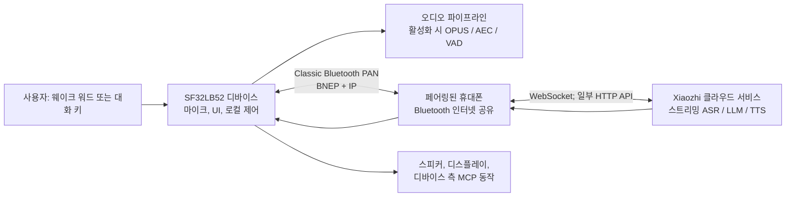

# SF32 Xiaozhi 음성 어시스턴트 { #sf32-xiaozhi-voice-assistant }

## Xiaozhi란 무엇인가? { #what-is-xiaozhi }

[Xiaozhi](https://github.com/78/xiaozhi-esp32)는 MCP 기반의 오픈소스 음성 챗봇으로, 2025년 ESP32 구현을 통해 널리 알려졌습니다. 음성 상호작용 기기에 클라우드 대규모 언어 모델 서비스와 디바이스 측 또는 클라우드 측 MCP 확장을 결합합니다. 따라서 단순한 텍스트 채팅 애플리케이션이 아니라 대화형 AI 기기를 개발할 때 실용적인 출발점이 됩니다.

## 왜 SF32 구현인가? { #why-the-sf32-implementation }

[78/xiaozhi-sf32](https://github.com/78/xiaozhi-sf32)는 SF32 구현이지만, 의도적으로 다른 연결 방식을 사용합니다. 원본 ESP32 프로젝트는 Wi-Fi 등의 직접 네트워킹 옵션을 지원하는 반면, SF32 버전은 Classic [Bluetooth PAN](../learn/bluetooth/pan.md)을 사용하여 페어링된 휴대폰을 통해 인터넷에 접속합니다. 이렇게 하면 광역 연결의 부담이 디바이스에서 휴대폰으로 옮겨지므로, 휴대폰 테더링 설계에서는 디바이스 측 네트워킹 전력을 크게 줄일 수 있습니다. 실제 절감량은 휴대폰, 무선 환경, 대화 듀티 사이클, 전력 정책에 따라 달라집니다. 따라서 SF32 방식은 펜던트, 배지, 소형 어시스턴트, 소형 웨어러블처럼 배터리로 동작하는 개인용 휴대 제품에 특히 적합합니다.

디스플레이와 오디오 하드웨어, 휴대폰이 제공하는 네트워킹, 클라우드 음성 서비스, 사용자 대상 활성화 흐름, 디바이스 제어, 현장 업데이트 기능처럼 흔히 따로 다루는 작업을 하나로 묶고 있어서 제품 레퍼런스로 매우 유용합니다.

## 목표, 범위, 시작 조건 { #outcome-scope-and-entry-criteria }

이 페이지는 해당 레퍼런스를 제품 방향에 맞게 적용하기 위한 완전한 엔지니어링 경로입니다. Xiaozhi가 오프라인 온디바이스 LLM이라거나, 업스트림의 모든 기능이 양산 수준으로 검증되었다거나, 지원되는 개발 보드가 인증된 완제품과 동등하다고 주장하지 **않습니다**. 디바이스는 Bluetooth PAN을 사용하여 페어링된 휴대폰을 통해 인터넷에 접속하고, 대화 흐름은 Xiaozhi 클라우드 서비스에 의존합니다. 제품을 확정하기 전에 서비스 약관, 계정 소유권, 개인정보 보호, 보안, 비용, 가용성, 지역별 적합성을 확인하십시오.

**목표:** 휴대폰을 통해 프로비저닝하고, 클라우드 기반 대화를 완료하고, 안전한 디바이스 기능 하나를 제어하고, PAN 연결 끊김에서 복구하며, 커스텀 하드웨어 제작 여부를 판단하는 데 필요한 증거를 만들어 내는, 반복 가능한 음성 및 디스플레이 어시스턴트입니다.

**대상 독자:** 이미 SF32 기준 구성을 빌드하고 플래시에 기록할 수 있으며, C/C++, 보드 회로도, Bluetooth 설정, 클라우드 서비스 연동 작업을 수행할 준비가 된 펌웨어, 하드웨어, 제품 엔지니어입니다.

<div align="center"><em>표: 프로젝트 기준 및 적용 전 검증 항목</em></div>

<div align="center" markdown>

| 영역 | 프로젝트 기준 구성 | 다음 단계 전에 필요한 증거 |
|:-----|:-----------------|:-------------------------------|
| 하드웨어 | 문서화된 SF32LB52 Xiaozhi 타깃 하나와 해당 오디오/디스플레이 경로, USB 플래싱 경로, 전원. | 콜드 부트, 키, 디스플레이, 마이크, 스피커, 해당하는 경우 충전/배터리 표시. |
| 연결 | `sifli-pan`으로 페어링할 수 있고 Bluetooth PAN 인터넷 공유를 제공하는 휴대폰. | 보드 UI에서 PAN이 확인되며, 연결 끊김과 재연결 동작이 반복 가능. |
| 서비스 | Xiaozhi 계정, 디바이스 활성화, Xiaozhi 콘솔에서 구성한 에이전트. | 대화 요청이 서비스에 도달하고 응답이 보드로 돌아옴. |
| 펌웨어 | 기록된 업스트림 커밋, SDK 서브모듈 리비전, 보드 타깃, 빌드/플래싱 방법. | 재현 가능한 클린 빌드, 플래시 기록, 시리얼 로그, 펌웨어 산출물. |
| 제품 적용 | UI 브랜딩, 디바이스 이름, 배터리 곡선, 안전한 MCP 제어 출력처럼 의도적으로 제한한 변경 하나. | 변경 후에도 기존 음성 루프가 통과함. |

</div>

## 하드웨어 및 소프트웨어 사양 { #hardware-and-software-specifications }

아래 명세는 구체적인 소스 빌드 레퍼런스 하나를 정의합니다. SiFli가 문서화한 외부 디스플레이 및 오디오 회로를 갖춘 **SF32LB52-DevKit-Nano-R16N16 V1.0.0**입니다. 지원되는 모든 Xiaozhi 보드에 공통으로 적용되는 BOM이 아닙니다. DevKit-ULP, DevKit-LCD 또는 Xiaotangyuan을 선택하는 경우, 이 하드웨어 명세 전체를 해당 보드의 문서화된 구성으로 교체하고 정확한 공급업체 부품과 보드 리비전을 유지하십시오.

### 하드웨어 사양 { #hardware-specification }

<div align="center"><em>표: Xiaozhi Nano 레퍼런스 하드웨어 사양</em></div>

<div align="center" markdown>

| 구성 요소 | 필수 사양 | 역할 | 상태 | 구하는 곳 | 호환성 및 대체 참고 사항 |
|:----------|:-----------------------|:-----|:-------|:----------------|:-------------------------------------|
| SF32LB52-DevKit-Nano-R16N16 V1.0.0 | SF32LB52JUD6, 16 MB OPI PSRAM, 16 MB SPI NOR 플래시 | SF32 연산, Bluetooth PAN, USB 플래싱/디버그, UI, 오디오 인터페이스 | 필수 | [SiFli 제품 페이지](https://www.sifli.com/zh-hans/SF32LB52_DevKit_Nano); [SiFli 공식 스토어](https://sifli.taobao.com/) | Nano N4 변형으로 대체하려면 먼저 펌웨어 타깃과 메모리 예산을 다시 확인해야 합니다. 보드 PCB 리비전과 공급업체 주문 링크를 기록하십시오. |
| 1.85인치 390 × 450 AMOLED와 16핀-22핀 FPC 어댑터 | 공식 Nano Xiaozhi 배선에서 사용하는 QSPI 디스플레이 어셈블리와 FPC 핀 배치 | 사용자 인터페이스 | 필수 | [공식 Nano Xiaozhi 하드웨어 페이지](https://docs.sifli.com/projects/xiaozhi/get-started/SF32LB52-DevKit-Nano/) | 공식 페이지에는 주문 링크가 게시되어 있지 않습니다. 기준 구성이 재현 가능하다고 말하기 전에 패널 컨트롤러, FPC 방향, 공급업체 부품 번호, 구매 링크를 고정하십시오. |
| 아날로그 MEMS 마이크 모듈 | `MIC_BIAS`, `MIC_ADC`, GND와 호환되는 아날로그 출력 | 음성 입력 | 필수 | [공식 가이드에 게시된 부품 링크](https://item.taobao.com/item.htm?id=595237371680) | 대체품을 사용하려면 바이어스, 출력 레벨, 노이즈, 음향 검증이 필요합니다. |
| PAM8302 앰프 모듈 | `DACP`/`DACN`의 차동 입력; `PA30`으로 제어하는 셧다운 | 스피커 구동 | 필수 | [공식 가이드에 게시된 부품 링크](https://item.taobao.com/item.htm?id=535743493142) | 다른 앰프는 하드웨어 변경으로 취급하고 인에이블 극성, 게인, 유휴 전류, 노이즈를 다시 확인하십시오. |
| 인클로저 일체형 스피커 | 8 Ω, 2–3 W | 음성 재생 | 필수 | [공식 가이드에 게시된 부품 링크](https://item.taobao.com/item.htm?id=895176389650) | 인클로저나 임피던스가 다른 대체품은 음향 출력, 앰프 온도, 전류를 다시 검증하십시오. |
| 점퍼 와이어와 400핀 브레드보드 | 문서화된 Nano 프로토타입에 맞는 배선 세트와 브레드보드 | 프로토타입 상호 연결 | 문서화된 프로토타입에 필수 | [점퍼 와이어](https://item.taobao.com/item.htm?id=39961676503); [400핀 브레드보드](https://item.taobao.com/item.htm?id=39828824454) | 레퍼런스 배선이 통과하고 핀 맵을 그대로 옮긴 뒤에만 검토를 거친 PCB로 교체하십시오. |
| USB Type-C 데이터 케이블과 개발용 컴퓨터 | 데이터 전송이 가능한 Type-C 케이블; Windows, Linux 또는 macOS 호스트 | 전원, 플래시 기록, 빌드, 시리얼 로그 | 필수 | [SiFli SDK 준비 요구 사항](https://docs.sifli.com/projects/sdk/latest/en/sf32lb52x/quickstart/get-started.html) | 충전 전용 케이블로는 플래시 기록이나 로그 캡처를 할 수 없습니다. 호스트 OS와 아키텍처를 기록하십시오. |
| Bluetooth 인터넷 공유를 지원하는 Android 또는 iOS 휴대폰 | `sifli-pan`으로 페어링할 수 있어야 하며 Classic Bluetooth PAN 인터넷 접속을 제공해야 함 | 네트워크 컴패니언 | 필수 | [공식 Xiaozhi PAN 온보딩](https://docs.sifli.com/projects/xiaozhi/get-started/) | 휴대폰 모델과 OS 버전을 기록하십시오. 지원하는 모든 휴대폰/OS 기준 구성에서 연결 끊김, 재페어링, 공유 동작을 검증하십시오. |

</div>

위의 서드파티 부품 URL은 공식 SiFli Nano 가이드에 게시된 마켓플레이스 링크이며, 제조업체 부품 번호를 영구적으로 보증하는 것이 아닙니다. 평가한 부품의 스크린샷이나 주문 기록을 보존하고, 제품 설계 전에 각 마켓플레이스 의존 항목을 검증된 공급업체 부품 번호와 데이터시트로 교체하십시오.

### 소프트웨어 사양 { #software-specification }

<div align="center"><em>표: Xiaozhi 레퍼런스 소프트웨어 사양</em></div>

<div align="center" markdown>

| 패키지 또는 서비스 | 필수 버전 또는 리비전 | 역할 | 상태 | 구하는 곳 | 호환성 및 업데이트 참고 사항 |
|:-------------------|:-----------------------------|:-----|:-------|:----------------|:-------------------------------|
| Xiaozhi SF32 사전 빌드 펌웨어 | v1.4.0 | 기준 구성과 복구에 쓰는 수정하지 않은 레퍼런스 이미지 | 1~2단계에 필수 | [v1.4.0 릴리스](https://github.com/78/xiaozhi-sf32/releases/tag/v1.4.0) | Nano R16N16 기준 구성에는 `sf32lb52-nano_52j.zip`을 선택하십시오. 보드별 아카이브를 섞어 쓰지 마십시오. |
| `78/xiaozhi-sf32` 소스 | 커밋 [`1d3ef641ace47fae68227e9173647fd5db01f6f5`](https://github.com/78/xiaozhi-sf32/commit/1d3ef641ace47fae68227e9173647fd5db01f6f5) | 애플리케이션 소스와 보드 설정 | 3~4단계에 필수 | [저장소](https://github.com/78/xiaozhi-sf32) | 이 문서에서 검토한 소스 스냅샷입니다. 이후 커밋은 새로운 기준 구성으로 기록하고 모든 게이트를 다시 수행하십시오. |
| SiFli-SDK 서브모듈 | 커밋 [`0d2de1480f735e05017c41436e655a1688063881`](https://github.com/OpenSiFli/SiFli-SDK/tree/0d2de1480f735e05017c41436e655a1688063881) | SF32 드라이버, RTOS, 미들웨어, 툴체인 스크립트, SCons 빌드 환경 | 3~4단계에 필수 | 저장소의 `sdk` 서브모듈을 통한 [OpenSiFli/SiFli-SDK](https://github.com/OpenSiFli/SiFli-SDK) | 선택한 애플리케이션 커밋에 기록된 서브모듈 리비전을 사용하십시오. 유지 중인 기준 구성 안에서 SDK를 따로 업데이트하지 마십시오. |
| sftool GUI | v1.2.1; 릴리스 페이지에서 선택한 OS용 에셋의 SHA-256을 보관 | 사전 빌드 이미지 플래싱과 로컬 복구 | 문서화된 v1.4.0 GUI 경로에 필수 | [v1.2.1 릴리스 및 플랫폼별 에셋](https://github.com/OpenSiFli/sftool-gui/releases/tag/v1.2.1) | 호스트 OS, 에셋 파일 이름, 체크섬을 기록하십시오. 이후 릴리스로 교체하기 전에 먼저 검증하십시오. |
| 빌드 호스트 도구 | 고정된 SiFli-SDK가 제공하는 설치/익스포트 스크립트; 해당 스크립트가 만드는 SCons 환경 | 소스 설정 및 컴파일 | 3~4단계에 필수 | [공식 Xiaozhi 소스 빌드 가이드](https://docs.sifli.com/projects/xiaozhi/source-build/) | 호스트 OS, 아키텍처, 스크립트 결과, 익스포트된 환경을 기록하십시오. 전역으로 설치된 도구가 고정된 SDK 환경을 조용히 덮어쓰면 안 됩니다. |
| Xiaozhi 클라우드 콘솔 및 서비스 | `xiaozhi.me`에서 호스팅되는 서비스; 검증 날짜, 계정 소유자, 에이전트 설정, 엔드포인트를 기록 | 활성화, 스트리밍 ASR/LLM/TTS, 클라우드 MCP | 대화에 필수 | [Xiaozhi 콘솔](https://xiaozhi.me) | 호스팅 서비스에는 사용자가 고정할 수 있는 릴리스가 없습니다. 서비스 동작, 약관, 가용성, 지역별 접근은 외부에서 통제되는 의존성으로 취급하십시오. |

</div>

## 지원되는 기준 구성 선택 { #choose-a-supported-baseline }

SiFli Xiaozhi 퀵 스타트 문서에는 사전 빌드 펌웨어 타깃이 네 가지로 나열되어 있습니다. SF32LB52-DevKit-ULP(Huangshan), SF32LB52-DevKit-LCD, SF32LB52-DevKit-Nano, Xiaotangyuan 플러그인 보드입니다. 소스 빌드 문서에는 현재 DevKit-ULP, DevKit-LCD, DevKit-Nano가 나열되어 있습니다. 소스 커스터마이징이 프로젝트 요구 사항이라면 소스 빌드 목록에 있는 보드를 선택하십시오. 사전 빌드 이미지가 있다고 해서 문서화된 소스 빌드 타깃이 있다고 가정하면 안 됩니다.

<div align="center"><em>표: 보드 선택</em></div>

<div align="center" markdown>

| 보드 | 사용하는 경우 | 제품 수준 주의 사항 |
|:------|:------------|:----------------------|
| [SF32LB52-DevKit-ULP](https://docs.sifli.com/projects/xiaozhi/get-started/SF32LB52-DevKit-ULP/) | 문서화된 ULP 소스 빌드 예제와 배터리 중심의 평가 경로를 원하는 경우. | 문서화된 기준 구성 이외의 배터리를 사용하면 배터리 곡선을 다시 보정하십시오. |
| [SF32LB52-DevKit-LCD](https://docs.sifli.com/projects/xiaozhi/get-started/SF32LB52-DevKit-LCD/) | 디스플레이와 스피커 통합에 대한 명시적인 레퍼런스를 원하는 경우. | 390 × 450 AMOLED, FPC 방향, `SPK` 연결, `KEY1`, `KEY2`에 대한 지침은 해당 보드 전용입니다. |
| [SF32LB52-DevKit-Nano](https://docs.sifli.com/projects/xiaozhi/get-started/SF32LB52-DevKit-Nano/) | 더 작은 문서화된 SF32LB52 기준 구성을 원하는 경우. | 다른 보드의 배선을 재사용하기 전에 정확한 디스플레이, 오디오, 전원, 사용자 입력 구성을 확인하십시오. |
| [Xiaotangyuan 플러그인 보드](https://docs.sifli.com/projects/xiaozhi/get-started/SF32LB52-XTY-AI-THT/) | 해당 사전 빌드 퀵 스타트 경로를 따르는 경우. | 제품 기준 구성으로 사용하기 전에 현재 소스 빌드 및 커스터마이징 지원 상태를 확인하십시오. |

</div>

## 프로젝트 개발 단계와 의사결정 지점 { #delivery-map }

각 단계를 기능 체크리스트가 아니라 의사결정 지점으로 사용하십시오. 각 단계는 다음 의사결정을 검토하고 반복할 수 있게 해 주는 산출물을 남깁니다.

<div align="center"><em>표: 프로젝트 개발 단계와 의사결정 지점</em></div>

<div align="center" markdown>

| 단계 | 이 단계가 뒷받침하는 의사결정 | 필수 산출물 |
|:------|:---------------------|:----------------|
| 1. 레퍼런스 기준 구성 | 문서화된 보드, 휴대폰, 계정, 서비스가 수정 없이 함께 동작하는가? | 기록된 정상 동작 대화 세션. |
| 2. 복구 검증 | 사용자가 겪게 될 장애 상황에서도 이 기준 구성이 신뢰할 만한가? | 통과한 장애 및 복구 테스트 기록. |
| 3. 소스 기준 구성 | 제공된 이미지에 의존하지 않고 팀이 펌웨어를 재현할 수 있는가? | 버전이 고정된 빌드 산출물과 로그. |
| 4. 범위를 제한한 적용 | 레퍼런스 동작을 잃지 않고 제품 변경 하나를 적용할 수 있는가? | 검토를 거친 변경과 그 회귀 테스트 증거. |
| 5. 제품 결정 | 추가 투자를 하기에 충분할 만큼 하드웨어, 서비스, 보안, 복구 리스크를 파악했는가? | 승인된 제품 준비 상태 기록과 하드웨어 인계. |

</div>

## 시스템 아키텍처와 의존성 { #system-architecture-and-dependencies }

<div align="center"><em>그림: Xiaozhi SF32 제품 흐름</em></div>



공식 아키텍처 가이드는 네트워크 경로로 Classic Bluetooth 기반의 Bluetooth PAN을 설명하며, 디바이스에서는 경량 IP 네트워킹을 사용합니다. 주요 실시간 애플리케이션 채널은 WebSocket으로, 일부 API 상호작용에는 HTTP를 사용하는 것으로 명시되어 있습니다. SiFli 개요에는 구현된 기능으로 키워드 웨이크업(KWS), 연속 대화, AEC/VAD, 동적 표정, 벡터 폰트, 로컬 MCP가 나열되어 있습니다. 그 밖의 공식 프로젝트 자료에는 디스플레이 UI, 배터리/전원 동작, 클라우드 측 MCP 확장, PAN OTA도 설명되어 있습니다. 선택한 보드와 펌웨어에서 정확한 지원 여부를 확인하십시오.

이 흐름에는 서로 독립적으로 진단해야 하는 네 가지 장애 영역이 있습니다. 로컬 하드웨어/오디오, Bluetooth 페어링과 PAN, 인터넷/클라우드 서비스 도달 가능성, 애플리케이션/서비스 설정입니다. BLE 페어링에 성공했다는 것만으로는 보드가 인터넷에 접속되었다거나 음성 서비스가 활성화되었다는 것이 증명되지 않습니다.

## 1단계 — 수정하지 않은 레퍼런스 기준 구성 확립 { #stage-1-establish-the-untouched-reference-baseline }

1. 보드별 공식 하드웨어 설정을 완료하십시오. DevKit-LCD의 경우 지정된 AMOLED/FPC 배치, `SPK`에 연결한 스피커, 웨이크/대화용 `KEY1`, 길게 눌러 전원을 끄는 `KEY2`가 여기에 포함됩니다.
2. 공식 Xiaozhi 절차에 따라 지원되는 사전 빌드 펌웨어를 플래시에 기록하십시오. 퀵 스타트 가이드는 UI 플래싱 도구를 권장하며, 해당 가이드 작성 시점에는 펌웨어 버전 1.4.0 이상에서 터미널 플래싱이 지원되지 않는다고 밝히고 있습니다.
3. 휴대폰에서 **페어링 전에 Bluetooth 인터넷 공유**를 활성화하십시오. `sifli-pan` 디바이스와 페어링한 다음, 보드 UI와 휴대폰의 공유 상태를 확인하여 단순한 Bluetooth 페어링이 아니라 PAN이 활성 상태인지 확인하십시오. iOS의 경우, `sifli-pan`이 보이지 않으면 휴대폰을 재시작해야 할 수 있다고 공식 가이드에 나와 있습니다.
4. Xiaozhi 콘솔 [xiaozhi.me](https://xiaozhi.me)에서 공식 활성화 절차를 따르십시오. 에이전트를 생성/구성하고 보드에 표시되는 디바이스 코드를 추가하십시오.
5. 보드의 대화 키 또는 구성된 웨이크 경로를 사용하여 대화를 한 번 수행하십시오. 프로젝트 기록에 펌웨어 버전, 보드, 휴대폰 모델/OS, 서비스 계정과 에이전트 식별자를 기록하십시오.

**게이트 1 종료 기준:** 콜드 부트 후 디바이스가 PAN을 수립하고 활성화된 상태를 보고하며, 대화 요청을 받아들이고 응답을 재생하고 기대하는 UI 상태를 표시합니다.

## 2단계 — 복구 및 제품 핵심 동작 증명 { #stage-2-prove-recovery-and-product-critical-behavior }

소스를 변경하기 전에 다음 테스트를 수행하십시오. 이 테스트는 시연을 신뢰할 수 있는 기준 구성으로 바꿔 줍니다.

<div align="center"><em>표: 기준 구성 검증 증거</em></div>

<div align="center" markdown>

| 테스트 | 방법 | 통과 증거 |
|:-----|:-------|:--------------|
| PAN 없음 | Bluetooth 인터넷 공유를 활성화하지 않고 페어링합니다. | 실패 UI/로그에 PAN 누락이 명확히 표시되며, 공유를 활성화하고 다시 연결하면 서비스가 복원됨. |
| PAN 끊김 | 유휴 상태와 대화 중에 공유를 끄거나, Bluetooth 연결을 끊거나, 통신 범위를 벗어납니다. | 디바이스가 장애를 감지하고, 복구 가능한 상태로 돌아가며, 문서화된 웨이크/재연결 경로로 다시 연결됨. |
| 슬립 및 웨이크 | 디바이스가 슬립에 들어갈 때까지 유휴 상태로 두었다가 지정된 웨이크 제어를 사용합니다. | 재플래싱 없이 웨이크, 재연결, 다음 대화가 반복 가능함. |
| 오디오 및 UI | 현실적인 볼륨으로 대화를 반복 수행합니다. | 입력이 알아들을 수 있고, 재생이 깨끗하며, UI가 계속 응답하고, 리셋이 발생하지 않음. |
| 배터리 보고 | 대표적인 레벨을 거치며 충전하고 방전합니다. | 보고되는 상태가 타당하며, 기준 구성이 아닌 배터리는 곡선 보정이 필요한 것으로 표시됨. |
| 서비스 경계 | 필요한 설정이 의도적으로 빠진 계정/에이전트를 테스트합니다. | 이 실패를 PAN 및 하드웨어 장애와 구별할 수 있음. |

</div>

공식 가이드는 보드별 기본 `battery_table.c` 곡선이 다른 배터리에서는 부정확할 수 있다고 경고합니다. 제품 배터리의 경우 공급업체의 충전/방전 데이터를 입수하거나 직접 측정하여 `charging_curve_table`과 `discharge_curve_table`을 업데이트하고, 다시 빌드한 뒤 배터리 테스트를 반복하십시오.

**게이트 2 종료 기준:** 모든 테스트에 결과가 기록되어 있고, 실패를 장애 영역별로 구별할 수 있으며, 문서화된 각 복구 경로가 재플래싱이나 수동 상태 복구 없이 동작합니다.

## 3단계 — 재현 가능한 소스 기준 구성 빌드 { #stage-3-build-a-reproducible-source-baseline }

이 저장소는 SiFli-SDK를 서브모듈로 가져옵니다. 재귀적으로 클론하고 Xiaozhi 커밋과 SDK 서브모듈 커밋을 모두 기록하십시오.

```bash
git clone --recursive https://github.com/78/xiaozhi-sf32.git
cd xiaozhi-sf32
git checkout 1d3ef641ace47fae68227e9173647fd5db01f6f5
git submodule update --init --recursive
cd sdk
# Windows: .\install.ps1, then .\export.ps1
# macOS/Linux: ./install.sh, then . ./export.sh
```

공식 DevKit-ULP 스크립트 빌드 예제에서는 문서화된 외부 보드 경로를 지정하여 `app/project`에서 빌드합니다.

```bash
scons --board=sf32lb52-lchspi-ulp --board_search_path="../boards" -j8
```

정확한 타깃과 플래싱 스크립트는 보드별 공식 빌드 페이지를 참조하십시오. ULP 보드 이름이나 생성된 산출물 경로를 다른 보드에 그대로 복사하면 안 됩니다. 재현 가능한 빌드 기록에는 호스트 OS, 도구 설치 결과, 익스포트된 환경, 보드 인자, 업스트림/SDK 리비전, 빌드 로그, 기록한 이미지, 시리얼 로그가 포함되어야 합니다.

**게이트 3 종료 기준:** 두 번째 머신에서 클린 체크아웃을 하거나 빌드 디렉터리를 삭제한 뒤에도, 2단계의 모든 검사를 통과하는 이미지가 만들어집니다.

## 4단계 — 신중하게 적용하기 { #stage-4-adapt-deliberately }

한 번에 하나씩만 변경하고, 통과한 기준 구성 이미지를 보존하십시오. 공식 커스터마이징 자료는 Bluetooth 이름 지정, 정적 및 애니메이션 그래픽, 폰트, PAN DFU, MCP를 다룹니다.

<div align="center"><em>표: 안전한 적용 순서</em></div>

<div align="center" markdown>

| 변경 유형 | 시작점 | 필수 회귀 테스트 |
|:-------------|:-----------|:--------------------|
| 제품 식별 요소 | Bluetooth 이름, 정적 이미지, 폰트 또는 애니메이션. | 플래시 기록, 활성화, PAN, UI, 대화. |
| 배터리/제품 하드웨어 | 배터리 곡선, 디스플레이 파라미터, 오디오 경로, 키 동작. | 전원, 웨이크, 오디오/UI, 반복 대화 테스트. |
| 로컬 디바이스 제어 | 파라미터 범위가 제한되고 안전한 콜백을 갖춘, 범위가 좁은 MCP 도구. | 명령 인증, 잘못된 입력, 동작 중 연결 끊김, 물리적 페일 세이프, 감사 가능한 로그. |
| 클라우드 확장 | 외부 MCP 서비스. | 엔드포인트 인증, 시크릿 저장, 가용성/재시작 동작, 최소 권한, 사용자에게 보이는 동의. |
| 현장 업데이트 | DFU_PAN과 OTA 서버. | 버전 감지, CRC/파티션 정확성, 업데이트 중단, 롤백/복구, 이미지 출처. |

</div>

디바이스 측 MCP의 경우, 공식 가이드는 `app/src/mcp/mcp_server.cc`의 `McpServer::AddCommonTools()`를 사용합니다. LLM이 요청한 동작은 신뢰할 수 없는 요청으로 취급하십시오. 콜백에서 범위와 상태를 검증하고, 출력의 기본값을 안전한 상태로 설정하며, 되돌릴 수 없거나 위험하거나 보안에 민감한 제어는 제품별 인가 없이 절대 노출하지 마십시오.

PAN OTA의 경우, 공식 문서는 별도로 배포할 수 있는 세 가지 이미지 종류인 코드, 이미지 에셋, 폰트 에셋을 설명하며, 이미지 주소와 크기는 파티션 테이블을 사용하도록 안내합니다. 양산용 OTA는 사용자에게 활성화하기 전에 버전 정책, 서버 접근 제어, 무결성 검증, 중단 테스트, 유선 또는 로컬 복구 경로가 필요합니다.

**게이트 4 종료 기준:** 선택한 변경, 롤백 또는 복구 경로, 해당하는 모든 회귀 테스트 결과가 기록되어 있어야 합니다. 기존 대화 흐름이 계속 동작하고 디바이스 동작에 설정한 안전 경계도 유지되어야 합니다.

## 5단계 — 제품 준비 상태 검토 { #stage-5-product-readiness-review }

팀이 다음 질문에 모두 답할 수 있기 전에는 커스텀 하드웨어로 넘어가지 마십시오.

- 어떤 휴대폰/OS 버전이 해당 PAN 온보딩 흐름을 정확히 지원하며, 지원하지 않을 때의 대체 수단은 무엇인가?
- 어떤 클라우드 엔드포인트, 계정, 에이전트, MCP 엔드포인트, 자격 증명을 사용하며, 이를 누가 소유하고 교체하는가?
- 어떤 오디오, 디바이스, 사용자 데이터가 디바이스 밖으로 나가며, 동의는 어떻게 받고, 보존 기간과 지역별 요구 사항은 무엇인가?
- 의도한 배터리와 인클로저에서 측정한 활성 대화, 연결 유휴, 슬립, 충전, 웨이크 전류는 얼마인가?
- 업데이트 실패, 휴대폰 분실, 클라우드 장애, 에셋 손상, 잘못된 설정이 발생했을 때 디바이스는 어떻게 복구하는가?
- 업스트림 코드, 서비스, 모델 동작, OTA 인프라 중 어느 부분을 제품 팀이 통제하고 어느 부분을 외부 제공자가 통제하는가?

**게이트 5 종료 기준:** 답변, 지정된 담당자, 잔여 리스크가 기록되어 제품 팀이 수용했으며, 미해결 항목마다 완화책, 명시적 보류, 중단 결정 중 하나가 있습니다.

## 제품 설계로의 인계 { #handoff-to-product-design }

선택한 SF32 부품, 전원 아키텍처, 디스플레이/오디오 설계, RF 전략, 스토리지/파티션 계획, 양산 테스트, 복구 가정을 [양산 설계](../hardware/design-for-production.md)로 가져가십시오. [SF32LB52 통합 경로](../sf32-products/chips/SF32LB52x.md#integration-path)를 사용하여 관련 칩, 모듈, 보드, 가이드, 체크리스트를 선택하십시오.

**프로젝트 완료 정의:** 새 팀원이 선택한 기준 구성을 재현하고, 관찰된 각 장애를 그 담당자 또는 복구 경로까지 추적하고, 커스터마이징된 이미지를 다시 빌드하고, 커스텀 하드웨어 결정에 필요한 증거를 검토할 수 있게 되면 이 레퍼런스는 제 목적을 다한 것입니다. 그때부터 이 레퍼런스는 검증 없이 양산에 가져가는 데모가 아니라 제품 개발 레퍼런스입니다.

## 주요 정보 출처 { #authoritative-sources }

- [78/xiaozhi-esp32 저장소](https://github.com/78/xiaozhi-esp32)
- [78/xiaozhi-sf32 저장소](https://github.com/78/xiaozhi-sf32)
- [SiFli Wiki: AI Xiaozhi 개요(중국어)](https://github.com/OpenSiFli/SiFli-Wiki/blob/main/source/zh_CN/application/xiaozhi.md)
- [SiFli Xiaozhi 퀵 스타트](https://docs.sifli.com/projects/xiaozhi/get-started/)
- [SiFli Xiaozhi 소스 빌드](https://docs.sifli.com/projects/xiaozhi/source-build/)
- [SiFli Xiaozhi 아키텍처](https://docs.sifli.com/projects/xiaozhi/architecture/)
- [SiFli Xiaozhi 커스터마이징](https://docs.sifli.com/projects/xiaozhi/custom/)
- [SiFli Xiaozhi DFU_PAN 가이드](https://docs.sifli.com/projects/xiaozhi/custom/dfu_pan.html)
- [SiFli Xiaozhi MCP 가이드](https://docs.sifli.com/projects/xiaozhi/custom/mcp.html)
