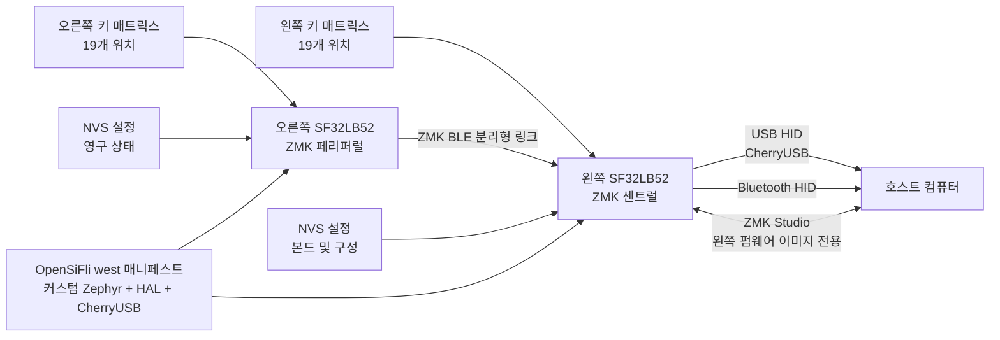

# SF32 기반 ZMK 키보드 펌웨어 { #zmk-keyboard-firmware-on-sf32 }

## SF32의 ZMK란 무엇인가? { #what-is-zmk-on-sf32 }

[ZMK Firmware](https://zmk.dev/)는 Zephyr를 기반으로 하는 MIT 라이선스 키보드 펌웨어입니다. 업스트림 ZMK는 유선, 무선, 분리형 키보드에서 널리 쓰이는 애플리케이션 모델을 제공합니다. 여기에는 매트릭스 스캔, 키맵과 레이어, 키 동작, USB 및 Bluetooth HID, 영구 설정, 확장 가능한 보드/쉴드 정의가 포함됩니다.

[OpenSiFli/zmk](https://github.com/OpenSiFli/zmk)는 해당 프로젝트의 OpenSiFli 다운스트림 포크입니다. 검토한 포크에는 다음이 추가되어 있습니다.

- `sf32lb52_devkit_lcd/sf32lb525uc6/zmk` 보드 변형
- ZMK 애플리케이션 트리 내부의 SF32LB52 SoC 통합
- 단일 보드, 분리형, ZMK Studio, `urchin_sf32lb52` 쉴드 구성
- SF32용 CherryUSB 백엔드
- 256 KB NVS 설정 파티션과 Bluetooth 설정 지원
- 3개 레이어, Bluetooth 프로필 제어, ZMK Studio 잠금 해제 바인딩을 갖춘 Urchin 분리형 키보드 키맵

이것은 개발용 포트이며, 태그가 지정된 SF32 ZMK 제품 릴리스가 아닙니다. 포크의 최상위 README는 일반 업스트림 ZMK README 그대로이며 SF32 전용 빠른 시작 안내를 제공하지 않습니다. 보드, 쉴드, 매니페스트, 소스, 커밋을 실행 가능한 레퍼런스로 취급하고, 적용하기 전에 클린 빌드, 플래싱, 기능, 복구에 대한 자체 증거를 요구하십시오.

## 왜 SF32 구현인가? { #why-the-sf32-implementation }

SF32 포트는 Zephyr의 devicetree, Kconfig, `west`, 키맵, 쉴드, 분리형 키보드 규약을 유지하면서 ZMK의 키보드 모델을 SF32LB52에서 실행하는 방법을 보여 줍니다. `urchin_sf32lb52` 레퍼런스는 38키 레이아웃을 두 반쪽으로 나눕니다. 왼쪽 구성은 ZMK 분리형의 센트럴로, CherryUSB와 ZMK Studio를 활성화해 호스트에 USB HID를 제공할 수 있습니다. 오른쪽 구성은 분리형 페리퍼럴이며, 양쪽 구성 모두 ZMK BLE를 활성화합니다.

따라서 이 포크는 SF32에서 무선 분리형 키보드, USB/Bluetooth 데스크톱 입력 디바이스, 프로그래밍 가능한 매크로 패드, 맞춤형 휴먼 인터페이스 제품을 평가하는 데 유용합니다. 단점은 의존성의 성숙도입니다. 포크의 `west` 매니페스트는 커스텀 Zephyr 브랜치(`v4.3+sf32-zmk_fixes`), 고정된 SiFli HAL 리비전, 커스텀 CherryUSB `zephyr-adapt` 브랜치를 고정합니다. 이들은 포트의 호환성 경계에 속하므로, 전체 마이그레이션과 회귀 검증 없이는 업스트림의 "최신" 리비전으로 교체할 수 없습니다.

## 목표, 범위, 시작 조건 { #outcome-scope-and-entry-criteria }

**목표:** 버전이 고정된 왼쪽 및 오른쪽 Urchin 이미지를 빌드하고 플래시에 기록하여, 전체 키 매트릭스, 레이어, USB HID, BLE 분리형 및 호스트 경로, 설정 유지, ZMK Studio 경계, 복구를 검증합니다. 이후 반복 가능한 증거와 함께 키맵 또는 하드웨어를 한 가지만 제한적으로 변경합니다.

이 페이지는 업스트림 ZMK 기능과의 완전한 동등성, 임의의 ZMK 쉴드와의 호환성, 양산 수준의 배터리 수명, 검증된 무선 성능, 다른 Zephyr/ZMK 리비전으로의 지원되는 마이그레이션을 주장하지 않습니다. 또한 양산용 키보드 PCB를 정의하지도 않습니다. 저장소의 Urchin 구성은 레퍼런스 키 매트릭스를 SF32LB52-DevKit-LCD 핀에 매핑하므로, 커스텀 하드웨어에는 신중하게 변환해야 합니다.

시작하기 전에 다음을 준비하십시오.

- 포크의 `sf32lb525uc6/zmk` 변형과 일치하는 SF32LB52-DevKit-LCD 보드 2개
- `urchin_sf32lb52_left` 및 `urchin_sf32lb52_right` 오버레이와 정확히 일치하게 배선한 38키 분리형 테스트 픽스처, 또는 초기 포트 점검용으로 문서화된 더 작은 테스트 쉴드
- 동작하는 Zephyr/ZMK `west` 환경과 포크의 고정된 모듈을 담을 충분한 저장 공간을 갖춘 호스트
- 분리형 동작을 테스트하기 전에 각 반쪽에 대해 확인해 둔 플래싱, 시리얼 콘솔, 복구 연결
- 왼쪽/센트럴 반쪽용 USB 데이터 케이블, 그리고 오른쪽/페리퍼럴 반쪽에 전원을 공급하고 복구할 독립적인 방법
- Bluetooth 호스트, Studio를 범위에 포함한다면 ZMK Studio를 사용할 수 있는 호스트, 각 반쪽의 전류를 측정할 방법
- 포크 커밋, 매니페스트 리비전, 보드/쉴드 식별자, 빌드 및 플래싱 로그, 키 테스트 결과, 본드, 설정 상태, 전류 측정값에 대한 기록

<div align="center"><em>표: SF32 기반 ZMK 프로젝트 합의 사항</em></div>

<div align="center" markdown>

| 영역 | 검토한 기준 구성 | 적용 전에 필요한 증거 |
|:-----|:------------------|:------------------------------------|
| 포크 | 고정된 커밋의 OpenSiFli/zmk | 포크 커밋, 업스트림과의 관계, 매니페스트 리비전, 로컬 diff 기록 |
| 보드 | `sf32lb52_devkit_lcd/sf32lb525uc6/zmk` | 정확한 보드 리비전, 플래싱/복구 경로, 콘솔 로그 |
| 분리형 레퍼런스 | 센트럴 `urchin_sf32lb52_left`와 페리퍼럴 `urchin_sf32lb52_right` | 배선, 이미지와 반쪽의 대응, 전체 매트릭스 테스트, 분리형 링크 결과 |
| 호스트 경로 | 센트럴 반쪽의 USB/CherryUSB 및 BLE HID | 열거, 페어링/본드, 재연결, 프로필, 오류 복구 증거 |
| 구성 | 3개 레이어 키맵, NVS 설정, 왼쪽의 ZMK Studio | 키별 결과, 설정 유지 테스트, Studio 인증, 롤백 기록 |
| 적용 | 한 번에 하나의 키맵, 매트릭스, 전송, 전원 또는 의존성 변경 | 검토된 변경, 원본 이미지, 전체 회귀 결과 |

</div>

## 하드웨어 및 소프트웨어 사양 { #hardware-and-software-specifications }

### 하드웨어 사양 { #hardware-specification }

<div align="center"><em>표: SF32 기반 ZMK 하드웨어 사양</em></div>

<div align="center" markdown>

| 구성 요소 | 필수 사양 | 역할 | 상태 | 구하는 곳 | 호환성 및 대체 참고 사항 |
|:----------|:-----------------------|:-----|:-------|:----------------|:-------------------------------------|
| SF32LB52-DevKit-LCD 보드 2개 | 보드 타깃 `sf32lb52_devkit_lcd/sf32lb525uc6/zmk`; 두 보드의 리비전을 기록 | 문서화된 분리형 기준 구성의 센트럴 및 페리퍼럴 반쪽 | 분리형 테스트에 필수 | [μForge 보드 레퍼런스](../sf32-products/devkits/SF32LB52-DevKit-LCD.md); [검토한 커밋의 OpenSiFli 보드 변형](https://github.com/OpenSiFli/zmk/tree/fd4d5843065f65ed5ed6198dc2e5d0520330bf8e/app/boards/sifli/sf32lb52_devkit_lcd) | 센트럴 이미지와 페리퍼럴 이미지는 역할/구성이 다릅니다. 두 보드 모두 독립적인 복구 수단을 유지하십시오 |
| Urchin 분리형 키보드 픽스처와 상호 연결 | `urchin_sf32lb52_left` 및 `urchin_sf32lb52_right` 오버레이에 맞게 배선한 38키 매트릭스 | 키 매트릭스, 분리형 전송, 역할별 동작 검증 | 전체 분리형 검증에 필수 | [검토한 커밋의 Urchin 쉴드](https://github.com/OpenSiFli/zmk/tree/fd4d5843065f65ed5ed6198dc2e5d0520330bf8e/app/boards/shields/urchin_sf32lb52) | 오버레이는 배선 레퍼런스이며, 다른 PCB나 임의의 쉴드에 대한 보증이 아닙니다 |
| USB/BLE 호스트와 데이터 케이블 | 센트럴 반쪽용 USB 호스트; Bluetooth HID 호스트; 페리퍼럴 반쪽용으로 따로 접근할 수 있는 전원/플래싱 경로 | 호스트 연결, 입력 검증, 로그, 복구 | 필수 | [OpenSiFli ZMK 포크](https://github.com/OpenSiFli/zmk) | 호스트 OS, BLE 본드 상태, 케이블/포트, 각 반쪽의 복구 연결을 기록하십시오 |

</div>

### 소프트웨어 사양 { #software-specification }

<div align="center"><em>표: SF32 기반 ZMK 소프트웨어 사양</em></div>

<div align="center" markdown>

| 패키지 또는 서비스 | 필수 버전 또는 리비전 | 역할 | 상태 | 구하는 곳 | 호환성 및 업데이트 참고 사항 |
|:-------------------|:-----------------------------|:-----|:-------|:----------------|:-------------------------------|
| OpenSiFli/zmk | 검토한 커밋 [`fd4d5843065f`](https://github.com/OpenSiFli/zmk/tree/fd4d5843065f65ed5ed6198dc2e5d0520330bf8e) | SF32 보드 포트, ZMK 애플리케이션, Urchin 구성 | 필수 | [검토한 커밋의 저장소](https://github.com/OpenSiFli/zmk/tree/fd4d5843065f65ed5ed6198dc2e5d0520330bf8e) | 태그가 지정된 SF32 ZMK 릴리스가 아닙니다. 포팅과 검증 없이 업스트림 ZMK로 대체하지 마십시오 |
| West 매니페스트 의존성 | 고정된 포크 커밋의 `app/west.yml`이 확정하는 정확한 리비전 | Zephyr, `hal_sifli`, CherryUSB 및 기타 모듈 | 필수 | [고정된 west 매니페스트](https://github.com/OpenSiFli/zmk/blob/fd4d5843065f65ed5ed6198dc2e5d0520330bf8e/app/west.yml) | `west list`를 실행해 결과를 보관하십시오. 의존성을 따로 업데이트하지 마십시오 |
| Zephyr `west` 툴체인 및 빌드 도구 | 고정된 매니페스트와 호환되는 버전; 설치된 버전과 호스트 OS를 기록 | 구성, 빌드, 왼쪽/오른쪽 이미지 생성 | 필수 | [ZMK 문서](https://zmk.dev/docs); [Zephyr 문서](https://docs.zephyrproject.org/) | 클린 워크스페이스에서 두 이미지를 다시 빌드하고, 각각의 빌드 디렉터리와 해시를 따로 보관하십시오 |
| ZMK Studio 호스트 | 선택한 구성에서 Studio를 활성화한 경우, 호환되는 호스트/애플리케이션 버전 | 선택 사항인 키맵/구성 경로 | 선택 | [ZMK Studio 문서](https://zmk.dev/docs/features/studio) | 검토한 구성은 왼쪽/센트럴 반쪽에서 Studio를 제공합니다. 제품에 사용하기 전에 인증과 롤백을 검증하십시오 |

</div>

## 지원되는 기준 구성 선택 { #choose-a-supported-baseline }

검토한 OpenSiFli 기준 구성은 2026-05-27의 커밋 `fd4d5843065f`입니다. 이 커밋에서 사용할 수 있는 Urchin 쉴드와 보드 구성 업데이트를 포함하지만, 태그가 지정된 SF32 ZMK 릴리스는 아닙니다. 초기 재현에는 이 커밋을 고정해서 사용하거나, 더 새로운 커밋을 명시적으로 기록하고 검토하십시오.

<div align="center"><em>표: SF32 기반 ZMK 기준 구성 선택</em></div>

<div align="center" markdown>

| 기준 구성 요소 | 권장 시작점 | 핵심 제약 |
|:-----------------|:------------------|:--------------------|
| ZMK 포크 | OpenSiFli/zmk `fd4d5843065f` | 업스트림 zmkfirmware/zmk로 대체하지 마십시오. 이 SF32 포트가 들어 있지 않습니다 |
| 보드 타깃 | `sf32lb52_devkit_lcd/sf32lb525uc6/zmk` | SF32LB52-DevKit-LCD의 ZMK 전용 변형입니다 |
| 실제 제품 구성에 가까운 쉴드 | `urchin_sf32lb52_left` 및 `urchin_sf32lb52_right` | 오버레이마다 GPIO 맵과 역할이 다르므로 이미지를 서로 바꿔 쓸 수 없습니다 |
| 진단용 쉴드 | `sf32lb52_test`, `sf32lb52_split_test_left/right`, `sf32lb52_zmkstudio_test` | 포트 개발용 레퍼런스이며, 제품 호환성에 대한 약속이 아닙니다 |
| 분리형 역할 | 왼쪽 = 센트럴; 오른쪽 = 페리퍼럴 | USB와 ZMK Studio는 왼쪽 구성에서 활성화됩니다. 대칭이라고 가정하지 마십시오 |
| 의존성 매니페스트 | 커스텀 Zephyr `v4.3+sf32-zmk_fixes`, 고정된 `hal_sifli`, 커스텀 CherryUSB `zephyr-adapt` | 의존성 하나만 업데이트해도 호환성 경계가 바뀝니다 |
| 라이선스 | ZMK 포크와 식별된 SF32 추가분은 MIT 헤더/라이선스를 사용 | 모든 모듈, 하드웨어, 키맵 에셋, 제품 콘텐츠를 별도로 검토하십시오 |

</div>

다음 명령은 포크의 자체 `west` 워크플로 형태에 정확한 SF32 보드 및 Urchin 쉴드 식별자를 결합한 것입니다. 이미지가 서로 섞이지 않도록 두 빌드 디렉터리를 보존하십시오.

```bash
git clone https://github.com/OpenSiFli/zmk.git
cd zmk
git checkout fd4d5843065f

west init -l app
west update --fetch-opt=--filter=tree:0
west zephyr-export

west build -s app -p always -d build-left \
  -b sf32lb52_devkit_lcd/sf32lb525uc6/zmk -- \
  -DSHIELD=urchin_sf32lb52_left

west build -s app -p always -d build-right \
  -b sf32lb52_devkit_lcd/sf32lb525uc6/zmk -- \
  -DSHIELD=urchin_sf32lb52_right
```

최종 `west list`, 생성된 Kconfig와 devicetree, 산출물 해시, 이미지와 반쪽의 대응 라벨, 실제 플래싱 절차를 기록하십시오. 각 보드를 독립적으로 복구할 수 있게 되기 전에는 분리형 테스트를 시작하지 마십시오.

## 프로젝트 개발 단계와 의사결정 지점 { #delivery-map }

<div align="center"><em>표: SF32 기반 ZMK 프로젝트 개발 단계와 의사결정 지점</em></div>

<div align="center" markdown>

| 단계 | 이 단계가 뒷받침하는 결정 | 필수 산출물 |
|:------|:---------------------|:----------------|
| 1. 수정하지 않은 포트 기준 구성 | 고정된 포크, 보드 타깃, 쉴드, 배선, 호스트가 함께 동작하는가? | 버전이 고정된 왼쪽/오른쪽 이미지와 정상 동작이 확인된 타이핑 세션 |
| 2. 입력, 전송, 복구 | 매트릭스, USB, BLE, 분리형, 설정, Studio 오류를 진단하고 복구할 수 있는가? | 키 커버리지와 오류 주입 및 복구 기록 |
| 3. 소스 재현 | 두 번째 환경에서 숨은 상태 없이 두 이미지를 다시 생성할 수 있는가? | 매니페스트, 클린 빌드, 산출물 해시, 플래싱, 반복 결과 |
| 4. 범위를 제한한 적용 | 기준 구성을 깨지 않고 키보드 동작 하나 또는 하드웨어 매핑 하나를 변경할 수 있는가? | 범위가 한정된 변경, 롤백 경로, 회귀 증거 |
| 5. 제품 검토 | 이 포트는 커스텀 PCB나 배터리 프로토타입에 쓸 만큼 성숙했는가? | 책임자가 정해진 위험와 진행/보류/중단 결정 |

</div>

## 시스템 아키텍처와 의존성 { #system-architecture-and-dependencies }

<div align="center"><em>그림: SF32LB52의 ZMK 분리형 키보드 경로</em></div>



오류는 서로 다른 영역으로 구분해서 다루십시오. 물리적 매트릭스/배선, 오른쪽에서 왼쪽으로의 분리형 링크, 왼쪽의 USB, 호스트 Bluetooth, 저장된 본드/설정, ZMK Studio, 보드 플래싱/복구, 고정된 의존성 스택입니다. 호스트에 도달하지 않는 키는 스캔 이전, 분리형 전송 중, 센트럴 키맵, 선택한 HID 엔드포인트 중 어디에서든 실패할 수 있으므로 이 순서대로 경로를 진단하십시오.

## 1단계 — 수정하지 않은 포트 기준 구성 확립 { #stage-1-establish-the-untouched-port-baseline }

**목표:** 키맵, 오버레이, 의존성을 변경하기 전에 정확한 OpenSiFli 레퍼런스를 증명합니다.

1. 두 보드의 리비전을 기록하고, 두 픽스처를 왼쪽 및 오른쪽 Urchin 오버레이에 정확히 맞게 배선하십시오. 보드와 USB/플래싱 케이블에 역할별로 라벨을 붙이십시오.
2. 고정된 커밋에서 두 이미지를 빌드하고 `west list`를 저장한 뒤, 생성된 구성을 살펴 예상한 보드, 쉴드, 분리형 역할, BLE, CherryUSB, ZMK Studio, NVS 설정을 확인하십시오.
3. 각 이미지를 독립적으로 확인한 복구 경로로 기록하십시오. 반쪽끼리 또는 호스트와 페어링하기 전에 콜드 부트와 콘솔 동작을 캡처하십시오.
4. BLE 분리형 연결을 설정한 뒤, 38개 위치 전체를 `default`, `lower`, `raise` 레이어에 대해 검증하십시오. 타이핑 테스트 중에 실수로 동작하지 않도록 Bluetooth 프로필 선택/삭제와 Studio 잠금 해제 바인딩은 의도적으로 따로 점검하십시오.
5. 왼쪽 반쪽에서 USB HID와 ZMK Studio를 검증한 다음, 선택한 호스트로의 Bluetooth HID를 검증하십시오. 콜드 스타트 후에 반복하십시오.

**보관할 증거:** 보드 및 배선 기록, 포크 및 매니페스트 리비전, 생성된 구성, 이미지 해시, 플래싱 및 부트 로그, 전체 키 위치 매트릭스, 레이어 결과, 엔드포인트 선택, 호스트/Studio 버전.

**게이트 1 종료 기준:** 두 번의 콜드 스타트에서 38개 위치 전체 키맵, 3개 레이어 전체, 오른쪽에서 왼쪽으로의 분리형 링크, 선택한 호스트 엔드포인트 하나 이상이 재현되며, 두 반쪽 모두 독립적으로 복구할 수 있습니다.

## 2단계 — 입력, 전송, 설정, 복구 검증 { #stage-2-validate-input-transport-settings-and-recovery }

**목표:** 현실적인 키보드 오류가 눈에 보이고, 알 수 없는 상태에서 다시 빌드하지 않고도 복구할 수 있음을 증명합니다.

<div align="center"><em>표: SF32 기반 ZMK 오류 및 복구 테스트</em></div>

<div align="center" markdown>

| 테스트 | 방법 | 통과 증거 |
|:-----|:-------|:--------------|
| 매트릭스 커버리지 | 모든 위치, 롤오버 조합, 각 레이어, 두 직접 입력 모두를 동작시킴 | 누락, 중복, 눌린 채 고정, 역할이 뒤바뀐 키가 없음; 누름/뗌 순서가 기록됨 |
| 분리형 링크 끊김 | 유휴 상태와 타이핑 중에 오른쪽 반쪽의 전원을 끄거나 범위 밖으로 이동 | 왼쪽 키와 호스트 링크가 정의된 상태를 유지함; 오른쪽 반쪽이 재플래싱이나 잔류 키 없이 재연결됨 |
| USB 중단 | 입력 및 Studio 사용 중에 왼쪽 USB 데이터 경로를 분리했다가 다시 연결 | HID와 Studio가 각각 독립적으로 복구됨; 눌린 채 고정된 수정자 키나 손상된 설정이 남지 않음 |
| 호스트 BLE 끊김 | 호스트 Bluetooth를 끄고, 프로필을 전환한 뒤 재연결 | 엔드포인트/프로필 상태가 보임; 재연결과 의도적인 본드 삭제가 기록된 경로를 따름 |
| 설정 유지 | 되돌릴 수 있는 설정을 변경하고, 두 반쪽의 전원을 껐다 켠 뒤, 기준 구성으로 복원 | 예상한 NVS 상태가 유지됨; 문서화된 리셋/복구 경로로 손상되었거나 원하지 않는 상태를 제거할 수 있음 |
| ZMK Studio 경계 | 복구 가능한 환경에서 인증된 변경을 시도하고, 세션 도중 연결을 끊은 뒤 복원 | 센트럴 이미지만 Studio를 제공함; 잘못되었거나 불완전한 변경으로 키보드가 사용 불능이 되지 않음 |
| 전원 사이클 | 전류와 웨이크를 기록하면서 각 반쪽의 전원 사이클을 독립적으로, 그리고 동시에 반복 | 역할, 분리형 링크, 엔드포인트, 키 뗌 상태가 예측 가능하게 복구됨 |

</div>

**게이트 2 종료 기준:** 해당하는 모든 오류에 대해 반복 가능한 검출 및 복구 결과가 있고, 어떤 테스트도 HID 상태를 눌린 채로 고정시키지 않으며, 추적되지 않는 파일을 교체하지 않고도 설정이나 본드를 기록된 기준 구성으로 되돌릴 수 있습니다.

## 3단계 — 재현 가능한 소스 기준 구성 빌드 { #stage-3-build-a-reproducible-source-baseline }

**목표:** 두 번째 엔지니어가 클린 소스에서 두 이미지를 다시 생성하고 2단계를 반복할 수 있게 합니다.

1. 기록된 커밋의 클린 포크 체크아웃에서 시작하여, 로컬 모듈 대체 없이 `west init`, `west update`, `west zephyr-export`를 실행하십시오.
2. `west list`, 컴파일러/도구 버전, 생성된 `.config`, 생성된 devicetree, 메모리 출력, 빌드 로그, 두 산출물을 해시와 함께 저장하십시오.
3. 라벨을 붙인 왼쪽 및 오른쪽 이미지를 올바른 반쪽에 기록하고, 2단계 테스트 전체를 반복하십시오.
4. 산출물과 구성을 원래 기록과 비교하고, 재현되지 않는 차이는 진행하기 전에 원인을 설명하십시오.

**게이트 3 종료 기준:** 두 번째 환경에서 올바르게 라벨이 붙은 이미지가 생성되고, 추적되지 않는 오버레이, 오래된 빌드 출력, 고정되지 않은 의존성 리비전 없이 2단계를 통과합니다.

## 4단계 — 키보드 경계를 한 번에 하나씩 적용 { #stage-4-adapt-one-keyboard-boundary-at-a-time }

**목표:** 정상 동작이 확인된 포트와 독립적인 복구 경로를 유지하면서 제품 변경을 한 가지씩 적용합니다.

<div align="center"><em>표: 범위를 제한한 SF32 기반 ZMK 적용 순서</em></div>

<div align="center" markdown>

| 변경 유형 | 먼저 시도하기 좋은 변경 | 필수 회귀 테스트 |
|:-------------|:------------------|:--------------------|
| 키맵 | 바인딩, 레이어, hold-tap 또는 콤보 하나 | 모든 위치/레이어, 누름-뗌 순서, 롤오버, 분리형 링크 끊김, 두 호스트 엔드포인트 |
| 매트릭스/PCB | 행, 열, 직접 입력 또는 다이오드 방향 변경 하나 | 전기 검토, 생성된 devicetree, 전체 매트릭스, 단락/고스팅, 웨이크, 복구 |
| Studio | 편집 가능한 파라미터 또는 레이아웃 노출 하나 | 인증, 유효/무효 변경, 유지, 연결 끊김, 복원, 버전 호환성 |
| 전송 | USB/BLE 엔드포인트 또는 분리형 정책 변경 하나 | 열거, 페어링, 본드, 프로필 전환, 분리형 재연결, 키 고정 방지, 전류 |
| 전원 | 슬립, 웨이크, 스캔 또는 무선 설정 하나 | 반쪽별 동작/유휴/슬립 전류, 지연 시간, 모든 웨이크 소스, 분리형 재연결, 설정 유지 |
| 의존성 마이그레이션 | ZMK, Zephyr, HAL 또는 CherryUSB 업데이트 하나 | 매니페스트 diff, 클린 빌드, 생성된 구성 diff, 2단계 테스트 전체, 전류, 롤백 |

</div>

**게이트 4 종료 기준:** 변경이 검토되었고, 원본 이미지와 설정을 복원할 수 있으며, 해당하는 모든 매트릭스, 레이어, 분리형, USB, BLE, Studio, 전원, 복구 테스트를 통과합니다.

## 5단계 — 제품 준비 상태 검토 { #stage-5-product-readiness-review }

커스텀 키보드 PCB나 배터리 프로토타입을 설계하기 전에 다음에 답하십시오.

- OpenSiFli ZMK 포크, 커스텀 Zephyr 브랜치, SiFli HAL 리비전, CherryUSB 적용분, 이후의 보안 또는 호환성 업데이트는 누가 책임집니까?
- 업스트림 ZMK 기능 중 SF32에서 실제로 사용해 본 것은 무엇이고, 상속된 트리에만 존재하는 것은 무엇입니까?
- 양산과 서비스 단계에서 왼쪽/오른쪽 이미지 식별, 보드 리비전, 키맵, 구성, 본드, 공장 초기화 상태를 어떻게 관리합니까?
- 스캔 속도, 재연결 동작, 배터리 보호를 포함하여, 각 반쪽의 동작, 연결 유휴, 연결 끊김, 슬립 상태에서 측정한 전류는 얼마입니까?
- 어떤 호스트, 운영 체제, USB 컨트롤러, Bluetooth 스택, 웨이크 경로, 롤오버 사례, 간섭 조건을 테스트했습니까?
- 실패한 의존성 업데이트, Studio 변경, 설정 쓰기, 현장 업데이트를 제품을 열거나 폐기하지 않고 복구할 수 있습니까?
- ZMK/Zephyr 라이선스, PCB 및 인클로저 파일, 키맵 콘텐츠, 로고, 글꼴, 번들된 구성이 배포에 적합합니까?

**게이트 5 종료 기준:** 모든 잔여 위험에 책임자, 증거, 처리 결정이 있고, 팀이 진행, 보류, 중단 중 하나를 명시적으로 결정했습니다.

## 제품 설계로의 인계 { #handoff-to-product-design }

정확한 SF32 부품과 메모리, 분리형 역할과 전송, 행/열/직접 입력 맵, 다이오드 방향, USB 연결, 안테나와 인클로저 가정, NVS/설정 정책, 플래싱 및 복구 인터페이스, 반쪽별 전력 예산, 테스트 픽스처, 이미지 식별, 고정된 매니페스트를 다음 단계로 넘기십시오. 이어서 [SF32LB52-DevKit-LCD](../sf32-products/devkits/SF32LB52-DevKit-LCD.md), [Zephyr 플랫폼 경계](../develop/platforms/zephyr/overview.md), [Bluetooth 아키텍처](../learn/bluetooth/overview.md), [SF32LB52x 하드웨어 설계 가이드](../hardware/chip-guides/SF32LB52x_hardware_design_guide.md), [양산 설계](../hardware/design-for-production.md)를 참고하십시오.

## 주요 정보 출처 { #authoritative-sources }

- [OpenSiFli/zmk SF32 포크](https://github.com/OpenSiFli/zmk)
- [검토한 OpenSiFli/zmk 커밋](https://github.com/OpenSiFli/zmk/tree/fd4d5843065f65ed5ed6198dc2e5d0520330bf8e)
- [검토한 커밋의 SF32LB52 ZMK 보드 변형](https://github.com/OpenSiFli/zmk/tree/fd4d5843065f65ed5ed6198dc2e5d0520330bf8e/app/boards/sifli/sf32lb52_devkit_lcd)
- [검토한 커밋의 Urchin SF32LB52 분리형 쉴드](https://github.com/OpenSiFli/zmk/tree/fd4d5843065f65ed5ed6198dc2e5d0520330bf8e/app/boards/shields/urchin_sf32lb52)
- [검토한 커밋의 OpenSiFli ZMK west 매니페스트](https://github.com/OpenSiFli/zmk/blob/fd4d5843065f65ed5ed6198dc2e5d0520330bf8e/app/west.yml)
- [업스트림 zmkfirmware/zmk](https://github.com/zmkfirmware/zmk)
- [ZMK 문서](https://zmk.dev/docs/)
- [Zephyr 프로젝트 문서](https://docs.zephyrproject.org/)
