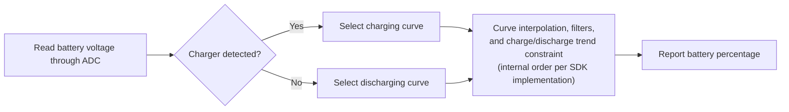

# Battery State-of-Charge Estimation { #battery-capacity-calculation }

The SiFli-SDK battery calculator estimates a battery's state of charge as a percentage from its measured voltage. It is a voltage-to-percentage estimator, not a coulomb counter: the result is only as accurate as the battery curve and charger-state information supplied to it.

The middleware detects the charger state, selects the matching charge or discharge curve, and estimates the percentage by interpolation. It also uses a primary jump filter and an optional weighted-average filter to stabilize the result. The published guide does not fully specify the filters' internal ordering, so check the implementation in the SDK revision used by your project before assuming an exact processing sequence.

## What the Calculator Does { #what-the-calculator-does }

<div align="center"><em>Table: Battery-calculator behavior</em></div>
<div align="center" markdown>

| Function | Behavior |
| --- | --- |
| Charge and discharge curves | Selects the appropriate voltage-to-percentage curve for the current charging state. |
| Linear interpolation | Calculates a percentage between the points in the selected curve. |
| Primary filter | Filters voltage jumps using the configured threshold and confirmation count. |
| Secondary filter | Optionally computes a weighted average of the previous and current voltage values. |
| Charge-state detection | Uses the board's charger-detection configuration to select the charging or discharging curve. |

</div>

<div align="center"><em>Diagram: Battery-percentage estimation path</em></div>



This is a conceptual summary, not a guaranteed internal call sequence. The published guide does not define the exact order of interpolation, filtering, and the charge/discharge trend constraint; verify that sequence in the SDK revision used by your product. The guide does state that the reported percentage does not decrease while charging or increase while discharging.

## Configure the Board First { #configure-the-board-first }

Before using the middleware, configure the board in menuconfig:

1. Enable ADC support for battery-voltage measurement.
2. Enable the battery-calculator feature.
3. Enable charging support.
4. Select the charger IC used by the board. Use the simple charger option only when no listed charger IC applies.
5. Configure the board's charger-insertion detection pin.
6. Select the detection-pin polarity to match the hardware.

`BSP_CHARGER_INT_PIN_ACTIVE_HIGH` defines the charger-detect polarity. When it is defined, a high level means the charger is inserted; when it is not defined, a low level means inserted. A wrong polarity selects the wrong battery curve and can make the displayed percentage appear stuck or behave in the wrong direction.

## Use Battery Curves from the Actual Cell { #use-battery-curves-from-the-actual-cell }

The board directory's default `battery_table.c` is a reference example, not a universal battery model. Obtain voltage-versus-percentage curves for the actual cell from its manufacturer, then configure matching lookup tables for the product.

<div align="center"><em>Table: Battery-curve requirements</em></div>
<div align="center" markdown>

| Table | Required definition |
| --- | --- |
| `charging_curve_table` | `const battery_lookup_point_t[]` table for charging. Voltage entries must be ordered from high to low. |
| `discharge_curve_table` | `const battery_lookup_point_t[]` table for discharging. Voltage entries must be ordered from high to low. |
| Table contents | Percentages correspond from 100 down to 0 and must reflect the actual battery's behavior. |
| Table location | Board-specific `battery_table.c`. |

</div>

Use separate curves because a cell's voltage at the same state of charge differs between charging and discharging. Do not substitute an arbitrary 4.2 V lithium-cell curve for the actual cell simply because the nominal chemistry matches.

!!! warning "Verify the voltage scale for your SDK and board"
    The published SiFli guide is internally inconsistent: it labels `voltage_mv` and the filter thresholds in mV, but its example passes `38000` for `3.8 V` and its sample curve uses `41808` for `4.18 V`. The values are consistent with a 0.1 mV scale, but the guide does not document that scale explicitly; treat it as an inference, not an API guarantee. Before using the calculator, inspect the ADC conversion path, battery table, and threshold comparisons in the exact SDK revision and board configuration.

    Ensure the ADC reading, selected curve table, and filter thresholds use compatible scales. The guide lists threshold literals `50` and `30` and describes them as mV; do not rescale these values based only on the voltage examples. Confirm how the target SDK interprets and compares each field, and do not change only the ADC reading while leaving the table or thresholds on another scale.

## Configure the Calculator { #configure-the-calculator }

`battery_calculator_config_t` supplies the two curve tables and filtering settings.

<div align="center"><em>Table: Battery-calculator configuration</em></div>
<div align="center" markdown>

| Field | Purpose | Published example literal (unit label in docs) |
| --- | --- | --- |
| `charging_table`, `charging_table_size` | Charging curve and number of points | Board-specific |
| `discharging_table`, `discharging_table_size` | Discharge curve and number of points | Board-specific |
| `charge_filter_threshold` | Charging voltage-jump threshold | `50` (labeled mV in docs; verify target SDK scale) |
| `discharge_filter_threshold` | Discharging voltage-jump threshold | `30` (labeled mV in docs; verify target SDK scale) |
| `filter_count` | Number of consecutive threshold-crossing samples required by the primary filter | `3` |
| `secondary_filter_enabled` | Enables the weighted secondary filter | `true` |
| `secondary_filter_weight_pre` | Previous-voltage weight | `90` |
| `secondary_filter_weight_cur` | Current-voltage weight | `10` |

</div>

When the secondary filter is enabled, `secondary_filter_weight_pre + secondary_filter_weight_cur` must equal `100`. Tune thresholds, counts, and weights against the actual battery, load transients, and product experience rather than treating the SDK reference values as a calibration result.

## Initialize and Calculate { #initialize-and-calculate }

Initialize the calculator before requesting a percentage. The published SiFli guide declares the initializer as `void`; compile against the header in the exact SDK revision used by your project.

```c
void battery_calculator_init(battery_calculator_t *calc,
                             const battery_calculator_config_t *config);
```

The percentage API returns 0–100; this is state of charge, not battery capacity in mAh. Check the exact SDK header and implementation for any additional parameter constraints or initialization status before integrating it.

Provide the measured battery voltage using the scale expected by the exact SDK revision. Although the published API names the parameter `voltage_mv`, verify its actual scale as explained above:

```c
uint8_t battery_calculator_get_percent(battery_calculator_t *calc,
                                       uint32_t voltage_mv);
```

<div align="center"><em>Table: Recommended integration sequence</em></div>
<div align="center" markdown>

| Step | Action |
| --- | --- |
| 1 | Configure the board's ADC, charger type, charger-detect pin, and polarity. |
| 2 | Define validated charging and discharging curves in `battery_table.c`. |
| 3 | Initialize `battery_calculator_t` with `battery_calculator_config_t`. |
| 4 | Read the battery voltage through the configured ADC path. |
| 5 | Pass the voltage to `battery_calculator_get_percent()` after verifying its scale against the tables and thresholds. |
| 6 | Use the filtered result for UI, low-battery policy, and product telemetry. |

</div>

## Verify Behavior on Product Hardware { #verify-behavior-on-product-hardware }

The displayed percentage should follow the product's physical state, not merely return plausible-looking values in a lab. Verify the charger-detect state, voltage reading, selected curve, and displayed percentage together during charging, discharging, cable insertion, and cable removal.

<div align="center"><em>Table: Battery-percentage troubleshooting</em></div>
<div align="center" markdown>

| Symptom | Check first |
| --- | --- |
| Percentage changes too abruptly | First verify that the ADC reading, curve tables, and thresholds use the same scale. Then tune the relevant threshold or `filter_count`; enable or strengthen the secondary filter if needed. |
| Percentage is inaccurate | Obtain a curve that matches the actual battery and recalibrate the lookup points. |
| Percentage stays fixed | Verify the reported charger state and the `BSP_CHARGER_INT_PIN_ACTIVE_HIGH` polarity. The published guide states that charging prevents the percentage from decreasing and discharging prevents it from increasing. |
| Percentage has the wrong trend | Verify the charger-detect pin, its electrical polarity, and the selected charging/discharging curve. |

</div>

For the official middleware reference and current configuration screenshots, see [Battery Capacity Calculation in SiFli-SDK](https://docs.sifli.com/projects/sdk/latest/sf32lb58x/middleware/battery_calculator.html). For system-level battery-life estimates, continue with [Smartwatch Power Profiling](smartwatch-power-profiling.md); for measured verification, see [Power Measurement and Validation](measurement-and-validation.md).

The published guide is the starting reference, not a substitute for the SDK revision used by your product. In particular, resolve its voltage-scale inconsistency against that revision's ADC path, battery table, filter comparisons, and API header before relying on the estimator.
