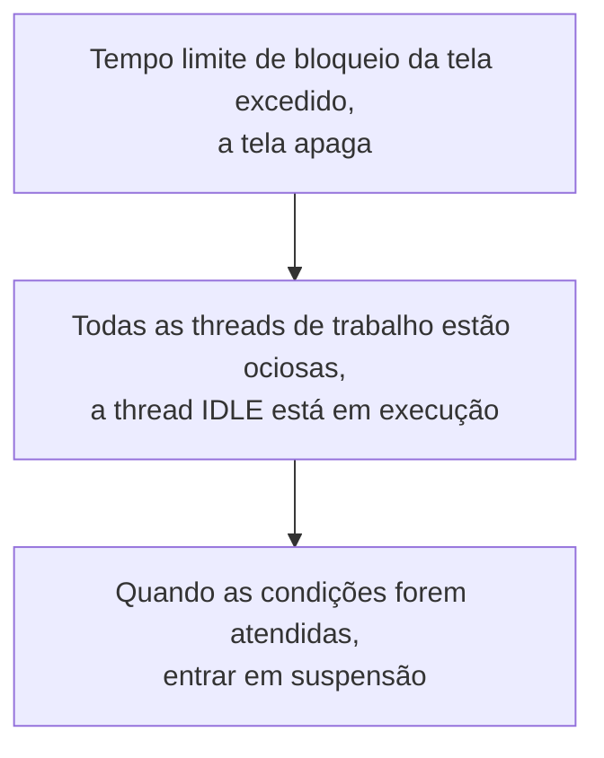
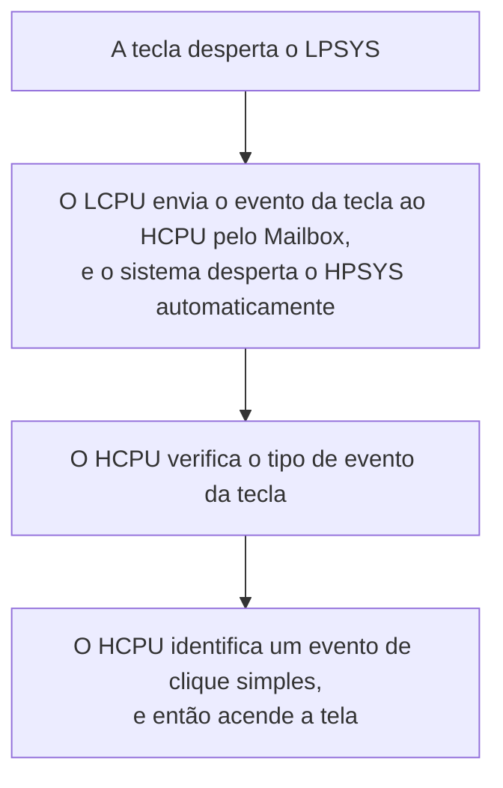

# Configurar e medir o baixo consumo { #configure-and-measure-low-power }

Os guias de baixo consumo do SiFli-SDK abrangem diferentes arquiteturas SF32. SF32LB52x, SF32LB55x e SF32LB56x usam dois núcleos: o HCPU, no HPSYS, opera a até 240 MHz para tarefas de alto desempenho, e o LCPU, no LPSYS, a até 48 MHz para Bluetooth e sensores. SF32LB57x e SF32LB58x acrescentam um ACPU à arquitetura HCPU/LCPU; no SF32LB58x, o LCPU de baixo consumo opera a até 96 MHz. O número de núcleos, os limites de clock e o comportamento em baixo consumo variam entre as famílias; consulte o guia do SDK correspondente ao dispositivo de destino.

## Configurar a estrutura de gerenciamento de energia { #configure-the-power-management-framework }

No diretório do projeto, execute:

```bash
sdk.py menuconfig
```

As configurações de menuconfig abaixo vêm do guia de origem do SF32LB52x. Os nomes dos modos e as opções disponíveis podem variar conforme a família e a versão do SDK; antes de aplicá-las, confira a documentação da família de destino.

<div align="center" markdown>

<em>Tabela: exemplo de configuração de baixo consumo no menuconfig do SF32LB52x</em>

| Caminho no menuconfig | Símbolo | Finalidade |
|---|---|---|
| `Sifli middleware → Enable Low power support` | `BSP_USING_PM` | Ativa o módulo de gerenciamento de energia do SiFli. |
| `RTOS → RT-Thread Components → Device Drivers → Using Power Management device drivers → Select PM Mode → Enable Deep Mode` | `PM_DEEP_ENABLE` | Habilita o suporte a Deep Sleep. |
| `Sifli middleware → Enable Low power support → Enable PM Debug` | `BSP_PM_DEBUG` | Exibe as transições de gerenciamento de energia; desative-o nas medições finais de corrente. |
</div>

O `rtconfig.h` gerado normalmente contém `RT_USING_PM`, `BSP_USING_PM` e o símbolo do modo selecionado. Use `example/pm/classical` como referência funcional. Para desativar o recurso, reverta as mesmas seleções no menuconfig.

As figuras abaixo vêm do guia de origem do SF32LB52x e mostram os dois locais relevantes no menu. No projeto, use como referência o menu do SDK da família de destino.

{ loading="lazy" }
<div align="center"><em>Figura: exemplo do guia de origem do SF32LB52x — ative `BSP_USING_PM` em Sifli middleware → Enable Low power support.</em></div>

{ loading="lazy" }
<div align="center"><em>Figura: exemplo do guia de origem do SF32LB52x — ative `PM_DEEP_ENABLE` em RTOS → RT-Thread Components → Device Drivers.</em></div>

## Selecionar uma fonte de despertar { #select-a-wake-source }

Use os arquivos `pinmux.c`/`drv_io.c` da placa e as APIs do exemplo correspondente no SDK.

<div align="center" markdown>

<em>Tabela: comportamento de despertar em Deep Sleep/Standby e Hibernate por família</em>

| Família | Despertar em Deep Sleep/Standby | Despertar em Hibernate |
|---|---|---|
| SF32LB52x | Em Deep Sleep, todos os pinos podem despertar o sistema por `WSR_GPIO1`; não é necessário selecionar um pino adicional. HCPU e LCPU podem entrar em suspensão de forma independente. | Configure o pino e o nível de despertar da PMU antes de chamar `HAL_PMU_EnterHibernate()`. |
| SF32LB55x | Use o mapa de pinos AON específico da família 55x. | Em Hibernate, somente os pinos de despertar `PIN0`–`PIN5` do LCPU podem despertar o sistema. Use `HAL_PMU_EnablePinWakeup()` com um número de pino válido para 55x. Esses pinos ficam como entradas flutuantes em Hibernate; use um resistor externo de pull-up ou pull-down se o projeto da placa exigir. |
| SF32LB56x | Use o mapa de pinos HPAON/LPAON específico da família. | A PMU aceita duas fontes de despertar, `PIN0` e `PIN1`, que podem ser mapeadas para um pino de despertar do HCPU ou do LCPU. Consulte o exemplo de mapeamento da PMU abaixo. |
| SF32LB57x | Use o mapa de pinos HPAON/LPAON específico da família. | A PMU aceita duas fontes de despertar, `PIN0` e `PIN1`; o índice do pino de despertar em Hibernate no 57x vai de 0 a 13. Mapeie cada fonte para o pino de despertar HCPU/LCPU pretendido. |
| SF32LB58x | Use o mapa de pinos HPAON/LPAON específico da família. | A PMU aceita duas fontes de despertar, `PIN0` e `PIN1`, que podem ser mapeadas para um pino de despertar do HCPU ou do LCPU. Consulte o exemplo de mapeamento da PMU abaixo. |
</div>

Para Hibernate no SF32LB52x, SF32LB56x, SF32LB57x e SF32LB58x, o exemplo abaixo mapeia um GPIO para a fonte de despertar `PIN0` da PMU. Ele não se aplica ao SF32LB55x, que usa o procedimento separado indicado na tabela. No SF32LB57x, o índice do pino de despertar da PMU vai de 0 a 13. Confirme o mapeamento escolhido no manual do dispositivo de destino e no projeto da placa.

```c
HAL_PMU_SelectWakeupPin(0,
    HAL_HPAON_QueryWakeupPin(hwp_gpio1, BSP_KEY1_PIN));
HAL_PMU_EnablePinWakeup(0, AON_PIN_MODE_HIGH);
rt_kprintf("CR:0x%x, WER:0x%x\n", hwp_pmuc->CR, hwp_pmuc->WER);
```

O despertar de Hibernate é uma inicialização a frio com `PM_HIBERNATE_BOOT` definido; ao contrário do Standby, não retoma a execução no ponto em que foi interrompida. Se um mesmo IO precisar despertar o sistema tanto de Standby quanto de Hibernate, configure os dois caminhos. Na família 55x, os pinos de despertar de Hibernate são entradas flutuantes; use um resistor externo de pull-up ou pull-down quando necessário no projeto da placa.

## Entender os estados de suspensão { #understand-the-sleep-states }

<div align="center" markdown>

<em>Tabela: modos de suspensão e faixas de referência do guia para o despertar</em>

| Modo do SDK | Estado da CPU/periféricos | SRAM e fontes de despertar | Faixa de tempo de despertar indicada no guia |
|---|---|---|---|
| `PM_SLEEP_MODE_IDLE` | A CPU aguarda em WFI/WFE; clocks e periféricos continuam funcionando. | A SRAM permanece acessível; qualquer interrupção pode despertar o sistema. | <1 µs |
| `PM_SLEEP_MODE_LIGHT` | Os clocks de alta velocidade param; o subsistema muda para 32 kHz. | LPTIM, RTC, BLE MAC do LCPU, Mailbox ou um pino de despertar. | 30–100 µs |
| `PM_SLEEP_MODE_DEEP` | Semelhante ao Light Sleep, mas a alimentação muda para `RET_LDO`. | A retenção de SRAM e as fontes de despertar variam conforme a família; consulte a tabela abaixo. | 100 µs–1 ms |
| `PM_SLEEP_MODE_STANDBY` | A CPU e seus periféricos são reinicializados ou desligados; o estado dos pinos é preservado. | A capacidade de SRAM retida e as fontes de despertar variam conforme a família; o software identifica a inicialização a partir de Standby pelo estado AON. | 1–2 ms |
| Hibernate | Todos os subsistemas são desligados; o cristal de 32 kHz permanece ativo. | RTC ou pino de despertar da PMU; a RAM não é retida. `HAL_PMU_EnterHibernate()`. | >2 ms |
| Desligamento (Shutdown) | Todos os subsistemas são desligados; o RC10K permanece ativo. | RTC ou pino de despertar da PMU; a RAM não é retida e os IOs ficam em alta impedância. `HAL_PMU_EnterShutdown()`. | >2 ms |
</div>

<div align="center" markdown>

<em>Tabela: referências de retenção de SRAM e tempo de despertar por família</em>

| Família | `PM_SLEEP_MODE_DEEP` | `PM_SLEEP_MODE_STANDBY` |
|---|---|---|
| SF32LB52x | As SRAMs de HPSYS e LPSYS ficam inacessíveis, mas são retidas; despertar em cerca de 250 µs. | A SRAM de LPSYS fica inacessível, mas é totalmente retida; a SRAM de HPSYS permanece inacessível e somente 384 KB dela são retidos; despertar em cerca de 1 ms. |
| SF32LB55x | As SRAMs de HPSYS e LPSYS ficam inacessíveis, mas são retidas; despertar em cerca de 250 µs. | A SRAM de LPSYS fica inacessível, mas é totalmente retida; a SRAM de HPSYS permanece inacessível e somente 64 KB dela são retidos; despertar em cerca de 1,5 ms. |
| SF32LB56x | As SRAMs de HPSYS e LPSYS ficam inacessíveis, mas são retidas; despertar em cerca de 250 µs. | A SRAM de LPSYS fica inacessível, mas é totalmente retida; a SRAM de HPSYS permanece inacessível e somente 64 KB dela são retidos; despertar em cerca de 1,5 ms. |
| SF32LB58x | As SRAMs de HPSYS e LPSYS ficam inacessíveis, mas são retidas; despertar em cerca de 250 µs. | A SRAM de LPSYS fica inacessível, mas é totalmente retida; a SRAM de HPSYS permanece inacessível e somente 64 KB dela são retidos; despertar em cerca de 1,5 ms. |

</div>

O guia atual de baixo consumo citado não apresenta uma linha comparável de retenção de SRAM e tempo de despertar para o SF32LB57x. Não extrapole para o SF32LB57x a capacidade de retenção nem os tempos de outra família; confirme-os na versão do SDK e na documentação do dispositivo de destino.

No quadro anterior, `PM_SLEEP_MODE_LIGHT`, `PM_SLEEP_MODE_DEEP` e `PM_SLEEP_MODE_STANDBY` correspondem, respectivamente, a Light Sleep, Deep Sleep e Standby.

Os valores por família são referências dos guias do SDK, não tempos de despertar garantidos na placa. O guia do SF32LB52x informa que, quando há PSRAM, o HCPU salva nela os dados da RAM que será desligada e os restaura após o despertar; sem PSRAM, usa 64 KB de RAM Retention como destino da cópia. Essa área de cópia é diferente da capacidade de SRAM retida indicada para cada família (por exemplo, o Standby do SF32LB52x lista 384 KB de SRAM HPSYS retida). Não presuma que essa política de cópia ou essa capacidade se aplique a outras famílias, a menos que o guia do SDK correspondente confirme. A corrente real também depende dos periféricos habilitados, dos níveis de IO, da memória externa e da placa.

## Controlar os clocks enquanto o sistema está ativo { #control-clocks-while-awake }

Se a thread idle não consegue entrar em um estado de suspensão, a redução automática de frequência do WFI pode diminuir a corrente. Isso só é seguro quando EPIC, EZIP, LCDC, USB e SD estão ociosos. Se a aplicação não usar o mecanismo do SDK que acompanha a atividade de LVGL e dos dispositivos, sinalize o início e o fim da atividade dos periféricos com `rt_pm_hw_device_start()` e `rt_pm_hw_device_stop()`. Configure o divisor com `HAL_RCC_HCPU_SetDeepWFIDiv()`; em geral, tarefas de áudio limitam o clock reduzido a 48 MHz, enquanto outras podem usar 4 MHz. Configure `HPSYS_RCC_DBGR_FORCE_HP` conforme necessário e indicado no guia do SDK.

Para executar tarefas, use `rt_pm_run_enter()`:

<div align="center" markdown>

<em>Tabela: clocks do HCPU nos modos de execução</em>

| Modo | Clock do HCPU |
|---|---:|
| `PM_RUN_MODE_HIGH_SPEED` | 240 MHz |
| `PM_RUN_MODE_NORMAL_SPEED` | 144 MHz |
| `PM_RUN_MODE_MEDIUM_SPEED` | 48 MHz |
| `PM_RUN_MODE_LOW_SPEED` | 24 MHz |
</div>

`pm_scenario_start()`/`pm_scenario_stop()` aplicam a política do SDK para UI e áudio: se qualquer um dos cenários estiver ativo, o sistema seleciona alta velocidade; se nenhum estiver ativo, seleciona velocidade média. Meça a energia, não apenas a corrente instantânea, pois um clock mais baixo pode prolongar a execução.

## Entender a sequência de suspensão entre subsistemas { #understand-inter-subsystem-sleep-sequencing }

Depois que a tela apaga, o HPSYS pode entrar em suspensão. Nas famílias 55x/56x/58x, normalmente o LPSYS entra em seguida; a família 52x é a exceção documentada e permite que HCPU e LCPU suspendam de forma independente. As fontes disponíveis não confirmam que o ACPU do 57x siga a mesma sequência; verifique a política dos subsistemas na versão correspondente do SDK. Após o despertar, `gui_resume` inicia um novo ciclo de decisão sobre apagar a tela. Mantenha ativo o núcleo necessário enquanto um periférico compartilhado ou uma transação IPC depender dele.

Ative `BSP_PM_DEBUG` temporariamente e procure estes marcadores nos logs:

<div align="center" markdown>

<em>Tabela: marcadores de log das transições de baixo consumo</em>

| Log | Significado |
|---|---|
| `gui_suspend` / `gui_resume` | Transição de tela apagada/acesa. |
| `[pm]S: mode,gtime` | Entrada em suspensão; `gtime` é expresso em ticks de 32.768 Hz. |
| `[pm]W: gtime` | Despertar do estado de suspensão. |
| `[pm]WSR:0x...` | Motivo do despertar; decodifique os bits usando o manual da família correspondente. |
</div>

Se o sistema não entrar no estado de suspensão esperado, verifique `list_thread`, `pm_dump` e `list_timer`. A thread IDLE precisa ser executada; nenhum trecho de código pode manter uma solicitação `rt_pm_request(PM_SLEEP_MODE_IDLE)` ativa; o próximo temporizador do SO deve expirar depois do limite da política (normalmente 100 ms para o HCPU e 10 ms para o LCPU); as condições de despertar devem estar inativas e as filas IPC, vazias. Um atraso periódico menor que esse limite pode impedir indefinidamente a entrada em suspensão.

O guia de origem também ilustra os fluxos “tela apaga → IDLE → entra em suspensão quando as condições são atendidas” e “uma tecla desperta o LPSYS; então, o LCPU envia o evento ao HCPU pelo Mailbox e o sistema desperta o HPSYS automaticamente”. Esses fluxos ajudam a conferir a ordem dos logs, mas são exemplos do SF32LB52x; não os use para inferir a atribuição dos bits WSR em outra família.

{ loading="lazy" }
<div align="center"><em>Figura: chave de depuração de baixo consumo do SF32LB52x (`BSP_PM_DEBUG`).</em></div>

<div align="center"><em>Figura: fluxo de exemplo do SF32LB52x — da tela apagada à suspensão.</em></div>



<div align="center"><em>Figura: fluxo de exemplo do SF32LB52x — despertar do LPSYS para o HPSYS.</em></div>



## Reduzir a corrente de fuga na placa { #reduce-board-level-leakage }

Primeiro, meça o sistema mínimo: desconecte o display, os sensores, o carregador e outras cargas removíveis; depois, reconecte cada uma separadamente. As fontes comuns de corrente de fuga incluem:

- um dispositivo externo que continua alimentado;
- uma saída em nível alto conectada a um dispositivo desligado;
- uma entrada flutuante ou uma configuração incompatível de pull-up/pull-down;
- PSRAM, Flash NOR/NAND, eMMC ou SDIO que não foi colocado em modo de baixo consumo;
- uma configuração USB `PA01` da família 55x que conflita com o pull-down interno.

Implemente as transições específicas da placa em `BSP_IO_Power_Down()` e `BSP_Power_Up()`. Use `BSP_TP_PowerDown/Up` e `BSP_LCD_PowerDown/Up` quando a alimentação do display ou do toque precisar mudar imediatamente ao apagar ou acender a tela. Se o XIP estiver sendo executado a partir da Flash NOR, coloque a rotina de suspensão/despertar da Flash na RAM de retenção (`HAL_RAM_RET_CODE_SECT`).

## Medir e registrar resultados reproduzíveis { #measure-and-record-a-reproducible-result }

Para cada medição, registre a família e a revisão do SDK, a revisão da placa, a tensão de alimentação, o ponto de medição e a largura de banda do instrumento, a configuração do firmware, as memórias instaladas, os periféricos ativos, a fonte de despertar, o modo de suspensão e o log de transições. Apresente a corrente junto com o estado e as condições do teste; não compare valores isolados obtidos em placas ou modos diferentes.

Fontes oficiais por família: [SF32LB52x](https://docs.sifli.com/projects/sdk/latest/sf32lb52x/app_note/low_power.html), [SF32LB55x](https://docs.sifli.com/projects/sdk/latest/sf32lb55x/app_note/low_power.html), [SF32LB56x](https://docs.sifli.com/projects/sdk/latest/sf32lb56x/app_note/low_power.html) e [SF32LB58x](https://docs.sifli.com/projects/sdk/latest/sf32lb58x/app_note/low_power.html). A [referência da API PMU do SDK](https://docs.sifli.com/projects/sdk/latest/en/sf32lb52x/api/hal/pmu.html) documenta a faixa do índice do pino de despertar em Hibernate no SF32LB57x.
