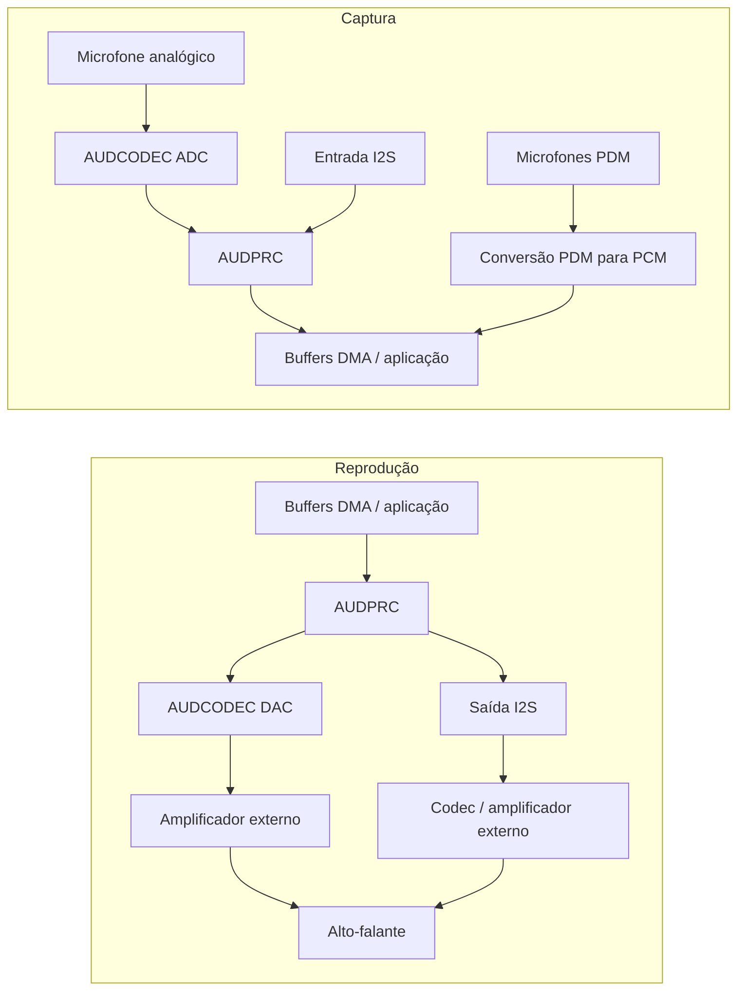

# Visão geral de áudio { #audio-overview }

## Visão geral { #overview }

Este guia apresenta o **subsistema de áudio local** dos dispositivos SF32: o caminho formado pelo codec, DMA e middleware, usado para entrada de microfone, saída para alto-falante ou linha e reprodução ou gravação no dispositivo. O foco está nas decisões práticas sobre interfaces, buffers, middleware Audio Server, codecs e consumo de energia.

O áudio Bluetooth (A2DP, LE Audio) é relacionado, mas constitui um tópico separado, abordado na [visão geral do Bluetooth](../bluetooth/overview.md#bluetooth-audio-and-le-audio). A visão geral de Bluetooth trata da transmissão sem fio; esta página explica o que ocorre depois que as amostras chegam ao chip: captura, mixagem, decodificação e acionamento do caminho físico de áudio.

Use esta página ao escolher microfones, codec, estratégia de buffers e gerenciamento de energia para um produto, não apenas para fazer uma demonstração de áudio tocar uma vez. O conteúdo se destina a engenheiros que precisam garantir a confiabilidade do caminho de áudio diante das restrições de Bluetooth, display, armazenamento e bateria.

## Defina os requisitos de áudio do produto { #define-the-products-audio-requirements }

Antes de escolher interfaces ou tamanhos de buffer, defina o que o produto precisa:

- Apenas reprodução, apenas gravação ou ambas simultaneamente (full-duplex)?
- Quantos microfones serão usados? Eles são analógicos (AMIC) ou digitais (DMIC)?
- Quais formatos serão usados na reprodução local: PCM bruto, MP3, Opus ou outro codec?
- O áudio Bluetooth (Classic ou LE Audio) também precisa funcionar em paralelo com o áudio local?
- O produto precisa de ativação por voz ou escuta contínua? Qual é o orçamento de energia?
- Quais são os requisitos de acionamento da saída para alto-falante/linha? A saída será encaminhada a um amplificador ou codec externo?
- Qual é a tolerância à latência? Chamadas de voz e monitoramento em tempo real têm requisitos muito mais rigorosos do que toques de notificação.

As respostas determinam a interface (I2S, PDM ou ADC/DAC), a configuração do codec e quais partes do pipeline precisam permanecer ativas.

## Caminho de sinal de áudio do SF32 { #the-sf32-audio-signal-path }

Captura e reprodução usam caminhos diferentes. O diagrama mostra caminhos comuns; a disponibilidade e o uso simultâneo dependem do modelo, do encapsulamento, da placa e da configuração do SDK.

<div align="center"><em>Figura: caminho típico do sinal de áudio local no SF32</em></div>



O **AUDCODEC** faz a conversão analógico-digital e digital-analógica. O **AUDPRC** executa mixagem, ganho e conversão de taxa de amostragem nos caminhos compatíveis. Os microfones PDM usam o bloco PDM para gerar PCM; não passam pelo ADC analógico. I2S conecta dispositivos de áudio digital externos. Uma interface PDM pode conectar até dois microfones compatíveis pela seleção de canal esquerdo/direito; duas interfaces permitem até quatro, conforme os pinos disponíveis e o suporte do driver.

O **Audio Server** é um software que gerencia fluxos e sessões, não um conversor físico entre o microfone e o alto-falante. A aplicação normalmente usa suas APIs e os drivers correspondentes; testes diretos do driver ou da HAL são úteis durante o bring-up. Selecione primeiro os caminhos reais de captura e reprodução, depois verifique clocks, formatos de amostra, requisições DMA e os requisitos de acionamento da saída. Não presuma que o DAC integrado consiga acionar o alto-falante escolhido sem amplificador externo.

Esses caminhos estão descritos no [guia do driver AUDPRC/AUDCODEC](https://docs.sifli.com/projects/sdk/latest/en/sf32lb52x/drivers/audprc_audcodec.html) e no [guia HAL de PDM](https://docs.sifli.com/projects/sdk/latest/en/sf32lb52x/hal/pdm.html).

## Microfones e interfaces digitais { #choosing-interfaces-amic-dmic-and-i2s }

AMIC e DMIC indicam tipos de microfone; PDM e I2S são interfaces digitais. Um microfone digital pode usar PDM ou I2S. Não trate microfone, canal e interface como o mesmo recurso.

<div align="center"><em>Tabela: microfones e interfaces digitais</em></div>

<div align="center" markdown>

| Microfone / Barramento | Uso típico | Observações |
|:----------|:------------|:------|
| **AMIC (entrada de microfone analógico)** | Captura de áudio de uso geral | Usa um ADC de áudio; verifique polarização, ganho, faixa de entrada e controle do ruído na placa. |
| **DMIC (microfone digital)** | Captura de voz e arranjos com vários microfones | Escolha o barramento real, PDM ou I2S. A sinalização digital não elimina os requisitos de alimentação, clock e layout. |
| **I2S** | Transmissão de PCM para/de codecs ou amplificadores externos | É comum quando se usa um codec ou amplificador de áudio externo, em vez do caminho do AUDCODEC integrado ao chip. |
| **PDM** | Entrada de microfone digital | Interface nativa de muitos microfones DMIC, usada em conjunto com a conversão de PDM para PCM integrada ao chip. |

</div>

Arranjos mistos analógicos/digitais exigem caminhos simultâneos compatíveis e amostragem sincronizada. A formação de feixe (beamforming) também requer disposição adequada, calibração e um algoritmo; apenas conectar vários microfones não basta.

## Comece com um exemplo de áudio validado { #start-from-a-verified-audio-example }

Escolha e valide o exemplo do SiFli-SDK mais próximo do seu caso antes de projetar o comportamento da aplicação. [Exemplos de áudio do SDK](audio-sdk-examples.md) relaciona os exemplos oficiais de PDM, captura analógica, gravação e reprodução, música local, cartão SD, FLAC, Opus e mixagem às tarefas de engenharia que eles demonstram. O artigo também identifica os aspectos da placa, da multiplexação de pinos, do armazenamento e da configuração que devem ser verificados novamente antes de adaptar um exemplo ao produto.

## Escolha o dispositivo SF32 adequado { #pick-the-right-sf32-device }

Os recursos de áudio variam entre as famílias. Consulte o datasheet do modelo exato; a tabela serve como orientação inicial:

<div align="center"><em>Tabela: orientação para escolher um dispositivo SF32</em></div>

<div align="center" markdown>

| Família | ADC/DAC de áudio integrados | Interfaces PDM (máximo de microfones) | Interfaces I2S | Aplicação sugerida |
|:---|:---|:---|:---|:---|
| **SF32LB52x** | 1 ADC + 1 DAC | 1 (2) | 1 | Acessórios de áudio Bluetooth com foco em baixo custo e HMIs compactas com suporte a voz. |
| **SF32LB55x** | Nenhum; use um codec de áudio externo para áudio analógico. | SF32LB551/555: 1 (2); SF32LB557: 2 (4) | SF32LB551/555: 1; SF32LB557: 2 | Dispositivos vestíveis BLE e produtos com muitos sensores, nos quais o áudio é secundário. |
| **SF32LB56x** | 1 ADC + 1 DAC | 2 (4) | 1 | Produtos com HMI e displays mais avançados que também precisam captar voz com vários microfones. |
| **SF32LB57x** | 2 ADC + 1 DAC | 2 (4) | 2 | Captura de voz com vários microfones e reprodução local. |
| **SF32LB58x** | 2 ADC + 2 DAC | 2 (4) | 3 | Produtos topo de linha que combinam áudio, gráficos, IA e conectividade complexa. |

</div>

Antes de escolher, confirme o modelo, os pinos do encapsulamento, sua multiplexação e os caminhos simultâneos. Uma interface PDM pode atender a dois microfones compatíveis; canais ADC, canais de microfone e interfaces digitais são recursos diferentes. As funções do I2S variam conforme a instância: no SF32LB58x, o I2S1 aceita apenas recepção (RX), enquanto I2S2 e I2S3 aceitam recepção e transmissão (RX/TX). Para receber pelo I2S2, também é necessário habilitar o lado TX como fonte de clock. O [guia HAL de I2S da SiFli](https://docs.sifli.com/projects/sdk/latest/en/sf32lb52x/hal/i2s.html) detalha cada instância; outros fatores de seleção estão na [Família SF32](../../sf32-products/family/SF32_family.md).

Fontes: [DS5201](https://downloads.sifli.com/user%20manual/DS5201-SF32LB52x-Datasheet%20V2p5.pdf), [DS5501, Table 0-1](https://downloads.sifli.com/user%20manual/DS5501-SF32LB55x-Datasheet%20V1p7p2.pdf), [DS5601](https://downloads.sifli.com/user%20manual/DS5601-SF32LB56x-Datasheet%20V1p9p2.pdf), [DS5801](https://downloads.sifli.com/user%20manual/DS5801-SF32LB58x-Datasheet%20V1p8p3.pdf), [registradores AUDCODEC do SF32LB57x (ADC_CH0/1, DAC_CH0)](https://github.com/OpenSiFli/SiFli-SDK/blob/v2.5.1/drivers/cmsis/sf32lb57x/audcodec.h), [instâncias PDM/I2S do SF32LB57x](https://github.com/OpenSiFli/SiFli-SDK/blob/v2.5.1/drivers/cmsis/sf32lb57x/register.h), [notas de versão do SiFli SDK v2.5.1 (configuração PDM de 4 microfones no 57x)](https://github.com/OpenSiFli/SiFli-SDK/releases/tag/v2.5.1), [exemplo PDM do SiFli SDK (placa 57x, PDM1, canais estéreo)](https://docs.sifli.com/projects/sdk/latest/en/sf32lb52x/example/rt_device/pdm/README.html).

## Modelos de sessão de áudio { #audio-session-templates }

A maioria dos produtos se enquadra em alguns padrões recorrentes de sessão. Escolha o mais próximo do seu caso e valide-o explicitamente:

<div align="center"><em>Tabela: modelos de sessão de áudio</em></div>

<div align="center" markdown>

| Sessão | Pipeline típico | Principal risco |
|:--------|:-----------------|:----------|
| Som de notificação | Recurso em Flash/PSRAM -> decodificação, se necessária -> Audio Server -> DAC/amplificador | Estalos ou cliques ao iniciar e parar. |
| Gravação de voz | AMIC -> ADC/AUDPRC, ou microfone PDM -> conversão PDM para PCM, ou entrada I2S -> buffers DMA -> aplicação/armazenamento/Bluetooth | Estouro de buffer e deriva do clock. |
| Alto-falante Bluetooth | Áudio Bluetooth -> decodificação/mixagem -> Audio Server -> DAC/amplificador | Coexistência com RF e disputa pela largura de banda da memória. |
| Chamada de voz | Captura pelo microfone e reprodução simultâneas | Latência full-duplex, tratamento do caminho de eco e gerenciamento dos buffers. |
| Ativação por voz/escuta contínua | Captura com baixa taxa de amostragem -> extração de características -> gatilho de IA | Consumo em espera e ativações falsas. |

</div>

Defina o comportamento de início, operação estável, recuperação de underrun/overrun e encerramento de cada sessão. Problemas de áudio muitas vezes aparecem nas transições, não durante o ciclo estável de reprodução.

## Orçamento de buffer e latência { #buffer-and-latency-budget }

A duração de áudio do buffer é calculada em **quadros de amostras**: cada quadro contém uma amostra de cada canal.

```text
interleaved frames = buffer bytes / (channels * stored bytes per sample)
planar frames per channel = channel buffer bytes / stored bytes per sample
buffer duration (s) = frames / sample rate (Hz)
```

A 48 kHz, 480 quadros representam 10 ms. Em estéreo intercalado, são 960 amostras individuais; 480 amostras individuais representam apenas 5 ms. Para converter bytes em quadros, use os bytes efetivamente armazenados por amostra, incluindo o preenchimento. Se os canais tiverem buffers separados, conte os quadros de cada canal sem somar os comprimentos dos dois buffers.

Essa é a duração do áudio no buffer, não necessariamente a latência de ponta a ponta. O buffer duplo permite que o DMA use uma região enquanto o software processa a outra. A latência depende dos dados pendentes nas filas e do uso de callbacks de meia transferência ou transferência completa, não apenas de haver dois buffers. Faça o orçamento e meça em conjunto os atrasos de captura, processamento, transporte, reprodução e escalonamento.

## Fundamentos de reprodução e gravação { #playback-and-recording-basics }

Os mesmos princípios se aplicam tanto ao acionamento de um alto-falante quanto à captura por microfone:

- **Dimensionamento dos buffers** — blocos pequenos podem reduzir a latência associada ao processamento em blocos, mas aumentam a sobrecarga de interrupções/DMA; blocos grandes oferecem mais margem de escalonamento e consomem mais memória. A latência aumenta quando mais áudio espera antes de ser processado ou reproduzido, não apenas porque foi alocada mais capacidade de buffer.
- **Transferência por DMA** — use DMA sincronizado pelo hardware para transferir as amostras do periférico. O software pode copiar ou processar blocos em memória; evite polling da CPU ou laços por amostra que precisem atender ao periférico em tempo real.
- **Planejamento da taxa de amostragem e do formato** — defina antecipadamente a taxa de amostragem (por exemplo, 16 kHz para voz, 44,1/48 kHz para música) e a profundidade de bits; converter formatos em tempo de execução consome CPU e memória.
- **Buffer duplo** — enquanto o DMA transfere uma região, o software preenche ou processa a outra. Conclua antes que a região seja necessária novamente; dois buffers, por si só, não evitam underrun ou overrun.

Para buffers cacheáveis compartilhados com DMA, defina quem pode acessar cada região e siga as regras de alinhamento e manutenção das linhas de cache do SDK. Limpe os dados de reprodução escritos pela CPU antes da leitura pelo DMA. Prepare o destino antes da escrita da captura pelo DMA e invalide a região concluída antes da leitura pela CPU, conforme a política de cache do dispositivo. Não modifique nem reutilize uma região em uso pelo DMA até que o callback de conclusão permita; não coloque dados alheios nas linhas de cache afetadas.

## Escolha de codec e compressão { #codec-and-compression-choices }

Diferencie o **codec de áudio em hardware** (conversão ADC/DAC) do **codec de compressão** (como MP3 ou Opus). PCM bruto dispensa um decodificador de compressão. Para um sinal equivalente, a compressão com perdas geralmente reduz o tamanho armazenado e a largura de banda de leitura. Ainda é necessário medir o tempo de CPU, os buffers de trabalho e a energia do decodificador; um arquivo menor não garante menor uso de memória durante a execução.

<div align="center"><em>Tabela: escolha de codec e formato de compressão</em></div>

<div align="center" markdown>

| Formato | Uso típico | Observações |
|:-------|:-------------|:------|
| **PCM bruto** | Sons curtos, monitoramento de baixa latência e pipelines de voz | Sem decodificação de compressão; o tamanho depende da duração, taxa de amostragem, canais e largura armazenada de cada amostra. |
| **MP3** | Reprodução local de música | Ampla compatibilidade; o custo de decodificação é bem conhecido e esse formato é usado com frequência nos exemplos de reprodutor de música em cartão SD. |
| **Opus** | Voz e áudio comprimido de uso geral | Formato comprimido útil para voz e áudio geral. Suportar Opus não garante interoperabilidade A2DP, HFP ou LE Audio; verifique separadamente o codec do perfil Bluetooth escolhido e o suporte do SDK. |

</div>

O SDK oferece exemplos de música local, MP3 em cartão SD, Opus, gravação e ADC/DAC duplos. O exemplo de dois canais exige um dispositivo e uma placa que os exponham; não significa que todos os SF32 tenham dois ADC/DAC. Comece pela configuração compatível e meça o custo de decodificação no dispositivo real.

## Áudio local e áudio Bluetooth { #local-audio-vs-bluetooth-audio }

Mantenha os dois caminhos separados conceitualmente, mesmo que possam funcionar ao mesmo tempo:

- **Áudio local** (este guia) — AUDCODEC/AUDPRC, microfones, alto-falante/saída de linha, reprodução e gravação no dispositivo.
- **Áudio Bluetooth** ([visão geral do Bluetooth](../bluetooth/overview.md#bluetooth-audio-and-le-audio)) — A2DP/AVRCP/HFP para Classic Bluetooth ou LE Audio unicast/broadcast quando o dispositivo, a pilha e o SDK suportarem os papéis necessários. Um rádio compatível com BLE não garante LE Audio.

Muitos produtos integram os dois caminhos. Por exemplo, podem capturar o áudio de um microfone local e transmiti-lo por Bluetooth, ou receber áudio Bluetooth e mixá-lo com um som de notificação local pelo Audio Server. Quando ambos estiverem ativos ao mesmo tempo, defina explicitamente quem gerencia os buffers e como será feita a mixagem.

## Checklist de áudio no nível da placa { #board-level-audio-checklist }

O firmware não consegue compensar totalmente um projeto analógico deficiente. Durante o projeto do esquemático e da PCB, revise estes pontos:

<div align="center"><em>Tabela: checklist de projeto de áudio na placa</em></div>

<div align="center" markdown>

| Área | Orientação |
|:-----|:---------|
| Polarização e roteamento do microfone | Mantenha curtas as trilhas dos microfones analógicos e reduza o acoplamento de ruído; afaste-as de clocks, RF e nós de comutação de alta corrente. |
| Aterramento | Evite caminhos de retorno ruidosos através da referência do microfone ou do alto-falante. |
| Trilhos de alimentação | Filtre as alimentações do codec e do microfone conforme o projeto de referência e o datasheet do microfone. |
| Caminho do alto-falante/amplificador | Verifique carga, ganho, comportamento térmico, supressão de estalos e comportamento do pino de desligamento. |
| Clocks I2S/PDM | Confirme a margem de temporização, o comprimento das trilhas e a qualidade do clock nas taxas de amostragem selecionadas. |
| Acesso para teste | Preveja uma forma prática de injetar e capturar áudio durante o bring-up e os testes de produção. |

</div>

Em produtos que combinam RF e áudio analógico, valide o ruído com o Bluetooth ativo, o display atualizando, o carregador conectado e o gabinete final montado.

## Considerações sobre o consumo de energia do áudio { #power-considerations-for-audio }

Meça separadamente a alimentação dos microfones, os conversores, o processamento digital, os acessos à memória e o amplificador; depois meça a sessão completa. A participação de cada parte depende do hardware, da carga de trabalho e do ciclo de atividade de escuta e reprodução.

- Entre sessões, pare os caminhos não utilizados na sequência exigida pelo componente e pelo driver. Verifique mute e desligamento do amplificador, clocks, alimentação e estados GPIO para evitar estalos, alimentação reversa e correntes de fuga nas interfaces.
- Para ativação por voz com escuta contínua, mantenha a captura necessária e escolha o processamento suportado de menor consumo. Não desligue o caminho do qual a detecção depende e mantenha seu modelo leve. Consulte a [visão geral de IA](../ai/overview.md#audio-and-voice).
- Agrupe o processamento dentro dos limites de latência e dos prazos dos buffers. O DMA transfere as amostras, mas os blocos concluídos ainda precisam ser processados a tempo; menos despertares de CPU não podem causar overrun ou underrun.
- Coordene os tempos de áudio com Bluetooth e display. Consulte a [visão geral de baixo consumo](../low-power/overview.md) e [Visão geral do Bluetooth: coexistência](../bluetooth/overview.md#coexistence-with-other-workloads).

## Matriz de validação de áudio { #audio-validation-matrix }

Repita os mesmos testes de áudio após qualquer alteração no codec, Bluetooth, display, alimentação ou clocks:

<div align="center"><em>Tabela: matriz de validação de áudio</em></div>

<div align="center" markdown>

| Teste | O que verificar |
|:-----|:--------------|
| Captura/reprodução de silêncio | Nível de ruído, zumbido, estalos/cliques e offset DC. |
| Varredura senoidal ou tom | Precisão da taxa de amostragem, distorção e clipping. |
| Reprodução prolongada | Underruns, vazamentos de memória e estabilidade térmica/energética. |
| Gravação com a interface de usuário sendo atualizada | Coexistência entre DMA e largura de banda da memória. |
| Áudio Bluetooth e som local simultâneos | Mixagem, prioridade e latência. |
| Suspensão e retomada durante o uso do áudio | Desligamento e reinicialização do codec, supressão de estalos e solicitações PM que restringem os estados de energia permitidos (PM votes). |

</div>

Mantenha um arquivo WAV/PCM de referência validado e uma amostra de áudio validada capturada na placa de avaliação. Eles ajudam a identificar regressões com muito mais facilidade do que a avaliação subjetiva por escuta.

## Depuração de problemas de áudio { #debugging-audio-issues }

<div align="center"><em>Tabela: diagnóstico de problemas de áudio</em></div>

<div align="center" markdown>

| Sintoma | Área provável a verificar |
|:--------|:----------------------|
| Cliques, estalos ou falhas | Underrun do buffer, quantidade/tamanho insuficiente de buffers ou configuração incorreta do DMA. |
| Ruído ou zumbido persistente | Front-end analógico/layout da placa, aterramento do AMIC ou ruído nos trilhos de alimentação. |
| Latência alta demais para o caso de uso | Buffers muito grandes, conversão desnecessária de formato ou atraso de escalonamento antes do início do DMA. |
| Áudio falha quando Bluetooth ou display está ativo | Coexistência e disputa pela largura de banda da memória; consulte [coexistência](../bluetooth/overview.md#coexistence-with-other-workloads). |
| Áudio decodificado soa incorreto (tom/velocidade) | Incompatibilidade entre as taxas de amostragem da fonte, do decodificador e da configuração do AUDCODEC. |
| Consumo alto durante reprodução ociosa | Codec/DMA permanece ativo entre sessões ou há polling desnecessário em vez de encerramento da sessão orientado a eventos. |

</div>

## Erros comuns { #common-mistakes }

- Atender cada amostra do periférico por polling da CPU em vez de DMA sincronizado pelo hardware.
- Usar buffers insuficientes ou mal gerenciados, que não atendem aos prazos de DMA; usar bufferização dupla quando houver suporte e ela for adequada.
- Escolher tipos e quantidades de microfone sem verificar as instâncias PDM/I2S, os pinos acessíveis e os caminhos simultâneos.
- Tratar o áudio Bluetooth e o áudio local como totalmente independentes quando funcionarão simultaneamente no produto real.
- Ignorar a coerência de cache e as regras de propriedade dos buffers compartilhados entre DMA e CPU.
- Manter caminhos não utilizados ativos entre sessões, ou desligar a captura necessária para escuta contínua.
- Escolher um formato comprimido antes de confirmar que o custo de decodificação cabe nos orçamentos de energia e CPU.

## Checklist de bring-up { #bring-up-checklist }

- [ ] Confirme, para o dispositivo e a placa escolhidos, os tipos e canais de microfone, as instâncias PDM/I2S, os pinos acessíveis e os caminhos simultâneos suportados.
- [ ] Defina a taxa de amostragem, a largura armazenada de cada amostra, a organização dos canais e os tamanhos dos buffers de captura e reprodução.
- [ ] Inicialize a captura escolhida por ADC/AUDPRC, PDM ou I2S e a reprodução por DAC ou I2S; teste cada direção antes do funcionamento full duplex.
- [ ] Depois de validar os caminhos básicos, integre as sessões suportadas com Audio Server e os drivers correspondentes; mantenha testes diretos de HAL para diagnóstico.
- [ ] Escolha o formato de áudio (PCM/MP3/Opus) e, quando houver decodificação, meça seu custo de CPU, memória e energia.
- [ ] Valide a propriedade e o alinhamento dos buffers DMA, além das operações de limpeza e invalidação de cache.
- [ ] Teste áudio local e Bluetooth simultâneos se o produto usar ambos.
- [ ] Meça o consumo ativo e em repouso; verifique as sequências de desligamento e reinicialização, os estados dos pinos e a captura que precise permanecer ativa para escuta contínua.

## Principais conclusões { #key-takeaways }

- Selecione o caminho físico: áudio analógico usa AUDCODEC, captura PDM usa o bloco PDM e áudio digital externo usa I2S. Gerencie as sessões compatíveis com Audio Server e drivers, sem tratar todos os caminhos como uma mesma cadeia de codec.
- Escolha os tipos de microfone e os caminhos PDM/I2S conforme as capacidades do dispositivo específico e a disposição dos microfones, sem repetir premissas de outro chip.
- Use transferências DMA sincronizadas pelo hardware e buffers com capacidade suficiente. A bufferização dupla é uma solução comum quando suportada, mas ainda é preciso cumprir os prazos dos callbacks e de reutilização dos buffers.
- Áudio local e áudio Bluetooth são subsistemas distintos que muitas vezes precisam funcionar juntos; planeje explicitamente a mixagem e o gerenciamento dos buffers.
- Trate o consumo de áudio como o de Bluetooth e IA: reduza o tempo ativo, evite despertares desnecessários da CPU e meça sessões reais, não apenas a reprodução em regime estável.
