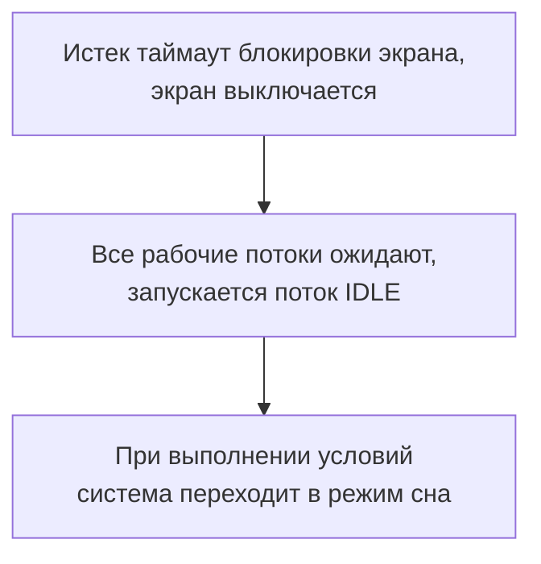
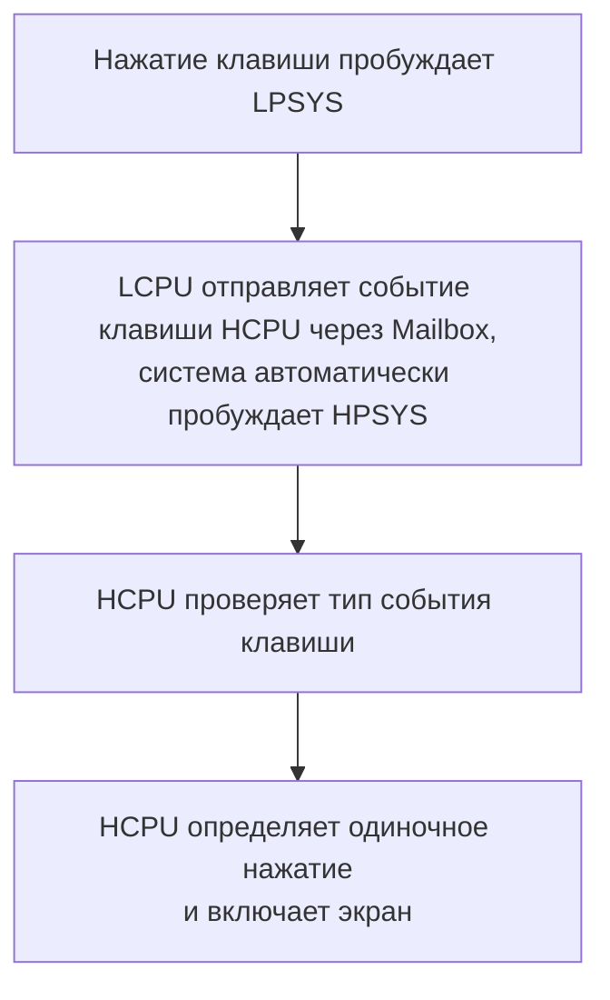

# Настройка режимов энергосбережения и измерение тока { #configure-and-measure-low-power }

Руководства SiFli-SDK по энергосбережению охватывают несколько архитектур SF32. В SF32LB52x, SF32LB55x и SF32LB56x используются два ядра: HCPU в составе HPSYS работает на частоте до 240 MHz для ресурсоемких задач, а LCPU в составе LPSYS — до 48 MHz для Bluetooth и датчиков. В SF32LB57x и SF32LB58x к архитектуре HCPU/LCPU добавлено ядро ACPU; в SF32LB58x маломощное ядро LCPU работает на частоте до 96 MHz. Число ядер, предельные частоты и поведение в режимах энергосбережения различаются между семействами, поэтому используйте руководство SDK именно для целевого устройства.

## Настройка системы управления питанием { #configure-the-power-management-framework }

В каталоге проекта выполните:

```bash
sdk.py menuconfig
```

Ниже приведены настройки menuconfig из исходного руководства по SF32LB52x. Названия режимов и доступные параметры могут различаться в зависимости от семейства и версии SDK; перед применением проверьте документацию для целевого семейства.

<div align="center" markdown>

<em>Таблица: пример настроек энергосбережения menuconfig для SF32LB52x</em>

| Путь menuconfig | Символ | Назначение |
|---|---|---|
| `Sifli middleware → Enable Low power support` | `BSP_USING_PM` | Включает модуль управления питанием SiFli. |
| `RTOS → RT-Thread Components → Device Drivers → Using Power Management device drivers → Select PM Mode → Enable Deep Mode` | `PM_DEEP_ENABLE` | Включает поддержку глубокого сна. |
| `Sifli middleware → Enable Low power support → Enable PM Debug` | `BSP_PM_DEBUG` | Выводит переходы между режимами питания; отключите этот параметр для итоговых измерений тока. |
</div>

В сгенерированном `rtconfig.h` обычно присутствуют `RT_USING_PM`, `BSP_USING_PM` и символ выбранного режима. В качестве рабочего примера используйте `example/pm/classical`. Чтобы отключить функцию, отмените те же настройки в menuconfig.

На рисунках показаны два нужных пункта меню из исходного руководства по SF32LB52x. Для реального проекта ориентируйтесь на меню SDK целевого семейства.

{ loading="lazy" }
<div align="center"><em>Рисунок: пример из руководства по SF32LB52x — включите `BSP_USING_PM` в разделе Sifli middleware → Enable Low power support.</em></div>

{ loading="lazy" }
<div align="center"><em>Рисунок: пример из руководства по SF32LB52x — включите `PM_DEEP_ENABLE` в разделе RTOS → RT-Thread Components → Device Drivers.</em></div>

## Выбор источника пробуждения { #select-a-wake-source }

Используйте файлы `pinmux.c`/`drv_io.c` платы и API из соответствующего примера SDK.

<div align="center" markdown>

<em>Таблица: пробуждение из Deep Sleep/Standby и Hibernate по семействам</em>

| Семейство | Пробуждение из Deep Sleep/Standby | Пробуждение из Hibernate |
|---|---|---|
| SF32LB52x | В глубоком сне пробуждение возможно с любого вывода через `WSR_GPIO1`; отдельно выбирать вывод пробуждения не требуется. HCPU и LCPU могут засыпать независимо друг от друга. | До вызова `HAL_PMU_EnterHibernate()` настройте вывод и уровень пробуждения PMU. |
| SF32LB55x | Используйте карту выводов пробуждения AON для семейства 55x. | В режиме Hibernate систему могут пробуждать только выводы пробуждения LCPU `PIN0`–`PIN5`. Используйте `HAL_PMU_EnablePinWakeup()` с допустимым для 55x номером вывода. В Hibernate эти выводы являются плавающими входами; при необходимости предусмотрите внешний подтягивающий резистор. |
| SF32LB56x | Используйте карту выводов пробуждения HPAON/LPAON для этого семейства. | PMU поддерживает два источника пробуждения `PIN0` и `PIN1`, которые можно назначить на вывод пробуждения HCPU или LCPU. См. пример настройки PMU ниже. |
| SF32LB57x | Используйте карту выводов пробуждения HPAON/LPAON для этого семейства. | PMU поддерживает два источника пробуждения `PIN0` и `PIN1`; допустимый индекс вывода пробуждения Hibernate для 57x — от 0 до 13. Назначьте каждый источник нужному выводу пробуждения HCPU/LCPU. |
| SF32LB58x | Используйте карту выводов пробуждения HPAON/LPAON для этого семейства. | PMU поддерживает два источника пробуждения `PIN0` и `PIN1`, которые можно назначить на вывод пробуждения HCPU или LCPU. См. пример настройки PMU ниже. |
</div>

Для Hibernate на SF32LB52x, SF32LB56x, SF32LB57x и SF32LB58x пример ниже назначает GPIO источнику пробуждения PMU `PIN0`. Он не подходит для SF32LB55x, где применяется отдельная процедура из таблицы. Для SF32LB57x индекс вывода пробуждения PMU находится в диапазоне 0–13. Проверьте выбранное назначение по руководству пользователя целевого устройства и схеме платы.

```c
HAL_PMU_SelectWakeupPin(0,
    HAL_HPAON_QueryWakeupPin(hwp_gpio1, BSP_KEY1_PIN));
HAL_PMU_EnablePinWakeup(0, AON_PIN_MODE_HIGH);
rt_kprintf("CR:0x%x, WER:0x%x\n", hwp_pmuc->CR, hwp_pmuc->WER);
```

Пробуждение из Hibernate представляет собой холодный запуск с установленным `PM_HIBERNATE_BOOT`; в отличие от Standby, выполнение не продолжается с прерванной инструкции. Если один и тот же IO должен выводить систему из Standby и Hibernate, настройте оба пути пробуждения. На 55x выводы пробуждения из Hibernate являются плавающими входами; при необходимости предусмотрите на плате внешний подтягивающий резистор.

## Режимы сна и состояния системы { #understand-the-sleep-states }

<div align="center" markdown>

<em>Таблица: режимы сна и справочный диапазон времени пробуждения по руководству</em>

| Режим SDK | Состояние CPU и периферии | SRAM и источники пробуждения | Справочный диапазон времени пробуждения по руководству |
|---|---|---|---|
| `PM_SLEEP_MODE_IDLE` | CPU ожидает в WFI/WFE; тактирование и периферия продолжают работать. | SRAM остаётся доступной; разбудить систему может любое прерывание. | <1 µs |
| `PM_SLEEP_MODE_LIGHT` | Высокоскоростное тактирование останавливается, подсистема переходит на 32 kHz. | LPTIM, RTC, BLE MAC LCPU, Mailbox или вывод пробуждения. | 30–100 µs |
| `PM_SLEEP_MODE_DEEP` | Аналогичен Light Sleep, но питание переключается на `RET_LDO`. | Сохранение SRAM и источники пробуждения зависят от семейства; см. таблицу ниже. | 100 µs–1 ms |
| `PM_SLEEP_MODE_STANDBY` | CPU и его периферия сбрасываются или отключаются; состояние выводов сохраняется. | Объём сохраняемой SRAM и источники пробуждения зависят от семейства; запуск из Standby определяется по состоянию AON. | 1–2 ms |
| Гибернация (Hibernate) | Все подсистемы отключаются; кварцевый резонатор 32 kHz продолжает работать. | RTC или вывод пробуждения PMU; содержимое RAM не сохраняется. `HAL_PMU_EnterHibernate()`. | >2 ms |
| Выключение (Shutdown) | Все подсистемы отключаются; RC10K продолжает работать. | RTC или вывод пробуждения PMU; содержимое RAM не сохраняется, выводы IO переходят в высокоомное состояние. `HAL_PMU_EnterShutdown()`. | >2 ms |
</div>

<div align="center" markdown>

<em>Таблица: справочные значения сохранения SRAM и времени пробуждения по семействам</em>

| Семейство | `PM_SLEEP_MODE_DEEP` | `PM_SLEEP_MODE_STANDBY` |
|---|---|---|
| SF32LB52x | Области SRAM HPSYS и LPSYS недоступны, но полностью сохраняются; пробуждение примерно за 250 µs. | Область SRAM LPSYS недоступна, но полностью сохраняется; область HPSYS недоступна, сохраняются только 384 KB; пробуждение примерно за 1 ms. |
| SF32LB55x | Области SRAM HPSYS и LPSYS недоступны, но полностью сохраняются; пробуждение примерно за 250 µs. | Область SRAM LPSYS недоступна, но полностью сохраняется; область HPSYS недоступна, сохраняются только 64 KB; пробуждение примерно за 1,5 ms. |
| SF32LB56x | Области SRAM HPSYS и LPSYS недоступны, но полностью сохраняются; пробуждение примерно за 250 µs. | Область SRAM LPSYS недоступна, но полностью сохраняется; область HPSYS недоступна, сохраняются только 64 KB; пробуждение примерно за 1,5 ms. |
| SF32LB58x | Области SRAM HPSYS и LPSYS недоступны, но полностью сохраняются; пробуждение примерно за 250 µs. | Область SRAM LPSYS недоступна, но полностью сохраняется; область HPSYS недоступна, сохраняются только 64 KB; пробуждение примерно за 1,5 ms. |

</div>

В цитируемом актуальном руководстве SDK по энергосбережению нет сопоставимых данных о сохранении SRAM и времени пробуждения для SF32LB57x. Не переносите на SF32LB57x числовые значения ёмкости сохранения или времени для других семейств; сверьте их с целевой версией SDK и документацией устройства.

В предыдущей таблице `PM_SLEEP_MODE_LIGHT`, `PM_SLEEP_MODE_DEEP` и `PM_SLEEP_MODE_STANDBY` соответствуют режимам Light Sleep, Deep Sleep и Standby.

Значения по семействам приведены в руководствах SDK как справочные и не гарантируют такое же время пробуждения на конкретной плате. В руководстве для SF32LB52x указано, что при наличии PSRAM HCPU сохраняет в ней данные RAM, питание которой будет отключено, и восстанавливает их после пробуждения; если PSRAM нет, областью резервного копирования служит 64 KB Retention RAM. Эта область не равна объёму SRAM, сохраняемому в режиме, указанному для каждого семейства (например, для Standby SF32LB52x указано сохранение 384 KB SRAM HPSYS). Фактический ток также зависит от включённой периферии, уровней IO, внешней памяти и платы.

## Управление тактированием во время работы { #control-clocks-while-awake }

Если поток простоя IDLE не может перевести систему в режим сна, автоматическое снижение частоты WFI помогает уменьшить ток. Это безопасно только при простое EPIC, EZIP, LCDC, USB и SD. Если приложение не использует предусмотренный SDK учёт активности LVGL и устройств, отмечайте начало и окончание работы периферии вызовами `rt_pm_hw_device_start()` и `rt_pm_hw_device_stop()`. Настройте делитель через `HAL_RCC_HCPU_SetDeepWFIDiv()`; для аудиозадач пониженная частота обычно ограничивается 48 MHz, для других задач можно использовать 4 MHz. При необходимости установите `HPSYS_RCC_DBGR_FORCE_HP` согласно руководству SDK.

Для выполнения задач используйте `rt_pm_run_enter()`:

<div align="center" markdown>

<em>Таблица: частоты HCPU в режимах выполнения</em>

| Режим | Частота HCPU |
|---|---:|
| `PM_RUN_MODE_HIGH_SPEED` | 240 MHz |
| `PM_RUN_MODE_NORMAL_SPEED` | 144 MHz |
| `PM_RUN_MODE_MEDIUM_SPEED` | 48 MHz |
| `PM_RUN_MODE_LOW_SPEED` | 24 MHz |
</div>

`pm_scenario_start()`/`pm_scenario_stop()` реализуют политику SDK для пользовательского интерфейса (UI) и аудио: если активен любой из сценариев, выбирается высокая частота; если оба неактивны — средняя. Измеряйте не только мгновенный ток, но и энергопотребление: при более низкой частоте выполнение может занять больше времени.

## Последовательность перехода подсистем в сон { #understand-inter-subsystem-sleep-sequencing }

После выключения экрана HPSYS может перейти в сон. На 55x/56x/58x вслед за HPSYS обычно засыпает LPSYS; документированное исключение — семейство 52x, где HCPU и LCPU могут засыпать независимо. Доступные источники не подтверждают, что ACPU в 57x следует той же последовательности; проверьте политику подсистем в соответствующей версии SDK. После пробуждения `gui_resume` запускает новый цикл проверки выключения экрана. Поддерживайте нужное ядро активным, пока оно требуется общей периферии или незавершённой транзакции IPC.

Временно включите `BSP_PM_DEBUG` и ищите в журналах следующие маркеры:

<div align="center" markdown>

<em>Таблица: маркеры переходов между режимами энергосбережения</em>

| Маркер | Значение |
|---|---|
| `gui_suspend` / `gui_resume` | Выключение или включение экрана. |
| `[pm]S: mode,gtime` | Переход в сон; `gtime` выражен в тиках частотой 32 768 Hz. |
| `[pm]W: gtime` | Пробуждение из сна. |
| `[pm]WSR:0x...` | Причина пробуждения; расшифруйте биты по руководству пользователя для данного семейства. |
</div>

Если ожидаемый переход в сон не происходит, проверьте `list_thread`, `pm_dump` и `list_timer`. Поток IDLE должен получить управление; ни один участок кода не должен удерживать запрос `rt_pm_request(PM_SLEEP_MODE_IDLE)`; ближайший таймер ОС должен сработать позже порога политики (обычно 100 ms для HCPU и 10 ms для LCPU); условия пробуждения должны быть неактивны, а очереди IPC — пусты. Периодическая задержка короче этого порога может надолго заблокировать переход в сон.

В исходном руководстве также показаны цепочки «экран выключается → запускается IDLE → при выполнении условий система переходит в сон» и «нажатие клавиши пробуждает LPSYS → LCPU отправляет событие HCPU через Mailbox → система автоматически пробуждает HPSYS». Эти схемы полезны для проверки последовательности журналов, но отражают пример SF32LB52x и не позволяют судить о назначении битов WSR у других семейств.

{ loading="lazy" }
<div align="center"><em>Рисунок: переключатель отладки энергосбережения SF32LB52x (`BSP_PM_DEBUG`).</em></div>

<div align="center"><em>Рисунок: пример SF32LB52x — переход от выключения экрана к режиму сна.</em></div>



<div align="center"><em>Рисунок: пример SF32LB52x — пробуждение HPSYS из LPSYS.</em></div>



## Снижение утечек тока на плате { #reduce-board-level-leakage }

Сначала измерьте минимальную конфигурацию системы: отключите дисплей, датчики, зарядное устройство и другие отсоединяемые нагрузки, затем подключайте их по одной. Типичные источники утечек тока:

- внешнее устройство, которое остаётся под напряжением;
- высокий уровень на выходе, подключённом к обесточенному устройству;
- плавающий вход или несогласованные подтяжки вверх/вниз;
- PSRAM, NOR/NAND Flash, eMMC или SDIO, не переведённые в режим энергосбережения;
- настройка USB `PA01` на 55x, конфликтующая с внутренней подтяжкой вниз.

Реализуйте специфичные для платы переходы в `BSP_IO_Power_Down()` и `BSP_Power_Up()`. Используйте `BSP_TP_PowerDown/Up` и `BSP_LCD_PowerDown/Up`, если питание дисплея или сенсорного экрана нужно переключать одновременно с выключением или включением экрана. Если код XIP выполняется из NOR Flash, разместите процедуру её перевода в сон и пробуждения в сохраняемой RAM (`HAL_RAM_RET_CODE_SECT`).

## Воспроизводимые измерения и их регистрация { #measure-and-record-a-reproducible-result }

Для каждого измерения записывайте семейство и ревизию SDK, ревизию платы, напряжение питания, точку измерения и полосу пропускания прибора, конфигурацию прошивки, установленную память, активную периферию, источник пробуждения, режим сна и журнал переходов. Указывайте ток вместе с состоянием системы и условиями теста; не сравнивайте отдельные значения, полученные на разных платах или в разных режимах.

Официальная документация по семействам: [SF32LB52x](https://docs.sifli.com/projects/sdk/latest/sf32lb52x/app_note/low_power.html), [SF32LB55x](https://docs.sifli.com/projects/sdk/latest/sf32lb55x/app_note/low_power.html), [SF32LB56x](https://docs.sifli.com/projects/sdk/latest/sf32lb56x/app_note/low_power.html) и [SF32LB58x](https://docs.sifli.com/projects/sdk/latest/sf32lb58x/app_note/low_power.html). В [справочнике API PMU SDK](https://docs.sifli.com/projects/sdk/latest/en/sf32lb52x/api/hal/pmu.html) указан диапазон индексов выводов пробуждения Hibernate для SF32LB57x.
