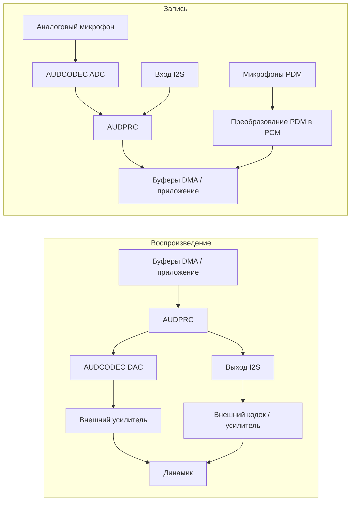

# Обзор аудио { #audio-overview }

## Обзор { #overview }

В этом руководстве описана **локальная аудиоподсистема** устройств SF32: тракт кодека, DMA и промежуточное ПО, используемое для записи с микрофона, вывода на динамик или линейный выход, а также воспроизведения и записи звука на устройстве. Основное внимание уделено практическим решениям: выбору интерфейса, стратегии буферизации, промежуточному ПО Audio Server, кодеку и энергопотреблению.

Bluetooth-аудио (A2DP, LE Audio) связано с этой темой, но рассматривается отдельно в [обзоре Bluetooth](../bluetooth/overview.md#bluetooth-audio-and-le-audio). Там описана беспроводная передача, а здесь — обработка отсчётов после их поступления в микросхему: захват, микширование, декодирование и вывод через физический аудиотракт.

Используйте это руководство для выбора микрофонов, кодека, буферизации и стратегии энергопотребления изделия, а не только для разового запуска аудиодемонстрации. Оно предназначено инженерам, которым нужно обеспечить надёжную работу аудиотракта с учётом ограничений Bluetooth, дисплея, накопителя и аккумулятора.

## Определите требования изделия к аудио { #define-the-products-audio-requirements }

До выбора интерфейсов и размеров буферов определите, какие функции нужны изделию:

- Только воспроизведение, только запись или одновременная двусторонняя работа (полный дуплекс, full duplex)?
- Сколько микрофонов требуется и какого они типа: аналоговые (AMIC) или цифровые (DMIC)?
- Какие форматы нужны для локального воспроизведения: несжатый PCM, MP3, Opus или другой кодек?
- Нужно ли одновременно с локальным звуком поддерживать Bluetooth-аудио (Classic или LE Audio)?
- Нужны ли активация голосом или постоянное прослушивание? Каков допустимый бюджет энергопотребления?
- Каковы требования к выходу на динамик или линейному выходу? Будет ли сигнал передаваться внешнему усилителю или кодеку?
- Какова допустимая задержка? Для голосовых вызовов и мониторинга в реальном времени требования намного строже, чем для звуков уведомлений.

Ответы определяют интерфейс (I2S, PDM или ADC/DAC), конфигурацию кодека и то, какие части тракта должны оставаться активными.

## Тракт аудиосигнала SF32 { #the-sf32-audio-signal-path }

Запись и воспроизведение используют разные тракты. На схеме показаны типовые пути; их доступность и одновременная работа зависят от модели, корпуса, платы и конфигурации SDK.

<div align="center"><em>Рисунок: типовой тракт локального аудиосигнала SF32</em></div>



**AUDCODEC** выполняет аналого-цифровое и цифро-аналоговое преобразование. **AUDPRC** обеспечивает микширование, регулировку усиления и преобразование частоты дискретизации в поддерживаемых трактах. Сигнал микрофонов PDM преобразуется в PCM блоком PDM и не проходит через аналоговый ADC. I2S подключает внешние цифровые аудиоустройства. Один интерфейс PDM может подключать до двух совместимых микрофонов с выбором левого/правого канала; два интерфейса позволяют подключить до четырёх при наличии доступных выводов и поддержки драйвера.

**Audio Server** — программа для управления потоками и сеансами, а не физический преобразователь между микрофоном и динамиком. Приложение обычно использует его API и соответствующие драйверы; прямые тесты драйвера или HAL полезны при первичной настройке платы. Сначала выберите реальные тракты записи и воспроизведения, затем проверьте тактовые сигналы, форматы отсчётов, запросы DMA и требования к выходному каскаду. Не рассчитывайте, что к встроенному DAC можно напрямую подключить выбранный динамик без внешнего усилителя.

Эти тракты описаны в [руководстве по драйверу AUDPRC/AUDCODEC](https://docs.sifli.com/projects/sdk/latest/en/sf32lb52x/drivers/audprc_audcodec.html) и [руководстве по HAL PDM](https://docs.sifli.com/projects/sdk/latest/en/sf32lb52x/hal/pdm.html).

## Микрофоны и цифровые интерфейсы { #choosing-interfaces-amic-dmic-and-i2s }

AMIC и DMIC — типы микрофонов, а PDM и I2S — цифровые интерфейсы. Цифровой микрофон может использовать PDM или I2S. Число микрофонов, каналов и интерфейсов — разные величины.

<div align="center"><em>Таблица: микрофоны и цифровые интерфейсы</em></div>

<div align="center" markdown>

| Микрофон / Шина | Типичное применение | Примечания |
|:----------|:------------|:------|
| **AMIC (аналоговый вход микрофона)** | Захват звука с обычного микрофона | Использует аудио-ADC; проверьте напряжение смещения микрофона, усиление, входной диапазон и уровень помех на плате. |
| **DMIC (цифровой микрофон)** | Захват голоса, многомикрофонные массивы | Выберите фактическую шину PDM или I2S. Цифровой сигнал не отменяет требований к питанию, тактированию и разводке. |
| **I2S** | Передача PCM к внешним кодекам и усилителям или от них | Обычно используется с внешним аудиокодеком или усилителем вместо встроенного тракта AUDCODEC. |
| **PDM** | Вход цифрового микрофона | Для многих микрофонов DMIC это штатный интерфейс; он используется вместе со встроенным блоком преобразования PDM в PCM. |

</div>

Смешанные аналоговые/цифровые массивы требуют поддерживаемых одновременных трактов и синхронной дискретизации. Формирование диаграммы направленности также требует подходящего расположения микрофонов, калибровки и алгоритма; одного подключения нескольких микрофонов недостаточно.

## Начните с проверенного аудиопримера { #start-from-a-verified-audio-example }

Перед разработкой логики приложения выберите и проверьте наиболее близкий к задаче пример SiFli-SDK. В статье [Аудиопримеры SDK](audio-sdk-examples.md) официальные примеры PDM, аналогового захвата, записи и воспроизведения, локальной музыки, работы с SD-картой, FLAC, Opus и микшированием сопоставлены с инженерными задачами, которые они демонстрируют. Там же перечислены ограничения платы, мультиплексирования выводов, накопителя и конфигурации, которые нужно повторно проверить перед адаптацией примера к изделию.

## Выберите подходящее устройство SF32 { #pick-the-right-sf32-device }

Возможности работы с аудио различаются между семействами. Характеристики конкретного устройства проверяйте по его даташиту; таблица ниже подходит только для первичной ориентации:

<div align="center"><em>Таблица: выбор подходящего устройства SF32</em></div>

<div align="center" markdown>

| Семейство | Встроенные аудио-ADC/DAC | Интерфейсы PDM (максимум микрофонов) | Интерфейсы I2S | Применение |
|:---|:---|:---|:---|:---|
| **SF32LB52x** | 1 ADC + 1 DAC | 1 (2) | 1 | Экономичные Bluetooth-аудиоустройства и компактные HMI с поддержкой голосового управления. |
| **SF32LB55x** | Нет; для аналогового аудио используйте внешний аудиокодек. | SF32LB551/555: 1 (2); SF32LB557: 2 (4) | SF32LB551/555: 1; SF32LB557: 2 | BLE-носимые устройства и изделия с большим количеством датчиков, где аудио не является основной функцией. |
| **SF32LB56x** | 1 ADC + 1 DAC | 2 (4) | 1 | Устройства с расширенными HMI/дисплеем и многомикрофонным захватом голоса. |
| **SF32LB57x** | 2 ADC + 1 DAC | 2 (4) | 2 | Многомикрофонная запись голоса и локальное воспроизведение. |
| **SF32LB58x** | 2 ADC + 2 DAC | 2 (4) | 3 | Флагманские изделия, объединяющие аудио, графику, ИИ и сложные функции связи. |

</div>

Перед выбором проверьте точную модель, выводы корпуса, их мультиплексирование и одновременно доступные тракты. Один интерфейс PDM обслуживает два совместимых микрофона; каналы ADC, каналы микрофонов и цифровые интерфейсы — разные ресурсы. Возможности I2S зависят от экземпляра интерфейса: в SF32LB58x I2S1 поддерживает только приём (RX), а I2S2 и I2S3 — приём и передачу (RX/TX). Для приёма через I2S2 необходимо также включить его передающую часть как источник тактового сигнала. Описание отдельных экземпляров см. в [руководстве SiFli по I2S HAL](https://docs.sifli.com/projects/sdk/latest/en/sf32lb52x/hal/i2s.html); другие критерии выбора приведены в [обзоре семейства SF32](../../sf32-products/family/SF32_family.md).

Источники: [DS5201](https://downloads.sifli.com/user%20manual/DS5201-SF32LB52x-Datasheet%20V2p5.pdf), [DS5501, таблица 0-1](https://downloads.sifli.com/user%20manual/DS5501-SF32LB55x-Datasheet%20V1p7p2.pdf), [DS5601](https://downloads.sifli.com/user%20manual/DS5601-SF32LB56x-Datasheet%20V1p9p2.pdf), [DS5801](https://downloads.sifli.com/user%20manual/DS5801-SF32LB58x-Datasheet%20V1p8p3.pdf), [регистры AUDCODEC SF32LB57x (ADC_CH0/1, DAC_CH0)](https://github.com/OpenSiFli/SiFli-SDK/blob/v2.5.1/drivers/cmsis/sf32lb57x/audcodec.h), [экземпляры PDM/I2S SF32LB57x](https://github.com/OpenSiFli/SiFli-SDK/blob/v2.5.1/drivers/cmsis/sf32lb57x/register.h), [примечания к выпуску SiFli SDK v2.5.1 (конфигурация PDM для четырёх микрофонов на 57x)](https://github.com/OpenSiFli/SiFli-SDK/releases/tag/v2.5.1), [пример PDM SiFli SDK (плата 57x, PDM1, два канала)](https://docs.sifli.com/projects/sdk/latest/en/sf32lb52x/example/rt_device/pdm/README.html).

## Типовые сценарии аудиосеансов { #audio-session-templates }

Большинство изделий используют несколько повторяющихся схем аудиосеансов. Выберите ближайшую и проверьте её отдельно:

<div align="center"><em>Таблица: типовые сценарии аудиосеансов</em></div>

<div align="center" markdown>

| Сеанс | Типовой тракт | Основной риск |
|:--------|:-----------------|:----------|
| Звук уведомления | Ресурс во флеш-памяти/PSRAM -> декодер при необходимости -> Audio Server -> DAC/усилитель | Щелчки при запуске и остановке. |
| Запись голоса | AMIC -> ADC/AUDPRC, или микрофон PDM -> преобразование PDM в PCM, или вход I2S -> буферы DMA -> приложение/накопитель/Bluetooth | Переполнение буфера и дрейф тактовой частоты. |
| Bluetooth-колонка | Bluetooth-аудио -> декодирование/микширование -> Audio Server -> DAC/усилитель | Совместная работа с RF и конкуренция за пропускную способность памяти. |
| Голосовой вызов | Одновременный захват сигнала микрофона и воспроизведение | Задержка в полнодуплексном режиме, обработка акустического эха и владение буферами. |
| Активация голосом/прослушивание | Захват с низкой частотой дискретизации -> извлечение признаков -> триггер ИИ | Потребление в режиме ожидания и ложные срабатывания. |

</div>

Для каждого сеанса отдельно определите порядок запуска, поведение в установившемся режиме, восстановление после опустошения буфера воспроизведения (underrun) или переполнения буфера записи (overrun), а также процедуру завершения. Ошибки аудио часто проявляются при переходах между состояниями, а не во время стабильного воспроизведения.

## Бюджет буферизации и задержки { #buffer-and-latency-budget }

Длительность аудио в буфере рассчитывается по **кадрам отсчётов**: один кадр содержит по одному отсчёту каждого канала.

```text
interleaved frames = buffer bytes / (channels * stored bytes per sample)
planar frames per channel = channel buffer bytes / stored bytes per sample
buffer duration (s) = frames / sample rate (Hz)
```

При частоте 48 kHz 480 кадров соответствуют 10 ms. В чередующемся стереоформате это 960 отдельных отсчётов; 480 отдельных отсчётов дают только 5 ms. При пересчёте байтов в кадры используйте фактическое число хранимых байтов на отсчёт, включая заполнение. Если каналы хранятся раздельно, считайте кадры каждого канала, не складывая длины двух буферов.

Это длительность аудио в буфере, а не обязательно сквозная задержка. Двойная буферизация позволяет DMA работать с одной областью, пока программа обрабатывает другую. Задержка зависит от ожидающих данных в очередях и использования обработчиков завершения половины или всего DMA-переноса, а не просто от наличия двух буферов. Планируйте и измеряйте суммарные задержки записи, обработки, передачи, воспроизведения и планирования задач.

## Основы воспроизведения и записи { #playback-and-recording-basics }

Основные принципы одинаковы и для вывода на динамик, и для захвата звука с микрофона:

- **Размер буфера** — небольшие блоки могут уменьшить задержку, связанную с блочной обработкой, но увеличивают накладные расходы прерываний и DMA; крупные блоки дают больше запаса на планирование задач и расходуют больше памяти. Задержка растёт, когда больше аудиоданных ожидает обработки или воспроизведения, а не просто из-за выделения дополнительной ёмкости буфера.
- **Передача через DMA** — используйте DMA с аппаратной синхронизацией для передачи отсчётов периферии. Программа может копировать или обрабатывать блоки в памяти; избегайте опроса CPU и циклов по одному отсчёту, которые должны обслуживать периферию в реальном времени.
- **Планирование частоты дискретизации и формата** — заранее выберите частоту (например, 16 kHz для голоса и 44,1/48 kHz для музыки) и разрядность. Преобразование формата во время работы расходует ресурсы CPU и память.
- **Двойная буферизация**: пока DMA передаёт данные одной области, программа заполняет или обрабатывает другую. Закончите до повторного использования этой области; два буфера сами по себе не предотвращают переполнение или опустошение.

Для кэшируемых буферов, общих с DMA, задайте правила доступа и соблюдайте требования SDK к выравниванию и обслуживанию строк кэша. Очистите кэш с данными воспроизведения, записанными CPU, до их чтения DMA. Подготовьте область записи до передачи DMA и инвалидируйте завершённую область перед чтением CPU в соответствии с политикой кэша устройства. Не меняйте и не используйте повторно область, занятую DMA, пока обработчик завершения не разрешит её передать программе. В затронутых строках кэша не должно быть посторонних данных.

## Выбор кодека и сжатия { #codec-and-compression-choices }

Различайте **аппаратный аудиокодек** (преобразование ADC/DAC) и **кодек сжатия** (например, MP3 или Opus). Несжатому PCM не нужен декодер сжатия. Для эквивалентного сигнала сжатие с потерями обычно уменьшает объём хранимых данных и полосу чтения. Но время CPU, рабочие буферы и энергию декодера нужно измерять: меньший файл не гарантирует меньшего расхода памяти во время работы.

<div align="center"><em>Таблица: выбор кодека и формата сжатия</em></div>

<div align="center" markdown>

| Формат | Типичное применение | Примечания |
|:-------|:-------------|:------|
| **Несжатый PCM** | Короткие звуки, мониторинг с низкой задержкой, голосовые тракты | Декодирование сжатия не требуется; объём зависит от длительности, частоты дискретизации, числа каналов и хранимой разрядности отсчёта. |
| **MP3** | Локальное воспроизведение музыки | Широкая совместимость; затраты на декодирование хорошо изучены. MP3 часто используется в примерах музыкальных проигрывателей с SD-картой. |
| **Opus** | Голос и аудио общего назначения со сжатием | Формат сжатия для голоса и аудио общего назначения. Поддержка Opus не гарантирует совместимость с A2DP, HFP или LE Audio; отдельно проверьте кодек выбранного профиля Bluetooth и поддержку SDK. |

</div>

SDK содержит примеры локальной музыки, MP3 с SD-карты, Opus, записи и трактов с двумя ADC/DAC. Двухканальный пример требует устройства и платы с доступными каналами; это не означает наличия двух ADC/DAC у каждого SF32. Начните с поддерживаемой конфигурации и измерьте затраты декодирования на целевом устройстве.

## Локальное и Bluetooth-аудио { #local-audio-vs-bluetooth-audio }

Даже если оба тракта работают одновременно, рассматривайте их отдельно:

- **Локальное аудио** (это руководство) — AUDCODEC/AUDPRC, микрофоны, динамик/линейный выход, воспроизведение и запись на устройстве.
- **Bluetooth-аудио** ([обзор Bluetooth](../bluetooth/overview.md#bluetooth-audio-and-le-audio)) — A2DP/AVRCP/HFP для Classic Bluetooth либо одноадресная/широковещательная передача LE Audio, если устройство, стек и SDK поддерживают необходимые роли. Наличия BLE-радио недостаточно для поддержки LE Audio.

Во многих изделиях оба тракта работают совместно. Например, звук с локального микрофона можно передавать по Bluetooth, а принятый по Bluetooth звук — микшировать с локальным сигналом уведомления через Audio Server. Если оба тракта работают одновременно, заранее определите, кто управляет буферами и как выполняется микширование.

## Контрольный список аудиосхемы и платы { #board-level-audio-checklist }

Прошивка не может полностью компенсировать недостатки аналоговой схемы. При разработке принципиальной схемы и разводке PCB проверьте следующее:

<div align="center"><em>Таблица: контрольный список аудиотракта на плате</em></div>

<div align="center" markdown>

| Область | Рекомендации |
|:-----|:---------|
| Смещение и разводка микрофона | Делайте аналоговые линии микрофона короткими и малошумящими; прокладывайте их вдали от тактовых сигналов, RF и узлов с большими импульсными токами. |
| Заземление | Не допускайте прохождения шумных обратных токов через цепи опорного потенциала микрофона или динамика. |
| Питание | Фильтруйте питание кодека и микрофона согласно эталонной схеме и даташиту микрофона. |
| Тракт динамика/усилителя | Проверьте нагрузку, усиление, тепловой режим, подавление щелчков и поведение вывода отключения. |
| Тактовые сигналы I2S/PDM | Проверьте временной запас, длину трасс и качество тактового сигнала на выбранных частотах дискретизации. |
| Доступ для тестирования | Предусмотрите удобный способ подавать и записывать аудиосигнал при первичной проверке платы и производственном тестировании. |

</div>

Для изделий с RF и аналоговым аудио проверьте уровень помех при активном Bluetooth, обновлении изображения на дисплее, подключённом зарядном устройстве и установленном корпусе конечного изделия.

## Энергопотребление аудиотракта { #power-considerations-for-audio }

Сначала измерьте отдельно потребление микрофонного питания, преобразователей, цифровой обработки, обращений к памяти и усилителя, затем — всего сеанса. Вклад каждой части зависит от аппаратуры, нагрузки и доли времени, занятой прослушиванием и воспроизведением.

- Между сеансами останавливайте неиспользуемые тракты в порядке, предусмотренном компонентом и драйвером. Проверьте отключение звука и усилителя, тактирование, питание и состояния GPIO, чтобы исключить щелчки, паразитное питание и токи утечки через интерфейсы.
- Для голосового триггера с постоянным прослушиванием сохраняйте необходимый тракт записи и выбирайте самый экономичный поддерживаемый способ обработки. Не отключайте тракт, от которого зависит обнаружение; модель должна оставаться лёгкой. См. [обзор ИИ](../ai/overview.md#audio-and-voice).
- Обрабатывайте данные блоками, соблюдая допустимую задержку и сроки обслуживания буферов. DMA переносит отсчёты, но готовые блоки всё равно нужно обработать вовремя; сокращение пробуждений CPU не должно приводить к переполнению или опустошению буферов.
- Согласуйте работу аудио с Bluetooth и дисплеем. См. [обзор энергосбережения](../low-power/overview.md) и [совместную работу с другими нагрузками](../bluetooth/overview.md#coexistence-with-other-workloads).

## Матрица проверки аудиотракта { #audio-validation-matrix }

Повторяйте одни и те же проверки после изменений кодека, Bluetooth, дисплея, питания или тактирования:

<div align="center"><em>Таблица: матрица проверки аудио</em></div>

<div align="center" markdown>

| Проверка | Что оценить |
|:-----|:--------------|
| Запись/воспроизведение тишины | Уровень шума, фон, щелчки, постоянное смещение (DC offset). |
| Синусоидальный сигнал или тональный свип | Точность частоты дискретизации, искажения и ограничение сигнала по амплитуде. |
| Длительное воспроизведение | Underrun, утечки памяти, стабильность температуры и энергопотребления. |
| Запись при обновлении UI | Совместная работа DMA и пропускной способности памяти. |
| Одновременное Bluetooth-аудио и локальный звук | Микширование, приоритеты и задержка. |
| Сон и пробуждение при работе с аудио | Отключение и повторный запуск кодека, подавление щелчков и запросы управления питанием (PM votes), ограничивающие доступные режимы энергопотребления. |

</div>

Храните проверенный эталонный файл WAV/PCM и образец, записанный на оценочной плате. Так регрессии проще выявить, чем при субъективном прослушивании.

## Диагностика проблем с аудио { #debugging-audio-issues }

<div align="center"><em>Таблица: диагностика проблем с аудио</em></div>

<div align="center" markdown>

| Симптом | Вероятная причина |
|:--------|:----------------------|
| Щелчки, хлопки или пропуски | Переполнение/опустошение буфера, недостаточное количество или размер буферов, неверная настройка DMA. |
| Постоянный шум или фон | Аналоговый тракт или разводка платы, заземление AMIC, шум в шинах питания. |
| Задержка слишком велика для сценария | Слишком большие буферы, лишнее преобразование формата, задержка планирования перед запуском DMA. |
| Звук прерывается при активном Bluetooth или дисплее | Совместная работа и конкуренция за пропускную способность памяти — см. раздел [совместной работы](../bluetooth/overview.md#coexistence-with-other-workloads). |
| Декодированный звук звучит неверно (высота/скорость) | Не совпадают частоты дискретизации источника, декодера и конфигурации AUDCODEC. |
| Высокое энергопотребление при простое воспроизведения | Кодек/DMA остаются активными между сеансами либо выполняется избыточный опрос вместо завершения сеанса по событиям. |

</div>

## Типичные ошибки { #common-mistakes }

- Обслуживание каждого отсчёта периферии опросом CPU вместо DMA с аппаратной синхронизацией.
- Слишком маленькие или плохо управляемые буферы, из-за которых пропускаются сроки DMA; если это поддерживается и уместно, применяйте двойную буферизацию.
- Выбор типов и количества микрофонов без проверки экземпляров PDM/I2S, доступных выводов и одновременно работающих трактов.
- Отношение к локальному и Bluetooth-аудио как к полностью независимым, хотя в реальном изделии они будут работать одновременно.
- Игнорирование когерентности кэша и правил владения буферами, общими для DMA и CPU.
- Неиспользуемые тракты, остающиеся активными между сеансами, либо отключённая запись, которая нужна для функции постоянного прослушивания.
- Выбор сжатого формата без проверки того, укладываются ли затраты на декодирование в бюджеты энергопотребления и CPU.

## Проверочный список запуска { #bring-up-checklist }

- [ ] Для выбранных устройства и платы проверьте типы и число каналов микрофонов, экземпляры PDM/I2S, доступные выводы и поддерживаемые одновременно работающие тракты.
- [ ] Задайте частоту дискретизации, ширину хранимого отсчёта, расположение каналов и размеры буферов записи и воспроизведения.
- [ ] Запустите выбранный входной тракт ADC/AUDPRC, PDM или I2S и выходной тракт DAC или I2S; проверьте каждое направление отдельно перед полнодуплексной работой.
- [ ] После проверки базовых аппаратных трактов подключите поддерживаемые сеансы через Audio Server и соответствующие драйверы; сохраните прямые тесты HAL для диагностики.
- [ ] Выберите аудиоформат (PCM/MP3/Opus) и при необходимости декодирования измерьте нагрузку на CPU, расход памяти и энергии.
- [ ] Проверьте владение буферами DMA, их выравнивание, очистку и инвалидацию кэша.
- [ ] Проверьте одновременную работу локального и Bluetooth-аудио, если изделие использует оба.
- [ ] Измерьте потребление в активном состоянии и в простое; проверьте последовательности отключения и запуска, состояния выводов и тракт записи, который должен оставаться активным для постоянного прослушивания.

## Основные выводы { #key-takeaways }

- Явно выбирайте физический тракт: аналоговый звук использует AUDCODEC, запись PDM — блок PDM, а внешнее цифровое аудио — I2S. Управляйте поддерживаемыми сеансами через Audio Server и драйверы, не считая все пути одним и тем же трактом кодека.
- Выбирайте типы микрофонов и тракты PDM/I2S по возможностям конкретного устройства и расположению микрофонов в изделии, а не по предположениям о другом чипе.
- Используйте передачу через DMA с аппаратной синхронизацией и достаточной ёмкостью буфера. Двойная буферизация — распространённый вариант, если её поддерживают драйвер и сценарий, но необходимо соблюдать сроки обратных вызовов и повторного использования буферов.
- Локальное и Bluetooth-аудио — отдельные подсистемы, которым часто нужно работать совместно. Заранее продумайте микширование и владение буферами.
- Управляйте энергопотреблением аудио так же, как Bluetooth и ИИ: сокращайте время активности, избегайте лишних пробуждений CPU и измеряйте реальные сеансы, а не только установившееся воспроизведение.
