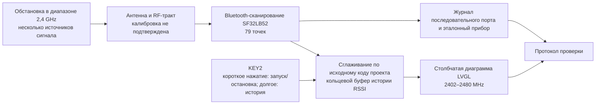

# Radiation Monitor: портативный детектор уровня сигнала { #radiation-monitor-portable-signal-strength-detector }

## Что такое Radiation Monitor? { #what-is-radiation-monitor }

[SiFliSparks/RadiationMonitor](https://github.com/SiFliSparks/RadiationMonitor) — проект портативного визуализатора уровня сигнала в диапазоне Bluetooth на базе SF32LB52 и SiFli-SDK. Прошивка последовательно сканирует 79 частотных точек от 2402 до 2480 MHz и отображает уровень принятого сигнала на столбчатой диаграмме LVGL. Кнопка KEY2 запускает и останавливает сканирование, а также позволяет просматривать сохранённую историю.

Проект позволяет изучить сканирование Bluetooth-диапазона, обработку данных в реальном времени, визуализацию по частотам и управление одной кнопкой. Это не калиброванный анализатор спектра, и проект не определяет источник принятого сигнала. На диаграмму могут влиять близкие источники излучения в диапазоне 2,4 GHz и условия измерения. Без калибровки и сравнения в контролируемых условиях показания нельзя использовать для нормативных измерений, сертификации или точных RF-измерений.

<em>Столбчатая диаграмма Radiation Monitor по 79 точкам</em>

## Зачем использовать реализацию на SF32? { #why-the-sf32-implementation }

SF32LB52 поддерживает Bluetooth 5.3 в двухрежимной конфигурации, имеет двухъядерный MCU и возможности работы с дисплеем. Проект использует SiFli-SDK и LVGL, чтобы выборка по частотам, сглаживание, буферизация истории и обновление экрана выполнялись на самом устройстве. Поэтому эта реализация — полезный ранний эксперимент для RF-панели визуализации, полевого индикатора помех или производственного диагностического интерфейса.

В репозитории не описаны процедура калибровки, бюджет неопределённости или прослеживаемые условия измерения. Поэтому результаты необходимо проверять для каждой комбинации кристалла, ревизии SDK и прошивки, платы, антенны, корпуса, помех на плате и временных параметров. При переносе на другую плату SF32LB52 или плату изделия требуется повторная проверка: успешная сборка не доказывает эквивалентность измерений.

## Результат, область применения и условия начала { #outcome-scope-and-entry-criteria }

**Ожидаемый результат:** воспроизвести диаграмму по 79 точкам на аппаратуре SF32LB52 с зафиксированными версиями, проверить повторяемость запуска и остановки, установить фактический алгоритм и глубину сглаживания по зафиксированному коду, проверить документированную историю на 10 записей и восстановление, а затем собрать достаточно данных для решения об инвестициях в калибровку или специальную аппаратную часть.

В этой статье высота столбца RSSI не трактуется как коэффициент заполнения, пропускная способность, мощность передатчика, тип протокола или мощность спектральной составляющей для нормативной оценки. Статья также не утверждает, что репозиторий содержит полный проект изделия, метод калибровки или явно указанную лицензию на ПО.

Перед началом подготовьте:

- плату SF32LB52 с дисплеем. В README проекта указаны SF32LB52x и выходная директория `build_sf32lb52-lchspi-ulp_hcpu`; в списке поддерживаемых плат SiFli для Huangshan Pi указано имя `sf32lb52-lchspi-ulp`. Запишите фактическую ревизию платы и проверьте конфигурацию сборки проекта;
- SiFli-SDK, SCons, способ загрузки прошивки и средство записи журналов последовательного порта;
- управляемый источник сигнала 2,4 GHz или как минимум два воспроизводимых сценария, например с выключенным и включённым BLE-устройством, передающим рекламные пакеты;
- если важна численная точность, калиброванный анализатор спектра или измеритель мощности, а также фиксированные условия для антенны, расстояния и экранирования;
- протокол испытаний с состоянием экрана, выводом последовательного порта, ориентацией платы, расстоянием, питанием и условиями окружающей среды.

<em>Таблица: исходные условия и обязательные свидетельства проверки Radiation Monitor</em>

| Область | Зафиксированная исходная база | Что необходимо подтвердить перед адаптацией |
|:-----|:------------------------|:------------------------------------|
| Сканирование частот | 79 точек от 2402 до 2480 MHz | Коммит прошивки, ревизии SDK и платы, полный журнал сканирования |
| Обработка | В описании модуля README указано усреднение предыдущих десяти сканирований, в обзоре — 30. README не уточняет, усредняются ли значения мощности в линейной шкале или в dBm | Зафиксированная ревизия кода, способ и глубина усреднения, исходные и сглаженные данные, сравнение со стабильным источником |
| История | Циклический буфер на 10 записей | Записи проверок остановки, перехода между страницами, циклического просмотра и перезапуска |
| Интерфейс | Столбчатая диаграмма LVGL с номинальной осью Y от -110 до -20 dBm | Снимок экрана и проверка соответствия подписей индексам массива |
| Ограничения измерений | Прослеживаемая калибровка и неопределённость не указаны | Сведения об эталонном приборе, измерительной оснастке и погрешности либо явная пометка, что отображаются только относительные тенденции |

## Аппаратные и программные спецификации { #hardware-and-software-specifications }

### Аппаратная спецификация { #hardware-specification }

<em>Таблица: аппаратная спецификация Radiation Monitor</em>

| Компонент | Требуемые характеристики | Назначение | Статус | Где получить | Совместимость и замена |
|:----------|:-------------------------|:-----------|:-------|:-------------|:-----------------------|
| SF32LB52-LCHSPI-ULP / Huangshan Pi | Используйте как исходную точку цель SCons SiFli `sf32lb52-lchspi-ulp`; зафиксируйте точную ревизию платы, антенну и состав дисплейного модуля | Выполняет Bluetooth-сканирование, строит график, обрабатывает элементы управления и отображает историю | Обязательно; точную комплектацию необходимо подтвердить | [Связанная справка μForge по DevKit-ULP](../sf32-products/devkits/SF32LB52-DevKit-ULP.md); [список поддерживаемых плат SiFli-SDK](https://docs.sifli.com/projects/sdk/latest/en/sf32lb52x/supported_boards/index.html); [страница платы LCKFB](https://lckfb.com/project/detail/lckfb-hspi-sf32lb52-ulp?param=baseInfo); [исходный код проекта](https://github.com/SiFliSparks/RadiationMonitor) | Каталог `build_sf32lb52-lchspi-ulp_hcpu` из README не определяет ревизию PCB, антенны или дисплея |
| Хост-компьютер, USB-кабель для передачи данных и контролируемый источник питания | Хост с выбранными инструментами SiFli-SDK, кабель с поддержкой передачи данных, последовательный журнал и контролируемое питание | Сборка, прошивка, наблюдение и повторение измерений | Обязательно | [Краткое руководство SiFli-SDK](https://docs.sifli.com/projects/sdk/latest/sf32lb52x/quickstart/index.html) | Запишите порт, напряжение, версии хоста и инструментов, а также способ восстановления |

### Программная спецификация { #software-specification }

<em>Таблица: программная спецификация Radiation Monitor</em>

| Пакет или служба | Требуемая версия или ревизия | Назначение | Статус | Где получить | Совместимость и обновление |
|:-----------------|:----------------------------|:-----------|:-------|:-------------|:---------------------------|
| SiFliSparks/RadiationMonitor | Зафиксированный коммит [`670cf20`](https://github.com/SiFliSparks/RadiationMonitor/commit/670cf20b931e82b7ff1cd14fa6727e460c4f677a) | Логика RF-сканирования, график из 79 точек, сглаживание и история | Обязательно | [Репозиторий](https://github.com/SiFliSparks/RadiationMonitor) | Описания сглаживания в README противоречат друг другу; перед выбором измерительной базы проверьте реализацию именно этого коммита |
| OpenSiFli/SiFli-SDK | В статье точный коммит не закреплён; выберите и зафиксируйте совместимую ревизию | RTOS, путь Bluetooth-сканирования, драйверы дисплея, среда сборки и прошивки | Обязательно | [Репозиторий](https://github.com/OpenSiFli/SiFli-SDK) | Успешная сборка не подтверждает калибровку RF-измерений или эквивалентность результатов на другой плате |
| SCons и хост-инструменты SDK | Версии из выбранной среды SiFli-SDK | Сборка и прошивка целевой платформы SF32LB52 | Обязательно | [Краткое руководство SiFli-SDK](https://docs.sifli.com/projects/sdk/latest/sf32lb52x/quickstart/index.html) | Запишите точную цель сборки, ОС хоста, версии инструментов и созданный образ |

## Выбор поддерживаемой базовой конфигурации { #choose-a-supported-baseline }

Используйте зафиксированный коммит [`670cf20`](https://github.com/SiFliSparks/RadiationMonitor/commit/670cf20b931e82b7ff1cd14fa6727e460c4f677a), а не изменяемую ветку `main` исходного проекта. В README указана выходная директория сборки `build_sf32lb52-lchspi-ulp_hcpu`; в списке SiFli для Huangshan Pi / LCHSPI-ULP указана цель SCons `sf32lb52-lchspi-ulp`. Название цели SDK не подтверждает команду сборки проекта или фактически испытанную плату. README не указывает ревизию платы и полный вызов SCons; проверьте настройки проекта при первом воспроизведении и не считайте все платы SF32LB52x поддерживаемыми.

<em>Таблица: выбор исходной конфигурации Radiation Monitor</em>

| Элемент | Выбор исходной конфигурации | Не следует предполагать, что |
|:--------|:----------------|:--------------|
| Плата | Начните с аргумента SCons `sf32lb52-lchspi-ulp`, проверьте настройки проекта и зафиксируйте фактическую PCB | Каталог `build_sf32lb52-lchspi-ulp_hcpu` из README доказывает эквивалентность антенн и трактов дисплея всех плат SF32LB52x |
| SDK | Запишите коммит SiFli-SDK, с которым сборка завершается успешно | Не считайте, что новейшая версия SDK сохраняет поведение Bluetooth-сканирования проекта |
| Сглаживание | Разрешите по зафиксированному коду противоречие README: усреднение 30 циклов или предыдущих десяти; выясните, усредняются ли значения мощности в линейной шкале или в dBm, и проверьте глубину буфера | В описании модуля указано усреднение предыдущих десяти сканирований, в обзоре — 30; шкала усреднения не указана |
| Временные параметры | README указывает интервал обновления данных 30 ms; измерьте длительность полного сканирования всех 79 точек | 30 ms гарантируют полный цикл обновления всех 79 точек |
| Лицензирование | Перед повторным использованием или распространением проверьте лицензии репозитория и включённого кода | Публичная доступность исходного кода автоматически разрешает распространение продукта |

!!! warning "В документации исходного проекта расходятся данные о глубине сглаживания"
    В обзоре возможностей README указано усреднение по 30 циклам сканирования, а в описании модуля — по предыдущим десяти, причём модулем сканирования назван `src/BT/bt_repeat.c`. README не указывает, усредняются ли линейные значения мощности или dBm. Из этих описаний нельзя определить, какое поведение реализовано в зафиксированном коммите. Проверьте в этой ревизии шкалу усреднения, глубину буфера и поведение устройства, прежде чем использовать любое из значений как измерительную базу. README также указывает интервал обновления данных 30 ms, который не обязательно равен длительности полного сканирования 79 точек.

## Этапы проекта { #delivery-map }

<em>Таблица: план работ по Radiation Monitor</em>

| Этап | Какое решение помогает принять | Необходимый результат |
|:------|:---------------------|:----------------|
| 1. Исходная версия без изменений | Может ли целевая плата надёжно сканировать и отображать все 79 точек? | Версия, плата, журнал, снимок экрана и запись результатов с контролируемым источником |
| 2. Данные и восстановление | Можно ли доверять сглаживанию, остановке, истории и поведению после сброса? | Воспроизводимые функциональные тесты и проверки восстановления |
| 3. Воспроизводимая сборка | Сможет ли другой инженер собрать тот же образ? | Чистая сборка, образ прошивки, загрузка и повторный результат |
| 4. Адаптация измерений | Можно ли добавить одно изменение отображения или калибровки, не скрывая исходное поведение? | Описание изменения, сравнительные данные, погрешность и результаты регрессионных тестов |
| 5. Оценка изделия | Оставить проект индикатором тенденций или развивать как измерительный прибор? | Целевая точность, лицензирование, аппаратная часть и решение по рискам |

## Архитектура системы и зависимости { #system-architecture-and-dependencies }

<em>Рисунок: путь данных в Radiation Monitor</em>

Основные области отказов — RF-вход и антенна, поведение сканирования и калибровка, обработка данных, буфер истории, конечный автомат кнопки, привязка данных к элементам LVGL и питание. Высокий столбец означает лишь, что текущая реализация получила относительно высокий уровень сигнала. Без контролируемого сравнения по нему нельзя определить передатчик, модуляцию или соответствие нормативным требованиям.

## Этап 1 — Зафиксируйте исходное сканирование без изменений { #stage-1-establish-the-untouched-scan-baseline }

**Цель:** подтвердить, что выбранная аппаратная часть и исходный код дают воспроизводимое отображение 79 точек.

1. Зафиксируйте коммиты репозитория и SiFli-SDK, ревизию платы, антенну и подключение дисплея; выполните чистую сборку и загрузку прошивки.
2. Запустите устройство в стабильной RF-обстановке и сохраните исходную диаграмму, вывод последовательного порта и состояние KEY2.
3. Коротко нажмите KEY2, чтобы начать сканирование. Проверьте охват и отметки оси X на 2402, 2441 и 2480 MHz.
4. Используйте контролируемое BLE-устройство, передающее рекламные пакеты, или другой воспроизводимый источник; запишите результаты при выключенном и включённом источнике, а также изменения расстояния и ориентации платы.
5. Сбросьте устройство и повторите проверку. Убедитесь, что массив из 79 точек и диаграмма не смещены и не содержат устаревших данных.

**Сохраняемые свидетельства:** ревизии исходного кода, SDK и платы; журналы сборки и загрузки; описание обстановки; параметры источника; расстояние и ориентация; журнал последовательного порта; снимки экрана; результат сброса.

**Критерий выхода из контрольной точки 1:** при двух независимых запусках устройство сканирует и отображает 79 точек; реакция на изменение контролируемой обстановки воспроизводима по направлению; соответствие индексов и подписей частот проверено.

## Этап 2 — Проверьте обработку, историю и восстановление { #stage-2-validate-processing-history-and-recovery }

**Цель:** убедиться, что интерфейс показывает понятный путь обработки данных, а не случайную анимацию.

<em>Таблица: функциональная проверка Radiation Monitor</em>

| Проверка | Метод | Критерий успешного прохождения |
|:-----|:-------|:--------------|
| Алгоритм и глубина сглаживания | Запишите исходные значения и `rssi_res` для одной частоты; сравните с зафиксированным коммитом и устраните расхождение README | Шкала и глубина усреднения соответствуют этой ревизии кода и подтверждены на устройстве |
| Запуск/остановка | Коротко нажмите KEY2 во время сканирования, затем возобновите его | При остановке история сохраняется; после возобновления устройство не зависает |
| История | В остановленном состоянии несколько раз нажмите и удерживайте KEY2 | Можно просмотреть назад до десяти записей; циклический переход работает правильно |
| Пустая история | Остановите устройство или удерживайте кнопку до накопления корректной истории | Нет выхода за границы массива и сбоев; интерфейс явно показывает отсутствие данных |
| Сброс | Выполните сброс во время сканирования, после остановки и при просмотре истории | Устройство возвращается в известное исходное состояние без необъяснимых старых значений |
| Изменение помех | Измените источник сигнала, расстояние или экранирование | Реакция воспроизводима; задержка и удержание пикового значения зафиксированы |

**Критерий выхода из контрольной точки 2:** сглаживание, глубина истории, состояние кнопки и поведение после сброса соответствуют исходному коду; аномальные состояния можно обнаружить, а не пропустить из-за отсутствия индикации.

## Этап 3 — Создайте воспроизводимую исходную конфигурацию { #stage-3-build-a-reproducible-source-baseline }

**Цель:** повторно собрать в чистой среде образ прошивки, проверенный на этапе 2.

1. Запишите коммиты проекта и SDK, ОС компьютера, версии SCons и компилятора, а также фактически используемый аргумент платы.
2. Удалите результаты сборки, выполните конфигурацию и сборку заново; сохраните образы, сведения о памяти и разделах, а также полные журналы.
3. Запишите прошивку с помощью созданного скрипта загрузки и зафиксируйте порт, скорость передачи данных и результат.
4. Повторите сборку на втором компьютере или в чистом каталоге и заново выполните основные проверки этапа 2.

**Критерий выхода из контрольной точки 3:** проект формирует функционально эквивалентный образ, не зависящий от неотслеживаемых файлов платы, сгенерированных файлов или устаревших артефактов сборки.

## Этап 4 — Внесите одно контролируемое изменение в измерения или интерфейс { #stage-4-make-one-controlled-measurement-or-ui-adaptation }

**Цель:** проверить одно направление развития продукта, не утратив исходную конфигурацию.

Возможные изменения: журналирование исходных значений, явные отметки с шагом 1 MHz, удержание пикового значения, другой способ выбора записей истории, калибровочная поправка или экспорт относительных тенденций на хост-компьютер. За один раз меняйте только одну категорию и сохраняйте исходный образ прошивки.

При добавлении калибровки задайте эталонный источник, частоту, уровень входного сигнала, антенну и кабель, расстояние, ориентацию, температуру и неопределённость измерения. Одной общей поправки обычно недостаточно, чтобы компенсировать частотную характеристику, различия между платами и влияние корпуса.

**Критерий выхода из контрольной точки 4:** изменение проходит исходные регрессионные проверки 79 точек, запуска/остановки, истории, сброса и работы с контролируемым источником; в каждом заявлении о точности указаны эталонный прибор и условия измерения.

## Этап 5 — Оцените готовность к применению в изделии { #stage-5-product-readiness-review }

Команда должна ответить на следующие вопросы:

- Нужны ли изделию только относительные тенденции помех или прослеживаемое измерение абсолютной мощности с оценкой неопределённости?
- Документирована ли поддержка реализации Bluetooth-сканирования проекта для целевого кристалла и SDK? Какие ограничения действуют при одновременной работе радиоподсистем?
- Насколько на результат влияют антенна, корпус, помехи от дисплея, работа DC/DC, уровень заряда аккумулятора и температура?
- Может ли изделие поддерживать необходимую связь Bluetooth во время сканирования или эти функции должны быть взаимоисключающими?
- Укладывается ли измеренная задержка полного сканирования 79 точек с проверенным по коду сглаживанием в требования интерфейса?
- Как будут решены вопросы распространения и коммерческих прав, если у RadiationMonitor и включённого в него кода нет явно указанной лицензии верхнего уровня?

**Критерий выхода из контрольной точки 5:** назначены ответственные за цель измерений, план калибровки, совместную работу радиоподсистем, лицензирование, аппаратную часть и ПО; зафиксировано решение продолжать, отложить или прекратить работу.

## Передача материалов для проектирования изделия { #handoff-to-product-design }

Передайте в разработку целевое устройство SF32, сведения о плате и антенне, реализацию Bluetooth-сканирования и ограничения режима/API, подтверждённые по зафиксированному коммиту, определения частот и данных, исходные и сглаженные записи, бюджет обновления интерфейса, калибровочную оснастку, результаты проверки помех по питанию, сценарий восстановления и границы производственных испытаний. См. также материалы [SF32LB52x](../sf32-products/chips/SF32LB52x.md), [SF32LB52-DevKit-ULP](../sf32-products/devkits/SF32LB52-DevKit-ULP.md), [руководство по проектированию аппаратуры SF32LB52x](../hardware/chip-guides/SF32LB52x_hardware_design_guide.md) и [RF-тестирование с SiFli SDK](../develop/platforms/sifli-sdk/application-notes/rf-performance-tests.md).

## Основные источники { #authoritative-sources }

- [SiFliSparks/RadiationMonitor](https://github.com/SiFliSparks/RadiationMonitor)
- [README исходного проекта в ветке `main`](https://github.com/SiFliSparks/RadiationMonitor/blob/main/README.md)
- [Зафиксированный эталонный коммит `670cf20`](https://github.com/SiFliSparks/RadiationMonitor/commit/670cf20b931e82b7ff1cd14fa6727e460c4f677a)
- [Каталог проектов SiFli Sparks](https://sparks.sifli.com/#projects)
- [OpenSiFli/SiFli-SDK](https://github.com/OpenSiFli/SiFli-SDK)
- [Поддерживаемые платы SF32LB52 в SiFli-SDK](https://docs.sifli.com/projects/sdk/latest/en/sf32lb52x/supported_boards/index.html)
- [Руководство по RF-тестированию SiFli-SDK](https://docs.sifli.com/projects/sdk/latest/en/sf32lb52x/app_note/rf_test_guide.html)
- [Обзор аппаратной платформы SF32LB52x](https://wiki.sifli.com/en/hardware/SF32LB52/SF32LB52-Overview-B3.html)
- [Краткое руководство по началу работы с SiFli-SDK для SF32LB52x](https://docs.sifli.com/projects/sdk/latest/sf32lb52x/quickstart/index.html)
