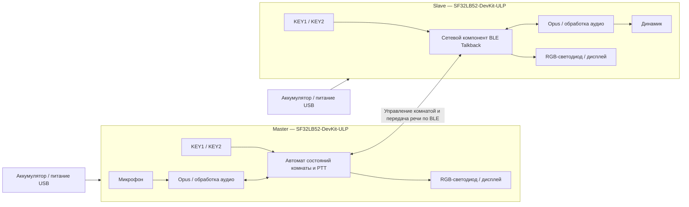

# BLE-интерком Talkback на SF32 { #sf32-ble-talkback-intercom }

## Что такое Talkback? { #what-is-talkback }

[OpenSiFli Talkback](https://github.com/OpenSiFli/sifli-sdk-demo/tree/main/talkback) — пример BLE-связи push-to-talk (PTT, «нажми и говори») между несколькими устройствами для `SF32LB52-DevKit-ULP`, также известного как Huangshan Pi. В режиме Master устройство создаёт комнату; в режиме Slave ищет комнату и подключается к ней. После подключения пользователь удерживает кнопку разговора для передачи голоса и отпускает её, чтобы остановить передачу. Официальная базовая реализация поддерживает до восьми устройств, причём одновременно говорить могут до трёх.

В проекте используется Opus для кодирования речи, а RGB-светодиод, кнопки и дисплей образуют простой локальный интерфейс. Реализованы также переподключение Slave одной кнопкой, передача сведений о напряжении и уровне заряда аккумулятора, переход в режим сна после 60 секунд бездействия, а также выключение и включение длительным нажатием. Поэтому этот пример лучше подходит в качестве основы для портативного интеркома, чем изолированный пример передачи звука точка-точка.

## Зачем нужна реализация на SF32? { #why-the-sf32-implementation }

В этой рабочей базовой реализации объединены BLE, аудио, дисплей, кнопки, контроль аккумулятора и режимы низкого энергопотребления SF32LB52. Команда может проверить связь и акустику на поддерживаемом отладочном оборудовании, прежде чем вкладываться в собственную RF-часть, аудиотракт и схему питания.

Ограничение «до восьми устройств, из которых до трёх могут говорить одновременно» относится к реализации исходного проекта и не является подтверждённой характеристикой продукта для любых расстояний, уровней помех, потерь пакетов и сценариев одновременной передачи. В материалах исходного проекта также не определены аутентификация участников комнаты, политика шифрования канала, гарантии конфиденциальности речи, статус соответствия радионормам и полные лицензионные условия бинарного компонента `talk_back`. Каждый из этих вопросов требует отдельной проверки для конкретного продукта.

**Примечание об источнике сведений о плате:** Китайская страница SiFli Wiki для платы ULP помечена как ещё не опубликованная; в ней указаны только назначение для малопотребляющих датчиков и носимых устройств, варианты датчиков с 3 или 6 осями и зарезервированные точки для измерения энергопотребления. Это не полная спецификация платы. Проверяйте периферию по фактической ревизии платы и схеме; описанное ниже поведение Talkback основано на зафиксированном исходном коде приложения.

## Результат, область применения и условия начала { #outcome-scope-and-entry-criteria }

**Результат:** на как минимум двух платах с зафиксированными аппаратными ревизиями воспроизвести создание комнаты и подключение к ней, передачу речи по PTT, выход и повторное подключение, переход в сон и пробуждение, а также индикацию состояния аккумулятора. Затем собрать достаточно данных, чтобы решить, оправдана ли разработка собственной аппаратуры.

**Вне области рассмотрения:** эта статья не подтверждает дальность связи, качество речи при ухудшении канала, сквозное шифрование, сертификацию, энергопотребление серийного изделия, стабильность характеристик антенны, соответствие нормативным требованиям или совместимость с произвольными BLE-устройствами.

**Условия начала:** команда умеет настроить среду сборки SiFli-SDK, загрузить прошивку через UART, анализировать журналы и безопасно подключить динамик и аккумулятор. Для полноценной проверки голосовой связи нужны как минимум две платы одной аппаратной ревизии.

<div align="center"><em>Таблица: Объём проекта и критерии проверки</em></div>

<div align="center" markdown>

| Область | Требование к базовой проверке | Что зафиксировать перед переходом дальше |
|:-----|:---------------------|:------------------------------------|
| Условия воспроизведения | Сначала не менять целевую платформу исходного проекта, зависимости и стандартный сценарий работы | Ревизия платы, commit приложения, ревизия SDK, запись о разрешении зависимостей и хеш прошивки |
| Функциональные границы | Проверить создание комнаты и подключение, PTT, выход, повторное подключение Slave, сон/пробуждение и индикацию аккумулятора | Журнал операций, журналы UART, состояния светодиода и результаты восстановления после сбоев |
| Границы продукта | Акустика, RF, безопасность, конфиденциальность, лицензирование, питание и нормативные требования проверяются отдельно | Риски, ответственные, план действий и решение — продолжать или остановить |

</div>

## Аппаратные и программные спецификации { #hardware-and-software-specifications }

### Аппаратная спецификация { #hardware-specification }

<div align="center"><em>Таблица: Аппаратная спецификация</em></div>

<div align="center" markdown>

| Компонент | Требования | Назначение | Состояние | Где получить | Совместимость и варианты замены |
|:----------|:-----------------------|:-----|:-------|:----------------|:-------------------------------------|
| SF32LB52-DevKit-ULP / LCKFB-HSPI-SF32LB52-ULP | Платформа `sf32lb52-lchspi-ulp`; от 2 до 8 плат | Запускает Talkback и предоставляет BLE, микрофон, дисплей, кнопки, RGB-светодиод, питание и аудиотракт | Обязательно | [Описание платы μForge](../sf32-products/devkits/SF32LB52-DevKit-ULP.md); [страница платы LCKFB](https://lckfb.com/project/detail/lckfb-hspi-sf32lb52-ulp?param=baseInfo); [магазин образцов и комплектов SiFli](https://sifli.taobao.com/) | Фиксируйте каждую аппаратную ревизию; непроверенная плата SF32LB52 не считается равноценной заменой |
| Динамик | Один внешний динамик 3 W/4 Ω или 2 W/8 Ω на плату, подключаемый через разъём GH-1.25 mm | Воспроизводит принятую речь | Обязательно | Обычно входит в комплект платы; перед покупкой сверьте комплектацию с [описанием платы](../sf32-products/devkits/SF32LB52-DevKit-ULP.md) | Не подключайте нагрузку, выходящую за пределы возможностей встроенного усилителя класса D и разъёма |
| USB-кабели с передачей данных и хост-компьютер | На каждую плату — кабель USB-C с линиями данных; хост должен запускать инструменты SiFli-SDK | Питание, загрузка через UART и сбор журналов | Обязательно | Стандартный кабель USB-C для передачи данных; инструменты доступны в [SiFli-SDK](https://github.com/OpenSiFli/SiFli-SDK) | Кабель только для зарядки не подходит для загрузки прошивки; зафиксируйте назначение портов и конфигурацию хоста |
| Одноэлементный литиевый аккумулятор | Должен соответствовать разъёму, полярности и схеме зарядки платы | Автономная работа, сон/пробуждение и проверка индикации заряда | Обязательно для проверки продукта; для стендовой проверки необязателен | Репозиторий Talkback не указывает отдельного поставщика; перед покупкой проверьте интерфейс по [описанию платы](../sf32-products/devkits/SF32LB52-DevKit-ULP.md) | Перед подключением проверьте полярность, диапазон напряжения, ёмкость и защиту; внешний вид разъёма не гарантирует совместимость |
| Встроенные микрофон, кнопки, RGB-светодиод и дисплей | Штатные компоненты отладочной платы | Захват речи и индикация роли, сопряжения, передачи, приёма и сна | Встроены | Установлены на плате; отдельно не поставляются | Замена аудиокомпонентов или HMI требует повторной проверки усиления, временных параметров, кодов кнопок и карты состояний |

</div>

### Программная спецификация { #software-specification }

<div align="center"><em>Таблица: Программная спецификация</em></div>

<div align="center" markdown>

| Пакет или сервис | Требуемая версия или ревизия | Назначение | Состояние | Где получить | Совместимость и обновление |
|:-------------------|:-----------------------------|:-----|:-------|:----------------|:-------------------------------|
| OpenSiFli `sifli-sdk-demo/talkback` | Commit, рассмотренный в этой статье: [`6fa55ac`](https://github.com/OpenSiFli/sifli-sdk-demo/commit/6fa55ac65b51fca5eac6660a7e481a30e07388ee) | Приложение, конфигурация платы и точка входа сборки | Обязательно | [Каталог исходников Talkback](https://github.com/OpenSiFli/sifli-sdk-demo/tree/main/talkback) | Ветка `main` исходного проекта меняется; зафиксируйте commit до сбора результатов. Актуальный путь — `talkback/project`; указанный в README путь `example/ble/talkback/project` устарел |
| SiFli-SDK | В `conanfile.py` заявлена совместимость с `^2.4`; исходный проект не фиксирует конкретный commit SDK | Основа для RT-Thread, BLE, аудио, питания, сборки и загрузки прошивки | Обязательно | [OpenSiFli/SiFli-SDK](https://github.com/OpenSiFli/SiFli-SDK) | Выберите и зафиксируйте конкретный commit, удовлетворяющий `^2.4`; изменяемая ветка `main` не является фиксированной базовой ревизией |
| `talk_back/1.2@sifli` | `1.2` | Сетевой и аудиокомпонент BLE Talkback | Обязательно | Разрешается через [Conan-манифест проекта](https://github.com/OpenSiFli/sifli-sdk-demo/blob/6fa55ac65b51fca5eac6660a7e481a30e07388ee/talkback/project/conanfile.py) | На этой странице исходный проект не публикует отдельные исходники, хеш пакета, сервер пакетов или полные условия лицензирования; сохраните пакет и запись о его разрешении и закройте этот риск до использования в продукте |
| Конфигурация Opus и AECM/AGC из WebRTC | Зависит от зафиксированных версий приложения, SDK и пакета Conan | Кодирование речи, подавление эха и регулировка усиления | Обязательно | [Конфигурация проекта](https://github.com/OpenSiFli/sifli-sdk-demo/blob/6fa55ac65b51fca5eac6660a7e481a30e07388ee/talkback/project/proj.conf) и зафиксированные зависимости SDK | Не ограничивайтесь записью макросов функций; сохраните фактически разрешённые версии библиотек и лицензионные материалы |
| SCons, компилятор и инструменты загрузки через UART | Версии, совместимые с выбранным SiFli-SDK | Настройка, сборка и загрузка образов | Обязательно | В составе среды выбранного [SiFli-SDK](https://github.com/OpenSiFli/SiFli-SDK) | Запишите ОС хоста, версию toolchain, команду сборки и хеш созданного скрипта |

</div>

## Выбор поддерживаемой базовой конфигурации { #choose-a-supported-baseline }

Начните с двух плат `SF32LB52-DevKit-ULP` одной ревизии. Зафиксируйте репозиторий примера на commit `6fa55ac`, выберите и запишите конкретный commit SiFli-SDK, удовлетворяющий `^2.4`, и сохраните сведения о разрешении зависимости Conan `talk_back/1.2@sifli`. При первом воспроизведении не меняйте параметры аудио, логику ролей и интервалы режимов низкого энергопотребления.

Из корневого каталога репозитория перейдите по фактически существующему пути:

```bash
cd talkback/project
scons --board=sf32lb52-lchspi-ulp -j8
```

В Windows сгенерированный скрипт загрузки — `build_sf32lb52-lchspi-ulp_hcpu\uart_download.bat`. Запустите его и при запросе укажите нужный COM-порт. Используйте один и тот же базовый образ на всех устройствах; запишите идентификаторы плат и хеш образа для каждой из них.

### Элементы управления по умолчанию и индикация состояния { #default-controls-and-state-indication }

<div align="center"><em>Таблица: Стандартная работа кнопок и индикация светодиода</em></div>

<div align="center" markdown>

| Состояние | KEY1 | KEY2 | Светодиод |
|:------|:-----|:-----|:----|
| Ожидание | Slave, который ранее успешно подключался, нажимает кратко для повторного подключения; иначе краткое нажатие сбрасывает таймер сна | Краткое нажатие переключает роли Master/Slave; длительное запускает сопряжение | Master: светится синим; Slave: светится красным |
| Сопряжение | — | Master создаёт комнату; Slave выполняет поиск | Master: мигает синим; Slave: мигает красным |
| Ожидание запуска | — | Длительное нажатие KEY2 на Master подтверждает запуск | Master: мигает синим; Slave: мигает красным |
| В комнате | Чтобы выйти, сначала отпустите KEY2, затем кратко нажмите KEY1 | Удерживайте для передачи речи; отпустите, чтобы остановить | Постоянный зелёный при передаче; постоянный оранжевый при приёме |
| Сон | Нажатие любой кнопки пробуждает устройство | Нажатие любой кнопки пробуждает устройство | Не горит |

</div>

## Этапы проекта { #delivery-map }

<div align="center"><em>Таблица: Этапы работ и принимаемые решения</em></div>

<div align="center" markdown>

| Этап | Какое решение поддерживает | Минимально необходимые данные |
|:------|:-------------------|:-----------------|
| Проверить исходную базовую реализацию без изменений | Стабильно ли собирается, загружается и запускается зафиксированный комплект исходников и зависимостей? | Манифест версий, журнал чистой сборки, хеш образа и запись запуска |
| Проверить передачу речи между двумя устройствами | Работают ли стандартное создание комнаты, подключение и PTT? | Роли устройств, индикация, нажатия кнопок и запись двусторонней связи |
| Проверить связь и восстановление | Приемлемы ли выход, тайм-аут, повторное подключение и пределы одновременной работы? | Матрица внесения сбоев, время восстановления, журналы и состояния после сбоя |
| Оценить аудио и питание | Соответствуют ли качество звука и работа от аккумулятора целевому форм-фактору? | Измерения качества звука, задержки, дальности, тока, сна и пробуждения |
| Оценить готовность продукта | Достаточно ли данных для финансирования собственной аппаратной разработки? | Реестр рисков, ответственные и решение — продолжить, отложить или остановить |

</div>

## Архитектура системы и зависимости { #system-architecture-and-dependencies }

<div align="center"><em>Рисунок: Роли устройств Talkback, аудиотракт и пути управления</em></div>



К основным областям возможных сбоев относятся поиск BLE и создание комнаты, синхронизация её состояния, распределение времени между одновременно говорящими участниками, тракт Opus и акустика, обработка кнопок, низкий заряд и переход в сон, восстановление с помощью кнопки питания, а также нераскрытые сведения о компоненте и лицензировании. Сначала проверьте роль и состояние устройства, затем разделите проблемы на радиоканал, аудио и локальное питание.

## Этап 1 — Зафиксировать исходную базовую реализацию { #stage-1-establish-the-untouched-source-baseline }

**Цель:** подтвердить, что фиксированные версии исходников, SDK и разрешённых зависимостей дают воспроизводимый образ.

1. Зафиксируйте приложение и конкретный commit SDK; сохраните вывод разрешения зависимостей.
2. Соберите `sf32lb52-lchspi-ulp` в чистом каталоге и загрузите прошивку на две платы.
3. Убедитесь, что каждое устройство запускается в роли Slave с постоянно горящим красным светодиодом; затем проверьте кнопки, дисплей, аккумулятор и аудиотракт динамика.

**Сохраните результаты:** полный манифест версий, журналы сборки и загрузки, хеши прошивок, аппаратные ревизии обеих плат и записи запуска.

**Критерий выхода из контрольной точки 1:** одинаковые входные данные воспроизводимо формируют и загружают на обе платы один и тот же базовый образ, а состояние после запуска соответствует поведению исходного проекта.

## Этап 2 — Проверить настройку комнаты и двустороннюю связь PTT { #stage-2-validate-room-setup-and-bidirectional-ptt }

**Цель:** подтвердить, что пользователь может создать комнату и пользоваться ею без вмешательства отладчика.

1. В режиме ожидания кратко нажмите KEY2 на одном устройстве, чтобы назначить его Master; должен постоянно гореть синий светодиод. Второе устройство оставьте в роли Slave с красным индикатором.
2. На обоих устройствах нажмите и удерживайте KEY2: Master создаст комнату, а Slave начнёт поиск. Через 30 секунд попытка сопряжения завершается по тайм-ауту.
3. В состоянии ожидания запуска нажмите и удерживайте KEY2 на Master, чтобы начать сеанс. Во время разговора удерживайте KEY2 для передачи речи и отпустите, чтобы остановить её.
4. Убедитесь, что при передаче постоянно горит зелёный светодиод, при приёме — оранжевый, а речь разборчива в обоих направлениях.

**Сохраните результаты:** роли устройств, хронологию операций, состояния светодиодов, журналы UART, образцы двусторонней передачи аудио и результаты повторных попыток.

**Критерий выхода из контрольной точки 2:** не менее двух устройств успешно проводят несколько двусторонних сеансов PTT, индикация соответствует фактическому направлению аудио, а по тайм-ауту в 30 секунд система возвращается в объяснимое состояние.

## Этап 3 — Проверить выход, повторное подключение и пределы вместимости { #stage-3-validate-leave-reconnect-and-capacity-boundaries }

**Цель:** убедиться, что предусмотренные в исходном проекте механизмы восстановления и ограничения вместимости не оставляют пользователя в неработоспособном состоянии.

1. Чтобы выйти во время разговора, сначала отпустите KEY2, затем кратко нажмите KEY1: устройство не может выйти из комнаты во время передачи.
2. Если Slave уже успешно подключался к комнате, в режиме ожидания кратко нажмите KEY1 для повторного подключения. Для Master аналогичный способ не предусмотрен.
3. Проверьте работу вне зоны связи, тайм-аут сопряжения, потерю Master и перезапуск после отключения питания.
4. Если важен режим нескольких участников, испытайте целевое их количество и заявленные пределы: до восьми устройств и до трёх одновременно говорящих.

**Сохраните результаты:** исходное состояние, условие сбоя, действия по восстановлению, время восстановления, журналы и итоговый состав комнаты для каждого сбоя.

**Критерий выхода из контрольной точки 3:** для каждого предусмотренного сбоя определён явный, воспроизводимый и понятный пользователю способ восстановления; необходимая вместимость и число одновременных говорящих проверены в целевой RF-среде, а не просто приняты на основании заявленных пределов.

## Этап 4 — Оценить аудио, характеристики RF и энергопотребление { #stage-4-qualify-acoustics-rf-and-low-power }

**Цель:** определить, подходят ли результаты на отладочной плате для планируемого корпуса, дальности связи и времени автономной работы.

1. Зафиксируйте разборчивость речи, ограничение сигнала по амплитуде, эхо и обрезание начала/конца передачи PTT в тишине, при одновременной речи рядом с микрофоном, при фоновом шуме и на нескольких уровнях громкости динамика.
2. Измерьте установление связи, обрывы и восстановление на целевой дальности, при наличии препятствий и под воздействием помех в диапазоне 2,4 GHz.
3. Проверьте переход в сон через 60 секунд бездействия, сброс роли до Slave, пробуждение любой кнопкой, включение и выключение длительным нажатием, а также индикацию светодиодом при уровне заряда ниже 20%.
4. Измерьте ток в ожидании, при передаче, приёме, во сне и при пробуждении. Не считайте измерения отладочной платы прогнозом времени работы серийного изделия от аккумулятора.

**Сохраните результаты:** описание среды, ориентацию платы и антенны, аудиофайлы, дальность и уровень помех, графики тока, состояние аккумулятора и результаты восстановления.

**Критерий выхода из контрольной точки 4:** команда определила и выполнила требования к акустике, RF, энергопотреблению и пробуждению в целевой среде; для каждого невыполненного требования назначены ответственный и дальнейшие действия.

## Этап 5 — Оценить готовность продукта { #stage-5-product-readiness-review }

До начала разработки собственной аппаратуры ответьте как минимум на следующие вопросы:

- Как комната распознаёт доверенные устройства и какие механизмы аутентификации, шифрования и защиты от повторного воспроизведения применяются к речи и управляющим данным?
- Кто отвечает за лицензирование, предоставление исходников и устранение уязвимостей в `talk_back/1.2@sifli`, Opus, компонентах WebRTC и файлах исходного кода репозитория?
- Какие дальность, задержка, потери пакетов и параметры восстановления измерены с целевой антенной и корпусом, при затенении телом и заданном числе одновременных участников?
- Как микрофон, усилитель, акустическая камера динамика и ограничение громкости обеспечат выполнение требований к акустике и безопасности?
- Как устройство восстановится после разряда аккумулятора, аварийного отключения питания, повреждения прошивки или неудачного обновления в полевых условиях?
- Какие процедуры соответствия применимы к Bluetooth, электромагнитной совместимости (EMC), радиооборудованию и аккумулятору?

**Критерий выхода из контрольной точки 5:** в реестре рисков указаны подтверждающие данные, ответственные и меры снижения рисков, а также принято явное решение — продолжать, отложить или остановить проект. Вопросы безопасности, лицензирования и нормативного соответствия нельзя оставлять на потом без ответственного.

## Передача материалов для проектирования изделия { #handoff-to-product-design }

В комплект передачи проекта включите зафиксированные версии исходников, SDK и зависимостей; роли устройств и автомат состояний; матрицу вместимости и восстановления; измерения аудио, RF и питания; предположения об антенне и акустике; ограничения по аккумулятору и зарядке; модель безопасности и конфиденциальности; лицензионные материалы; требования к производственным испытаниям и план восстановления. Для выбора микросхемы, модуля, платы, руководства по проектированию аппаратуры и контрольного списка воспользуйтесь [маршрутом интеграции SF32LB52x](../sf32-products/chips/SF32LB52x.md#integration-path). Перенесите проверенное поведение в собственную схему и разводку и проверьте его повторно, а не предполагайте, что результаты на отладочной плате переносятся без изменений.

## Основные источники { #authoritative-sources }

- [Каталог OpenSiFli Talkback](https://github.com/OpenSiFli/sifli-sdk-demo/tree/main/talkback)
- [Commit проверенной версии приложения `6fa55ac`](https://github.com/OpenSiFli/sifli-sdk-demo/commit/6fa55ac65b51fca5eac6660a7e481a30e07388ee)
- [Официальный README Talkback](https://github.com/OpenSiFli/sifli-sdk-demo/blob/6fa55ac65b51fca5eac6660a7e481a30e07388ee/talkback/README.md)
- [Conan-манифест Talkback](https://github.com/OpenSiFli/sifli-sdk-demo/blob/6fa55ac65b51fca5eac6660a7e481a30e07388ee/talkback/project/conanfile.py)
- [Конфигурация проекта Talkback](https://github.com/OpenSiFli/sifli-sdk-demo/blob/6fa55ac65b51fca5eac6660a7e481a30e07388ee/talkback/project/proj.conf)
- [OpenSiFli/SiFli-SDK](https://github.com/OpenSiFli/SiFli-SDK)
- [Официальная страница SF32LB52-DevKit-ULP в Wiki](https://github.com/OpenSiFli/SiFli-Wiki/blob/main/source/en/board/sf32lb52x/SF32LB52-DevKit-ULP.md)
- [Китайский источник SiFli Wiki для SF32LB52-DevKit-ULP](https://github.com/OpenSiFli/SiFli-Wiki/blob/main/source/zh_CN/board/sf32lb52x/SF32LB52-DevKit-ULP.md)
