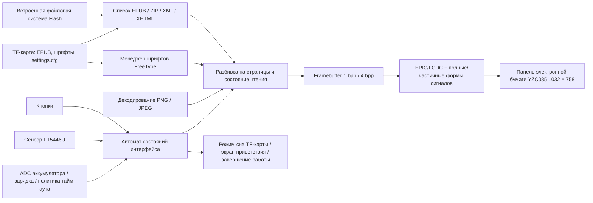

# EPUB-ридер на электронной бумаге SF32 { #sf32-e-paper-epub-reader }

## Что такое EPD Reader? { #what-is-epd-reader }

[OpenSiFli EPD Reader](https://github.com/OpenSiFli/EPD_Reader) адаптирует проект [atomic14/diy-esp32-epub-reader](https://github.com/atomic14/diy-esp32-epub-reader) для аппаратной платформы SiFli `SF32-OED-EPD`. В роли вычислительного ядра используется SF32LB52x. EPUB-файлы читаются из встроенной файловой системы или с TF-карты, а содержимое обрабатывается с помощью ZIP/XML/XHTML-парсеров, шрифтов FreeType и декодеров изображений. Затем панель электронной бумаги обновляется с применением форм сигналов для полного и частичного обновления.

В приложении есть экраны библиотеки, оглавления, чтения, настроек чтения и функций, приветствия/выключения экрана, низкого заряда, зарядки и завершения работы. Поддерживаются кнопки и сенсорный ввод, китайский и английский текст, динамическая загрузка шрифтов TTF/OTF, настройка размера и начертания шрифта, межстрочного интервала и полей, а также сохранение настроек чтения на TF-карту. Для экономии ресурсов встроенный китайский шрифт по умолчанию не включает отдельные начертания жирного и курсивного шрифта; фактический результат изменения начертания нужно проверить на целевом шрифте. Это полноценный пример терминала для чтения с редким обновлением экрана, но он не доказывает общую совместимость с EPUB и не является готовым серийным ридером.

## Почему реализация на SF32? { #why-the-sf32-implementation }

В одном приложении объединены хранилище SF32LB52, ускорение дисплея EPIC/LCDC, сенсорный ввод, кнопки, контроль аккумулятора и управление энергопотреблением. Для продуктовой команды ценность примера не сводится к отображению страницы: он позволяет совместно оценить память для компоновки, остаточное изображение при полном и частичном обновлении, адаптацию форм сигналов, управление питанием TF-карты, доступ к шрифтам, сценарий взаимодействия и поведение сна на поддерживаемом оборудовании.

В руководстве SiFli по плате есть ссылка на страницу продажи образцов, однако оно не подтверждает, что предлагаемая плата, панель и сенсорное оборудование соответствуют программной базе проекта V1.1; точная эталонная сборка и отдельный источник панели также не указаны. Кроме того, не опубликованы доля совместимости с EPUB, рабочий температурный диапазон панели, ресурс панели при эксплуатации в серийном изделии и ток в каждом режиме. Поэтому в этой статье аппаратная ревизия, сочетание панели и сенсорного контроллера и коммит ПО считаются обязательными исходными данными проекта. Другие модули электронной бумаги не являются прямой заменой.

**Сверка исходной аппаратной конфигурации:** В [руководстве SiFli по SF32LB52-OED-6'-EPD](https://github.com/OpenSiFli/SiFli-Wiki/blob/main/source/zh_CN/board/sf32lb52x/SF32LB52-OED-6%27-EPD.md) описана 6-дюймовая панель OPM060DA с разрешением 758 × 1024. Блок-схема также показывает аппаратные интерфейсы платы: 8-битный параллельный EPD по 8080, сенсорный ввод по I²C, TF-карту по SPI1, аналоговый микрофон/аудиоусилитель, USB-UART и питание от аккумулятора с зарядным устройством. В зафиксированной конфигурации EPD Reader V1.1 выбрана другая панель — YZC085 V1.05 с разрешением 1032 × 758; на фотографии платы в Wiki указана ревизия V1.2. Эти источники не подтверждают взаимозаменяемость OPM060DA и YZC085 или поставку панели из Wiki с V1.1. Проверьте маркировку реальной платы и панели, затем используйте соответствующие им цель проекта, форму сигнала и настройки VCOM.

**Требования к питанию:** Руководство SiFli требует, чтобы во время работы платы аккумулятор оставался подключённым; USB-C VBUS служит для зарядки и не может самостоятельно питать плату. В руководстве указан аккумулятор ёмкостью 1000–1500 mAh и рекомендуется одноэлементный Li-Po-аккумулятор на 1500 mAh с разъёмом MX1.25. На фотографии в руководстве отмечена плата V1.2, тогда как программная база проекта ориентирована на V1.1; перед выбором аккумулятора проверьте разъём питания, полярность и пределы зарядки конкретной платы.

## Результат, область применения и условия начала { #outcome-scope-and-entry-criteria }

**Результат:** на зафиксированной плате `SF32-OED-EPD_V1.1` с панелью YZC085 V1.05, для которой в конфигурации задано разрешение 1032 × 758, воспроизвести сборку и загрузку прошивки, работу библиотеки/оглавления/чтения, ввод кнопками и сенсором, сохранение настроек, полное и частичное обновление экрана, реакцию на низкий заряд, сон и выключение; затем собрать данные для решения по продукту.

**Вне области рассмотрения:** статья не подтверждает полную совместимость с EPUB/CSS и шрифтами, поддержку DRM, совместимость форм сигналов с произвольными панелями, качество чтения коммерческого уровня, беспроводную передачу контента, сертификацию или надёжность серийного изделия. В зафиксированном исходном коде есть настройки Bluetooth/PAN и экран состояния, но README исходного проекта не описывает передачу контента через это соединение. Воспроизводимая конфигурация ограничена локальными файлами; передача по сети не проверена и остаётся вне области рассмотрения.

**Условия начала:** команда умеет собирать и загружать приложения SiFli-SDK и может определить ревизию платы, модель панели, ориентацию шлейфа, полярность аккумулятора и файловую систему TF-карты. Если происхождение платы или панели и документация на оборудование неясны, не принимайте решение о закупке, пока SiFli или поставщик оборудования не подтвердит эти сведения.

<div align="center"><em>Таблица: Объём проекта и критерии проверки</em></div>

<div align="center" markdown>

| Область | Требование базовой проверки | Что сохранить перед переходом дальше |
|:-----|:---------------------|:------------------------------------|
| Фиксация версий | Зафиксировать плату, панель, сенсорный контроллер, commit приложения и commit подмодуля SDK | Фотографии, маркировки, конфигурация, commits, хеши образов и ориентация шлейфа |
| Сценарий чтения | Отдельно проверить встроенные примеры, книги на TF-карте, оглавление, изображения, китайский/английский текст и настройки | Манифест контента, результаты по страницам, журналы и классификацию сбоев |
| Дисплей | Формы сигналов, VCOM, разрешение, шина и температура должны соответствовать панели | Данные полного/частичного обновления, остаточного изображения, времени обновления, температуры и тока |
| Продукт | Лицензирование, права на контент, питание, надёжность, радио и нормативные требования требуют отдельной проверки | Реестр рисков, ответственные и решение — продолжать или остановить |

</div>

## Аппаратные и программные спецификации { #hardware-and-software-specifications }

### Аппаратная спецификация { #hardware-specification }

<div align="center"><em>Таблица: Аппаратная спецификация</em></div>

<div align="center" markdown>

| Компонент | Требования | Назначение | Состояние | Где получить | Совместимость и варианты замены |
|:----------|:-----------------------|:-----|:-------|:----------------|:-------------------------------------|
| Плата SF32-OED-EPD V1.1 | SF32LB52x; целевая конфигурация ПО `sf32-oed-epd_v11`; карта проекта предусматривает область QSPI NOR 16 MiB и область PSRAM 8 MiB | Вычисления, хранение, дисплей, ввод, аккумулятор и управление питанием | Обязательно | В [руководстве SiFli по плате](https://github.com/OpenSiFli/SiFli-Wiki/blob/main/source/zh_CN/board/sf32lb52x/SF32LB52-OED-6%27-EPD.md) есть ссылка на страницу продажи образцов; подтвердите у продавца ревизию платы, панель и сенсорное оборудование. Целевую конфигурацию ПО определяйте по [зафиксированной конфигурации V1.1](https://github.com/OpenSiFli/EPD_Reader/tree/7d72223c513d0a77eb251a3acb0f18cadb8d4d89/epdiy-epub/sf32-oed-epd_v11) | Для V1.2 и V1.2-SPI используются отдельные цели сборки; одного совпадения разъёмов недостаточно для замены |
| Модуль электронной бумаги YZC085 V1.05 | 1032 × 758; 8-битный интерфейс EPD/DBI; штатная конфигурация V1.1. Зафиксированная конфигурация проекта и цитируемое руководство на плату не подтверждают физическую диагональ и DPI панели; проверьте их по маркировке панели и документации производителя. | Отображает страницы EPUB и интерфейс | Обязательно | Канал поставки не опубликован; сопоставьте физическую модель с [зафиксированной опцией Kconfig](https://github.com/OpenSiFli/EPD_Reader/blob/7d72223c513d0a77eb251a3acb0f18cadb8d4d89/epdiy-epub/project/Kconfig.proj) | R7D005 (1448 × 1072) и OPM037A3 (240 × 416, SPI) требуют отдельных конфигураций и не являются заменой без перенастройки; для каждой панели проверьте форму сигналов, VCOM, временные параметры и разрешение |
| Сенсорный интерфейс FT5446U | По умолчанию для V1.1: `TSC_USING_FT5446U_V01` | Выбор касанием, перелистывание и вызов оверлея жестом вверх | Нужен при использовании сенсора | Поставляется в составе соответствующей сборки платы и панели V1.1; отдельный канал поставки не опубликован | В V1.2 по умолчанию используется GT967, а конфигурация SPI для панели 3,7 дюйма выбирает FT6336U; драйверы не взаимозаменяемы |
| TF-карта | Распознается SPI-драйвером хранения платы и файловой системой FAT | Хранение EPUB, внешних шрифтов и сохранение `/settings.cfg` | Нужна для полного набора функций; необязательна только для встроенных примеров | Обычная TF-карта; исходный проект не указывает марку или ёмкость | Прошивка отдаёт приоритет TF-карте; фиксируйте ёмкость, формат и набор файлов и проверяйте восстановление после извлечения или повреждения |
| Кабель USB для передачи данных и компьютер для сборки | Кабель с линиями данных; компьютер должен запускать инструменты SiFli-SDK | Загрузка и отладка через USB-UART, сбор журналов и зарядка аккумулятора; не заменяет питание платы | Обязательно | Стандартный кабель для передачи данных; инструменты входят в [зафиксированный commit SDK](https://github.com/OpenSiFli/SiFli-SDK/commit/8a1eb8a34be02c1df8529c9e8f0e69172bf9ef36) | Без подключённого аккумулятора USB-C VBUS не запускает плату; кабель только для зарядки не подходит для загрузки прошивки |
| Батарея и схема питания | В руководстве SiFli указана ёмкость 1000–1500 mAh и рекомендуется одноэлементная Li-Po на 1500 mAh с разъёмом MX1.25; проверьте вход и полярность конкретной платы V1.1 | Питание, необходимое для работы платы; проверка низкого заряда, зарядки, сна и автономной работы | Необходима для работы платы | Точный номер батареи не опубликован; см. [руководство SiFli по плате](https://github.com/OpenSiFli/SiFli-Wiki/blob/main/source/zh_CN/board/sf32lb52x/SF32LB52-OED-6%27-EPD.md) и уточните у поставщика разъём, полярность и ограничения | SiFli указывает максимальный ток линейного зарядного устройства 1 A и начальную настройку постоянного тока 1000 mA; перед проектированием подтвердите применимость к плате V1.1 |

</div>

### Программная спецификация { #software-specification }

<div align="center"><em>Таблица: Программная спецификация</em></div>

<div align="center" markdown>

| Пакет или сервис | Требуемая версия или ревизия | Назначение | Состояние | Где получить | Совместимость и обновление |
|:-------------------|:-----------------------------|:-----|:-------|:----------------|:-------------------------------|
| OpenSiFli EPD Reader | Коммит, рассмотренный в этой статье: [`7d72223`](https://github.com/OpenSiFli/EPD_Reader/commit/7d72223c513d0a77eb251a3acb0f18cadb8d4d89); подмодули нужно получить рекурсивно | Основной проект, приложение, определения плат, формы сигналов и фиксированная версия SDK | Обязательно | [OpenSiFli/EPD_Reader](https://github.com/OpenSiFli/EPD_Reader) | Используйте `git clone --recursive` или отдельно инициализируйте подмодули; изменяемая ветка `main` подходит только для поиска проекта |
| Приложение `epdiy-epub` | Зафиксировано commit `7d72223` | Поиск и разбор EPUB, автомат состояний страниц, шрифты, визуализация, ввод и управление питанием | Обязательно | [Каталог приложения на зафиксированной версии](https://github.com/OpenSiFli/EPD_Reader/tree/7d72223c513d0a77eb251a3acb0f18cadb8d4d89/epdiy-epub) | Адаптировано из проекта atomic14; основное приложение распространяется по лицензии MIT, у сторонних библиотек собственные лицензии |
| Подмодуль SiFli-SDK | [`8a1eb8a`](https://github.com/OpenSiFli/SiFli-SDK/commit/8a1eb8a34be02c1df8529c9e8f0e69172bf9ef36) | RT-Thread, BSP, файловые системы, Bluetooth, сеть, управление питанием, сборка и загрузка | Обязательно | [Подмодуль репозитория](https://github.com/OpenSiFli/EPD_Reader/tree/7d72223c513d0a77eb251a3acb0f18cadb8d4d89/SiFli-SDK) | Это версия SDK, зафиксированная исходным проектом для воспроизводимой сборки; обновление требует регрессионной проверки дисплея, хранения, ввода и питания |
| Зависимости EPUB и визуализации | Зафиксированы приложением: EPDIY, tinyxml2, miniz 2.2.0, PNGdec, TJpgDec, FreeType и встроенный шрифт | Обработка архивов, XML/XHTML, PNG/JPEG, шрифтов и вывод на EPD | Обязательно | Зафиксированные каталоги [`lib/`](https://github.com/OpenSiFli/EPD_Reader/tree/7d72223c513d0a77eb251a3acb0f18cadb8d4d89/epdiy-epub/lib) и [`font/`](https://github.com/OpenSiFli/EPD_Reader/tree/7d72223c513d0a77eb251a3acb0f18cadb8d4d89/epdiy-epub/font) | Проверьте каждую лицензию и NOTICE для шрифтов; лицензия MIT основного проекта автоматически не распространяется на весь сторонний код и шрифты |
| SCons, компилятор и средства загрузки UART | Среда, совместимая с зафиксированным commit SDK | menuconfig, сборка, создание образов файловой системы/форм сигналов и загрузка | Обязательно | В составе [зафиксированного SiFli-SDK](https://github.com/OpenSiFli/SiFli-SDK/commit/8a1eb8a34be02c1df8529c9e8f0e69172bf9ef36) | Сохраните конфигурацию среды, команды, созданные образы и журналы загрузки |
| EPUB-файлы и шрифты | Одобренный командой EPUB без DRM; `.ttf`/`.otf` по выбору, до 64 внешних шрифтов | Чтение книг и выбор шрифтов | EPUB обязателен; внешние шрифты необязательны | Собственный или лицензированный контент; в [`disk/`](https://github.com/OpenSiFli/EPD_Reader/tree/7d72223c513d0a77eb251a3acb0f18cadb8d4d89/epdiy-epub/disk) находятся тестовые примеры | Команда отвечает за права на контент и шрифты; проверьте структуры EPUB, языки и изображения, которые будет использовать продукт |

</div>

## Выбор поддерживаемой базовой конфигурации { #choose-a-supported-baseline }

Для первого воспроизведения используйте `SF32-OED-EPD V1.1 + YZC085 V1.05 + FT5446U`. В исходном проекте документирован отдельный путь сборки и загрузки `sf32-oed-epd_v11`, а Kconfig задаёт эту комбинацию по умолчанию для V1.1. Зафиксируйте основной commit `7d72223` и подмодуль SDK `8a1eb8a`; на первом этапе не меняйте одновременно плату, панель, сенсорный контроллер и форму сигналов.

```bash
git clone --recursive https://github.com/OpenSiFli/EPD_Reader.git
cd EPD_Reader/epdiy-epub/project
scons --board=sf32-oed-epd_v11 --board_search_path=.. -j8
```

В Windows скрипт загрузки называется `build_sf32-oed-epd_v11_hcpu\uart_download.bat`. Запустите его и при запросе укажите COM-порт. Посмотреть параметры можно командой:

```bash
scons --board=sf32-oed-epd_v11 --board_search_path=.. --menuconfig
```

## Этапы проекта { #delivery-map }

<div align="center"><em>Таблица: Этапы работ и принимаемые решения</em></div>

<div align="center" markdown>

| Этап | Какое решение поддерживает | Минимально необходимые данные |
|:------|:-------------------|:-----------------|
| Зафиксировать аппаратную часть и исходники | Соответствует ли физическая сборка базовой конфигурации V1.1 исходного проекта? | Фото маркировки и панели, ориентация подключений, commits, подмодули и конфигурация |
| Проверить базовый сценарий чтения | Проходит ли локальный сценарий EPUB на зафиксированном образе? | Журналы сборки/загрузки, манифест примеров, фотографии страниц и запись ввода |
| Проверить контент и восстановление | Повторяемо ли работают реальные книги, шрифты, TF-карта и настройки? | Матрица совместимости, восстановление после отсутствия/повреждения данных и шрифтов, результаты сохранения настроек |
| Оценить качество дисплея и энергопотребление | Подходят ли формы сигналов, остаточное изображение, обновление и поведение аккумулятора для выбранного направления продукта? | Температура, полное/частичное обновление, VCOM, время обновления и измерения тока |
| Адаптировать и принять решение | Можно ли безопасно внести ограниченное изменение и продолжить работу над продуктом? | Изменение, регрессионная проверка, реестр рисков и решение продолжить или остановить |

</div>

## Архитектура системы и зависимости { #system-architecture-and-dependencies }

<div align="center"><em>Рисунок: EPUB-контент, визуализация, ввод и тракт дисплея на электронной бумаге</em></div>



К основным областям возможных сбоев относятся разбор архива и XHTML, файлы шрифтов и память, обнаружение и питание TF-карты, назначение касаний и кнопок, модель панели и её форма сигналов/VCOM, остаточное изображение при полном/частичном обновлении, ADC аккумулятора и состояние зарядки, выключение и пробуждение. Пока документация проекта не подтверждает поддержку беспроводных функций и не описывает способ передачи контента через них, не включайте эти функции в базовую проверку локальных файлов, дисплея и питания.

## Этап 1 — Зафиксировать аппаратную конфигурацию и исходники { #stage-1-pin-the-physical-and-source-baseline }

**Цель:** подтвердить, что плата, панель, сенсорный контроллер и исходники соответствуют одной поддерживаемой конфигурации.

1. Запишите маркировку платы V1.1, модель микросхемы SF32 и панели, тип сенсорного контроллера, ориентацию шлейфа и источник питания.
2. Зафиксируйте основной commit и подмодуль SDK, сохраните полный статус подмодулей.
3. Выполните сборку и загрузку в чистой среде; вычислите хеш каждого созданного образа и скрипта загрузки.

**Сохраните результаты:** фотографии аппаратной сборки, идентификаторы компонентов, состояние Git, конфигурацию, журналы сборки и загрузки, хеши образов и журнал запуска.

**Критерий выхода из контрольной точки 1:** аппаратная сборка соответствует штатной конфигурации `sf32-oed-epd_v11`, а зафиксированные исходники воспроизводимо создают и запускают один и тот же образ.

## Этап 2 — Проверить чтение без изменений базовой реализации { #stage-2-validate-the-untouched-reading-flow }

**Цель:** проверить основной пользовательский сценарий до внесения изменений.

1. Отдельно проверьте обнаружение EPUB во встроенном хранилище и на TF-карте; прошивка отдаёт приоритет TF-карте.
2. Пройдите путь `Home` («Главная») → `Library` («Библиотека») → `Contents` («Оглавление») → `Reading` («Чтение»), проверив четыре элемента библиотеки и шесть пунктов оглавления на странице, а также работу кнопок и сенсора по схеме «выбрать, затем подтвердить».
3. Проверьте перелистывание влево/вправо, оверлей жестом вверх, переходы `-5/-1/+1/+5`, возврат к оглавлению/библиотеке и вход в настройки чтения.
4. Проверьте китайский и английский текст, PNG/JPEG и навигацию по главам; зафиксируйте неподдерживаемые или некорректные структуры контента.

**Сохраните результаты:** источник и хеш тестовых EPUB, фотографии страниц, последовательность действий, журналы, запас памяти и классификацию сбоев.

**Критерий выхода из контрольной точки 2:** основной сценарий повторяется на целевом наборе образцов, а каждый сбой классифицирован как проблема контента, шрифта, хранения, памяти, ввода или дисплея, а не описан расплывчато как «возникающий время от времени».

## Этап 3 — Проверить настройки, хранение данных и восстановление { #stage-3-qualify-settings-storage-and-recovery }

**Цель:** убедиться, что реальный контент и настройки не могут оставить пользователя в невосстановимом состоянии после событий, связанных с хранилищем.

1. Поместите файлы `.ttf`/`.otf` в каталог `/fonts` на TF-карте; проверьте обнаружение до 64 внешних шрифтов, выбор шрифта и переключение на резервный, если выбранный шрифт исчезнет.
2. Проверьте размеры шрифта 24–48 px, начертание, межстрочный интервал 1,0×–2,0×, поля 5–20 px и сохранение после перезагрузки через `/settings.cfg`.
3. В безопасные моменты, когда запись не выполняется, проверьте отсутствие, извлечение и повторную установку карты, повреждённые настройки и недоступные шрифты; не извлекайте карту во время записи, намеренно повреждая файловую систему.
4. Учитывайте текущее ограничение: `Continue Reading` («Продолжить чтение») сохраняет индекс последней открытой книги и главу только в течение текущего сеанса; не описывайте это как полную синхронизацию прогресса чтения между перезагрузками.

**Сохраните результаты:** характеристики и формат карты, манифест файлов, файл настроек, результаты перезагрузки, журналы ошибок и действия по восстановлению.

**Критерий выхода из контрольной точки 3:** целевой контент и настройки загружаются повторно; при отсутствии карты, некорректной конфигурации или шрифта предусмотрены понятные резервные действия, не мешающие вернуться на экран `Home` («Главная»).

## Этап 4 — Оценить качество дисплея на электронной бумаге и энергопотребление { #stage-4-qualify-e-paper-quality-and-power }

**Цель:** определить, подходят ли драйвер панели и политика энергосбережения для предполагаемого сценария чтения.

1. Проверьте периоды полного обновления 5, 10, 20 и «каждый раз» (`0`); фиксируйте остаточное изображение, мигание, время обновления и целостность страниц.
2. Проверьте форму сигналов, VCOM и временные параметры целевой панели во всём ожидаемом температурном диапазоне; не переносите значения из конфигурации другой панели.
3. Проверьте пользовательские тайм-ауты: 5/10/30 минут, 1 час и «никогда», а также отдельную политику по умолчанию, которая открывает экран выключения после пяти часов бездействия в основном цикле.
4. Проверьте процент заряда и значок зарядки в строке состояния, включая исчезновение значка зарядки при 98%; измерьте ток при перелистывании, частичном и полном обновлении, простое, пробуждении/сне TF-карты, низком заряде, зарядке и выключении.

**Сохраните результаты:** версии панели и формы сигналов, температуру, изображения страниц, статистику обновления, графики тока, состояние аккумулятора и результаты пробуждения/выключения.

**Критерий выхода из контрольной точки 4:** определены и выполнены требования к качеству дисплея, задержке обновления, температуре, энергопотреблению и восстановлению; для каждого отклонения принято явное решение.

## Этап 5 — Выполнить контролируемую адаптацию и оценить готовность { #stage-5-make-a-controlled-adaptation-and-review-readiness }

**Цель:** подтвердить, что команда может изменить один ограниченный аспект, не нарушив базовую реализацию.

К допустимым изменениям относятся добавление одного лицензированного шрифта, корректировка страницы, точечное исправление совместимости с EPUB или отдельный драйвер для новой панели. Поддержка новой панели должна учитывать Kconfig, разрешение/DPI, сенсорный ввод, шину, форму сигналов, температурные диапазоны, LUT, временные параметры и VCOM; при этом исходная цель платы должна остаться для регрессионных тестов.

При оценке продукта необходимо ответить как минимум на следующие вопросы:

- Каковы показатели совместимости и предельные требования к памяти для целевого набора EPUB/XHTML/CSS, изображений и языков?
- Кто отвечает за поставку панели и спецификации её форм сигналов, VCOM, температурного диапазона и срока службы?
- Каким образом лицензии контента, шрифтов, основного приложения и каждой сторонней библиотеки допускают распространение?
- Как устройство восстанавливается после повреждения TF-карты или настроек, низкого заряда, аварийного выключения, повреждения прошивки и прерванного обновления?
- Если в продукт входит Bluetooth/PAN, как определены назначение, сопряжение, безопасность, конфиденциальность и соответствие радионормам?
- Как производственные испытания проверят дефекты/остаточное изображение дисплея, сенсор, кнопки, хранилище, ADC аккумулятора, зарядку и ток сна?

**Сохраните результаты:** ревью изменения, diff, матрицу регрессионных тестов, реестр рисков, назначенных ответственных и решение по продукту.

**Критерий выхода из контрольной точки 5:** контролируемое изменение проходит все применимые регрессионные тесты; для оставшихся рисков по контенту, дисплею, питанию, безопасности, лицензированию, поставкам и нормативным требованиям назначены ответственные, меры снижения и решение — продолжать, отложить или остановить работу.

## Передача материалов для проектирования изделия { #handoff-to-product-design }

В комплект передачи проекта включите ревизии платы, панели и сенсорного контроллера; зафиксированные версии исходников и SDK; сведения о памяти и разделах; файловые системы; шрифты и контент; форму сигналов/VCOM/временные параметры; политику полного и частичного обновления; карту ввода; характеристику аккумулятора; измерения энергопотребления; восстановление после сбоев; манифест лицензий и план производственных испытаний. Для выбора микросхемы, модуля, платы, руководства по проектированию аппаратуры и контрольного списка используйте [маршрут интеграции SF32LB52x](../sf32-products/chips/SF32LB52x.md#integration-path), а затем проектируйте собственную аппаратуру в пределах проверенных функциональных границ.

## Основные источники { #authoritative-sources }

- [OpenSiFli/EPD_Reader](https://github.com/OpenSiFli/EPD_Reader)
- [Проверенный commit проекта `7d72223`](https://github.com/OpenSiFli/EPD_Reader/commit/7d72223c513d0a77eb251a3acb0f18cadb8d4d89)
- [Официальный китайский README EPD Reader](https://github.com/OpenSiFli/EPD_Reader/blob/7d72223c513d0a77eb251a3acb0f18cadb8d4d89/epdiy-epub/README.md)
- [Зафиксированный commit подмодуля SiFli-SDK `8a1eb8a`](https://github.com/OpenSiFli/SiFli-SDK/commit/8a1eb8a34be02c1df8529c9e8f0e69172bf9ef36)
- [Kconfig панели и платы EPD Reader](https://github.com/OpenSiFli/EPD_Reader/blob/7d72223c513d0a77eb251a3acb0f18cadb8d4d89/epdiy-epub/project/Kconfig.proj)
- [Конфигурация платы EPD Reader V1.1](https://github.com/OpenSiFli/EPD_Reader/tree/7d72223c513d0a77eb251a3acb0f18cadb8d4d89/epdiy-epub/sf32-oed-epd_v11)
- [Лицензия MIT основного приложения EPD Reader](https://github.com/OpenSiFli/EPD_Reader/blob/7d72223c513d0a77eb251a3acb0f18cadb8d4d89/epdiy-epub/LICENSE)
- [atomic14/diy-esp32-epub-reader](https://github.com/atomic14/diy-esp32-epub-reader)
- [Руководство SiFli по сборке и загрузке для SF32LB52x](https://docs.sifli.com/projects/sdk/latest/sf32lb52x/quickstart/build.html)
- [Аппаратное руководство SiFli по SF32LB52-OED-6'-EPD (китайский оригинал)](https://github.com/OpenSiFli/SiFli-Wiki/blob/main/source/zh_CN/board/sf32lb52x/SF32LB52-OED-6%27-EPD.md)
