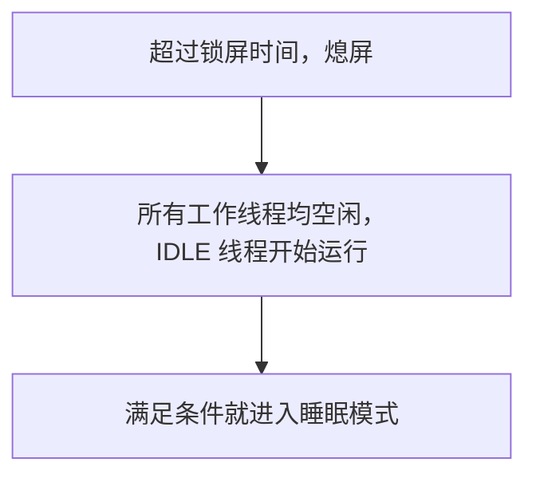
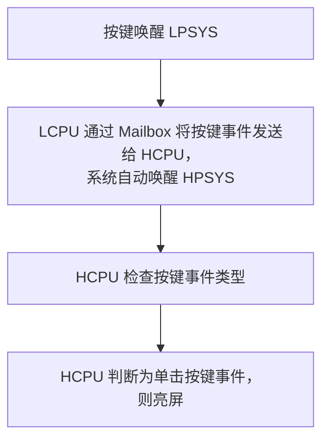

# 配置并测量低功耗 { #configure-and-measure-low-power }

SiFli SDK 的低功耗指南涵盖多种 SF32 架构。SF32LB52x、SF32LB55x 和 SF32LB56x 采用双核架构：HPSYS 中的 HCPU 最高运行频率为 240 MHz，适合高性能任务；LPSYS 中的 LCPU 最高运行频率为 48 MHz，适合蓝牙（Bluetooth）和传感器任务。SF32LB57x 和 SF32LB58x 在 HCPU/LCPU 架构上增加了 ACPU；SF32LB58x 的低功耗 LCPU 最高运行频率为 96 MHz。各系列的核数、时钟上限和低功耗行为并不相同，应以目标芯片对应的 SDK 指南为准。

## 配置电源管理框架 { #configure-the-power-management-framework }

在工程目录运行：

```bash
sdk.py menuconfig
```

以下 menuconfig 设置来自 SF32LB52x 源指南。不同系列或 SDK 版本的低功耗模式名称及配置项可能不同，应用前请对照目标系列的文档核实。

<div align="center" markdown>

<em>表：SF32LB52x 源指南中的低功耗 menuconfig 配置示例</em>

| menuconfig 路径 | 符号 | 作用 |
|---|---|---|
| `Sifli middleware → Enable Low power support` | `BSP_USING_PM` | 启用 SiFli 电源管理模块。 |
| `RTOS → RT-Thread Components → Device Drivers → Using Power Management device drivers → Select PM Mode → Enable Deep Mode` | `PM_DEEP_ENABLE` | 启用深度睡眠（Deep Sleep）支持。 |
| `Sifli middleware → Enable Low power support → Enable PM Debug` | `BSP_PM_DEBUG` | 输出电源管理切换日志；正式测量功耗时应关闭。 |
</div>

生成的 `rtconfig.h` 通常会包含 `RT_USING_PM`、`BSP_USING_PM` 以及所选模式的宏。可以从 `example/pm/classical` 例程开始。要关闭功能，只需按相同路径取消配置。

下面的截图来自 SF32LB52x 源指南，用于确认两个关键菜单位置；实际工程应以目标系列 SDK 的菜单为准。

{ loading="lazy" }
<div align="center"><em>图：SF32LB52x 源示例——在 Sifli middleware → Enable Low power support 下启用 `BSP_USING_PM`。</em></div>

{ loading="lazy" }
<div align="center"><em>图：SF32LB52x 源示例——在 RTOS → RT-Thread Components → Device Drivers 下启用 `PM_DEEP_ENABLE`。</em></div>

## 选择唤醒源 { #select-a-wake-source }

使用开发板的 `pinmux.c`/`drv_io.c` 和对应 SDK 示例中的 API 配置唤醒源。

<div align="center" markdown>

<em>表：各系列深度睡眠（Deep Sleep）/待机（Standby）与休眠（Hibernate）的唤醒行为</em>

| 系列 | 深度睡眠（Deep Sleep）/待机（Standby）唤醒行为 | 休眠（Hibernate）唤醒行为 |
|---|---|---|
| SF32LB52x | 深度睡眠下所有引脚均可通过 `WSR_GPIO1` 唤醒，不需要额外选择唤醒引脚。HCPU 与 LCPU 可以独立睡眠。 | 调用 `HAL_PMU_EnterHibernate()` 前，配置 PMU 唤醒引脚和电平。 |
| SF32LB55x | 使用 55x 对应的 AON 唤醒引脚映射。 | Hibernate 下只有 LCPU 的唤醒引脚 `PIN0`–`PIN5` 可用于唤醒。使用 `HAL_PMU_EnablePinWakeup()` 并传入有效的 55x 引脚编号；这些引脚在 Hibernate 下为浮空输入，板级设计需要时应加外部上拉或下拉电阻。 |
| SF32LB56x | 使用该系列对应的 HPAON/LPAON 唤醒引脚映射。 | PMU 支持两个唤醒源 `PIN0` 和 `PIN1`，可映射到 HCPU 或 LCPU 的唤醒引脚。请参考下方 PMU 映射示例。 |
| SF32LB57x | 使用该系列对应的 HPAON/LPAON 唤醒引脚映射。 | PMU 支持两个唤醒源 `PIN0` 和 `PIN1`；57x 的 Hibernate 唤醒引脚索引范围为 0–13。将每个唤醒源映射到目标 HCPU/LCPU 唤醒引脚。 |
| SF32LB58x | 使用该系列对应的 HPAON/LPAON 唤醒引脚映射。 | PMU 支持两个唤醒源 `PIN0` 和 `PIN1`，可映射到 HCPU 或 LCPU 的唤醒引脚。请参考下方 PMU 映射示例。 |
</div>

SF32LB52x、SF32LB56x、SF32LB57x 和 SF32LB58x 的 Hibernate 配置可参考下方示例：将一个 GPIO 映射到 PMU 唤醒源 `PIN0`。该示例不适用于 SF32LB55x；55x 应使用表中所述的独立配置方法。SF32LB57x 的 PMU 唤醒引脚索引范围为 0–13。请结合目标芯片用户手册和开发板设计确认所选引脚映射。

```c
HAL_PMU_SelectWakeupPin(0,
    HAL_HPAON_QueryWakeupPin(hwp_gpio1, BSP_KEY1_PIN));
HAL_PMU_EnablePinWakeup(0, AON_PIN_MODE_HIGH);
rt_kprintf("CR:0x%x, WER:0x%x\n", hwp_pmuc->CR, hwp_pmuc->WER);
```

从休眠唤醒会执行冷启动，并设置 `PM_HIBERNATE_BOOT`；它不会像待机唤醒那样，从进入低功耗状态时暂停的位置继续执行。如果同一个 IO 同时用于待机和休眠唤醒，必须分别配置两条唤醒路径。55x 的休眠唤醒引脚为浮空输入；如果板级设计需要，应加外部上拉或下拉电阻。

## 理解低功耗状态 { #understand-the-sleep-states }

<div align="center" markdown>

<em>表：低功耗模式与典型唤醒时间</em>

| SDK 模式 | CPU/外设状态 | SRAM 与唤醒源 | 指南给出的唤醒时间范围 |
|---|---|---|---|
| `PM_SLEEP_MODE_IDLE` | CPU 在 WFI/WFE 中等待；时钟和外设继续运行。 | SRAM 可访问；任意中断均可唤醒。 | <1 µs |
| `PM_SLEEP_MODE_LIGHT` | 高速时钟关闭，子系统切换到 32 kHz。 | LPTIM、RTC、LCPU BLE MAC、Mailbox 或唤醒引脚。 | 30–100 µs |
| `PM_SLEEP_MODE_DEEP` | 与轻度睡眠（Light Sleep）类似，但电源切换到 `RET_LDO`。 | SRAM 保持情况和唤醒源因系列而异，详见下方系列对照表。 | 100 µs–1 ms |
| `PM_SLEEP_MODE_STANDBY` | CPU 及其外设复位或掉电；引脚状态保留。 | SRAM 保持容量和唤醒源因系列而异；软件通过 AON 状态识别待机启动。 | 1–2 ms |
| 休眠（Hibernate） | 所有子系统掉电，32 kHz 晶体保持运行。 | RTC 或 PMU 唤醒引脚；RAM 不保留。调用 `HAL_PMU_EnterHibernate()`。 | >2 ms |
| 关机（Shutdown） | 所有子系统掉电，RC10K 保持运行。 | RTC 或 PMU 唤醒引脚；RAM 不保留，IO 处于高阻态。调用 `HAL_PMU_EnterShutdown()`。 | >2 ms |
</div>

<div align="center" markdown>

<em>表：各系列 SRAM 保持情况与唤醒时间参考值</em>

| 系列 | `PM_SLEEP_MODE_DEEP` | `PM_SLEEP_MODE_STANDBY` |
|---|---|---|
| SF32LB52x | HPSYS 和 LPSYS SRAM 均不可访问，但全部保持；唤醒约需 250 µs。 | LPSYS SRAM 不可访问但全部保持；HPSYS SRAM 不可访问，仅保持 384 KB；唤醒约需 1 ms。 |
| SF32LB55x | HPSYS 和 LPSYS SRAM 均不可访问，但全部保持；唤醒约需 250 µs。 | LPSYS SRAM 不可访问但全部保持；HPSYS SRAM 不可访问，仅保持 64 KB；唤醒约需 1.5 ms。 |
| SF32LB56x | HPSYS 和 LPSYS SRAM 均不可访问，但全部保持；唤醒约需 250 µs。 | LPSYS SRAM 不可访问但全部保持；HPSYS SRAM 不可访问，仅保持 64 KB；唤醒约需 1.5 ms。 |
| SF32LB58x | HPSYS 和 LPSYS SRAM 均不可访问，但全部保持；唤醒约需 250 µs。 | LPSYS SRAM 不可访问但全部保持；HPSYS SRAM 不可访问，仅保持 64 KB；唤醒约需 1.5 ms。 |

</div>

当前引用的 SDK 低功耗指南未提供 SF32LB57x 可对照的 SRAM 保持容量与唤醒时间数据。不要将其他系列的保持容量或时序数值套用于 SF32LB57x；请根据目标 SDK 版本和器件文档核实。

表中的模式名称按以下方式对应：`PM_SLEEP_MODE_LIGHT` 为轻度睡眠（Light Sleep），`PM_SLEEP_MODE_DEEP` 为深度睡眠（Deep Sleep），`PM_SLEEP_MODE_STANDBY` 为待机（Standby）。

上表中的系列数据是 SDK 指南给出的参考值，不代表开发板上的保证时序。SF32LB52x 指南说明：如果配置了 PSRAM，HCPU 会将即将掉电的 RAM 中需要保留的数据备份到 PSRAM，并在唤醒后恢复；如果没有 PSRAM，则以 64 KB Retention RAM 作为备份空间。这个备份空间与各系列模式表中列出的 SRAM 保持容量不是同一指标（例如，SF32LB52x 的 Standby 表项列出 HPSYS 保持 384 KB）。实际电流还取决于已启用的外设、IO 电平、外部存储器和开发板。

## 在运行状态控制时钟 { #control-clocks-while-awake }

如果 IDLE 线程无法进入睡眠，可以使用 WFI 自动降频降低电流。只有 EPIC、EZIP、LCDC、USB 和 SD 均空闲时才可以降频。如果应用没有使用 SDK 自带的 LVGL/设备忙闲管理，请在外设开始和结束工作时调用 `rt_pm_hw_device_start()` 与 `rt_pm_hw_device_stop()`。使用 `HAL_RCC_HCPU_SetDeepWFIDiv()` 配置降频分频；有音频工作时通常只能降到 48 MHz，其他场景可降到 4 MHz，并按 SDK 指南设置 `HPSYS_RCC_DBGR_FORCE_HP`。

运行状态可通过 `rt_pm_run_enter()` 选择：

<div align="center" markdown>

<em>表：运行模式下的 HCPU 时钟</em>

| 模式 | HCPU 时钟 |
|---|---:|
| `PM_RUN_MODE_HIGH_SPEED` | 240 MHz |
| `PM_RUN_MODE_NORMAL_SPEED` | 144 MHz |
| `PM_RUN_MODE_MEDIUM_SPEED` | 48 MHz |
| `PM_RUN_MODE_LOW_SPEED` | 24 MHz |
</div>

`pm_scenario_start()`/`pm_scenario_stop()` 提供 SDK 的 UI 和音频（Audio）场景策略：任一场景开启时使用高速模式，两者均关闭时使用中速模式。应测量能耗，不能只看瞬时电流，因为降频可能延长执行时间。

## 理解子系统间的睡眠时序 { #understand-inter-subsystem-sleep-sequencing }

熄屏后，HPSYS 可以进入睡眠。55x/56x/58x 通常由 HPSYS 先睡眠，LPSYS 随后进入；现有资料明确记载的例外是 52x，HCPU 与 LCPU 可以独立睡眠。现有资料未能确认 57x 的 ACPU 是否遵循相同顺序，请根据对应 SDK 版本核实其子系统策略。唤醒后，`gui_resume` 会开始新一轮熄屏判断。共享外设或 IPC 事务仍依赖某个核心时，应保持该核心运行。

临时打开 `BSP_PM_DEBUG`，在日志中搜索：

<div align="center" markdown>

<em>表：低功耗转换日志标记</em>

| 日志 | 含义 |
|---|---|
| `gui_suspend` / `gui_resume` | 熄屏/亮屏切换。 |
| `[pm]S: mode,gtime` | 进入睡眠；`gtime` 以 32,768 Hz 时钟节拍（tick）为单位。 |
| `[pm]W: gtime` | 从睡眠唤醒。 |
| `[pm]WSR:0x...` | 唤醒原因；按对应系列用户手册解码位含义。 |
</div>

如果没有进入预期的睡眠状态，检查 `list_thread`、`pm_dump` 和 `list_timer`。IDLE 线程必须获得调度；不得有代码仍持有 `rt_pm_request(PM_SLEEP_MODE_IDLE)` 请求；下一个 OS 定时器的到期时间必须超过策略门限（通常 HCPU 为 100 ms、LCPU 为 10 ms）；唤醒条件须处于非激活状态，IPC 队列也必须清空。若周期性延时短于门限，系统可能一直无法进入睡眠。

原指南还用流程图展示了“熄屏 → IDLE → 满足条件后进入睡眠”以及“按键唤醒 LPSYS、LCPU 通过 Mailbox 将事件发送给 HCPU、系统自动唤醒 HPSYS”的路径。这些流程图适合用来核对日志顺序；图中的文字和流程以 SF32LB52x 为例，不能据此推断其他系列的 WSR 位定义。

{ loading="lazy" }
<div align="center"><em>图：SF32LB52x 低功耗调试开关（`BSP_PM_DEBUG`）。</em></div>

<div align="center"><em>图：SF32LB52x 示例流程——从熄屏到睡眠。</em></div>



<div align="center"><em>图：SF32LB52x 示例流程——LPSYS 唤醒 HPSYS。</em></div>



## 降低板级漏电 { #reduce-board-level-leakage }

先断开显示屏、传感器、充电 IC 等可拆负载，测量最小系统，再逐一接回。常见漏电来源包括：

- 外部器件仍然上电；
- 芯片输出高电平驱动已经掉电的器件；
- 输入悬空或上下拉不匹配；
- PSRAM、NOR/NAND Flash、eMMC 或 SDIO 未进入低功耗状态；
- 55x 的 USB `PA01` 内部有下拉，配置与外部电平冲突。

在 `BSP_IO_Power_Down()` 和 `BSP_Power_Up()` 中实现板级电源切换；需要在熄屏/亮屏时立即切换显示或触摸电源时，使用 `BSP_TP_PowerDown/Up` 与 `BSP_LCD_PowerDown/Up`。如果从 NOR Flash 执行 XIP，Flash 睡眠/唤醒代码必须放在保持供电的 RAM 中（`HAL_RAM_RET_CODE_SECT`）。

## 记录可复现的测量结果 { #measure-and-record-a-reproducible-result }

每次测量都记录芯片系列和 SDK 版本、板卡版本、供电电压、电流表位置与带宽、固件配置、存储器组合、启用的外设、唤醒源、低功耗模式和转换日志。电流数值必须带完整测试条件，不能比较来自不同板卡或不同模式的孤立数字。

官方系列来源：[SF32LB52x](https://docs.sifli.com/projects/sdk/latest/sf32lb52x/app_note/low_power.html)、[SF32LB55x](https://docs.sifli.com/projects/sdk/latest/sf32lb55x/app_note/low_power.html)、[SF32LB56x](https://docs.sifli.com/projects/sdk/latest/sf32lb56x/app_note/low_power.html) 和 [SF32LB58x](https://docs.sifli.com/projects/sdk/latest/sf32lb58x/app_note/low_power.html)。SDK 的 [PMU API 参考](https://docs.sifli.com/projects/sdk/latest/en/sf32lb52x/api/hal/pmu.html) 说明了 SF32LB57x Hibernate 唤醒引脚索引范围。
