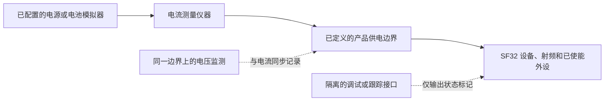
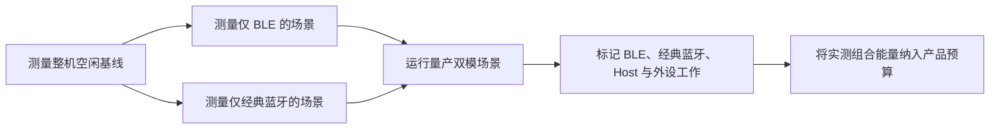

# 蓝牙功耗测量与分析 { #bluetooth-low-power-profiling }

本文介绍如何测量设备在蓝牙（Bluetooth）运行期间的**实际功耗**，包括低功耗蓝牙（Bluetooth Low Energy，BLE）、经典蓝牙（BR/EDR），以及双模产品中两种模式的组合运行情况。对每种场景，都要明确电气测量边界，记录电流和电压，并采集足够的固件信息来解释波形中的关键区段。

经典蓝牙和双模部分仅适用于设备及其固件配置均支持 BR/EDR 的产品。仅支持 BLE 的产品仍应采用本文方法，但场景计划只需覆盖 BLE。

Nordic 的 [Online Power Profiler for Bluetooth LE](https://devzone.nordicsemi.com/power/w/opp/2/online-power-profiler-for-bluetooth-le)可作为 BLE 功耗分析的参考。Nordic 称，该工具是根据测量数据建立的模型，用于估算预期值，并非对某台设备进行实测。公开的精度数据仅适用于 Nordic 参考器件，不能直接套用到 SF32；该工具也不涵盖经典蓝牙或双模产品。模型可帮助确定测试重点，但产品功耗必须通过目标设备的实测来确认。

## 先定义测量对象 { #define-what-you-are-measuring }

“蓝牙功耗”可能指完全不同的内容。只测射频或某一电源轨，有助于优化连接参数，却不能说明量产设备在控制器、应用 CPU、传感器、显示、存储和供电系统共同参与时的实际耗电。

<div align="center"><em>表：蓝牙功耗的测量位置与范围</em></div>

<div align="center" markdown>

| 测量位置 | 测量范围 | 适用场景 | 局限 |
|:---------|:---------|:---------|:-----|
| 蓝牙子系统或选定电源轨 | 射频/控制器和该电源路径 | 定位射频或控制器的功耗退化 | 不等于整机电池消耗 |
| MCU 输入电源轨 | 该电源轨供电的 MCU、控制器和片上外设 | 在受控开发板上比较固件状态 | 不含其他电源轨上的外设和稳压损耗 |
| 电池或产品主输入 | 稳压器、MCU、外部存储、传感器、显示和其他已供电负载 | 续航建模和产品验收 | 必须严格控制所有连接的硬件和供电 |

</div>

要给出产品续航结论时，应尽可能在电池或产品主输入边界测量。同时记录电压和电流，才能将结果表达为功率和能量，而不是脱离供电条件的单一电流数字。

## 搭建可重复的测试 { #set-up-a-repeatable-test }

仪器和设备必须以同一个有明确记录的测试边界为准。当 Nordic Power Profiler Kit II（PPK II）的电压和电流量程适合测试条件时，可将其用作供电与电流测量的实用参考工具；等效的源测量单元或电流分析仪也可以使用。关键在于测量方法是否严谨，而不是仪器品牌。

PPK II 的[源测量模式（Source Meter）](https://docs.nordicsemi.com/r/bundle/ug_ppk2/page/ug/ppk/measure_current_source_meter.html)由仪器为设备供电；[电流测量模式（Ampere Meter）](https://docs.nordicsemi.com/r/bundle/ug_ppk2/page/ug/ppk/measure_current_ampere_meter.html)则由外部电源经仪器向设备供电。根据产品实际供电路径选择模式。设置的供电电压不等于已记录的设备电压波形；仍应在测量点监测电压，尤其是电压跌落或电池电压变化会影响能量计算时。

连接被测设备（DUT）前，先确认 PPK II 的工作范围：Source Meter 模式的输出电压可在 0.8–5.0 V 之间调节，DUT 电流上限为 600 mA；Ampere Meter 模式需要外部 0.8–5.0 V 电源，连续测量电流上限为 1 A。如果 DUT 在 Source Meter 模式下可能超过 400 mA，Nordic 建议额外使用额定电流至少为 1 A 的 USB 电源为 PPK II 供电。这些是仪器的使用上限，不是设备的建议工作值。详见 Nordic 的[最大 DUT 电流规格](https://docs.nordicsemi.com/r/bundle/ug_ppk2/page/ug/ppk/ppk_max_dut_current.html)和[供电说明](https://docs.nordicsemi.com/r/bundle/ug_ppk2/page/ug/ppk/ppk_power_supply.html)。

<div align="center"><em>图：整机蓝牙功耗测量连接方式</em></div>



每次测试前应完成以下准备：

1. 断开可能绕过仪器或引入额外负载的 USB 供电、调试器和其他电源。只保留场景必需的接口。
2. 在选定边界施加已记录的供电电压，并记录所有已供电电源轨、跳帽、模组和外部设备。
3. 使用产品固件及其目标 PM 配置。除非大量诊断日志本身属于量产配置，否则在最终数据中关闭它们。
4. 对每次对比使用相同的手机、配件、测试应用、距离、天线朝向和射频环境。
5. 采集足够长的波形窗口，覆盖多个重复蓝牙事件，不要只截取单个孤立脉冲。

## 看懂 BLE 广播事件中的功耗阶段 { #read-a-ble-advertising-event-as-a-set-of-power-components }

典型的 BLE 广播事件并不是一个单独的射频脉冲。它先经历短暂的上电和预处理阶段，再完成高频晶振启动与稳定；当电源与时钟准备就绪后，设备会进入待机（Standby），等待预定的射频启动时刻。对于图示的可扫描或可连接广播，设备启动射频后，会在一个主广播信道发送广播包，并在同一信道打开接收窗口。前两个接收窗口结束后，设备会回到待机，再在下一个信道发送；最后一个接收窗口结束后进入后处理。不可连接且不可扫描的广播不会打开用于监听请求的接收窗口。实际阶段取决于配置的广播类型和信道映射。

图中完整顺序为：预处理 → 晶振启动 → 待机 → 射频启动 → 射频发射 → 射频切换 → 射频接收 → 待机 → 射频发射 → 射频切换 → 射频接收 → 待机 → 射频发射 → 射频切换 → 射频接收 → 后处理。射频启动阶段只出现一次；38、39 信道的发送分别在前一信道接收窗口后的待机阶段结束后开始。该顺序参考 Nordic 的[典型 BLE 广播事件示意图](https://devzone.nordicsemi.com/power/w/opp/2/online-power-profiler-for-bluetooth-le)。这些阶段描述的是通用 BLE 广播事件，并非 Nordic 专有的射频状态；本图没有增加其他状态。图中的电流和时序比例仅用于说明，并非 SF32 实测值；请在目标设备上测量。

<div align="center"><em>图：BLE 广播事件阶段</em></div>


图中展示的是传统可扫描或可连接广播使用三个主广播信道的示例，且未画出收到请求后的交互。信道标签 37、38、39 仅为图示。Bluetooth Core Specification 允许按任意顺序使用已启用的主信道索引；具体使用哪些索引由信道映射配置决定。一个事件通常会在每个已用索引上发送一个广播 PDU，且每个索引最多发送一个。三次发送是在不同信道上发送相同广播数据的副本，不是等待确认后的重试。对于可扫描或可连接广播，链路层会在同一主信道监听符合策略的请求；不可连接且不可扫描的广播则不会打开用于监听请求的接收窗口。详见 [Bluetooth Core 6.2 链路层规范](https://www.bluetooth.com/wp-content/uploads/Files/Specification/HTML/Core-62/out/en/low-energy-controller/link-layer-specification.html) 和 [Bluetooth SIG 入门资料](https://www.bluetooth.com/bluetooth-le-primer/)。扩展广播、不同的信道映射或实际收到请求，都可能产生不同波形；应在目标设备上确认配置行为。

<div align="center"><em>表：BLE 广播事件功耗波形中的各阶段</em></div>

<div align="center" markdown>

| 阶段 | 典型活动与功耗来源 | 需要测量和验证的内容 |
|:-----|:-----------|:---------------|
| 预处理（Pre-processing） | 短暂的上电阶段（可能伴随较高电流），以及 CPU/控制器准备、载荷处理、DMA、内存访问和外设配置 | `I_pre` 与 `t_pre`；识别必要的唤醒和上电工作，并移除或合并可避免的工作 |
| 晶振启动与稳定（Crystal ramp-up） | 高频时钟启动和稳定过程 | `I_xtal` 与 `t_xtal`；确认时钟策略和唤醒顺序没有超过实际需要 |
| 待机（Standby） | 电源和时钟就绪后的所选低功耗状态，以及保持逻辑、低频计时和已启用的唤醒源 | 测量 `I_standby`、射频启动前的初始等待时长，以及每次 RX 后的信道间待机时长；事件内部的待机电流不等于两次完整事件之间的睡眠电流 |
| 射频启动（Start radio） | 首次发射前的射频/控制器准备工作及所需的 RF 供电路径 | `I_start` 与 `t_start`；识别不必要的准备工作或重复启动 |
| 射频发射（Radio TX） | 射频发射路径、控制器工作以及在信道 37、38、39 上发送广播包 | 测量每个发射包的 `I_tx` 与 `t_tx`；TX 功率、包长和启用信道共同决定数据包及完整事件的能量 |
| 射频切换（Radio switch） | 发射与接收之间的切换，以及控制器状态转换 | `I_switch` 与 `t_switch`；应统计每一次切换，不能将其视为零成本时间 |
| 射频接收（Radio RX，如启用） | 等待扫描请求或连接请求时的接收路径和控制器工作 | `I_rx` 与 `t_rx`；仅当广播类型和配置确实打开接收窗口时才计入 |
| 后处理（Post-processing） | 协议回调、CPU 工作、内存/外设访问，以及回到睡眠前的应用响应 | `I_post` 与 `t_post`；确认时钟、PM 约束和外部器件能及时释放 |

</div>

对于 SF32，应将这些阶段名称作为波形打点和归因提示，而不是视为 Nordic 专有的运行状态或假定的时序、电流数值。只有当目标广播类型和配置会打开接收窗口时，事件中才会出现接收阶段；应通过目标设备的实测波形确认。

完整事件的能量是波形下经电压加权的面积，可按各阶段求和：

```text
E_event = sum(V_stage x I_stage x t_stage)
```

当供电电压保持恒定时，周期性广播配置可近似为：

```text
Q_event = sum(I_stage x t_stage)
I_average = (Q_event + I_idle x (T_cycle - t_event)) / T_cycle
```

`Q_event` 包含完整事件中各阶段的电量，包括事件内部的待机区间；`t_event` 是完整事件的持续时间。`I_idle` 是两次完整事件之间的实测空闲电流，不能直接用事件内部的 `I_standby` 代替。`T_cycle` 是两次事件开始时刻之间的实测间隔，包含广播延迟和调度影响。若间隔不固定，应对足够长且有代表性的波形积分，不要将配置的广播间隔当作精确的事件周期。

在电压不变时，某阶段的实测电流或持续时间翻倍，该阶段的能量也翻倍。TX、RX 和启动阶段虽短，仍可能是单次事件的主要耗电项；事件间隔较长时，两次事件之间的空闲耗电则可能主导平均电流。用 GPIO 或低开销固件事件标记各阶段，并在完整产品的供电入口测量，再决定优先优化什么。

经典蓝牙的协议时序不同，但测量原则相同。Bluetooth Core Specification 将 Inquiry Scan 和 Page Scan 定义为不同的扫描过程；Sniff 则是已连接的 ACL 模式，会减少 Peripheral 一侧的监听时隙，并将监听安排在指定的 Sniff 时机。对端流量可能使活动超出一个锚点间隔。它们描述的是时序行为，不是电流估算值。应在目标设备上测量实际配置的扫描策略、Sniff 参数，以及对端和应用活动。详见 [BR/EDR 基带规范](https://www.bluetooth.com/wp-content/uploads/Files/Specification/HTML/Core-62/out/en/br-edr-controller/baseband-specification.html) 和 [HCI Scan Enable](https://www.bluetooth.com/wp-content/uploads/Files/Specification/HTML/Core-62/out/en/host-controller-interface/host-controller-interface-functional-specification.html)。

## 先按蓝牙模式规划测量场景 { #build-a-mode-specific-measurement-plan }

不要把“已开启蓝牙”当成一个工作状态。BLE 与经典蓝牙使用不同的连接和低功耗过程；双模产品可能会让两种模式共享射频时隙、控制器资源、时钟、内存及应用处理工作。应先建立最小、可重复的单模式场景，再测量产品实际会采用的组合行为。

<div align="center"><em>表：蓝牙场景覆盖范围</em></div>

<div align="center" markdown>

| 无线能力 | 场景 | 测量前需要明确的内容 | 应保留的结果 |
|:---------|:-----|:---------------------|:-------------|
| BLE | 广播、已连接空闲、应用传输和重连 | 角色、间隔、TX 功率、载荷、对端、起止条件 | 平均电流、单事件能量和单次完成操作的能量 |
| 经典蓝牙（BR/EDR） | 扫描状态 | 是否开启 Inquiry Scan、Page Scan 或两者；可发现/可连接策略 | 代表性扫描窗口内的平均电流和能量 |
| 经典蓝牙（BR/EDR） | 已连接 Sniff 模式 | Sniff 参数、对端、链路状态和后台应用活动 | 多个 Sniff 间隔上的平均电流和能量 |
| 经典蓝牙（BR/EDR） | 活跃的蓝牙应用规范（Profile）负载 | Profile 与角色，例如 SPP/PAN 数据或 A2DP/HFP 音频；载荷或音频会话时长 | 每次完成传输或会话的能量，以及持续平均功率 |
| 双模蓝牙 | BLE 与经典蓝牙共同使用 | 共存链路、各自参数、前台负载，以及状态切换/重连行为 | 完整产品场景的实测组合平均功率和能量 |

</div>

思澈科技（SiFli）的 [BLE/BT 功耗测试](https://docs.sifli.com/projects/sdk/latest/en/sf32lb52x/example/pm/bt/README.html)可作为实用基线：它覆盖 BLE 广播和连接模式，以及经典蓝牙的 Scan 和 Sniff 模式。该示例在开发板上的结果并不是产品规格。应先按其支持开发板、唤醒引脚、调试终端（Console）和 PM 设置建立可重复基线，再在目标硬件上复现产品实际的角色、对端、流量和功耗策略。

## 先独立测量 BLE { #profile-ble-as-a-standalone-radio-mode }

先只测 BLE。这样可以建立 BLE 基线，不会让经典蓝牙 Profile 流量或跨模式调度干扰波形判断。

<div align="center"><em>表：独立 BLE 场景集</em></div>

<div align="center" markdown>

| 场景 | 测试设置 | 需要计算的结果 | 常见误导来源 |
|:-----|:---------|:---------------|:-------------|
| 广播 | 设备未连接，按已记录的广播类型和信道配置发送广播 | 平均电流和每个广播间隔的能量 | 手机扫描行为、调试流量，或广播间隔未按预期增大 |
| 已连接空闲 | 设备已连接，但没有应用数据传输；记录是否启用配对、绑定及加密 | 多个连接间隔上的平均电流 | 每个连接事件都唤醒应用 CPU，或定时器/通知仍持续工作 |
| 用户交互 | 一次代表性的 GATT 命令、传感器上传或 UI 触发动作 | 每次完成操作的能量，以及相对空闲状态增加的能量 | 只测射频，却忽略 Host、显示或传感器工作 |
| 突发传输或 OTA | 定义好载荷和完成条件的一次传输 | 每字节或每次完成传输的能量，以及总时长 | 将峰值速率误当作整个传输过程 |
| 断连与重连 | BLE 对端离开范围、返回并重新连接 | 恢复所需的能量和时间 | 没有上限的重试，或无限保持激进广播策略 |

</div>

应记录 BLE 的角色、对端、连接或广播参数、TX 功率、载荷、起始触发、结束条件和真实使用频率。缺少这些信息的波形无法与其他固件版本进行对比。

## 再独立测量经典蓝牙 { #profile-classic-bluetooth-as-a-standalone-radio-mode }

双模产品应在引入 BLE 之前，先单独测量经典蓝牙。这样可以看清 Scan、Sniff 的基线，以及每种 Profile 特有的系统工作，而不会被 BLE 事件交错干扰。

<div align="center"><em>表：独立经典蓝牙场景集</em></div>

<div align="center" markdown>

| 场景 | 测试设置 | 需要计算的结果 | 常见误导来源 |
|:-----|:---------|:---------------|:-------------|
| Scan | 启用量产配置中的 Inquiry Scan、Page Scan 或组合策略 | 代表性扫描窗口内的平均电流和能量 | 实际保留了比量产配置更激进的扫描策略 |
| 已连接 Sniff 模式 | 已连接的经典蓝牙链路进入预期 Sniff 配置 | 多个 Sniff 间隔上的平均电流 | 对端流量或应用工作使链路始终保持活跃，却未被发现 |
| 活跃 Profile 负载 | 定义好的 SPP/PAN 数据传输、A2DP 音频流、HFP 通话或其他量产 Profile 负载 | 每次完成传输或会话的能量，以及持续平均功率 | 只测射频，却遗漏 Profile 所需的 Codec、功放、显示、存储或 Host 工作 |
| 断连与重连 | 经典蓝牙对端离开范围、返回并重新连接 | 恢复所需的能量和时间 | 没有上限的重试，或无限保持发现策略 |

</div>

应记录经典蓝牙的角色、对端、Scan 或 Sniff 策略、TX 功率、Profile、载荷或会话时长、起始触发、结束条件和真实使用频率。对于音频 Profile，测量边界必须覆盖产品实际使用的音频通路。

## 将双模行为作为独立场景测量 { #measure-dual-mode-behavior-as-its-own-scenario }

不要用一项 BLE 测量结果加上一项经典蓝牙测量结果，来推算双模产品的功耗。两种模式可能共享射频时隙、控制器处理、时钟、内存资源和应用唤醒，因此组合结果可能与两个独立平均值的算术和有明显差异。

<div align="center"><em>图：双模蓝牙功耗分析流程</em></div>



只有在理解独立的 BLE 和经典蓝牙基线之后，才应开始对双模产品进行功耗分析。例如，产品在保持 BLE 链路可用的同时播放经典蓝牙音频时，应在相同硬件和对端条件下分别测量：

1. 仅 BLE 的已连接空闲策略。
2. 仅经典蓝牙的音频流或数据 Profile。
3. 包含目标 BLE 流量的实际组合稳态。
4. 进入和退出组合状态的过程，以及错误恢复和重连行为。

波形标记应能区分 BLE 事件、经典蓝牙 Profile 工作、应用回调、音频或数据处理，以及 PM 状态变化。这样既能分离射频调度与它触发的系统工作，也能发现意外相互影响，例如 BLE 回调让应用 CPU 在经典蓝牙会话期间无法重新进入睡眠。

## 将波形归因到固件行为 { #correlate-the-trace-with-firmware-behavior }

找出设备实际耗电的关键在于归因。应对产品工作开始和结束做标记或记录，让波形能够回答“为什么电流发生变化”：

- 应用主动发起传输或通知突发的前后。
- 显示、传感器、Flash、音频通路或其他外部器件的开关时刻。
- 固件请求 PM 状态的时刻，以及设备实际进入该状态的时刻。
- 重连、重试或错误恢复路径开始的时刻。

可使用 GPIO 跟踪点、低开销事件标记或可重复的测试脚本。串口日志有助于启动调试，但也会改变电流消耗。最终功耗测量中的日志应作为受控测试变量，而不是没有代价的观察通道。

<div align="center"><em>表：解读蓝牙功耗波形</em></div>

<div align="center" markdown>

| 波形观察 | 可能含义 | 在固件或硬件中验证的内容 |
|:---------|:---------|:---------------------------|
| 低基线之上出现短而规律的脉冲 | 计划内的 BLE 广播/连接事件，或经典蓝牙 Scan/Sniff 活动 | 模式、间隔或 Scan/Sniff 策略、射频角色，以及事件之间实际的低功耗状态 |
| 每个射频事件后都出现更大的脉冲 | Host 回调、协议处理或应用工作 | 哪个回调在执行、数据是否有效，以及能否合并处理 |
| 经典蓝牙会话期间持续或密集重复的活动 | 活跃的经典蓝牙 Profile 流量，通常还包含 Host、音频或数据处理 | Profile、Codec/数据路径、对端流量、音频时钟、外部器件和已定义的会话边界 |
| BLE 与经典蓝牙脉冲交错出现 | 双模调度或相关的 Host 工作 | 每个区段由哪条链路触发、是否共享工作，以及任一模式是否延迟睡眠或增加重试 |
| 预期事件结束后仍保持高电流 | PM 约束、外设或外部接口仍在工作 | PM 投票（vote）、定时器、时钟、引脚状态、显示/传感器电源和错误路径 |
| 偶发的长脉冲 | 重试、扫描、重连、对端流量或用户活动 | 射频条件、对端行为、退避/重试策略和测试脚本 |
| 连接模组或线缆后基线发生变化 | 电气边界已经改变 | 反向供电路径、UART 适配器、外部上拉、模组电源轨和供电走线 |

</div>

## 计算实际能量与每日消耗 { #calculate-actual-energy-and-daily-consumption }

对于变化的电流波形，应根据电流和电压随时间计算能量：

```text
E_scenario = integral(V(t) x I(t) dt)
P_average = E_scenario / T_scenario
```

如果测量边界上的电压保持恒定，也可以使用平均电流做比较。但仍应保留电压记录，尤其是在稳压后电源轨和电池输入之间切换测量时。

对于重复发生的产品场景：

```text
E_day = sum(E_scenario x events_per_day) + E_mode_idle + E_other_states
```

将一天划分为互不重叠的时段。`E_mode_idle` 和 `E_other_states` 只能计入完整场景能量尚未覆盖的时间。BLE 与经典蓝牙同时运行时，应采用实测的组合场景，不能直接相加两个独立模式的结果。如果模型已计入全天 24 小时的基线耗电，每个操作只计入高于该基线的能量，不计入其完整能量。电压、电流和时间分别用 V、A、s 时，计算结果为 J；除以 3600 可换算为 Wh。

场景能量必须覆盖设备完成该场景所需的全部工作。例如，一条手机通知可能包含连接事件、Host 处理、传感器或 Flash 访问、显示更新和重新进入睡眠。只测射频脉冲会低估设备能量；只测整机而没有波形标记，又无法找到可以优化的原因。

## 用设备实测校准模型 { #reconcile-the-model-with-the-device }

先用初始模型排序可能的主要贡献项，再用实测值更新它。估算与波形之间的差异本身就很有价值：它可能指出遗漏的事件、错误的时长、意外唤醒，或未被纳入模型的外部负载。

<div align="center"><em>图：蓝牙功耗实测与验证闭环</em></div>


<div align="center"><em>表：模型与实测的核对问题</em></div>

<div align="center" markdown>

| 模型与测量不一致 | 需要回答的问题 |
|:---------------|:---------------|
| 平均电流高于预期 | 设备是否实际进入了请求的 PM 状态？是否有定时器、日志或外设时钟使其保持唤醒？ |
| 事件能量高于预期 | Host、显示、传感器、存储或重试路径是否做了额外工作？射频质量是否导致重试或更高 TX 功率？ |
| BLE 或经典蓝牙的空闲功耗是主要耗电项 | BLE 连接参数、经典蓝牙 Scan/Sniff 策略、通知频率和应用唤醒是否适合该产品状态？ |
| 双模结果与单模式测试结果之和不一致 | 哪些射频时段、控制器工作、共享时钟、应用回调、音频/数据路径或 PM 约束发生重叠，或阻止了睡眠？ |
| 重连能量主导 | 产品是否采用了有上限的重试/退避行为和合理的发现策略？ |
| 开发板与最终产品结果不一致 | 哪些外部电源轨、稳压损耗、模组、天线/外壳影响和接口上拉不同？ |

</div>

## 以思澈科技（SiFli）的可重复基线为起点 { #start-from-a-repeatable-sifli-baseline }

先使用 SiFli-SDK 示例让某种蓝牙状态可重复，再测量产品固件。示例的支持开发板、供电路径、跳帽配置、SDK 设置和测试步骤属于基线证据，而不是产品规格。

<div align="center"><em>表：蓝牙功耗分析的 SiFli-SDK 起点</em></div>

<div align="center" markdown>

| 测量目标 | 官方起点 | 随后在产品上测量的内容 |
|:---------|:---------|:-------------------------|
| BLE 广播和连接功耗 | [BLE 广播与连接功耗测试](https://docs.sifli.com/projects/sdk/latest/en/sf32lb52x/example/pm/ble/README.html) | 产品广播策略、连接参数、回调、对端行为和天线 |
| 经典蓝牙 Scan 和 Sniff | [BLE/BT 功耗测试](https://docs.sifli.com/projects/sdk/latest/en/sf32lb52x/example/pm/bt/README.html) | 量产 Scan 策略、Sniff 设置、对端行为和实际空闲链路状态 |
| 经典蓝牙 Profile 负载 | [蓝牙 SDK 示例](bluetooth-sdk-examples.md) | 实际 SPP/PAN 传输或 A2DP/HFP 会话，以及所需的 Host、音频、内存和外部器件工作 |
| 双模产品行为 | [BLE/BT 功耗测试](https://docs.sifli.com/projects/sdk/latest/en/sf32lb52x/example/pm/bt/README.html)加上最接近的产品 Profile 示例 | BLE 与经典蓝牙实际并发或交替行为，以及状态切换、共享处理和产品 PM 策略 |
| 已连接的 GATT 服务 | [BLE Peripheral](https://docs.sifli.com/projects/sdk/latest/sf32lb58x/example/ble/peripheral/README.html) | 实际使用的 GATT 特征、通知频率、安全策略和手机交互 |
| BLE 数据传输 | [BLE Throughput](https://docs.sifli.com/projects/sdk/latest/sf32lb58x/example/ble/throughput/README.html) | 每次完成载荷的能量和端到端完成时间 |
| 其他蓝牙工作流 | [蓝牙 SDK 示例](bluetooth-sdk-examples.md) | 集成产品功能前最接近的经典蓝牙、BLE 或 LE Audio 角色/Profile |

</div>

## 发布前评审清单 { #release-review-checklist }

- [ ] 已记录测量边界和供电电压。
- [ ] 已为每个影响发布决策的场景记录电流和电压。
- [ ] 已控制或明确纳入 USB、调试器、UART 适配器和外部模组电源的影响。
- [ ] 已将波形与固件事件、PM 状态请求和实际进入状态对应起来。
- [ ] 已测量适用的 BLE 广播/已连接空闲，以及经典蓝牙 Scan/Sniff 行为。
- [ ] 每个量产经典蓝牙数据或音频 Profile 都有定义明确、已经测量的负载。
- [ ] 双模场景已按组合产品状态实测，而不是通过相加单模式结果估算。
- [ ] 已测量适用的代表性传输、断连和重连行为。
- [ ] 已按真实每日频率换算场景能量，并与电池预算核对。
- [ ] 最大能量贡献项已有负责人和优化或接受决策。

## 相关资源 { #related-resources }

- [蓝牙概览](overview.md)：了解 BLE、经典蓝牙、Profile、安全和系统共存。
- [蓝牙 SDK 示例](bluetooth-sdk-examples.md)：按任务选择经典蓝牙、BLE 和 LE Audio 项目。
- [低功耗概览](../low-power/overview.md)：了解 PM 设计和整机功耗预算。
- [功耗测量与验证](../low-power/measurement-and-validation.md)：了解从器件到产品的验证流程。
- [智能手表功耗建模](../low-power/smartwatch-power-profiling.md)：查看每日使用能量模型示例。
