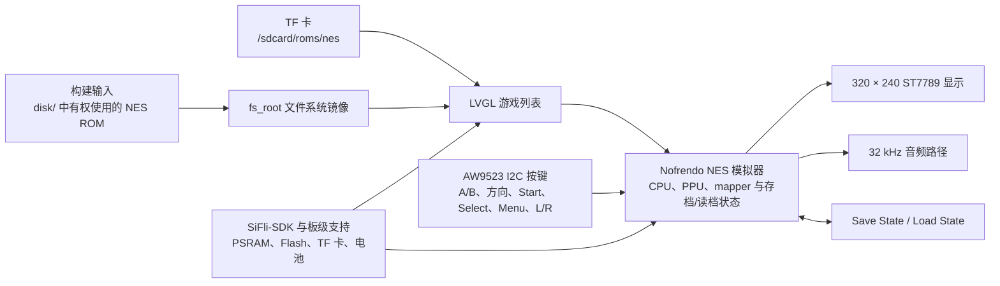

# Pocket Pi SF32 掌上游戏机 { #pocket-pi-sf32-handheld-game-console }

!!! note "固定的源码快照"
    除非另有说明，本文对代码行为的描述均以 PocketPi 提交版本 [`7d9fac2`](https://github.com/SiFliSparks/PocketPi/commit/7d9fac2cb577d6c9b66a99521aebf3c9de0ae163) 为准。上游 `main` 分支会持续变化；复现本文内容时应检出这一固定 commit，而不要直接使用分支最新内容。

## Pocket Pi 是什么？ { #what-is-pocket-pi }

[SiFliSparks/PocketPi](https://github.com/SiFliSparks/PocketPi) 是一个面向 SF32LB52 的掌上游戏机与模拟器参考工程。在固定提交版本中，项目集成了 Nofrendo NES 模拟器、LVGL 游戏列表、320 × 240 ST7789 8080 显示路径、音频输出、存档/读档、内置文件系统和 TF 卡 ROM 目录，并以黄山派 / `sf32lb52-lchspi-ulp` 作为公开构建基线。

它适合用来验证本地图形、输入、音频、外部存储、PSRAM 分配和模拟器负载如何在一个 SF32LB52 系统中协同工作。项目仓库不附带商业游戏 ROM；用户必须自行准备有权使用的 `.nes`/`.NES` 文件。公开源码也不是完整的量产掌机设计，不能替代电池安全、音频、EMC、散热、许可证和内容分发评审。


<div align="center"><em>Pocket Pi 在 SF32LB52 平台上运行 NES 游戏</em></div>

## 为什么选择 SF32 实现？ { #why-the-sf32-implementation }

NES 模拟把多个嵌入式系统边界集中到一个直观的工作负载中：CPU 模拟、PPU 图形、音频采样、低延迟（latency）输入、文件读取、帧缓冲和存档都必须协同工作。基于 SF32LB52 的系统具备这一工作负载所需的显示、音频、外部存储和 PSRAM 资源；黄山派还可作为电池供电的评估平台。

这并不意味着所有 NES 游戏都完全兼容。ROM 映射器（mapper）的支持情况、帧率、音频、存档行为、内存峰值和输入延迟都可能因游戏而异；每增加一个 ROM 或 mapper，都需要单独评估兼容性并确认版权。

## 成果、范围与进入条件 { #outcome-scope-and-entry-criteria }

**目标成果：**从软件规格表中固定的 PocketPi 提交版本构建可重复镜像，启动至少一个已获使用授权的测试 ROM，验证显示、输入、音频、暂停、存档、读档、退出和恢复，再完成一个受控适配。

本页不保证所有 NES mapper、PAL/NTSC 时序、游戏音频、存档格式或第三方 ROM 可用，也不授予任何游戏内容的复制或分发权。固定版本的仓库没有顶层许可证文件；在复制代码进入产品或发布二进制前，必须由负责人确认 PocketPi、Nofrendo 及每项第三方代码的许可。

开始前应准备：

- [SF32LB52-DevKit-ULP / 黄山派](../sf32-products/devkits/SF32LB52-DevKit-ULP.md)，或与仓库 `sf32lb52-lchspi-ulp` 板级定义一致的硬件；
- 与固定版本源码匹配的 320 × 240 显示、AW9523 I2C 输入扩展器、按键、音频和可选 TF 卡路径；开发板名称本身不证明这些外设已完整装配；
- SiFli-SDK、SCons、串口下载和日志环境；
- 一个自行编写、公共领域或已获得授权的 `.nes` 测试 ROM；
- 若使用内置文件系统，把 ROM 放入仓库 `disk/`；若使用 TF 卡，则放入固件配置的 ROM 目录。固定提交版本的运行时扫描路径为 `/sdcard/roms/nes`，请对照该版本源码确认 TF 卡的挂载路径；
- 可观察帧表现、音频、输入、内存和电流的测试方法。

<div align="center"><em>表：Pocket Pi 固定版本基线与适配前所需证据</em></div>

<div align="center" markdown>

| 范围 | 固定版本源码基线 | 进入适配前必须保留的证据 |
|:-----|:-------------|:-------------------------|
| 板卡 | `sf32lb52-lchspi-ulp` | 板卡、扩展器、显示、音频、存储和供电版本 |
| 内容 | 固定提交版本仅扫描 `.nes` 与 `.NES`；同名 `.jpg` 可作为封面 | ROM 来源/许可、文件哈希、mapper 和封面来源 |
| 存储 | 构建时把 `disk/` 生成到 `fs_root`；运行时也扫描 `/sdcard/roms/nes` | 文件系统镜像、TF 卡格式、目录与错误恢复记录 |
| 输入 | 固定提交版本通过 AW9523 I2C 扩展器读取 A/B、方向、Start、Select、Menu、L/R 等按键 | 原理图/引脚定义、全按键矩阵和同时按键结果 |
| 模拟器 | Nofrendo NES 内核、显示、32 kHz 音频路径与状态保存/读取 | 游戏兼容性、帧/音频、存档、内存和复位证据 |

</div>

## 硬件与软件规格 { #hardware-and-software-specifications }

### 硬件规格 { #hardware-specification }

<div align="center"><em>表：Pocket Pi 硬件规格</em></div>

<div align="center" markdown>

| 器件或设备 | 必要规格 | 用途 | 状态 | 获取方式或来源 | 兼容性与替换说明 |
|:-----------|:---------|:-----|:-----|:---------------|:-----------------|
| 黄山派 / SF32LB52-DevKit-ULP 基线 | 开发板目标为 `sf32lb52-lchspi-ulp`；固定版本的项目源码要求 320 × 240 ST7789 显示路径、AW9523 I2C 输入扩展器、音频和 TF 卡接口 | 运行模拟器及显示、输入、音频和存储路径 | 必需 | [μForge 开发板说明](../sf32-products/devkits/SF32LB52-DevKit-ULP.md)；[LCKFB 开发板页面](https://lckfb.com/project/detail/lckfb-hspi-sf32lb52-ulp?param=baseInfo)；[项目源码](https://github.com/SiFliSparks/PocketPi) | 确认具体板卡装配和外设；仅凭目标名称不能证明板卡等效 |
| TF 卡 | 所选固件可读取的卡和文件系统；固定版本源码中的运行时路径为 `/sdcard/roms/nes` | 可选的外部 ROM 存储 | 可选 | [PocketPi 源码](https://github.com/SiFliSparks/PocketPi) | 根据固定版本确认挂载路径、卡格式、热插拔行为和故障恢复 |
| 构建主机和 USB 数据线 | 可运行所选 SiFli-SDK 工具链的主机；用于开发板文档化下载/调试路径的数据线 | 构建、下载并采集串口日志 | 必需 | [SiFli-SDK 快速入门](https://docs.sifli.com/projects/sdk/latest/sf32lb52x/quickstart/index.html) | 记录主机操作系统/架构、线缆或转接器、端口和恢复方法；仅支持充电的线缆不可用 |

</div>

!!! warning "黄山派尚不能视为外设即插即用的匹配基线"
    思澈科技（SiFli）的[黄山派指南](https://wiki.sifli.com/en/board/sf32lb52x/SF32LB52-%E9%BB%84%E5%B1%B1%E6%B4%BE.html)记录的是 1.85 英寸、390 × 450、Quad-SPI 接口的 AMOLED 屏，并列出了板上的功能键和电源键。固定版本的 PocketPi 源码则要求 320 × 240 ST7789 8080 显示路径和 AW9523 I2C 输入。官方板卡指南并未表明其所述配置包含这些匹配外设。应先核对实际屏幕、转接板和输入硬件；或者移植相应软件路径并重新完成显示/输入回归测试，然后再将该板卡目标视为可直接使用的基线。

### 软件规格 { #software-specification }

<div align="center"><em>表：Pocket Pi 软件规格</em></div>

<div align="center" markdown>

| 软件包或服务 | 所需版本或修订版 | 用途 | 状态 | 获取方式或来源 | 兼容性与更新说明 |
|:-------------|:-----------------|:-----|:-----|:---------------|:-----------------|
| SiFliSparks/PocketPi | 已审查提交版本 [`7d9fac2`](https://github.com/SiFliSparks/PocketPi/commit/7d9fac2cb577d6c9b66a99521aebf3c9de0ae163) | 应用、Nofrendo 集成、文件系统镜像和开发板目标 | 必需 | [代码仓库](https://github.com/SiFliSparks/PocketPi) | ROM 输入文件应与仓库源码分别管理许可并记录哈希 |
| OpenSiFli/SiFli-SDK | 项目文章未锁定具体提交版本；须选择兼容版本并记录 | RTOS、板级支持、驱动、SCons 构建和下载工具 | 必需 | [代码仓库](https://github.com/OpenSiFli/SiFli-SDK) | 不要默认 `main` 分支兼容；应用和 SDK 提交版本应成套记录 |
| SCons 环境与 UART 下载工具 | 与所选 SiFli-SDK 修订版匹配的版本 | 构建并下载 `sf32lb52-lchspi-ulp` | 必需 | [SiFli-SDK 快速入门](https://docs.sifli.com/projects/sdk/latest/sf32lb52x/quickstart/index.html) | 记录主机操作系统、SDK 配置、构建日志和生成的下载脚本 |
| 测试 ROM | 用户自行选择且有权使用的 `.nes`/`.NES` 文件；记录 mapper 和 SHA-256 | 验证文件扫描、解码、模拟和音频 | 必需的测试内容 | PocketPi 未发布 ROM 下载；请自行提供已获授权的文件，并查阅[项目源码](https://github.com/SiFliSparks/PocketPi) | 游戏和 mapper 兼容性需逐项验证；内容授权与哈希应和项目源码分开管理 |
| 封面图 | 可选 `.jpg`，文件名与 ROM 主文件名相同；记录来源、授权和 SHA-256 | 验证游戏列表中的封面解码及回退行为 | 可选 | 用户自行提供；PocketPi 未发布封面图；可查阅[项目源码](https://github.com/SiFliSparks/PocketPi) | 仅将允许再分发的封面放入 `disk/`；记录来源和哈希 |

</div>

## 选择受支持的基线 { #choose-a-supported-baseline }

使用软件规格中固定的 PocketPi 版本，不要直接构建当前 `main` 分支指向的提交：

```bash
git clone https://github.com/SiFliSparks/PocketPi.git
cd PocketPi
git checkout 7d9fac2cb577d6c9b66a99521aebf3c9de0ae163
cd project
scons --board=sf32lb52-lchspi-ulp -j8
```

构建脚本会把 `../disk` 生成文件系统镜像并作为 `fs_root` 加入固件产物。Windows 下载路径由生成的 `build_sf32lb52-lchspi-ulp_hcpu\uart_download.bat` 提供；其他主机应使用 SiFli-SDK 对应的下载工具，并记录等效参数。

<div align="center"><em>表：Pocket Pi 基线选择</em></div>

<div align="center" markdown>

| 元素 | 采用方式 | 关键限制 |
|:-----|:---------|:---------|
| ROM | 从一个小型、已获使用授权且 mapper 已知的 `.nes` 或 `.NES` ROM 开始 | 固定版本的扫描器只接受 `.nes` 和 `.NES`；“显示在列表中”不等于模拟兼容 |
| 封面图 | 可选的同目录、同文件名 `.jpg` | 解码失败应回退默认封面，而不是阻止游戏列表 |
| 显示 | 固定版本的 UI 为 320 × 240，源码设置 270° 旋转 | 另一块 LCD 或方向需要完整显示与输入回归 |
| 输入 | 以固定版本 `input.c` 和 `input.h` 中的 AW9523 映射为准 | README 中关于直接 GPIO、9 键和 Select 组合键的段落已过时 |
| 存档 | 使用暂停菜单执行 Save State / Load State | 断电一致性、槽位格式和跨版本兼容尚需验证 |

</div>

!!! warning "README 的按键说明与固定版本源码不一致"
    README 描述的是 `key_pin_def[]`、200 Hz GPIO 扫描和 Select 组合键；固定版本的源码则通过地址 `0x5B` 的 AW9523 I2C 扩展器读取按键。Menu 打开暂停菜单，菜单提供 Save State、Load State 和 Exit Game，L/R 调整音频移位。复现和硬件设计必须以固定版本源码与原理图为准，不要沿用旧 GPIO 表。

## 项目阶段与决策要点 { #delivery-map }

<div align="center"><em>表：Pocket Pi 项目阶段</em></div>

<div align="center" markdown>

| 阶段 | 所支持的决定 | 必须输出 |
|:-----|:-------------|:---------|
| 1. 原版基线 | 目标硬件能否列出并运行一个已获使用授权的 ROM？ | 版本、构建、ROM、启动、画面和声音记录 |
| 2. 交互与恢复 | 输入、暂停、存档、读档、退出和复位是否可靠？ | 游戏级功能与故障恢复记录 |
| 3. 源码复现 | 第二位工程师能否重建相同文件系统和镜像？ | 版本锁定构建、产物哈希和重复结果 |
| 4. 可控适配 | 能否增加一个 ROM、UI 或硬件变化而不破坏基线？ | 改动、内容许可、性能和回归证据 |
| 5. 产品评审 | 是否值得进入定制掌机硬件与内容策略？ | 兼容性、许可、功耗和风险决定 |

</div>

## 系统架构与依赖 { #system-architecture-and-dependencies }

<div align="center"><em>图：Pocket Pi 运行路径</em></div>



主要故障域包括文件系统与 ROM、mapper/模拟器、PSRAM 与内存、显示与帧时序、AW9523 输入、音频、存档以及电源/复位。出现黑屏时，应先区分“ROM 没被扫描到”“封面图解码失败”“mapper 不支持”“帧缓冲分配失败”和“LCD 路径错误”，而不是统一归为模拟器故障。

## 阶段 1 — 建立未经修改的游戏基线 { #stage-1-establish-the-untouched-game-baseline }

**目标：**用一份有权使用的测试 ROM 验证从构建输入到游戏运行的完整路径。

1. 锁定 PocketPi 与 SiFli-SDK 的 commit，以及板卡和外设版本。
2. 将有权使用的 `.nes` ROM 放入 `disk/`；如提供封面，使用同名 `.jpg`。保存 ROM 哈希、来源和 mapper 信息。
3. 执行干净构建，确认 `fs_root` 被生成并加入下载产物。
4. 下载后冷启动，确认游戏出现在列表中、封面或默认图片可见，并能进入游戏。
5. 记录启动时间、稳定画面、按键响应、音频和串口日志，然后复位并重复一次。

**应保留证据：**仓库/SDK commit、板卡与外设、ROM 哈希/许可、构建日志、文件系统镜像、下载日志、串口日志、游戏列表和运行照片。

**关口 1 退出条件：**两次冷启动均能列出并运行同一 ROM，显示、基本方向/A/B/Start/Select 与音频行为可重复。

## 阶段 2 — 验证输入、状态和故障恢复 { #stage-2-validate-input-state-and-fault-recovery }

**目标：**把“游戏能启动”提升为可评审的掌机基线。

<div align="center"><em>表：Pocket Pi 核心验证</em></div>

<div align="center" markdown>

| 测试 | 方法 | 通过证据 |
|:-----|:-----|:---------|
| 全按键 | 分别测试 A、B、方向、Start、Select、Menu、L、R，并测试必要的同时按键 | 无卡键、错键或不可解释重复；映射与固定版本源码一致 |
| 暂停菜单 | 游戏中按 Menu，执行返回、Save State、Load State 和 Exit Game | 菜单焦点、游戏暂停/恢复与退出均可重复 |
| 存档恢复 | 在可识别场景存档，改变游戏状态后读档 | 恢复到预期状态；保存文件和槽位可追踪 |
| 文件系统 | 测试空 `disk/`、无效扩展名、损坏 ROM、缺失/损坏 JPG 和不可用 TF 卡 | UI 不崩溃，串口给出可诊断结果，默认封面和根文件系统仍可用 |
| 复位与电源 | 游戏、暂停、保存前后和列表中分别复位/断电 | 文件系统不损坏；设备回到可恢复列表或明确故障状态 |
| 长时间运行 | 选择一个代表性游戏持续运行 | 无持续内存增长、音画崩溃、输入失效或异常温升 |

</div>

**关口 2 退出条件：**选定 ROM 的输入、显示、音频、暂停、存档、读档、退出和复位都有记录，失败可定位到具体故障域。

## 阶段 3 — 建立可复现源码与内容基线 { #stage-3-build-a-reproducible-source-and-content-baseline }

**目标：**让另一位工程师能够重建同一固件与同一内容镜像。

1. 保存 PocketPi、SiFli-SDK 和任何第三方内核的版本记录。
2. 为 `disk/` 建立清单，记录每个 ROM/封面的文件名、哈希、来源和许可；不要把无权分发的 ROM 提交到仓库。
3. 从空输出目录构建，保存 `fs_root`、固件、分区/内存输出、下载脚本和哈希。
4. 在第二台电脑或干净目录中重建并执行阶段 2 核心测试。

**关口 3 退出条件：**源码与内容清单足以重现哈希一致或差异已有说明的镜像，且没有依赖未记录的本地文件。

## 阶段 4 — 一次只适配一个变量 { #stage-4-adapt-one-variable-at-a-time }

**目标：**测清模拟器、内容和硬件边界。

<div align="center"><em>表：Pocket Pi 可控适配顺序</em></div>

<div align="center" markdown>

| 改动类别 | 合理起点 | 必须回归 |
|:---------|:---------|:---------|
| 内容 | 加入一份有权使用的 ROM 和可选封面 | 扫描、mapper、启动、帧/音频、输入、存档和许可 |
| 游戏列表 UI | 字体、封面、排序或空列表提示 | 内存、滚动、默认封面、长文件名和损坏 JPG |
| 输入 | 调整一个 AW9523 键位或布局 | 全按键、同时按键、菜单、I2C 故障和启动 |
| 显示 | 方向、LCD 或帧缓冲策略 | 320 × 240 几何、帧时序、撕裂、内存和退出恢复 |
| 音频 | 音量、移位或输出硬件 | 32 kHz 路径、失真、缓冲区欠载、与显示/存储并发及静音 |
| 存储 | TF 卡目录或状态文件策略 | 热插拔边界、损坏、断电、空间不足和回退路径 |

</div>

**关口 4 退出条件：**改动及其内容许可已经评审，原版镜像可恢复，选定 ROM 的阶段 2 测试全部通过。

## 阶段 5 — 产品就绪评审 { #stage-5-product-readiness-review }

进入定制掌机或内容发布前，必须回答：

- 目标游戏集合需要哪些 mapper，每个 ROM 的帧率、音频、内存和存档是否逐一验证？
- PocketPi、Nofrendo、SiFli-SDK、字体、封面、声音和 ROM 的许可证与分发权是否清晰？
- AW9523、LCD、音频、TF 卡、电池和充电硬件是否有完整原理图、BOM 与生产测试？
- 游戏中、列表、暂停、睡眠和关机的电流、续航、温升与低电量行为是多少？
- 存档在断电、版本升级、空间不足和损坏时如何保护和迁移？
- 设备如何从损坏文件系统、失败升级、黑屏或不可启动 ROM 中恢复？

**关口 5 退出条件：**兼容性矩阵、内容/软件许可、硬件责任、功耗和恢复风险均有负责人和继续/延期/停止决定。

## 产品设计阶段交接 { #handoff-to-product-design }

交接资料应包含 SF32/模组选择、PSRAM 与 Flash 峰值、显示和帧缓冲、AW9523 输入矩阵、音频放大器与扬声器、TF 卡和内置文件系统、存档格式、电池/充电、恢复下载口、ROM/mapper 兼容矩阵以及完整许可证清单。可从 [SF32LB52x](../sf32-products/chips/SF32LB52x.md)、[SF32LB52-DevKit-ULP](../sf32-products/devkits/SF32LB52-DevKit-ULP.md)、[SiFli-SDK 构建、烧录与监视](../develop/platforms/sifli-sdk/build-flash-monitor.md)和[面向量产的设计](../hardware/design-for-production.md)继续。

## 权威来源 { #authoritative-sources }

- [SiFliSparks/PocketPi](https://github.com/SiFliSparks/PocketPi)
- [锁定的参考 commit `7d9fac2`](https://github.com/SiFliSparks/PocketPi/commit/7d9fac2cb577d6c9b66a99521aebf3c9de0ae163)
- [立创·黄山派 SF32LB52-ULP 开发板](https://lckfb.com/project/detail/lckfb-hspi-sf32lb52-ulp?param=baseInfo)
- [OpenSiFli/SiFli-SDK](https://github.com/OpenSiFli/SiFli-SDK)
- [思澈科技（SiFli）Wiki：黄山派开发板指南](https://wiki.sifli.com/en/board/sf32lb52x/SF32LB52-%E9%BB%84%E5%B1%B1%E6%B4%BE.html)
- [SiFli-SDK 上手指南](https://docs.sifli.com/projects/sdk/latest/en/sf32lb52x/quickstart/get-started.html)
- [pebri86/esplay-retro-emulation](https://github.com/pebri86/esplay-retro-emulation)
- [LVGL 文档](https://docs.lvgl.io/latest/en/html/index.html)
