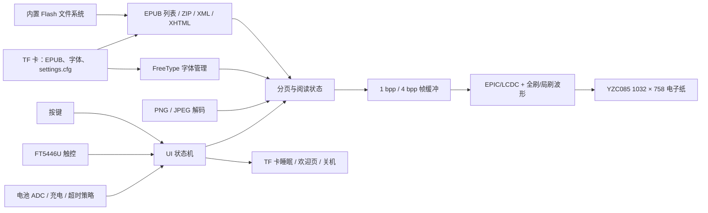

# SF32 墨水屏 EPUB 阅读器 { #sf32-e-paper-epub-reader }

## 什么是 EPD Reader？ { #what-is-epd-reader }

[OpenSiFli EPD Reader](https://github.com/OpenSiFli/EPD_Reader) 是将 [atomic14/diy-esp32-epub-reader](https://github.com/atomic14/diy-esp32-epub-reader) 适配到思澈科技（SiFli）`SF32-OED-EPD` 系列硬件。它以 SF32LB52x 为处理核心，从内置文件系统或 TF 卡读取 EPUB，通过 ZIP/XML/XHTML 解析、FreeType 字体和图像解码链路排版内容，再使用全刷/局刷波形驱动电子纸面板。

当前应用提供书库、目录、阅读、阅读设置、功能设置、欢迎/熄屏、低电量、充电和关机页面；支持按键与触控、中文/英文、动态 TTF/OTF 字体、字号/字重/行距/边距设置，以及把阅读设置保存到 TF 卡。为节省资源，内置中文字体默认未启用独立粗体/斜体字形；使用字重选项时必须以目标字体的实际显示结果为准。它适合作为低刷新率阅读终端的完整参考，而不是通用 EPUB 标准符合性或量产电子书方案的证明。

## 为什么选择 SF32？ { #why-the-sf32-implementation }

这条路径将 SF32LB52 的存储能力、EPIC/LCDC 显示加速、触控、按键、电池监测和低功耗管理整合到同一个应用中。对产品团队而言，最有价值的不是“能显示一页书”，而是可以在现成硬件上同时评估排版内存、全刷/局刷残影、波形适配、TF 卡电源管理、字体读取、输入流程和睡眠行为。

思澈科技（SiFli）的板卡指南链接了样品销售页面，但没有证明所售板卡、面板和触控硬件与项目 V1.1 软件基线相符，也没有明确完整的基准硬件组合或面板单独采购渠道。此外，上游没有给出 EPUB 覆盖率、面板工作温区、产品寿命或各模式电流指标。因此，本文将硬件版本、面板/触控组合和软件提交视为必须固定的工程基线；其他电子纸模块不能直接替代。

**来源基线核对：** 思澈科技（SiFli）的 [SF32LB52-OED-6'-EPD 使用指南](https://github.com/OpenSiFli/SiFli-Wiki/blob/main/source/zh_CN/board/sf32lb52x/SF32LB52-OED-6%27-EPD.md)介绍的是 6 英寸 OPM060DA 面板，分辨率为 758 × 1024。指南中的功能框图还显示了板级接口：8-bit 8080 EPD、I²C 触控、SPI1 TF 卡、模拟麦克风/音频功放、USB 转 UART，以及电池/充电电源路径。固定的 EPD Reader V1.1 配置则选择分辨率为 1032 × 758 的 YZC085 V1.05，Wiki 板卡照片标注的是 V1.2。因此，现有资料不能证明 OPM060DA 与 YZC085 可互换，也不能证明 V1.1 随附的是 Wiki 中的面板。实施前应核对板卡和面板丝印，并按实际组合选择软件目标、波形和 VCOM 参数。

**供电要求：** 思澈科技（SiFli）的开发板指南要求板卡运行时必须连接电池；USB-C 的 VBUS 仅用于充电，不能单独为板卡供电。指南要求使用 1000–1500 mAh 电池，并推荐带 MX1.25 连接器的 1500 mAh 单节锂聚合物电池。该指南中的板卡照片标有 V1.2，而本项目基线目标为 V1.1，因此选电池前应核实具体板卡的供电连接器、极性和充电限制。

## 成果、范围与进入条件 { #outcome-scope-and-entry-criteria }

**成果：** 在固定的 `SF32-OED-EPD_V1.1` 板卡上，使用配置分辨率为 1032 × 758 的 YZC085 V1.05 面板，完成可重复的构建、下载、书库/目录/阅读流程、按键/触控、设置持久化、全刷/局刷、低电量与睡眠/关机验证，并形成是否进入产品化的证据。

**不在范围内：** 本文不证明全部 EPUB/CSS/字体兼容、DRM 内容支持、任意面板波形兼容、商用阅读体验、无线内容分发、认证或量产可靠性。固定版本的源码提供蓝牙（Bluetooth）/PAN 配置项和状态界面，但上游 README 未说明如何通过该连接传输内容。本文以本地文件作为可复现基线；网络内容分发尚未验证，不属于本文范围。

**进入条件：** 团队应具备 SiFli-SDK 构建/下载能力，并能识别板卡版本、面板型号、排线方向、电池极性和 TF 卡文件系统。若缺少明确的板卡/面板来源与硬件资料，应先停止采购承诺并向思澈科技（SiFli）或硬件提供方取得确认。

<div align="center"><em>表：项目约定</em></div>

<div align="center" markdown>

| 项目 | 基线要求 | 进入下一阶段前保留的证据 |
|:-----|:---------|:-------------------------|
| 版本边界 | 固定板卡、面板、触控、应用提交和 SDK 子模块提交 | 照片、丝印、配置、提交、固件校验值和线缆方向 |
| 阅读边界 | 分别验证内置样书、TF 卡书籍、目录、图像、中文/英文和设置 | 内容样本清单、页面结果、日志和失败分类 |
| 显示边界 | 波形、VCOM、分辨率、总线和温度必须与面板匹配 | 全刷/局刷、残影、刷新时间、温度和电流记录 |
| 产品边界 | 许可、内容权利、功耗、可靠性、无线与法规需另行评审 | 风险登记、负责人和继续/停止决定 |

</div>

## 硬件与软件规格 { #hardware-and-software-specifications }

### 硬件规格 { #hardware-specification }

<div align="center"><em>表：硬件规格</em></div>

<div align="center" markdown>

| 组件 | 所需规格 | 作用 | 状态 | 获取方式 | 兼容性与替代说明 |
|:-----|:---------|:-----|:-----|:---------|:-----------------|
| SF32-OED-EPD V1.1 板卡 | SF32LB52x；`sf32-oed-epd_v11` 软件目标；项目配置使用 16 MiB QSPI NOR 区域和 8 MiB PSRAM 区域 | 处理、存储、显示、输入、电池和电源管理 | 必需 | 思澈科技（SiFli）的[板卡指南](https://github.com/OpenSiFli/SiFli-Wiki/blob/main/source/zh_CN/board/sf32lb52x/SF32LB52-OED-6%27-EPD.md)链接了样品销售页面；下单前应向卖家确认板卡版本、随板面板和触控硬件。使用[固定的 V1.1 板级配置](https://github.com/OpenSiFli/EPD_Reader/tree/7d72223c513d0a77eb251a3acb0f18cadb8d4d89/epdiy-epub/sf32-oed-epd_v11)识别软件目标 | V1.2 与 V1.2-SPI 具有独立目标，不得只凭连接器外观替代 V1.1 |
| YZC085 V1.05 电子纸模组 | 1032 × 758；8-bit EPD/DBI 接口；V1.1 默认配置。固定项目配置和本文引用的板卡指南未确认面板的物理对角线尺寸和 DPI；需依据面板丝印及供应商资料核实。 | 显示 EPUB 页面和 UI | 必需 | 获取渠道未公开；以[固定 Kconfig 选项](https://github.com/OpenSiFli/EPD_Reader/blob/7d72223c513d0a77eb251a3acb0f18cadb8d4d89/epdiy-epub/project/Kconfig.proj)和实物型号核对 | R7D005（1448 × 1072）和 OPM037A3（240 × 416、SPI）是独立配置，不是无配置替换件；波形、VCOM、时序和分辨率必须随面板验证 |
| FT5446U 触控接口 | V1.1 默认 `TSC_USING_FT5446U_V01` | 触控选择、翻页和上滑覆盖层 | 使用触控功能时必需 | 随匹配的 V1.1 板卡/屏组件取得；独立渠道未公开 | V1.2 默认使用 GT967，3.7 英寸 SPI 配置选择 FT6336U；不可混用驱动 |
| TF 卡 | 可由板级 SPI 存储驱动和 FAT 文件系统识别 | EPUB 文件、外部字体与 `/settings.cfg` 持久化 | 完整功能基线必需；仅内置样书可选 | 标准 TF 卡；上游未指定品牌或容量 | 固件优先使用 TF 卡；必须记录容量、格式和文件集，验证拔插与损坏恢复 |
| USB 数据线与构建主机 | 可传输数据的连接线；可运行 SiFli-SDK 工具 | USB-UART 下载、调试/日志和电池充电；不能单独为板卡供电 | 必需 | 标准数据线；工具见[固定 SDK 提交](https://github.com/OpenSiFli/SiFli-SDK/commit/8a1eb8a34be02c1df8529c9e8f0e69172bf9ef36) | 未连接电池时，USB-C VBUS 不能驱动板卡；仅支持充电的线缆无法下载固件 |
| 电池/供电组件 | 思澈科技（SiFli）的板卡指南要求使用 1000–1500 mAh 电池，并推荐带 MX1.25 连接器的 1500 mAh 单节锂聚合物电池；需核实 V1.1 板卡的输入与极性 | 板卡运行所需电源；用于低电量、充电、睡眠和便携使用验证 | 板卡运行必需 | 未公布具体电池料号；参见[思澈科技（SiFli）板卡指南](https://github.com/OpenSiFli/SiFli-Wiki/blob/main/source/zh_CN/board/sf32lb52x/SF32LB52-OED-6%27-EPD.md)，并向板卡提供方确认连接器、极性和限制 | 该指南给出的线性充电电流最大值为 1 A，默认恒流设置为 1000 mA；产品设计前应确认 V1.1 组件与此相符 |

</div>

### 软件规格 { #software-specification }

<div align="center"><em>表：软件规格</em></div>

<div align="center" markdown>

| 软件包或服务 | 所需版本或修订 | 作用 | 状态 | 获取方式 | 兼容性与更新说明 |
|:-------------|:---------------|:-----|:-----|:---------|:-----------------|
| OpenSiFli EPD Reader | 本文审核提交 [`7d72223`](https://github.com/OpenSiFli/EPD_Reader/commit/7d72223c513d0a77eb251a3acb0f18cadb8d4d89)；必须递归取得子模块 | 顶层项目、应用、板级配置、波形和 SDK 固定点 | 必需 | [OpenSiFli/EPD_Reader](https://github.com/OpenSiFli/EPD_Reader) | 使用 `git clone --recursive` 或初始化子模块；会持续变动的 `main` 分支仅用于查找新版本 |
| `epdiy-epub` 应用 | 随 `7d72223` 固定 | EPUB 发现/解析、页面状态机、字体、渲染、输入和功耗策略 | 必需 | [固定应用目录](https://github.com/OpenSiFli/EPD_Reader/tree/7d72223c513d0a77eb251a3acb0f18cadb8d4d89/epdiy-epub) | 应用基于 atomic14 项目适配；主应用许可证为 MIT，第三方库保留各自的许可证 |
| SiFli-SDK 子模块 | [`8a1eb8a`](https://github.com/OpenSiFli/SiFli-SDK/commit/8a1eb8a34be02c1df8529c9e8f0e69172bf9ef36) | RT-Thread、BSP、文件系统、蓝牙、网络、PM、构建和下载 | 必需 | [仓库子模块](https://github.com/OpenSiFli/EPD_Reader/tree/7d72223c513d0a77eb251a3acb0f18cadb8d4d89/SiFli-SDK) | 这是上游固定的可复现 SDK；更新时必须重跑显示、存储、输入和功耗回归 |
| EPUB/渲染依赖 | 随应用提交固定：EPDIY、tinyxml2、miniz 2.2.0、PNGdec、TJpgDec、FreeType 与内置字体 | 解包、XML/XHTML、PNG/JPEG、字体和 EPD 渲染 | 必需 | [固定 `lib/` 目录](https://github.com/OpenSiFli/EPD_Reader/tree/7d72223c513d0a77eb251a3acb0f18cadb8d4d89/epdiy-epub/lib)和[`font/` 目录](https://github.com/OpenSiFli/EPD_Reader/tree/7d72223c513d0a77eb251a3acb0f18cadb8d4d89/epdiy-epub/font) | 分别核对许可证和字体 NOTICE；不得假设主项目 MIT 覆盖全部第三方代码和字体 |
| SCons、编译器与 UART 下载工具 | 使用固定 SDK 提交对应环境 | menuconfig、构建、文件系统/波形镜像和下载 | 必需 | 随[固定 SiFli-SDK](https://github.com/OpenSiFli/SiFli-SDK/commit/8a1eb8a34be02c1df8529c9e8f0e69172bf9ef36)提供 | 保存构建环境、命令、生成镜像和下载日志 |
| EPUB 与字体资产 | 团队批准的无 DRM EPUB；可选 `.ttf`/`.otf`，最多 64 个外部字体 | 阅读内容和字体选择 | EPUB 必需；外部字体可选 | 自有/授权内容；仓库 [`disk/`](https://github.com/OpenSiFli/EPD_Reader/tree/7d72223c513d0a77eb251a3acb0f18cadb8d4d89/epdiy-epub/disk)含测试样本 | 团队负责内容和字体授权；测试矩阵应覆盖实际使用的 EPUB 结构、语言和图片 |

</div>

## 选择受支持的基线 { #choose-a-supported-baseline }

第一次复现采用 `SF32-OED-EPD V1.1 + YZC085 V1.05 + FT5446U`，因为上游文档为 `sf32-oed-epd_v11` 给出了明确的构建/下载路径，且 Kconfig 将该组合设为 V1.1 默认值。固定顶层提交 `7d72223` 和 SDK 子模块 `8a1eb8a`，不要在首轮同时更换板卡、面板、触控或波形。

```bash
git clone --recursive https://github.com/OpenSiFli/EPD_Reader.git
cd EPD_Reader/epdiy-epub/project
scons --board=sf32-oed-epd_v11 --board_search_path=.. -j8
```

Windows 下载脚本为 `build_sf32-oed-epd_v11_hcpu\uart_download.bat`。运行后按提示输入串口号。需要检查选项时使用：

```bash
scons --board=sf32-oed-epd_v11 --board_search_path=.. --menuconfig
```

## 项目阶段与决策要点 { #delivery-map }

<div align="center"><em>表：项目阶段与决策要点</em></div>

<div align="center" markdown>

| 阶段 | 支持的决策 | 最低证据 |
|:-----|:-----------|:---------|
| 固定硬件与源码 | 实物是否与上游 V1.1 基线一致？ | 丝印/面板照片、连接方向、提交、子模块和配置记录 |
| 建立阅读基线 | 固定镜像能否完成本地 EPUB 主流程？ | 构建/下载日志、样书清单、页面和输入记录 |
| 验证内容与恢复 | 实际书籍、字体、TF 卡和设置是否可重复？ | 兼容矩阵、损坏/拔卡/缺字体恢复和持久化结果 |
| 验证显示与功耗 | 波形、残影、刷新和电池行为能否支持产品方向？ | 温度、全刷/局刷、VCOM、刷新时间和电流测量 |
| 受控适配与评审 | 是否能安全地改一个边界并决定产品化？ | 变更、回归、风险登记和继续/停止决定 |

</div>

## 系统架构与依赖 { #system-architecture-and-dependencies }

<div align="center"><em>图：EPUB 内容、渲染、输入与电子纸路径</em></div>



主要失效域包括：内容包与 XHTML 解析、字体文件与内存、TF 卡检测/供电、触控/按键映射、面板型号/波形/VCOM、全刷/局刷残影、电池 ADC/充电状态和关机唤醒。在项目文档明确无线功能及其内容传输路径前，应将其排除在本地文件、显示和功耗基线之外。

## 阶段 1 — 固定实物和源码 { #stage-1-pin-the-physical-and-source-baseline }

**目标：** 证明板卡、面板、触控和源码确实对应同一个受支持组合。

1. 记录 V1.1 板卡丝印、SF32 器件、面板型号、触控型号、排线方向和供电方式。
2. 固定顶层提交与 SDK 子模块，保存所有子模块状态。
3. 在干净环境构建并下载，记录每个生成镜像和下载脚本的校验值。

**保留证据：** 实物照片、部件标识、Git 状态、配置、构建/下载日志、镜像校验值和启动日志。

**关口 1 退出条件：** 实物与 `sf32-oed-epd_v11` 默认组合一致，固定输入可重复生成并启动同一镜像。

## 阶段 2 — 验证未修改的阅读流程 { #stage-2-validate-the-untouched-reading-flow }

**目标：** 证明核心用户路径在修改前成立。

1. 分别从内置文件系统和 TF 卡发现 EPUB；固件优先使用 TF 卡。
2. 完成“主页面 → 书库 → 目录 → 阅读”，验证书库每页 4 项、目录每页 6 项，以及按键和触控的“先选中再确认”行为。
3. 验证阅读页左右翻页、上滑覆盖层、`-5/-1/+1/+5` 跳页、返回目录/书库和阅读设置入口。
4. 核对中文、英文、PNG/JPEG 和章节切换；记录不支持或排版异常的内容结构。

**保留证据：** 测试 EPUB 的来源/校验值、页面照片、操作时间线、日志、内存水位和异常分类。

**关口 2 退出条件：** 目标样本集的主流程可重复，所有失败都归类为内容、字体、存储、内存、输入或显示问题，而不是“偶发失败”。

## 阶段 3 — 验证设置、存储和恢复 { #stage-3-qualify-settings-storage-and-recovery }

**目标：** 确认实际内容和用户设置不会因存储事件进入不可恢复状态。

1. 将 `.ttf`/`.otf` 放入 TF 卡 `/fonts`，验证最多 64 个外部字体的发现、选择和缺失字体回退。
2. 逐项验证字号 24–48 px、字重、1.0×–2.0× 行距、5–20 px 边距，以及 `/settings.cfg` 重启持久化。
3. 在非写入关键时刻测试无卡、拔卡、重新插卡、损坏设置和不可用字体；不得以破坏文件系统的方式进行热拔插。
4. 验证当前边界：“继续阅读”只在本次运行期间保留最近打开的书籍索引和章节；不要将其描述为跨重启的完整阅读进度同步。

**保留证据：** 卡片规格/格式、资产清单、设置文件、重启结果、错误日志和恢复步骤。

**关口 3 退出条件：** 目标内容和设置可以重复加载；缺卡、坏配置和缺字体有可理解的回退，且不会阻止设备回到主页面。

## 阶段 4 — 评估电子纸显示质量与功耗 { #stage-4-qualify-e-paper-quality-and-power }

**目标：** 确认面板驱动和低功耗策略适合目标阅读体验。

1. 分别验证每翻 5、10、20 页执行一次全刷，以及每次翻页都全刷（`0`）；记录残影、闪烁、刷新时间和页面一致性。
2. 在预期温度范围内验证匹配面板的波形、VCOM 和时序；不得把仓库中的其他面板数值复制到目标面板。
3. 验证 5/10/30 分钟、1 小时和不关机的用户超时选项，以及主循环默认 5 小时无交互进入关机页的独立策略。
4. 验证状态栏电量百分比和充电闪电图标，确认电量达到 98% 时充电图标清除；测量分页、局刷、全刷、待机、TF 卡唤醒/睡眠、低电量、充电和关机路径的电流。

**保留证据：** 面板/波形版本、温度、页面图像、刷新统计、电流轨迹、电池条件和唤醒/关机结果。

**关口 4 退出条件：** 显示质量、刷新延迟（latency）、温区、功耗和恢复阈值均已定义并达标，每个未达标项都有明确处置。

## 阶段 5 — 进行受控适配并评审产品就绪度 { #stage-5-make-a-controlled-adaptation-and-review-readiness }

**目标：** 用一个有边界的变更验证团队能适配项目，而不破坏基线。

可选变更包括新增一种已授权字体、调整一个页面、增加一组 EPUB 兼容修复，或为一款新面板增加独立驱动。新面板适配必须同时处理 Kconfig、分辨率/DPI、触控、总线、波形、温区、LUT、时序和 VCOM，并保留原板目标作为回归基线。

产品评审至少回答：

- 目标 EPUB/XHTML/CSS/图像/语言集合的兼容率和内存上限是多少？
- 面板、波形、VCOM、温区、寿命和供应渠道由谁控制并提供规格？
- 内容、字体、主应用和每个第三方库的许可如何满足发布要求？
- TF 卡损坏、设置损坏、低电量、异常关机、固件损坏和升级中断如何恢复？
- 如果产品范围包含蓝牙/PAN，其用途、配对、安全、隐私和射频合规应如何定义？
- 量产测试如何覆盖显示坏点/残影、触控、按键、存储、电池 ADC、充电和睡眠电流？

**保留证据：** 变更评审、差异、回归矩阵、风险登记、负责人和产品决定。

**关口 5 退出条件：** 受控变更通过全部相关回归；剩余内容、显示、电源、安全、许可、供应和法规风险均具有负责人、缓解措施及继续、延期或停止决定。

## 产品设计阶段交接 { #handoff-to-product-design }

交接包应包含板卡/面板/触控版本、固定代码和 SDK、内存/分区、文件系统、字体/内容资产、波形/VCOM/时序、全刷/局刷策略、输入映射、电池曲线、功耗测量、异常恢复、许可证清单和生产测试计划。使用 [SF32LB52x 集成路径](../sf32-products/chips/SF32LB52x.md#integration-path)选择芯片、模块、开发板、硬件设计指南和检查清单，并以已验证的功能边界为依据重新设计定制硬件。

## 权威来源 { #authoritative-sources }

- [OpenSiFli/EPD_Reader](https://github.com/OpenSiFli/EPD_Reader)
- [本文审核的项目提交 `7d72223`](https://github.com/OpenSiFli/EPD_Reader/commit/7d72223c513d0a77eb251a3acb0f18cadb8d4d89)
- [EPD Reader 官方中文 README](https://github.com/OpenSiFli/EPD_Reader/blob/7d72223c513d0a77eb251a3acb0f18cadb8d4d89/epdiy-epub/README.md)
- [固定 SiFli-SDK 子模块提交 `8a1eb8a`](https://github.com/OpenSiFli/SiFli-SDK/commit/8a1eb8a34be02c1df8529c9e8f0e69172bf9ef36)
- [EPD Reader 板级与面板 Kconfig](https://github.com/OpenSiFli/EPD_Reader/blob/7d72223c513d0a77eb251a3acb0f18cadb8d4d89/epdiy-epub/project/Kconfig.proj)
- [EPD Reader V1.1 板级配置](https://github.com/OpenSiFli/EPD_Reader/tree/7d72223c513d0a77eb251a3acb0f18cadb8d4d89/epdiy-epub/sf32-oed-epd_v11)
- [EPD Reader 主应用 MIT 许可证](https://github.com/OpenSiFli/EPD_Reader/blob/7d72223c513d0a77eb251a3acb0f18cadb8d4d89/epdiy-epub/LICENSE)
- [atomic14/diy-esp32-epub-reader](https://github.com/atomic14/diy-esp32-epub-reader)
- [思澈科技（SiFli）SF32LB52x 构建与下载说明](https://docs.sifli.com/projects/sdk/latest/sf32lb52x/quickstart/build.html)
- [思澈科技（SiFli）SF32LB52-OED-6'-EPD 中文硬件指南](https://github.com/OpenSiFli/SiFli-Wiki/blob/main/source/zh_CN/board/sf32lb52x/SF32LB52-OED-6%27-EPD.md)
