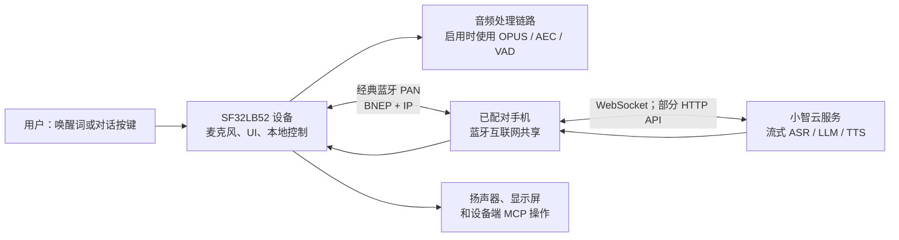

# SF32 小智语音助手 { #sf32-xiaozhi-voice-assistant }

## 什么是小智？ { #what-is-xiaozhi }

[小智](https://github.com/78/xiaozhi-esp32)是一款基于 MCP 的开源语音聊天机器人；它在 2025 年凭借 ESP32 实现而广为人知。它将语音交互设备、云端大模型服务以及设备端或云端 MCP 扩展结合在一起，因此是面向对话式 AI 硬件的实用起点，而不只是文字聊天应用。

## 为什么选择 SF32 实现？ { #why-the-sf32-implementation }

[78/xiaozhi-sf32](https://github.com/78/xiaozhi-sf32)是其 SF32 实现，但有意采用了不同的连接方案。原始 ESP32 项目支持 Wi-Fi 等直接联网方式；SF32 版本则通过经典[蓝牙（Bluetooth）个人局域网（PAN）](../learn/bluetooth/pan.md)从已配对的手机接入互联网。这样可将广域网络连接的负担转移到手机；在手机共享网络的设计中，设备侧联网功耗可能显著降低。实际节省量取决于手机、无线环境、对话占空比和功耗策略。因此，SF32 方案尤其适合电池供电的个人便携产品，例如挂件、胸牌、小型助手和可穿戴设备。

它是一份很有价值的产品参考，因为它将通常被分开处理的工作连接在一起：显示与音频硬件、手机提供的网络、云端语音服务、面向用户的激活流程、设备控制和现场更新能力。

## 预期成果、适用范围与前置条件 { #outcome-scope-and-entry-criteria }

本页给出将该参考方案推进为产品方向的完整工程路径。它**不**表示小智是离线端侧 LLM，不表示所有上游功能都已通过量产验证，也不表示受支持的开发板等同于通过认证的成品。设备通过蓝牙 PAN 从已配对手机接入互联网，并依赖小智云服务完成对话流程。在做出产品承诺前，必须核实服务条款、账号归属、隐私、安全、成本、可用性和地区适用性。

**成果：** 得到一套可重复验证的语音与显示助手：能通过手机完成配网、完成一次云端对话、控制一个安全的设备功能、从 PAN 连接丢失中恢复，并产出决定是否进入自定义硬件所需的证据。

**目标读者：** 已能构建并烧录 SF32 基线，且准备处理 C/C++、开发板原理图、蓝牙配置和云服务集成的固件、硬件和产品工程师。

<div align="center"><em>表：项目约定</em></div>

<div align="center" markdown>

| 领域 | 项目基线 | 进入下一阶段前的证据 |
|:-----|:---------|:---------------------|
| 硬件 | 一个有明确文档的 SF32LB52 小智目标，包括音频/显示路径、USB 烧录连接和电源。 | 冷启动、按键、显示、麦克风、扬声器，以及适用时的充电/电量显示均正常。 |
| 连接 | 一台能够与 `sifli-pan` 配对并提供蓝牙 PAN 网络共享的手机。 | 开发板 UI 确认 PAN 已连接；断开和重连行为可重复。 |
| 服务 | 小智账号、设备激活，以及通过小智控制台配置的智能体。 | 对话请求到达服务，响应能返回开发板。 |
| 固件 | 已记录的上游提交、SDK 子模块版本、目标开发板和构建/烧录方法。 | 可重复的干净构建、烧录、串口日志和固件产物。 |
| 产品适配 | 一项有意限制的改动，例如 UI 品牌化、设备名称、电池曲线或由 MCP 控制的安全输出。 | 改动后原始语音闭环仍能通过。 |

</div>

## 硬件与软件规格 { #hardware-and-software-specifications }

以下清单定义了一套具体的源码构建参考基线：**SF32LB52-DevKit-Nano-R16N16 V1.0.0**，配合思澈科技（SiFli）文档中的外接显示和音频电路。它不是所有受支持小智开发板的通用 BOM。若选择 DevKit-ULP、DevKit-LCD 或小汤圆，应使用该开发板文档所述的完整组装方案替换下列硬件清单，并保留准确的供应商料号和开发板修订版。

### 硬件规格 { #hardware-specification }

<div align="center"><em>表：小智 Nano 参考硬件规格</em></div>

<div align="center" markdown>

| 组件 | 必需规格 | 作用 | 状态 | 获取方式 | 兼容与替代说明 |
|:-----|:---------|:-----|:-----|:---------|:---------------|
| SF32LB52-DevKit-Nano-R16N16 V1.0.0 | SF32LB52JUD6、16 MB OPI PSRAM 和 16 MB SPI NOR Flash | SF32 计算、蓝牙 PAN、USB 烧录/调试、UI 和音频接口 | 必需 | [思澈科技（SiFli）产品页](https://www.sifli.com/zh-hans/SF32LB52_DevKit_Nano)；[思澈科技（SiFli）官方店](https://sifli.taobao.com/) | 未重新核对固件目标和存储预算前，不要替换为 Nano N4。记录开发板 PCB 修订版和供应商订单链接。 |
| 1.85 英寸 390 × 450 AMOLED 与 16 针转 22 针 FPC 转接适配件 | 官方 Nano 小智接线所用的 QSPI 显示组件和 FPC 线序 | 用户界面 | 必需 | [Nano 小智官方硬件页](https://docs.sifli.com/projects/xiaozhi/get-started/SF32LB52-DevKit-Nano/) | 官方页面未提供购买链接。基线只有在固定面板控制器、FPC 方向、供应商料号和购买链接后才可复现。 |
| 模拟 MEMS 麦克风模块 | 模拟输出兼容 `MIC_BIAS`、`MIC_ADC` 和 GND | 语音采集 | 必需 | [官方指南提供的组件链接](https://item.taobao.com/item.htm?id=595237371680) | 使用替代件时，必须验证偏置、输出电平、噪声和声学性能。 |
| PAM8302 功放模块 | `DACP`/`DACN` 差分输入；由 `PA30` 控制关断 | 驱动扬声器 | 必需 | [官方指南提供的组件链接](https://item.taobao.com/item.htm?id=535743493142) | 其他功放应作为硬件适配处理，并重新检查使能极性、增益、静态电流和噪声。 |
| 腔体扬声器 | 8 Ω、2–3 W | 语音播放 | 必需 | [官方指南提供的组件链接](https://item.taobao.com/item.htm?id=895176389650) | 更换腔体或阻抗后，应重新验证声学输出、功放温升和电流。 |
| 跳线和 400 孔面包板 | 与已有文档 Nano 原型一致的导线套装和面包板 | 原型互连 | 有文档原型必需 | [跳线](https://item.taobao.com/item.htm?id=39961676503)；[400 孔面包板](https://item.taobao.com/item.htm?id=39828824454) | 只有在参考接线通过验证且管脚映射已准确转移后，才可替换为经评审的 PCB。 |
| USB Type-C 数据线和开发电脑 | 支持数据传输的 Type-C 线；Windows、Linux 或 macOS 主机 | 供电、烧录、构建和串口日志 | 必需 | [思澈科技（SiFli）SDK 准备要求](https://docs.sifli.com/projects/sdk/latest/sf32lb52x/quickstart/get-started.html) | 仅支持充电的线缆无法烧录或采集日志。记录主机操作系统和架构。 |
| 支持蓝牙网络共享的 Android 或 iOS 手机 | 必须能够与 `sifli-pan` 配对，并通过经典蓝牙 PAN 提供互联网接入 | 网络连接设备 | 必需 | [小智官方 PAN 激活流程](https://docs.sifli.com/projects/xiaozhi/get-started/) | 记录手机型号和操作系统版本。针对每个受支持的手机与操作系统组合验证断连、重新配对和网络共享行为。 |

</div>

上述第三方组件 URL 是思澈科技（SiFli）Nano 官方指南公布的电商购买链接，并不保证对应的制造商料号长期不变。应保留已评估器件的页面截图或订单记录；进入产品设计前，将各项电商采购件替换为已完成适用性验证的供应商料号，并附上对应数据手册。

### 软件规格 { #software-specification }

<div align="center"><em>表：小智参考软件规格</em></div>

<div align="center" markdown>

| 软件包或服务 | 必需版本或修订版 | 作用 | 状态 | 获取方式 | 兼容与更新说明 |
|:-------------|:-----------------|:-----|:-----|:---------|:---------------|
| 小智 SF32 预编译固件 | v1.4.0 | 建立未经修改的参考基线和恢复镜像 | 阶段 1–2 必需 | [v1.4.0 发行版](https://github.com/78/xiaozhi-sf32/releases/tag/v1.4.0) | Nano R16N16 基线应选择 `sf32lb52-nano_52j.zip`。不能混用不同开发板的固件包。 |
| `78/xiaozhi-sf32` 源码 | 提交 [`1d3ef641ace47fae68227e9173647fd5db01f6f5`](https://github.com/78/xiaozhi-sf32/commit/1d3ef641ace47fae68227e9173647fd5db01f6f5) | 应用源码和开发板配置 | 阶段 3–4 必需 | [仓库](https://github.com/78/xiaozhi-sf32) | 这是本文评审时采用的源码快照。使用更晚提交时应建立新基线，并重新执行全部关口。 |
| SiFli-SDK 子模块 | 提交 [`0d2de1480f735e05017c41436e655a1688063881`](https://github.com/OpenSiFli/SiFli-SDK/tree/0d2de1480f735e05017c41436e655a1688063881) | SF32 驱动、RTOS、中间件、工具链脚本和 SCons 构建环境 | 阶段 3–4 必需 | 通过仓库的 `sdk` 子模块获取 [OpenSiFli/SiFli-SDK](https://github.com/OpenSiFli/SiFli-SDK) | 使用所选应用提交记录的子模块版本；不能在已留存的基线中单独升级 SDK。 |
| sftool GUI | v1.2.1；保留发行页中所选操作系统安装包的 SHA-256 | 烧录预编译镜像和本地恢复 | 有文档的 v1.4.0 GUI 路径必需 | [v1.2.1 发行版及各平台安装包](https://github.com/OpenSiFli/sftool-gui/releases/tag/v1.2.1) | 记录主机操作系统、安装包文件名和校验和。升级前先验证新版本。 |
| 构建主机工具 | 由固定 SiFli-SDK 提供的安装/环境导出脚本，以及脚本创建的 SCons 环境 | 源码配置与编译 | 阶段 3–4 必需 | [小智官方源码构建指南](https://docs.sifli.com/projects/xiaozhi/source-build/) | 记录主机操作系统、架构、脚本执行结果和导出的环境。不能让全局安装工具静默覆盖固定的 SDK 环境。 |
| 小智云控制台和服务 | 托管于 `xiaozhi.me`；记录验证日期、账号责任人、智能体配置和接入点 | 激活、流式 ASR/LLM/TTS 和云端 MCP | 对话必需 | [小智控制台](https://xiaozhi.me) | 托管服务没有用户可固定的发行版。服务行为、条款、可用性和区域访问均属于外部控制的依赖。 |

</div>

## 选择受支持的基线 { #choose-a-supported-baseline }

思澈科技（SiFli）小智快速入门文档列出四个预编译固件目标：SF32LB52-DevKit-ULP（黄山派）、SF32LB52-DevKit-LCD、SF32LB52-DevKit-Nano 和小汤圆直插版。其源码构建文档当前列出 DevKit-ULP、DevKit-LCD 和 DevKit-Nano。如果项目需要源码定制，请选择位于源码构建列表中的开发板；不要因为存在预编译镜像就假定该目标已有文档化的源码构建支持。

<div align="center"><em>表：开发板选择</em></div>

<div align="center" markdown>

| 开发板 | 适用场景 | 面向产品的注意事项 |
|:-------|:---------|:-------------------|
| [SF32LB52-DevKit-ULP](https://docs.sifli.com/projects/xiaozhi/get-started/SF32LB52-DevKit-ULP/) | 希望使用已有文档的 ULP 源码构建示例和电池导向的评估路径。 | 对非文档基线电池，必须重新校准电池曲线。 |
| [SF32LB52-DevKit-LCD](https://docs.sifli.com/projects/xiaozhi/get-started/SF32LB52-DevKit-LCD/) | 希望获得明确的显示与喇叭集成参考。 | 其 390 × 450 AMOLED、FPC 方向、`SPK` 连接、`KEY1` 和 `KEY2` 说明均是开发板专用的。 |
| [SF32LB52-DevKit-Nano](https://docs.sifli.com/projects/xiaozhi/get-started/SF32LB52-DevKit-Nano/) | 希望采用更小的、已有文档的 SF32LB52 基线。 | 复用其他开发板的连线前，先确认准确的显示、音频、电源和用户输入配置。 |
| [小汤圆直插版](https://docs.sifli.com/projects/xiaozhi/get-started/SF32LB52-XTY-AI-THT/) | 正在遵循相应的预编译快速入门路径。 | 将其作为产品基线前，确认当前的源码构建和定制状态。 |

</div>

## 项目阶段与决策要点 { #delivery-map }

应将各阶段视为决策点，而非功能清单。每个阶段都应留下可供审查且可复现的产物，以支持下一项决策。

<div align="center"><em>表：项目阶段与决策要点</em></div>

<div align="center" markdown>

| 阶段 | 所支持的决策 | 必需产物 |
|:-----|:-------------|:---------|
| 1. 参考基线 | 有文档的开发板、手机、账号和服务能否在未修改状态下协同工作？ | 一次已记录、已知正常的对话。 |
| 2. 恢复验证 | 该基线能否可靠应对用户会遇到的故障？ | 一份通过的故障与恢复测试记录。 |
| 3. 源码基线 | 团队能否复现固件，而不是依赖现成镜像？ | 一份版本锁定的构建产物和日志。 |
| 4. 受控适配 | 能否完成一项产品改动而不丢失参考行为？ | 一项已评审的改动及其回归证据。 |
| 5. 产品决策 | 是否已充分理解硬件、服务、安全和恢复风险，以继续投入？ | 一份已签署的产品就绪记录和硬件交接包。 |

</div>

## 系统架构与依赖 { #system-architecture-and-dependencies }

<div align="center"><em>图：小智 SF32 产品流程</em></div>



官方架构指南将蓝牙 PAN（基于经典蓝牙）描述为网络路径；设备端采用轻量 IP 网络，以 WebSocket 作为主要实时应用通道，并使用 HTTP 进行部分 API 交互。思澈科技（SiFli）的概览将语音唤醒（KWS）、连续对话、AEC/VAD、动态表情、矢量字体和本地 MCP 列为已实现功能。其他官方项目资料还介绍了显示 UI、电池与电源行为、云端 MCP 扩展和 PAN OTA；具体支持情况应以所选开发板和固件版本为准。

该流程形成四个必须独立诊断的故障域：本地硬件和音频、蓝牙配对与 PAN、互联网和云服务可达性，以及应用和服务配置。BLE 配对成功并不能证明开发板已接入互联网，也不能证明语音服务已经激活。

## 阶段 1——建立未经修改的参考基线 { #stage-1-establish-the-untouched-reference-baseline }

1. 完成官方的开发板专用硬件配置。对于 DevKit-LCD，这包括指定的 AMOLED/FPC 组合、连接到 `SPK` 的喇叭、用于唤醒/对话的 `KEY1` 和用于长按关机的 `KEY2`。
2. 按照小智官方流程烧录受支持的预编译固件。快速入门指南推荐使用 UI 烧录工具；该指南撰写时，1.4.0 及之后版本的固件不支持终端烧录。
3. 在手机上，**先开启蓝牙网络共享，再进行配对**。与 `sifli-pan` 配对后，通过开发板 UI 和手机共享状态确认已建立 PAN，而不是只确认蓝牙配对。对于 iOS，官方指南指出，如果看不到 `sifli-pan`，可能需要重启手机。
4. 按照小智控制台 [xiaozhi.me](https://xiaozhi.me) 中的官方激活流程操作：创建/配置智能体，并添加开发板显示的设备码。
5. 使用开发板对话按键或配置的唤醒方式完成一次对话。将固件版本、开发板、手机型号和操作系统，以及服务账号和智能体标识记录到项目记录中。

**关口 1 退出条件：** 冷启动后，设备建立 PAN、显示已激活状态、接受对话请求、播放响应并呈现预期 UI 状态。

## 阶段 2——验证恢复与产品关键行为 { #stage-2-prove-recovery-and-product-critical-behavior }

在修改源码前执行以下测试。它们将演示转化为可靠的基线：

<div align="center"><em>表：基线验证证据</em></div>

<div align="center" markdown>

| 测试 | 方法 | 通过证据 |
|:-----|:-----|:---------|
| PAN 缺失 | 未开启蓝牙网络共享时配对。 | 失败 UI/日志明确提示 PAN 缺失；开启共享并重连后服务恢复。 |
| PAN 丢失 | 在空闲和对话中关闭共享、断开蓝牙或超出范围。 | 设备检测故障、回到可恢复状态，并通过有文档的唤醒/重连路径恢复。 |
| 睡眠与唤醒 | 让设备空闲至睡眠，再使用指定唤醒控制。 | 无需重新烧录，唤醒、重连和下一次对话均可重复。 |
| 音频与 UI | 以真实音量连续进行多次对话。 | 采集可懂、播放干净、UI 保持响应且不复位。 |
| 电量报告 | 经过有代表性的充/放电水平。 | 报告结果合理；非基线电池被标记为需要曲线校准。 |
| 服务边界 | 测试缺少预期配置的账号/智能体。 | 故障能够与 PAN 和硬件故障区分开。 |

</div>

官方指南警告，每块板默认的 `battery_table.c` 曲线可能不适合其他电池。对于产品电池，应取得供应商充/放电数据或自行测量，更新 `charging_curve_table` 和 `discharge_curve_table`，重新构建并重复电池测试。

**关口 2 退出条件：** 每项测试均有记录结果，故障可按故障域区分，并且每一条已有文档的恢复路径均可在无需重新烧录或手动修复状态的情况下工作。

## 阶段 3——建立可复现的源码基线 { #stage-3-build-a-reproducible-source-baseline }

仓库通过子模块引入 SiFli-SDK。请递归克隆，并记录小智提交和 SDK 子模块提交：

```bash
git clone --recursive https://github.com/78/xiaozhi-sf32.git
cd xiaozhi-sf32
git checkout 1d3ef641ace47fae68227e9173647fd5db01f6f5
git submodule update --init --recursive
cd sdk
# Windows: .\install.ps1, then .\export.ps1
# macOS/Linux: ./install.sh, then . ./export.sh
```

对于官方 DevKit-ULP 脚本构建示例，在 `app/project` 中使用已有文档的外置开发板路径构建：

```bash
scons --board=sf32lb52-lchspi-ulp --board_search_path="../boards" -j8
```

准确的构建目标和烧录脚本应以对应开发板的官方构建页面为准；不要把 ULP 的开发板名称或生成产物路径复制到其他开发板。可复现构建记录必须包含主机操作系统、工具安装结果、导出的环境、开发板参数、上游/SDK 版本、构建日志、待烧录镜像和串口日志。

**关口 3 退出条件：** 在第二台机器上，或删除构建目录后，从干净检出得到的镜像仍能通过阶段 2 的全部检查。

## 阶段 4——有节制地适配 { #stage-4-adapt-deliberately }

每次只做一项改动，并保留已通过的基线镜像。官方定制资料覆盖蓝牙名称、静态与动态图像、字体、PAN DFU 和 MCP。

<div align="center"><em>表：安全的适配顺序</em></div>

<div align="center" markdown>

| 变更类别 | 从这里开始 | 必须回归的内容 |
|:---------|:-----------|:---------------|
| 产品标识 | 蓝牙名称、静态图片、字体或动画。 | 烧录、激活、PAN、UI 和一次对话。 |
| 电池/产品硬件 | 电池曲线、显示参数、音频路径、按键行为。 | 功耗、唤醒、音频/UI 和重复对话测试。 |
| 本地设备控制 | 参数受限、回调安全的 MCP 工具。 | 命令授权、非法输入、动作过程中断连、物理失效保护和可审计日志。 |
| 云端扩展 | 外部 MCP 服务。 | 接入点身份验证、密钥保存、可用性/重启行为、最小权限和用户可见的同意。 |
| 现场更新 | DFU_PAN 和 OTA 服务器。 | 版本检测、CRC/分区正确性、更新中断、回滚/恢复和镜像来源。 |

</div>

对于设备端 MCP，官方指南在 `app/src/mcp/mcp_server.cc` 中使用 `McpServer::AddCommonTools()`。应将 LLM 请求的动作视为不受信任请求：在回调中验证范围和状态，默认将输出置为安全状态，并且在没有产品专用授权的情况下，不要暴露不可逆、危险或安全敏感控制。

对于 PAN OTA，官方文档描述三类可分别部署的镜像：代码、图像资源和字体资源，并要求根据分区表确定镜像地址与大小。面向量产的 OTA 在向用户开放前，必须具有版本策略、服务器访问控制、完整性验证、中断测试以及有线或本地恢复路径。

**关口 4 退出条件：** 已记录所选改动、其回滚或恢复路径以及所有适用的回归结果；原始对话闭环和任何设备动作的安全边界仍然通过验证。

## 阶段 5——产品就绪评审 { #stage-5-product-readiness-review }

在进入自定义硬件前，团队必须能够回答以下问题：

- 哪些手机和操作系统版本支持文档所述的 PAN 配网流程？不支持时的备用路径是什么？
- 使用哪个云端接入点、账号、智能体、MCP 接入点和凭据？这些资源归谁所有，由谁负责轮换？
- 哪些用户音频、设备数据和用户数据会离开设备？如何取得同意？数据保留和区域要求是什么？
- 在目标电池和外壳中，活跃对话、已连接空闲、睡眠、充电和唤醒电流的实测值分别是多少？
- 设备如何从升级失败、手机丢失、云服务中断、资源损坏或错误配置中恢复？
- 上游代码、服务、模型行为和 OTA 基础设施中，哪些由产品团队控制，哪些依赖外部提供方？

**关口 5 退出条件：** 答案、责任人和剩余风险均已记录，并由产品团队接受；每个未解决项均有缓解措施、明确延期或停止决策。

## 产品设计阶段交接 { #handoff-to-product-design }

将选定 SF32 器件、电源架构、显示/音频设计、RF 策略、存储/分区方案、量产测试和恢复假设交接给[面向量产的设计](../hardware/design-for-production.md)。使用 [SF32LB52 集成路径](../sf32-products/chips/SF32LB52x.md#integration-path)选择相应的芯片、模组、开发板、设计指南和检查清单。

**项目完成定义：** 当新加入的团队成员能够复现选定基线、将每个观察到的故障追溯到其责任方或恢复路径、重新构建定制镜像，并审查自定义硬件决策所需的证据时，该参考已达成目的。此时它是一份产品开发参考，而不是未经验证便带入量产的演示。

## 权威来源 { #authoritative-sources }

- [78/xiaozhi-esp32 仓库](https://github.com/78/xiaozhi-esp32)
- [78/xiaozhi-sf32 仓库](https://github.com/78/xiaozhi-sf32)
- [思澈科技（SiFli）Wiki：AI 小智概述（中文）](https://github.com/OpenSiFli/SiFli-Wiki/blob/main/source/zh_CN/application/xiaozhi.md)
- [思澈科技（SiFli）小智快速入门](https://docs.sifli.com/projects/xiaozhi/get-started/)
- [思澈科技（SiFli）小智源码构建](https://docs.sifli.com/projects/xiaozhi/source-build/)
- [思澈科技（SiFli）小智架构](https://docs.sifli.com/projects/xiaozhi/architecture/)
- [思澈科技（SiFli）小智定制](https://docs.sifli.com/projects/xiaozhi/custom/)
- [思澈科技（SiFli）小智 DFU_PAN 指南](https://docs.sifli.com/projects/xiaozhi/custom/dfu_pan.html)
- [思澈科技（SiFli）小智 MCP 指南](https://docs.sifli.com/projects/xiaozhi/custom/mcp.html)
