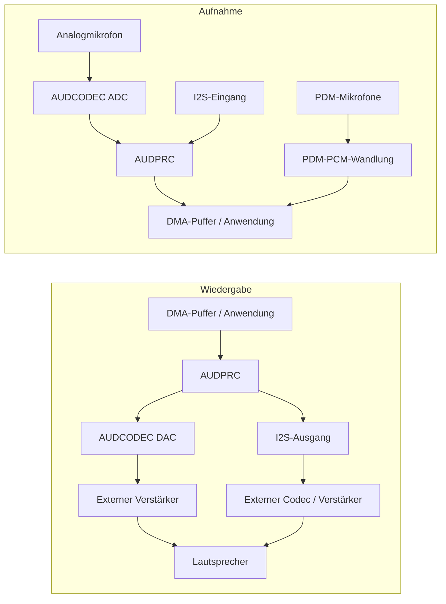

# Audioübersicht { #audio-overview }

## Übersicht { #overview }

Dieser Leitfaden behandelt das **lokale Audiosubsystem** von SF32-Geräten: den Signalweg aus Codec, DMA und Middleware für Mikrofoneingang, Lautsprecher- oder Line-Ausgang sowie Wiedergabe und Aufnahme auf dem Gerät. Im Mittelpunkt stehen praktische Entscheidungen zu Schnittstellen, Puffern, Audio Server, Codecs und Leistungsaufnahme.

Bluetooth-Audio (A2DP und LE Audio) ist ein verwandtes, aber eigenständiges Thema, das in der [Bluetooth-Übersicht](../bluetooth/overview.md#bluetooth-audio-and-le-audio) behandelt wird. Dort geht es um die drahtlose Übertragung; diese Seite beschreibt, was nach dem Eingang der Samples auf dem Chip geschieht: Erfassung, Mischung, Decodierung und Ansteuerung des physischen Audiopfads.

Nutzen Sie diese Seite, wenn Sie Mikrofone, Codecs und Pufferstrategien für ein Produkt auswählen oder dessen Leistungsaufnahme bewerten. Sie richtet sich an Ingenieurinnen und Ingenieure, die nicht nur eine Audiodemo einmalig zum Laufen bringen, sondern einen zuverlässigen Audiopfad unter den Randbedingungen von Bluetooth, Display, Speicher und Akku auslegen müssen.

## Die Audioanforderungen des Produkts festlegen { #define-the-products-audio-requirements }

Bevor Sie Schnittstellen oder Puffergrößen wählen, legen Sie fest, was das Produkt benötigt:

- Nur Wiedergabe, nur Aufnahme, oder beides gleichzeitig (Vollduplex)?
- Wie viele Mikrofone werden benötigt und welcher Typ: analog (AMIC) oder digital (DMIC)?
- Welche Formate werden für die lokale Wiedergabe benötigt — rohes PCM, MP3, Opus oder ein anderer Codec?
- Muss Bluetooth-Audio (Classic oder LE Audio) parallel zum lokalen Audio unterstützt werden?
- Sind Sprachaktivierung oder dauerhaftes Mithören vorgesehen? Welches Leistungsbudget steht dafür zur Verfügung?
- Welche Anforderungen gelten für die Lautsprecher- oder Line-Out-Ansteuerung? Wird die Ausgabe an einen externen Verstärker oder Codec geleitet?
- Welche Latenz ist akzeptabel? Für Sprachanrufe und Echtzeitüberwachung gelten deutlich strengere Anforderungen als für Benachrichtigungstöne.

Diese Antworten bestimmen die Schnittstelle (I2S, PDM oder ADC/DAC), die Codec-Konfiguration und welche Teile des Signalwegs aktiv bleiben müssen.

## Der SF32-Audiosignalpfad { #the-sf32-audio-signal-path }

Aufnahme und Wiedergabe verwenden unterschiedliche Signalwege. Die Abbildung zeigt übliche Wege; Verfügbarkeit und gleichzeitige Nutzung hängen von Gerät, Gehäuse, Platine und SDK-Konfiguration ab.

<div align="center"><em>Abbildung: Typischer lokaler SF32-Audiosignalpfad</em></div>



**AUDCODEC** übernimmt die A/D- und D/A-Wandlung. **AUDPRC** verarbeitet auf unterstützten Signalwegen Mischung, Verstärkung und Abtastratenwandlung. PDM-Mikrofone liefern ihre Signale an den PDM-Block, der PCM erzeugt; sie durchlaufen nicht den analogen ADC. I2S verbindet externe digitale Audiogeräte. Eine PDM-Schnittstelle kann über die Auswahl des linken oder rechten Kanals bis zu zwei kompatible Mikrofone anbinden; zwei Schnittstellen können bis zu vier Mikrofone anbinden, sofern Pins verfügbar sind und der Treiber dies zulässt.

**Audio Server** verwaltet Streams und Sitzungen als Software, nicht als physischer Wandler zwischen Mikrofon und Lautsprecher. Anwendungen verwenden üblicherweise seine APIs und die zugehörigen Treiber. Direkte Treiber- oder HAL-Tests sind bei der Inbetriebnahme hilfreich. Wählen Sie zuerst den tatsächlichen Aufnahme- und Wiedergabeweg und prüfen Sie dann Takte, Sampleformate, DMA-Anforderungen und ob die Ausgangsstufe die vorgesehene Last ansteuern kann. Gehen Sie nicht davon aus, dass der integrierte DAC den gewählten Lautsprecher ohne externen Verstärker treiben kann.

Die Details zu diesen Signalwegen finden Sie im [AUDPRC/AUDCODEC-Treiberleitfaden](https://docs.sifli.com/projects/sdk/latest/en/sf32lb52x/drivers/audprc_audcodec.html) und im [PDM-HAL-Leitfaden](https://docs.sifli.com/projects/sdk/latest/en/sf32lb52x/hal/pdm.html).

## Mikrofone und digitale Schnittstellen { #choosing-interfaces-amic-dmic-and-i2s }

AMIC und DMIC bezeichnen Mikrofontypen; PDM und I2S hingegen sind digitale Schnittstellen. Ein digitales Mikrofon kann PDM oder I2S verwenden. Zählen Sie Mikrofon, Kanal und Schnittstelle nicht als dieselbe Ressource.

<div align="center"><em>Tabelle: Mikrofone und digitale Schnittstellen</em></div>

<div align="center" markdown>

| Mikrofon / Bus | Typische Nutzung | Hinweise |
|:----------|:------------|:------|
| **AMIC (analoger Mikrofoneingang)** | Allgemeine Mikrofonaufnahme | Nutzt einen Audio-ADC; Mikrofonvorspannung, Verstärkung, Eingangsbereich und Störungen auf der Platine prüfen. |
| **DMIC (digitales Mikrofon)** | Sprachaufnahme und Mehrmikrofon-Arrays | Den tatsächlichen PDM- oder I2S-Bus wählen. Digitale Übertragung ersetzt nicht die Prüfung von Versorgung, Takt und Layout. |
| **I2S** | PCM-Übertragung zu und von externen Codecs oder Verstärkern | Wird häufig mit einem externen Audio-Codec oder Verstärker verwendet, statt mit dem integrierten AUDCODEC-Signalweg. |
| **PDM** | Eingang für digitale Mikrofone | Eine bei vielen DMICs übliche Schnittstelle, die mit der integrierten PDM-zu-PCM-Umwandlung kombiniert wird. |

</div>

Gemischte Analog-/Digital-Arrays benötigen gleichzeitig nutzbare Signalwege und synchronisierte Abtastzeitpunkte. Beamforming erfordert zusätzlich passende Mikrofonanordnung, Kalibrierung und einen Algorithmus; mehrere angeschlossene Mikrofone allein genügen nicht.

## Von einem geprüften Audiobeispiel ausgehen { #start-from-a-verified-audio-example }

Wählen und validieren Sie zunächst das passende SiFli-SDK-Beispiel, bevor Sie das Anwendungsverhalten darauf aufbauen. [Audio-SDK-Beispiele](audio-sdk-examples.md) ordnet die offiziellen Beispiele zu PDM, analoger Erfassung, Aufnahme und Wiedergabe, lokaler Musikwiedergabe, SD-Karte, FLAC, Opus und Mischung den jeweiligen Entwicklungsaufgaben zu. Außerdem nennt die Seite Randbedingungen für Platine, Pin-Multiplexing, Speicher und Konfiguration, die vor der Anpassung eines Beispiels an das Produkt erneut zu prüfen sind.

## Das richtige SF32-Gerät wählen { #pick-the-right-sf32-device }

Die Audiofunktionen unterscheiden sich je nach Familie. Prüfen Sie das Datenblatt des konkreten Geräts; die Tabelle bietet eine erste Orientierung:

<div align="center"><em>Tabelle: Das richtige SF32-Gerät wählen</em></div>

<div align="center" markdown>

| Gerätefamilie | Integrierte Audio-ADC/DAC | PDM-Schnittstellen (maximale Mikrofonzahl) | I2S-Schnittstellen | Typische Anwendung |
|:---|:---|:---|:---|:---|
| **SF32LB52x** | 1 ADC + 1 DAC | 1 (2) | 1 | Kostenoptimiertes Bluetooth-Audiozubehör, kompakte HMIs mit Sprachfunktion. |
| **SF32LB55x** | Keine; für analoges Audio ist ein externer Audio-Codec erforderlich. | SF32LB551/555: 1 (2); SF32LB557: 2 (4) | SF32LB551/555: 1; SF32LB557: 2 | BLE-Wearables und sensorreiche Produkte, bei denen Audio eine untergeordnete Rolle spielt. |
| **SF32LB56x** | 1 ADC + 1 DAC | 2 (4) | 1 | Produkte mit umfangreicher HMI-/Display-Funktionalität, die zusätzlich Spracherfassung mit mehreren Mikrofonen benötigen. |
| **SF32LB57x** | 2 ADC + 1 DAC | 2 (4) | 2 | Spracherfassung mit mehreren Mikrofonen und lokale Wiedergabe. |
| **SF32LB58x** | 2 ADC + 2 DAC | 2 (4) | 3 | Flaggschiff-Produkte, die Audio, Grafik, KI und komplexe Konnektivität kombinieren. |

</div>

Prüfen Sie vor der Auswahl das konkrete Modell, die Gehäusepins, deren Funktionszuordnung und gleichzeitig nutzbare Signalwege. Eine PDM-Schnittstelle kann zwei kompatible Mikrofone bedienen. ADC-Kanäle, Mikrofonkanäle und digitale Schnittstellen sind unterschiedliche Ressourcen. Die I2S-Funktionen hängen von der jeweiligen Instanz ab: Beim SF32LB58x unterstützt I2S1 nur Empfang (RX), I2S2 und I2S3 unterstützen Empfang und Senden (RX/TX). Für Empfang über I2S2 muss außerdem dessen TX-Seite als Taktquelle aktiviert werden. Angaben zu den einzelnen Instanzen finden Sie im [SiFli-I2S-HAL-Leitfaden](https://docs.sifli.com/projects/sdk/latest/en/sf32lb52x/hal/i2s.html); weitere Auswahlkriterien bietet die [SF32-Familie](../../sf32-products/family/SF32_family.md).

Quellen: [DS5201](https://downloads.sifli.com/user%20manual/DS5201-SF32LB52x-Datasheet%20V2p5.pdf), [DS5501, Table 0-1](https://downloads.sifli.com/user%20manual/DS5501-SF32LB55x-Datasheet%20V1p7p2.pdf), [DS5601](https://downloads.sifli.com/user%20manual/DS5601-SF32LB56x-Datasheet%20V1p9p2.pdf), [DS5801](https://downloads.sifli.com/user%20manual/DS5801-SF32LB58x-Datasheet%20V1p8p3.pdf), [SF32LB57x AUDCODEC-Register (ADC_CH0/1, DAC_CH0)](https://github.com/OpenSiFli/SiFli-SDK/blob/v2.5.1/drivers/cmsis/sf32lb57x/audcodec.h), [SF32LB57x-PDM/I2S-Instanzen](https://github.com/OpenSiFli/SiFli-SDK/blob/v2.5.1/drivers/cmsis/sf32lb57x/register.h), [SiFli-SDK-v2.5.1-Release-Notes (57x-PDM-Konfiguration für vier Mikrofone)](https://github.com/OpenSiFli/SiFli-SDK/releases/tag/v2.5.1), [SiFli-SDK-PDM-Beispiel (57x-Board, PDM1, Stereokanäle)](https://docs.sifli.com/projects/sdk/latest/en/sf32lb52x/example/rt_device/pdm/README.html).

## Audio-Sitzungsvorlagen { #audio-session-templates }

Die meisten Produkte lassen sich einigen wiederkehrenden Sitzungstypen zuordnen. Wählen Sie den passendsten aus und prüfen Sie ihn gezielt:

<div align="center"><em>Tabelle: Audio-Sitzungsvorlagen</em></div>

<div align="center" markdown>

| Sitzung | Typische Pipeline | Hauptrisiko |
|:--------|:-----------------|:----------|
| Benachrichtigungston | Flash-/PSRAM-Asset -> bei Bedarf Decoder -> Audio Server -> DAC/Verstärker | Knacken/Klicken beim Start und Stopp. |
| Sprachaufnahme | AMIC -> ADC/AUDPRC oder PDM-Mikrofon -> PDM-PCM-Wandlung oder I2S-Eingang -> DMA-Puffer -> App/Speicher/Bluetooth | Pufferüberlauf und Taktdrift. |
| Bluetooth-Lautsprecher | Bluetooth-Audio -> Decodierung/Mischung -> Audio Server -> DAC/Verstärker | Koexistenz mit dem Funkbetrieb und Konkurrenz um Speicherbandbreite. |
| Sprachanruf | Mikrofonerfassung und Wiedergabe gleichzeitig | Vollduplex-Latenz, Echopfadverarbeitung und Pufferverwaltung. |
| Sprachaktivierung/dauerhaftes Mithören | Aufnahme mit niedriger Abtastrate -> Merkmalsextraktion -> KI-Auslöser | Leistungsaufnahme im Bereitschaftsbetrieb und Fehlaktivierungen. |

</div>

Legen Sie für jede Sitzung fest, wie Start und Normalbetrieb ablaufen, wie Unter- und Überläufe behandelt werden und wie die Sitzung beendet wird. Audiofehler treten häufig bei Übergängen auf, nicht während der stabilen Wiedergabe.

## Puffer- und Latenzbudget { #buffer-and-latency-budget }

Die Audiodauer eines Puffers wird in **Sampleframes** berechnet. Ein Frame enthält je ein Sample jedes Kanals.

```text
interleaved frames = buffer bytes / (channels * stored bytes per sample)
planar frames per channel = channel buffer bytes / stored bytes per sample
buffer duration (s) = frames / sample rate (Hz)
```

Bei 48 kHz entsprechen 480 Frames einer Dauer von 10 ms. Bei verschachteltem Stereo sind das 960 einzelne Samples; 480 einzelne Samples ergeben nur 5 ms. Verwenden Sie für die Umrechnung von Bytes in Frames die tatsächlich gespeicherten Bytes pro Sample einschließlich Padding. Bei getrennten Kanalpuffern zählen Sie die Frames je Kanal, statt beide Pufferlängen zu addieren.

Dies ist die Audiodauer des Puffers, nicht automatisch die Ende-zu-Ende-Latenz. Bei Doppelpufferung nutzt DMA einen Bereich, während die Software den anderen bearbeitet. Die Latenz hängt von wartenden Daten in den Warteschlangen und der Richtlinie für Halb-/Volltransfer-Callbacks ab, nicht allein von zwei vorhandenen Puffern. Planen und messen Sie die Verzögerungen von Aufnahme, Verarbeitung, Transport, Wiedergabe und Ablaufplanung gemeinsam.

## Grundlagen von Wiedergabe und Aufnahme { #playback-and-recording-basics }

Ob Lautsprecheransteuerung oder Mikrofonerfassung — dieselben Grundprinzipien gelten:

- **Puffergröße** — kleine Datenblöcke können die blockbedingte Latenz verkürzen, erhöhen aber den Interrupt-/DMA-Overhead; große Blöcke bieten mehr Spielraum für die Ablaufplanung und benötigen mehr Speicher. Die Latenz steigt, wenn mehr Audiodaten vor der Verarbeitung oder Wiedergabe warten, nicht allein durch die Reservierung zusätzlicher Pufferkapazität.
- **DMA-Übertragung** — verwenden Sie hardwaregetaktete DMA für die Sampleübertragung am Peripheriebaustein. Software darf weiterhin Datenblöcke im Speicher kopieren oder verarbeiten. Vermeiden Sie CPU-Polling oder Sample-Schleifen, die die Peripherie in Echtzeit bedienen müssen.
- **Abtastrate und Format festlegen** — bestimmen Sie frühzeitig Abtastrate (z. B. 16 kHz für Sprache, 44,1/48 kHz für Musik) und Bittiefe. Eine Formatumwandlung zur Laufzeit kostet CPU-Zeit und Speicher.
- **Doppelpufferung** — Während DMA einen Bereich überträgt, füllt oder verarbeitet die Software den anderen. Die Verarbeitung muss vor dessen erneuter Nutzung abgeschlossen sein; zwei Puffer allein verhindern keine Über- oder Unterläufe.

Legen Sie für cachefähige, mit DMA geteilte Puffer die Zugriffsverantwortung fest und beachten Sie die Cache-Line-Ausrichtung und Wartungsvorgaben des SDK. Schreiben Sie CPU-erzeugte Wiedergabedaten aus dem Cache zurück, bevor DMA sie liest. Bereiten Sie Aufnahmeziele vor dem DMA-Schreibzugriff vor und invalidieren Sie den abgeschlossenen Bereich vor dem CPU-Lesezugriff gemäß der Cache-Strategie des Zielsystems. Ändern oder verwenden Sie einen von DMA belegten Bereich erst wieder, wenn der Abschluss-Callback dies erlaubt. Betroffene Cache-Lines dürfen keine fremden Daten enthalten.

## Codec- und Formatwahl { #codec-and-compression-choices }

Unterscheiden Sie einen **Hardware-Audio-Codec** (ADC/DAC-Wandlung) von einem **Kompressionscodec** (etwa MP3 oder Opus). Unkomprimiertes PCM benötigt keinen Kompressionsdecoder. Verlustbehaftete Kompression reduziert für ein vergleichbares Signal meist Speichergröße und Lesebandbreite. CPU-Zeit, Arbeitspuffer und Energie des Decoders müssen dennoch gemessen werden; eine kleinere Audiodatei garantiert keinen geringeren Laufzeitspeicherbedarf.

<div align="center"><em>Tabelle: Codec- und Kompressionswahl</em></div>

<div align="center" markdown>

| Format | Typische Nutzung | Hinweise |
|:-------|:-------------|:------|
| **Unkomprimiertes PCM** | Kurze Töne, latenzarme Überwachung und Sprachverarbeitung | Keine Kompressionsdecodierung; Größe abhängig von Dauer, Abtastrate, Kanalzahl und gespeicherter Samplebreite. |
| **MP3** | Lokale Musikwiedergabe | Breite Kompatibilität; der Decodieraufwand ist gut einschätzbar, und MP3 wird häufig in Beispielen für SD-Karten-Musikplayer verwendet. |
| **Opus** | Sprache und komprimiertes Audio für allgemeine Zwecke | Nützliches Kompressionsformat für Sprache und allgemeines Audio. Opus-Unterstützung allein garantiert keine A2DP-, HFP- oder LE-Audio-Interoperabilität; Codec des gewählten Bluetooth-Profils und SDK-Unterstützung separat prüfen. |

</div>

Das SDK bietet Beispiele für lokale Musik, SD-Karten-MP3, Opus, Aufnahme und duale ADC/DAC-Pfade. Das Zweikanalbeispiel benötigt ein Gerät und eine Platine mit diesen Kanälen; nicht jedes SF32-Gerät hat zwei ADCs/DACs. Beginnen Sie mit der unterstützten Konfiguration und messen Sie den Decodieraufwand auf dem Zielgerät.

## Lokales Audio vs. Bluetooth-Audio { #local-audio-vs-bluetooth-audio }

Unterscheiden Sie die beiden Signalwege konzeptionell, auch wenn sie gleichzeitig aktiv sein können:

- **Lokales Audio** (dieser Leitfaden) — AUDCODEC/AUDPRC, Mikrofone, Lautsprecher/Line-out, geräteinterne Wiedergabe und Aufnahme.
- **Bluetooth-Audio** ([Bluetooth-Übersicht](../bluetooth/overview.md#bluetooth-audio-and-le-audio)) — A2DP/AVRCP/HFP für Classic Bluetooth oder LE-Audio-Unicast/Broadcast, sofern Gerät, Stack und SDK die erforderlichen Rollen unterstützen. Eine BLE-fähige Funkhardware allein garantiert kein LE Audio.

In vielen Produkten werden beide Signalwege kombiniert: etwa indem ein lokales Mikrofon Audio erfasst und dieses über Bluetooth gestreamt wird oder indem empfangenes Bluetooth-Audio im Audio Server mit einem lokalen Benachrichtigungston gemischt wird. Legen Sie ausdrücklich fest, wer die Puffer verwaltet und wie gemischt wird, wenn beide Signalwege gleichzeitig aktiv sind.

## Audio-Checkliste auf Platinenebene { #board-level-audio-checklist }

Firmware kann schlechtes analoges Design nicht vollständig verbergen. Prüfen Sie diese Punkte bei Schaltplan- und Leiterplattenarbeit:

<div align="center"><em>Tabelle: Audio-Checkliste auf Platinenebene</em></div>

<div align="center" markdown>

| Bereich | Hinweise |
|:-----|:---------|
| Mikrofonvorspannung und Leiterbahnführung | Halten Sie analoge Mikrofonleitungen kurz, störungsarm und fern von Takten, RF-Signalen und hochstromführenden Schaltknoten. |
| Masseführung | Vermeiden Sie störbehaftete Rückstrompfade über die Massebezüge von Mikrofon oder Lautsprecher. |
| Versorgungsschienen | Filtern Sie Codec- und Mikrofonversorgungen gemäß Referenzdesign und Mikrofon-Datenblatt. |
| Lautsprecher-/Verstärkerpfad | Prüfen Sie Last, Verstärkung, Wärmeverhalten, Knackunterdrückung und Verhalten des Abschaltpins. |
| I2S-/PDM-Takte | Prüfen Sie Timing-Reserve, Leiterbahnlänge und Taktqualität bei den gewählten Abtastraten. |
| Testzugang | Sehen Sie eine praktikable Möglichkeit vor, während der Inbetriebnahme und Fertigungsprüfung Audio einzuspeisen und aufzunehmen. |

</div>

Prüfen Sie bei Produkten mit RF und analogem Audio die Störgeräusche unter realen Bedingungen: Bluetooth aktiv, Display in Betrieb, Ladegerät angeschlossen und endgültiges Gehäuse montiert.

## Leistungsaufnahme bei Audio { #power-considerations-for-audio }

Messen Sie Mikrofonversorgung, Wandler, digitale Verarbeitung, Speicherzugriffe und Verstärker zunächst getrennt und anschließend die gesamte Sitzung. Die jeweiligen Anteile hängen von Hardware, Arbeitslast und Einschaltdauer bei Aufnahme und Wiedergabe ab.

- Stoppen Sie zwischen Sitzungen ungenutzte Audiowege in der vom Bauteil und Treiber vorgeschriebenen Reihenfolge. Prüfen Sie Verstärkerstummschaltung und Abschaltung, Takte, Versorgung und GPIO-Zustände, um Knackgeräusche, Rückspeisung und Leckströme an Schnittstellen zu vermeiden.
- Für Sprachaktivierung mit dauerhaftem Mithören muss der benötigte Aufnahmeweg aktiv bleiben. Wählen Sie die sparsamste unterstützte Verarbeitung und ein leichtgewichtiges Erkennungsmodell; schalten Sie den für die Erkennung erforderlichen Weg nicht ab. Siehe [KI-Übersicht](../ai/overview.md#audio-and-voice).
- Bündeln Sie die Verarbeitung innerhalb der Latenzgrenzen und Pufferfristen. DMA übernimmt den Sample-Transfer, abgeschlossene Blöcke müssen jedoch rechtzeitig verarbeitet werden. Weniger CPU-Aufweckvorgänge dürfen keine Pufferüber- oder -unterläufe verursachen.
- Stimmen Sie Audio auf Bluetooth und Display ab. Siehe [Energiesparendes Design im Überblick](../low-power/overview.md) und [Bluetooth-Übersicht: Koexistenz](../bluetooth/overview.md#coexistence-with-other-workloads).

## Audio-Validierungsmatrix { #audio-validation-matrix }

Wiederholen Sie dieselben Audiotests nach Änderungen an Codec, Bluetooth, Display, Stromversorgung oder Takten:

<div align="center"><em>Tabelle: Audio-Validierungsmatrix</em></div>

<div align="center" markdown>

| Test | Was zu prüfen ist |
|:-----|:--------------|
| Stille Erfassung/Wiedergabe | Rauschpegel, Brummen, Pop/Klicken, DC-Offset. |
| Sinus-Sweep oder Ton | Korrektheit der Abtastrate, Verzerrung, Clipping. |
| Langzeitwiedergabe | Pufferunterläufe, Speicherlecks sowie thermische und Leistungsstabilität. |
| Aufnahme bei gleichzeitiger UI-Aktualisierung | Koexistenz von DMA und Speicherbandbreite. |
| Bluetooth-Audio plus lokaler Ton | Mischung, Priorität und Latenz. |
| Schlafen und Aufwachen während des Audiobetriebs | Abschalten und Neustart des Codecs, Knackunterdrückung und PM-Votes, die zulässige Energiesparzustände einschränken. |

</div>

Bewahren Sie eine geprüfte WAV-/PCM-Referenzdatei und eine geprüfte Aufnahme vom Evaluierungsboard auf. Damit lassen sich Regressionen deutlich leichter erkennen als allein durch subjektives Hören.

## Audioprobleme diagnostizieren { #debugging-audio-issues }

<div align="center"><em>Tabelle: Audioprobleme diagnostizieren</em></div>

<div align="center" markdown>

| Symptom | Wahrscheinlich zu prüfender Bereich |
|:--------|:----------------------|
| Klicken, Knacken oder Aussetzer | Pufferunterlauf, zu wenige oder zu kleine Puffer oder fehlerhafte DMA-Konfiguration. |
| Anhaltendes Rauschen oder Brummen | Analoge Stufe oder Platinenlayout, AMIC-Masseführung oder Störungen auf der Versorgungsschiene. |
| Für den Anwendungsfall zu hohe Latenz | Zu große Puffer, unnötige Formatumwandlung oder Planungsverzögerung vor dem DMA-Start. |
| Audio setzt bei aktivem Bluetooth oder Display aus | Koexistenz und Konkurrenz um Speicherbandbreite; siehe [Koexistenz](../bluetooth/overview.md#coexistence-with-other-workloads). |
| Decodiertes Audio klingt falsch (Tonhöhe oder Geschwindigkeit) | Abweichende Abtastraten von Quelle, Decoder und AUDCODEC-Konfiguration. |
| Hohe Leistungsaufnahme bei inaktiver Wiedergabe | Codec oder DMA bleibt zwischen Sitzungen aktiv; unnötiges Polling statt ereignisgesteuertem Beenden der Sitzung. |

</div>

## Häufige Fehler { #common-mistakes }

- Bedienen Sie nicht jedes Peripherie-Sample per CPU-Polling, sondern nutzen Sie hardwaregetaktete DMA.
- Verwenden Sie keine zu kleinen oder schlecht verwalteten Puffer, die DMA-Fristen verfehlen; nutzen Sie Doppelpufferung, wenn Treiber und Anwendungsfall sie unterstützen.
- Wählen Sie Mikrofontypen und -zahlen erst, nachdem Sie PDM/I2S-Instanzen, herausgeführte Pins und gleichzeitig nutzbare Signalwege geprüft haben.
- Behandeln Sie Bluetooth-Audio und lokales Audio nicht als vollständig unabhängige Pfade, wenn sie im Produkt gleichzeitig laufen.
- Ignorieren Sie nicht die Cache-Kohärenz- und Zuständigkeitsregeln für Puffer, die DMA und CPU gemeinsam nutzen.
- Lassen Sie ungenutzte Audiowege nicht zwischen Sitzungen aktiv und schalten Sie keinen Aufnahmeweg ab, den kontinuierliches Mithören erfordert.
- Legen Sie sich nicht auf ein komprimiertes Format fest, bevor Sie bestätigt haben, dass der Decodieraufwand ins Leistungs- und CPU-Budget passt.

## Inbetriebnahme-Checkliste { #bring-up-checklist }

- [ ] Prüfen Sie Mikrofontypen und Kanalzahlen, PDM/I2S-Instanzen, herausgeführte Pins und gleichzeitig nutzbare Signalwege für das konkrete Gerät und Entwicklungsboard.
- [ ] Legen Sie Abtastrate, gespeicherte Sample-Breite, Kanalanordnung und Puffergrößen für Aufnahme und Wiedergabe fest.
- [ ] Nehmen Sie den gewählten Aufnahmeweg über ADC/AUDPRC, PDM oder I2S und den Wiedergabeweg über DAC oder I2S in Betrieb; testen Sie vor Vollduplex jede Richtung einzeln.
- [ ] Integrieren Sie nach erfolgreicher Hardwareprüfung unterstützte Sitzungen mit Audio Server und den zugehörigen Treibern; behalten Sie direkte HAL-Tests zur Diagnose bei.
- [ ] Wählen Sie das Audioformat (PCM/MP3/Opus) und messen Sie gegebenenfalls den Decodieraufwand einschließlich CPU-Last, Speicherbedarf und Energie.
- [ ] Prüfen Sie DMA-Pufferbesitz, Ausrichtung sowie Cache-Bereinigung und -Invalidierung.
- [ ] Testen Sie lokales Audio und Bluetooth-Audio gleichzeitig, wenn das Produkt beide verwendet.
- [ ] Messen Sie die Leistungsaufnahme im aktiven und inaktiven Zustand; prüfen Sie Abschalt- und Neustartsequenzen, Pinzustände und den für kontinuierliches Mithören erforderlichen Aufnahmeweg.

## Wichtigste Erkenntnisse { #key-takeaways }

- Wählen Sie den physischen Signalweg ausdrücklich: Analoges Audio nutzt AUDCODEC, PDM-Aufnahme den PDM-Block und externes digitales Audio I2S. Verwalten Sie unterstützte Sitzungen mit Audio Server und Treibern, statt alle Wege als dieselbe Codec-Pipeline zu behandeln.
- Wählen Sie Mikrofontypen und PDM/I2S-Signalwege anhand der Fähigkeiten des konkreten Geräts und der Mikrofonanordnung, statt Annahmen zu einem anderen Chip zu übernehmen.
- Nutzen Sie hardwaregetaktete DMA-Übertragungen mit ausreichender Puffertiefe. Doppelpufferung ist, wenn Treiber und Anwendungsfall sie unterstützen, ein üblicher Ausgangspunkt; die Fristen für Callbacks und Pufferwiederverwendung müssen trotzdem eingehalten werden.
- Lokales Audio und Bluetooth-Audio sind getrennte Subsysteme, die oft gleichzeitig laufen müssen. Planen Sie Mischung und Pufferverwaltung ausdrücklich.
- Behandeln Sie die Audio-Leistungsaufnahme ebenso wie die von Bluetooth und KI: Halten Sie die aktive Zeit kurz, vermeiden Sie unnötige CPU-Aufweckvorgänge und messen Sie reale Sitzungen statt nur die Wiedergabe im stationären Zustand.
