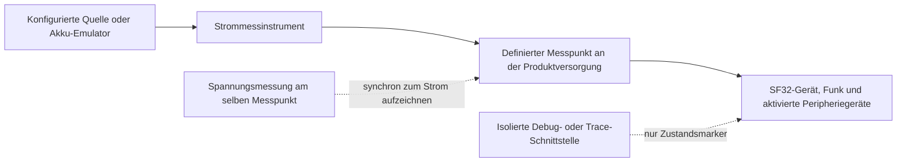
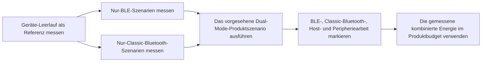
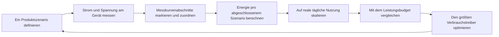

# Bluetooth-Leistungsaufnahme messen und analysieren { #bluetooth-low-power-profiling }

Dieser Artikel erklärt, wie sich die **tatsächliche Leistungsaufnahme eines Geräts im Bluetooth-Betrieb** messen lässt: mit Bluetooth Low Energy (BLE), Classic Bluetooth (BR/EDR) und im kombinierten Dual-Mode-Betrieb. Legen Sie für jedes Szenario die elektrische Messgrenze fest, erfassen Sie Strom und Spannung und dokumentieren Sie das Firmwareverhalten so, dass sich die wichtigen Abschnitte der Messkurve erklären lassen.

Die Abschnitte zu Classic Bluetooth und Dual-Mode gelten nur für Geräte und Firmware-Konfigurationen mit BR/EDR-Unterstützung. Für ein reines BLE-Produkt gilt dieselbe Messmethode; der Testplan beschränkt sich dann auf BLE.

Der [Online Power Profiler for Bluetooth LE](https://devzone.nordicsemi.com/power/w/opp/2/online-power-profiler-for-bluetooth-le) von Nordic ist eine nützliche konzeptionelle Referenz für BLE. Laut Nordic basiert das Tool auf Messungen und liefert Erwartungswerte; es misst nicht ein bestimmtes Gerät. Die veröffentlichten Genauigkeitsangaben gelten nur für Nordic-Referenzhardware und dürfen nicht auf SF32 übertragen werden. Classic Bluetooth und Dual-Mode-Produkte werden ebenfalls nicht modelliert. Ein Modell hilft bei der Auswahl relevanter Tests; die Leistungsaufnahme des Zielgeräts muss am Gerät selbst gemessen werden.

## Festlegen, was gemessen wird { #define-what-you-are-measuring }

„Bluetooth-Leistungsaufnahme“ kann sehr Unterschiedliches bedeuten. Eine reine Funkmessung kann bei der Optimierung eines Verbindungsparameters helfen. Sie zeigt jedoch nicht, wie viel Strom das vollständige Produkt im Betrieb aufnimmt, wenn zusätzlich Controller, Anwendungsprozessor, Sensoren, Display, Speicher und Stromversorgung beteiligt sind.

<div align="center"><em>Tabelle: Messpunkte für die Bluetooth-Leistungsaufnahme</em></div>

<div align="center" markdown>

| Messpunkt | Enthaltene Komponenten | Geeignet für | Einschränkung |
|:---------|:-----------------|:---------------|:-----------|
| Bluetooth-Subsystem oder ausgewählte Versorgungsschiene | Funk/Controller und der ausgewählte Versorgungspfad | Ursachen eines erhöhten Funk- oder Controller-Verbrauchs eingrenzen | Entspricht nicht dem gesamten Akkuverbrauch des Geräts |
| MCU-Versorgungseingang | MCU, Controller und von dieser Schiene versorgte On-Chip-Peripheriegeräte | Vergleich von Firmware-Zuständen auf einem kontrollierten Entwicklungsboard | Schließt externe Komponenten auf anderen Schienen und Reglerverluste aus |
| Akku oder Haupteingang des Produkts | Regler, MCU, externer Speicher, Sensoren, Display und andere versorgte Lasten | Modellierung der Akkulaufzeit und Produktabnahme | Erfordert die Kontrolle aller angeschlossenen Geräte und Versorgungspfade |

</div>

Messen Sie zur Bewertung der Akkulaufzeit möglichst am Akkueingang oder am Hauptversorgungseingang des Produkts. Zeichnen Sie Spannung und Strom gemeinsam auf. So lassen sich Leistung und Energie bestimmen, statt einen Stromwert ohne die zugehörigen Versorgungsbedingungen zu vergleichen.

## Einen wiederholbaren Test einrichten { #set-up-a-repeatable-test }

Messgerät und Prüfling müssen denselben, eindeutig dokumentierten Messpunkt verwenden. Das Power Profiler Kit II (PPK II) von Nordic eignet sich bei passenden Spannungs- und Strombereichen als praktisches Werkzeug zur Versorgung und Strommessung. Eine vergleichbare Source-Measure-Unit oder ein Stromanalysator ist ebenfalls geeignet. Entscheidend ist ein sauberer Messaufbau, nicht die Marke des Instruments.

Im [Source-Meter-Modus](https://docs.nordicsemi.com/r/bundle/ug_ppk2/page/ug/ppk/measure_current_source_meter.html) des PPK II versorgt das Messgerät den Prüfling (DUT); im [Ampere-Meter-Modus](https://docs.nordicsemi.com/r/bundle/ug_ppk2/page/ug/ppk/measure_current_ampere_meter.html) erfolgt die Versorgung aus einer externen Quelle über das Messgerät. Wählen Sie den Modus passend zum vorgesehenen Versorgungspfad. Eine eingestellte Versorgungsspannung ist keine aufgezeichnete Spannungskurve am Gerät: Überwachen Sie die Spannung am Messpunkt, besonders wenn Spannungseinbrüche oder Änderungen der Akkuspannung die Energie beeinflussen.

Prüfen Sie vor dem Anschließen des DUT die Betriebsgrenzen des PPK II. Im Source-Meter-Modus ist die Ausgangsspannung von 0,8 bis 5,0 V einstellbar; der maximale DUT-Strom beträgt 600 mA. Der Ampere-Meter-Modus erfordert eine externe Versorgung mit 0,8 bis 5,0 V und unterstützt eine kontinuierliche Messung bis 1 A. Kann der DUT im Source-Meter-Modus mehr als 400 mA aufnehmen, empfiehlt Nordic eine zusätzliche USB-Versorgung mit mindestens 1 A Nennstrom für das PPK II. Dies sind Instrumentengrenzwerte, keine empfohlenen Betriebswerte für das Gerät. Siehe Nordics Angaben zum [maximal zulässigen DUT-Strom](https://docs.nordicsemi.com/r/bundle/ug_ppk2/page/ug/ppk/ppk_max_dut_current.html) und zur [Stromversorgung](https://docs.nordicsemi.com/r/bundle/ug_ppk2/page/ug/ppk/ppk_power_supply.html).

<div align="center"><em>Abbildung: Aufbau zur gerätebasierten Bluetooth-Leistungsmessung</em></div>



Vor jedem Durchlauf:

1. Trennen Sie USB-Strom, einen Debugger oder andere Versorgungen, die das Instrument umgehen oder Last hinzufügen können. Behalten Sie nur die vom Szenario benötigten Schnittstellen.
2. Legen Sie die dokumentierte Versorgungsspannung am definierten Messpunkt an. Protokollieren Sie jede versorgte Schiene, jeden Jumper, jedes Modul und jedes externe Gerät.
3. Verwenden Sie den Produkt-Firmware-Build und dessen vorgesehene PM-Konfiguration. Deaktivieren Sie umfangreiches Diagnose-Logging für die abschließenden Messungen, sofern es nicht Teil der Serienkonfiguration ist.
4. Bereiten Sie für jeden Vergleich dasselbe Telefon, Zubehör, dieselbe Testanwendung, Distanz, Antennenausrichtung und RF-Umgebung vor.
5. Erfassen Sie ein ausreichend langes Fenster mit vielen wiederholten Bluetooth-Ereignissen, nicht nur einen einzelnen, zufällig erfassten Impuls.

## Die Leistungsphasen eines BLE-Advertising-Ereignisses verstehen { #read-a-ble-advertising-event-as-a-set-of-power-components }

Ein typisches BLE-Advertising-Ereignis besteht nicht aus einem einzelnen Funkimpuls. Auf eine kurze Einschalt- und Vorbereitungsphase folgen der Hochlauf und die Stabilisierung des Hochfrequenz-Quarzoszillators. Sobald Versorgung und Takt bereit sind, wartet das Gerät im Standby bis zum geplanten Funkstart. Im hier gezeigten Beispiel für scannbares oder verbindbares Advertising startet es das Funkmodul, sendet auf einem primären Advertising-Kanal und öffnet ein Empfangsfenster auf demselben Kanal. Nach den ersten beiden Empfangsfenstern kehrt es in den Standby zurück, bevor es auf dem nächsten Kanal sendet; nach dem letzten Empfangsfenster folgt die Nachverarbeitung. Nicht verbindbares und nicht scannbares Advertising lauscht nicht auf Anfragen. Die tatsächlichen Phasen hängen vom konfigurierten Advertising-Typ und der Kanalzuordnung ab.

Die vollständige dargestellte Reihenfolge lautet: Vorverarbeitung → Quarzhochlauf → Standby → Funkstart → Funkübertragung (TX) → Umschaltung TX/RX → Funkempfang (RX) → Standby → Funkübertragung (TX) → Umschaltung TX/RX → Funkempfang (RX) → Standby → Funkübertragung (TX) → Umschaltung TX/RX → Funkempfang (RX) → Nachverarbeitung. Der Funkstart tritt nur einmal auf; die Übertragungen auf den Kanälen 38 und 39 beginnen nach der Standby-Phase, die auf das vorherige RX-Fenster folgt. Die Phasenfolge orientiert sich an der [Darstellung von Nordic zu einem typischen BLE-Advertising-Ereignis](https://devzone.nordicsemi.com/power/w/opp/2/online-power-profiler-for-bluetooth-le). Dies sind allgemeine BLE-Ereignisphasen, keine Nordic-spezifischen Funkzustände; die Neuzeichnung fügt keine weiteren Zustände hinzu. Stromstärken und Zeitanteile sind illustrativ und keine SF32-Messwerte. Messen Sie beide Größen am Zielgerät.

<div align="center"><em>Abbildung: Stufen eines BLE-Advertising-Ereignisses</em></div>


Die Abbildung zeigt ein scannbares oder verbindbares Legacy-Advertising-Ereignis auf den drei Primärkanälen 37, 38 und 39; eine Interaktion nach einer empfangenen Anfrage ist nicht dargestellt. Die Kanalbeschriftungen dienen der Veranschaulichung: Die Bluetooth-Core-Spezifikation erlaubt die Nutzung aktivierter Primärkanalindizes in beliebiger Reihenfolge; die konfigurierte Kanalkarte bestimmt, welche Indizes verwendet werden. Auf jedem verwendeten Index wird höchstens eine Advertising-PDU gesendet, üblicherweise eine pro Index. Die drei Sendungen sind Kopien der Advertising-Daten auf unterschiedlichen Kanälen, keine durch Bestätigungen gesteuerten Wiederholungsversuche. Bei scannbaren oder verbindbaren Ereignissen hört die Link Layer auf dem jeweiligen Primärkanal auf zulässige Anfragen; nicht scannbare und nicht verbindbare Ereignisse öffnen kein Empfangsfenster für Anfragen. Erweitertes Advertising, eine andere Kanalkarte oder eine tatsächlich empfangene Anfrage können eine andere Messkurve ergeben. Prüfen Sie das konfigurierte Verhalten anhand der [Bluetooth-Core-6.2-Link-Layer-Spezifikation](https://www.bluetooth.com/wp-content/uploads/Files/Specification/HTML/Core-62/out/en/low-energy-controller/link-layer-specification.html), der [Einführung der Bluetooth SIG](https://www.bluetooth.com/bluetooth-le-primer/) und der Messkurve des Geräts.

<div align="center"><em>Tabelle: Stromverlauf eines BLE-Advertising-Ereignisses nach Phasen</em></div>

<div align="center" markdown>

| Stufe | Typische Verbraucher in dieser Phase | Was zu messen und zu prüfen ist |
|:------|:----------------------------|:---------------|
| Vorverarbeitung (Pre-processing) | Eine kurze Einschaltphase, bei der vergleichsweise hoher Strom fließen kann, dazu CPU-/Controller-Vorbereitung, Nutzdatenverarbeitung, DMA, Speicherzugriff und Peripherie-Setup | `I_pre` und `t_pre`; die erforderliche Weck- und Einschaltarbeit identifizieren, dann vermeidbare Arbeit entfernen oder bündeln |
| Hochlauf des HF-Quarzoszillators (Crystal ramp-up) | Start und Stabilisierung des Hochfrequenz-Takts | `I_xtal` und `t_xtal`; prüfen, ob Taktstrategie und Wecksequenz länger als nötig dauern |
| Standby | Gewählter Energiesparzustand, nachdem Versorgung und Takte bereit sind, sowie Retention-Logik, Niederfrequenz-Taktung und aktivierte Weckquellen | `I_standby`, die anfängliche Wartezeit bis zum Funkstart und die Standby-Zeiten zwischen den Kanälen nach RX messen; diesen internen Ereignisstrom nicht mit dem Schlafstrom zwischen vollständigen Ereignissen gleichsetzen |
| Funkstart (Start radio) | Vorbereitung von Funk und Controller sowie der erforderliche RF-Versorgungspfad vor der ersten Übertragung | `I_start` und `t_start`; unnötige Vorbereitung oder wiederholte Startarbeit identifizieren |
| Funk-TX (Radio TX) | Funksendepfad, Controller-Arbeit und Übertragung des Advertising-Pakets auf den Kanälen 37, 38 und 39 | `I_tx` und `t_tx` für jedes Paket messen; Sendeleistung, Paketlänge und aktivierte Kanäle bestimmen die Paket- und Ereignisenergie |
| Funkumschaltung (Radio switch) | Der Sende-zu-Empfangs-Übergang des Funks und der Controller-Zustandswechsel | `I_switch` und `t_switch`; jeden Übergang zählen, statt ihn als kostenlose Zeit zu behandeln |
| Funk-RX, falls aktiviert (Radio RX) | Empfangspfad und Controller-Arbeit während des Wartens auf eine Scan- oder Verbindungsanfrage | `I_rx` und `t_rx`; nur einbeziehen, wenn der Advertising-Typ und die Konfiguration Empfangsfenster öffnen |
| Nachverarbeitung (Post-processing) | Protokoll-Callbacks, CPU-Arbeit, Speicher-/Peripheriezugriff und jede Anwendungsreaktion vor der Rückkehr in den Energiesparzustand | `I_post` und `t_post`; bestätigen, dass Takte, PM-Beschränkungen und externe Komponenten zeitnah freigegeben werden |

</div>

Verwenden Sie die Phasenbezeichnungen auf einem SF32-Gerät als Hinweise für Trace-Marker, nicht als Nordic-spezifische Funkzustände oder angenommene Zeit- und Stromwerte. Ob die Zielkonfiguration Empfangsaktivität umfasst, hängt vom eingestellten Advertising-Verhalten ab und muss anhand der Messkurve geprüft werden.

Die Energie eines vollständigen Ereignisses ergibt sich aus dem Zeitintegral des Produkts aus momentaner Spannung und Strom:

```text
E_event = sum(V_stage x I_stage x t_stage)
```

Bei konstanter Versorgungsspannung kann eine periodische Advertising-Konfiguration angenähert werden als:

```text
Q_event = sum(I_stage x t_stage)
I_average = (Q_event + I_idle x (T_cycle - t_event)) / T_cycle
```

`Q_event` umfasst die Ladung aller Phasen des vollständigen Ereignisses, einschließlich seiner internen Standby-Zeiten; `t_event` ist die gesamte Ereignisdauer. `I_idle` bezeichnet den gemessenen Strom zwischen vollständigen Ereignissen, nicht den internen Ereignisstrom `I_standby`. `T_cycle` ist der gemessene Abstand zwischen zwei Ereignisstarts einschließlich Advertising-Verzögerung und Scheduling-Effekten. Bei wechselnden Abständen integrieren Sie eine ausreichend lange, repräsentative Messkurve, statt das konfigurierte Advertising-Intervall als exakte Zyklusdauer anzunehmen.

Bei konstanter Spannung verdoppelt sich die Energie einer Phase, wenn ihr gemessener Strom oder ihre Dauer verdoppelt wird. Kurze TX-, RX- und Startphasen können die Ereignisenergie dominieren; bei langen Abständen kann der Ruhestrom zwischen Ereignissen den mittleren Strom bestimmen. Kennzeichnen Sie die Phasen mit GPIO-Markern oder Firmware-Ereignissen mit geringem Zusatzaufwand und messen Sie am Versorgungseingang des vollständigen Produkts, bevor Sie das Optimierungsziel festlegen.

Classic Bluetooth hat ein anderes Protokoll-Timing, es gilt jedoch dieselbe Messdisziplin. Die Bluetooth Core Specification definiert Inquiry Scan und Page Scan als unterschiedliche Scan-Verfahren. Im verbundenen Sniff-Modus einer ACL-Verbindung werden die Empfangsgelegenheiten auf Peripheral-Seite auf die geplanten Sniff-Ankerpunkte reduziert; Verkehr der Gegenstelle kann die Funkaktivität über das jeweilige Sniff-Ankerintervall hinaus verlängern. Diese Timing-Unterschiede zeigen, was gemessen werden muss, liefern aber keine Stromwerte. Messen Sie die konfigurierte Scan-Richtlinie, die Sniff-Parameter und die tatsächliche Aktivität von Gegenstelle und Anwendung am Zielgerät ([Bluetooth Core Specification: BR/EDR Baseband](https://www.bluetooth.com/wp-content/uploads/Files/Specification/HTML/Core-62/out/en/br-edr-controller/baseband-specification.html); [HCI Scan Enable](https://www.bluetooth.com/wp-content/uploads/Files/Specification/HTML/Core-62/out/en/host-controller-interface/host-controller-interface-functional-specification.html)).

## Einen modusspezifischen Messplan erstellen { #build-a-mode-specific-measurement-plan }

Behandeln Sie „Bluetooth aktiviert“ nicht als einen einzigen Betriebszustand. BLE und Classic Bluetooth verwenden unterschiedliche Verbindungs- und Energiesparverfahren. Ein Dual-Mode-Produkt kann Funksubsystem, Controller-Ressourcen, Takte, Speicher und oft Anwendungsarbeit gemeinsam nutzen. Beginnen Sie mit den kleinsten wiederholbaren Szenarien und messen Sie anschließend das kombinierte Verhalten, das im Endprodukt tatsächlich auftritt.

<div align="center"><em>Tabelle: Abdeckung von Bluetooth-Szenarien</em></div>

<div align="center" markdown>

| Funkunterstützung | Szenario | Vor der Messung festlegen | Zu dokumentierende Ergebnisse |
|:-----------------|:---------|:--------------------------------|:-----------------|
| BLE | Advertising, verbundener Leerlauf, Anwendungsübertragung und Wiederverbindung | Rolle, Intervall, TX-Leistung, Nutzdaten, Gegenstelle, Start-/Endbedingungen | Durchschnittsstrom, Ereignisenergie und Energie pro abgeschlossener Aktion |
| Classic Bluetooth (BR/EDR) | Scan-Zustand | Ob Inquiry Scan, Page Scan oder beide aktiviert sind; Einstellungen für Erkennbarkeit und Verbindbarkeit | Durchschnittsstrom und Energie über ein repräsentatives Scan-Fenster |
| Classic Bluetooth (BR/EDR) | Verbundener ACL-Sniff-Modus | Sniff-Parameter, Gegenstelle, Verbindungszustand und Hintergrund-Anwendungsaktivität | Durchschnittsstrom und Energie über viele Sniff-Intervalle |
| Classic Bluetooth (BR/EDR) | Aktiver Profilbetrieb | Profil und Rolle, zum Beispiel SPP/PAN-Daten oder A2DP/HFP-Audio; Nutzdaten- oder Audiositzungsdauer | Energie pro abgeschlossener Übertragung oder Sitzung, plus anhaltende Durchschnittsleistung |
| Dual-Mode | BLE und Classic Bluetooth im selben Produktszenario | Welche Verbindungen oder Modi im kombinierten Szenario genutzt werden, ihre Parameter, die Vordergrundlast sowie das Verhalten bei Übergängen und Wiederverbindungen | Gemessene kombinierte Durchschnittsleistung und Energie pro vollständigem Produktszenario |

</div>

Der [BLE/BT-Verbrauchstest](https://docs.sifli.com/projects/sdk/latest/en/sf32lb52x/example/pm/bt/README.html) von SiFli ist eine hilfreiche Referenz: Er deckt BLE-Advertising und Verbindungsmodi sowie Classic-Bluetooth-Scan- und Sniff-Modi ab. Das Ergebnis eines einzelnen Boards ist jedoch keine Produktspezifikation. Nutzen Sie das unterstützte Board, den Wake-Pin, die Konsole und die PM-Konfiguration, um den Test reproduzierbar aufzusetzen. Übertragen Sie anschließend die vorgesehene Produktrolle, die Gegenstelle, den Datenverkehr und die Energiesparstrategie auf die Zielhardware.

## BLE als eigenständigen Funkmodus messen { #profile-ble-as-a-standalone-radio-mode }

Beginnen Sie mit BLE allein. So erhalten Sie eine BLE-Referenzmessung, ohne dass Classic-Bluetooth-Profilverkehr oder die gemeinsame Ablaufplanung beider Modi den Messverlauf überlagert.

<div align="center"><em>Tabelle: Eigenständiges BLE-Szenarien-Set</em></div>

<div align="center" markdown>

| Szenario | Versuchsaufbau | Was zu berechnen ist | Typische Ursache eines irreführenden Ergebnisses |
|:---------|:------|:------------------|:-------------------------------------|
| Advertising | Nicht verbundenes Gerät mit dokumentiertem Advertising-Typ und dokumentierter Kanalauswahl | Durchschnittsstrom und Energie pro Advertising-Intervall | Scan-Aktivität des Telefons, Debug-Verkehr oder ein Advertising-Intervall, das nie verlängert wird |
| Verbundener Leerlauf | Verbundenes Gerät ohne Anwendungsübertragung; Pairing, Bonding und Verschlüsselung dokumentieren | Durchschnittsstrom über viele Verbindungsintervalle | Anwendungs-CPU wacht bei jedem Verbindungsereignis auf; Timer oder Benachrichtigungen bleiben aktiv |
| Nutzerinteraktion | Ein repräsentativer GATT-Befehl, eine Sensordatenübertragung oder eine durch die Benutzeroberfläche ausgelöste Aktion | Energie pro abgeschlossener Aktion und zusätzliche Energie über den Leerlauf hinaus | Nur den Funk messen, während Host-, Display- oder Sensorarbeit ignoriert wird |
| Burst-Übertragung oder OTA | Eine definierte Nutzlast mit definierter Abschlussbedingung | Energie pro Byte oder pro abgeschlossener Übertragung, plus Gesamtdauer | Eine Spitzenrate verwenden, als repräsentiere sie die gesamte Übertragung |
| Trennen und erneutes Verbinden | BLE-Gegenstelle verlässt Reichweite, kehrt zurück und verbindet sich erneut | Energie und Zeit zur Wiederherstellung | Unbegrenzte Wiederholungen oder eine aggressive Advertising-Richtlinie, die unbegrenzt fortgesetzt wird |

</div>

Protokollieren Sie die BLE-Rolle, die Gegenstelle, Verbindungs- oder Advertising-Parameter, TX-Leistung, Nutzdaten, Auslöser, Endbedingung und tatsächliche Nutzungshäufigkeit. Ein Verlauf ohne diese Fakten lässt sich nicht mit einer anderen Firmware-Revision vergleichen.

## Classic Bluetooth als eigenständigen Funkmodus messen { #profile-classic-bluetooth-as-a-standalone-radio-mode }

Messen Sie bei einem Dual-Mode-Produkt Classic Bluetooth separat, bevor Sie BLE einbeziehen. So werden die Referenzwerte für Scan und Sniff sowie die profilspezifische Systemarbeit sichtbar, ohne dass BLE-Ereignisse die Messung überlagern.

<div align="center"><em>Tabelle: Eigenständiges Classic-Bluetooth-Szenarien-Set</em></div>

<div align="center" markdown>

| Szenario | Versuchsaufbau | Was zu berechnen ist | Typische Ursache eines irreführenden Ergebnisses |
|:---------|:------|:------------------|:-------------------------------------|
| Scan | Die für das Serienprodukt vorgesehene Inquiry-Scan-, Page-Scan- oder kombinierte Richtlinie ist aktiv | Durchschnittsstrom und Energie über ein repräsentatives Scan-Fenster | Eine aggressivere Scan-Richtlinie aktiviert lassen als im Serienprodukt vorgesehen |
| Verbundener ACL-Sniff-Modus | Eine verbundene Classic-Bluetooth-ACL-Verbindung tritt in ihre vorgesehene Sniff-Konfiguration ein | Durchschnittsstrom über viele Sniff-Intervalle | Messung einer Verbindung, die aufgrund von Datenverkehr der Gegenstelle oder Anwendungsarbeit unbemerkt aktiv bleibt |
| Aktiver Profilbetrieb | Eine definierte SPP-/PAN-Datenübertragung, ein A2DP-Stream, ein HFP-Anruf oder ein weiterer im Endprodukt eingesetzter Profilbetrieb | Energie pro abgeschlossener Übertragung oder Sitzung, plus anhaltende Durchschnittsleistung | Messung des Funks unter Auslassung von Codec-, Verstärker-, Display-, Speicher- oder Hostarbeit, die das Profil benötigt |
| Trennen und erneutes Verbinden | Classic-Bluetooth-Gegenstelle verlässt Reichweite, kehrt zurück und verbindet sich erneut | Energie und Zeit zur Wiederherstellung | Unbegrenzte Wiederholungen oder eine Geräteerkennungsstrategie, die unbegrenzt aktiv bleibt |

</div>

Protokollieren Sie die Classic-Bluetooth-Rolle, die Gegenstelle, die Scan- oder Sniff-Richtlinie, TX-Leistung, Profil, Nutzdaten oder Sitzungsdauer, Auslöser, Endbedingung und tatsächliche Nutzungshäufigkeit. Bei Audioprofilen muss der Messumfang den tatsächlich vom Produkt genutzten Audiopfad einschließen.

## Dual-Mode-Verhalten als eigenes Szenario messen { #measure-dual-mode-behavior-as-its-own-scenario }

Berechnen Sie die Dual-Mode-Leistung des Produkts nicht durch einfaches Addieren einer BLE-Messung zu einer Classic-Bluetooth-Messung. Die beiden Modi können sich Funkzeit, Controller-Verarbeitung, Takte, Speicher und Anwendungs-Weckvorgänge teilen. Ihr kombiniertes Ergebnis kann sich daher wesentlich von einer arithmetischen Summe zweier isolierter Durchschnittswerte unterscheiden.

<div align="center"><em>Abbildung: Ablauf zur Messung des Dual-Mode-Bluetooth</em></div>



Erst wenn die BLE- und Classic-Bluetooth-Referenzmessungen vorliegen, sollten Sie das Dual-Mode-Verhalten des Produkts erfassen. Messen Sie zum Beispiel für ein Produkt, das eine BLE-Verbindung verfügbar hält, während es Classic-Bluetooth-Audio streamt, alle folgenden Punkte an derselben Hardware und mit derselben Gegenstelle:

1. Die vorgesehene BLE-Verbindung im Leerlauf, ohne Classic Bluetooth.
2. Den Classic-Bluetooth-Stream oder das Datenprofil für sich allein.
3. Den tatsächlichen kombinierten stationären Zustand, einschließlich des vorgesehenen BLE-Verkehrs.
4. Die Übergänge in und aus dem kombinierten Zustand sowie Fehlerbehandlung und Wiederverbindungsverhalten.

Trace-Marker sollten BLE-Ereignisse, Classic-Bluetooth-Profilarbeit, Anwendungs-Callbacks, Audio- oder Datenverarbeitung und PM-Zustandswechsel identifizieren. So lässt sich die Funkplanung von der dadurch ausgelösten Systemarbeit trennen. Außerdem werden unerwartete Wechselwirkungen sichtbar, etwa wenn ein BLE-Callback die Anwendungs-CPU während einer Classic-Bluetooth-Sitzung daran hindert, wieder in den Schlafzustand zu wechseln.

## Den Verlauf mit dem Firmwareverhalten korrelieren { #correlate-the-trace-with-firmware-behavior }

Um den tatsächlichen Geräteverbrauch zu verstehen, müssen Messverlauf und Firmware-Aktivität einander zugeordnet werden. Markieren oder protokollieren Sie Beginn und Ende der Produktaktivitäten, damit sich nachvollziehen lässt, warum sich der Strom ändert:

- Vor und nach einer von der Anwendung gestarteten Übertragung oder einer Serie von Benachrichtigungen.
- Wenn Display, Sensor, Flash, Audiopfad oder eine andere externe Komponente aktiviert oder deaktiviert wird.
- Wenn die Firmware einen PM-Zustand anfordert und wenn das Gerät ihn tatsächlich betritt.
- Wenn ein Wiederverbindungs-, Wiederholungs- oder Fehlerbehandlungspfad beginnt.

Verwenden Sie einen GPIO-Trace-Punkt, einen Ereignismarker mit geringem Zusatzaufwand oder ein reproduzierbares Testskript. Ein serielles Log kann bei der Inbetriebnahme helfen, aber auch den Stromverbrauch verändern. Behandeln Sie die Protokollierung während der abschließenden Messung als kontrollierte Testvariable und nicht als grundsätzlich folgenlose Beobachtungsmethode.

<div align="center"><em>Tabelle: Einen Bluetooth-Leistungsverlauf lesen</em></div>

<div align="center" markdown>

| Verlaufsbeobachtung | Wahrscheinliche Bedeutung | In Firmware oder Hardware zu verifizieren |
|:------------------|:---------------|:-------------------------------|
| Kurze, regelmäßig verteilte Impulse über einer niedrigen Grundlinie | Geplante BLE-Advertising-/Verbindungsereignisse oder Classic-Bluetooth-Scan-/Sniff-Aktivität | Modus, Intervall oder Scan-/Sniff-Richtlinie, Funkrolle und tatsächlicher Energiesparzustand zwischen Ereignissen |
| Ein deutlich höherer Stromimpuls unmittelbar nach jedem Funkereignis | Host-Callback, Protokollverarbeitung oder Anwendungsarbeit | Welcher Callback läuft, ob Daten nützlich sind und ob Arbeit gebündelt werden kann |
| Anhaltende oder dicht wiederholte Aktivität während einer Classic-Bluetooth-Sitzung | Aktiver Classic-Bluetooth-Profilverkehr, oft begleitet von Host-, Audio- oder Datenverarbeitung | Profil, Codec-/Datenpfad, Datenverkehr der Gegenstelle, Audiotakte, externe Komponenten und Dauer der definierten Sitzung |
| Abwechselnde BLE- und Classic-Bluetooth-Funkimpulse | Ein Dual-Mode-Zeitplan oder verwandte Hostarbeit | Welche Verbindung jeden Bereich verursacht hat, ob Arbeit gemeinsam genutzt wird und ob einer der Modi den Schlaf verzögert oder Wiederholungsaktivität erhöht |
| Hoher Strom bleibt nach dem erwarteten Ereignis bestehen | Eine PM-Beschränkung, ein Peripheriegerät oder eine externe Schnittstelle bleibt aktiv | PM-Zustandsanforderungen, Timer, Takte, Pin-Zustände, Display-/Sensorversorgung und Fehlerpfade |
| Vereinzelte, länger anhaltende Stromspitzen | Wiederholungen, Scannen, Wiederverbindungen, Datenverkehr der Gegenstelle oder Nutzeraktivität | RF-Bedingungen, Verhalten der Gegenstelle, Backoff-/Wiederholungsrichtlinie und Testskript |
| Grundlinie ändert sich nach dem Anschließen eines Moduls oder Kabels | Der erfasste elektrische Messumfang hat sich geändert | Rückspeisungspfade, UART-Adapter, externe Pull-Widerstände, Modulversorgung und Versorgungsführung |

</div>

## Tatsächlichen Energiebedarf und Tagesverbrauch berechnen { #calculate-actual-energy-and-daily-consumption }

Berechnen Sie für einen variablen Verlauf die Energie aus Strom und Spannung über die Zeit:

```text
E_scenario = integral(V(t) x I(t) dt)
P_average = E_scenario / T_scenario
```

Bleibt die Spannung am Messpunkt konstant, kann für Vergleiche auch der Durchschnittsstrom herangezogen werden. Erfassen Sie die Spannung trotzdem weiter, insbesondere beim Wechsel zwischen einer geregelten Schiene und dem Akkueingang.

Für ein wiederholtes Produktszenario:

```text
E_day = sum(E_scenario x events_per_day) + E_mode_idle + E_other_states
```

Teilen Sie den Tag in zeitlich überschneidungsfreie Abschnitte auf. `E_mode_idle` und `E_other_states` dürfen nur Zeiten abdecken, die noch nicht in den vollständigen Szenarioenergien enthalten sind. Erfassen Sie gleichzeitigen BLE- und Classic-Bluetooth-Betrieb als ein gemessenes kombiniertes Szenario, nicht als Summe isolierter Modi. Enthält das Modell bereits den Grundverbrauch für alle 24 Stunden, addieren Sie nur die zusätzliche Energie einer Aktion oberhalb dieses Grundverbrauchs, nicht ihre gesamte Energie. Mit Volt, Ampere und Sekunden ergibt sich die Energie in Joule; für Wh teilen Sie durch 3600.

Die Szenarioenergie muss die gesamte Gerätearbeit einschließen, die zu ihrem Abschluss nötig ist. Zum Beispiel kann eine Telefonbenachrichtigung ein Verbindungsereignis, Hostverarbeitung, einen Sensor- oder Flash-Zugriff, eine Display-Aktualisierung und eine Rückkehr in den Schlaf umfassen. Nur den RF-Puls zu messen unterschätzt die Geräteenergie. Ohne Trace-Marker lässt sich bei einer Messung des gesamten Produkts die Ursache nicht gezielt verbessern.

## Das Modell mit dem Gerät abgleichen { #reconcile-the-model-with-the-device }

Verwenden Sie das erste Modell, um wahrscheinliche Verbrauchstreiber zu priorisieren, und aktualisieren Sie es anhand realer Messungen. Eine Abweichung zwischen Schätzung und Messverlauf ist wertvoll: Sie weist auf ein fehlendes Ereignis, eine falsche Dauer, einen unerwarteten Weckvorgang oder eine nicht berücksichtigte externe Last hin.

<div align="center"><em>Abbildung: Mess- und Verifizierungsschleife für die Bluetooth-Leistungsaufnahme</em></div>



<div align="center"><em>Tabelle: Abgleichsfragen</em></div>

<div align="center" markdown>

| Diskrepanz zwischen Modell und Messung | Zu beantwortende Fragen |
|:--------------------------------|:-------------------|
| Der Durchschnittsstrom ist höher als erwartet | Tritt das Gerät in den angeforderten PM-Zustand ein? Halten Timer, Logging oder Peripherietakte es wach? |
| Ereignisenergie ist höher als erwartet | Haben Host, Display, Sensor, Speicher oder der Wiederholungspfad zusätzliche Arbeit geleistet? Erzwingt die RF-Qualität Wiederholungen oder höhere TX-Leistung? |
| Der Leerlaufverbrauch von BLE oder Classic Bluetooth bestimmt den Energiebedarf | Sind BLE-Verbindungsparameter, Classic-Bluetooth-Scan-/Sniff-Richtlinie, Benachrichtigungstakt und Anwendungs-Weckvorgänge für den Produktzustand angemessen? |
| Dual-Mode-Ergebnis weicht von der Summe der Einzelmodus-Tests ab | Welche Funkzeiträume, Controller-Arbeit, gemeinsam genutzte Takte, Anwendungs-Callbacks, Audio-/Datenpfade oder PM-Beschränkungen überlappen sich oder verhindern den Schlaf? |
| Energie für Wiederverbindungen dominiert | Verwendet das Produkt begrenztes Wiederholungs-/Backoff-Verhalten und eine realistische Geräteerkennungsstrategie? |
| Entwicklungsboard und Endprodukt stimmen nicht überein | Welche externen Schienen, Reglerverluste, Module, Antennen-/Gehäuseeffekte und Schnittstellen-Pull-Widerstände unterscheiden sich? |

</div>

## Von einer reproduzierbaren SiFli-Referenzmessung ausgehen { #start-from-a-repeatable-sifli-baseline }

Verwenden Sie SiFli-SDK-Beispiele, um einen Bluetooth-Zustand wiederholbar zu machen, bevor Sie die Produkt-Firmware messen. Angaben des Beispiels zum unterstützten Board, zum Versorgungspfad, zur Jumper-Konfiguration, zu den SDK-Einstellungen und zum Testverfahren dienen als reproduzierbare Referenz, sind aber keine Produktspezifikation.

<div align="center"><em>Tabelle: SiFli-SDK-Ausgangspunkte für Bluetooth-Leistungsmessungen</em></div>

<div align="center" markdown>

| Messziel | Offizieller Ausgangspunkt | Dann am Produkt messen |
|:-------------------|:------------------------|:----------------------------|
| BLE-Advertising- und Verbindungsleistung | [BLE-Verbrauchstest für Advertising und Verbindungen](https://docs.sifli.com/projects/sdk/latest/en/sf32lb52x/example/pm/ble/README.html) | Produkt-Advertising-Richtlinie, Verbindungsparameter, Callbacks, Verhalten der Gegenstelle und Antenne |
| Classic-Bluetooth-Scan und -Sniff | [BLE/BT-Verbrauchstest](https://docs.sifli.com/projects/sdk/latest/en/sf32lb52x/example/pm/bt/README.html) | Scan-Richtlinie des Serienprodukts, Sniff-Einstellungen, Verhalten der Gegenstelle und tatsächlicher Leerlauf-Verbindungszustand |
| Betrieb eines Classic-Bluetooth-Profils | [Bluetooth-SDK-Beispiele](bluetooth-sdk-examples.md) | Reale SPP-/PAN-Übertragung oder A2DP-/HFP-Sitzung, einschließlich der erforderlichen Host-, Audio-, Speicher- und externen Komponentenarbeit |
| Dual-Mode-Produktverhalten | [BLE/BT-Verbrauchstest](https://docs.sifli.com/projects/sdk/latest/en/sf32lb52x/example/pm/bt/README.html) plus das nächstliegende Produktprofilbeispiel | Das genaue gleichzeitige oder abwechselnde BLE- und Classic-Bluetooth-Verhalten, einschließlich Übergängen, gemeinsamer Verarbeitung und der Produkt-PM-Richtlinie |
| Verbundener GATT-Service | [BLE-Peripheriegerät](https://docs.sifli.com/projects/sdk/latest/sf32lb58x/example/ble/peripheral/README.html) | Reale Charakteristiken, Benachrichtigungstakt, Sicherheit und Telefoninteraktion |
| BLE-Datenübertragung | [BLE-Datendurchsatz](https://docs.sifli.com/projects/sdk/latest/sf32lb58x/example/ble/throughput/README.html) | Energie pro abgeschlossener Nutzlast und Abschlussdauer der Ende-zu-Ende-Übertragung |
| Andere Bluetooth-Workflows | [Bluetooth-SDK-Beispiele](bluetooth-sdk-examples.md) | Die für das Produkt am besten passende Rolle beziehungsweise das passende Profil für Classic Bluetooth, BLE oder LE Audio vor der Integration |

</div>

## Checkliste für die Release-Prüfung { #release-review-checklist }

- [ ] Messpunkt und Versorgungsspannung sind dokumentiert.
- [ ] Strom und Spannung wurden für jedes für die Freigabe relevante Szenario aufgezeichnet.
- [ ] USB, Debugger, UART-Adapter und externe Modulversorgungen wurden kontrolliert oder explizit einbezogen.
- [ ] Die Messkurven sind Firmware-Ereignissen, angeforderten PM-Zuständen und tatsächlich erreichten Zuständen zugeordnet.
- [ ] BLE-Advertising-/Verbunden-Leerlauf- und Classic-Bluetooth-Scan-/Sniff-Verhalten wurden gegebenenfalls gemessen.
- [ ] Für jedes im Serienprodukt eingesetzte Classic-Bluetooth-Daten- oder Audioprofil ist eine konkrete Arbeitslast definiert und gemessen.
- [ ] Dual-Mode-Szenarien wurden als kombinierte Produktzustände gemessen, statt durch Addition von Einzelmodus-Ergebnissen geschätzt.
- [ ] Repräsentatives Übertragungs-, Trenn- und Wiederverbindungsverhalten wurde gegebenenfalls gemessen.
- [ ] Szenarioenergie wurde mit realistischer täglicher Häufigkeit skaliert und mit dem Akkubudget abgeglichen.
- [ ] Für den größten Energieverbraucher sind eine verantwortliche Person und eine Entscheidung zur Optimierung oder Akzeptanz festgelegt.

## Verwandte Ressourcen { #related-resources }

- [Bluetooth-Übersicht](overview.md) für BLE, Classic Bluetooth, Profile, Sicherheit und Systemkoexistenz.
- [Bluetooth-SDK-Beispiele](bluetooth-sdk-examples.md) für die Auswahl von Classic-Bluetooth-, BLE- und LE-Audio-Projekten.
- [Energiesparendes Design im Überblick](../low-power/overview.md) für PM-Design und das vollständige Produkt-Leistungsbudget.
- [Energieverbrauch messen und validieren](../low-power/measurement-and-validation.md) für den Validierungsworkflow von der Komponente bis zum Produkt.
- [Stromverbrauchsanalyse einer Smartwatch](../low-power/smartwatch-power-profiling.md) für ein Beispiel zur täglichen Energiebilanz.
