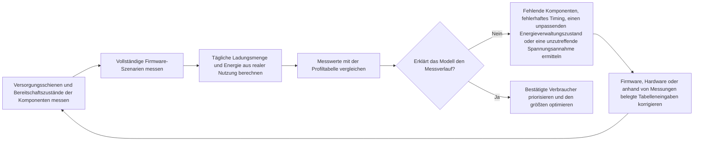

# Energieverbrauch messen und validieren { #power-measurement-and-validation }

Eine Schätzung der Akkulaufzeit ist erst belastbar, wenn ihre Annahmen durch Messungen an der realen Hardware bestätigt werden. Nutzen Sie diese Seite zusammen mit der [Energiesparendes Design im Überblick](overview.md) und dem Beispiel zur [Stromverbrauchsanalyse einer Smartwatch](smartwatch-power-profiling.md). Messen Sie zunächst die einzelnen Komponenten, prüfen Sie anschließend vollständige Firmware-Szenarien und gleichen Sie das Tagesnutzungsmodell mit den Messwerten ab. Optimiert wird danach der größte nachgewiesene Energieverbraucher.

## Energie statt nur Stromstärke messen { #measure-energy-not-current-alone }

Die Stromstärke allein beschreibt den Energieverbrauch nicht vollständig. Erfassen Sie die Spannung am Prüfling (DUT, `V_DUT`) zeitgleich mit dem Stromverlauf, damit sich neben der transportierten Ladung auch die Momentanleistung und die Energie berechnen lassen:

```text
power_W(t) = voltage_V(t) x current_A(t)
energy_Wh = integral(power_W(t) dt) / 3600
energy_mWh = energy_Wh x 1000
charge_mAh = integral(current_mA(t) dt) / 3600
```

Dabei wird `t` in Sekunden angegeben. Der Faktor `3600` rechnet Sekunden in Stunden um; verwenden Sie für die Leistungsberechnung Strom in A und für die Ladungsberechnung Strom in mA.

Das Energieintegral wird in Wh angegeben. Multiplizieren Sie den Wert mit 1000, bevor Sie ihn zu einem in mWh geführten Profil addieren. Ladung (mAh) und Energie (mWh) sind unterschiedliche Größen und nicht austauschbar.

Bleibt die Versorgungsspannung stabil, protokollieren Sie den gemessenen Wert von `V_DUT` für den jeweiligen Messlauf und werten Sie ihn zusammen mit dem Stromverlauf aus. Ändert sich die Spannung während des Tests, erfassen Sie sie auf derselben Zeitbasis wie den Strom oder nehmen Sie genügend synchronisierte Messpunkte auf, um eine verlässliche mittlere Leistung zu berechnen. Ein Vergleich allein anhand von mAh kann reale Energieunterschiede verschleiern, wenn Versorgungsspannung, Arbeitspunkt des Reglers oder Akkuzustand zwischen den Messläufen variieren.

## Messaufbau und Referenzbedingungen festlegen { #set-up-the-measurement-baseline }

Verwenden Sie das [Power Profiler Kit II (PPK2)](https://docs.nordicsemi.com/r/bundle/ug_ppk2/page/ug/ppk/ppk_user_guide_intro.html) von Nordic als Referenzgerät für Strommessungen. Im Source-Meter-Modus versorgt es den Prüfling; im Ampere-Meter-Modus wird das PPK2 zur Strommessung zwischen Prüfling und externer Stromversorgung in Reihe geschaltet. Behandeln Sie im Source-Meter-Modus die eingestellte Ausgangsspannung als kontrollierte Prüfbedingung. Messen und protokollieren Sie im Ampere-Meter-Modus die externe Versorgungsspannung direkt am Prüfling. Halten Sie in beiden Fällen die tatsächlich anliegende Spannung fest, nicht nur den Nennwert des Akkus oder die Einstellung des Labornetzteils.

Das PPK2 liefert den Stromverlauf, die kumulierte Ladung und exportierbare Messdaten. Der Logikanschluss bietet die Digitaleingänge D0–D7 sowie VCC- und GND-Anschlüsse für den Prüfling. Verbinden Sie VCC und GND mit der Logikversorgung und der gemeinsamen Masse des Prüflings und schließen Sie die GPIO-Marker an D0–D7 an. Die VCC des Logikanschlusses muss im von Nordic angegebenen Bereich von 1,65–5,5 V liegen; prüfen Sie außerdem, ob die Pegel der Markersignale kompatibel sind. Die Digitaleingänge werden mit 100 kHz abgetastet und haben eine typische Bandbreite von 50 kHz. Sehr kurze Phasen lassen sich daher möglicherweise nicht zuverlässig auflösen. Weitere Angaben finden Sie in der Nordic-Dokumentation zu [Anschlüssen](https://docs.nordicsemi.com/r/bundle/ug_ppk2/page/ug/ppk/ppk_user_guide_connectors.html), [Versorgungsspezifikationen](https://docs.nordicsemi.com/r/bundle/ug_ppk2/page/ug/ppk/ppk_power_supply_specs.html) und [Auflösung der Digitaleingänge](https://docs.nordicsemi.com/r/bundle/ug_ppk2/page/ug/ppk/digital_input_resolution.html). Setzen Sie GPIO-Marker für wichtige Abläufe wie Aufwachen, Display-Aktualisierung, Funkübertragung, Sensorabtastung und Rückkehr in den Schlafmodus. Der offizielle [PPK2-Benutzerleitfaden](https://docs.nordicsemi.com/r/bundle/ug_ppk2/) beschreibt die unterstützten Betriebsarten und Anschlussbedingungen.

Lassen Sie den USB-Daten-/Stromversorgungsanschluss des PPK2 während des Betriebs angeschlossen, wie von Nordic vorgeschrieben. Die zusätzliche USB-Versorgung für höhere Lasten im Source-Meter-Modus ist davon getrennt und wird weiter unten beschrieben.

Prüfen Sie vor dem Anschließen des Prüflings, ob der gewählte PPK2-Modus dessen Spannung und Spitzenstrom unterstützt. Nordic gibt für den Prüfling einen Spannungsbereich von 0,8–5,0 V an. Der zulässige Dauerstrom beträgt im Ampere-Meter-Modus 1 A; im Source-Meter-Modus liegt der maximale Prüflingsstrom bei 600 mA. Zieht der Prüfling im Source-Meter-Modus mehr als 400 mA, empfiehlt Nordic eine zusätzliche, für mindestens 1 A ausgelegte USB-Versorgung für das PPK2. Einzelheiten finden Sie in der Nordic-Spezifikation zum [maximal zulässigen Prüflingsstrom](https://docs.nordicsemi.com/r/bundle/ug_ppk2/page/ug/ppk/ppk_max_dut_current.html) und in den [Hinweisen zur Stromversorgung](https://docs.nordicsemi.com/r/bundle/ug_ppk2/page/ug/ppk/ppk_power_supply.html). Dies sind Grenzen des Messgeräts, keine empfohlenen Betriebswerte des Produkts. Verwenden Sie für Messungen außerhalb des unterstützten Bereichs passend ausgelegte Messgeräte.

<div align="center"><em>Tabelle: Für jeden Messlauf zu protokollierende Angaben</em></div>

<div align="center" markdown>

| Aufzeichnung | Warum sie benötigt wird |
|:-------|:-----------------|
| Test-ID, Board-Revision, bestückte Bauteile und Firmware-Revision | Macht die Ergebnisse reproduzierbar und vergleichbar. |
| `V_DUT`: Sollwert, Messwerte zu Beginn und Ende sowie Schwankungen während der Messung | Ermöglicht eine belastbare Berechnung von Leistung und Energie. |
| Stromverlauf, mittlerer Strom und Spitzenstrom, mittlere Leistung, Ladung (mAh), Energie (mWh) und Messdauer | Trennt kurze Stromspitzen vom anhaltenden Verbrauch und hält die Leistung und Energie der Messung fest. |
| Temperatur, Akkuzustand oder Labornetzteil-Einstellung sowie Funkumgebung | Verhindert, dass Änderungen der Umgebungsbedingungen fälschlich als Firmware-Verbesserungen gelten. |
| Aktivierte Peripherie, Taktkonfiguration, Energieverwaltungszustand und Weckquellen | Erklärt, warum das Gerät den vorgesehenen Energiesparzustand erreicht hat oder nicht. |
| Firmware-Marker und Auslösebedingungen | Ordnet den Energieverbrauch einem konkreten Ablauf statt einem schwer interpretierbaren Kurvenabschnitt zu. |

</div>

## Jede Komponente vor Gesamtsystemtests charakterisieren { #characterize-each-component-before-full-system-tests }

Messen Sie die einzelnen Komponenten zunächst an einer separat messbaren Versorgungsschiene oder mit einem geeigneten Prüfaufbau, bevor Sie die Gesamtmessung der Platine auswerten. Ziel ist kein weiterer Katalogwert, sondern die Frage, welche Betriebsarten, Lasten und Firmware-Einstellungen den Energieverbrauch der jeweiligen Komponente im realen Produkt bestimmen.

<div align="center"><em>Tabelle: Plan zur Charakterisierung auf Komponentenebene</em></div>

<div align="center" markdown>

| Komponente | Mindestens messen | Im Modell erfassen |
|:----------|:-------------------|:--------------------|
| MCU | Aktive Verarbeitung, Leerlauf (Idle), alle vorgesehenen Schlafmodi sowie Dauer des Aufwachens und der Taktübergänge | Strom und Dauer für jeden Firmware-Zustand, unerwartete Aufwachvorgänge und Ursachen, die den Energiesparmodus verhindern. |
| Externer PSRAM | Bereitschaft oder Datenerhalt, Lese- und Schreibzugriffe, Burst-Übertragungen und gegebenenfalls Refresh-Verhalten | Stromaufnahme der Versorgungsschiene je Zugriffsmuster und die jeweilige Dauer. |
| Externer Flash-Speicher | Deep Power-Down oder Bereitschaft, Lese- und Schreibzugriffe, Löschvorgänge und Aufwachlatenz | Energie je Zugriff oder Vorgang sowie Stromaufnahme im Leerlauf. |
| Jeder externe Sensor | Alle verwendeten Betriebsarten, Ausgabedatenrate, FIFO- oder Interrupt-Konfiguration und Tastverhältnis | Energie je Messwert oder Zeitintervall; bei einer Szenariomessung auch den Verarbeitungsaufwand des MCU einbeziehen. |
| Haptikmotor und Treiber | Anlauf, Amplitude, Muster, Dauer sowie Brems- oder Auslaufverhalten | Energie je Haptikmuster, nicht nur den Spitzenstrom des Motors. |
| Audio-Codec und Leistungsverstärker | Aus, Bereitschaft, Wiedergabe oder Aufnahme, Ausgangspegel und tatsächliche Lautsprecher- oder Lastimpedanz | Energie je Audiositzung sowie Leckstrom des gesamten Audiopfads im ausgeschalteten Zustand. |
| Display, Touch, Funk, PMIC und weitere Verbraucher | Relevante aktive, inaktive und Datenerhaltungszustände | Separate Stromannahmen oder explizite `Other`-Einträge mit klar angegebener Messgrenze. |

</div>

Wenn es um den Energieverbrauch des gesamten Produkts geht, messen Sie am Batterieeingang. Messungen einzelner Versorgungsschienen sind für die Fehlersuche weiterhin wichtig. Rechnen Sie sie jedoch vor der Übernahme in das Akkulaufzeitmodell mithilfe des gemessenen Wirkungsgrads und Ruhestroms der Regler auf die Batterieseite um. Die Summe der Schienenströme ist nicht mit dem Strom am Batterieeingang gleichzusetzen.

## Durch Treiber gesteuerte Energiesparzustände überprüfen { #verify-driver-controlled-power-states }

Eine Komponente erreicht den spezifizierten Energiesparzustand nur, wenn ihr Treiber die dokumentierten Einstellungen und Abläufe korrekt umsetzt. Auch ein funktionierender Treiber kann unnötig Strom verbrauchen, etwa wenn er ein Enable-Signal aktiv lässt, den falschen Bereitschaftsbefehl sendet, Takt oder Bus nicht abschaltet oder Versorgungs-, Reset- und Schnittstellensignale in der falschen Reihenfolge schaltet. Bilden Sie für jeden vorgesehenen Zustand die Bedingungen aus dem Datenblatt in der Firmware nach. Prüfen Sie anschließend, ob die gemessenen Werte für Strom, Spannung, Ladung und Energie der geltenden Spezifikation oder einem für das Produkt validierten Betriebspunkt entsprechen.

<div align="center"><em>Tabelle: Treibergesteuerte Energiesparzustände überprüfen</em></div>

<div align="center" markdown>

| Kontrollpunkt | Anforderung an den Treiber | Nachweis durch Messung |
|:-------------|:-------------------|:---------------------|
| Modusregister und Energiesparbefehle | Dokumentierte Einstellungen für Bereitschaft, Abschaltung, Datenerhalt, Datenrate und Interrupts anwenden; den Status auslesen, wenn die Komponente dies unterstützt. | Strom und Energie entsprechen dem gewählten Modus; die tatsächlich verwendete Konfiguration ist im Prüfprotokoll festgehalten. |
| Zuständigkeit für PM-Sperren und -Einschränkungen | Legen Sie fest, ob der Komponententreiber oder ein übergeordneter Dienst jede PM-Sperre bzw. -Einschränkung verwaltet. Halten Sie sie nur, solange die geschützte Ressource benötigt wird, und geben Sie sie nach einem sicheren Übergang der Komponente in den Leerlauf auf allen Erfolgs-, Fehler- und vorzeitigen Rückkehrpfaden frei. | Messprotokolle belegen, dass die Sperre den erforderlichen Zeitraum abdeckt, nicht vorzeitig freigegeben wird und nach Abschluss oder Fehler nicht gehalten bleibt und dadurch den Schlafmodus blockiert. |
| Schaltfolge von Versorgung, Enable, Reset und Takt | Die erforderliche Reihenfolge und Zeitvorgaben beim Ein- und Ausschalten sowie während des Betriebs einhalten. | GPIO-Marker und Stromverlauf zeigen keine unbeabsichtigten aktiven Phasen oder Stromspitzen. |
| SPI, I2C, UART und weitere Steuerbusse | Unnötige Kommunikation beenden und Chip-Select-, Takt-, Daten- und Interrupt-Leitungen in den vorgeschriebenen inaktiven Zustand versetzen. | Zwischen Übertragungen bleibt die Komponente im vorgesehenen Energiesparzustand. |
| GPIO-Pulls und hochohmiger Zustand | Jeden Steuerpin gezielt als Ausgang High/Low, Eingang mit geeignetem Pull-up/Pull-down oder – nur wenn die externe Schaltung den Pegel festlegt – hochohmig konfigurieren. | Strom bei versorgtem und unversorgtem Gegenüber messen; auch Reset- und Standardzustände prüfen. |
| Verbindungen zwischen Versorgungsdomänen | Eine unversorgte Komponente niemals über einen Steuer- oder Datenpin ansteuern, außer die Hardware unterstützt diesen Pfad ausdrücklich. | Bei abgeschalteter Versorgung auf einer Schnittstellenseite treten weder Rückspeisung noch Leckstrom auf. |
| Fehler- und Wiederanlaufpfade | Nach Timeouts, fehlgeschlagenen Übertragungen, Aufwecken und Firmware-Reset den korrekten Zustand wiederherstellen. | Langzeitmessungen zeigen keinen anhaltenden oder zunehmend erhöhten Strom durch unvollständige Fehlerbereinigung. |

</div>

Gültige Logikpegel schließen Leckströme nicht aus. Interne Pull-Widerstände, widersprüchliche Pull-Konfigurationen, Vorgabewerte nach einem Reset, ESD-Pfade und Bus-Pull-ups können Leck- oder Rückspeisepfade bilden, obwohl beide Bausteine scheinbar gültige Logikpegel führen. Messen Sie den Schnittstellenstrom, wenn beide Seiten versorgt sind, wenn eine Seite unversorgt ist und während des Übergangs zwischen diesen Zuständen. Weicht das Ergebnis von der Erwartung ab, prüfen Sie zuerst, ob eine falsche Treiberkonfiguration oder Schaltfolge oder ein Leckpfad auf der Platine die Ursache ist. Ändern Sie nicht vorschnell die Werte in der Energieprofiltabelle.

## Firmware-Szenarien validieren { #validate-firmware-scenarios }

Nachdem das Verhalten der einzelnen Komponenten bekannt ist, messen Sie vollständige Firmware-Szenarien aus der Nutzungsperspektive. Ein Szenario umfasst die gleichzeitig aktiven Komponenten, Energieverwaltungszustände, Aufwachvorgänge und Zeitabläufe. Beginnen Sie bei einer Smartwatch mit den Szenarien aus der [Stromverbrauchsanalyse einer Smartwatch](smartwatch-power-profiling.md): Bereitschaft bei ausgeschaltetem Display, Benachrichtigungen, Anrufmeldungen, Displayaktivierung beim Anheben des Handgelenks, automatische Herzfrequenzmessung, manuelle SpO2-Messung, Trainingsaufzeichnung, Alarme, Schlafüberwachung und App-Synchronisierung. Sind NFC, Bluetooth-Telefonie oder AOD aktiviert, ergänzen Sie diese als eigene Szenarien.

<div align="center"><em>Tabelle: Messwerte zur Validierung eines Szenarios</em></div>

<div align="center" markdown>

| Je Szenario erfassen | Prüfen | Ins Profil übernehmen |
|:------------------|:-------|:---------------------------|
| Start- und Endmarker | Der Verlauf umfasst den gesamten Ablauf vom Aufwachen bis zur Rückkehr in den Schlafmodus. | Anfang, Ende und Dauer des Szenarios. |
| Aktivität der Komponenten und Versorgungsschienen | Nur die erwarteten Komponenten sind aktiv. | Annahmen zu den Komponenten und Zuordnung zu `Other`. |
| Energieverwaltungszustand nach Abschluss der Aufgabe | Das System erreicht den vorgesehenen Schlafzustand. | Leerlauf- oder Bereitschaftsstrom und angenommene Restdauer. |
| Strom, `V_DUT`, Ladung (mAh) und Energie (mWh) je Ereignis | Die Messung bildet den Verbrauch auf der Batterieseite ab. | Ladung (mAh) und Energie (mWh) je Ereignis. |
| Produktverhalten | Erforderliche Reaktionszeit, HF-Zuverlässigkeit, Audioqualität und Nutzererlebnis bleiben erhalten. | Ein nutzbarer Betriebspunkt statt einer für das Produkt ungeeigneten Energiespareinstellung. |

</div>

Teilen Sie den Stromverlauf mithilfe von Firmware-gesteuerten GPIO-Markern in Phasen auf. Eine Messung beim Anheben des Handgelenks kann beispielsweise Gestenerkennung, MCU-Aufwachen, Displayaktivierung und -darstellung, Einschaltdauer des Displays, Abdunkeln oder Ausschalten sowie die Rückkehr in den Schlafmodus sichtbar machen. So wird aus einem einzelnen Mittelwert eine Folge konkreter Vorgänge, die sich gezielt durch Firmware- und Hardwareteams optimieren lässt.

## Das Tagesnutzungsprofil abgleichen { #reconcile-the-daily-use-profile }

Die abschließende Prüfung darf nicht aus einer Sammlung isolierter Best-Case-Messungen bestehen. Führen Sie anhand der gemessenen Energie je Szenario und dessen tatsächlicher Häufigkeit einen repräsentativen Nutzungstag durch oder rekonstruieren Sie ihn. Vergleichen Sie die Messwerte sowohl für die Ladung als auch für die Energie mit der Profiltabelle:

```text
daily_charge_mAh = sum(occurrences_per_day x charge_per_occurrence_mAh)
daily_energy_mWh = sum(occurrences_per_day x energy_per_occurrence_mWh)
```

<div align="center"><em>Diagramm: Mess- und Abgleichschleife für das Energieprofil</em></div>



Weichen Messung und Modell voneinander ab, verändern Sie die Tabelle nicht einfach, um eine Übereinstimmung zu erzwingen. Suchen Sie nach einer überprüfbaren Ursache: einer nicht erfassten Last, einem falschen Tastverhältnis, einer unzutreffenden Annahme zu Reglerverlusten, einem unbeabsichtigten Aufwachen, einer aktiv gebliebenen Komponente oder einer Messgrenze, die nicht zum Modell passt. Aktualisieren Sie die Tabelle erst, wenn die Ursache durch korrigierte Hardware- oder Firmware-Messungen belegt ist. Legen Sie vor der Freigabe ein ausdrückliches, produktspezifisches Toleranzkriterium fest. Der zulässige Fehler hängt von der angegebenen Akkulaufzeit, dem Betriebsbereich und der verbleibenden Unsicherheit ab.

<div align="center"><em>Tabelle: Abweichungen zwischen Profil und Messung einordnen</em></div>

<div align="center" markdown>

| Abweichung | Mögliche Ursache | Nächster Prüfschritt |
|:---------|:-------------|:-----------|
| Messwert einer Komponente liegt über der Erwartung | Falscher Betriebsmodus, Leckstrom auf der Versorgungsschiene, Reglerverluste oder zusätzliche Last durch den Prüfaufbau | Versorgungsschiene isolieren sowie Moduspins, Spannung und Bestückung der Platine prüfen. |
| Szenarioenergie übersteigt die Summe der Komponentenwerte | Zusätzliche Aufwachvorgänge, zu lange Display- oder Funkaktivität, Hintergrundverarbeitung oder überlappende Lasten | Firmware-Marker ergänzen und die Zustände der Komponenten während des gesamten Szenarios vergleichen. |
| Tagesprofil übersteigt die Summe der Szenarien | Nutzungshäufigkeit, Leerlaufzeit bei bestehender Verbindung, deaktivierte Funktion oder Hintergrundaufgabe falsch angesetzt | Ereigniszahlen, Timer, Funkzeitplan und angenommene verbleibende Bereitschaftszeit überprüfen. |
| Modell und Messung stimmen nur bei einer Konfiguration überein | Abweichende Spannung, Temperatur, Funkumgebung, Akkuzustand oder Firmware-Version | Dieselben Szenarien über den gesamten vorgesehenen Betriebsbereich erneut messen. |

</div>

## Die größten nachgewiesenen Energieverbraucher optimieren { #optimize-the-largest-verified-contributors }

Nutzen Sie das abgeglichene Profil, um die wirksamsten Optimierungen zu priorisieren. Unterscheiden Sie dabei zwei Fragen: Welche Komponente verbraucht am meisten Energie, und welches Nutzungsszenario trägt am stärksten zum Gesamtverbrauch des Produkts bei? Die Antworten können unterschiedlich sein. Das Display kann die verbrauchsstärkste Komponente sein, während häufiges Einschalten beim Anheben des Handgelenks das maßgebliche Szenario darstellt.

1. **Firmware zuerst optimieren, wenn das Verhalten den Verbrauch verursacht.** Vermeiden Sie unnötige Aufwachvorgänge und Abfragen, bündeln Sie Aufgaben, verkürzen Sie die Display-Einschaltdauer, vermeiden Sie überflüssige Neuzeichnungen, heben Sie Sperren der Energieverwaltung zeitnah auf und reduzieren Sie das Tastverhältnis von Sensoren oder Funk, ohne die Produktanforderungen zu verletzen.
2. **Hardware optimieren, wenn eine Komponente nachweislich begrenzt.** Wählen Sie gegebenenfalls sparsamere Sensoren, Speicher, Regler, Codecs, Verstärker, Displays oder Haptikkomponenten. Vergleichen Sie die gemessene Energie im vorgesehenen Betriebsmodus, nicht einen hervorgehobenen Datenblattwert aus einem anderen Betriebszustand.
3. **Geänderte Komponente und Szenario erneut messen.** Ein Austausch kann den größten Verbraucher verlagern, Aufwachzeiten verändern oder einen anderen Arbeitspunkt des Reglers erfordern.
4. **Profil aktualisieren und den Tagesvergleich wiederholen.** Die Änderung gilt erst dann als bestätigt, wenn sich sowohl der Szenarioverlauf als auch das Energiebudget des Gesamtprodukts verbessern.

## Nachweise für die Freigabe { #release-evidence }

Bevor Sie Angaben zur Akkulaufzeit veröffentlichen, archivieren Sie die Messdaten der Komponenten und Szenarien, das Tagesnutzungsprofil, die Spannungsaufzeichnungen, Firmware-Marker sowie die versionierten Annahmen, die diese Daten verbinden. Wiederholen Sie die betroffenen Schritte, wenn sich Firmware-Zeitplanung, Displaysteuerung, Funkparameter, Sensorabtastrate, Komponenten der Stromversorgung oder Annahmen zur Produktnutzung ändern.

!!! note "Automatisch erstellter Inhalt"
    Diese Seite wurde ohne ein eigenes Quelldokument aus mehreren Referenzen zusammengestellt. Prüfen Sie technische Aussagen vor der Verwendung anhand der offiziellen SiFli-Dokumentation.
