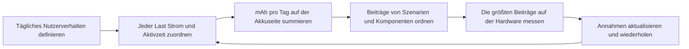
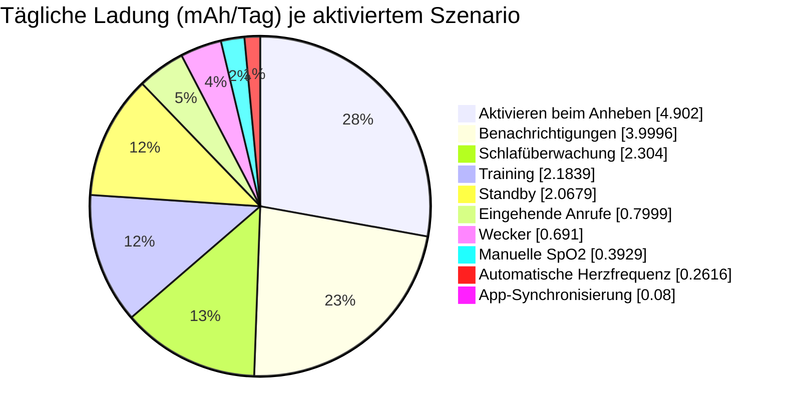
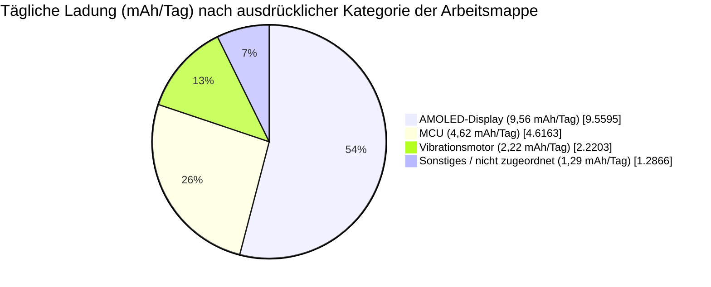
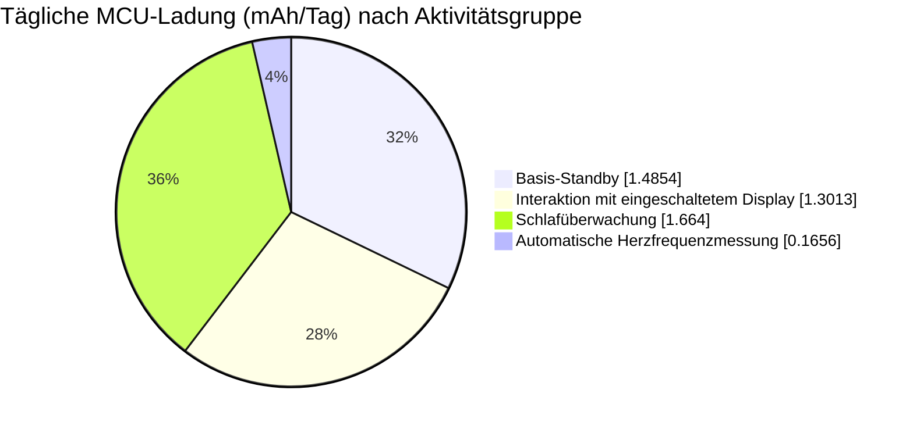

# Stromverbrauchsanalyse einer Smartwatch { #power-profiling-a-smartwatch }

Die Stromverbrauchsanalyse macht aus der erwarteten täglichen Nutzung eine Schätzung der Akkulaufzeit und, wichtiger noch, eine Rangliste der Lasten, die sich zu optimieren lohnen. Als durchgerechnetes Beispiel dient die bereitgestellte [englische Arbeitsmappe mit den Leistungsprofildaten einer Smartwatch](assets/smartwatch-power-profile-data.xlsx). Der Artikel zeigt, wie sich Nutzerverhalten in mAh pro Tag umrechnen lässt, welche Lasten das Budget dominieren und wie aus einem Tabellenmodell ein Messplan wird.

!!! warning "Ein Modell, keine Gerätespezifikation"
    Die Ströme und Nutzungsannahmen in diesem Beispiel gehören zum bereitgestellten Modell. Sie sind keine Charakterisierungsdaten für ein bestimmtes SF32-Gerät, Display, einen Akku oder ein Uhrendesign. Ersetzen Sie sie durch Messwerte Ihrer Hardware, bevor Sie das Ergebnis für eine Aussage zur Akkulaufzeit eines Produkts verwenden.
    Die Arbeitsmappe enthält kein Messprotokoll und kennzeichnet daher keinen Eingabewert als Hardware-Messung. Das Ergebnis von 13,15 Tagen ist eine Modellschätzung und keine beobachtete Laufzeit.

Nutzen Sie diese Seite zusammen mit der [Low-Power-Übersicht](overview.md) für Architektur und Firmware-Hinweise und mit [Leistungsmessung und Validierung](measurement-and-validation.md) für den Messablauf, der das Modell validiert.

## Überblick über das Smartwatch-System { #smartwatch-system-overview }

Legen Sie zunächst die Modellgrenze fest. Diese Arbeitsmappe bildet eine akkubetriebene Smartwatch mit MCU, AMOLED-Display, Vibrationsmotor und einem nicht zugeordneten Lastbereich `Other` ab. Sie nennt weder Panelgröße, Auflösung, Helligkeitseinstellung, Funkarchitektur noch einzelne Sensoren. Betrachten Sie die unten genannten Display-Ströme als Eingaben der Arbeitsmappe und nicht als gemessene Arbeitspunkte oder Spezifikationen eines bestimmten Panels. Betrachten Sie `Other` als Modellgrenze und nicht als ein einzelnes physisches Bauteil.

<div align="center"><em>Tabelle: Smartwatch-System und Modelleingaben</em></div>

<div align="center" markdown>

| Posten | Wert in der Arbeitsmappe | Warum er wichtig ist |
|:-----|----------------------:|:---------------|
| Stromaufnahme des AMOLED-Displays im Normalbetrieb | 15 mA | Wird für Benachrichtigungen, Hinweise auf eingehende Anrufe und die Funktion „Aktivieren beim Anheben“ verwendet. |
| Stromaufnahme des AMOLED-Displays im AOD-Modus | 2 mA | Im Modell definiert, aber das zugehörige AOD-Szenario ist in dieser Basis deaktiviert. |
| Nennkapazität des Akkus | 250 mAh | Die Ausgangskapazität vor dem Abschlag des Modells. |
| Kapazitätsabschlag durch Akkualterung | 7 % | Verringert die verfügbare Kapazität auf 232,5 mAh. |
| Nennspannung des Akkus | 3,87 V | Wird vom Hilfswert der Arbeitsmappe zur Spannungsnormierung verwendet. |

</div>

## Leistungsaufnahme je Szenario { #power-consumption-by-scenario }

Ein Szenario bildet ein vollständiges Nutzer- oder Systemereignis ab, nicht nur den Betrieb einer einzelnen Komponente. Eine Nachrichtenbenachrichtigung kann die MCU wecken, das AMOLED-Display einschalten, den Vibrationsmotor ansteuern und Hintergrundlasten aktiv halten. In der Quellmatrix bezieht sich jede Zeile `Display` auf das AMOLED-Display. Die Matrix hält die Komponentenzeilen jedes Szenarios zusammen und behält die berechneten Tageswerte zur Nachvollziehbarkeit bei. Die Häufigkeiten und Dauern hinter diesen Werten stehen weiter unten im Artikel im Tagesnutzungsprofil.

<div align="center"><em>Tabelle: Vollständiges Leistungsmodell auf Komponentenebene</em></div>

<div align="center" markdown>

| Szenario | Komponente | Spannung | Strom | Spannungsfaktor* | Tägliche Ladung | Anteil an der täglichen Ladung |
|:---------|:----------|--------:|--------:|----------------:|-------------:|----------------------:|
| Basis-Standby | MCU | 3,3 V | 0,102 mA | 85,27 % | 1,4854 mAh | 8,40 % |
| Basis-Standby | Display | 3,3 V | 0 mA | 85,27 % | 0 mAh | 0,00 % |
| Basis-Standby | Vibrationsmotor | 3,3 V | 0 mA | 85,27 % | 0 mAh | 0,00 % |
| Basis-Standby | Sonstiges | 3,87 V | 0,04 mA | 100,00 % | 0,5825 mAh | 3,29 % |
| Nachrichtenbenachrichtigung | MCU | 3,3 V | 2,507 mA | 85,27 % | 0,3482 mAh | 1,97 % |
| Nachrichtenbenachrichtigung | Display | 3,3 V | 15 mA | 85,27 % | 2,0833 mAh | 11,78 % |
| Nachrichtenbenachrichtigung | Vibrationsmotor | 3,3 V | 11,25 mA | 85,27 % | 1,5625 mAh | 8,84 % |
| Nachrichtenbenachrichtigung | Sonstiges | 3,87 V | 0,04 mA | 100,00 % | 0,0056 mAh | 0,03 % |
| Hinweis auf eingehenden Anruf | MCU | 3,3 V | 2,507 mA | 85,27 % | 0,0696 mAh | 0,39 % |
| Hinweis auf eingehenden Anruf | Display | 3,3 V | 15 mA | 85,27 % | 0,4167 mAh | 2,36 % |
| Hinweis auf eingehenden Anruf | Vibrationsmotor | 3,3 V | 11,25 mA | 85,27 % | 0,3125 mAh | 1,77 % |
| Hinweis auf eingehenden Anruf | Sonstiges | 3,87 V | 0,04 mA | 100,00 % | 0,0011 mAh | 0,01 % |
| Aktivieren beim Anheben | MCU | 3,3 V | 2,607 mA | 85,27 % | 0,7242 mAh | 4,10 % |
| Aktivieren beim Anheben | Display | 3,3 V | 15 mA | 85,27 % | 4,1667 mAh | 23,56 % |
| Aktivieren beim Anheben | Vibrationsmotor | 3,3 V | 0 mA | 85,27 % | 0 mAh | 0,00 % |
| Aktivieren beim Anheben | Sonstiges | 3,87 V | 0,04 mA | 100,00 % | 0,0111 mAh | 0,06 % |
| Automatische Herzfrequenzmessung | MCU | 3,3 V | 0,207 mA | 85,27 % | 0,1656 mAh | 0,94 % |
| Automatische Herzfrequenzmessung | Display | 3,3 V | 0 mA | 85,27 % | 0 mAh | 0,00 % |
| Automatische Herzfrequenzmessung | Vibrationsmotor | 3,3 V | 0,08 mA | 85,27 % | 0,0640 mAh | 0,36 % |
| Automatische Herzfrequenzmessung | Sonstiges | 3,87 V | 0,04 mA | 100,00 % | 0,0320 mAh | 0,18 % |
| Manuelle SpO2-Messung | MCU | 3,3 V | 2,6 mA | 85,27 % | 0,0578 mAh | 0,33 % |
| Manuelle SpO2-Messung | Display | 3,3 V | 15 mA | 85,27 % | 0,3333 mAh | 1,89 % |
| Manuelle SpO2-Messung | Vibrationsmotor | 3,3 V | 0 mA | 85,27 % | 0 mAh | 0,00 % |
| Manuelle SpO2-Messung | Sonstiges | 3,87 V | 0,08 mA | 100,00 % | 0,0018 mAh | 0,01 % |
| Trainingsaufzeichnung | MCU | 3,3 V | 0,207 mA | 85,27 % | 0,0296 mAh | 0,17 % |
| Trainingsaufzeichnung | Display | 3,3 V | 15 mA | 85,27 % | 2,1429 mAh | 12,12 % |
| Trainingsaufzeichnung | Vibrationsmotor | 3,3 V | 0 mA | 85,27 % | 0 mAh | 0,00 % |
| Trainingsaufzeichnung | Sonstiges | 3,87 V | 0,08 mA | 100,00 % | 0,0114 mAh | 0,06 % |
| Wecker-Vibration | MCU | 3,3 V | 2,6 mA | 85,27 % | 0,0650 mAh | 0,37 % |
| Wecker-Vibration | Display | 3,3 V | 15 mA | 85,27 % | 0,3750 mAh | 2,12 % |
| Wecker-Vibration | Vibrationsmotor | 3,3 V | 10 mA | 85,27 % | 0,2500 mAh | 1,41 % |
| Wecker-Vibration | Sonstiges | 3,87 V | 0,04 mA | 100,00 % | 0,0010 mAh | 0,01 % |
| Schlafüberwachung | MCU | 3,3 V | 0,208 mA | 85,27 % | 1,6640 mAh | 9,41 % |
| Schlafüberwachung | Display | 3,3 V | 0 mA | 85,27 % | 0 mAh | 0,00 % |
| Schlafüberwachung | Vibrationsmotor | 3,3 V | 0 mA | 85,27 % | 0 mAh | 0,00 % |
| Schlafüberwachung | Sonstiges | 3,87 V | 0,08 mA | 100,00 % | 0,6400 mAh | 3,62 % |
| Synchronisierung der App-Daten | MCU | 3,3 V | 2,5 mA | 85,27 % | 0,0069 mAh | 0,04 % |
| Synchronisierung der App-Daten | Display | 3,3 V | 15 mA | 85,27 % | 0,0417 mAh | 0,24 % |
| Synchronisierung der App-Daten | Vibrationsmotor | 3,3 V | 11,25 mA | 85,27 % | 0,0313 mAh | 0,18 % |
| Synchronisierung der App-Daten | Sonstiges | 3,87 V | 0,04 mA | 100,00 % | 0,0001 mAh | 0,0006 % |
| NFC-Kartentransaktion | MCU | 3,3 V | 2,5 mA | 85,27 % | 0 mAh | 0,00 % |
| NFC-Kartentransaktion | Display | 3,3 V | 15 mA | 85,27 % | 0 mAh | 0,00 % |
| NFC-Kartentransaktion | Vibrationsmotor | 3,3 V | 11,25 mA | 85,27 % | 0 mAh | 0,00 % |
| NFC-Kartentransaktion | Sonstiges | 3,87 V | 0,04 mA | 100,00 % | 0 mAh | 0,00 % |
| Bluetooth-Anruf | MCU | 3,3 V | 10 mA | 85,27 % | 0 mAh | 0,00 % |
| Bluetooth-Anruf | Display | 3,3 V | 15 mA | 85,27 % | 0 mAh | 0,00 % |
| Bluetooth-Anruf | Vibrationsmotor | 3,3 V | 11,25 mA | 85,27 % | 0 mAh | 0,00 % |
| Bluetooth-Anruf | Sonstiges | 3,87 V | 0,04 mA | 100,00 % | 0 mAh | 0,00 % |
| AOD, MCU-Aktualisierung einmal pro Minute | MCU | 3,3 V | 2,5 mA | 85,27 % | 0 mAh | 0,00 % |
| AOD, MCU-Aktualisierung einmal pro Minute | Display | 3,3 V | 0 mA | 85,27 % | 0 mAh | 0,00 % |
| AOD, MCU-Aktualisierung einmal pro Minute | Vibrationsmotor | 3,3 V | 0 mA | 85,27 % | 0 mAh | 0,00 % |
| AOD, MCU-Aktualisierung einmal pro Minute | Sonstiges | 3,87 V | 0,08 mA | 100,00 % | 0 mAh | 0,00 % |
| AOD, Display ein | MCU | 3,3 V | 0 mA | 85,27 % | 0 mAh | 0,00 % |
| AOD, Display ein | Display | 3,3 V | 2 mA | 85,27 % | 0 mAh | 0,00 % |
| AOD, Display ein | Vibrationsmotor | 3,3 V | 0 mA | 85,27 % | 0 mAh | 0,00 % |
| AOD, Display ein | Sonstiges | 3,87 V | 0,08 mA | 100,00 % | 0 mAh | 0,00 % |

</div>

\*Die Arbeitsmappe bezeichnet diese Spalte als „Wirkungsgrad der Leistungswandlung (%)“, aber ihre Formel ist nur ein Spannungsverhältnis und kein gemessener Reglerwirkungsgrad. Der Unterabschnitt „Annahme zur Wandlung in der Arbeitsmappe prüfen“ weiter unten erläutert die Folgen für die Akkulaufzeitschätzung. Die Werte für tägliche Ladung und Prozentanteile in dieser Tabelle sind aus der Arbeitsmappe gerundet; die genauen Formeln und Werte enthält die herunterladbare Datei. Legen Sie Prioritäten anhand der Ranglisten-Tabellen unten fest und kehren Sie zu dieser Matrix zurück, wenn Sie die Strom- oder Spannungsannahme hinter einem Beitrag prüfen müssen.

<div align="center"><em>Diagramm: Ablauf zur Analyse des Smartwatch-Stromverbrauchs</em></div>



### Ein Szenario in tägliche Ladung umrechnen { #convert-a-scenario-into-daily-charge }

Für eine Last, deren Strom bereits am Akku angegeben ist, ist die tägliche Ladung einfach:

```text
daily_charge_mAh = current_mA x active_time_seconds_per_day / 3600
```

Bei einer Last, die über einen Regler versorgt wird, berechnen Sie vor dem Zeitterm den Strom auf der Akkuseite:

```text
battery_current_mA = (load_voltage_V x load_current_mA) /
                     (battery_voltage_V x regulator_efficiency)
```

Verwenden Sie den gemessenen Reglerwirkungsgrad beim vorgesehenen Laststrom. Die Angabe des Spitzenwirkungsgrads eines Reglers ist für eine Uhr, die einen Großteil des Tages bei geringer Last verbringt, selten nützlich.

### Annahme zur Wandlung in der Arbeitsmappe prüfen { #check-the-workbooks-conversion-assumption }

Die Spalte „Wirkungsgrad der Leistungswandlung (%)“ der Arbeitsmappe wird als `load voltage / battery voltage` berechnet. Ihre nachfolgende Ladungsformel teilt durch diesen Hilfswert und dann durch die Akkuspannung, sodass sich die Spannungsterme aufheben. Die resultierende tägliche Ladung ist schlicht Laststrom mal Zeit: Sie setzt den Akkustrom dem Laststrom gleich, statt eine ideale Leistungswandlung zu modellieren. Das ähnelt einem Linearregler ohne Ruhestrom; für einen Schaltregler ist es kein allgemeines Modell.

Beispielsweise zieht eine 1-mA-Last bei 3,3 V aus einem Akku mit 3,87 V über einen idealen Wandler etwa 0,853 mA; die Arbeitsmappe setzt dagegen 1 mA an. Bei einem realen Wandler hängen die Werte von Wirkungsgrad und Ruhestrom ab. Allein anhand der Wandlungsannahme lässt sich daher nicht beurteilen, ob die Akkulaufzeitschätzung der Arbeitsmappe zu optimistisch oder zu konservativ ist. Die Szenario-Rangfolge eignet sich für eine erste Prüfung der angegebenen Strom- und Zeitannahmen, ersetzt aber kein belastbares Energiebudget. Für ein Produktionsbudget ersetzen Sie den Hilfswert durch den gemessenen Wirkungsgrad je Versorgungsschiene und Lastbereich. Berücksichtigen Sie den Ruhestrom, ohne ihn doppelt zu zählen, falls er bereits in der Messung enthalten ist. Erfassen Sie außerdem Verluste durch Akkuschutz und Ladepfad.

## Den Tagesverbrauch aus der Produktnutzung berechnen { #calculate-daily-consumption-from-product-usage }

Dasselbe Szenario kann je nach Produktnutzung vernachlässigbar oder dominant sein. Für die Beispielrechnung bildet die Arbeitsmappe einen repräsentativen Tagesablauf ab: Basis-Standby, Benachrichtigungen, Hinweise auf eingehende Anrufe, Aktivieren beim Anheben, Herzfrequenz- und SpO2-Messungen, Trainingsaufzeichnung, Wecker, Schlafüberwachung und App-Synchronisierung. NFC, Bluetooth-Telefonie und beide AOD-Szenarien sind auf null gesetzt und daher nicht im Ergebnis von 13,15 Tagen enthalten.

<div align="center"><em>Tabelle: Tagesnutzungsprofil des Produkts und Beiträge</em></div>

<div align="center" markdown>

| Szenario | Vorkommen pro Tag | Dauer je Vorkommen | Gesamtdauer pro Tag | Anteil an der täglichen Ladung | Status im Modell |
|:---------|--------------------:|------------------------:|-----------------------:|----------------------:|:----------------|
| Basis-Standby | 1 | Verbleibende Sekunden des Tages (`=G7`) | 52 425,7 s | 11,69 % | Aktiviert |
| Nachrichtenbenachrichtigung | 100 | 5 s | 500 s | 22,62 % | Aktiviert |
| Hinweis auf eingehenden Anruf | 10 | 10 s | 100 s | 4,52 % | Aktiviert |
| Aktivieren beim Anheben | 200 | 5 s | 1 000 s | 27,72 % | Aktiviert |
| Automatische Herzfrequenzmessung | 48 | 60 s | 2 880 s | 1,48 % | Aktiviert |
| Manuelle SpO2-Messung | 2 | 40 s | 80 s | 2,22 % | Aktiviert |
| Trainingsaufzeichnung | 1 | `3600 / 7` s | 514,3 s | 12,35 % | Aktiviert; eine Stunde pro Woche, auf den Tag gemittelt |
| Wecker-Vibration | 3 | 30 s | 90 s | 3,91 % | Aktiviert |
| Schlafüberwachung | 1 | `8 x 3600` s | 28 800 s | 13,03 % | Aktiviert |
| Synchronisierung der App-Daten | 20 | 0,5 s | 10 s | 0,45 % | Aktiviert |
| NFC-Kartentransaktion | 0 | 5 s | 0 s | 0,00 % | Deaktiviert |
| Bluetooth-Anruf | 0 | `2 x 60` s | 0 s | 0,00 % | Deaktiviert |
| AOD, MCU-Aktualisierung einmal pro Minute | 0 | 0,05 s | 0 s | 0,00 % | Deaktiviert |
| AOD, Display ein | 0 | `(24 - 8) x 3600` s | 0 s | 0,00 % | Deaktiviert |

</div>

Die leeren Szenariozellen in der Quellmatrix sind beabsichtigt: Auf jedes benannte Szenario folgen seine Lastzeilen für Display, Vibrationsmotor und `Other`. Diese Zeilen übernehmen Vorkommen und Dauer pro Tag aus der Szenariozeile darüber, sodass die Quelle jedes Szenario nur einmal benennt.

<div align="center"><em>Tabelle: Berechnetes Ergebnis der Tagesnutzung</em></div>

<div align="center" markdown>

| Ergebnis | Berechnung | Wert |
|:-------|:------------|------:|
| Nutzbare Akkukapazität | `250 mAh x (1 - 7%)` | 232,5 mAh |
| Modellierter Tagesverbrauch | Summe aller aktivierten Szenariolasten | 17,68 mAh/Tag |
| Durchschnittlicher Akkustrom | `17.68 mAh/day / 24 h` | 0,74 mA |
| Geschätzte Akkulaufzeit | `232.5 mAh / 17.68 mAh/day` | 13,15 Tage |

</div>

Die Szenario-Rangfolge des Modells ist aussagekräftiger als die endgültige Akkulaufzeit. Prüfen Sie die größten Beiträge zuerst auf konkretes Einsparpotenzial.

<div align="center"><em>Tabelle: Beiträge der aktivierten Szenarien im Smartwatch-Modell</em></div>

<div align="center" markdown>

| Szenario | Tägliche Ladung | Anteil an der täglichen Ladung | Angenommenes Tagesverhalten |
|:---------|------------:|----------------------:|:-----------------------|
| Aktivieren beim Anheben | 4,90 mAh | 27,72 % | 200 Ereignisse, je 5 s. |
| Nachrichtenbenachrichtigung | 4,00 mAh | 22,62 % | 100 Benachrichtigungen, je 5 s. |
| Schlafüberwachung | 2,30 mAh | 13,03 % | 8 h. |
| Trainingsaufzeichnung | 2,18 mAh | 12,35 % | 1 h pro Woche, auf den Tag gemittelt. |
| Basis-Standby | 2,07 mAh | 11,69 % | Verbleibende Zeit nach den aktivierten Aktivitäten. |
| Hinweis auf eingehenden Anruf | 0,80 mAh | 4,52 % | 10 Hinweise, je 10 s. |
| Wecker-Vibration | 0,69 mAh | 3,91 % | 3 Wecker, je 30 s. |
| Manuelle SpO2-Messung | 0,39 mAh | 2,22 % | 2 Messungen, je 40 s. |
| Automatische Herzfrequenzmessung | 0,26 mAh | 1,48 % | 48 Messungen, je 60 s. |
| Synchronisierung der App-Daten | 0,08 mAh | 0,45 % | 20 Übertragungen, je 0,5 s. |

</div>

<div align="center"><em>Diagramm: Beiträge der aktivierten Szenarien im Smartwatch-Modell</em></div>



Die ersten beiden Interaktionen mit eingeschaltetem Bildschirm machen etwa die Hälfte der modellierten täglichen Ladung aus. Das ist ein prüfbares Ergebnis und nicht bloß die generische Aussage, dass Displays Strom verbrauchen. Bevor Sie Aufwand in kleinere Lasten stecken, bestätigen Sie die tatsächliche Anzahl der Aktivierungen beim Anheben, die Display-Einschaltdauer, die Helligkeit, das Aktualisierungsverhalten und die Benachrichtigungsrichtlinie.

<div align="center"><em>Tabelle: Tägliche Ladung nach Komponentenkategorie</em></div>

<div align="center" markdown>

| Komponentenkategorie | Tägliche Ladung | Anteil an der täglichen Ladung | Frage für die Profilierung |
|:-------------------|------------:|----------------------:|:-------------------|
| AMOLED-Display | 9,56 mAh | 54,06 % | Passen Helligkeit, Einschaltdauer und Aktualisierungen zum realen Nutzerverhalten? |
| MCU | 4,62 mAh | 26,11 % | Kehrt die Firmware zwischen Arbeitsphasen in den vorgesehenen Schlafzustand zurück? |
| Vibrationsmotor | 2,22 mAh | 12,56 % | Sind Vibrationsstärke, Muster und Dauer für jedes Ereignis nötig? |
| Sonstiges / nicht zugeordnet | 1,29 mAh | 7,28 % | Sind die Annahmen zu Sensor, PMIC, Funk und Leckströmen einzeln gemessen? |

</div>

<div align="center"><em>Diagramm: Bekannte Aufteilung der täglichen Ladung im Smartwatch-Modell</em></div>



Das Diagramm weist das letzte Segment bewusst als `Other / unallocated` aus. Die Arbeitsmappe liefert keine unabhängigen Werte auf der Akkuseite für Bluetooth, Beschleunigungssensor oder Gyroskop. Dass das Szenario für Bluetooth-Anrufe deaktiviert ist, belegt nicht, dass Bluetooth keinen Energiebedarf hat: Das Szenario zur App-Synchronisierung kann ebenfalls den Funkpfad nutzen; die Arbeitsmappe weist diesen Anteil jedoch nicht separat aus. Ebenso kann der Sensorverbrauch in `Other` enthalten sein. Anhand der bereitgestellten Daten lässt er sich aber nicht separat dem Beschleunigungssensor oder Gyroskop zuordnen.

Um daraus ein Diagramm mit fünf Kategorien zu machen — MCU, Display, Vibrationsmotor, Bluetooth und eine kombinierte Kategorie für Beschleunigungssensor/Gyroskop —, ergänzen Sie getrennte Zeilen für Bluetooth-Leerlauf und -Übertragung, für Modi und Tastverhältnisse des Beschleunigungssensors sowie für Modi und Tastverhältnisse des Gyroskops. Messen Sie jede Zeile am Akkueingang oder wenden Sie den gemessenen Reglerwirkungsgrad an, bevor Sie sie zur Summe in mAh auf der Akkuseite addieren. Ersetzen Sie dann das Segment `Other / unallocated`, statt ein zweites, überlappendes Sensor- oder Bluetooth-Segment hinzuzufügen.

### Basisverbrauch der MCU, szenariobezogene MCU-Arbeit und Sensorlasten trennen { #separate-standby-mcu-active-mcu-and-sensors }

Die Arbeitsmappe weist einen eigenen Bereich `MCU` aus, isoliert das Grafik-Rendering aber nicht als eigenen Codepfad. Die belastbarste Analyse trennt den MCU-Eintrag für den Basis-Standby von den MCU-Einträgen, die den Nutzungsszenarien zugeordnet sind; der Sensorverbrauch ist nicht als eigene Kategorie ausgewiesen.

<div align="center"><em>Tabelle: Aufschlüsselung des MCU-Bereichs der Arbeitsmappe</em></div>

<div align="center" markdown>

| MCU-Aktivitätsgruppe | Tägliche Ladung | Anteil an der gesamten täglichen Ladung | Anteil an der MCU-Ladung | Interpretation |
|:-------------------|------------:|----------------------------:|--------------------:|:---------------|
| Basis-Standby | 1,49 mAh | 8,40 % | 32,18 % | 0,102 mA für die verbleibenden 14,56 h des Modells. Dies ist eine Annahme für den MCU-Bereich auf Systemebene und kein verifizierter Leckstrom des nackten Dies. |
| Interaktion mit eingeschaltetem Display | 1,30 mAh | 7,36 % | 28,19 % | Szenarien Nachricht, eingehender Anruf, Aktivieren beim Anheben, SpO2, Training, Wecker und App-Synchronisierung. Enthält Ereignisbehandlung ebenso wie etwaige Grafikarbeit. |
| Schlafüberwachung | 1,66 mAh | 9,41 % | 36,04 % | 0,208 mA über 8 h; der größte einzelne MCU-Eintrag im Modell. |
| Automatische Herzfrequenzmessung | 0,17 mAh | 0,94 % | 3,59 % | Geplante Sensorik und die zugehörige MCU-Arbeit. |
| **MCU gesamt** | **4,62 mAh** | **26,11 %** | **100 %** | Alle ausdrücklichen MCU-Einträge der Arbeitsmappe. |

</div>

<div align="center"><em>Diagramm: Aufschlüsselung der täglichen Ladung im MCU-Bereich der Arbeitsmappe</em></div>



Zwei Vergleiche verhindern eine irreführende Schlussfolgerung:

- **MCU-Eintrag für Basis-Standby gegenüber den Einträgen der Szenarien mit eingeschaltetem Display:** Der Basis-Standby trägt 1,49 mAh/Tag bei und damit etwas mehr als die 1,30 mAh/Tag, die der MCU über alle Szenarien mit eingeschaltetem Display zugeordnet sind. In diesem Modell ist die Verringerung des angenommenen Basisstroms mindestens ebenso wichtig wie die Verringerung der MCU-Arbeit dieser Szenarien. Die Arbeitsmappe erfasst kurze Grafikverarbeitungsphasen nicht als eigene Messung.
- **MCU-Eintrag für Basis-Standby gegenüber allen übrigen ausgewiesenen MCU-Einträgen:** Die übrigen MCU-Einträge summieren sich auf 3,13 mAh/Tag, also das 2,11-Fache des Basis-Standby-Eintrags. Die Schlafüberwachung ist mit 1,66 mAh/Tag der größte einzelne Eintrag außerhalb der Basis; dies ist eine MCU-Zuordnung auf Szenarioebene und keine Messung des reinen CPU-Aktivstroms.

Die Arbeitsmappe enthält keine eigene Sensorkategorie. Der Bereich `Other` ist die einzige Stelle, die den Sensorverbrauch enthalten könnte; er kann aber auch PMIC, Funk, Leckströme oder andere Hintergrundlasten enthalten. Er summiert sich auf 1,29 mAh/Tag (7,28 %). Selbst wenn der gesamte Wert von `Other` den Sensoren zugerechnet würde, wäre der ausgewiesene MCU-Bereich immer noch größer: 4,62 mAh/Tag gegenüber 1,29 mAh/Tag, also das 3,59-Fache. Dies vergleicht Kategorien der Arbeitsmappe und ist kein direkter Messvergleich zwischen MCU-Chip und Sensoren. Der reine Sensoranteil lässt sich erst bestimmen, nachdem das Modell die Sensorschienen vom generischen Eintrag `Other` trennt.

<div align="center"><em>Tabelle: Was als Nächstes zu messen ist, um die übrigen Lasten zu trennen</em></div>

<div align="center" markdown>

| Frage | Aktuelle Grenze der Arbeitsmappe | Erforderliche Messung |
|:---------|:--------------------------|:-------------------|
| Wie hoch ist der MCU-Leckstrom? | Der Basisstrom `MCU` umfasst mehr als den Leckstrom des nackten Dies. | Messen Sie die MCU-Versorgung im vorgesehenen Schlafzustand und danach separat den Leckstrom auf Platinenebene. |
| Wie viel Energie kostet das Grafik-Rendering? | Die MCU-Zeit bei eingeschaltetem Display enthält auch Aufwachen, Ereignisbehandlung und Display-Treiberarbeit. | Markieren Sie das Render-Intervall in der Firmware und integrieren Sie den Strom über dieses Intervall. |
| Wie viel entfällt auf Sensoren? | Sensoren sind keine eigene Kategorie; sie können in `Other` stecken. | Messen Sie jede Sensorschiene oder ergänzen Sie eine Zeile der Arbeitsmappe je Sensormodus und Tastverhältnis. |
| Was bleibt in `Other`? | PMIC, Funk, Leckströme und Sensoren sind vermischt. | Deaktivieren oder isolieren Sie jeweils eine Schiene oder ein Subsystem und gleichen Sie die Summe auf der Akkuseite ab. |

</div>

## Aus der Rangfolge konkrete Maßnahmen ableiten { #turn-the-ranking-into-design-work }

Arbeiten Sie vom größten modellierten Beitrag abwärts und validieren Sie die Reihenfolge dann durch Messungen. In diesem Modell ist folgende Abfolge sinnvoll:

1. **Display-Richtlinie:** Messen Sie den vollständigen Verlauf beim Aktivieren durch Anheben. Verringern Sie Fehlauslösungen der Gestenerkennung, Display-Einschaltdauer, Helligkeit, Vollbild-Neuzeichnungen und unnötige Animationen, bevor Sie sich mit kleinsten MCU-Strömen befassen.
2. **Benachrichtigungsrichtlinie:** Fassen Sie nicht dringende Benachrichtigungen zusammen, soweit das Produkterlebnis es erlaubt. Prüfen Sie, ob jedes Ereignis sowohl Display als auch haptisches Feedback braucht.
3. **Verbundener Standby:** Bestätigen Sie, dass die MCU nach jedem Ereignis den vorgesehenen Schlafzustand erreicht. Prüfen Sie periodische Timer, Polling-Schleifen, Bluetooth-Callbacks und Anforderungen des Energiemanagements.
4. **Haptische Muster:** Stimmen Sie Amplitude und Dauer anhand von Wahrnehmungstests ab. Ein kürzeres oder sanfteres Muster kann Energie sparen, ohne Hinweise schlechter nutzbar zu machen.
5. **Langlaufende Sensorik:** Messen Sie Schlafüberwachung und Trainingsaufzeichnung als vollständige Nutzungsszenarien, einschließlich Sensor-Tastverhältnis, Verarbeitung, Speicherverkehr und Funkverhalten.

Optimieren Sie keine isolierte Tabellenzahl. Eine scheinbar effiziente Änderung kann die Aufwachhäufigkeit erhöhen, die Nutzerzufriedenheit senken oder die Aktivzeit so weit verlängern, dass die erwartete Energieeinsparung verloren geht.

## Das Modell auf der Hardware validieren { #validate-the-model-on-hardware }

Das Modell wird nützlich, wenn es laufend an Messungen kalibriert wird. Erfassen Sie für jeden der größten Beiträge Akku- oder Versorgungsspannung, Temperatur, Platinenrevision, Firmware-Revision, aktive Funkfunktionen, Display-Modus und Messbereich.

<div align="center"><em>Tabelle: Minimaler Validierungsplan für dieses Smartwatch-Profil</em></div>

<div align="center" markdown>

| Szenario | Was zu messen ist | Welche Werte ins Modell übernommen werden |
|:---------------|:----------------|:---------------------------------|
| Standby bei ausgeschaltetem Display | Durchschnittsstrom und unerwartete Aufwachvorgänge über eine lange Aufzeichnung | Basisstrom von MCU, Sensoren, PMIC und sonstigen Hintergrundlasten. |
| Aktivieren beim Anheben | Gestenerkennung, Aufwachlatenz, Display-Strom und Einschaltdauer des Bildschirms | Tatsächliche Ereignisanzahl, Display-Dauer und UI-Kosten. |
| Benachrichtigung | Aktivität von MCU, Display, Haptik und Bluetooth bei einem Hinweis | Energie pro Benachrichtigung und die korrekte Tagesanzahl. |
| Schlafüberwachung | Eine vollständige Aufzeichnung über Nacht oder ein repräsentatives wiederholbares Fenster | Sensor-Tastverhältnis und Kosten der periodischen Verarbeitung. |
| Trainingsaufzeichnung | Aktivität von Sensor, Display, Speicher und Funk über die vorgesehene Sitzung | Energie pro Sitzung und realistische wöchentliche Häufigkeit. |
| AOD, NFC und Bluetooth-Telefonie | Getrennte Messungen, bevor diese Funktionen in die Prognose aufgenommen werden | Als eigene Szenarien modellieren, statt nur das Standby geringfügig anzupassen. |

</div>

## Das Modell realistisch halten { #keep-the-profile-honest }

- Betrachten Sie deaktivierte Szenarien als nicht budgetiert und nicht als kostenlos. Die Arbeitsmappe setzt derzeit für die Szenarien NFC, Bluetooth-Telefonie und AOD die Ladung auf null.
- Halten Sie für nutzersichtbare Funktionen und Hintergrundarbeit getrennte Szenarien vor. So werden Zielkonflikte bei der Produktgestaltung sichtbar.
- Messen Sie nach Möglichkeit am Akkueingang. Messungen auf Schienenebene bleiben wertvoll, aber Reglerverluste und Ruhestrom müssen berücksichtigt werden, bevor sich daraus eine Akkulaufzeit ableiten lässt.
- Ändern Sie jeweils eine Annahme und vergleichen Sie dann mAh pro Tag und nicht nur den momentanen Strom.
- Führen Sie das Profil erneut aus, wenn sich Display-Richtlinie, Bluetooth-Einstellung, Sensortakt, PM-Richtlinie oder eine wichtige Firmware-Funktion ändert.

## Wichtigste Erkenntnisse { #key-takeaways }

- Die Akkulaufzeit ist die effektive Akkukapazität geteilt durch die tägliche Ladungsaufnahme; dieses Modell projiziert 13,15 Tage aus 232,5 mAh nutzbarer Kapazität und 17,68 mAh/Tag aktivierter Last.
- In der bereitgestellten Basis dominiert das Display-Verhalten das Budget. Aktivieren beim Anheben und Nachrichtenbenachrichtigungen machen allein etwa die Hälfte der täglichen Ladung aus.
- Die Szenario-Rangfolge zeigt, wo zuerst gemessen und optimiert werden sollte; sie ist nützlicher als eine einzelne Durchschnittsstromzahl.
- Verwenden Sie den tatsächlichen Wandlerwirkungsgrad und Ruhestrom, bevor Sie eine Prognose der Arbeitsmappe als Aussage zur Akkulaufzeit des Produkts behandeln.
- Wiederholen Sie den Kreislauf: realistisches Verhalten modellieren, die dominanten Szenen messen, die Annahmen aktualisieren und dann optimieren.
