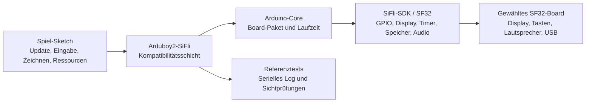

# Arduboy2-Portierung für SF32LB52 { #arduboy2-on-sifli }

## Was ist Arduboy2-SiFli? { #what-is-arduboy2-sifli }

[OpenSiFli/Arduboy2-SiFli](https://github.com/OpenSiFli/Arduboy2-SiFli) ist eine OpenSiFli-Portierung der [Arduboy2-Bibliothek](https://github.com/MLXXXp/Arduboy2) für die SiFli-Entwicklungsumgebung. Arduboy2 bietet ein anwendungsnahes Modell für ein kleines Spielgerät: eine Spielschleife mit Bildaktualisierung, einen Display-Puffer, Tasten, Sprites, Text und optionale Klangsteuerung. Die SiFli-Portierung eignet sich als Kompatibilitätsexperiment: Sie zeigt, wie viel von einem Spiel im Arduboy-Stil erhalten bleiben kann, wenn Board, Display, Eingabe, Audio und Build-Pfad auf SF32 umgestellt werden.

Das Repository ist eine Software-Referenz, keine fertige Spielkonsole und kein Hardware-Design für die Serienfertigung. README, Quellbaum, Beispiele, Issue-Verlauf und Lizenzdateien sind maßgeblich für das genaue Board-Ziel, den unterstützten API-Umfang, die Build-Anleitung und die Weitergabebedingungen. Diese Seite ordnet die technischen Entscheidungen rund um die Referenz; sie ersetzt nicht die ausführbaren Anweisungen des Repositorys.

## Warum diese SF32-Portierung? { #why-the-sifli-implementation }

Eine Anwendung im Arduboy-Stil ist ein kompakter Weg, mehrere Entscheidungen für Embedded-Produkte gleichzeitig zu erproben: eine vorhersagbare Render-Schleife, kleine monochrome oder niedrig aufgelöste Ressourcen, Tasteneingabe, Audio-Timing und ein eng begrenztes Speicherbudget. Die Portierung dieses Modells auf SF32 kann eine nützliche frühe Referenz für Handheld-Spiele, UI-Demonstratoren, Lerngeräte und andere Produkte liefern, deren Interaktion lokal und deterministisch ist.

Entscheidend ist nicht, dass jeder Arduboy-Sketch unverändert läuft. Die Portierung macht vielmehr die Integrationsgrenzen sichtbar:

- Das Spiel kann seine übergeordnete Update-, Eingabe-, Zeichen- und Ressourcenlogik behalten, solange es innerhalb der unterstützten Arduboy2-API bleibt.
- Die Portierung muss die in der Originalhardware impliziten Annahmen zu Display, Tasten, Audio, Timing und Speicher an die SF32-Umgebung anpassen.
- Jeder Sketch, der AVR-Register, Arduboy-spezifische Pins, Display-Transaktionen, Timer oder das EEPROM-Layout direkt steuert, braucht eine bewusste Anpassung und eigene Regressionsnachweise.

Dies sind technische Erwartungen, keine gemessenen Kompatibilitätsaussagen. Bestätigen Sie sie am aktuellen OpenSiFli-Repository und halten Sie das genaue Ergebnis für das gewählte Board und den gewählten Commit fest.

## Ergebnis, Umfang und Eintrittskriterien { #outcome-scope-and-entry-criteria }

Diese Seite definiert einen gestuften Weg von der OpenSiFli-Referenz zu einem reproduzierbaren SF32-Spiel oder einer interaktiven Demo. Sie behauptet **nicht**, dass die Portierung jede Arduboy2-Funktion, jedes Arduboy-Spiel, jedes SF32-Board oder serientaugliches Display- und Audio-Timing unterstützt. Sie begründet auch keine Lizenzrechte an Spielen, Schriften, Grafiken oder anderen Ressourcen, die aus Repositorys Dritter übernommen wurden.

**Ergebnis:** ein versionierter Arduboy2-SiFli-Build, der ein Beispiel aus dem Repository oder einen kleinen Testsketch ausführt, den gewählten Pfad für Display/Eingabe/Audio demonstriert und die Nachweise festhält, die nötig sind, um zu entscheiden, ob ein größeres Spiel oder eine Produktanpassung gerechtfertigt ist.

**Zielgruppe:** Firmware-, Hardware- und Produktingenieure, die Arduino-Werkzeuge nutzen, C/C++-Code prüfen, ein SF32-Board flashen, serielle Ausgaben lesen und einfache Messungen an Display, Eingabe und Leistungsaufnahme durchführen können.

Halten Sie vor dem Start Folgendes bereit:

- Ein SF32LB52-Entwicklungsboard mit der Variante `sf32lb52_devkit_lcd_sf32lb525uc6` von ArduinoCore-Zephyr sowie die unten beschriebenen externen Peripheriegeräte. Das README berichtet, dass Display, Tasten, externes EEPROM und Audiopfade auf SF32LB52-Hardware erprobt wurden; es dokumentiert einen RGB-LED-Pfad, nennt dafür aber kein Testergebnis. Das README legt keine physische Board-Revision fest und benennt das genaue OLED-Modul nicht.
- Eine funktionierende Arduino-Installation und das passende OpenSiFli-Board-Paket. Der Variantenname ist eine Basis für Software und Pin-Zuordnung, kein Beweis, dass jede SF32LB52-DevKit-LCD-Bestückung der externen Verdrahtung des Projekts entspricht; prüfen Sie den Schaltplan des physischen Boards, bevor Sie Peripherie anschließen.
- Den genauen Commit von Arduboy2-SiFli, die Version von Arduino-Core/-Paket, das Host-Betriebssystem und das Upload-Werkzeug.
- Eine USB-Datenverbindung und eine Möglichkeit, das serielle Log aufzuzeichnen sowie Display, Tasten und Audioausgabe zu beobachten.
- Die Erlaubnis, jedes in einer nachgelagerten Anpassung enthaltene Spiel, Bild, jede Schrift und jede Klangressource zu verwenden und weiterzugeben.

<em>Tabelle: Projektbasis und Nachweise</em>

| Bereich | Projektbasis | Nachweis vor der Anpassung |
|:-----|:-----------------|:---------------------------|
| Quelle | Ein erfasster Commit von OpenSiFli/Arduboy2-SiFli und die Revisionen seiner Abhängigkeiten. | Sauberer Checkout und reproduzierbares Build-Protokoll. |
| Board | SF32LB52 und ArduinoCore-Zephyr-Variante `sf32lb52_devkit_lcd_sf32lb525uc6` mit den unten aufgeführten externen Peripheriegeräten. | Erfassen Sie physische Board-Revision, Verdrahtung, Stromquelle und erfolgreichen Upload; das Repository legt weder eine Board-Revision noch ein OLED-Modell fest. |
| Toolchain | Arduino IDE oder CLI, OpenSiFli-Board-Paket und der dokumentierte Upload-Pfad. | Paketversionen, Board-Auswahl, Compiler-Ausgabe, Upload-Log und serielles Log. |
| Referenzverhalten | Ein Upstream-Beispiel oder minimaler Sketch, der die Portierung beansprucht. | Display-Aktualisierung, Eingabereaktion und unterstütztes Audioverhalten sind beobachtet und wiederholbar. |
| Produktänderung | Eine begrenzte Spiel- oder UI-Anpassung. | Der Referenztest besteht nach der Änderung weiterhin, Ressourcen- und Lizenznachweise bleiben erhalten. |

## Hardware- und Software-Spezifikationen { #hardware-and-software-specifications }

### Hardware-Spezifikation { #hardware-specification }

<em>Tabelle: Hardware-Spezifikation von Arduboy2-SiFli</em>

| Komponente | Erforderliche Spezifikation | Rolle | Status | Bezugsquelle | Hinweise zu Kompatibilität und Ersatz |
|:----------|:-----------------------|:-----|:-------|:----------------|:-------------------------------------|
| SF32LB52-Entwicklungsboard | ArduinoCore-Zephyr-Variante `sf32lb52_devkit_lcd_sf32lb525uc6`; das Repository legt keine physische Board-Revision fest | Führt die Portierung aus und stellt die zugeordneten MCU-Pins bereit | Erforderlich | [Quelle von Arduboy2-SiFli](https://github.com/OpenSiFli/Arduboy2-SiFli); [Variante in ArduinoCore-zephyr](https://github.com/OpenSiFli/ArduinoCore-zephyr) | Dies bezeichnet die Software-Board-Variante und Pin-Zuordnung, keine validierte physische Bestückung; vergleichen Sie vor der Verdrahtung die tatsächliche Board-Revision und den Schaltplan |
| Monochromes OLED | 128 × 64 Pixel, über SPI1 angeschlossen; das Repository nennt weder das genaue Modul noch den Controller | Zeigt den Spiel-Framebuffer an | Erforderlich | [Quelle von Arduboy2-SiFli](https://github.com/OpenSiFli/Arduboy2-SiFli) | Das OLED ist externe Peripherie; prüfen Sie vor der Verwendung Controller, Spannung, Steckverbinder, Ausrichtung und Timing anhand von Modul und Board |
| Sechs Spieltasten | Arduboy-kompatible Eingänge; low-aktiv mit Pull-ups, gemäß der Pin-Zuordnung im Repository | Liest Richtungs- und A/B-Tasten | Erforderlich | [Quelle von Arduboy2-SiFli](https://github.com/OpenSiFli/Arduboy2-SiFli) | Die Tasten sind extern; prüfen Sie die zugeordneten Arduino-IOs am physischen Board und halten Sie Verdrahtung und Entprellverhalten fest |
| Externes EEPROM | AT24C02 oder AT24C32 über I2C1 an Adresse `0x50` | Unterstützt Bibliotheksfunktionen mit EEPROM | Optional; nur für Funktionen mit EEPROM erforderlich | [Quelle von Arduboy2-SiFli](https://github.com/OpenSiFli/Arduboy2-SiFli) | Bestätigen Sie das gewählte Gerät, die Spannung, Pull-ups und Busverdrahtung; das Repository legt keine bestückte EEPROM-Variante fest |
| Audioausgang und RGB-Anzeige | Die vom Repository unterstützten Audio-Backends nutzen die zugeordneten Lautsprecherausgänge; eine externe RGB-LED mit gemeinsamer Kathode wird per Software-PWM angesteuert | Optionale Tonausgabe und Farbanzeige | Optional; für den getesteten Sketch auswählen | [Quelle von Arduboy2-SiFli](https://github.com/OpenSiFli/Arduboy2-SiFli) | Die Quelle legt keine vollständige Stückliste für Lautsprecher/LED fest; prüfen Sie externe Schaltung, Pin-Zuordnung, Strom und Audioverhalten |
| Host und USB-Datenverbindung | Von der gewählten Arduino-Toolchain unterstützter Host; datenfähiges Kabel und Zugriff auf das serielle Log | Build, Upload und Beobachtung der Referenz | Erforderlich | [ArduinoCore-zephyr](https://github.com/OpenSiFli/ArduinoCore-zephyr) | Halten Sie Host-Betriebssystem, Kabel/Port, Paketversionen und Wiederherstellungsmethode fest; ein reines Ladekabel genügt nicht |

### Software-Spezifikation { #software-specification }

<em>Tabelle: Software-Spezifikation von Arduboy2-SiFli</em>

| Paket oder Dienst | Erforderliche Version oder Revision | Rolle | Status | Bezugsquelle | Hinweise zu Kompatibilität und Aktualisierung |
|:-------------------|:-----------------------------|:-----|:-------|:----------------|:-------------------------------|
| OpenSiFli/Arduboy2-SiFli | Genau einen Commit festlegen und erfassen; dieser Artikel friert keine Revision ein | SF32-Kompatibilitätsschicht und Beispiele | Erforderlich | [Repository](https://github.com/OpenSiFli/Arduboy2-SiFli) | Prüfen Sie Board-Target, Abhängigkeiten und unterstützte API beim gewählten Commit erneut |
| OpenSiFli/ArduinoCore-zephyr und Board-Paket | Der genaue kompatible Commit bzw. die Paketversion muss aus der Portierung ermittelt und erfasst werden | Arduino-Laufzeit, Board-Definition, Compiler und Upload-Integration | Erforderlich | [Repository](https://github.com/OpenSiFli/ArduinoCore-zephyr) | Ersetzen Sie den Core oder das Board-Paket nicht durch eine neuere Version oder ein anderes Paket, ohne einen sauberen Build und eine Peripherie-Regression |
| Testsketch und Spielressourcen | Ein Beispiel aus dem Repository oder ein separat lizenzierter Testsketch; Ressourcen-Revisionen und Lizenzen erfassen | Beansprucht die gewählte API und den Produktpfad | Eines wählen | [Beispiele von Arduboy2-SiFli](https://github.com/OpenSiFli/Arduboy2-SiFli) | Der Artikel gewährt keine Rechte zur Weitergabe von Spielen, Schriften, Bildern oder Klängen Dritter |

## Unterstützte Referenzkonfiguration auswählen { #choose-a-supported-baseline }

Beginnen Sie mit der Kombination aus Board und Software, die das OpenSiFli-Repository nennt, statt ein Board nach Ähnlichkeit aus dem Produktkatalog zu wählen. Board-Paket, Display-Verdrahtung, Eingabezuordnung, Upload-Methode und Annahmen der Bibliothek gehören zur Basis.

Das Repository Arduboy2-SiFli liefert die Pin-Zuordnung des Boards nicht als separate Datei: Sein README veröffentlicht die [SiFli-I/O-Zuordnungstabelle](https://github.com/OpenSiFli/Arduboy2-SiFli#sifli-io-mapping). Die logischen Pin-Definitionen der Bibliothek stehen in [`pins_sifli.h`](https://github.com/OpenSiFli/Arduboy2-SiFli/blob/master/src/platforms/sifli/pins_sifli.h), das boardspezifische Routing im [Devicetree-Overlay](https://github.com/OpenSiFli/ArduinoCore-zephyr/blob/main/variants/sf32lb52_devkit_lcd_sf32lb525uc6/sf32lb52_devkit_lcd_sf32lb525uc6.overlay) von ArduinoCore-Zephyr. Diese Quellen definieren eine Software-Basis, keine validierte physische Bestückung; prüfen Sie vor der Verdrahtung die tatsächliche Board-Revision und den Schaltplan.

<em>Tabelle: Auswahl der Basis</em>

| Element der Basis | Auswählen aus | Nicht annehmen |
|:-----------------|:---------------|:--------------|
| Ziel-Board | Der im README von Arduboy2-SiFli genannten ArduinoCore-Zephyr-Variante `sf32lb52_devkit_lcd_sf32lb525uc6`, danach dem Schaltplan des physischen Boards. | Dass die Software-Variante beweist, dass jede physische Board-Revision oder Peripherie-Bestückung kompatibel ist. |
| Arduino-Core | Dem für das Target dokumentierten OpenSiFli-Paket und dessen Revision. | Dass das neueste Paket mit der vom Repository verwendeten Revision austauschbar ist. |
| Display und Eingabe | Den Pin-/Konfigurationsdefinitionen des Repositorys und dem Schaltplan des physischen Boards. | Dass Display-Geometrie, Tastenpolarität oder Pin-Namen des ursprünglichen Arduboy mit dem SF32-Board übereinstimmen. |
| Audio | Dem vom Repository unterstützten Ausgabepfad und jeder boardspezifischen Konfiguration. | Dass eine Ton-API beweist, dass Lautsprecher-Timing, Lautstärke und Leistungsverhalten produktreif sind. |
| Upload und Wiederherstellung | Dem dokumentierten Ablauf mit Arduino oder `sftool` für das gewählte Board. | Dass ein erfolgreicher Upload auf einem Host einen wiederherstellbaren Update-Pfad im Feld beweist. |

Das Repository benennt eine Software-Board-Variante und eine Pin-Zuordnung der Peripherie und berichtet, dass Display, Tasten, externes EEPROM und Audiopfade auf SF32LB52-Hardware erprobt wurden. Es dokumentiert einen externen RGB-LED-Pfad, gibt aber nicht an, dass dieser getestet wurde. Das Repository benennt weder die physische Board-Revision noch das genaue OLED-Modul/den Controller noch eine vollständige Zubehör-Bestückung. Gleichen Sie die Pin-Zuordnung der Variante vor der Verdrahtung oder vor der Behauptung einer reproduzierbaren Hardware-Basis mit dem Schaltplan des tatsächlichen Boards ab und halten Sie die verwendeten Teile und Revisionen fest. Schließen Sie verbleibende Lücken nicht mit Pin-Zuordnungen oder Adressen aus einem anderen SF32-Projekt.

## Projektphasen und Entscheidungspunkte { #delivery-map }

Verwenden Sie die Phasen als Kontrollpunkte und nicht als Funktions-Checkliste.

<em>Tabelle: Projektphasen und Entscheidungspunkte</em>

| Phase | Entscheidungsfrage | Erforderliches Ergebnis |
|:------|:---------------------|:----------------|
| 1. Unveränderte Referenz | Lässt sich die dokumentierte Portierung auf der gewählten Basis bauen, hochladen und ausführen? | Ein funktionierender Sketch, Commit-/Paketprotokoll, Upload-Log und beobachtetes Verhalten. |
| 2. Validierung der Peripherie | Verhalten sich Display, Eingabe, Audio, Reset und Timing auf dem realen Board vorhersagbar? | Ein Peripherie-Testprotokoll mit Fehlern und Wiederherstellungsverhalten. |
| 3. Reproduzierbare Quellbasis | Kann ein anderer Ingenieur dasselbe Image aus einem sauberen Checkout neu bauen? | Ein Artefakt aus sauberem Build, Umgebungsprotokoll und Wiederholungsergebnis. |
| 4. Kontrollierte Spielanpassung | Lässt sich eine begrenzte Spiel- oder UI-Änderung einführen, ohne die Portierung zu beeinträchtigen? | Eine geprüfte Änderung, Ressourcen-/Lizenznachweis und Regressionsergebnis. |
| 5. Prüfung der Produktreife | Reicht die Referenz aus, um eigene Hardware oder eine größere Softwareinvestition zu rechtfertigen? | Ein Risikoregister mit Verantwortlichen, Nachweisen, Gegenmaßnahmen und einer Entscheidung: fortfahren/zurückstellen/stoppen. |

## Systemarchitektur und Abhängigkeiten { #system-architecture-and-dependencies }

<em>Abbildung: Anwendungspfad von Arduboy2-SiFli</em>

Dies ist ein Entscheidungsmodell und keine Behauptung, dass das Repository genau diese internen Modulnamen verwendet. Bestätigen Sie die tatsächlichen Quellgrenzen, bevor Sie die Portierung ändern. Die wichtigen Produktpfade sind:

- **Bildaktualisierung und Timing:** Die Spielschleife muss Bilder in einem wiederholbaren Takt aktualisieren und rendern. Zeitkritisches Audio- oder Eingabeverhalten muss auf dem Ziel-Board gemessen werden.
- **Display:** Die Kompatibilitätsschicht muss den Puffer und die Geometrie des Spiels auf den gewählten Display-Controller, das Pixelformat, die Ausrichtung und den Aktualisierungspfad abbilden.
- **Eingabe:** Tastennamen, Polarität, Entprellung, gleichzeitiges Drücken sowie Aufwach-/Reset-Verhalten müssen anhand der Board-Verdrahtung geprüft werden.
- **Audio:** Tonerzeugung, Timer-Zuständigkeit, Lautsprecheranschluss, Lautstärke und Stummschaltung gelten bis zur Verifikation als boardspezifisch.
- **Ressourcen und Speicher:** Schriften, Sprites, Klangdaten, Flash-Layout und RAM-Nutzung müssen gemessen werden, nachdem das gewählte Spiel gelinkt wurde.
- **Wiederherstellung:** Bewahren Sie einen bekannten Upload- und Wiederherstellungsweg, bevor Sie mit Timing-, Speicher- oder Low-Power-Änderungen experimentieren.

Die wesentlichen Fehlerdomänen sind Anwendungs-/API-Kompatibilität, Display-Konfiguration, Eingabeverdrahtung, Audio-/Timer-Verhalten, Speicher- und Ressourcenplatzierung sowie Upload/Wiederherstellung. Ein Fehler in einer Domäne sollte nicht einfach als „die Portierung funktioniert nicht“ gemeldet werden.

## Phase 1 — Die unveränderte Referenz herstellen { #stage-1-establish-the-untouched-reference }

**Ziel:** Nachweisen, dass die dokumentierte Basis des Repositorys real ist, bevor Bibliothek oder Spiel geändert werden.

1. Lesen Sie die Anweisungen des Repositorys, erfassen Sie den Standard-Branch bzw. das Release und prüfen Sie Beispiele, Board-Konfiguration, Abhängigkeiten und Lizenzdateien.
2. Installieren Sie genau den Arduino-Core bzw. das Paket und die Werkzeuge, die das Repository verlangt. Erfassen Sie Host-Betriebssystem und Werkzeugversionen.
3. Bauen Sie das kleinste dokumentierte Beispiel oder den Testsketch und laden Sie es hoch.
4. Zeichnen Sie die serielle Ausgabe auf und notieren Sie, was auf dem Display erscheint, welche Tasten reagieren und ob das Beispiel Audio nutzt.

**Aufzubewahrende Nachweise:** Commit des Repositorys, Abhängigkeits-/Paketversionen, Board-Revision, Verdrahtung oder Schaltplanreferenz, Build-Ausgabe, Upload-Log, serielles Log und ein kurzes Funktionsprotokoll.

**Abnahmekriterium für Kontrollpunkt 1:** Die unveränderte Referenz lässt sich auf dem gewählten Board bauen und hochladen; ihr dokumentiertes Verhalten ist nach einem Reset oder Aus- und Einschalten wiederholbar.

## Phase 2 — Grenzen von Peripherie und Timing validieren { #stage-2-validate-peripheral-and-timing-boundaries }

**Ziel:** Eine erfolgreiche Kompilierung von einer brauchbaren Basis für ein Spielgerät trennen.

1. Prüfen Sie das Leeren des Displays, die Aktualisierung des gesamten Bildes, die Darstellung von Sprites oder Bitmaps, die Textausgabe sowie alle vom Beispiel vorausgesetzten Geometrie- und Ausrichtungseinstellungen.
2. Prüfen Sie alle vom Projekt verwendeten Eingaben: Loslassen, gleichzeitiges und schnelles Drücken sowie gegebenenfalls das Verhalten nach Reset oder beim Aufwachen.
3. Prüfen Sie bei enthaltenem Audio Tonstart/-stopp, Timer-Interaktion, Stummschaltung und den Einfluss von Display- und Eingabeaktivität auf den Tonpfad.
4. Unterbrechen Sie den normalen Ablauf durch Reset, Trennen/Wiederverbinden und eine ungültige oder unvollständige Eingabefolge. Halten Sie fest, ob das Board in einen nutzbaren Upload- und Ausführungszustand zurückkehrt.

**Aufzubewahrende Nachweise:** Sicht- oder aufgezeichnete Display-Ergebnisse, Eingabematrix, Timing-Beobachtungen, Audio-Beobachtungen, Reset-/Wiederherstellungs-Log sowie gemessener Strom oder gemessene Latenz, die die Produktentscheidung beeinflussen.

**Abnahmekriterium für Kontrollpunkt 2:** Der gewählte Peripheriepfad ist so gut verstanden, dass sich Anwendungsfehler von Problemen der Board-Konfiguration, des Timings oder der Versorgung unterscheiden lassen.

## Phase 3 — Eine reproduzierbare Quellbasis aufbauen { #stage-3-build-a-reproducible-source-baseline }

**Ziel:** Die Portierung reproduzierbar machen, statt von einem Entwicklungsrechner oder einem gelieferten Binary abzuhängen.

1. Beginnen Sie mit einem sauberen Checkout und initialisieren Sie jede vom Repository benötigte Abhängigkeit.
2. Erfassen Sie Board-Paket, Version von Arduino IDE/CLI, Compiler-/Werkzeugversionen, Konfigurationsdateien und alle erzeugten Ressourcen.
3. Bauen Sie aus einem sauberen Verzeichnis, sichern Sie das entstandene Image sowie Map-/Größeninformationen, soweit verfügbar, und erfassen Sie den Upload-Befehl bzw. die Werkzeugausgabe.
4. Wiederholen Sie dies auf einem zweiten Rechner oder nach dem Entfernen des Build-Verzeichnisses.

**Aufzubewahrende Nachweise:** Quellrevision, Revisionen der Abhängigkeiten, Host-/Werkzeug-Manifest, Build-Log, Binary oder anderes Artefakt, Größenbericht, Upload-Log und serielles Log.

**Abnahmekriterium für Kontrollpunkt 3:** Ein sauberer Checkout erzeugt ohne undokumentierte lokale Dateien oder manuelle Änderungen ein Image, das die Peripherieprüfungen aus Phase 2 besteht.

## Phase 4 — Ein Spiel gezielt anpassen { #stage-4-adapt-one-game-deliberately }

**Ziel:** Die Kompatibilitätsgrenze mit einer kontrollierten Produktänderung nachweisen.

Beginnen Sie mit einem kleinen Sketch oder Spiel, bei dem die Anforderungen an Display, Eingabe, Audio und Ressourcen klar erkennbar sind. Halten Sie das unveränderte Referenz-Image bereit und ändern Sie jeweils nur eine Verhaltensklasse:

<em>Tabelle: Reihenfolge der kontrollierten Anpassung</em>

| Änderungsklasse | Beginnen mit | Erforderliche Regression |
|:-------------|:-----------|:--------------------|
| Identität und UI | Titelbildschirm, Schrift, Sprite, Palette oder Bildschirmlayout. | Build, Upload, Bildaktualisierung, Eingabe und Integrität der Ressourcen prüfen. |
| Spiellogik | Eine begrenzte Regel, ein Level oder ein Zustandsübergang. | Wiederholbare Eingabefolge, Reset, ggf. Persistenz von Punktestand/Zustand und Bildtakt prüfen. |
| Audio | Ein Ton oder ein kurzer Effekt über den unterstützten Pfad. | Start/Stopp, Stummschaltung, Timer-Interaktion und Verhalten unter Display-/Eingabelast. |
| Speicher | Eine kleine Änderung beim Speichern oder Laden von Ressourcen. | Größenbericht, Verhalten bei Stromausfall, Behandlung von Beschädigungen und saubere Wiederherstellung. |
| Board-Anpassung | Eine bewusste Änderung der Zuordnung von Display, Taste oder Lautsprecher. | Schaltplan-/Pin-Nachweis, vollständige Peripherie-Regression und Rückkehr zum Referenz-Image. |

Übernehmen Sie keinen AVR-Registerzugriff, keine ursprünglichen Arduboy-Pin-Annahmen und keine Speicheradressen in das SF32-Projekt, ohne eine durch Quellen gestützte Designentscheidung. Bewahren Sie Lizenzen von Spielen und Ressourcen Dritter neben dem angepassten Quellcode auf und entfernen Sie alles, dessen Weitergabebedingungen nicht eindeutig sind.

**Aufzubewahrende Nachweise:** Geprüfter Diff, Herkunft der Ressourcen, Vorher-/Nachher-Bild, Build- und Upload-Logs, Regressionsergebnisse und ein Rollback-Image.

**Abnahmekriterium für Kontrollpunkt 4:** Das angepasste Spiel besteht die Referenz-Peripherieprüfungen; seine Grenzen bei Speicher, Timing, Wiederherstellung und Lizenzierung sind dokumentiert.

## Phase 5 — Prüfung der Produktreife { #stage-5-product-readiness-review }

Gehen Sie von einer Portierungsdemonstration erst dann zu eigener Hardware oder einem Feldtest über, wenn das Team Folgendes beantworten kann:

- Welches genaue SF32-Board, Display, welche Tasten, welcher Lautsprecher und welche Stromquelle werden unterstützt, und was sind noch Annahmen?
- Welche Bildrate, Eingabelatenz, welches Audioverhalten, welche Startzeit und welches Stromprofil wurden auf der vorgesehenen Produktbasis gemessen?
- Wie viel Flash und RAM verbrauchen Spiel, Ressourcen, Schriften und Laufzeit, einschließlich Inhalten im ungünstigsten Fall?
- Was geschieht nach Reset, Brownout, Stromausfall während des Speicherns, beschädigten Ressourcen, fehlgeschlagenem Upload oder unvollständigem Update?
- Welche Teile der Portierung werden vom Produktteam, von OpenSiFli, SiFli oder der ursprünglichen Arduboy2-Community gepflegt?
- Sind alle Lizenzen für Spiele, Schriften, Bilder, Klänge und Bibliotheken mit dem vorgesehenen Vertriebsmodell vereinbar?

**Abnahmekriterium für Kontrollpunkt 5:** Für verbleibende Risiken gibt es benannte Verantwortliche und Nachweise; für jeden Punkt ist eine Gegenmaßnahme, eine ausdrückliche Zurückstellung oder eine Stopp-Entscheidung festgehalten.

## Übergabe an das Produktdesign { #handoff-to-product-design }

Übernehmen Sie das gewählte SF32-Gerät, die Architektur von Display und Eingabe, den Plan für Audio/Timer, Flash- und Ressourcen-Layout, Leistungsmessungen, Wiederherstellungsmethode und die Annahmen zum Produktionstest in den Bereich [Hardware](../hardware/index.md). Nutzen Sie den [SF32-Produktwähler](../sf32-products/product-selector.md), wenn Anforderungen des Spiels an Display, Speicher, Gehäuse, Energiebedarf oder Konnektivität die Auswahlliste der Bauteile verändern. Für die Software-Basis beginnen Sie mit [Erste Schritte mit Arduino](../getting-started/arduino/getting-started-arduino.md) und fahren mit der [Übersicht zur Arduino-Plattform](../develop/platforms/arduino/overview.md) fort.

Die Referenz hat ihren Zweck für die Produktentwicklung erfüllt, wenn ein anderer Ingenieur die Portierung neu bauen, die Peripherieergebnisse reproduzieren, jede boardspezifische Anpassung erklären und die Nachweise prüfen kann, bevor ein eigenes Board oder eine erweiterte Spielebibliothek freigegeben wird.

## Maßgebliche Quellen { #authoritative-sources }

- [OpenSiFli/Arduboy2-SiFli](https://github.com/OpenSiFli/Arduboy2-SiFli)
- [MLXXXp/Arduboy2](https://github.com/MLXXXp/Arduboy2)
- [OpenSiFli/ArduinoCore-zephyr](https://github.com/OpenSiFli/ArduinoCore-zephyr)
- [Erste Schritte mit Arduino auf SF32](../getting-started/arduino/getting-started-arduino.md)
- [Übersicht zur Arduino-Plattform](../develop/platforms/arduino/overview.md)
- [SF32-Produktwähler](../sf32-products/product-selector.md)
